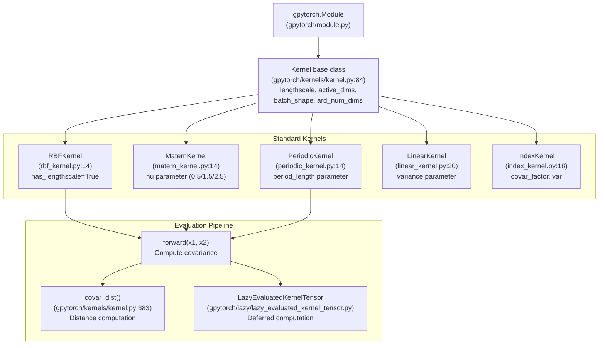
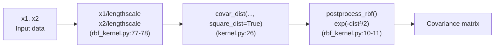
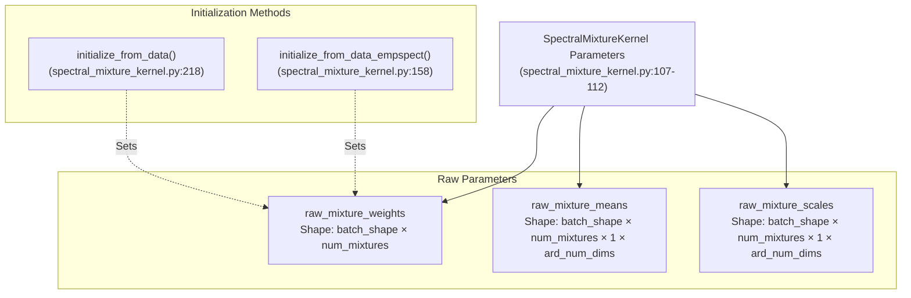

<!-- source: DeepWiki mcp.deepwiki.com · repo cornellius-gp/gpytorch · page 4.1 Standard Kernels · fetched 2026-10-21 -->

# Standard Kernels

Relevant source files

The following files were used as context for generating this wiki page:

- [examples/01_Exact_GPs/GP_Regression_on_Classification_Labels.ipynb](examples/01_Exact_GPs/GP_Regression_on_Classification_Labels.ipynb)
- [examples/01_Exact_GPs/Spectral_Delta_GP_Regression.ipynb](examples/01_Exact_GPs/Spectral_Delta_GP_Regression.ipynb)
- [examples/01_Exact_GPs/index.rst](examples/01_Exact_GPs/index.rst)
- [gpytorch/kernels/arc_kernel.py](gpytorch/kernels/arc_kernel.py)
- [gpytorch/kernels/cosine_kernel.py](gpytorch/kernels/cosine_kernel.py)
- [gpytorch/kernels/cylindrical_kernel.py](gpytorch/kernels/cylindrical_kernel.py)
- [gpytorch/kernels/hamming_kernel.py](gpytorch/kernels/hamming_kernel.py)
- [gpytorch/kernels/index_kernel.py](gpytorch/kernels/index_kernel.py)
- [gpytorch/kernels/kernel.py](gpytorch/kernels/kernel.py)
- [gpytorch/kernels/linear_kernel.py](gpytorch/kernels/linear_kernel.py)
- [gpytorch/kernels/matern_kernel.py](gpytorch/kernels/matern_kernel.py)
- [gpytorch/kernels/periodic_kernel.py](gpytorch/kernels/periodic_kernel.py)
- [gpytorch/kernels/piecewise_polynomial_kernel.py](gpytorch/kernels/piecewise_polynomial_kernel.py)
- [gpytorch/kernels/rbf_kernel.py](gpytorch/kernels/rbf_kernel.py)
- [gpytorch/kernels/rbf_kernel_grad.py](gpytorch/kernels/rbf_kernel_grad.py)
- [gpytorch/kernels/rq_kernel.py](gpytorch/kernels/rq_kernel.py)
- [gpytorch/kernels/scale_kernel.py](gpytorch/kernels/scale_kernel.py)
- [gpytorch/kernels/spectral_delta_kernel.py](gpytorch/kernels/spectral_delta_kernel.py)
- [gpytorch/kernels/spectral_mixture_kernel.py](gpytorch/kernels/spectral_mixture_kernel.py)
- [test/kernels/test_arc_kernel.py](test/kernels/test_arc_kernel.py)
- [test/kernels/test_cosine_kernel.py](test/kernels/test_cosine_kernel.py)
- [test/kernels/test_cylindrical_kernel.py](test/kernels/test_cylindrical_kernel.py)
- [test/kernels/test_hamming_kernel.py](test/kernels/test_hamming_kernel.py)
- [test/kernels/test_linear_kernel.py](test/kernels/test_linear_kernel.py)
- [test/kernels/test_matern_kernel.py](test/kernels/test_matern_kernel.py)
- [test/kernels/test_periodic_kernel.py](test/kernels/test_periodic_kernel.py)
- [test/kernels/test_piecewise_polynomial_kernel.py](test/kernels/test_piecewise_polynomial_kernel.py)
- [test/kernels/test_polynomial_kernel.py](test/kernels/test_polynomial_kernel.py)
- [test/kernels/test_rbf_kernel.py](test/kernels/test_rbf_kernel.py)
- [test/kernels/test_rq_kernel.py](test/kernels/test_rq_kernel.py)
- [test/kernels/test_scale_kernel.py](test/kernels/test_scale_kernel.py)
- [test/kernels/test_spectral_delta_kernel.py](test/kernels/test_spectral_delta_kernel.py)
- [test/kernels/test_spectral_mixture_kernel.py](test/kernels/test_spectral_mixture_kernel.py)

This page documents the standard kernel implementations in GPyTorch that define covariance functions between input points. These kernels are the fundamental building blocks for constructing Gaussian Process models.

For information about combining kernels using addition and multiplication, see [Compositional Kernels](#4.2). For scalability-focused kernel implementations like KISS-GP and inducing point methods, see [Scalable Kernels](#4.3).

## Purpose and Scope

Standard kernels implement specific covariance functions that encode assumptions about function smoothness, periodicity, and correlation structure. All standard kernels inherit from the `Kernel` base class defined in [gpytorch/kernels/kernel.py:84-597]() and support:

- **Lengthscale parameters** for controlling input distance scaling.
- **Automatic Relevance Determination (ARD)** for dimension-specific lengthscales.
- **Batch mode** for processing multiple datasets simultaneously.
- **Active dimensions** for computing covariance on subsets of input features.
- **Priors and constraints** on kernel parameters via the `Module` system.

Sources: [gpytorch/kernels/kernel.py:84-161](), [gpytorch/kernels/kernel.py:165-231]()

## Kernel Type Overview

The following table summarizes the standard kernels available in GPyTorch:

| Kernel | Class Name | Primary Use Case | Key Parameters | Stationary |
|--------|------------|------------------|----------------|------------|
| RBF (Squared Exponential) | `RBFKernel` | Smooth, infinitely differentiable functions | `lengthscale` | Yes |
| Matérn | `MaternKernel` | Functions with controlled smoothness | `lengthscale`, `nu` (0.5, 1.5, 2.5) | Yes |
| Periodic | `PeriodicKernel` | Periodic/seasonal patterns | `lengthscale`, `period_length` | Yes |
| Cosine | `CosineKernel` | Simple periodic structure | `period_length` | Yes |
| Spectral Mixture | `SpectralMixtureKernel` | Complex multi-scale patterns | `mixture_scales`, `mixture_means`, `mixture_weights` | Yes |
| Index | `IndexKernel` | Discrete categorical inputs | `covar_factor`, `var` | N/A |
| Linear | `LinearKernel` | Linear relationships, high-dimensional features | `variance` | No |
| Arc | `ArcKernel` | Non-stationary modeling via cylindrical embedding | `angle`, `radius` | No |

Sources: [gpytorch/kernels/rbf_kernel.py:14-85](), [gpytorch/kernels/matern_kernel.py:14-110](), [gpytorch/kernels/periodic_kernel.py:14-145](), [gpytorch/kernels/cosine_kernel.py:14-105](), [gpytorch/kernels/spectral_mixture_kernel.py:17-354](), [gpytorch/kernels/index_kernel.py:18-112](), [gpytorch/kernels/linear_kernel.py:20-119](), [gpytorch/kernels/arc_kernel.py:14-200]()

## Kernel Hierarchy and Parameter Management

Sources: [gpytorch/kernels/kernel.py:84-257](), [gpytorch/kernels/kernel.py:383-435]()

## RBF Kernel (Squared Exponential)

The `RBFKernel` implements the most commonly used kernel in Gaussian Process regression. It produces infinitely differentiable sample functions and is defined as:

$$k_{\text{RBF}}(\mathbf{x_1}, \mathbf{x_2}) = \exp \left( -\frac{1}{2} (\mathbf{x_1} - \mathbf{x_2})^\top \Theta^{-2} (\mathbf{x_1} - \mathbf{x_2}) \right)$$

where $\Theta$ is a diagonal lengthscale matrix [gpytorch/kernels/rbf_kernel.py:16-27]().

### Key Implementation Details

The RBF kernel uses an optimized `RBFCovariance` autograd function for efficient gradient computation:

The implementation includes performance optimizations:
- **Efficient distance computation**: Uses `sq_dist()` helper from [gpytorch/kernels/kernel.py:26-50]().
- **Custom autograd function**: `RBFCovariance.apply()` for specialized backward pass [gpytorch/kernels/rbf_kernel.py:80-85]().
- **Conditional optimization**: Falls back to standard computation when gradients are required, ARD is enabled, or in `trace_mode` [gpytorch/kernels/rbf_kernel.py:69-79]().

Sources: [gpytorch/kernels/rbf_kernel.py:14-85](), [gpytorch/kernels/kernel.py:26-61]()

## Matérn Kernel

The `MaternKernel` provides control over function smoothness via the parameter $\nu \in \{0.5, 1.5, 2.5\}$ [gpytorch/kernels/matern_kernel.py:42-43]():

$$k_{\text{Matern}}(\mathbf{x_1}, \mathbf{x_2}) = \frac{2^{1 - \nu}}{\Gamma(\nu)} \left( \sqrt{2 \nu} d \right)^{\nu} K_\nu \left( \sqrt{2 \nu} d \right)$$

where $d$ is the scaled distance [gpytorch/kernels/matern_kernel.py:21-32]().

### Smoothness Control

| $\nu$ Value | Differentiability | Use Case |
|-------------|-------------------|----------|
| 0.5 | Non-differentiable (equivalent to exponential kernel) | Rough, non-smooth functions |
| 1.5 | Once differentiable | Moderately smooth functions |
| 2.5 | Twice differentiable | Smooth functions (common default) |

The three $\nu$ cases are handled explicitly in the `forward` method [gpytorch/kernels/matern_kernel.py:101-107]():
- **$\nu = 0.5$**: `constant_component = 1`
- **$\nu = 1.5$**: `constant_component = (math.sqrt(3) * distance).add(1)`
- **$\nu = 2.5$**: `constant_component = (math.sqrt(5) * distance).add(1).add(5.0 / 3.0 * distance**2)`

Sources: [gpytorch/kernels/matern_kernel.py:14-110]()

## Periodic Kernel

The `PeriodicKernel` encodes periodic patterns with specified period length [gpytorch/kernels/periodic_kernel.py:15-25]():

$$k_{\text{Periodic}}(\mathbf{x}, \mathbf{x'}) = \exp \left( -2 \sum_i \frac{\sin ^2 \left( \frac{\pi}{p} ({x_{i}} - {x_{i}'} ) \right)}{\lambda} \right)$$

where $p$ is the `period_length` and $\lambda$ is the `lengthscale`.

### Implementation Details

The periodic kernel performs dimension-wise computation:
1. **Scale inputs by period**: `x1_ = x1.div(self.period_length / math.pi)` [gpytorch/kernels/periodic_kernel.py:131-132]().
2. **Compute differences**: Uses `covar_dist` with `last_dim_is_batch=True` to calculate per-dimension differences [gpytorch/kernels/periodic_kernel.py:134]().
3. **Apply periodic transformation**: `exp_term = diff.sin().pow(2.0).div(lengthscale).mul(-2.0)` [gpytorch/kernels/periodic_kernel.py:140]().

Sources: [gpytorch/kernels/periodic_kernel.py:14-145]()

## Linear Kernel

The `LinearKernel` computes the dot product between inputs, scaled by a variance parameter $v$ [gpytorch/kernels/linear_kernel.py:21-34]():

$$k_\text{Linear}(\mathbf{x_1}, \mathbf{x_2}) = v\mathbf{x_1}^\top \mathbf{x_2}$$

### Efficiency and Strategy

To handle high-dimensional inputs ($D < N$) efficiently, the kernel uses specialized `LinearOperator` types [gpytorch/kernels/linear_kernel.py:36-47]():
- **Training**: Uses `RootLinearOperator` or `LowRankRootLinearOperator` when $x_1 = x_2$ [gpytorch/kernels/linear_kernel.py:97-101]().
- **Prediction**: Implements `prediction_strategy` to select `LinearPredictionStrategy` when features are fewer than data points [gpytorch/kernels/linear_kernel.py:115-119]().

Sources: [gpytorch/kernels/linear_kernel.py:20-119](), [test/kernels/test_linear_kernel.py:100-111]()

## Spectral Mixture Kernel

The `SpectralMixtureKernel` learns multi-scale patterns by representing the spectral density as a mixture of Gaussians [gpytorch/kernels/spectral_mixture_kernel.py:18-22]().

### Parameter Structure

**Note**: The `ard_num_dims` **must equal** the dimensionality of the data, and it should not be wrapped in a `ScaleKernel` [gpytorch/kernels/spectral_mixture_kernel.py:24-28]().

Sources: [gpytorch/kernels/spectral_mixture_kernel.py:17-354]()

## Index Kernel

The `IndexKernel` defines a lookup table covariance for discrete indices [gpytorch/kernels/index_kernel.py:19-29]():

$$k(i, j) = \left(BB^\top + \text{diag}(\mathbf v) \right)_{i, j}$$

### Parameters and Evaluation
- **`covar_factor`**: The low-rank matrix $B$ [gpytorch/kernels/index_kernel.py:47-48]().
- **`var`**: The diagonal component $\mathbf v$ [gpytorch/kernels/index_kernel.py:81-82]().
- **Evaluation**: Uses `InterpolatedLinearOperator` to index into the pre-computed task covariance matrix [gpytorch/kernels/index_kernel.py:107-111]().

Sources: [gpytorch/kernels/index_kernel.py:18-112]()

## Arc Kernel

The `ArcKernel` applies a cylindrical embedding to inputs before passing them to a base kernel (defaulting to `MaternKernel`) [gpytorch/kernels/arc_kernel.py:15-59]().

### Embedding Logic
The `embedding` method transforms inputs $x$ using `radius` and `angle` parameters [gpytorch/kernels/arc_kernel.py:187-195]():
- $x_s = \omega \sin(\pi \rho \frac{x}{\lambda})$
- $x_c = \omega \cos(\pi \rho \frac{x}{\lambda})$

This is typically used within a `ProductStructureKernel` to handle multiple dimensions [gpytorch/kernels/arc_kernel.py:46-53]().

Sources: [gpytorch/kernels/arc_kernel.py:14-200]()

## Scale Kernel (Compositional Wrapper)

While not a "base" kernel, the `ScaleKernel` is the standard way to add an `outputscale` parameter to stationary kernels like `RBFKernel` or `MaternKernel` [gpytorch/kernels/scale_kernel.py:13-32]():

$$K_{\text{scaled}} = \theta_\text{scale} K_{\text{orig}}$$

It delegates stationarity checks to the `base_kernel` [gpytorch/kernels/scale_kernel.py:57-62]() and multiplies the base output by the learned `outputscale` [gpytorch/kernels/scale_kernel.py:108-118]().

Sources: [gpytorch/kernels/scale_kernel.py:13-124]()

---

