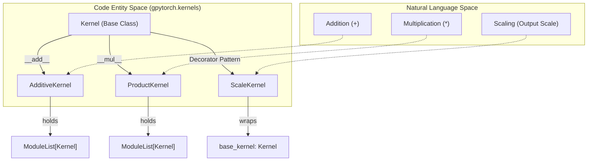
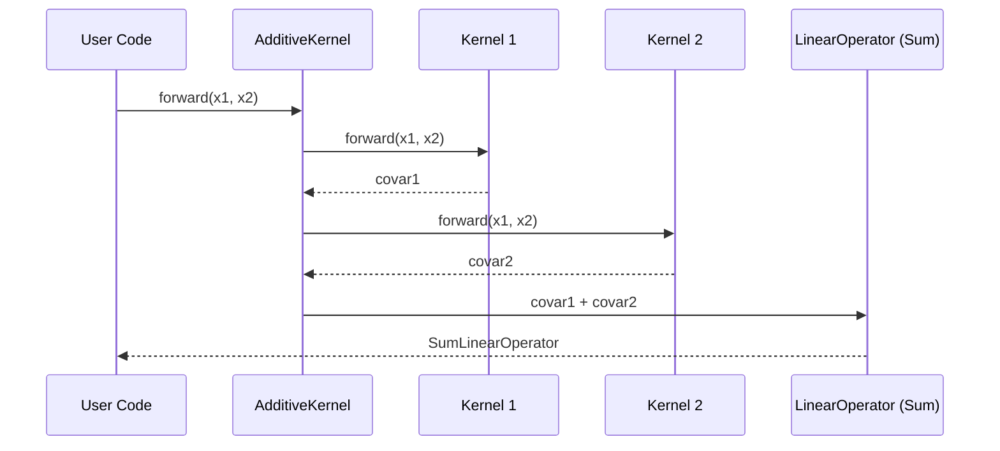
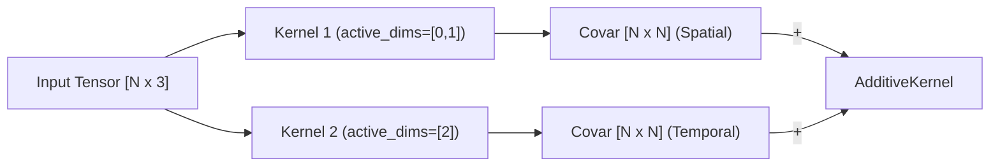

<!-- source: DeepWiki mcp.deepwiki.com · repo cornellius-gp/gpytorch · page 4.2 Compositional Kernels · fetched 2026-10-21 -->

# Compositional Kernels

Relevant source files

The following files were used as context for generating this wiki page:

- [docs/source/kernels.rst](docs/source/kernels.rst)
- [gpytorch/kernels/__init__.py](gpytorch/kernels/__init__.py)
- [gpytorch/kernels/cosine_kernel.py](gpytorch/kernels/cosine_kernel.py)
- [gpytorch/kernels/gibbs_kernel.py](gpytorch/kernels/gibbs_kernel.py)
- [gpytorch/kernels/index_kernel.py](gpytorch/kernels/index_kernel.py)
- [gpytorch/kernels/kernel.py](gpytorch/kernels/kernel.py)
- [gpytorch/kernels/matern_kernel.py](gpytorch/kernels/matern_kernel.py)
- [gpytorch/kernels/newton_girard_additive_kernel.py](gpytorch/kernels/newton_girard_additive_kernel.py)
- [gpytorch/kernels/periodic_kernel.py](gpytorch/kernels/periodic_kernel.py)
- [gpytorch/kernels/rbf_kernel.py](gpytorch/kernels/rbf_kernel.py)
- [gpytorch/kernels/rbf_kernel_grad.py](gpytorch/kernels/rbf_kernel_grad.py)
- [gpytorch/kernels/scale_kernel.py](gpytorch/kernels/scale_kernel.py)
- [gpytorch/kernels/spectral_mixture_kernel.py](gpytorch/kernels/spectral_mixture_kernel.py)
- [gpytorch/kernels/spherical_linear_kernel.py](gpytorch/kernels/spherical_linear_kernel.py)
- [test/kernels/test_additive_and_product_kernels.py](test/kernels/test_additive_and_product_kernels.py)
- [test/kernels/test_gibbs_kernel.py](test/kernels/test_gibbs_kernel.py)
- [test/kernels/test_inducing_point_kernel.py](test/kernels/test_inducing_point_kernel.py)
- [test/kernels/test_newton_girard_additive_kernel.py](test/kernels/test_newton_girard_additive_kernel.py)
- [test/kernels/test_spherical_linear_kernel.py](test/kernels/test_spherical_linear_kernel.py)

This page documents the compositional kernel system in GPyTorch, which allows kernels to be combined through operations like addition, multiplication, and scaling. Kernel composition is a powerful technique for constructing flexible covariance functions that can model complex patterns in data.

## Overview

GPyTorch provides a flexible framework for composing kernels through algebraic operations. This allows users to build complex kernel structures by combining simpler kernels. The core classes enabling this are `ScaleKernel`, `AdditiveKernel`, and `ProductKernel`.

### Entity Relationship Diagram
The following diagram illustrates how the compositional kernels relate to the base `Kernel` class and how algebraic operators map to specific code entities.

Sources: [gpytorch/kernels/kernel.py:548-558](), [gpytorch/kernels/kernel.py:599-638](), [gpytorch/kernels/kernel.py:641-688](), [gpytorch/kernels/scale_kernel.py:13-55]()

---

## Kernel Composition Mechanisms

GPyTorch implements kernel composition through operator overloading in the `Kernel` base class, allowing for intuitive mathematical expressions.

### Addition of Kernels (`AdditiveKernel`)

When kernels are added together, an `AdditiveKernel` is created. This kernel computes the sum of the covariances from each component kernel.

**Implementation Details:**
- **Operator Overloading**: The `__add__` method in `Kernel` handles the logic for flattening nested `AdditiveKernel` structures [gpytorch/kernels/kernel.py:548-552]().
- **Data Flow**: The `forward` method iterates through its `ModuleList` of kernels, computes each covariance, and sums them using `linear_operator` logic for efficiency [gpytorch/kernels/kernel.py:619-627]().

Sources: [gpytorch/kernels/kernel.py:599-638]()

### Multiplication of Kernels (`ProductKernel`)

When kernels are multiplied, a `ProductKernel` is created which computes the Hadamard (element-wise) product of covariances.

**Key Logic:**
- **Symmetry Check**: If `x1` is not equal to `x2`, the kernel matrix is not necessarily square or symmetric. In this case, GPyTorch falls back to dense computation to maintain correctness [gpytorch/kernels/kernel.py:661-667]().
- **Lazy Evaluation**: If inputs are equal, it returns a `MulLinearOperator` (or similar lazy structure) to avoid explicit matrix construction [gpytorch/kernels/kernel.py:668-684]().

Sources: [gpytorch/kernels/kernel.py:641-688]()

### Scaling Kernels (`ScaleKernel`)

The `ScaleKernel` is a decorator that multiplies a base kernel by a learnable `outputscale` parameter. This is essential for most standard kernels (like RBF or Matern) which do not include a variance parameter by default [gpytorch/kernels/rbf_kernel.py:31-32]().

**Parameters:**
- `outputscale`: Constrained to be positive via `Positive` constraint by default [gpytorch/kernels/scale_kernel.py:74-75]().
- `base_kernel`: The underlying kernel to be scaled [gpytorch/kernels/scale_kernel.py:77]().

Sources: [gpytorch/kernels/scale_kernel.py:13-124]()

---

## Specialized Compositional Kernels

Beyond basic algebra, GPyTorch includes specialized compositional structures:

### Newton-Girard Additive Kernel
`NewtonGirardAdditiveKernel` implements additive structures for high-dimensional inputs using the Newton-Girard formulae to compute symmetric polynomials of kernels.
- **Note**: This class is deprecated in favor of manual additive structure tutorials but remains in the codebase for legacy support [gpytorch/kernels/newton_girard_additive_kernel.py:31-36]().
- **Mechanism**: It computes power sums $s_k$ of base kernel values across dimensions and uses them to derive elementary symmetric polynomials [gpytorch/kernels/newton_girard_additive_kernel.py:99-117]().

### Spectral Mixture Kernel
While not a simple composition of two existing GPyTorch classes, the `SpectralMixtureKernel` is functionally a mixture (sum) of RBF-like components in the spectral domain.
- **Components**: It learns `mixture_weights`, `mixture_means`, and `mixture_scales` [gpytorch/kernels/spectral_mixture_kernel.py:53-56]().
- **Constraints**: All mixture parameters are typically constrained to be positive [gpytorch/kernels/spectral_mixture_kernel.py:98-106]().

Sources: [gpytorch/kernels/spectral_mixture_kernel.py:17-156](), [gpytorch/kernels/newton_girard_additive_kernel.py:14-128]()

---

## Common Usage Patterns

| Composition | Code Example | Math Equivalent |
| :--- | :--- | :--- |
| **Standard Scaled RBF** | `ScaleKernel(RBFKernel())` | $\sigma^2 \exp(-\frac{1}{2} d^2)$ |
| **Locally Periodic** | `RBFKernel() * PeriodicKernel()` | $k_{RBF} \cdot k_{Per}$ |
| **Additive Noise/Bias** | `RBFKernel() + ConstantKernel()` | $k_{RBF} + c$ |
| **ARD + Scale** | `ScaleKernel(MaternKernel(ard_num_dims=D))` | $\sigma^2 k_{Mat}(x, y; \Theta)$ |

Sources: [gpytorch/kernels/rbf_kernel.py:53](), [gpytorch/kernels/periodic_kernel.py:70](), [docs/source/kernels.rst:11-12]()

## Implementation Details: Active Dimensions

Compositional kernels frequently use `active_dims` to apply different kernels to different slices of the input data.

When `active_dims` are set, the `Kernel.__call__` method slices the input tensor before passing it to the `forward` implementation [gpytorch/kernels/kernel.py:499-523]().

Sources: [gpytorch/kernels/kernel.py:84-159](), [gpytorch/kernels/kernel.py:499-523]()

---

