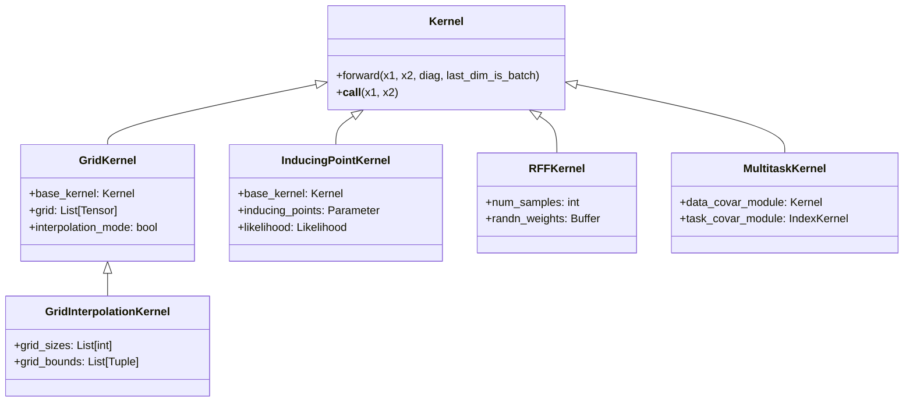
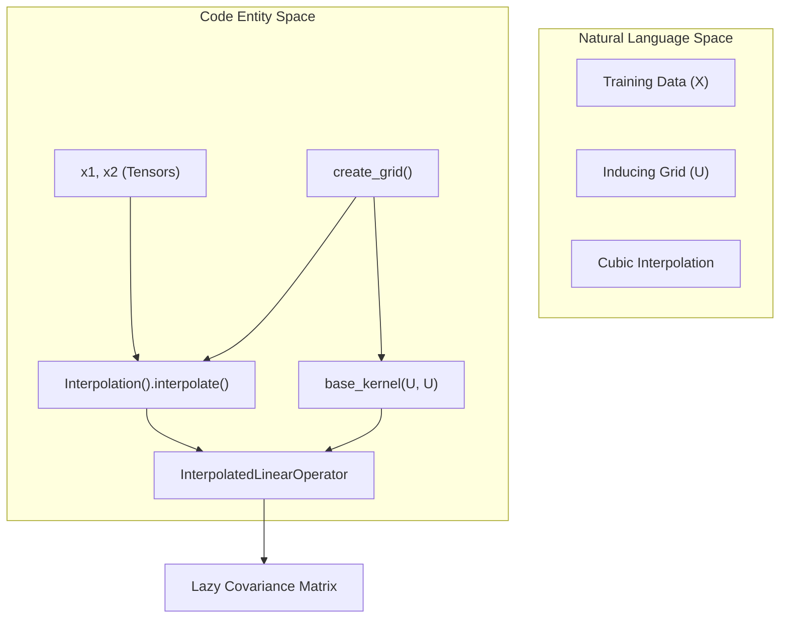
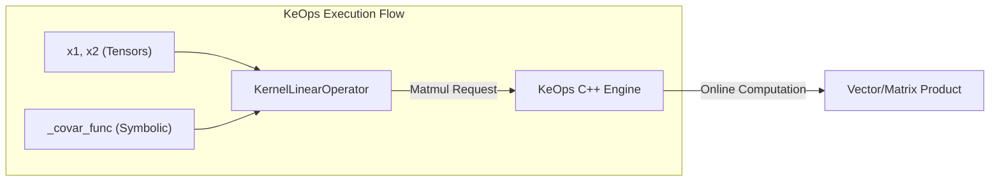

<!-- source: DeepWiki mcp.deepwiki.com · repo cornellius-gp/gpytorch · page 4.3 Scalable Kernels · fetched 2026-10-21 -->

# Scalable Kernels

Relevant source files

The following files were used as context for generating this wiki page:

- [examples/02_Scalable_Exact_GPs/KeOps_GP_Regression.ipynb](examples/02_Scalable_Exact_GPs/KeOps_GP_Regression.ipynb)
- [examples/045_GPLVM/3PhData.tar.gz](examples/045_GPLVM/3PhData.tar.gz)
- [examples/045_GPLVM/Gaussian_Process_Latent_Variable_Models_with_Stochastic_Variational_Inference.ipynb](examples/045_GPLVM/Gaussian_Process_Latent_Variable_Models_with_Stochastic_Variational_Inference.ipynb)
- [gpytorch/kernels/additive_structure_kernel.py](gpytorch/kernels/additive_structure_kernel.py)
- [gpytorch/kernels/grid_interpolation_kernel.py](gpytorch/kernels/grid_interpolation_kernel.py)
- [gpytorch/kernels/grid_kernel.py](gpytorch/kernels/grid_kernel.py)
- [gpytorch/kernels/inducing_point_kernel.py](gpytorch/kernels/inducing_point_kernel.py)
- [gpytorch/kernels/keops/__init__.py](gpytorch/kernels/keops/__init__.py)
- [gpytorch/kernels/keops/keops_kernel.py](gpytorch/kernels/keops/keops_kernel.py)
- [gpytorch/kernels/keops/matern_kernel.py](gpytorch/kernels/keops/matern_kernel.py)
- [gpytorch/kernels/keops/periodic_kernel.py](gpytorch/kernels/keops/periodic_kernel.py)
- [gpytorch/kernels/keops/rbf_kernel.py](gpytorch/kernels/keops/rbf_kernel.py)
- [gpytorch/kernels/lcm_kernel.py](gpytorch/kernels/lcm_kernel.py)
- [gpytorch/kernels/multi_device_kernel.py](gpytorch/kernels/multi_device_kernel.py)
- [gpytorch/kernels/multitask_kernel.py](gpytorch/kernels/multitask_kernel.py)
- [gpytorch/kernels/product_structure_kernel.py](gpytorch/kernels/product_structure_kernel.py)
- [gpytorch/kernels/rff_kernel.py](gpytorch/kernels/rff_kernel.py)
- [gpytorch/likelihoods/likelihood_list.py](gpytorch/likelihoods/likelihood_list.py)
- [gpytorch/mlls/sum_marginal_log_likelihood.py](gpytorch/mlls/sum_marginal_log_likelihood.py)
- [gpytorch/models/model_list.py](gpytorch/models/model_list.py)
- [gpytorch/test/base_keops_test_case.py](gpytorch/test/base_keops_test_case.py)
- [gpytorch/utils/generic.py](gpytorch/utils/generic.py)
- [test/examples/test_keops_gp_regression.py](test/examples/test_keops_gp_regression.py)
- [test/examples/test_lowrank_gp_regression.py](test/examples/test_lowrank_gp_regression.py)
- [test/kernels/test_grid_interpolation_kernel.py](test/kernels/test_grid_interpolation_kernel.py)
- [test/kernels/test_grid_kernel.py](test/kernels/test_grid_kernel.py)
- [test/kernels/test_rff_kernel.py](test/kernels/test_rff_kernel.py)
- [test/models/test_model_list.py](test/models/test_model_list.py)

This page documents the specialized kernel implementations in GPyTorch that enable Gaussian Process models to scale to larger datasets. These kernels employ various approximation techniques and mathematical structures to reduce the computational complexity of kernel operations, which would otherwise scale as $O(n^3)$ for exact GP inference on $n$ data points.

## Overview of Scalable Kernel Methods

GPyTorch provides several approaches to scale kernel computations:

1.  **Grid-based methods (KISS-GP)**: Approximate kernel evaluations using interpolation with a grid of inducing points.
2.  **Sparse approximations**: Use a smaller set of inducing points to reduce computational complexity.
3.  **Random Fourier Features (RFF)**: Approximate the kernel using a finite-dimensional feature map.
4.  **Hardware Acceleration**: Utilize KeOps for $O(n^2)$ operations without storing the full matrix in memory.
5.  **Multitask Scaling**: Exploit Kronecker structure for multiple outputs.

### Class Hierarchy and Relationships

Sources: [gpytorch/kernels/grid_kernel.py:17-47](), [gpytorch/kernels/grid_interpolation_kernel.py:16-70](), [gpytorch/kernels/inducing_point_kernel.py:27-34](), [gpytorch/kernels/rff_kernel.py:13-90](), [gpytorch/kernels/multitask_kernel.py:13-28]()

## Grid-Based Methods (KISS-GP / SKI)

### GridKernel
`GridKernel` exploits Toeplitz and Kronecker structure when input data $X$ are regularly spaced on a grid. It is restricted to **stationary kernels** [gpytorch/kernels/grid_kernel.py:27-28]().

*   **Toeplitz Structure**: If `settings.use_toeplitz.on()`, it uses `ToeplitzLinearOperator` for 1D grids [gpytorch/kernels/grid_kernel.py:140-157]().
*   **Kronecker Structure**: For multi-dimensional grids, it returns a `KroneckerProductLinearOperator` [gpytorch/kernels/grid_kernel.py:159]().

### GridInterpolationKernel
Implements the **KISS-GP** (or SKI) approximation [gpytorch/kernels/grid_interpolation_kernel.py:18-19](). It approximates $k(x_1, x_2) \approx \mathbf{w}_{x_1}^\top K_{U,U} \mathbf{w}_{x_2}$, where $U$ is a grid of inducing points and $\mathbf{w}$ are sparse interpolation weights [gpytorch/kernels/grid_interpolation_kernel.py:25-38]().

**Data Flow in GridInterpolationKernel:**

Sources: [gpytorch/kernels/grid_interpolation_kernel.py:114-143](), [gpytorch/utils/grid.py:10-13](), [gpytorch/utils/interpolation.py:11]()

## Inducing Point Methods

### InducingPointKernel
Implements sparse GP approximations (like SGPR). It requires a `base_kernel`, a set of `inducing_points`, and a `likelihood` [gpytorch/kernels/inducing_point_kernel.py:28-34]().

*   **Mechanism**: It computes a low-rank approximation $K_{XU} K_{UU}^{-1} K_{UX}$.
*   **Variational Term**: During training, it registers an `InducingPointKernelAddedLossTerm` to the model's marginal log-likelihood [gpytorch/kernels/inducing_point_kernel.py:43-112]().
*   **Prediction Strategy**: It uses `SGPRPredictionStrategy` for optimized inference [gpytorch/kernels/inducing_point_kernel.py:150-152]().

Sources: [gpytorch/kernels/inducing_point_kernel.py:75-90](), [gpytorch/mlls/inducing_point_kernel_added_loss_term.py]()

## Random Fourier Features (RFF)

### RFFKernel
Approximates the RBF kernel using the Monte Carlo estimator $k(x, x') \approx z(x)^\top z(x')$.
*   **Feature Map**: It constructs $z(x)$ using sine and cosine features [gpytorch/kernels/rff_kernel.py:42-54]().
*   **Efficiency**: If the number of samples $D$ is less than the number of data points $N$, it returns a `LowRankRootLinearOperator` [gpytorch/kernels/rff_kernel.py:131-134]().

Sources: [gpytorch/kernels/rff_kernel.py:113-148]()

## Multitask Scaling

### MultitaskKernel
Scales GPs to multiple tasks where every data point is evaluated at every task (Kronecker-style multitask).
*   **Structure**: Computes $K = K_{data} \otimes K_{tasks}$ [gpytorch/kernels/multitask_kernel.py:18-20]().
*   **Implementation**: Uses `IndexKernel` for the task covariance and returns a `KroneckerProductLinearOperator` [gpytorch/kernels/multitask_kernel.py:40-53]().

### LCMKernel
The Linear Model of Coregionalization (LCM) kernel is a sum of multiple `MultitaskKernel` instances, each with its own base kernel [gpytorch/kernels/lcm_kernel.py:14-22]().

Sources: [gpytorch/kernels/multitask_kernel.py:30-54](), [gpytorch/kernels/lcm_kernel.py:49-60]()

## Hardware-Accelerated Kernels (KeOps)

GPyTorch integrates with **KeOps** to perform kernel operations without explicitly instantiating large $N \times N$ matrices in GPU memory.

*   **Classes**: `gpytorch.kernels.keops.RBFKernel`, `gpytorch.kernels.keops.MaternKernel`.
*   **Operation**: They return a `KernelLinearOperator` which wraps a symbolic KeOps expression [gpytorch/kernels/keops/rbf_kernel.py:48](), [gpytorch/kernels/keops/matern_kernel.py:73]().

Sources: [gpytorch/kernels/keops/keops_kernel.py:9](), [gpytorch/kernels/keops/rbf_kernel.py:12-15](), [gpytorch/kernels/keops/matern_kernel.py:13-30]()

## Summary of Efficiency Trade-offs

| Kernel Class | Complexity (Memory) | Complexity (Time) | Key Constraint |
| :--- | :--- | :--- | :--- |
| `GridKernel` | $O(d \cdot g)$ | $O(n \log n)$ | Inputs must be on a grid |
| `GridInterpolationKernel` | $O(n + d \cdot g)$ | $O(n + g \log g)$ | Stationary base kernel |
| `InducingPointKernel` | $O(nm + m^2)$ | $O(nm^2 + m^3)$ | Accuracy depends on $m$ |
| `RFFKernel` | $O(nD)$ | $O(nD^2)$ | RBF approximation only |
| `MultitaskKernel` | $O(n^2 + t^2)$ | $O(n^3 + t^3)$ | Kronecker structure (all tasks at all $X$) |
| `KeOpsKernel` | $O(n)$ | $O(n^2)$ | Requires `pykeops` installation |

*Note: $n$ = data points, $d$ = dimensions, $g$ = grid size, $m$ = inducing points, $D$ = RFF samples, $t$ = tasks.*

---

