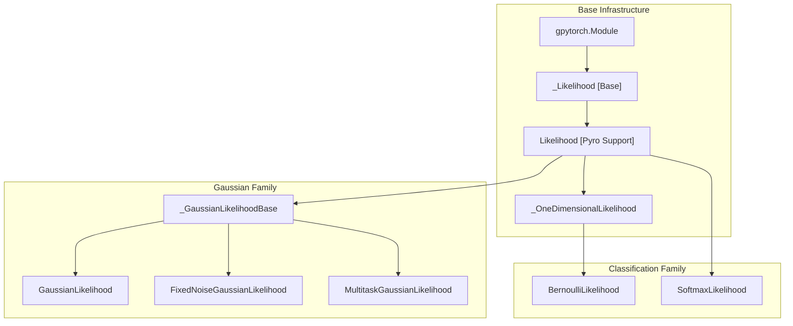

<!-- source: DeepWiki mcp.deepwiki.com · repo cornellius-gp/gpytorch · page 5 Likelihoods · fetched 2026-10-21 -->

# Likelihoods

Relevant source files

The following files were used as context for generating this wiki page:

- [docs/source/likelihoods.rst](docs/source/likelihoods.rst)
- [gpytorch/likelihoods/__init__.py](gpytorch/likelihoods/__init__.py)
- [gpytorch/likelihoods/bernoulli_likelihood.py](gpytorch/likelihoods/bernoulli_likelihood.py)
- [gpytorch/likelihoods/likelihood.py](gpytorch/likelihoods/likelihood.py)
- [gpytorch/likelihoods/softmax_likelihood.py](gpytorch/likelihoods/softmax_likelihood.py)
- [test/likelihoods/test_bernoulli_likelihood.py](test/likelihoods/test_bernoulli_likelihood.py)
- [test/likelihoods/test_gaussian_likelihood.py](test/likelihoods/test_gaussian_likelihood.py)
- [test/likelihoods/test_multitask_gaussian_likelihood.py](test/likelihoods/test_multitask_gaussian_likelihood.py)
- [test/likelihoods/test_softmax_likelihood.py](test/likelihoods/test_softmax_likelihood.py)

## Purpose and Scope

This page documents the likelihood system in GPyTorch, which specifies the mapping from latent GP function values $f(\mathbf{x})$ to observed labels or targets $y$. Likelihoods model the observation process and define the conditional distribution $p(y \mid f(\mathbf{x}))$.

For information about:
- **Gaussian Likelihoods**: See [Gaussian Likelihoods](#5.1) for details on `GaussianLikelihood`, `FixedNoiseGaussianLikelihood`, and `MultitaskGaussianLikelihood`.
- **Classification Likelihoods**: See [Classification Likelihoods](#5.2) for details on `BernoulliLikelihood`, `SoftmaxLikelihood`, and quadrature-based inference.

---

## Overview: The Role of Likelihoods

Likelihoods bridge the gap between the latent GP function and observations. They serve three primary roles:

1.  **Training**: Compute the marginal distribution $p(y)$ or expected log likelihood for optimization.
2.  **Prediction**: Add observation noise to posterior distributions.
3.  **Sampling**: Draw samples from the conditional distribution $p(y \mid f)$.

### Likelihood Operational Flow

```mermaid
graph TB
    subgraph "Training Phase"
        LatentF["Latent Function f(x)<br/>MultivariateNormal"]
        Marginal["marginal() method"]
        MarginalDist["Marginal p(y)<br/>MultivariateNormal"]
        Loss["Log Marginal Likelihood"]
    end
    
    subgraph "Prediction Phase"
        PosteriorF["Posterior f*(x*)<br/>MultivariateNormal"]
        AddNoise["Add observation noise"]
        PredDist["Predictive p(y*|x*)<br/>MultivariateNormal"]
    end
    
    subgraph "Conditional Sampling"
        Samples["Function samples f"]
        Forward["forward() method"]
        ConditionalDist["Conditional p(y|f)<br/>torch.distributions"]
    end
    
    LatentF --> Marginal
    Marginal --> MarginalDist
    MarginalDist --> Loss
    
    PosteriorF --> AddNoise
    AddNoise --> PredDist
    
    Samples --> Forward
    Forward --> ConditionalDist
```

Sources: [gpytorch/likelihoods/likelihood.py:22-84](), [gpytorch/likelihoods/likelihood.py:87-122]()

---

## Base Classes and Architecture

### Likelihood Hierarchy
All likelihoods inherit from `_Likelihood` (an abstract base class extending `gpytorch.Module`) or `Likelihood` (which adds Pyro integration).

Sources: [gpytorch/likelihoods/likelihood.py:22-22](), [gpytorch/likelihoods/likelihood.py:90-90](), [gpytorch/likelihoods/__init__.py:5-23]()

### Key Interface Methods
The base `_Likelihood` class defines the standard interface for all observation models.

| Method | Purpose | Returns |
| :--- | :--- | :--- |
| `forward(function_samples, ...)` | Conditional distribution $p(y \mid f)$ | `torch.distributions.Distribution` |
| `marginal(function_dist, ...)` | Marginal distribution $p(y)$ | `Distribution` |
| `expected_log_prob(obs, dist)` | Variational objective component | `Tensor` |
| `log_marginal(obs, dist)` | Log marginal likelihood | `Tensor` |
| `__call__(input, ...)` | Dispatch: marginal if `MVN`, conditional if `Tensor` | `Distribution` |

Sources: [gpytorch/likelihoods/likelihood.py:46-51](), [gpytorch/likelihoods/likelihood.py:54-55](), [gpytorch/likelihoods/likelihood.py:60-66](), [gpytorch/likelihoods/likelihood.py:68-70](), [gpytorch/likelihoods/likelihood.py:72-84]()

---

## Gaussian Likelihoods

Gaussian likelihoods are used for regression tasks where the observation noise is assumed to be normally distributed. They are unique because they typically allow for an analytic marginal distribution $p(y)$, which is essential for `ExactGP` models.

*   **`GaussianLikelihood`**: Standard homoskedastic noise model.
*   **`FixedNoiseGaussianLikelihood`**: Used when observation noise is known per-point (heteroskedastic).
*   **`MultitaskGaussianLikelihood`**: Handles multiple outputs with potential cross-task noise correlation.

For details on parameters, noise models, and multi-task structures, see [Gaussian Likelihoods](#5.1).

Sources: [gpytorch/likelihoods/gaussian_likelihood.py:1-13](), [gpytorch/likelihoods/multitask_gaussian_likelihood.py:9-18]()

---

## Classification Likelihoods

Non-Gaussian likelihoods are used when observations are discrete (e.g., binary or multiclass labels). These models do not have analytic marginals and require approximate inference methods like Variational Inference.

*   **`BernoulliLikelihood`**: Binary classification using a Probit link function. It inherits from `_OneDimensionalLikelihood` to utilize Gauss-Hermite quadrature for higher accuracy in computing expected log probabilities.
*   **`SoftmaxLikelihood`**: Multiclass classification using a Softmax link. It supports linear mixing weights to map multiple latent functions to class probabilities.

For details on link functions and quadrature integration, see [Classification Likelihoods](#5.2).

Sources: [gpytorch/likelihoods/bernoulli_likelihood.py:17-34](), [gpytorch/likelihoods/softmax_likelihood.py:17-33]()

---

## Summary of Likelihood Properties

| Likelihood | Analytic Marginal | Integration Method | Primary Use Case |
| :--- | :--- | :--- | :--- |
| `GaussianLikelihood` | Yes | Analytic | Standard Regression |
| `FixedNoiseGaussianLikelihood` | Yes | Analytic | Regression with known error bars |
| `MultitaskGaussianLikelihood` | Yes | Analytic | Multi-output Regression |
| `BernoulliLikelihood` | Yes (Probit) | Quadrature | Binary Classification |
| `SoftmaxLikelihood` | No | Monte Carlo | Multiclass Classification |
| `PoissonLikelihood` | No | Quadrature | Count Data |

Sources: [gpytorch/likelihoods/likelihood.py:23-23](), [gpytorch/likelihoods/bernoulli_likelihood.py:36-36](), [gpytorch/likelihoods/softmax_likelihood.py:60-81]()

---

