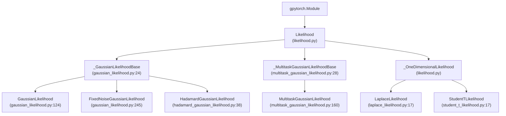
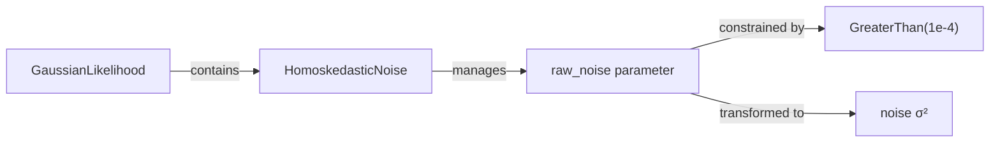
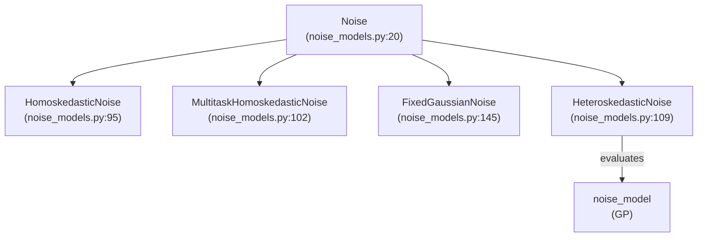

<!-- source: DeepWiki mcp.deepwiki.com · repo cornellius-gp/gpytorch · page 5.1 Gaussian Likelihoods · fetched 2026-10-21 -->

# Gaussian Likelihoods

Relevant source files

The following files were used as context for generating this wiki page:

- [.pre-commit-config.yaml](.pre-commit-config.yaml)
- [examples/03_Multitask_Exact_GPs/Hadamard_Multitask_GP_Regression.ipynb](examples/03_Multitask_Exact_GPs/Hadamard_Multitask_GP_Regression.ipynb)
- [examples/08_Advanced_Usage/svgp_elevators.pt](examples/08_Advanced_Usage/svgp_elevators.pt)
- [gpytorch/likelihoods/beta_likelihood.py](gpytorch/likelihoods/beta_likelihood.py)
- [gpytorch/likelihoods/gaussian_likelihood.py](gpytorch/likelihoods/gaussian_likelihood.py)
- [gpytorch/likelihoods/hadamard_gaussian_likelihood.py](gpytorch/likelihoods/hadamard_gaussian_likelihood.py)
- [gpytorch/likelihoods/laplace_likelihood.py](gpytorch/likelihoods/laplace_likelihood.py)
- [gpytorch/likelihoods/multitask_gaussian_likelihood.py](gpytorch/likelihoods/multitask_gaussian_likelihood.py)
- [gpytorch/likelihoods/noise_models.py](gpytorch/likelihoods/noise_models.py)
- [gpytorch/likelihoods/student_t_likelihood.py](gpytorch/likelihoods/student_t_likelihood.py)
- [test/likelihoods/test_hadamard_multitask_gaussian_likelihood.py](test/likelihoods/test_hadamard_multitask_gaussian_likelihood.py)
- [test/likelihoods/test_noise_models.py](test/likelihoods/test_noise_models.py)

## Purpose and Scope

This page documents Gaussian likelihood functions in GPyTorch, which connect latent GP function values to observed continuous data through Gaussian noise models. Gaussian likelihoods are used for regression tasks where observations are assumed to be corrupted by Gaussian noise. 

For classification tasks with Bernoulli or Softmax likelihoods, see [Classification Likelihoods](#5.2). For the general likelihood interface and base classes, see [Core Components](#2).

**Key Features:**
- Analytic marginal distributions for exact inference [gpytorch/likelihoods/gaussian_likelihood.py:27-27]()
- Support for homoskedastic (constant) and heteroskedastic (varying) noise [gpytorch/likelihoods/noise_models.py:26-143]()
- Multitask learning with cross-task noise correlations [gpytorch/likelihoods/multitask_gaussian_likelihood.py:28-158]()
- Integration with both exact and variational inference methods [gpytorch/likelihoods/gaussian_likelihood.py:134-135]()

---

## Class Hierarchy

The following diagram shows the inheritance structure of Gaussian likelihood classes:

**Sources:** [gpytorch/likelihoods/gaussian_likelihood.py:24-360](), [gpytorch/likelihoods/multitask_gaussian_likelihood.py:28-160](), [gpytorch/likelihoods/hadamard_gaussian_likelihood.py:38-38](), [gpytorch/likelihoods/laplace_likelihood.py:17-17](), [gpytorch/likelihoods/student_t_likelihood.py:17-17]()

---

## Base Class: _GaussianLikelihoodBase

The `_GaussianLikelihoodBase` class provides core functionality for all Gaussian likelihoods:

| Property | Description |
|----------|-------------|
| `has_analytic_marginal` | Always `True` - enables exact inference without sampling [gpytorch/likelihoods/gaussian_likelihood.py:27-27]() |
| `noise_covar` | Noise model (e.g., `HomoskedasticNoise`, `FixedGaussianNoise`) [gpytorch/likelihoods/gaussian_likelihood.py:39-39]() |

### Key Operations

**Marginal Computation**
The `marginal()` method computes the predictive distribution $p(\mathbf{y}|\mathbf{x})$ by adding noise to the latent function covariance:
$$p(\mathbf{y}|\mathbf{x}) = \mathcal{N}(\mu_f, K_f + \Sigma_{noise})$$

**Expected Log Probability**
Computes $\mathbb{E}_{q(f)}[\log p(y|f)]$ for variational inference, including handling for `observation_nan_policy` [gpytorch/likelihoods/gaussian_likelihood.py:44-78]().

**Sources:** [gpytorch/likelihoods/gaussian_likelihood.py:24-121]()

---

## GaussianLikelihood

The standard `GaussianLikelihood` assumes homoskedastic (constant) Gaussian noise:
$$p(y|f) = \mathcal{N}(f, \sigma^2)$$

### Implementation Details

| Component | Purpose |
|-----------|---------|
| `raw_noise` | Unconstrained parameter optimized during training [gpytorch/likelihoods/noise_models.py:32-32]() |
| `noise` | Constrained parameter ($\sigma^2 > 10^{-4}$) accessed by users [gpytorch/likelihoods/noise_models.py:44-46]() |
| `noise_constraint` | Ensures noise is positive via `GreaterThan(1e-4)` [gpytorch/likelihoods/noise_models.py:30-30]() |

**Sources:** [gpytorch/likelihoods/gaussian_likelihood.py:124-182](), [gpytorch/likelihoods/noise_models.py:26-93]()

---

## MultitaskGaussianLikelihood

For multitask learning, this likelihood models cross-task noise correlations with a low-rank structure:
$$\Sigma_{noise} = \mathbf{I}_n \otimes \mathbf{D}_t + \sigma^2 \mathbf{I}_{nt}$$

### Task Noise Covariance Structure

The class supports two modes for the task noise covariance $\mathbf{D}_t$:
1. **Rank 0 (Diagonal):** $\mathbf{D}_t = \text{diag}(d_1, \ldots, d_t)$ using `raw_task_noises` [gpytorch/likelihoods/multitask_gaussian_likelihood.py:125-127]().
2. **Rank > 0 (Low-rank):** $\mathbf{D}_t = \mathbf{F}\mathbf{F}^T$ where $\mathbf{F}$ is the `task_noise_covar_factor` [gpytorch/likelihoods/multitask_gaussian_likelihood.py:131-132]().

It exploits Kronecker structure via `KroneckerProductLinearOperator` to ensure efficiency [gpytorch/likelihoods/multitask_gaussian_likelihood.py:134-154]().

**Sources:** [gpytorch/likelihoods/multitask_gaussian_likelihood.py:28-158]()

---

## HadamardGaussianLikelihood

This likelihood is used for input-wise homoskedastic and task-wise heteroskedastic noise, where a different constant noise level is learned for each fidelity/task [gpytorch/likelihoods/hadamard_gaussian_likelihood.py:39-42]().

### Operation
It expects task indices to be provided in the `forward` and `marginal` calls [gpytorch/likelihoods/hadamard_gaussian_likelihood.py:90-92](). It constructs a masked noise covariance matrix where the noise for each observation is selected based on its task index [gpytorch/likelihoods/hadamard_gaussian_likelihood.py:102-111]().

**Sources:** [gpytorch/likelihoods/hadamard_gaussian_likelihood.py:38-126]()

---

## Noise Models

Noise models encapsulate the noise structure.

### HeteroskedasticNoise
Uses a separate `noise_model` (typically another GP) to predict the noise variance for each input [gpytorch/likelihoods/noise_models.py:109-114](). During evaluation, it extracts the mean of the noise model's output to serve as the observation noise [gpytorch/likelihoods/noise_models.py:129-142]().

### FixedGaussianNoise
Stores a fixed `noise` tensor provided by the user [gpytorch/likelihoods/noise_models.py:146-157](). It rounds very small values up to `settings.min_fixed_noise` to prevent numerical instability [gpytorch/likelihoods/noise_models.py:148-156]().

**Sources:** [gpytorch/likelihoods/noise_models.py:1-179]()

---

## Robust Regression Likelihoods

GPyTorch provides non-Gaussian likelihoods for regression that inherit from `_OneDimensionalLikelihood`. These are typically used with variational inference or quadrature as they lack analytic marginals.

| Class | Distribution | Learnable Parameters |
|-------|--------------|----------------------|
| `LaplaceLikelihood` | `Laplace` | `noise` ($\sigma$) [gpytorch/likelihoods/laplace_likelihood.py:26-26]() |
| `StudentTLikelihood` | `StudentT` | `noise` ($\sigma^2$), `deg_free` ($\nu$) [gpytorch/likelihoods/student_t_likelihood.py:29-30]() |
| `BetaLikelihood` | `Beta` | `scale` ($s$) [gpytorch/likelihoods/beta_likelihood.py:40-40]() |

**Sources:** [gpytorch/likelihoods/laplace_likelihood.py:17-61](), [gpytorch/likelihoods/student_t_likelihood.py:17-92](), [gpytorch/likelihoods/beta_likelihood.py:17-78]()

---

