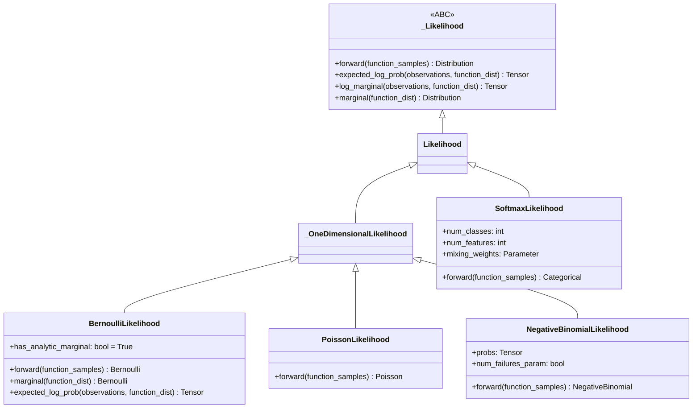
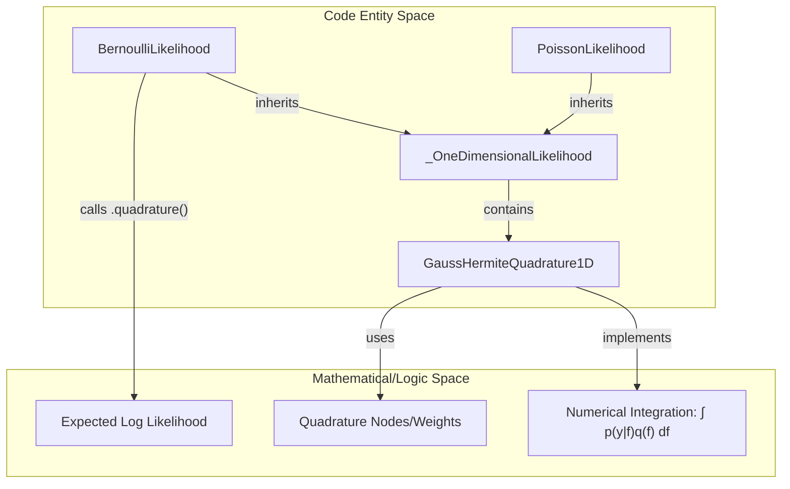

<!-- source: DeepWiki mcp.deepwiki.com · repo cornellius-gp/gpytorch · page 5.2 Classification Likelihoods · fetched 2026-10-21 -->

# Classification Likelihoods

Relevant source files

The following files were used as context for generating this wiki page:

- [gpytorch/likelihoods/bernoulli_likelihood.py](gpytorch/likelihoods/bernoulli_likelihood.py)
- [gpytorch/likelihoods/likelihood.py](gpytorch/likelihoods/likelihood.py)
- [gpytorch/likelihoods/negative_binomial_likelihood.py](gpytorch/likelihoods/negative_binomial_likelihood.py)
- [gpytorch/likelihoods/poisson_likelihood.py](gpytorch/likelihoods/poisson_likelihood.py)
- [gpytorch/likelihoods/softmax_likelihood.py](gpytorch/likelihoods/softmax_likelihood.py)
- [test/likelihoods/test_bernoulli_likelihood.py](test/likelihoods/test_bernoulli_likelihood.py)
- [test/likelihoods/test_beta_likelihood.py](test/likelihoods/test_beta_likelihood.py)
- [test/likelihoods/test_laplace_likelihood.py](test/likelihoods/test_laplace_likelihood.py)
- [test/likelihoods/test_multitask_gaussian_likelihood.py](test/likelihoods/test_multitask_gaussian_likelihood.py)
- [test/likelihoods/test_negative_binomial_likelihood.py](test/likelihoods/test_negative_binomial_likelihood.py)
- [test/likelihoods/test_poisson_likelihood.py](test/likelihoods/test_poisson_likelihood.py)
- [test/likelihoods/test_softmax_likelihood.py](test/likelihoods/test_softmax_likelihood.py)
- [test/likelihoods/test_student_t_likelihood.py](test/likelihoods/test_student_t_likelihood.py)

Classification likelihoods in GPyTorch map continuous latent GP function values to discrete class probabilities or labels. These likelihoods enable GP models to perform classification tasks by warping the latent function through appropriate link functions. The primary classification likelihoods are `BernoulliLikelihood` for binary classification and `SoftmaxLikelihood` for multiclass problems. Both integrate with quadrature methods for computing expected log probabilities under non-Gaussian likelihoods. For Gaussian likelihoods used in regression, see page 5.1.

## Class Hierarchy and Code Structure

Classification likelihoods inherit from the base `Likelihood` class located in `gpytorch.likelihoods.likelihood`. The diagram below shows the inheritance structure and key methods:

**Diagram: Classification Likelihood Class Hierarchy**

Sources: [gpytorch/likelihoods/likelihood.py:22-85](), [gpytorch/likelihoods/bernoulli_likelihood.py:17-77](), [gpytorch/likelihoods/softmax_likelihood.py:17-81](), [gpytorch/likelihoods/poisson_likelihood.py:13-45](), [gpytorch/likelihoods/negative_binomial_likelihood.py:15-88]()

## Data Flow During Training and Prediction

The following diagram shows how classification likelihoods integrate into the GP training and prediction pipeline, with specific method calls:

**Diagram: Classification Likelihood Data Flow**

```mermaid
flowchart TB
    subgraph "Training Phase (ELBO Optimization)"
        TrainX["train_x: Tensor"] --> Model["ApproximateGP.forward()"]
        Model --> FuncDist["MultivariateNormal (q(f))"]
        FuncDist --> ELBO["VariationalELBO.forward()"]
        ELBO --> ELP["likelihood.expected_log_prob(observations, q_f)"]
        ELP --> Sample["_Likelihood._draw_likelihood_samples()"]
        Sample --> Forward["Likelihood.forward(function_samples)"]
        Forward --> Dist["torch.distributions.Distribution"]
        Dist --> LogProb["distribution.log_prob(observations)"]
    end
    
    subgraph "Prediction Phase (Posterior)"
        TestX["test_x: Tensor"] --> ModelEval["model.eval()"]
        ModelEval --> PosteriorDist["MultivariateNormal (p(f*|y))"]
        PosteriorDist --> LikelihoodCall["likelihood(posterior_dist)"]
        LikelihoodCall --> Marginal["Likelihood.marginal(posterior_dist)"]
        Marginal --> FinalDist["Bernoulli or Categorical"]
    end
```

Sources: [gpytorch/likelihoods/likelihood.py:29-51](), [gpytorch/likelihoods/likelihood.py:68-70](), [gpytorch/likelihoods/likelihood.py:72-84](), [gpytorch/likelihoods/bernoulli_likelihood.py:41-43]()

## BernoulliLikelihood

`BernoulliLikelihood` implements binary classification using probit regression. The likelihood maps latent function values to the [0,1] interval using the standard normal CDF $\Phi(x)$.

### Mathematical Definition

The likelihood is defined as:
$p(y=1|f) = \Phi(f)$
$p(y=0|f) = 1 - \Phi(f) = \Phi(-f)$

This can be written compactly as: $p(y|f) = \Phi((2y - 1)f)$ where $y \in \{0, 1\}$.

### Class Definition and Methods

The `BernoulliLikelihood` class is located in [gpytorch/likelihoods/bernoulli_likelihood.py:17-77]() and inherits from `_OneDimensionalLikelihood`.

| Method | Return Type | Purpose |
|--------|-------------|---------|
| `forward(function_samples)` | `Bernoulli` | Converts function samples to Bernoulli distribution [gpytorch/likelihoods/bernoulli_likelihood.py:41-43]() |
| `marginal(function_dist)` | `Bernoulli` | Computes analytic marginal $p(y)$ from GP prior [gpytorch/likelihoods/bernoulli_likelihood.py:51-59]() |
| `log_marginal(observations, function_dist)` | `Tensor` | Computes log $p(y)$ directly [gpytorch/likelihoods/bernoulli_likelihood.py:45-49]() |
| `expected_log_prob(observations, function_dist)` | `Tensor` | Computes $E_{q(f)}[\log p(y|f)]$ using quadrature [gpytorch/likelihoods/bernoulli_likelihood.py:61-77]() |

### Key Implementation Details

**Analytic Marginal:** `BernoulliLikelihood` has `has_analytic_marginal = True` [gpytorch/likelihoods/bernoulli_likelihood.py:36](), enabling exact computation of the marginal distribution. The marginal integrates out the latent function: $p(y) = \int \Phi(f) N(f|\mu,\sigma^2) df = \Phi(\frac{\mu}{\sqrt{1+\sigma^2}})$ [gpytorch/likelihoods/bernoulli_likelihood.py:55-58]().

**Expected Log Probability:** The `expected_log_prob` method (lines 61-77) computes $E_{q(f)}[\log p(y|f)]$ using Gauss-Hermite quadrature. It uses `log_normal_cdf` from `gpytorch.functions` for numerical stability [gpytorch/likelihoods/bernoulli_likelihood.py:75-76]().

Sources: [gpytorch/likelihoods/bernoulli_likelihood.py:17-77](), [gpytorch/functions/__init__.py]() (implied by `log_normal_cdf` import)

## SoftmaxLikelihood

`SoftmaxLikelihood` implements multiclass classification by applying a softmax transformation to the latent GP functions. It is located in [gpytorch/likelihoods/softmax_likelihood.py:17-91]().

### Mathematical Definition

For $C$ classes and $F$ latent functions, the likelihood is:
$p(y=c|\mathbf{f}) = \text{Softmax}(\mathbf{W} \mathbf{f})_c$

where $\mathbf{W}$ is an optional linear mixing weight matrix [gpytorch/likelihoods/softmax_likelihood.py:22]().

### Constructor Parameters

| Parameter | Type | Required | Default | Purpose |
|-----------|------|----------|---------|---------|
| `num_features` | `int` | Yes (if mixing) | `None` | Latent function dimensionality [gpytorch/likelihoods/softmax_likelihood.py:49]() |
| `num_classes` | `int` | Yes | `None` | Number of classes [gpytorch/likelihoods/softmax_likelihood.py:45]() |
| `mixing_weights` | `bool` | No | `True` | Learn linear mixing weight $\mathbf{W}$ [gpytorch/likelihoods/softmax_likelihood.py:39]() |

### Implementation Details

The `forward` method (lines 60-81) applies mixing weights and returns a `Categorical` distribution. If `mixing_weights` is provided, it performs a matrix multiplication `function_samples @ self.mixing_weights.t()` [gpytorch/likelihoods/softmax_likelihood.py:77]().

The `__call__` method handles input validation, ensuring that `MultivariateNormal` inputs are converted to `MultitaskMultivariateNormal` to support the multi-output nature of multiclass classification [gpytorch/likelihoods/softmax_likelihood.py:83-91]().

Sources: [gpytorch/likelihoods/softmax_likelihood.py:17-91](), [test/likelihoods/test_softmax_likelihood.py:9-67]()

## Other Classification-Related Likelihoods

### PoissonLikelihood
Used for count data regression where outcomes are non-negative integers. It uses a `softplus` link function to map GP samples to the rate parameter $\lambda$ [gpytorch/likelihoods/poisson_likelihood.py:24-45]().

### NegativeBinomialLikelihood
Designed for overdispersed count data. The GP function parametrizes either the mean or the number of failures $k$, depending on the `num_failures_param` flag [gpytorch/likelihoods/negative_binomial_likelihood.py:27-41](). It includes a learnable `probs` parameter $p \in (0, 1)$ constrained by an `Interval` [gpytorch/likelihoods/negative_binomial_likelihood.py:58-65]().

Sources: [gpytorch/likelihoods/poisson_likelihood.py:13-45](), [gpytorch/likelihoods/negative_binomial_likelihood.py:15-88]()

## Integration with Quadrature

Classification likelihoods that do not have analytic marginals rely on numerical integration. `_OneDimensionalLikelihood` subclasses use `GaussHermiteQuadrature1D` [gpytorch/likelihoods/likelihood.py:18]().

**Diagram: Quadrature Entity Mapping**

Sources: [gpytorch/likelihoods/likelihood.py:18](), [gpytorch/likelihoods/bernoulli_likelihood.py:76](), [gpytorch/likelihoods/poisson_likelihood.py:13]()

## Comparison of Likelihood Properties

| Likelihood | Analytic Marginal | Link Function | Output Distribution |
|------------|-------------------|---------------|---------------------|
| `BernoulliLikelihood` | **Yes** | Normal CDF ($\Phi$) | `Bernoulli` |
| `SoftmaxLikelihood` | **No** | Softmax | `Categorical` |
| `PoissonLikelihood` | **No** | Softplus | `Poisson` |
| `NegativeBinomialLikelihood` | **No** | Softplus | `NegativeBinomial` |

Sources: [gpytorch/likelihoods/bernoulli_likelihood.py:36](), [gpytorch/likelihoods/softmax_likelihood.py:80](), [gpytorch/likelihoods/poisson_likelihood.py:44](), [gpytorch/likelihoods/negative_binomial_likelihood.py:88]()

---

