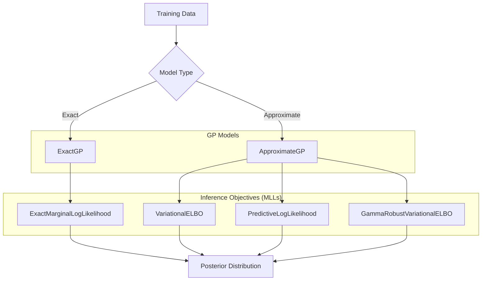
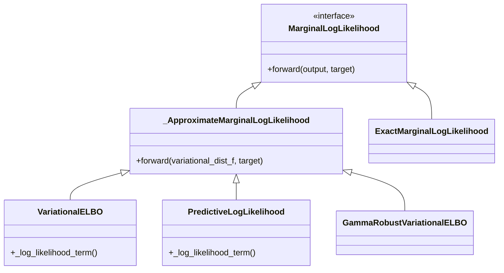

<!-- source: DeepWiki mcp.deepwiki.com · repo cornellius-gp/gpytorch · page 6 Inference Methods · fetched 2026-10-21 -->

# Inference Methods

Relevant source files

The following files were used as context for generating this wiki page:

- [docs/source/constraints.rst](docs/source/constraints.rst)
- [docs/source/marginal_log_likelihoods.rst](docs/source/marginal_log_likelihoods.rst)
- [gpytorch/mlls/__init__.py](gpytorch/mlls/__init__.py)
- [gpytorch/mlls/added_loss_term.py](gpytorch/mlls/added_loss_term.py)
- [gpytorch/mlls/exact_marginal_log_likelihood.py](gpytorch/mlls/exact_marginal_log_likelihood.py)
- [gpytorch/mlls/gamma_robust_variational_elbo.py](gpytorch/mlls/gamma_robust_variational_elbo.py)
- [gpytorch/mlls/inducing_point_kernel_added_loss_term.py](gpytorch/mlls/inducing_point_kernel_added_loss_term.py)
- [gpytorch/mlls/kl_gaussian_added_loss_term.py](gpytorch/mlls/kl_gaussian_added_loss_term.py)
- [gpytorch/mlls/marginal_log_likelihood.py](gpytorch/mlls/marginal_log_likelihood.py)
- [gpytorch/mlls/predictive_log_likelihood.py](gpytorch/mlls/predictive_log_likelihood.py)
- [gpytorch/mlls/variational_elbo.py](gpytorch/mlls/variational_elbo.py)
- [gpytorch/models/__init__.py](gpytorch/models/__init__.py)
- [test/examples/test_kronecker_multitask_sgpr_regression.py](test/examples/test_kronecker_multitask_sgpr_regression.py)
- [test/mlls/test_inducing_point_kernel_added_loss_term.py](test/mlls/test_inducing_point_kernel_added_loss_term.py)

This page documents the various inference methods available in GPyTorch for computing posterior distributions in Gaussian Process (GP) models. It covers both exact inference and approximate methods like variational inference, detailing their implementation, computational properties, and appropriate use cases. For information about model construction, see [Core Components](#2) and [Models](#3).

## Overview

Inference in Gaussian Process models involves computing the posterior distribution over function values given observed data. GPyTorch implements these methods through specialized model classes and objective functions called Marginal Log Likelihoods (MLLs) [gpytorch/mlls/marginal_log_likelihood.py:9-28]().

1. **Exact Inference**: Provides mathematically exact posterior distributions. It uses the `ExactMarginalLogLikelihood` [gpytorch/mlls/exact_marginal_log_likelihood.py:13-34]() and has $O(n^3)$ complexity.
2. **Approximate Inference**: Scales to larger datasets by employing variational strategies and optimizing the Evidence Lower Bound (ELBO) [gpytorch/mlls/variational_elbo.py:8-60]().

Sources: [gpytorch/mlls/marginal_log_likelihood.py](), [gpytorch/mlls/exact_marginal_log_likelihood.py](), [gpytorch/mlls/variational_elbo.py](), [gpytorch/models/exact_gp.py](), [gpytorch/models/approximate_gp.py]()

## Exact Inference

Exact inference computes the true posterior distribution for a Gaussian Process model. This approach provides the most accurate results but scales poorly with dataset size. For details, see [Exact Inference](#6.1).

### ExactGP and MLL
The `ExactMarginalLogLikelihood` is specifically designed for `ExactGP` models with a `GaussianLikelihood` [gpytorch/mlls/exact_marginal_log_likelihood.py:13-24](). It computes the log probability of the marginal distribution [gpytorch/mlls/exact_marginal_log_likelihood.py:84]().

- **Complexity**: $O(n^3)$ time and $O(n^2)$ space.
- **Constraints**: Cannot be used with stochastic optimization (mini-batching) [gpytorch/mlls/exact_marginal_log_likelihood.py:20-21]().
- **Special Terms**: Supports additional loss terms like the SGPR regularization trace term via `InducingPointKernelAddedLossTerm` [gpytorch/mlls/inducing_point_kernel_added_loss_term.py:12-36]().

Sources: [gpytorch/mlls/exact_marginal_log_likelihood.py:13-89](), [gpytorch/mlls/inducing_point_kernel_added_loss_term.py:12-58]()

## Variational Inference

Variational inference provides scalable approximations by optimizing a lower bound on the marginal log likelihood. For details, see [Variational Inference](#6.2).

### Variational Objectives
GPyTorch provides several approximate objectives:
- **VariationalELBO**: The standard evidence lower bound for variational GPs [gpytorch/mlls/variational_elbo.py:8-60]().
- **PredictiveLogLikelihood**: An alternative that often produces better predictive variances by putting the log outside the expectation [gpytorch/mlls/predictive_log_likelihood.py:8-38]().
- **GammaRobustVariationalELBO**: Uses $\gamma$-divergence for robustness against outliers in Gaussian likelihoods [gpytorch/mlls/gamma_robust_variational_elbo.py:14-66]().

### Variational Strategies
Variational strategies define how the latent function $f$ is related to the inducing points $u$.

Sources: [gpytorch/mlls/variational_elbo.py:8-19](), [gpytorch/mlls/predictive_log_likelihood.py:8-24](), [gpytorch/mlls/gamma_robust_variational_elbo.py:14-31]()

## Comparison and Use Cases

| Feature | Exact Inference | Variational Inference |
| :--- | :--- | :--- |
| **Model Class** | `ExactGP` | `ApproximateGP` |
| **Likelihood** | `GaussianLikelihood` only | Any (Gaussian, Bernoulli, etc.) |
| **Optimization** | Full-batch | Stochastic (Mini-batch) supported |
| **Scalability** | Small datasets ($N < 10,000$) | Large datasets ($N > 1,000,000$) |
| **Complexity** | $O(N^3)$ | $O(M^3 + NM^2)$ ($M$ inducing points) |

### Performance and Caching
GPyTorch uses a caching system to store intermediate results like the `mean_cache` and `covar_cache` during exact inference [gpytorch/models/exact_prediction_strategies.py:247-301](). Variational methods leverage `AddedLossTerm` to include KL divergence terms and other regularization without modifying the core ELBO logic [gpytorch/mlls/added_loss_term.py:1-12]().

### Numerical Stability
The `settings` module provides controls for numerical stability during inference, such as `eval_cg_tolerance` for the conjugate gradient solver and policies for handling `NaN` observations [gpytorch/mlls/exact_marginal_log_likelihood.py:71-81]().

Sources: [gpytorch/mlls/exact_marginal_log_likelihood.py:13-89](), [gpytorch/mlls/variational_elbo.py:8-60](), [gpytorch/settings.py:145-387]()

---

