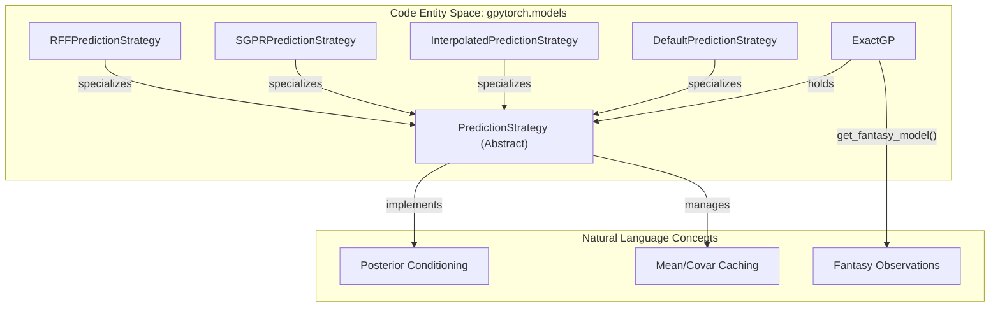
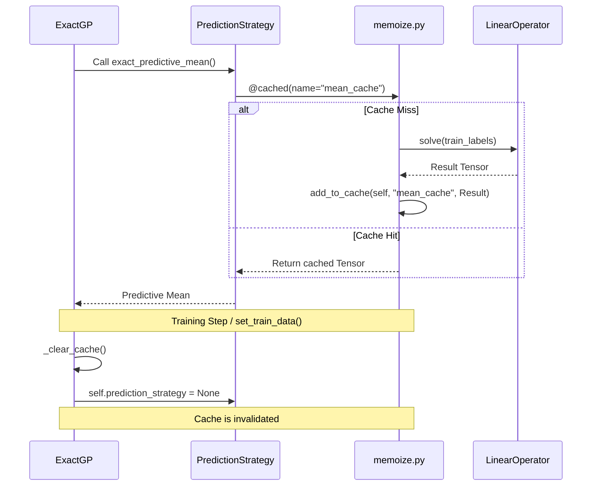

<!-- source: DeepWiki mcp.deepwiki.com · repo cornellius-gp/gpytorch · page 6.1 Exact Inference · fetched 2026-10-21 -->

# Exact Inference

Relevant source files

The following files were used as context for generating this wiki page:

- [gpytorch/mlls/added_loss_term.py](gpytorch/mlls/added_loss_term.py)
- [gpytorch/mlls/exact_marginal_log_likelihood.py](gpytorch/mlls/exact_marginal_log_likelihood.py)
- [gpytorch/mlls/inducing_point_kernel_added_loss_term.py](gpytorch/mlls/inducing_point_kernel_added_loss_term.py)
- [gpytorch/mlls/kl_gaussian_added_loss_term.py](gpytorch/mlls/kl_gaussian_added_loss_term.py)
- [gpytorch/mlls/leave_one_out_pseudo_likelihood.py](gpytorch/mlls/leave_one_out_pseudo_likelihood.py)
- [gpytorch/mlls/marginal_log_likelihood.py](gpytorch/mlls/marginal_log_likelihood.py)
- [gpytorch/models/exact_gp.py](gpytorch/models/exact_gp.py)
- [gpytorch/models/exact_prediction_strategies.py](gpytorch/models/exact_prediction_strategies.py)
- [gpytorch/settings.py](gpytorch/settings.py)
- [gpytorch/utils/memoize.py](gpytorch/utils/memoize.py)
- [test/examples/test_kronecker_multitask_sgpr_regression.py](test/examples/test_kronecker_multitask_sgpr_regression.py)
- [test/mlls/__init__.py](test/mlls/__init__.py)
- [test/mlls/test_exact_marginal_log_likelihood.py](test/mlls/test_exact_marginal_log_likelihood.py)
- [test/mlls/test_inducing_point_kernel_added_loss_term.py](test/mlls/test_inducing_point_kernel_added_loss_term.py)
- [test/mlls/test_leave_one_out_pseudo_likelihood.py](test/mlls/test_leave_one_out_pseudo_likelihood.py)

Exact inference in GPyTorch refers to the analytical computation of the posterior distribution over function values when both the prior and likelihood are Gaussian. This approach yields closed-form solutions for the predictive mean and covariance, providing mathematically precise uncertainty estimates.

Sources: [gpytorch/models/exact_gp.py:24-59](), [gpytorch/models/exact_prediction_strategies.py:30-36]()

## ExactGP Model Class

The `ExactGP` class is the base for all models using exact inference. It requires a Gaussian likelihood and handles training data management.

### System Mapping: Model to Strategy
The following diagram bridges the high-level `ExactGP` model to the low-level `prediction_strategy` implementations.

**Key features of ExactGP:**
- **Training Data**: Managed via `self.train_inputs` and `self.train_targets` [gpytorch/models/exact_gp.py:75-81]().
- **Data Modification**: `set_train_data` allows updating data while clearing existing caches [gpytorch/models/exact_gp.py:113-150]().
- **Posterior Logic**: When called (`__call__`), the model determines if it should return the prior or compute the posterior via `prediction_strategy` [gpytorch/models/exact_gp.py:264-349]().

Sources: [gpytorch/models/exact_gp.py:23-150](), [gpytorch/models/exact_prediction_strategies.py:30-36]()

## Prediction Strategies

GPyTorch uses specialized strategies to implement the mathematical operations for posterior computation. The function `prediction_strategy` [gpytorch/models/exact_prediction_strategies.py:30-36]() selects the appropriate class based on the covariance matrix type.

### Strategy Types

| Strategy | Usage Case | Implementation |
| :--- | :--- | :--- |
| `DefaultPredictionStrategy` | Standard GP regression | Uses `solve()` on the full covariance matrix [gpytorch/models/exact_prediction_strategies.py:46-421]() |
| `InterpolatedPredictionStrategy` | KISS-GP / SKI | Leverages structured interpolation matrices [gpytorch/models/exact_prediction_strategies.py:424-733]() |
| `SGPRPredictionStrategy` | Sparse GP (Titsias 2009) | Exploits low-rank + diagonal structure [gpytorch/models/exact_prediction_strategies.py:790-873]() |
| `RFFPredictionStrategy` | Random Fourier Features | Optimized for pure low-rank approximations [gpytorch/models/exact_prediction_strategies.py:735-788]() |

### DefaultPredictionStrategy Implementation
The default strategy computes and caches two primary components:
1.  **Mean Cache**: Computed as $\alpha = (K_{XX} + \sigma^2 I)^{-1} (y - \mu_{X})$ [gpytorch/models/exact_prediction_strategies.py:254-301]().
2.  **Covariance Cache**: Computed as a root inverse of the training covariance [gpytorch/models/exact_prediction_strategies.py:246-251]().

Sources: [gpytorch/models/exact_prediction_strategies.py:30-43](), [gpytorch/models/exact_prediction_strategies.py:46-421]()

## Caching and Memoization

GPyTorch utilizes a custom memoization framework to avoid redundant linear algebra operations during optimization and prediction.

### Data Flow: Memoization and Invalidation
This diagram shows how `memoize.py` utilities interact with the `ExactGP` lifecycle.

**Key Caching Functions:**
- `add_to_cache`: Manually inserts values into an object's `_memoize_cache` [gpytorch/utils/memoize.py:20-22]().
- `register_cache_clear_hook`: Attaches a backward hook to a tensor that clears the cache when gradients are computed [gpytorch/utils/memoize.py:50-66]().
- `cached`: A decorator for methods to automatically manage retrieval and storage [gpytorch/utils/memoize.py:12-17]().

Sources: [gpytorch/utils/memoize.py:1-145](), [gpytorch/models/exact_gp.py:99-101]()

## Marginal Log Likelihood (MLL)

For exact inference, the `ExactMarginalLogLikelihood` is used to train model hyperparameters.

- **Objective**: Computes $\log p(y | X, \theta)$ exactly for Gaussian likelihoods [gpytorch/mlls/exact_marginal_log_likelihood.py:13-34]().
- **Added Loss Terms**: Supports additional regularization terms, such as the SGPR trace term [gpytorch/mlls/exact_marginal_log_likelihood.py:41-52]().
- **Trace Term**: `InducingPointKernelAddedLossTerm` implements $-\frac{1}{2\sigma^2} \text{Tr}(K_{XX} - Q)$ for SGPR [gpytorch/mlls/inducing_point_kernel_added_loss_term.py:12-58]().

Sources: [gpytorch/mlls/exact_marginal_log_likelihood.py:13-89](), [gpytorch/mlls/inducing_point_kernel_added_loss_term.py:12-58]()

## Settings Affecting Exact Inference

GPyTorch provides several feature flags to control the behavior and performance of exact inference.

| Setting | Impact | Default | Source |
| :--- | :--- | :--- | :--- |
| `fast_pred_var` | Enables Lanczos Variance Estimates (LOVE) for $O(n)$ predictive variances | `False` | [gpytorch/settings.py:183-222]() |
| `fast_pred_samples` | Enables fast sampling using Lanczos roots | `False` | [gpytorch/settings.py:225-244]() |
| `detach_test_caches` | Detaches caches from the autograd graph to save memory/time | `True` | [gpytorch/settings.py:160-171]() |
| `eval_cg_tolerance` | Sets the termination threshold for CG during prediction | `0.01` | [gpytorch/settings.py:173-181]() |
| `observation_nan_policy` | Determines how to handle NaNs in training data (`mask`, `fill`, `ignore`) | `ignore` | [gpytorch/settings.py:405-449]() |

### NaN Handling in Strategies
When `observation_nan_policy` is set to `"mask"`, `DefaultPredictionStrategy` uses a `MaskedLinearOperator` to filter out invalid training observations during the solve [gpytorch/models/exact_prediction_strategies.py:266-275]().

Sources: [gpytorch/settings.py:1-449](), [gpytorch/models/exact_prediction_strategies.py:260-292]()

## Fantasy Models (Online Conditioning)

The `ExactGP` class supports "fantasy" observations via `get_fantasy_model` [gpytorch/models/exact_gp.py:151-261]().

- **Efficiency**: Instead of re-solving the system, it uses rank-1 or rank-m updates to the existing caches [gpytorch/models/exact_prediction_strategies.py:137-244]().
- **State**: Returns a new `ExactGP` instance where the training data is the concatenation of the original data and the fantasy points [gpytorch/models/exact_gp.py:252-261]().

Sources: [gpytorch/models/exact_gp.py:151-261](), [gpytorch/models/exact_prediction_strategies.py:137-244]()

---

