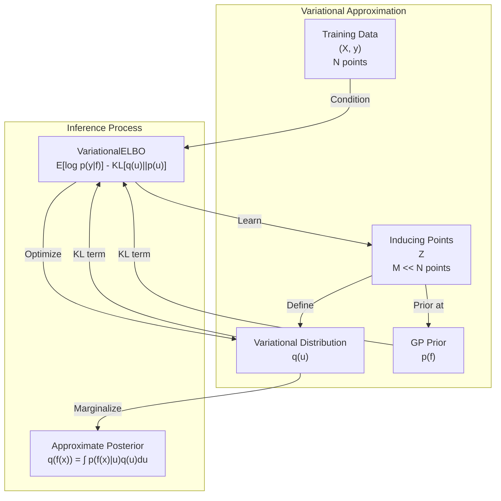
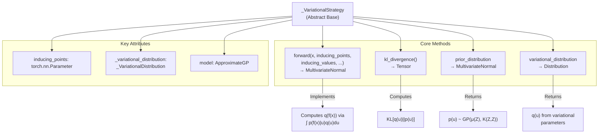
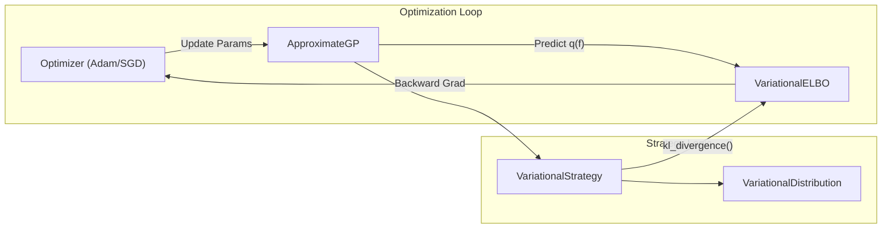

<!-- source: DeepWiki mcp.deepwiki.com · repo cornellius-gp/gpytorch · page 6.2 Variational Inference · fetched 2026-10-21 -->

# Variational Inference

Relevant source files

The following files were used as context for generating this wiki page:

- [docs/source/constraints.rst](docs/source/constraints.rst)
- [docs/source/marginal_log_likelihoods.rst](docs/source/marginal_log_likelihoods.rst)
- [gpytorch/mlls/__init__.py](gpytorch/mlls/__init__.py)
- [gpytorch/mlls/gamma_robust_variational_elbo.py](gpytorch/mlls/gamma_robust_variational_elbo.py)
- [gpytorch/mlls/predictive_log_likelihood.py](gpytorch/mlls/predictive_log_likelihood.py)
- [gpytorch/mlls/variational_elbo.py](gpytorch/mlls/variational_elbo.py)
- [gpytorch/models/__init__.py](gpytorch/models/__init__.py)
- [gpytorch/variational/__init__.py](gpytorch/variational/__init__.py)
- [gpytorch/variational/_variational_distribution.py](gpytorch/variational/_variational_distribution.py)
- [gpytorch/variational/_variational_strategy.py](gpytorch/variational/_variational_strategy.py)
- [gpytorch/variational/additive_grid_interpolation_variational_strategy.py](gpytorch/variational/additive_grid_interpolation_variational_strategy.py)
- [gpytorch/variational/batch_decoupled_variational_strategy.py](gpytorch/variational/batch_decoupled_variational_strategy.py)
- [gpytorch/variational/cholesky_variational_distribution.py](gpytorch/variational/cholesky_variational_distribution.py)
- [gpytorch/variational/ciq_variational_strategy.py](gpytorch/variational/ciq_variational_strategy.py)
- [gpytorch/variational/delta_variational_distribution.py](gpytorch/variational/delta_variational_distribution.py)
- [gpytorch/variational/grid_interpolation_variational_strategy.py](gpytorch/variational/grid_interpolation_variational_strategy.py)
- [gpytorch/variational/independent_multitask_variational_strategy.py](gpytorch/variational/independent_multitask_variational_strategy.py)
- [gpytorch/variational/large_batch_variational_strategy.py](gpytorch/variational/large_batch_variational_strategy.py)
- [gpytorch/variational/lmc_variational_strategy.py](gpytorch/variational/lmc_variational_strategy.py)
- [gpytorch/variational/mean_field_variational_distribution.py](gpytorch/variational/mean_field_variational_distribution.py)
- [gpytorch/variational/natural_variational_distribution.py](gpytorch/variational/natural_variational_distribution.py)
- [gpytorch/variational/nearest_neighbor_variational_strategy.py](gpytorch/variational/nearest_neighbor_variational_strategy.py)
- [gpytorch/variational/orthogonally_decoupled_variational_strategy.py](gpytorch/variational/orthogonally_decoupled_variational_strategy.py)
- [gpytorch/variational/tril_natural_variational_distribution.py](gpytorch/variational/tril_natural_variational_distribution.py)
- [gpytorch/variational/unwhitened_variational_strategy.py](gpytorch/variational/unwhitened_variational_strategy.py)
- [gpytorch/variational/variational_strategy.py](gpytorch/variational/variational_strategy.py)
- [test/variational/test_large_batch_variational_strategy.py](test/variational/test_large_batch_variational_strategy.py)
- [test/variational/test_nearest_neighbor_variational_strategy.py](test/variational/test_nearest_neighbor_variational_strategy.py)

This page describes GPyTorch's variational inference framework for scalable Gaussian Process modeling. Variational inference approximates the intractable GP posterior using a simpler distribution parameterized by inducing points, enabling efficient training on large datasets.

For exact inference methods, see [Exact Inference](#6.1). For scalability techniques that use variational inference, see [Stochastic Variational Inference](#7.2).

## Core Concepts

### Variational Approximation Framework

Variational inference approximates the true GP posterior $p(f \mid \mathbf{X}, \mathbf{y})$ with a tractable variational distribution $q(f)$. This is done by introducing a set of $M \ll N$ **inducing points** $\mathbf{Z}$ with corresponding function values $\mathbf{u} = f(\mathbf{Z})$.

The variational distribution over inducing values $q(\mathbf{u})$ is chosen (typically Gaussian), and the approximate posterior at any test point is obtained by marginalizing:

$$q( f(\mathbf{X}) ) = \int p( f(\mathbf{X}) \mid \mathbf{u}) q(\mathbf{u}) \: d\mathbf{u}$$

Training optimizes the **Evidence Lower BOund (ELBO)**, implemented in `VariationalELBO` [gpytorch/mlls/variational_elbo.py:8-60]():

$$\mathcal{L}_\text{ELBO} \approx \sum_{i=1}^N \mathbb{E}_{q( f_i)} \left[ \log p( y_i \! \mid \! f_i) \right] - \beta \: \text{KL} \left[ q( \mathbf{u}) \Vert p( \mathbf{u}) \right]$$

The first term is the expected log-likelihood (computed via `likelihood.expected_log_prob`), and the second is the KL divergence between the variational and prior inducing distributions [gpytorch/mlls/variational_elbo.py:62-79]().

Sources: [gpytorch/variational/_variational_strategy.py:48-166](), [gpytorch/mlls/variational_elbo.py:8-60]()

### Inducing Points and Variational Distributions

**Inducing points** $\mathbf{Z}$ are pseudo-inputs that summarize training data. In `_VariationalStrategy`, they are registered as parameters if `learn_inducing_locations=True`, or as buffers otherwise [gpytorch/variational/_variational_strategy.py:70-78]().

The **variational distribution** $q(\mathbf{u})$ represents the belief about inducing function values. The base class `_VariationalDistribution` defines the interface for these objects [gpytorch/variational/_variational_distribution.py:13-61]().

| Class | Description | Sources |
| :--- | :--- | :--- |
| `CholeskyVariationalDistribution` | Full covariance Gaussian parameterized by a mean vector and Cholesky factor. | [gpytorch/variational/cholesky_variational_distribution.py:12-60]() |
| `MeanFieldVariationalDistribution` | Diagonal covariance Gaussian (independent dimensions). | [gpytorch/variational/mean_field_variational_distribution.py:12-49]() |
| `DeltaVariationalDistribution` | Deterministic point estimate. | [gpytorch/variational/delta_variational_distribution.py:11-41]() |
| `NaturalVariationalDistribution` | Gaussian parameterized by natural parameters for NGD. | [gpytorch/variational/natural_variational_distribution.py:12-92]() |

## Base Strategy Architecture

All variational strategies inherit from `_VariationalStrategy`, which provides the logic for marginalization and KL divergence computation [gpytorch/variational/_variational_strategy.py:48-51]().

Sources: [gpytorch/variational/_variational_strategy.py:48-166]()

### Key Methods

| Method | Purpose | Returns |
| :--- | :--- | :--- |
| `forward(...)` | Marginalizes inducing points to get $q(f(x))$ [gpytorch/variational/_variational_strategy.py:123-157]() | `MultivariateNormal` |
| `kl_divergence()` | Computes KL term between $q(\mathbf{u})$ and $p(\mathbf{u})$ [gpytorch/variational/_variational_strategy.py:159-166]() | `Tensor` |
| `prior_distribution` | Computes the GP prior at inducing locations $p(\mathbf{u})$ [gpytorch/variational/_variational_strategy.py:105-116]() | `MultivariateNormal` |
| `variational_distribution` | Accesses the current $q(\mathbf{u})$ [gpytorch/variational/_variational_strategy.py:118-121]() | `Distribution` |

## Strategy Hierarchy

GPyTorch provides specialized strategies optimized for different data structures and computational constraints [gpytorch/variational/__init__.py:7-25]().

### VariationalStrategy (Standard Whitened)
The default strategy (Hensman et al., 2015) uses "whitening" to transform variational parameters into a space where the prior is $\mathcal{N}(0, I)$, accelerating optimization [gpytorch/variational/variational_strategy.py:142-156]().

**Predictive Updates:**
It uses a custom autograd function `ComputePredictiveUpdates` for efficient backward passes when $M \ll N$, rearranging operations to save matrix multiplications [gpytorch/variational/variational_strategy.py:59-140]().

**When to Use:**
- Default for most problems.
- $M < 5000$ inducing points.
- Standard SVGPs.

### UnwhitenedVariationalStrategy
Similar to the standard strategy but operates directly on the inducing values $\mathbf{u}$ without whitening [gpytorch/variational/unwhitened_variational_strategy.py:29-52]().

**When to Use:**
- When inducing points equal training points ($\mathbf{Z} = \mathbf{X}$).
- Very large number of inducing points where CG is preferred [gpytorch/variational/unwhitened_variational_strategy.py:38-40]().

### NNVariationalStrategy (VNNGP)
Implements Variational Nearest Neighbor GPs (Wu et al., 2022). It sets inducing locations to observed inputs and uses a $k$-nearest-neighbor approximation [gpytorch/variational/nearest_neighbor_variational_strategy.py:24-46]().

**Complexity:**
- Training/Inference: $O(k^3)$ after one-time $k$-NN search [gpytorch/variational/nearest_neighbor_variational_strategy.py:38-40]().
- Only supports `MeanFieldVariationalDistribution` [gpytorch/variational/nearest_neighbor_variational_strategy.py:88-90]().

### BatchDecoupledVariationalStrategy
Uses different inducing points for the variational mean ($\mathbf{Z}_\mu$) and variational covariance ($\mathbf{Z}_\sigma$) [gpytorch/variational/batch_decoupled_variational_strategy.py:19-45]().

**When to Use:**
- When mean and variance require different levels of approximation.
- With `PredictiveLogLikelihood` for PPGPR [gpytorch/variational/batch_decoupled_variational_strategy.py:47-51]().

### GridInterpolationVariationalStrategy
Constrains inducing points to a grid and applies deterministic interpolation [gpytorch/variational/grid_interpolation_variational_strategy.py:17-37]().

**Key Features:**
- Inducing points are not learned [gpytorch/variational/grid_interpolation_variational_strategy.py:54]().
- Covariance is represented as an `InterpolatedLinearOperator` [gpytorch/variational/grid_interpolation_variational_strategy.py:108-114]().

### CiqVariationalStrategy
Uses Contour Integral Quadrature (CIQ) for whitening instead of Cholesky, allowing for $O(N)$ or $O(N \log N)$ scaling with structured kernels [gpytorch/variational/ciq_variational_strategy.py:20-50]().

## Scalability and Optimization

### LargeBatchVariationalStrategy
Optimized for very large mini-batches. It uses a custom autograd function `QuadFormDiagonal` to compute predictive variances more efficiently during training [gpytorch/variational/large_batch_variational_strategy.py:20-40]().

**Caching:**
In `eval` mode, it caches `_cached_inv_chol_t_inducing_values` and `_cached_middle_term` to speed up repeated inferences [gpytorch/variational/large_batch_variational_strategy.py:102-125]().

### ELBO Optimization
The ELBO is optimized using standard PyTorch optimizers. `VariationalELBO` computes the loss by summing the expected log likelihood and the KL divergence (scaled by $\beta$) [gpytorch/mlls/variational_elbo.py:16-35]().

Sources: [gpytorch/mlls/variational_elbo.py:47-54](), [gpytorch/variational/variational_strategy.py:142-273]()

### Inducing Point Selection
Inducing points are typically initialized as a random subset of the training data or a grid. Classes like `GridInterpolationVariationalStrategy` automate grid creation [gpytorch/variational/grid_interpolation_variational_strategy.py:39-54](). In standard strategies, `inducing_points` is a `torch.nn.Parameter` that is optimized via backpropagation alongside kernel hyperparameters [gpytorch/variational/_variational_strategy.py:70-78]().

Sources: [gpytorch/variational/variational_strategy.py:142-273](), [gpytorch/variational/grid_interpolation_variational_strategy.py:17-54](), [gpytorch/variational/nearest_neighbor_variational_strategy.py:78-121]()

---

