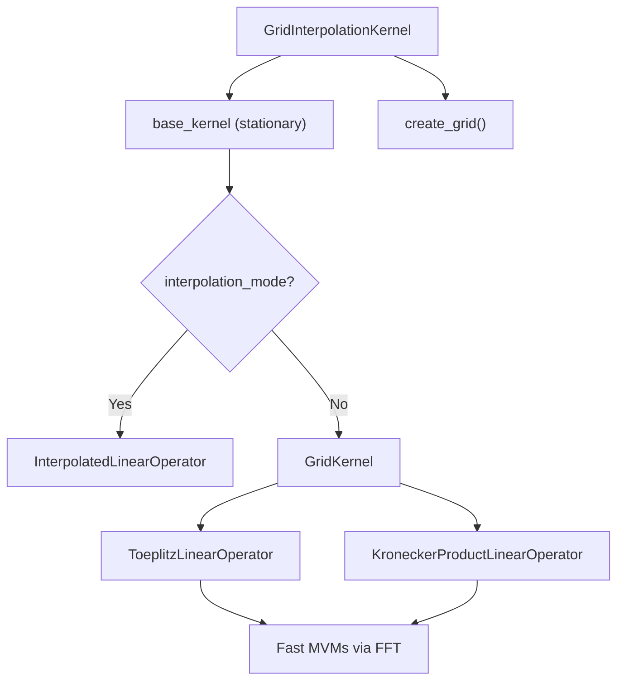
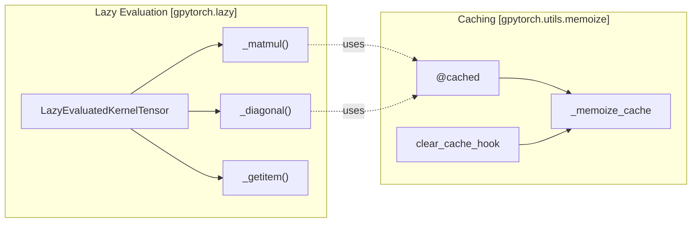

<!-- source: DeepWiki mcp.deepwiki.com · repo cornellius-gp/gpytorch · page 7 Scalability Techniques · fetched 2026-10-21 -->

# Scalability Techniques

Relevant source files

The following files were used as context for generating this wiki page:

- [gpytorch/__init__.py](gpytorch/__init__.py)
- [gpytorch/beta_features.py](gpytorch/beta_features.py)
- [gpytorch/functions/__init__.py](gpytorch/functions/__init__.py)
- [gpytorch/kernels/additive_structure_kernel.py](gpytorch/kernels/additive_structure_kernel.py)
- [gpytorch/kernels/grid_interpolation_kernel.py](gpytorch/kernels/grid_interpolation_kernel.py)
- [gpytorch/kernels/grid_kernel.py](gpytorch/kernels/grid_kernel.py)
- [gpytorch/kernels/inducing_point_kernel.py](gpytorch/kernels/inducing_point_kernel.py)
- [gpytorch/kernels/multitask_kernel.py](gpytorch/kernels/multitask_kernel.py)
- [gpytorch/kernels/product_structure_kernel.py](gpytorch/kernels/product_structure_kernel.py)
- [gpytorch/lazy/__init__.py](gpytorch/lazy/__init__.py)
- [test/kernels/test_grid_interpolation_kernel.py](test/kernels/test_grid_interpolation_kernel.py)
- [test/kernels/test_grid_kernel.py](test/kernels/test_grid_kernel.py)

This page provides an overview of the three primary approaches GPyTorch uses to scale Gaussian Process models to large datasets. Traditional GP inference requires $O(n^3)$ computation and $O(n^2)$ storage for $n$ data points. GPyTorch addresses this through:

1.  **Structured Kernels**: Exploiting mathematical structure in covariance matrices (page 7.1)
2.  **Variational Inference**: Approximating the posterior with inducing points (page 7.2)
3.  **Lazy Evaluation**: Deferring and caching expensive computations (page 7.3)

These techniques can be combined to achieve near-linear scaling for many problems. Detailed coverage of specific methods is provided in the subsections.

## Overview of Scalability Approaches

The following diagram illustrates how GPyTorch's main scalability techniques reduce computational complexity by mapping high-level concepts to their primary code entities:

**Diagram: Computational Complexity and Code Mapping**

Sources: [gpytorch/lazy/lazy_evaluated_kernel_tensor.py:5-8](), [gpytorch/kernels/grid_kernel.py:17-47](), [gpytorch/kernels/multitask_kernel.py:13-45](), [gpytorch/kernels/inducing_point_kernel.py:27-38]()

## Structured Kernels

Structured kernels exploit mathematical patterns in the covariance matrix for efficient computation. GPyTorch implements several structured kernel types that return specialized `LinearOperator` objects from the `linear_operator` library.

### GridKernel and GridInterpolationKernel (KISS-GP)

When data lies on a regular grid, `GridKernel` exploits `ToeplitzLinearOperator` and `KroneckerProductLinearOperator` structure [gpytorch/kernels/grid_kernel.py:9-10](). For off-grid data, `GridInterpolationKernel` (implementing KISS-GP/SKI) interpolates to a grid using sparse interpolation matrices [gpytorch/kernels/grid_interpolation_kernel.py:16-43]().

**Diagram: Grid Kernel Logic Flow**

**Key Classes:**
*   `GridKernel` ([gpytorch/kernels/grid_kernel.py:17-47]()): Base class for grid-structured covariances.
*   `GridInterpolationKernel` ([gpytorch/kernels/grid_interpolation_kernel.py:16-70]()): Implements the SKI/KISS-GP approximation.
*   `MultitaskKernel` ([gpytorch/kernels/multitask_kernel.py:13-45]()): Uses Kronecker products to scale multi-output GPs.

For details, see [KISS-GP and SKI](#7.1).

Sources: [gpytorch/kernels/grid_kernel.py:17-47](), [gpytorch/kernels/grid_interpolation_kernel.py:16-70](), [gpytorch/kernels/multitask_kernel.py:13-45]()

## Stochastic Variational Inference

Variational inference approximates the GP posterior using a set of $m$ inducing points. This allows for mini-batch training, which is essential for datasets that do not fit in memory.

### Variational Strategies

The `VariationalStrategy` defines how the latent function $f$ is related to the inducing variables $u$. GPyTorch provides several strategies to handle different scalability needs.

| Strategy | Code Entity | Use Case |
| :--- | :--- | :--- |
| Standard | `VariationalStrategy` | Default whitened variational inference. |
| Unwhitened | `UnwhitenedVariationalStrategy` | When inducing points are the training points ($Z=X$). |
| Multi-task | `LMCVariationalStrategy` | Efficient multi-output variational GPs. |
| Large Inducing | `CiqVariationalStrategy` | Scaling to tens of thousands of inducing points. |

For details, see [Stochastic Variational Inference](#7.2).

Sources: [gpytorch/kernels/inducing_point_kernel.py:107-112](), [gpytorch/variational/__init__.py:1-26]()

## Efficient Linear Algebra and Lazy Evaluation

GPyTorch relies heavily on "Lazy Evaluation" to avoid forming large dense matrices. The `LazyEvaluatedKernelTensor` is the core mechanism for this, deferring the evaluation of kernel functions until a matrix-vector multiplication (MVM) or diagonal access is required.

### LazyEvaluatedKernelTensor

Instead of computing an $n \times n$ matrix, `LazyEvaluatedKernelTensor` stores the inputs and the kernel module.

**Diagram: Lazy Evaluation and Caching**

**Key Features:**
*   **Checkpointing**: `checkpoint_kernel` settings allow computing kernels in chunks to save GPU memory at the cost of compute [gpytorch/beta_features.py:26-40]().
*   **Structured Operators**: Integration with `linear_operator` for `Toeplitz`, `Kronecker`, and `LowRank` structures [gpytorch/__init__.py:5-7]().

For details, see [Efficient Linear Algebra](#7.3).

Sources: [gpytorch/lazy/lazy_evaluated_kernel_tensor.py:5-8](), [gpytorch/beta_features.py:26-40](), [gpytorch/__init__.py:5-7]()

## InducingPointKernel (SGPR)

The `InducingPointKernel` implements Sparse Gaussian Process Regression (SGPR). It approximates the covariance using a low-rank structure: $K \approx K_{XU} K_{UU}^{-1} K_{UX}$.

*   **Low-Rank Representation**: Uses `LowRankRootLinearOperator` for the approximation [gpytorch/kernels/inducing_point_kernel.py:78]().
*   **Diagonal Correction**: Includes an optional correction term for predictive variances [gpytorch/kernels/inducing_point_kernel.py:81-83]().
*   **Loss Terms**: Automatically adds an `InducingPointKernelAddedLossTerm` to the MLL during training [gpytorch/kernels/inducing_point_kernel.py:107-112]().

Sources: [gpytorch/kernels/inducing_point_kernel.py:75-90](), [gpytorch/kernels/inducing_point_kernel.py:107-112]()

---

