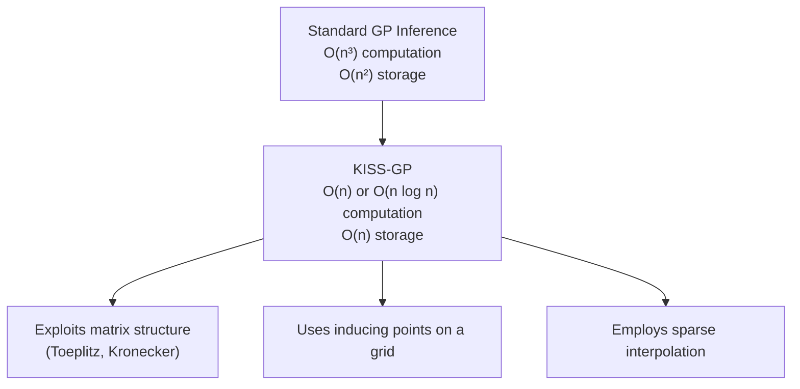
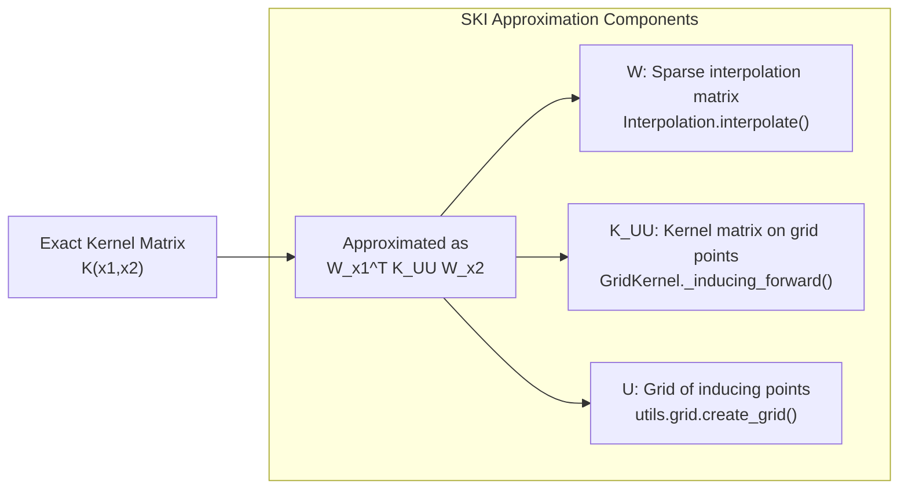
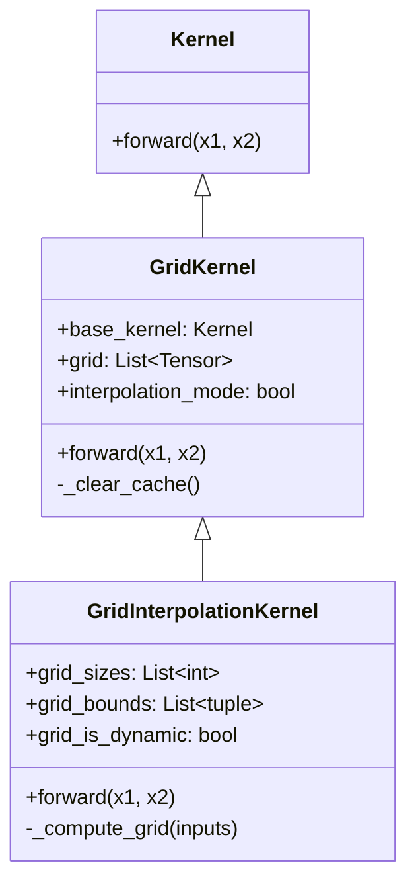
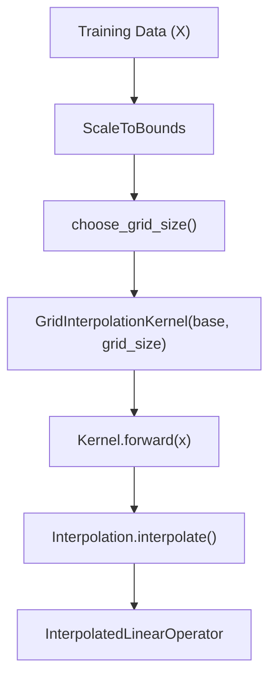

<!-- source: DeepWiki mcp.deepwiki.com · repo cornellius-gp/gpytorch · page 7.1 KISS-GP and SKI · fetched 2026-10-21 -->

# KISS-GP and SKI

Relevant source files

The following files were used as context for generating this wiki page:

- [.pyre_configuration](.pyre_configuration)
- [docs/source/functions.rst](docs/source/functions.rst)
- [docs/source/utils.rst](docs/source/utils.rst)
- [examples/04_Variational_and_Approximate_GPs/Non_Gaussian_Likelihoods.ipynb](examples/04_Variational_and_Approximate_GPs/Non_Gaussian_Likelihoods.ipynb)
- [examples/06_PyTorch_NN_Integration_DKL/Deep_Kernel_Learning_DenseNet_CIFAR_Tutorial.ipynb](examples/06_PyTorch_NN_Integration_DKL/Deep_Kernel_Learning_DenseNet_CIFAR_Tutorial.ipynb)
- [examples/07_Pyro_Integration/Clustered_Multitask_GP_Regression.ipynb](examples/07_Pyro_Integration/Clustered_Multitask_GP_Regression.ipynb)
- [examples/07_Pyro_Integration/Cox_Process_Example.ipynb](examples/07_Pyro_Integration/Cox_Process_Example.ipynb)
- [examples/07_Pyro_Integration/Pyro_GPyTorch_High_Level.ipynb](examples/07_Pyro_Integration/Pyro_GPyTorch_High_Level.ipynb)
- [examples/07_Pyro_Integration/Pyro_GPyTorch_Low_Level.ipynb](examples/07_Pyro_Integration/Pyro_GPyTorch_Low_Level.ipynb)
- [gpytorch/kernels/additive_structure_kernel.py](gpytorch/kernels/additive_structure_kernel.py)
- [gpytorch/kernels/grid_interpolation_kernel.py](gpytorch/kernels/grid_interpolation_kernel.py)
- [gpytorch/kernels/grid_kernel.py](gpytorch/kernels/grid_kernel.py)
- [gpytorch/kernels/inducing_point_kernel.py](gpytorch/kernels/inducing_point_kernel.py)
- [gpytorch/kernels/multitask_kernel.py](gpytorch/kernels/multitask_kernel.py)
- [gpytorch/kernels/product_structure_kernel.py](gpytorch/kernels/product_structure_kernel.py)
- [gpytorch/utils/__init__.py](gpytorch/utils/__init__.py)
- [gpytorch/utils/grid.py](gpytorch/utils/grid.py)
- [gpytorch/utils/interpolation.py](gpytorch/utils/interpolation.py)
- [gpytorch/utils/lanczos.py](gpytorch/utils/lanczos.py)
- [gpytorch/utils/quadrature.py](gpytorch/utils/quadrature.py)
- [gpytorch/utils/sparse.py](gpytorch/utils/sparse.py)
- [gpytorch/utils/toeplitz.py](gpytorch/utils/toeplitz.py)
- [test/examples/test_grid_gp_regression.py](test/examples/test_grid_gp_regression.py)
- [test/examples/test_kissgp_additive_classification.py](test/examples/test_kissgp_additive_classification.py)
- [test/examples/test_kissgp_additive_regression.py](test/examples/test_kissgp_additive_regression.py)
- [test/examples/test_kissgp_gp_regression.py](test/examples/test_kissgp_gp_regression.py)
- [test/examples/test_kissgp_kronecker_product_classification.py](test/examples/test_kissgp_kronecker_product_classification.py)
- [test/examples/test_kissgp_kronecker_product_regression.py](test/examples/test_kissgp_kronecker_product_regression.py)
- [test/examples/test_kissgp_multiplicative_regression.py](test/examples/test_kissgp_multiplicative_regression.py)
- [test/examples/test_simple_gp_classification.py](test/examples/test_simple_gp_classification.py)
- [test/kernels/test_grid_interpolation_kernel.py](test/kernels/test_grid_interpolation_kernel.py)
- [test/kernels/test_grid_kernel.py](test/kernels/test_grid_kernel.py)
- [test/utils/test_quadrature.py](test/utils/test_quadrature.py)

This document explains the Kernel Interpolation for Scalable Structured Gaussian Processes (KISS-GP) and Structured Kernel Interpolation (SKI) methods implemented in GPyTorch. These techniques enable scaling Gaussian Process inference to much larger datasets by efficiently approximating kernel matrices using structured interpolation methods.

For information about other scalability techniques like Stochastic Variational Inference, see [Stochastic Variational Inference](#7.2), and for efficient linear algebra techniques, see [Efficient Linear Algebra](#7.3).

## 1. Introduction to KISS-GP and SKI

KISS-GP, introduced by Wilson and Nickisch (2015), is a method for scaling Gaussian Processes to large datasets. The key insight is representing kernel matrices through sparse approximations that leverage structured matrices, which enables:

- Reducing the standard $O(n^3)$ computational complexity for exact GPs to $O(n)$ or $O(n \log n)$
- Decreasing memory requirements from $O(n^2)$ to $O(n)$
- Enabling inference on datasets with millions of points

SKI (Structured Kernel Interpolation) provides the underlying mathematical framework for KISS-GP by approximating kernel matrices through interpolation from a grid of inducing points.

Sources: [gpytorch/kernels/grid_kernel.py:19-24](), [gpytorch/kernels/grid_interpolation_kernel.py:18-20]()

## 2. Structured Kernel Interpolation (SKI)

The core idea behind SKI is to approximate the exact kernel matrix using interpolation from a fixed grid of inducing points. For inputs $x_1$ and $x_2$, a kernel function $k(x_1, x_2)$ is approximated as:

$$k(x_1, x_2) \approx \mathbf{w}_{x_1}^\top K_{U,U} \mathbf{w}_{x_2}$$

This approximation leads to the computational benefits of KISS-GP because:

1. The interpolation matrices $W$ are sparse (typically cubic interpolation).
2. The grid kernel matrix $K_{UU}$ has Toeplitz or Kronecker structure (for stationary kernels).
3. Matrix-vector multiplications (MVMs) on structured matrices are much faster than dense MVMs.

Sources: [gpytorch/kernels/grid_interpolation_kernel.py:22-39](), [gpytorch/utils/interpolation.py:15-42](), [gpytorch/kernels/grid_kernel.py:22-24]()

## 3. Implementation in GPyTorch

GPyTorch implements SKI and KISS-GP primarily through the `GridKernel` and `GridInterpolationKernel` classes.

Sources: [gpytorch/kernels/grid_kernel.py:17-47](), [gpytorch/kernels/grid_interpolation_kernel.py:16-70]()

### 3.1. GridKernel

`GridKernel` is designed for when your input data is already on a regular grid. It exploits the Toeplitz and Kronecker structure within the kernel matrix for efficient computation [gpytorch/kernels/grid_kernel.py:19-24]().

Key features:
- Wraps a **stationary** base kernel [gpytorch/kernels/grid_kernel.py:58-59]().
- Exploits `ToeplitzLinearOperator` when grid points are equally spaced [gpytorch/kernels/grid_kernel.py:140-152]().
- Uses `KroneckerProductLinearOperator` for multidimensional grids [gpytorch/kernels/grid_kernel.py:158-159]().

### 3.2. GridInterpolationKernel (KISS-GP)

`GridInterpolationKernel` implements the full KISS-GP approximation for arbitrary input locations [gpytorch/kernels/grid_interpolation_kernel.py:18-20]().

- **Dynamic Grid**: If `grid_bounds` are not provided, it automatically determines bounds from the data and updates the grid if points fall outside `_tight_grid_bounds` [gpytorch/kernels/grid_interpolation_kernel.py:150-175]().
- **Interpolation**: It uses `gpytorch.utils.interpolation.Interpolation` to compute the sparse weights $W$ [gpytorch/kernels/grid_interpolation_kernel.py:140-143]().
- **Data Flow**:
    1. `_compute_grid` calculates interpolation indices and values [gpytorch/kernels/grid_interpolation_kernel.py:132-143]().
    2. `_inducing_forward` computes the structured $K_{UU}$ [gpytorch/kernels/grid_interpolation_kernel.py:145-146]().
    3. The result is returned as an `InterpolatedLinearOperator` [gpytorch/kernels/grid_interpolation_kernel.py:195]().

Sources: [gpytorch/kernels/grid_interpolation_kernel.py:132-195](), [gpytorch/utils/interpolation.py:44-110]()

## 4. Structured Kernel Variants

GPyTorch supports specialized structures to handle the "curse of dimensionality" in KISS-GP:

### 4.1. Additive and Product Structure
For high-dimensional data, a single $d$-dimensional grid becomes computationally expensive. Users often decompose the kernel:

- **AdditiveStructureKernel**: $k(x, z) = \sum k_i(x_i, z_i)$. Used in `test_kissgp_additive_regression.py` [test/examples/test_kissgp_additive_regression.py:40-42]().
- **ProductStructureKernel**: $k(x, z) = \prod k_i(x_i, z_i)$. Used in `test_kissgp_multiplicative_regression.py` [test/examples/test_kissgp_multiplicative_regression.py:46-48]().

### 4.2. Kronecker Structure
If the data lies on a full Cartesian product grid, `GridInterpolationKernel` uses `KroneckerProductLinearOperator` to avoid forming the full $O(m^d \times m^d)$ matrix [gpytorch/kernels/grid_kernel.py:159]().

Sources: [test/examples/test_kissgp_additive_regression.py:40-42](), [test/examples/test_kissgp_multiplicative_regression.py:46-48](), [gpytorch/kernels/grid_kernel.py:158-159]()

## 5. Prediction Strategies

For `ExactGP` models using interpolation, GPyTorch employs the `InterpolatedPredictionStrategy` [gpytorch/kernels/grid_interpolation_kernel.py:9](). This strategy is optimized to handle the `InterpolatedLinearOperator` returned by the kernel, ensuring that predictive means and variances benefit from the $O(n)$ or $O(n \log n)$ complexity.

Sources: [gpytorch/kernels/grid_interpolation_kernel.py:9](), [gpytorch/models/exact_prediction_strategies.py]()

## 6. Usage and Configuration

### 6.1. Choosing Grid Size
The helper `gpytorch.utils.grid.choose_grid_size` assists in selecting an appropriate number of inducing points based on the number of data points and the presence of Kronecker structure [gpytorch/utils/grid.py:80-100]().

### 6.2. Settings
Several settings impact KISS-GP performance:
- `gpytorch.settings.use_toeplitz(True/False)`: Enables or disables the exploitation of Toeplitz structure in the grid kernel [gpytorch/kernels/grid_kernel.py:140]().
- `gpytorch.settings.fast_pred_var()`: Enables fast predictive variances, which is highly recommended for KISS-GP models [test/examples/test_kissgp_additive_regression.py:69]().

Sources: [gpytorch/utils/grid.py:80-100](), [gpytorch/kernels/grid_kernel.py:140](), [gpytorch/utils/grid.py:11-31]()

## 7. Performance Considerations

| Feature | Exact GP | KISS-GP (SKI) |
| :--- | :--- | :--- |
| **Complexity** | $O(n^3)$ | $O(n + \text{poly}(m))$ |
| **Storage** | $O(n^2)$ | $O(n + m)$ |
| **Kernel Type** | Any | Stationary (for Toeplitz/Kronecker) |
| **Structure** | Dense | Interpolated / Toeplitz / Kronecker |

Where $n$ is the number of data points and $m$ is the number of grid points per dimension.

Sources: [gpytorch/kernels/grid_interpolation_kernel.py:18-20](), [gpytorch/kernels/grid_kernel.py:19-24]()

---

