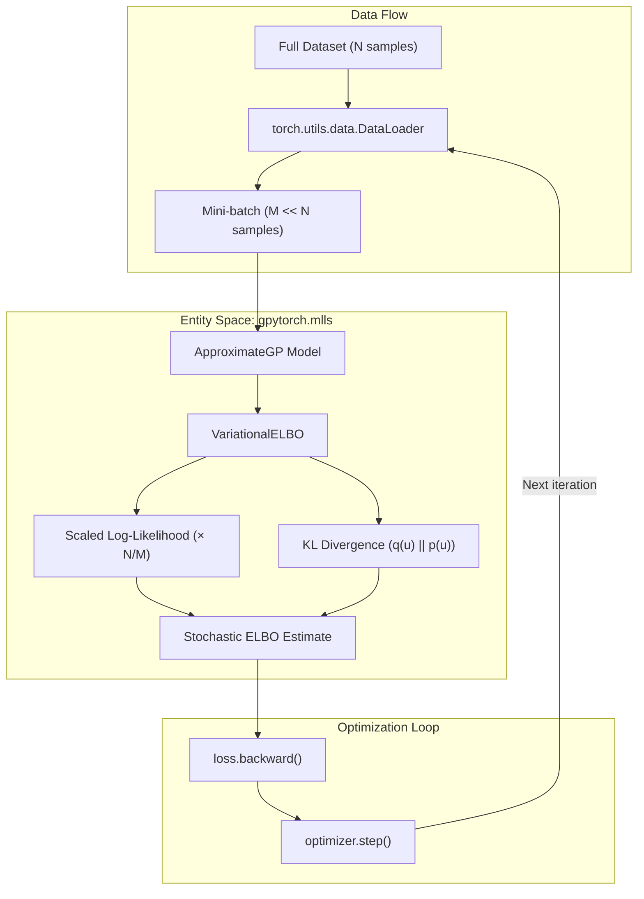
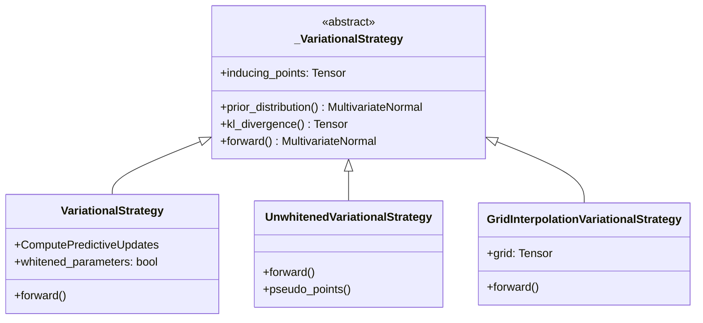

<!-- source: DeepWiki mcp.deepwiki.com · repo cornellius-gp/gpytorch · page 7.2 Stochastic Variational Inference · fetched 2026-10-21 -->

# Stochastic Variational Inference

<details>
<summary>Relevant source files</summary>

The following files were used as context for generating this wiki page:

- [docs/source/keops_kernels.rst](docs/source/keops_kernels.rst)
- [docs/source/variational.rst](docs/source/variational.rst)
- [examples/04_Variational_and_Approximate_GPs/GP_Regression_with_Uncertain_Inputs.ipynb](examples/04_Variational_and_Approximate_GPs/GP_Regression_with_Uncertain_Inputs.ipynb)
- [examples/04_Variational_and_Approximate_GPs/PolyaGamma_Binary_Classification.ipynb](examples/04_Variational_and_Approximate_GPs/PolyaGamma_Binary_Classification.ipynb)
- [examples/04_Variational_and_Approximate_GPs/SVGP_Multitask_GP_Regression.ipynb](examples/04_Variational_and_Approximate_GPs/SVGP_Multitask_GP_Regression.ipynb)
- [examples/04_Variational_and_Approximate_GPs/index.rst](examples/04_Variational_and_Approximate_GPs/index.rst)
- [gpytorch/variational/_variational_strategy.py](gpytorch/variational/_variational_strategy.py)
- [gpytorch/variational/grid_interpolation_variational_strategy.py](gpytorch/variational/grid_interpolation_variational_strategy.py)
- [gpytorch/variational/unwhitened_variational_strategy.py](gpytorch/variational/unwhitened_variational_strategy.py)
- [gpytorch/variational/variational_strategy.py](gpytorch/variational/variational_strategy.py)
- [test/examples/test_batch_decoupled_ppgpr_regression.py](test/examples/test_batch_decoupled_ppgpr_regression.py)
- [test/examples/test_batch_svgp_gp_regression.py](test/examples/test_batch_svgp_gp_regression.py)
- [test/examples/test_decoupled_svgp_regression.py](test/examples/test_decoupled_svgp_regression.py)
- [test/examples/test_lmc_svgp_regression.py](test/examples/test_lmc_svgp_regression.py)
- [test/examples/test_svgp_gp_classification.py](test/examples/test_svgp_gp_classification.py)
- [test/examples/test_svgp_gp_regression.py](test/examples/test_svgp_gp_regression.py)
- [test/examples/test_unwhitened_svgp_regression.py](test/examples/test_unwhitened_svgp_regression.py)
- [test/models/test_exact_gp.py](test/models/test_exact_gp.py)
- [test/models/test_variational_gp.py](test/models/test_variational_gp.py)
- [test/variational/test_batch_decoupled_variational_strategy.py](test/variational/test_batch_decoupled_variational_strategy.py)
- [test/variational/test_ciq_variational_strategy.py](test/variational/test_ciq_variational_strategy.py)
- [test/variational/test_grid_interpolation_variational_strategy.py](test/variational/test_grid_interpolation_variational_strategy.py)
- [test/variational/test_independent_multitask_variational_strategy.py](test/variational/test_independent_multitask_variational_strategy.py)
- [test/variational/test_lmc_variational_strategy.py](test/variational/test_lmc_variational_strategy.py)
- [test/variational/test_orthogonally_decoupled_variational_strategy.py](test/variational/test_orthogonally_decoupled_variational_strategy.py)
- [test/variational/test_unwhitened_variational_strategy.py](test/variational/test_unwhitened_variational_strategy.py)
- [test/variational/test_variational_strategy.py](test/variational/test_variational_strategy.py)

</details>


This document explains the implementation of stochastic variational inference (SVI) in GPyTorch. SVI enables scaling variational Gaussian Process models to large datasets by using mini-batch optimization, typically optimized via the Evidence Lower Bound (ELBO).

## Overview

Stochastic Variational Inference combines variational inference with stochastic optimization. Instead of computing gradients over the entire dataset, GPyTorch processes small mini-batches of data in each optimization step. This approach is computationally efficient and is the standard way to scale GPs to millions of data points.



Sources: [test/examples/test_svgp_gp_regression.py:67-100](), [test/examples/test_batch_svgp_gp_regression.py:77-100]()

## Variational ELBO with Mini-Batches

The Evidence Lower Bound (ELBO) in GPyTorch is implemented in `_ApproximateMarginalLogLikelihood` subclasses. When using mini-batches, the log-likelihood term must be scaled by the ratio of total data points to the current batch size to remain an unbiased estimate.

### Scaling the Log-Likelihood

The `VariationalELBO` class requires the `num_data` parameter during initialization to handle this scaling automatically:

```python
# num_data is N (total training points)
mll = gpytorch.mlls.VariationalELBO(likelihood, model, num_data=len(train_y))
```

During the training loop, the `mll` object calculates the expected log likelihood on the mini-batch and scales it by `num_data / batch_x.size(0)` before adding the KL divergence term (which is not scaled as it depends only on inducing points).

Sources: [test/examples/test_svgp_gp_regression.py:81-81](), [test/examples/test_batch_svgp_gp_regression.py:71-71](), [docs/source/variational.rst:17-19]()

## Variational Strategies and Whitening

The core of SVI in GPyTorch is the `VariationalStrategy`. The standard implementation uses "whitening" to decorrelate the variational parameters, which significantly accelerates optimization convergence.

### Implementation Details: `VariationalStrategy`

The `VariationalStrategy` class [gpytorch/variational/variational_strategy.py:142-142]() implements the strategy defined by Hensman et al. (2015). It transforms the variational distribution $q(u)$ into the predictive distribution $q(f)$ via:
$q( f(\mathbf X) ) = \int p( f(\mathbf X) \mid \mathbf u) q(\mathbf u) \: d\mathbf u$.



### Computational Optimization: `ComputePredictiveUpdates`

For large-scale SVI, GPyTorch uses a custom autograd function `ComputePredictiveUpdates` [gpytorch/variational/variational_strategy.py:59-139]() to optimize the backward pass. 

When the number of inducing points $m$ is much smaller than the data points $n$ ($m \ll n$), this implementation is approximately 2x faster than standard PyTorch autograd by rearranging tensor operations and reducing the number of $O(m^2 n)$ matrix multiplications [gpytorch/variational/variational_strategy.py:89-94]().

Sources: [gpytorch/variational/variational_strategy.py:59-139](), [gpytorch/variational/_variational_strategy.py:48-82]()

## Alternative Strategies for SVI

### Unwhitened Variational Strategy
The `UnwhitenedVariationalStrategy` [gpytorch/variational/unwhitened_variational_strategy.py:29-52]() is preferable in specific cases:
- When inducing points are exactly equal to training points ($Z = X$).
- When using very large numbers of inducing points where Conjugate Gradient (CG) is more efficient than Cholesky [gpytorch/variational/unwhitened_variational_strategy.py:38-39]().

### Grid Interpolation (KISS-GP for SVI)
The `GridInterpolationVariationalStrategy` [gpytorch/variational/grid_interpolation_variational_strategy.py:17-37]() constrains inducing points to a grid. It uses `InterpolatedLinearOperator` to map grid function values to data points, enabling $O(n)$ inference time for SVI.

Sources: [gpytorch/variational/unwhitened_variational_strategy.py:29-52](), [gpytorch/variational/grid_interpolation_variational_strategy.py:17-37]()

## Multi-Output SVI

GPyTorch supports multitask SVI by wrapping a base `VariationalStrategy` in a multitask strategy. This is typically used with a batch of latent GPs.

| Class | Description |
| :--- | :--- |
| `LMCVariationalStrategy` | Implements the Linear Model of Coregionalization. Latent GPs are combined linearly to produce outputs [examples/04_Variational_and_Approximate_GPs/SVGP_Multitask_GP_Regression.ipynb:83-87](). |
| `IndependentMultitaskVariationalStrategy` | Treats each task as a completely independent GP [docs/source/variational.rst:117-118](). |

In these models, the `inducing_points` and `variational_distribution` are initialized with a `batch_shape` corresponding to the number of latent functions [examples/04_Variational_and_Approximate_GPs/SVGP_Multitask_GP_Regression.ipynb:104-108]().

Sources: [gpytorch/variational/variational_strategy.py:142-272](), [examples/04_Variational_and_Approximate_GPs/SVGP_Multitask_GP_Regression.ipynb:99-141]()

## Efficiency and Caching

To prevent redundant computations during mini-batch iterations, `_VariationalStrategy` utilizes a caching system via `gpytorch.utils.memoize`.

1.  **Prior Distribution**: The inducing point prior $p(u)$ is cached as `prior_distribution_memo` [gpytorch/variational/_variational_strategy.py:106-107]().
2.  **Variational Distribution**: The current $q(u)$ is cached as `variational_distribution_memo` [gpytorch/variational/_variational_strategy.py:119-120]().
3.  **Cache Clearing**: A `clear_cache_hook` is registered to ensure that caches are invalidated at the start of every new training iteration or when parameters are updated [gpytorch/variational/_variational_strategy.py:83-84]().

Sources: [gpytorch/variational/_variational_strategy.py:83-121](), [gpytorch/variational/variational_strategy.py:33-34]()

---

