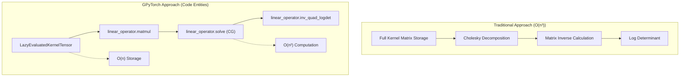
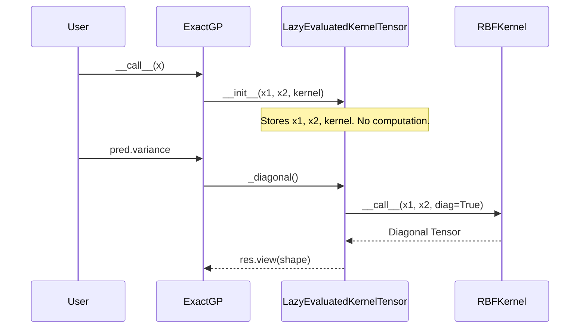

<!-- source: DeepWiki mcp.deepwiki.com · repo cornellius-gp/gpytorch · page 7.3 Efficient Linear Algebra · fetched 2026-10-21 -->

# Efficient Linear Algebra

<details>
<summary>Relevant source files</summary>

The following files were used as context for generating this wiki page:

- [docs/source/functions.rst](docs/source/functions.rst)
- [docs/source/utils.rst](docs/source/utils.rst)
- [gpytorch/__init__.py](gpytorch/__init__.py)
- [gpytorch/beta_features.py](gpytorch/beta_features.py)
- [gpytorch/functions/__init__.py](gpytorch/functions/__init__.py)
- [gpytorch/lazy/__init__.py](gpytorch/lazy/__init__.py)
- [gpytorch/lazy/lazy_evaluated_kernel_tensor.py](gpytorch/lazy/lazy_evaluated_kernel_tensor.py)
- [gpytorch/models/approximate_gp.py](gpytorch/models/approximate_gp.py)
- [gpytorch/models/pyro/_pyro_mixin.py](gpytorch/models/pyro/_pyro_mixin.py)
- [gpytorch/models/pyro/pyro_gp.py](gpytorch/models/pyro/pyro_gp.py)
- [gpytorch/utils/__init__.py](gpytorch/utils/__init__.py)
- [gpytorch/utils/interpolation.py](gpytorch/utils/interpolation.py)
- [gpytorch/utils/lanczos.py](gpytorch/utils/lanczos.py)
- [gpytorch/utils/quadrature.py](gpytorch/utils/quadrature.py)
- [gpytorch/utils/sparse.py](gpytorch/utils/sparse.py)
- [gpytorch/utils/toeplitz.py](gpytorch/utils/toeplitz.py)
- [test/examples/test_pyro_integration.py](test/examples/test_pyro_integration.py)
- [test/lazy/test_lazy_evaluated_kernel_tensor.py](test/lazy/test_lazy_evaluated_kernel_tensor.py)
- [test/utils/test_quadrature.py](test/utils/test_quadrature.py)

</details>


## Purpose and Scope

This document provides a detailed overview of the efficient linear algebra techniques used within GPyTorch to make Gaussian Process (GP) computations tractable for large datasets. These methods are fundamental to GPyTorch's scalability, reducing the typical $O(n^3)$ computational complexity and $O(n^2)$ storage requirements of GPs to more manageable levels.

GPyTorch offloads much of its structured linear algebra to the [linear_operator](https://github.com/cornellius-gp/linear_operator) library, providing a high-level `LinearOperator` abstraction that GPyTorch modules consume `[gpytorch/__init__.py:5-7]()`.

## Why Efficient Linear Algebra Matters for GPs

Gaussian Processes traditionally suffer from computational challenges due to the need to:

1. Store and manipulate the kernel matrix $K$ ($O(n^2)$ storage).
2. Compute the Cholesky decomposition of $K$ ($O(n^3)$ computation).
3. Calculate log determinants and matrix inverses ($O(n^3)$ computation).

GPyTorch implements specialized linear algebra techniques, often accessed via `gpytorch.functions` (which wraps `linear_operator` logic), to circumvent these limitations `[gpytorch/functions/__init__.py:51-58]()`.

### GPyTorch Linear Algebra Data Flow


Sources: `[gpytorch/lazy/lazy_evaluated_kernel_tensor.py:33-435]()`, `[gpytorch/__init__.py:118-143]()`

## Linear Operator Abstraction

At the heart of GPyTorch's efficient linear algebra is the `LinearOperator` system. GPyTorch defines `Anysor` as a union of `LinearOperator` and `Tensor` to handle both structured and dense representations `[gpytorch/__init__.py:31]()`.

### Class Hierarchy and Entity Mapping

```mermaid
classDiagram
    class "LinearOperator (external)" {
        +matmul(rhs)
        +solve(rhs)
        +inv_quad_logdet()
    }
    
    class "LazyEvaluatedKernelTensor" {
        +kernel: Kernel
        +x1: Tensor
        +x2: Tensor
        +evaluate_kernel()
        +_matmul(rhs)
        +_diagonal()
        +_bilinear_derivative()
    }
    
    "LinearOperator (external)" <|-- "LazyEvaluatedKernelTensor"
```

The `LazyEvaluatedKernelTensor` is a key component that operates on the principle of lazy evaluation—only computing kernel matrix elements when absolutely necessary for operations like matrix-vector multiplication `[gpytorch/lazy/lazy_evaluated_kernel_tensor.py:33-43]()`.

Sources: `[gpytorch/lazy/lazy_evaluated_kernel_tensor.py:33-43]()`, `[gpytorch/__init__.py:5-7]()`

## Lazy Evaluation of Kernel Matrices

Rather than explicitly constructing full kernel matrices, GPyTorch uses lazy evaluation to delay computation. The `LazyEvaluatedKernelTensor` stores the inputs and the kernel function, only evaluating them when a method like `_matmul` or `_diagonal` is called.

### Lazy Evaluation Sequence



Key implementation insights:
- **Grad State Persistence**: The `recall_grad_state` decorator ensures that lazy operations (like `_diagonal`) execute within the same `grad_enabled` context present during the tensor's instantiation `[gpytorch/lazy/lazy_evaluated_kernel_tensor.py:17-30]()`.
- **Efficient Diagonal**: `_diagonal()` handles variance computations efficiently by passing `diag=True` to the underlying kernel, avoiding $O(n^2)$ work `[gpytorch/lazy/lazy_evaluated_kernel_tensor.py:106-133]()`.
- **Caching**: Results are stored using the `@cached` decorator to prevent redundant kernel evaluations `[gpytorch/lazy/lazy_evaluated_kernel_tensor.py:106]()`.

Sources: `[gpytorch/lazy/lazy_evaluated_kernel_tensor.py:17-133]()`, `[gpytorch/utils/memoize.py:11]()`

## Kernel Checkpointing

For extremely large datasets where even a single $O(n^2)$ matrix-vector product exceeds GPU memory, GPyTorch provides **Kernel Checkpointing**. This feature splits the kernel computation into manageable chunks.

When `beta_features.checkpoint_kernel` is enabled with a non-zero `split_size`, `LazyEvaluatedKernelTensor._bilinear_derivative` computes gradients in segments `[gpytorch/lazy/lazy_evaluated_kernel_tensor.py:69-73]()`.

### Checkpointing Logic
1. **Split**: The input `x1` is split into chunks of size `split_size` `[gpytorch/lazy/lazy_evaluated_kernel_tensor.py:84]()`.
2. **Iterate**: For each chunk, a partial kernel matrix is created with `lazily_evaluate_kernels(False)` to force immediate (but small) evaluation `[gpytorch/lazy/lazy_evaluated_kernel_tensor.py:89-98]()`.
3. **Backward**: `torch.autograd.backward` is called on each chunk's representation to accumulate gradients without storing the full graph for the entire matrix `[gpytorch/lazy/lazy_evaluated_kernel_tensor.py:101]()`.

*Note: Checkpointing is deprecated in favor of KeOps integration for large-scale kernel operations `[gpytorch/beta_features.py:45-49]()`.*

Sources: `[gpytorch/lazy/lazy_evaluated_kernel_tensor.py:69-104]()`, `[gpytorch/beta_features.py:26-53]()`

## Lanczos and Stochastic Methods

GPyTorch utilizes the Lanczos algorithm for approximating matrix functions. While much of the core implementation resides in `linear_operator`, GPyTorch provides entry points for these operations.

- **Diagonalization**: The `diagonalization` function provides a partial diagonalization of symmetric positive definite matrices using either "lanczos" or "symeig" `[gpytorch/__init__.py:61-73]()`.
- **Pivoted Cholesky**: `pivoted_cholesky` provides a low-rank approximation of a `LinearOperator` by greedily selecting pivots based on residual diagonal elements `[gpytorch/__init__.py:146-173]()`.
- **Log Determinants**: `inv_quad_logdet` uses stochastic Lanczos quadrature (SLQ) to efficiently estimate $\log|K|$ and $r^\top K^{-1} r$ simultaneously `[gpytorch/__init__.py:118-143]()`.

Sources: `[gpytorch/__init__.py:61-173]()`, `[gpytorch/utils/lanczos.py:1-19]()`

## Interpolation and Structured Grids

For methods like KISS-GP (SKI), GPyTorch implements efficient interpolation to map data points to a structured grid. The `Interpolation` class in `gpytorch.utils.interpolation` handles cubic interpolation kernels `[gpytorch/utils/interpolation.py:15-42]()`.

- **`interpolate`**: Maps target points to grid indices and computes interpolation weights `[gpytorch/utils/interpolation.py:44-100]()`.
- **Boundary Handling**: The implementation explicitly checks if data is within grid bounds and handles boundary conditions for interpolation points `[gpytorch/utils/interpolation.py:53-87]()`.

Sources: `[gpytorch/utils/interpolation.py:15-150]()`

## Summary Table of Operations

| Function | Code Entity | Complexity | Purpose |
| :--- | :--- | :--- | :--- |
| **Matrix-Vector Product** | `LinearOperator.matmul` | $O(n^2)$ | Fundamental operation for CG |
| **Linear Solve** | `linear_operator.solve` | $O(k \cdot n^2)$ | Replaces matrix inverse |
| **Log Determinant** | `inv_quad_logdet` | $O(k \cdot n^2)$ | Used in MLL computation |
| **Low-rank Approx** | `pivoted_cholesky` | $O(r^2 \cdot n)$ | Used in LOVE and SGPR |
| **Diagonal** | `LazyEvaluatedKernelTensor._diagonal` | $O(n)$ | Predictive variance |

Sources: `[gpytorch/__init__.py:91-173]()`, `[gpytorch/lazy/lazy_evaluated_kernel_tensor.py:106-133]()`

---

