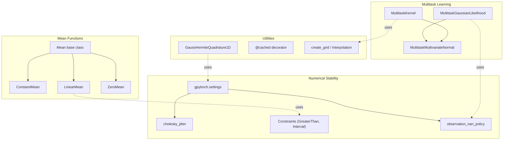
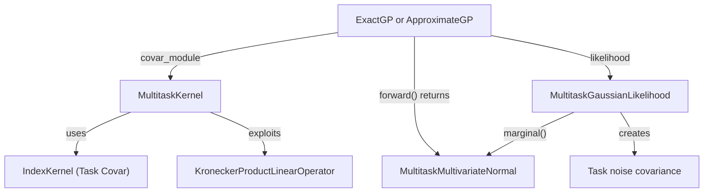

<!-- source: DeepWiki mcp.deepwiki.com · repo cornellius-gp/gpytorch · page 8 Advanced Topics · fetched 2026-10-21 -->

# Advanced Topics

Relevant source files

The following files were used as context for generating this wiki page:

- [docs/source/index.rst](docs/source/index.rst)
- [docs/source/models.rst](docs/source/models.rst)
- [gpytorch/kernels/additive_structure_kernel.py](gpytorch/kernels/additive_structure_kernel.py)
- [gpytorch/kernels/grid_interpolation_kernel.py](gpytorch/kernels/grid_interpolation_kernel.py)
- [gpytorch/kernels/grid_kernel.py](gpytorch/kernels/grid_kernel.py)
- [gpytorch/kernels/inducing_point_kernel.py](gpytorch/kernels/inducing_point_kernel.py)
- [gpytorch/kernels/multitask_kernel.py](gpytorch/kernels/multitask_kernel.py)
- [gpytorch/kernels/product_structure_kernel.py](gpytorch/kernels/product_structure_kernel.py)
- [gpytorch/mlls/deep_approximate_mll.py](gpytorch/mlls/deep_approximate_mll.py)
- [gpytorch/models/deep_gps/__init__.py](gpytorch/models/deep_gps/__init__.py)
- [gpytorch/models/deep_gps/deep_gp.py](gpytorch/models/deep_gps/deep_gp.py)
- [test/kernels/test_grid_interpolation_kernel.py](test/kernels/test_grid_interpolation_kernel.py)
- [test/kernels/test_grid_kernel.py](test/kernels/test_grid_kernel.py)

This page covers specialized features in GPyTorch that enable sophisticated modeling scenarios: multitask learning for correlated outputs, mean functions for incorporating prior knowledge, utilities for efficient computation, and numerical stability mechanisms for robust inference.

Sources: [gpytorch/likelihoods/multitask_gaussian_likelihood.py:1-300](), [gpytorch/means/__init__.py:1-24](), [gpytorch/utils/__init__.py:1-37](), [gpytorch/settings.py:1-507]()

## Overview of Advanced Features

GPyTorch provides four main categories of advanced functionality:

1.  **Multitask Learning**: Models multiple correlated outputs using `MultitaskGaussianLikelihood`, `MultitaskKernel`, and `MultitaskMultivariateNormal`. Supports both diagonal and low-rank task covariance structures. See [Multitask Learning](#8.1) for details.
2.  **Mean Functions and Priors**: Incorporates prior knowledge through mean functions (`ConstantMean`, `LinearMean`, `ZeroMean`) and prior distributions over hyperparameters. See [Mean Functions and Priors](#8.2) for details.
3.  **Utilities and Helpers**: Provides quadrature methods for non-Gaussian likelihoods, caching mechanisms for efficient prediction, and grid interpolation utilities for scalable kernels. See [Utilities and Helpers](#8.3) for details.
4.  **Numerical Stability**: Ensures robust computation through settings like `cholesky_jitter`, constraint systems, and NaN handling policies. See [Numerical Stability](#8.4) for details.

Sources: [gpytorch/likelihoods/multitask_gaussian_likelihood.py:160-191](), [gpytorch/means/__init__.py:1-24](), [gpytorch/utils/__init__.py:1-37](), [gpytorch/settings.py:145-462]()

## Advanced Feature Architecture

**Diagram: Advanced Feature Components and Their Relationships**

Sources: [gpytorch/likelihoods/multitask_gaussian_likelihood.py:160-241](), [gpytorch/means/__init__.py:1-24](), [gpytorch/utils/__init__.py:1-37](), [gpytorch/settings.py:1-507](), [gpytorch/kernels/grid_interpolation_kernel.py:10-13]()

## Multitask Learning Overview

Multitask learning in GPyTorch enables modeling multiple correlated outputs simultaneously. The key components are:

**Diagram: Multitask Learning Components**

### Key Classes

| Class | Purpose | Key Parameters |
| :--- | :--- | :--- |
| `MultitaskGaussianLikelihood` | Adds task-specific and global noise | `num_tasks`, `rank`, `has_task_noise` |
| `MultitaskKernel` | Creates Kronecker structure over tasks and data | `data_covar_module`, `num_tasks`, `rank` |
| `MultitaskMultivariateNormal` | Distribution over multiple outputs | `interleaved` flag controls data layout |

The `MultitaskKernel` [gpytorch/kernels/multitask_kernel.py:13-61]() wraps a `data_covar_module` and an internal `IndexKernel` to form a `KroneckerProductLinearOperator` [gpytorch/kernels/multitask_kernel.py:53](). This structure is highly efficient for datasets where every data point is evaluated at every task.

Sources: [gpytorch/likelihoods/multitask_gaussian_likelihood.py:26-241](), [gpytorch/kernels/multitask_kernel.py:13-61](), [gpytorch/distributions/multitask_multivariate_normal.py]()

For detailed coverage, see [Multitask Learning](#8.1).

## Mean Functions and Priors

Mean functions specify the prior expectation $E[f(x)]$ for the GP. GPyTorch provides several mean function types in `gpytorch.means`.

### Mean Function Types

| Class | Formula | Parameters | Use Case |
| :--- | :--- | :--- | :--- |
| `ZeroMean` | $\mu(x) = 0$ | None | Default, data determines function |
| `ConstantMean` | $\mu(x) = c$ | `constant` | Non-zero baseline |
| `LinearMean` | $\mu(x) = w^T x + b$ | `weights`, `bias` | Linear trends [gpytorch/means/linear_mean.py:8-22]() |
| `MultitaskMean` | Per-task mean | Wraps base mean | Different mean per task |

Priors can be specified on kernel hyperparameters and likelihood parameters using `register_prior()`. This enables MAP estimation or full Bayesian inference using Pyro.

Sources: [gpytorch/means/__init__.py:1-24](), [gpytorch/means/linear_mean.py:8-22]()

For detailed coverage, see [Mean Functions and Priors](#8.2).

## Utilities and Helpers

GPyTorch provides several utility modules for common operations:

*   **Quadrature**: `GaussHermiteQuadrature1D` [gpytorch/utils/quadrature.py:25-88]() is used by non-Gaussian likelihoods (like `BernoulliLikelihood`) to compute expected log probabilities.
*   **Grid Utilities**: Tools like `create_grid` [gpytorch/utils/grid.py]() and `Interpolation` [gpytorch/utils/interpolation.py]() support scalable kernels like `GridInterpolationKernel` (KISS-GP) [gpytorch/kernels/grid_interpolation_kernel.py:16-121]().
*   **Caching**: The `@cached` decorator from `gpytorch.utils.memoize` manages expensive intermediate results, such as the `_cached_kernel_mat` in `InducingPointKernel` [gpytorch/kernels/inducing_point_kernel.py:45-59]().

Sources: [gpytorch/utils/quadrature.py:25-88](), [gpytorch/kernels/grid_interpolation_kernel.py:10-13](), [gpytorch/kernels/inducing_point_kernel.py:45-59]()

For detailed coverage, see [Utilities and Helpers](#8.3).

## Numerical Stability

GPyTorch provides multiple mechanisms to ensure numerically stable computations:

### Key Stability Settings

| Setting | Purpose | Default |
| :--- | :--- | :--- |
| `cholesky_jitter` | Added to diagonal before Cholesky | dtype-dependent (e.g., 1e-6) |
| `min_variance` | Minimum variance returned | dtype-dependent |
| `observation_nan_policy` | How to handle NaN observations | "ignore" [gpytorch/settings.py:405-449]() |

The `observation_nan_policy` setting is particularly important for real-world datasets, allowing the model to "mask" out missing data during training and prediction [gpytorch/models/exact_prediction_strategies.py:256-292]().

Sources: [gpytorch/settings.py:1-507](), [gpytorch/models/exact_prediction_strategies.py:256-292]()

For detailed coverage, see [Numerical Stability](#8.4).

---

