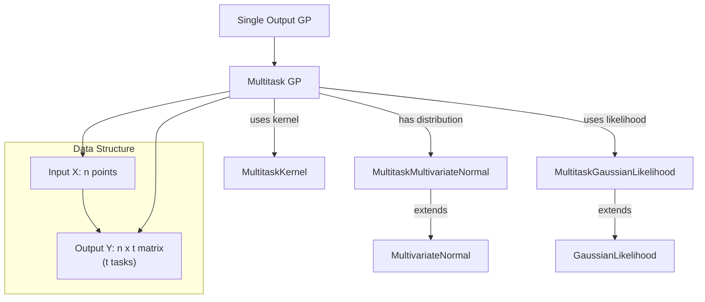
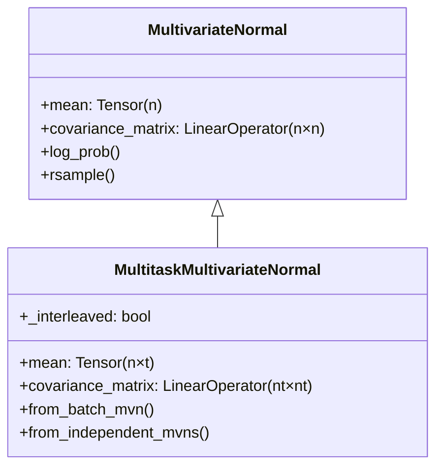
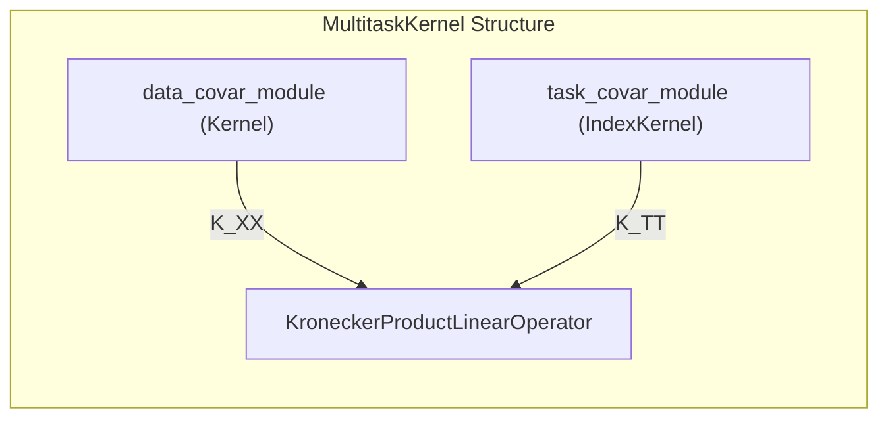
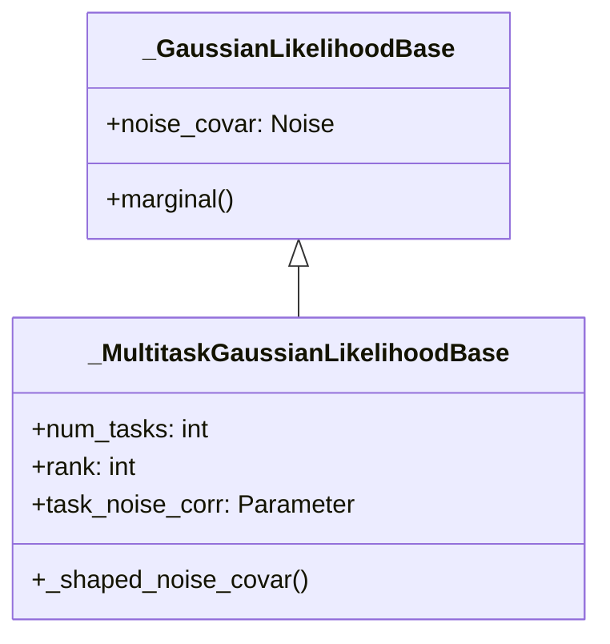

<!-- source: DeepWiki mcp.deepwiki.com · repo cornellius-gp/gpytorch · page 8.1 Multitask Learning · fetched 2026-10-21 -->

# Multitask Learning

Relevant source files

The following files were used as context for generating this wiki page:

- [gpytorch/distributions/multitask_multivariate_normal.py](gpytorch/distributions/multitask_multivariate_normal.py)
- [gpytorch/distributions/multivariate_normal.py](gpytorch/distributions/multivariate_normal.py)
- [gpytorch/kernels/additive_structure_kernel.py](gpytorch/kernels/additive_structure_kernel.py)
- [gpytorch/kernels/grid_interpolation_kernel.py](gpytorch/kernels/grid_interpolation_kernel.py)
- [gpytorch/kernels/grid_kernel.py](gpytorch/kernels/grid_kernel.py)
- [gpytorch/kernels/inducing_point_kernel.py](gpytorch/kernels/inducing_point_kernel.py)
- [gpytorch/kernels/lcm_kernel.py](gpytorch/kernels/lcm_kernel.py)
- [gpytorch/kernels/multitask_kernel.py](gpytorch/kernels/multitask_kernel.py)
- [gpytorch/kernels/product_structure_kernel.py](gpytorch/kernels/product_structure_kernel.py)
- [gpytorch/likelihoods/gaussian_likelihood.py](gpytorch/likelihoods/gaussian_likelihood.py)
- [gpytorch/likelihoods/likelihood_list.py](gpytorch/likelihoods/likelihood_list.py)
- [gpytorch/likelihoods/multitask_gaussian_likelihood.py](gpytorch/likelihoods/multitask_gaussian_likelihood.py)
- [gpytorch/likelihoods/noise_models.py](gpytorch/likelihoods/noise_models.py)
- [gpytorch/mlls/sum_marginal_log_likelihood.py](gpytorch/mlls/sum_marginal_log_likelihood.py)
- [gpytorch/models/model_list.py](gpytorch/models/model_list.py)
- [gpytorch/utils/generic.py](gpytorch/utils/generic.py)
- [test/distributions/test_multitask_multivariate_normal.py](test/distributions/test_multitask_multivariate_normal.py)
- [test/distributions/test_multivariate_normal.py](test/distributions/test_multivariate_normal.py)
- [test/examples/test_hadamard_multitask_gp_regression.py](test/examples/test_hadamard_multitask_gp_regression.py)
- [test/examples/test_kissgp_dkl_regression.py](test/examples/test_kissgp_dkl_regression.py)
- [test/examples/test_kronecker_multitask_gp_regression.py](test/examples/test_kronecker_multitask_gp_regression.py)
- [test/examples/test_kronecker_multitask_ski_gp_regression.py](test/examples/test_kronecker_multitask_ski_gp_regression.py)
- [test/kernels/test_grid_interpolation_kernel.py](test/kernels/test_grid_interpolation_kernel.py)
- [test/kernels/test_grid_kernel.py](test/kernels/test_grid_kernel.py)
- [test/models/test_model_list.py](test/models/test_model_list.py)

This page explains multitask learning in GPyTorch—a mechanism for modeling multiple related outputs (tasks) simultaneously using Gaussian processes. Multitask learning enables sharing of information across outputs, leading to more data-efficient learning when the outputs are correlated.

## Overview of Multitask Gaussian Processes

Multitask Gaussian Processes extend traditional GPs to handle multiple outputs by modeling the correlations between different tasks. Instead of training separate GPs for each output, multitask GPs learn a joint model that captures relationships between outputs.

Sources: 
- [gpytorch/distributions/multitask_multivariate_normal.py:17-32]()
- [gpytorch/likelihoods/multitask_gaussian_likelihood.py:28-40]()
- [gpytorch/kernels/multitask_kernel.py:13-28]()

## Core Components

### MultitaskMultivariateNormal Distribution

This distribution represents the output of a multitask GP model. It extends the regular `MultivariateNormal` distribution to handle multiple outputs.

Key features of `MultitaskMultivariateNormal`:
- **Interleaving**: Controls the ordering of the joint vector. If `interleaved=True` (default), the variables are ordered by observation then task ($y_{1,1}, y_{1,2}, \dots, y_{n,t}$). If `False`, they are ordered by task then observation ($y_{1,1}, y_{2,1}, \dots, y_{n,t}$) [[gpytorch/distributions/multitask_multivariate_normal.py:29-32](), [gpytorch/distributions/multitask_multivariate_normal.py:67-71]()].
- **Event Shape**: The `event_shape` is defined as `torch.Size([n, t])` [[gpytorch/distributions/multitask_multivariate_normal.py:83-84]()].

Sources:
- [gpytorch/distributions/multitask_multivariate_normal.py:17-150]()
- [gpytorch/distributions/multivariate_normal.py:22-64]()

### Multitask Kernels and Kronecker Structure

GPyTorch utilizes Kronecker products to efficiently represent the joint covariance of $n$ points and $t$ tasks.

#### MultitaskKernel
The `MultitaskKernel` computes $K = K_{XX} \otimes K_{TT}$, where $K_{XX}$ is the data covariance and $K_{TT}$ is the task covariance (represented by an `IndexKernel`) [[gpytorch/kernels/multitask_kernel.py:13-28](), [gpytorch/kernels/multitask_kernel.py:53-54]()].

#### LCMKernel (Linear Coregionalization Model)
The `LCMKernel` allows summing multiple `MultitaskKernel` components, each with its own base kernel and task covariance matrix [[gpytorch/kernels/lcm_kernel.py:14-22](), [gpytorch/kernels/lcm_kernel.py:56-60]()].

Sources:
- [gpytorch/kernels/multitask_kernel.py:13-54]()
- [gpytorch/kernels/lcm_kernel.py:14-60]()

### MultitaskGaussianLikelihood

This likelihood handles Gaussian noise for multiple tasks, supporting cross-task noise correlations.

Key features of `MultitaskGaussianLikelihood`:
- **Noise Correlation**: If `rank > 0`, it learns a correlation matrix between task noises using a low-rank factor `task_noise_corr` [[gpytorch/likelihoods/multitask_gaussian_likelihood.py:51-57](), [gpytorch/likelihoods/multitask_gaussian_likelihood.py:67-74]()].
- **Marginal Computation**: It forms a `KroneckerProductLinearOperator` between the identity $I_n$ and the task noise matrix $D_t$ to augment the covariance: $\mathbf K + \mathbf D_{t} \otimes \mathbf I_{n} + \sigma^{2} \mathbf I_{nt}$ [[gpytorch/likelihoods/multitask_gaussian_likelihood.py:86-96]()].

Sources:
- [gpytorch/likelihoods/multitask_gaussian_likelihood.py:28-154]()
- [gpytorch/likelihoods/gaussian_likelihood.py:24-43]()

## Data Representation and Covariance Structures

| Feature | Interleaved (`True`) | Non-interleaved (`False`) |
| :--- | :--- | :--- |
| **Ordering** | $y_{1, task1}, y_{1, task2} \dots$ | $y_{task1, 1}, y_{task1, 2} \dots$ |
| **Mean Shape** | `reshape(*mean.shape[:-2], -1)` | `transpose(-1, -2).reshape(...)` |
| **Likelihood Structure** | `ckl_init(eye_lt, task_var_lt)` | `ckl_init(task_var_lt, eye_lt)` |

Sources:
- [gpytorch/distributions/multitask_multivariate_normal.py:67-71]()
- [gpytorch/likelihoods/multitask_gaussian_likelihood.py:149-152]()

## Noise Models and Missing Data

### Task Noise Configuration
The noise structure is determined by the `rank` parameter in `_MultitaskGaussianLikelihoodBase`:
1.  **rank = 0**: A diagonal covariance matrix is fit (independent task noises) [[gpytorch/likelihoods/multitask_gaussian_likelihood.py:46-50]()].
2.  **rank > 0**: A low-rank task noise covariance matrix is fit [[gpytorch/likelihoods/multitask_gaussian_likelihood.py:51-57]()].

### Handling Missing Observations
GPyTorch supports missing data in multitask settings via `settings.observation_nan_policy`.
- **Masking**: The `expected_log_prob` and `log_marginal` functions in `_GaussianLikelihoodBase` can detect `NaN` targets and use a `MaskedLinearOperator` to ignore those dimensions during computation [[gpytorch/likelihoods/gaussian_likelihood.py:51-61](), [gpytorch/likelihoods/gaussian_likelihood.py:90-99]()].

Sources:
- [gpytorch/likelihoods/multitask_gaussian_likelihood.py:42-65]()
- [gpytorch/likelihoods/gaussian_likelihood.py:44-78]()

## Scalability: Multitask KISS-GP
For large-scale multitask learning, `GridInterpolationKernel` (KISS-GP) can be combined with multitask structures. While `GridKernel` exploits Toeplitz/Kronecker structure for inputs on a grid [[gpytorch/kernels/grid_kernel.py:19-23]()], multitask models add an additional Kronecker dimension for tasks.

Sources:
- [gpytorch/kernels/grid_interpolation_kernel.py:16-47]()
- [gpytorch/kernels/grid_kernel.py:17-47]()

---

