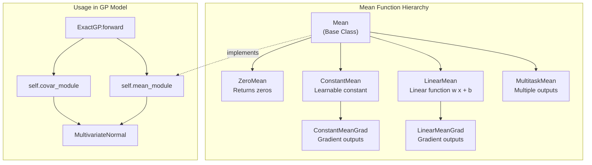
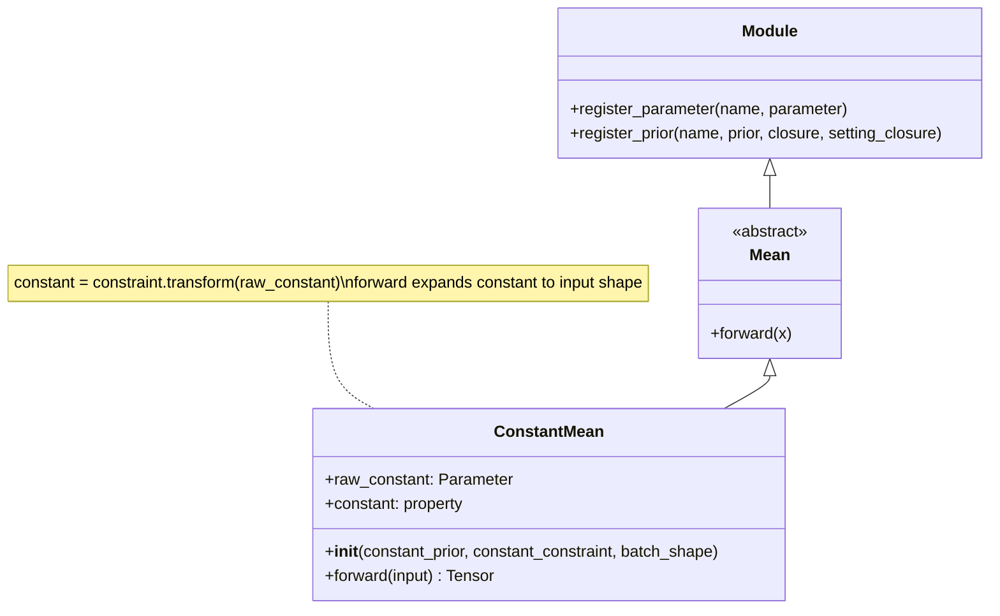
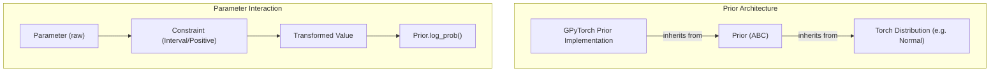
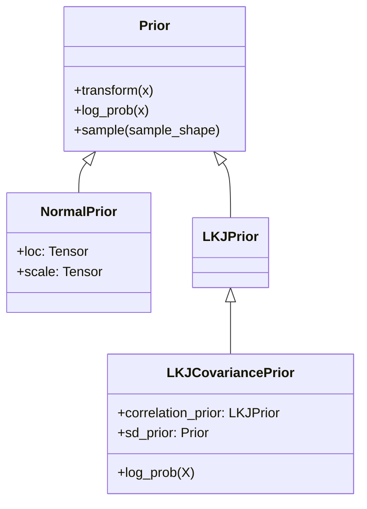

<!-- source: DeepWiki mcp.deepwiki.com · repo cornellius-gp/gpytorch · page 8.2 Mean Functions and Priors · fetched 2026-10-21 -->

# Mean Functions and Priors

<details>
<summary>Relevant source files</summary>

The following files were used as context for generating this wiki page:

- [docs/source/_static/.gitkeep](docs/source/_static/.gitkeep)
- [docs/source/means.rst](docs/source/means.rst)
- [docs/source/priors.rst](docs/source/priors.rst)
- [gpytorch/means/__init__.py](gpytorch/means/__init__.py)
- [gpytorch/means/constant_mean.py](gpytorch/means/constant_mean.py)
- [gpytorch/means/constant_mean_grad.py](gpytorch/means/constant_mean_grad.py)
- [gpytorch/means/constant_mean_gradgrad.py](gpytorch/means/constant_mean_gradgrad.py)
- [gpytorch/means/linear_mean.py](gpytorch/means/linear_mean.py)
- [gpytorch/means/linear_mean_grad.py](gpytorch/means/linear_mean_grad.py)
- [gpytorch/means/linear_mean_gradgrad.py](gpytorch/means/linear_mean_gradgrad.py)
- [gpytorch/means/mean.py](gpytorch/means/mean.py)
- [gpytorch/means/multitask_mean.py](gpytorch/means/multitask_mean.py)
- [gpytorch/means/zero_mean.py](gpytorch/means/zero_mean.py)
- [gpytorch/priors/__init__.py](gpytorch/priors/__init__.py)
- [gpytorch/priors/horseshoe_prior.py](gpytorch/priors/horseshoe_prior.py)
- [gpytorch/priors/lkj_prior.py](gpytorch/priors/lkj_prior.py)
- [gpytorch/priors/prior.py](gpytorch/priors/prior.py)
- [gpytorch/priors/smoothed_box_prior.py](gpytorch/priors/smoothed_box_prior.py)
- [gpytorch/priors/torch_priors.py](gpytorch/priors/torch_priors.py)
- [gpytorch/priors/utils.py](gpytorch/priors/utils.py)
- [gpytorch/priors/wishart_prior.py](gpytorch/priors/wishart_prior.py)
- [gpytorch/test/variational_test_case.py](gpytorch/test/variational_test_case.py)
- [gpytorch/utils/cholesky.py](gpytorch/utils/cholesky.py)
- [test/examples/test_batch_gp_regression.py](test/examples/test_batch_gp_regression.py)
- [test/examples/test_batch_multitask_gp_regression.py](test/examples/test_batch_multitask_gp_regression.py)
- [test/kernels/test_rbf_kernel_gradgrad.py](test/kernels/test_rbf_kernel_gradgrad.py)
- [test/likelihoods/test_general_multitask_gaussian_likelihood.py](test/likelihoods/test_general_multitask_gaussian_likelihood.py)
- [test/means/test_constant_mean_gradgrad.py](test/means/test_constant_mean_gradgrad.py)
- [test/means/test_linear_mean.py](test/means/test_linear_mean.py)
- [test/means/test_linear_mean_grad.py](test/means/test_linear_mean_grad.py)
- [test/priors/test_half_cauchy_prior.py](test/priors/test_half_cauchy_prior.py)
- [test/priors/test_half_normal_prior.py](test/priors/test_half_normal_prior.py)
- [test/priors/test_horseshoe_prior.py](test/priors/test_horseshoe_prior.py)
- [test/priors/test_lkj_prior.py](test/priors/test_lkj_prior.py)
- [test/priors/test_prior.py](test/priors/test_prior.py)
- [test/priors/test_utils.py](test/priors/test_utils.py)

</details>


This page documents mean functions and prior specification in GPyTorch. Mean functions define the expected value of the GP prior, while priors over hyperparameters enable Bayesian inference and regularization. Together, these components allow flexible modeling of both the central tendency and uncertainty in Gaussian Process models.

## 1. Mean Functions

### 1.1 Overview

Mean functions in GPyTorch define the prior mean of the Gaussian Process. By default, GPs assume a zero mean, but specifying a mean function can improve model performance when data exhibits known structure or trends.

All mean functions inherit from the `Mean` base class defined in [gpytorch/means/mean.py:8-26](). The mean function is called during the forward pass of a GP model to compute the mean vector. The `__call__` method automatically handles dimension unsqueezing for 1D inputs [gpytorch/means/mean.py:19-26]().



Sources: [gpytorch/means/mean.py:8-26](), [gpytorch/means/__init__.py:1-24]()

### 1.2 Available Mean Functions

| Mean Function | Description | Parameters | Use Case |
|---------------|-------------|------------|----------|
| `ZeroMean` | Returns zeros | None | Default choice, assumes data centered at zero |
| `ConstantMean` | Learnable constant offset | `raw_constant` | Data with unknown but constant mean |
| `LinearMean` | Linear function: w^T x + b | `weights`, `bias` | Linear trends in data |
| `MultitaskMean` | Wraps mean for multiple outputs | `base_mean`, `num_tasks` | Multi-output regression |

Sources: [gpytorch/means/constant_mean.py:33-113](), [gpytorch/means/multitask_mean.py:9-45]()

### 1.3 ConstantMean Implementation

The `ConstantMean` class demonstrates the pattern of parameter management using constraints and priors. It uses a `raw_constant` parameter which is transformed via an `Interval` constraint (if provided) to the `constant` property [gpytorch/means/constant_mean.py:81-99]().



Sources: [gpytorch/means/constant_mean.py:33-113]()

### 1.4 Using Mean Functions in Models

Mean functions are specified in the GP model constructor and called in the `forward` method. For multi-task settings, `MultitaskMean` wraps a base mean to handle multiple outputs [gpytorch/means/multitask_mean.py:32-45]().

```python
class ExactGPModel(gpytorch.models.ExactGP):
    def __init__(self, train_inputs, train_targets, likelihood, batch_shape=torch.Size()):
        super().__init__(train_inputs, train_targets, likelihood)
        # Constant mean with a SmoothedBoxPrior
        self.mean_module = ConstantMean(
            batch_shape=batch_shape, 
            constant_prior=gpytorch.priors.SmoothedBoxPrior(-1, 1)
        )
```

Sources: [test/examples/test_batch_gp_regression.py:38-56](), [test/examples/test_batch_multitask_gp_regression.py:36-54]()

## 2. Introduction to Priors in GPyTorch

Priors represent beliefs about parameters before observing data. In GPyTorch, priors are registered to parameters, and their log-probabilities are automatically included in Marginal Log-Likelihood (MLL) calculations [gpytorch/priors/prior.py:17-24]().

All priors inherit from the `Prior` base class, which combines `gpytorch.distributions.Distribution` and `torch.nn.Module` [gpytorch/priors/prior.py:17]().



Sources: [gpytorch/priors/prior.py:17-59](), [gpytorch/priors/torch_priors.py:15-120]()

## 3. Available Prior Types

### 3.1 Scalar and Standard Priors

GPyTorch wraps standard PyTorch distributions to behave as GPyTorch modules with buffer management for parameters [gpytorch/priors/torch_priors.py:27-110]().

| Prior Type | Distribution | Parameters |
|------------|--------------|------------|
| `NormalPrior` | Normal | `loc`, `scale` |
| `GammaPrior` | Gamma | `concentration`, `rate` |
| `LogNormalPrior` | LogNormal | `loc`, `scale` |
| `UniformPrior` | Uniform | `low`, `high` |
| `HalfNormalPrior` | HalfNormal | `scale` |
| `SmoothedBoxPrior` | Smoothed Uniform | `a`, `b`, `sigma` |

Sources: [gpytorch/priors/torch_priors.py:15-118](), [gpytorch/priors/smoothed_box_prior.py:10-25]()

### 3.2 Matrix-Valued and Correlation Priors

For multi-task and multi-output models, GPyTorch provides priors over covariance and correlation matrices.

- **LKJPrior**: Prior over correlation matrices where the PDF is proportional to $|\Sigma|^{\eta-1}$ [gpytorch/priors/lkj_prior.py:43-70]().
- **LKJCholeskyFactorPrior**: Accepts the Cholesky factor of the correlation matrix directly [gpytorch/priors/lkj_prior.py:14-38]().
- **LKJCovariancePrior**: Combines an `LKJPrior` for correlations with a user-specified prior for marginal standard deviations to define a prior over the full covariance matrix [gpytorch/priors/lkj_prior.py:72-119]().
- **WishartPrior / InverseWishartPrior**: Priors over positive definite matrices [gpytorch/priors/wishart_prior.py:15-113]().

Sources: [gpytorch/priors/lkj_prior.py:14-119](), [gpytorch/priors/wishart_prior.py:15-113]()

## 4. Prior Registration and Data Flow

Priors are registered via `register_prior`. When `log_prob` is called, the prior optionally applies a transformation to the input tensor before computing the probability [gpytorch/priors/prior.py:26-34]().

### 4.1 Prior Internal Structure



Sources: [gpytorch/priors/prior.py:17-35](), [gpytorch/priors/lkj_prior.py:72-119]()

### 4.2 Batch Support

Priors support batching, allowing different prior parameters for different tasks or GP instances. For example, `MultivariateNormalPrior` handles batch shapes and lazy properties for covariance matrices [gpytorch/priors/torch_priors.py:120-161]().

Example of batch prior initialization:
```python
likelihood = GaussianLikelihood(
    noise_prior=gpytorch.priors.NormalPrior(loc=torch.zeros(2), scale=torch.ones(2)),
    batch_shape=torch.Size([2]),
)
```

Sources: [test/examples/test_batch_gp_regression.py:127-130](), [gpytorch/priors/torch_priors.py:155-161]()

## 5. Implementation Details

### 5.1 Buffer Management

Priors use `_bufferize_attributes` to ensure that distribution parameters (like `loc` or `scale`) are moved to the correct device (CPU/GPU) alongside the model [gpytorch/priors/torch_priors.py:27, 45, 60]().

### 5.2 LKJ Correlation Logic

The `LKJPrior` validates that inputs are valid correlation matrices (positive semidefinite with unit diagonal) [gpytorch/priors/lkj_prior.py:128-151](). `LKJCovariancePrior` decomposes a covariance matrix $X$ into correlations and standard deviations:
1. Extract marginal variances: `torch.diagonal(X)` [gpytorch/priors/lkj_prior.py:102]().
2. Compute correlation matrix: $D^{-1} X D^{-1}$ where $D$ is the diagonal matrix of standard deviations [gpytorch/priors/lkj_prior.py:106-107]().
3. Sum log-probabilities from the correlation prior and the SD prior [gpytorch/priors/lkj_prior.py:108-110]().

Sources: [gpytorch/priors/lkj_prior.py:101-110](), [gpytorch/priors/lkj_prior.py:128-151]()

---

