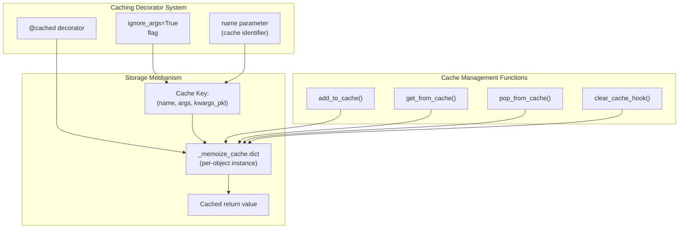
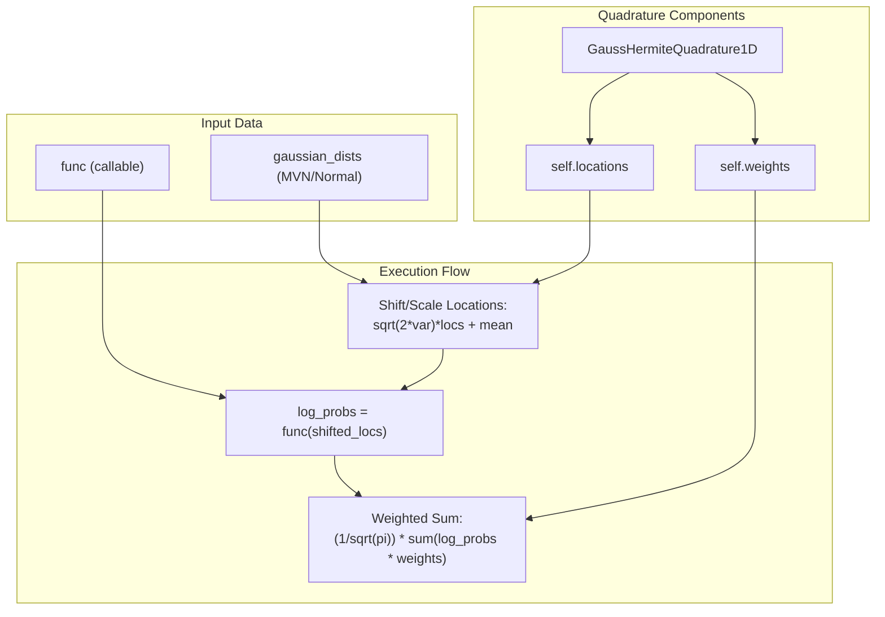

<!-- source: DeepWiki mcp.deepwiki.com · repo cornellius-gp/gpytorch · page 8.3 Utilities and Helpers · fetched 2026-10-21 -->

# Utilities and Helpers

<details>
<summary>Relevant source files</summary>

The following files were used as context for generating this wiki page:

- [docs/source/functions.rst](docs/source/functions.rst)
- [docs/source/optim.rst](docs/source/optim.rst)
- [docs/source/utils.rst](docs/source/utils.rst)
- [gpytorch/metrics/__init__.py](gpytorch/metrics/__init__.py)
- [gpytorch/metrics/metrics.py](gpytorch/metrics/metrics.py)
- [gpytorch/optim/__init__.py](gpytorch/optim/__init__.py)
- [gpytorch/optim/ngd.py](gpytorch/optim/ngd.py)
- [gpytorch/utils/__init__.py](gpytorch/utils/__init__.py)
- [gpytorch/utils/broadcasting.py](gpytorch/utils/broadcasting.py)
- [gpytorch/utils/interpolation.py](gpytorch/utils/interpolation.py)
- [gpytorch/utils/lanczos.py](gpytorch/utils/lanczos.py)
- [gpytorch/utils/nearest_neighbors.py](gpytorch/utils/nearest_neighbors.py)
- [gpytorch/utils/quadrature.py](gpytorch/utils/quadrature.py)
- [gpytorch/utils/sparse.py](gpytorch/utils/sparse.py)
- [gpytorch/utils/sum_interaction_terms.py](gpytorch/utils/sum_interaction_terms.py)
- [gpytorch/utils/toeplitz.py](gpytorch/utils/toeplitz.py)
- [test/metrics/__init__.py](test/metrics/__init__.py)
- [test/metrics/test_metrics.py](test/metrics/test_metrics.py)
- [test/optim/__init__.py](test/optim/__init__.py)
- [test/optim/test_ngd.py](test/optim/test_ngd.py)
- [test/utils/test_nearest_neighbors.py](test/utils/test_nearest_neighbors.py)
- [test/utils/test_quadrature.py](test/utils/test_quadrature.py)

</details>


## Purpose and Scope

This page documents the utility functions and helper classes in GPyTorch that provide cross-cutting functionality used throughout the library. These utilities include:

- **Caching and memoization** for expensive computations (Cholesky factorizations, distribution caching).
- **Quadrature methods** for numerical integration in non-Gaussian likelihoods.
- **Nearest neighbor search** for scalable variational strategies.
- **Custom error types** for better debugging.
- **Specialized helpers** for grid operations, interpolation, and transformations.
- **Metrics** for evaluating model performance.

For kernel-specific utilities, see [Kernels](#4). For settings that control behavior (jitter, CG tolerance, etc.), see [Numerical Stability](#8.4). For distribution-related operations, see [Distributions](#2.2).

---

## Caching and Memoization System

GPyTorch uses an extensive caching system to avoid redundant expensive computations, particularly Cholesky factorizations and distribution evaluations. The caching system is implemented in `gpytorch/utils/memoize.py` and is critical for computational efficiency during both training and inference.

### Core Caching Decorator

The primary interface is the `@cached` decorator, which provides two modes of operation:

| Decorator | Usage | Cache Key Includes Arguments? |
|-----------|-------|------------------------------|
| `@cached(name="cache_name")` | Standard caching | Yes - different args create separate cache entries |
| `@cached(name="cache_name", ignore_args=True)` | Argument-agnostic caching | No - same cache regardless of arguments |

The decorator stores cached values in a `_memoize_cache` dictionary attached to the object instance.

Sources: [gpytorch/utils/memoize.py:9-14](), [gpytorch/utils/__init__.py:11]()

### Caching Architecture



Sources: [gpytorch/utils/memoize.py:1-125]()

---

## Quadrature Methods for Numerical Integration

Non-Gaussian likelihoods require computing expected log probabilities that involve intractable integrals. GPyTorch uses Gauss-Hermite quadrature to numerically approximate these expectations.

### GaussHermiteQuadrature1D

The `GaussHermiteQuadrature1D` class implements 1D Gauss-Hermite quadrature for integrating functions with respect to Gaussian distributions.

```python
class GaussHermiteQuadrature1D(Module):
    def __init__(self, num_locs=None):
        # Initialize quadrature locations and weights
        
    def forward(self, func, gaussian_dists):
        # Result of ∫ func(x) p(x) dx
```

The quadrature approximation is:

$$
\int f(x) \mathcal{N}(x | \mu, \sigma^2) dx \approx \frac{1}{\sqrt{\pi}} \sum_{i=1}^{n} w_i f(\sqrt{2\sigma^2} x_i + \mu)
$$

where $x_i$ and $w_i$ are the quadrature locations and weights obtained via `np.polynomial.hermite.hermgauss` [gpytorch/utils/quadrature.py:60-63]().

Sources: [gpytorch/utils/quadrature.py:27-89]()

### Quadrature Integration Process



Sources: [gpytorch/utils/quadrature.py:77-89]()

---

## Interpolation and Grid Utilities

GPyTorch provides specialized utilities for Structured Kernel Interpolation (SKI/KISS-GP).

### Cubic Interpolation

The `Interpolation` class computes the interpolation kernel $u()$ for points $X$ given grid distances. This is used to map data points to a structured grid [gpytorch/utils/interpolation.py:15-42]().

Key methods include:
- `_cubic_interpolation_kernel`: Computes $u(s)$ where $s$ is the distance between neighboring grid points [gpytorch/utils/interpolation.py:16-42]().
- `interpolate`: Performs the actual interpolation of target points onto the grid, handling boundary conditions [gpytorch/utils/interpolation.py:44-152]().

Sources: [gpytorch/utils/interpolation.py:15-152]()

---

## Metrics and Evaluation

The `gpytorch.metrics` module provides standard evaluation functions for Gaussian Process models.

| Function | Description | Implementation |
|----------|-------------|----------------|
| `mean_absolute_error` | Mean absolute error between prediction and target. | `torch.abs(pred_dist.mean - test_y).mean()` |
| `mean_squared_error` | Mean squared error (or RMSE if `squared=False`). | `torch.square(pred_dist.mean - test_y).mean()` |
| `negative_log_predictive_density` | Normalized negative log probability. | `-pred_dist.log_prob(test_y) / N` |
| `mean_standardized_log_loss` | Standardized log loss (MSLL) relative to a trivial model. | `(0.5*log(2*pi*var) + sq_err/(2*var)).mean()` |
| `quantile_coverage_error` | Error in the fraction of points within a specific quantile. | `abs(fraction - quantile/100)` |

Sources: [gpytorch/metrics/metrics.py:12-110]()

---

## Additive Interaction Utilities

For `AdditiveKernel` implementations, GPyTorch provides `sum_interaction_terms`. This function computes the sum of interaction terms up to a specific degree using the Newton-Girard formula in $\mathcal{O}(D)$ time [gpytorch/utils/sum_interaction_terms.py:9-32]().

Sources: [gpytorch/utils/sum_interaction_terms.py:9-58]()

---

## Nearest Neighbor Utilities

The `NNUtil` class handles efficient k-nearest neighbor search, supporting both FAISS (for GPU/CPU speed) and scikit-learn (as a fallback) [gpytorch/utils/nearest_neighbors.py:1-237]().

Sources: [gpytorch/utils/nearest_neighbors.py:12](), [gpytorch/utils/__init__.py:12]()

---

## Deprecated Utilities and LinearOperator Integration

Many low-level linear algebra utilities have been moved to the `linear_operator` library. The `gpytorch.utils` module uses a `__getattr__` hook to provide backward compatibility with a `DeprecationWarning` [gpytorch/utils/__init__.py:30-37]().

Affected modules include:
- `gpytorch.utils.broadcasting` [gpytorch/utils/broadcasting.py:12-19]()
- `gpytorch.utils.lanczos` [gpytorch/utils/lanczos.py:12-19]()
- `gpytorch.utils.sparse` [gpytorch/utils/sparse.py:12-19]()
- `gpytorch.utils.toeplitz` [gpytorch/utils/toeplitz.py:12-19]()

---

## Optimization Helpers: Natural Gradient Descent

GPyTorch implements Natural Gradient Descent (NGD) specifically for variational distributions.

### NGD Optimizer
The `NGD` class performs a natural gradient step, which is equivalent to a standard gradient step when parameters are in the natural parameter space [gpytorch/optim/ngd.py:8-44]().

```python
# Usage Example
ngd_optimizer = NGD(model.variational_parameters(), num_data=train_y.size(0), lr=0.1)
ngd_optimizer.step()
```

Sources: [gpytorch/optim/ngd.py:8-44]()

---

