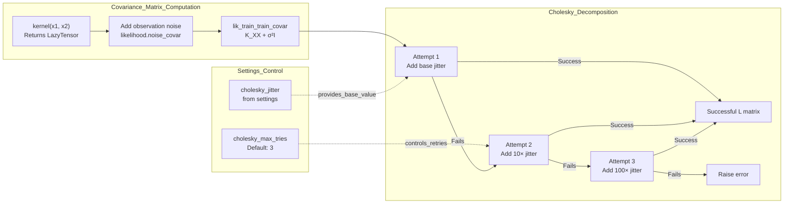
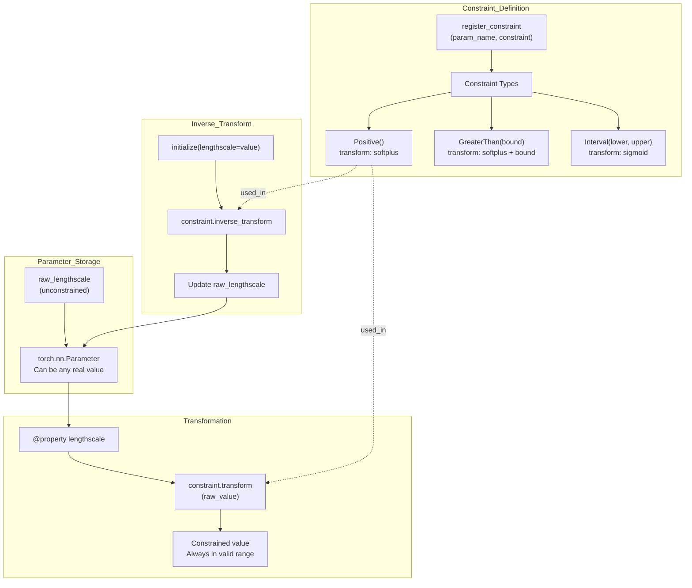
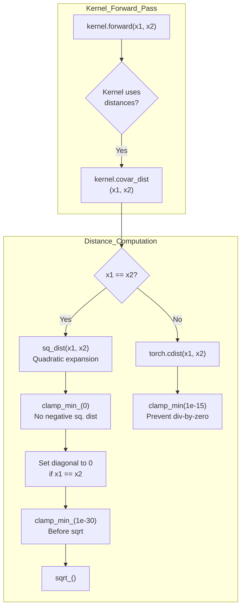
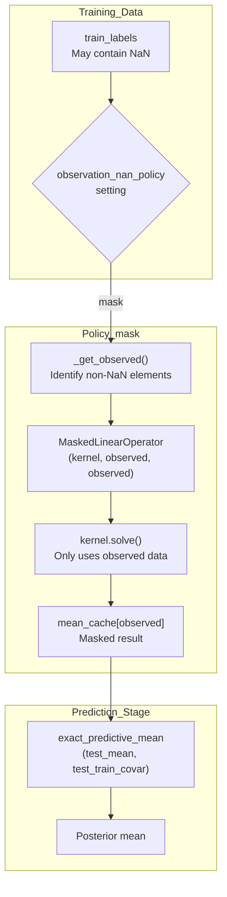

<!-- source: DeepWiki mcp.deepwiki.com · repo cornellius-gp/gpytorch · page 8.4 Numerical Stability · fetched 2026-10-21 -->

# Numerical Stability

<details>
<summary>Relevant source files</summary>

The following files were used as context for generating this wiki page:

- [gpytorch/models/exact_gp.py](gpytorch/models/exact_gp.py)
- [gpytorch/models/exact_prediction_strategies.py](gpytorch/models/exact_prediction_strategies.py)
- [gpytorch/priors/lkj_prior.py](gpytorch/priors/lkj_prior.py)
- [gpytorch/priors/smoothed_box_prior.py](gpytorch/priors/smoothed_box_prior.py)
- [gpytorch/priors/wishart_prior.py](gpytorch/priors/wishart_prior.py)
- [gpytorch/settings.py](gpytorch/settings.py)
- [gpytorch/test/variational_test_case.py](gpytorch/test/variational_test_case.py)
- [gpytorch/utils/cholesky.py](gpytorch/utils/cholesky.py)
- [gpytorch/utils/errors.py](gpytorch/utils/errors.py)
- [gpytorch/utils/memoize.py](gpytorch/utils/memoize.py)
- [test/priors/test_lkj_prior.py](test/priors/test_lkj_prior.py)
- [test/test_settings.py](test/test_settings.py)

</details>


This page documents GPyTorch's numerical stability mechanisms, including jitter values, parameter constraints, NaN handling policies, and minimum value thresholds. These features prevent common numerical issues such as singular matrices, negative variances, and divide-by-zero errors during Gaussian Process inference.

For information about parameter management and initialization, see [Module System](gpytorch/module.py). For details on prediction strategies and caching, see [Exact Inference](gpytorch/models/exact_prediction_strategies.py).

---

## Overview

Numerical stability in GPyTorch is maintained through several mechanisms:

| Mechanism | Purpose | Configuration |
|-----------|---------|---------------|
| **Jitter values** | Add small diagonal terms to prevent singular matrices | `cholesky_jitter`, `variational_cholesky_jitter`, `tridiagonal_jitter` |
| **Parameter constraints** | Enforce valid parameter ranges (e.g., positive lengthscales) | `Positive()`, `Interval()`, `GreaterThan()` |
| **Distance clamping** | Prevent negative squared distances and zero distances | `dist()`, `sq_dist()` in kernel computations |
| **Minimum thresholds** | Prevent underflow in variances and noise | `min_variance`, `min_fixed_noise` |
| **NaN handling** | Deal with missing or invalid observations | `observation_nan_policy` |
| **Safe matrix operations** | Use numerically stable algorithms | `psd_safe_cholesky`, `max_cholesky_size` |

Sources: [gpytorch/settings.py:1-507](), [gpytorch/kernels/kernel.py:26-61]()

---

## Settings System

The `gpytorch.settings` module provides context managers for controlling numerical stability parameters. Most settings are imported from the `linear_operator` library and extended with GPyTorch-specific configurations.

### Core Stability Settings

```python
# Jitter settings (from linear_operator)
with gpytorch.settings.cholesky_jitter(1e-6, double_value=1e-8):
    # Cholesky decompositions will add this jitter to diagonal
    covar_matrix.cholesky()

# GPyTorch-specific jitter for variational inference
with gpytorch.settings.variational_cholesky_jitter(1e-4, double_value=1e-6):
    # Variational strategies use this jitter value
    variational_strategy.variational_distribution.cholesky_factor

# Minimum variance threshold
with gpytorch.settings.min_variance(float_value=1e-6):
    # Variances below this threshold are clamped and a warning is issued
    posterior.variance
```

**Diagram: Settings Architecture**

```mermaid
graph TB
    subgraph "Settings_Module"
        Settings["gpytorch.settings"]
        LinearOpSettings["linear_operator.settings<br/>(imported)"]
        GPyTorchSettings["GPyTorch-specific settings"]
    end
    
    subgraph "Imported_from_linear_operator"
        CholeskyJitter["cholesky_jitter<br/>Default: dtype-dependent"]
        CholeskyMaxTries["cholesky_max_tries<br/>Default: 3"]
        MaxCholeskySize["max_cholesky_size<br/>Default: 2000"]
        CGTolerance["cg_tolerance<br/>Default: 1.0"]
        TridiagJitter["tridiagonal_jitter<br/>Default: dtype-dependent"]
    end
    
    subgraph "GPyTorch_Settings"
        MinVariance["min_variance<br/>float: 1e-6, double: 1e-10"]
        MinFixedNoise["min_fixed_noise<br/>float: 1e-4, double: 1e-6"]
        VarCholeskyJitter["variational_cholesky_jitter<br/>float: 1e-4, double: 1e-6"]
        ObsNaNPolicy["observation_nan_policy<br/>ignore/mask/fill"]
        EvalCGTol["eval_cg_tolerance<br/>Default: 0.01"]
    end
    
    subgraph "Usage_in_Components"
        Kernels["Kernel.covar_dist<br/>Uses distance clamping"]
        Distributions["MultivariateNormal.variance<br/>Uses min_variance"]
        Likelihoods["FixedNoiseGaussianLikelihood<br/>Uses min_fixed_noise"]
        VarStrat["VariationalStrategy<br/>Uses variational_cholesky_jitter"]
        PredStrat["PredictionStrategy<br/>Uses eval_cg_tolerance"]
    end
    
    Settings --> LinearOpSettings
    Settings --> GPyTorchSettings
    
    LinearOpSettings --> CholeskyJitter
    LinearOpSettings --> CholeskyMaxTries
    LinearOpSettings --> MaxCholeskySize
    LinearOpSettings --> CGTolerance
    LinearOpSettings --> TridiagJitter
    
    GPyTorchSettings --> MinVariance
    GPyTorchSettings --> MinFixedNoise
    GPyTorchSettings --> VarCholeskyJitter
    GPyTorchSettings --> ObsNaNPolicy
    GPyTorchSettings --> EvalCGTol
    
    CholeskyJitter -.used_by.-> Distributions
    VarCholeskyJitter -.used_by.-> VarStrat
    MinVariance -.used_by.-> Distributions
    MinFixedNoise -.used_by.-> Likelihoods
    EvalCGTol -.used_by.-> PredStrat
    
    Kernels -.uses_internal_clamping.-> Kernels
```



Sources: [gpytorch/settings.py:1-507](), [gpytorch/kernels/kernel.py:52-60]()

---

## Jitter Values

Jitter is a small positive value added to the diagonal of covariance matrices to ensure numerical stability during Cholesky decomposition. Without jitter, matrices that are theoretically positive definite can become numerically singular due to floating-point precision limitations.

### Cholesky Jitter

The `cholesky_jitter` setting (imported from `linear_operator`) controls the diagonal term added during Cholesky factorization:

```python
# Automatic jitter based on dtype
cholesky_jitter.value(torch.float32)   # Returns default jitter for float32
cholesky_jitter.value(torch.float64)   # Returns default jitter for float64

# Manual override
with gpytorch.settings.cholesky_jitter(1e-5):
    L = covar_matrix.cholesky()  # Uses 1e-5 jitter
```

The `psd_safe_cholesky` function in `linear_operator` automatically adds jitter and retries if the initial decomposition fails.

Sources: [gpytorch/settings.py:8-9](), [gpytorch/models/exact_prediction_strategies.py:199](), [gpytorch/priors/lkj_prior.py:6-7]()

### Variational Cholesky Jitter

Variational inference requires separate jitter control because it operates on inducing point covariances that may have different numerical characteristics:

```python
# Default values by dtype
variational_cholesky_jitter.value(torch.float32)   # 1e-4
variational_cholesky_jitter.value(torch.float64)   # 1e-6
```

Sources: [gpytorch/settings.py:389-403]()

**Diagram: Jitter Application Pipeline**



Sources: [gpytorch/settings.py:389-403](), [gpytorch/models/exact_prediction_strategies.py:199](), [gpytorch/priors/lkj_prior.py:64-65]()

---

## Parameter Constraints

Constraints enforce mathematical requirements on parameters, such as positive lengthscales or bounded mixture weights. They operate through the `gpytorch.Module` system's constraint registration mechanism.

### Constraint System Architecture

Parameters are stored in "raw" (unconstrained) form internally and transformed when accessed:

```python
# In Kernel.__init__
self.register_parameter("raw_lengthscale", torch.nn.Parameter(torch.zeros(...)))
self.register_constraint("raw_lengthscale", Positive())

# When accessed, constraint transforms the raw value
@property
def lengthscale(self):
    return self.raw_lengthscale_constraint.transform(self.raw_lengthscale)
```

**Diagram: Constraint Application**



Sources: [gpytorch/module.py:331-351](), [gpytorch/kernels/kernel.py:186-210]()

### Common Constraints

| Constraint | Purpose | Transform | Example Use |
|------------|---------|-----------|-------------|
| `Positive()` | Ensure parameter > 0 | `softplus(x) + eps` | Lengthscales, noise variance |
| `GreaterThan(bound)` | Ensure parameter > bound | `softplus(x) + bound` | Minimum noise values |
| `Interval(lower, upper)` | Bound parameter in range | `sigmoid(x) * (upper - lower) + lower` | Normalized parameters |

Sources: [gpytorch/kernels/kernel.py:165-210](), [gpytorch/priors/smoothed_box_prior.py:32-35]()

---

## Distance Computations

Distance calculations between data points are fundamental to kernel evaluations. GPyTorch ensures numerical stability by clamping distances to prevent negative values or zeros.

### Distance Functions

Two primary functions handle distance computation in `Kernel.covar_dist()`:

#### Squared Distance: `sq_dist(x1, x2)`

Computes squared Euclidean distances with careful numerical handling:

```python
def sq_dist(x1, x2, x1_eq_x2=False):
    # Quadratic expansion: ||x1 - x2||² = ||x1||² - 2⟨x1, x2⟩ + ||x2||²
    # ...
    # Critical: clamp to prevent negative values from numerical errors
    return res.clamp_min_(0)
```

Sources: [gpytorch/kernels/kernel.py:26-49]()

#### Distance: `dist(x1, x2)`

Computes Euclidean distances with additional safeguards:

```python
def dist(x1, x2, x1_eq_x2=False):
    if not x1_eq_x2:
        res = torch.cdist(x1, x2)
        return res.clamp_min(1e-15)  # Prevent divide-by-zero
    res = sq_dist(x1, x2, x1_eq_x2=x1_eq_x2)
    return res.clamp_min_(1e-30).sqrt_()  # Clamp before sqrt to prevent NaN
```

Sources: [gpytorch/kernels/kernel.py:52-60]()

**Diagram: Distance Computation Pipeline**



Sources: [gpytorch/kernels/kernel.py:26-60]()

---

## NaN Handling

GPyTorch provides three strategies for handling NaN (missing) values in training observations through the `observation_nan_policy` setting.

### NaN Policy Options

| Policy | Behavior | Use Case |
|--------|----------|----------|
| `"ignore"` | No special handling (default) | Clean data, no NaNs expected |
| `"mask"` | Mask out NaN observations | Recommended for sparse missing data |
| `"fill"` | Fill NaNs with dummy value | Alternative approach |

Sources: [gpytorch/settings.py:405-449]()

### Masking Strategy

The `"mask"` policy identifies which observations are valid and masks the kernel matrix accordingly using `MaskedLinearOperator`.

Sources: [gpytorch/settings.py:425-438](), [gpytorch/models/exact_prediction_strategies.py:258-301]()

**Diagram: NaN Handling in Prediction**



Sources: [gpytorch/settings.py:425-438](), [gpytorch/models/exact_prediction_strategies.py:258-301]()

---

## Minimum Value Thresholds

GPyTorch enforces minimum values for quantities that must be positive to prevent numerical underflow.

### Minimum Variance

The `min_variance` setting prevents extremely small variances:

```python
# Default values by dtype
min_variance.value(torch.float32)   # 1e-6
min_variance.value(torch.float64)   # 1e-10
```

Sources: [gpytorch/settings.py:297-310]()

### Minimum Fixed Noise

For `FixedNoiseGaussianLikelihood`, a minimum threshold prevents unrealistically small noise:

```python
# Default values by dtype
min_fixed_noise.value(torch.float32)   # 1e-4
min_fixed_noise.value(torch.float64)   # 1e-6
```

Sources: [gpytorch/settings.py:282-295]()

---

## Fast Prediction Settings

### Fast Predictive Variance (LOVE)

The `fast_pred_var` setting enables Lanczos Variance Estimates (LOVE) for O(1) predictive variance computation.

```python
with gpytorch.settings.fast_pred_var(state=True, num_probe_vectors=10):
    predictive_dist = model(test_x)
```

Sources: [gpytorch/settings.py:181-221]()

### CG Tolerance

Conjugate Gradient (CG) iteration tolerance affects solve accuracy. The `eval_cg_tolerance` is specifically used during prediction.

```python
# Evaluation-time CG tolerance
eval_cg_tolerance.value()  # 0.01
```

Sources: [gpytorch/settings.py:171-179](), [gpytorch/models/exact_gp.py:341]()

### Skip Posterior Variances

The `skip_posterior_variances` setting returns a `ZeroLinearOperator` for the predictive covariance, trading accuracy for speed.

Sources: [gpytorch/settings.py:358-369](), [gpytorch/models/exact_prediction_strategies.py:382-383]()

---

## Debug Mode

The `debug` setting enables additional runtime checks that can catch numerical issues early.

```python
with gpytorch.settings.debug(True):
    # Verifies training data consistency and output types
    output = model(train_x)
```

Sources: [gpytorch/settings.py:145-156](), [gpytorch/models/exact_gp.py:275-289]()

---

## Summary Table: Numerical Stability Mechanisms

| Component | Mechanism | Default Value | Purpose |
|-----------|-----------|---------------|---------|
| Cholesky | `cholesky_jitter` | dtype-dependent | Prevent singular matrices |
| Variational | `variational_cholesky_jitter` | 1e-4 (float) | Stabilize inducing points |
| Distance | `dist()` clamping | 1e-15 minimum | Prevent divide-by-zero |
| Variance | `min_variance` | 1e-6 (float) | Prevent underflow |
| Fixed Noise | `min_fixed_noise` | 1e-4 (float) | Ensure minimum noise |
| Constraints | `Positive()` | Softplus transform | Ensure valid parameters |

Sources: [gpytorch/settings.py:1-507](), [gpytorch/kernels/kernel.py:26-210](), [gpytorch/module.py:331-351]()

---

