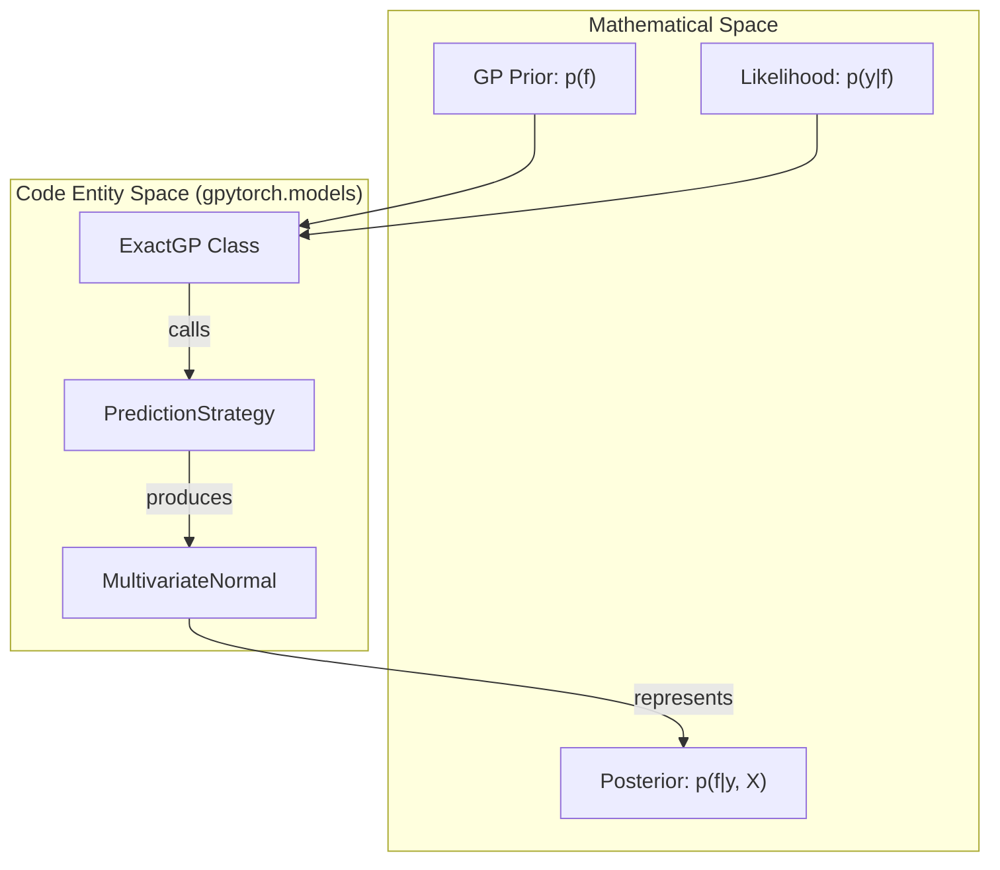
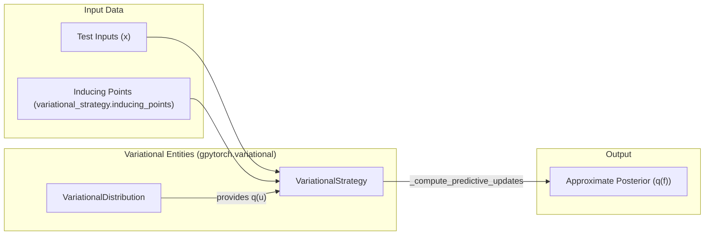

<!-- source: DeepWiki mcp.deepwiki.com · repo cornellius-gp/gpytorch · page 9 Glossary · fetched 2026-10-21 -->

# Glossary

Relevant source files

The following files were used as context for generating this wiki page:

- [.conda/meta.yaml](.conda/meta.yaml)
- [.github/ISSUE_TEMPLATE/---other.md](.github/ISSUE_TEMPLATE/---other.md)
- [.github/workflows/deploy.yml](.github/workflows/deploy.yml)
- [.github/workflows/run_test_suite.yml](.github/workflows/run_test_suite.yml)
- [.readthedocs.yml](.readthedocs.yml)
- [CONTRIBUTING.md](CONTRIBUTING.md)
- [README.md](README.md)
- [docs/source/conf.py](docs/source/conf.py)
- [docs/source/distributions.rst](docs/source/distributions.rst)
- [gpytorch/__init__.py](gpytorch/__init__.py)
- [gpytorch/beta_features.py](gpytorch/beta_features.py)
- [gpytorch/constraints/constraints.py](gpytorch/constraints/constraints.py)
- [gpytorch/distributions/__init__.py](gpytorch/distributions/__init__.py)
- [gpytorch/distributions/delta.py](gpytorch/distributions/delta.py)
- [gpytorch/distributions/distribution.py](gpytorch/distributions/distribution.py)
- [gpytorch/distributions/multitask_multivariate_normal.py](gpytorch/distributions/multitask_multivariate_normal.py)
- [gpytorch/distributions/multivariate_normal.py](gpytorch/distributions/multivariate_normal.py)
- [gpytorch/functions/__init__.py](gpytorch/functions/__init__.py)
- [gpytorch/kernels/cosine_kernel.py](gpytorch/kernels/cosine_kernel.py)
- [gpytorch/kernels/index_kernel.py](gpytorch/kernels/index_kernel.py)
- [gpytorch/kernels/kernel.py](gpytorch/kernels/kernel.py)
- [gpytorch/kernels/matern_kernel.py](gpytorch/kernels/matern_kernel.py)
- [gpytorch/kernels/periodic_kernel.py](gpytorch/kernels/periodic_kernel.py)
- [gpytorch/kernels/rbf_kernel.py](gpytorch/kernels/rbf_kernel.py)
- [gpytorch/kernels/rbf_kernel_grad.py](gpytorch/kernels/rbf_kernel_grad.py)
- [gpytorch/kernels/scale_kernel.py](gpytorch/kernels/scale_kernel.py)
- [gpytorch/kernels/spectral_mixture_kernel.py](gpytorch/kernels/spectral_mixture_kernel.py)
- [gpytorch/lazy/__init__.py](gpytorch/lazy/__init__.py)
- [gpytorch/models/exact_gp.py](gpytorch/models/exact_gp.py)
- [gpytorch/models/exact_prediction_strategies.py](gpytorch/models/exact_prediction_strategies.py)
- [gpytorch/module.py](gpytorch/module.py)
- [gpytorch/settings.py](gpytorch/settings.py)
- [gpytorch/test/base_test_case.py](gpytorch/test/base_test_case.py)
- [gpytorch/utils/memoize.py](gpytorch/utils/memoize.py)
- [gpytorch/variational/_variational_strategy.py](gpytorch/variational/_variational_strategy.py)
- [gpytorch/variational/grid_interpolation_variational_strategy.py](gpytorch/variational/grid_interpolation_variational_strategy.py)
- [gpytorch/variational/unwhitened_variational_strategy.py](gpytorch/variational/unwhitened_variational_strategy.py)
- [gpytorch/variational/variational_strategy.py](gpytorch/variational/variational_strategy.py)
- [setup.py](setup.py)
- [test/distributions/test_delta.py](test/distributions/test_delta.py)
- [test/distributions/test_multitask_multivariate_normal.py](test/distributions/test_multitask_multivariate_normal.py)
- [test/distributions/test_multivariate_normal.py](test/distributions/test_multivariate_normal.py)

This page provides definitions for GPyTorch-specific terminology, internal jargon, and key class references used throughout the codebase. It serves as a bridge between Gaussian Process (GP) mathematical theory and the technical implementation details within the library.

## Core Abstractions

### LinearOperator
The fundamental building block for scalable linear algebra in GPyTorch. Unlike a standard `torch.Tensor`, a `LinearOperator` represents a matrix lazily, storing only the necessary components (e.g., inducing points or Kronecker factors) to perform matrix-vector multiplications (MVMs) [README.md:14-19](). GPyTorch relies on the external `linear_operator` library for these structured matrix operations [gpytorch/__init__.py:5-7]().

### Module
The base class for all GPyTorch components, extending `torch.nn.Module` [gpytorch/module.py:70-71](). It manages GP-specific metadata such as `priors`, `constraints`, and `added_loss_terms` (e.g., KL divergence in variational methods) [gpytorch/module.py:73-75]().

### LazyEvaluatedKernelTensor
A specialized `LinearOperator` that wraps a `Kernel` and its input data. It defers the actual computation of the covariance matrix until an operation (like `to_dense()` or a matmul) requires it [gpytorch/kernels/kernel.py:19](), [gpytorch/kernels/kernel.py:95-99]().

## Technical Terms & Jargon

| Term | Definition | Code Reference |
| :--- | :--- | :--- |
| **ARD** | Automatic Relevance Determination. A mode where each input dimension has its own separate `lengthscale` [gpytorch/kernels/kernel.py:115-118](). | `ard_num_dims` in `Kernel` |
| **Whitening** | A reparameterization technique used in variational inference to decorrelate variational parameters from the GP prior, typically improving optimization convergence [gpytorch/variational/variational_strategy.py:154-156](). | `VariationalStrategy` |
| **Fantasy Data** | New observations added to an existing `ExactGP` model without re-fitting hyperparameters, useful for Bayesian Optimization [gpytorch/models/exact_gp.py:151-156](). | `get_fantasy_model` |
| **Jitter** | A small constant added to the diagonal of a covariance matrix to ensure positive definiteness and numerical stability during Cholesky decomposition [gpytorch/__init__.py:46-52](). | `add_jitter` |
| **MVM** | Matrix-Vector Multiplication. The primary operation GPyTorch uses for inference instead of direct matrix inversion [README.md:20-21](). | `LinearOperator.matmul` |
| **LOVE** | Lanczos Variance Estimates. A method for constant-time predictive variances and fast posterior sampling [gpytorch/settings.py:183-198](). | `settings.fast_pred_var` |

## Code Entity Mapping

The following diagrams illustrate the relationship between mathematical concepts and the classes that implement them.

### From GP Components to Code Entities
This diagram shows how the standard GP posterior components map to specific classes and prediction strategies.

**Sources:** [gpytorch/models/exact_gp.py:23-59](), [gpytorch/models/exact_prediction_strategies.py:30-36](), [gpytorch/distributions/multivariate_normal.py:22-42]()

### Variational Inference Data Flow
This diagram maps the flow of data through the variational strategy to produce the approximate posterior $q(f)$.

**Sources:** [gpytorch/variational/variational_strategy.py:142-156](), [gpytorch/variational/variational_strategy.py:68-81](), [gpytorch/models/gp.py:9]()

## Key Settings and Flags
GPyTorch uses a global `settings` module to toggle algorithmic behaviors.

*   **`debug`**: Enables/disables safety checks on input data shapes and GP modes [gpytorch/settings.py:147-157]().
*   **`fast_pred_var`**: Toggles the use of **LOVE** for accelerating variance computations [gpytorch/settings.py:183-195]().
*   **`detach_test_caches`**: When `True`, detaches test-time caches from the autograd graph to save memory during prediction [gpytorch/settings.py:160-170]().
*   **`cholesky_jitter`**: Controls the amount of noise added to the diagonal during internal Cholesky calls [gpytorch/settings.py:10]().

**Sources:** [gpytorch/settings.py:1-241]()

## Distribution Types

### MultivariateNormal (MVN)
The primary distribution object. In GPyTorch, it supports **Lazy Covariance Matrices**, meaning the `covariance_matrix` property can return a `LinearOperator` rather than a dense tensor [gpytorch/distributions/multivariate_normal.py:44-62]().

### MultitaskMultivariateNormal
Extends MVN to handle multiple outputs (tasks). It treats the last two dimensions of the mean as `[num_samples, num_tasks]` [gpytorch/distributions/multitask_multivariate_normal.py:1-20]().

**Sources:** [gpytorch/distributions/multivariate_normal.py:22-42](), [gpytorch/distributions/multitask_multivariate_normal.py:1-20]()