# Page: Overview

# Overview

<details>
<summary>Relevant source files</summary>

The following files were used as context for generating this wiki page:

- [.conda/meta.yaml](.conda/meta.yaml)
- [.github/ISSUE_TEMPLATE/---other.md](.github/ISSUE_TEMPLATE/---other.md)
- [.github/workflows/deploy.yml](.github/workflows/deploy.yml)
- [.github/workflows/run_test_suite.yml](.github/workflows/run_test_suite.yml)
- [.readthedocs.yml](.readthedocs.yml)
- [CONTRIBUTING.md](CONTRIBUTING.md)
- [README.md](README.md)
- [docs/source/conf.py](docs/source/conf.py)
- [gpytorch/__init__.py](gpytorch/__init__.py)
- [gpytorch/beta_features.py](gpytorch/beta_features.py)
- [gpytorch/functions/__init__.py](gpytorch/functions/__init__.py)
- [gpytorch/lazy/__init__.py](gpytorch/lazy/__init__.py)
- [setup.py](setup.py)

</details>


This document provides a high-level introduction to GPyTorch: its purpose, design philosophy, architectural organization, and the relationship with the external `linear_operator` library. This overview establishes the foundational concepts needed to understand the more detailed subsystem documentation in subsequent pages.

For installation instructions and environment setup, see [Installation and Setup](#1.1). For detailed documentation of specific components, see the relevant subsystem pages: [Core Components](#2), [Models](#3), [Kernels](#4), [Likelihoods](#5), [Inference Methods](#6), and [Scalability Techniques](#7).

---

## Purpose and Design Philosophy

GPyTorch is a Gaussian process (GP) library implemented in PyTorch, designed to enable scalable, flexible, and modular GP models [README.md:1-12](). The library distinguishes itself from traditional GP implementations through three core design principles:

1. **Matrix-Vector Multiplication (MVM) Based Inference**: Instead of relying on Cholesky decomposition for GP inference, GPyTorch performs most operations using iterative numerical linear algebra techniques like preconditioned conjugate gradients (CG) [README.md:14-18](). This approach provides better GPU utilization and enables scaling to larger datasets.

2. **Lazy Evaluation**: Kernel matrices and other structured matrices are represented as `LinearOperator` objects (from the external `linear_operator` library) that defer computation until necessary [README.md:15-16](). This allows the system to exploit structure (Toeplitz, Kronecker, etc.) and avoid materializing large matrices.

3. **Modular Composition**: GPs are built by composing kernels, mean functions, likelihoods, and inference strategies [gpytorch/__init__.py:10-26](). This compositional design makes it easy to implement new scalable GP methods by providing matrix multiplication routines through the `LinearOperator` interface.

**Key Library Features** [README.md:20-22]():
- Significant GPU acceleration through MVM-based inference.
- State-of-the-art implementations of algorithmic advances (SKI/KISS-GP, stochastic Lanczos expansions, LOVE, SKIP, stochastic variational deep kernel learning).
- Easy integration with deep learning frameworks via PyTorch.

Sources: [README.md:1-133](), [gpytorch/__init__.py:1-327]()

---

## System Architecture

GPyTorch is organized into distinct architectural layers, each with specific responsibilities. The following diagram illustrates the core layers and their primary components using actual class and module names from the codebase:

### High-Level Architecture
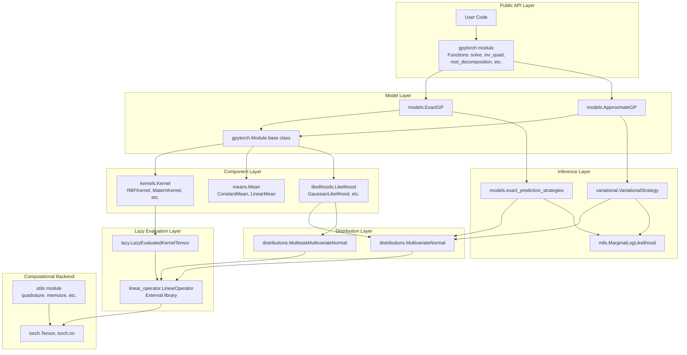

**Layer Responsibilities:**

| Layer | Purpose | Key Classes/Modules |
|-------|---------|---------------------|
| **Public API** | User-facing functions for linear algebra operations | `gpytorch.solve()`, `gpytorch.inv_quad()`, `gpytorch.add_jitter()` [gpytorch/__init__.py:46-115]() |
| **Model** | GP model abstractions for exact and approximate inference | `ExactGP`, `ApproximateGP`, `Module` [gpytorch/__init__.py:20-29]() |
| **Component** | Mathematical building blocks for GP specification | `Kernel`, `Mean`, `Likelihood` subclasses [gpytorch/__init__.py:14-17]() |
| **Distribution** | Probabilistic representations of GP outputs | `MultivariateNormal`, `MultitaskMultivariateNormal` [gpytorch/__init__.py:13]() |
| **Inference** | Strategies for computing posteriors and marginal likelihoods | `VariationalStrategy`, `MarginalLogLikelihood` [gpytorch/__init__.py:19-25]() |
| **Lazy Evaluation** | Deferred computation and structure exploitation | `LazyEvaluatedKernelTensor`, `LinearOperator` [gpytorch/lazy/__init__.py:5](), [gpytorch/__init__.py:7]() |
| **Backend** | Core numerical operations and utilities | PyTorch tensors, quadrature, caching [gpytorch/__init__.py:24]() |

Sources: [gpytorch/__init__.py:1-29](), [README.md:12-22](), [gpytorch/lazy/__init__.py:1-9]()

---

## Relationship with linear_operator Library

GPyTorch has a critical dependency on the external `linear_operator` library [setup.py:44](). This relationship is fundamental to GPyTorch's design and performance characteristics.

### Division of Responsibilities

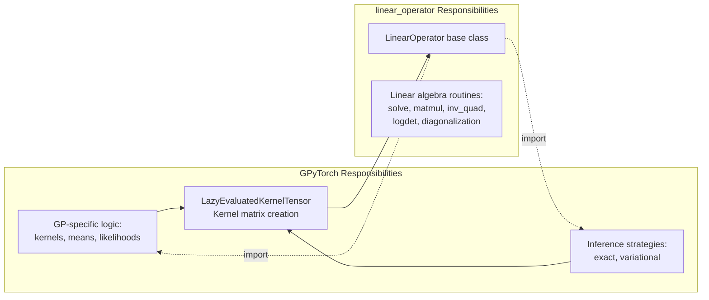

**GPyTorch delegates to linear_operator for:**
- All fundamental linear algebra operations including `solve`, `inv_quad`, `logdet`, and `diagonalization` [gpytorch/__init__.py:34-143]().
- Efficient implementations exploiting matrix structure via the `LinearOperator` interface [README.md:15-16]().

**GPyTorch retains responsibility for:**
- GP-specific concepts: kernel functions, mean functions, likelihoods.
- Model abstractions: `ExactGP`, `ApproximateGP`, variational strategies.
- Creating lazy kernel tensors from kernel evaluations via `LazyEvaluatedKernelTensor` [gpytorch/lazy/lazy_evaluated_kernel_tensor.py]().

### API Integration

GPyTorch's public API functions are often wrappers around `linear_operator` functions to maintain a consistent interface [gpytorch/__init__.py:34-143]().

**Example wrapper implementations**:
- `gpytorch.add_diagonal()` → `linear_operator.add_diagonal()` [gpytorch/__init__.py:34-43]()
- `gpytorch.inv_quad()` → `linear_operator.inv_quad()` [gpytorch/__init__.py:91-115]()
- `gpytorch.diagonalization()` → `linear_operator.diagonalization()` [gpytorch/__init__.py:61-73]()

Sources: [gpytorch/__init__.py:1-143](), [setup.py:44](), [README.md:14-18]()

---

## Core Module Hierarchy

All parameterized GPyTorch components inherit from `gpytorch.Module`, which extends `torch.nn.Module` [gpytorch/__init__.py:29](). This hierarchy establishes the foundation for parameter management, constraints, and priors.

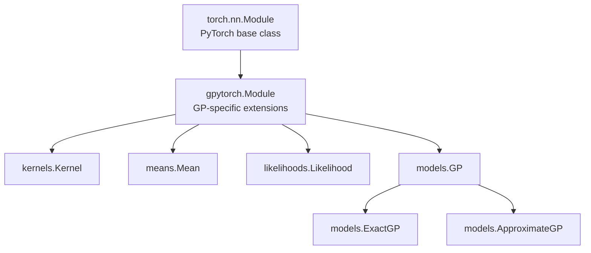

**Key Features Provided by `gpytorch.Module`** (see [Module System](#2.1) for details):
- **Parameter Registration**: Store learnable parameters with constraints.
- **Constraint Transforms**: Enforce parameter domains (e.g., positive values) [gpytorch/__init__.py:12]().
- **Prior Specification**: Define priors over hyperparameters [gpytorch/__init__.py:22]().

Sources: [gpytorch/__init__.py:10-29](), [gpytorch/module.py]()

---

## Computational Backend and Dependencies

### Primary Dependencies
[setup.py:39-45](), [.conda/meta.yaml:23-29]()

| Dependency | Version | Purpose |
|------------|---------|---------|
| **PyTorch** | ≥ 2.0 | Core tensor operations, autograd, and GPU support. |
| **linear_operator** | ≥ 0.6.1 | Structured linear algebra and lazy evaluation. |
| **scikit-learn** | Latest | General machine learning utilities. |
| **scipy** | ≥ 1.6.0 | Numerical utilities and special functions. |
| **mpmath** | ≥ 0.19, ≤ 1.3 | Precision arithmetic for specific operations. |

### Optional Dependencies
[setup.py:91-94](), [.github/workflows/run_test_suite.yml:57-62]()

| Dependency | Purpose |
|------------|---------|
| **pyro-ppl** | Integration for probabilistic programming and Bayesian inference. |
| **pykeops** | GPU-accelerated kernel operations for very large datasets. |
| **matplotlib** | Visualization for example notebooks. |

Sources: [setup.py:1-97](), [.conda/meta.yaml:1-51](), [.github/workflows/run_test_suite.yml:1-86]()

---

## File and Module Organization

GPyTorch's codebase is organized into functional modules [gpytorch/__init__.py:10-26]():

- `models/`: Base classes for `ExactGP` and `ApproximateGP`.
- `kernels/`: Standard and compositional kernel implementations.
- `likelihoods/`: Observation models (Gaussian, Bernoulli, etc.).
- `means/`: Mean function implementations.
- `distributions/`: `MultivariateNormal` and multitask variants.
- `variational/`: Variational strategies and distributions.
- `mlls/`: Marginal Log Likelihood objectives.
- `lazy/`: `LazyEvaluatedKernelTensor` for deferred evaluation [gpytorch/lazy/__init__.py:5]().
- `settings/`: Global context managers for numerical precision and behavior [gpytorch/beta_features.py:7]().

Sources: [gpytorch/__init__.py:1-327](), [gpytorch/lazy/__init__.py:1-9]()

---

# Page: Installation and Setup

# Installation and Setup

<details>
<summary>Relevant source files</summary>

The following files were used as context for generating this wiki page:

- [.conda/meta.yaml](.conda/meta.yaml)
- [.github/ISSUE_TEMPLATE/---other.md](.github/ISSUE_TEMPLATE/---other.md)
- [.github/workflows/deploy.yml](.github/workflows/deploy.yml)
- [.github/workflows/run_test_suite.yml](.github/workflows/run_test_suite.yml)
- [.gitignore](.gitignore)
- [.readthedocs.yml](.readthedocs.yml)
- [CONTRIBUTING.md](CONTRIBUTING.md)
- [LICENSE](LICENSE)
- [README.md](README.md)
- [docs/source/conf.py](docs/source/conf.py)
- [docs/source/linear_operator_objects.inv](docs/source/linear_operator_objects.inv)
- [examples/08_Advanced_Usage/TorchScript_Exact_Models.ipynb](examples/08_Advanced_Usage/TorchScript_Exact_Models.ipynb)
- [examples/LBFGS.py](examples/LBFGS.py)
- [setup.cfg](setup.cfg)
- [setup.py](setup.py)

</details>


This page provides a comprehensive guide for installing GPyTorch and setting up your environment. It covers standard installation methods, dependencies, verification steps, and development environment setup options.

## Introduction

GPyTorch is a Gaussian process library implemented using PyTorch, designed for creating scalable, flexible, and modular Gaussian Process models [README.md:1-12](). The library leverages numerical linear algebra techniques, specifically preconditioned conjugate gradients, to make GPs more computationally efficient, with significant GPU acceleration through matrix-vector multiplication (MVM) based inference [README.md:14-22]().

Before proceeding with installation, ensure that your system meets the minimum requirements.

Sources: [README.md:1-22]()

## System Requirements

GPyTorch requires a modern Python environment with PyTorch.

- **Python**: Version 3.10 or higher [README.md:32](), [setup.py:9-10]()
- **PyTorch**: Version 2.0 or higher [README.md:33](), [setup.py:39]()

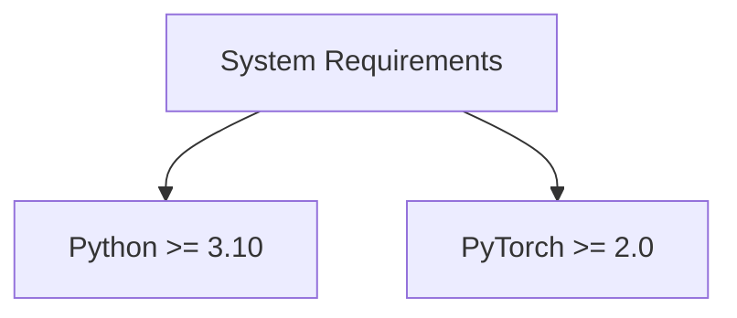

Sources: [README.md:31-33](), [setup.py:9-10, 39]()

## Installation Methods

GPyTorch can be installed using several methods, depending on your needs.

### Standard Installation

The recommended way to install GPyTorch is via pip or conda [README.md:35]().

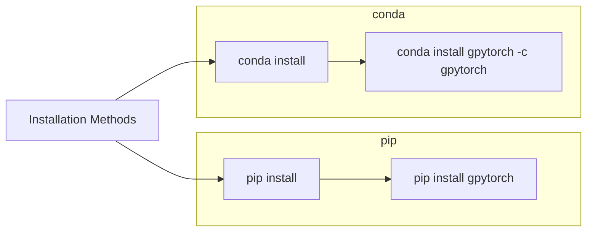

#### Using pip
```bash
pip install gpytorch
```
To install as a user-only package: `pip install --user gpytorch` [README.md:38, 42]().

#### Using conda
```bash
conda install gpytorch -c gpytorch
```
The conda package is managed via a `meta.yaml` configuration that ensures all runtime requirements like `linear_operator` and `mpmath` are satisfied [.conda/meta.yaml:18-28]().

Sources: [README.md:35-42](), [.conda/meta.yaml:7-29]()

### Latest (Unstable) Version

To use the latest development features, you must install the development versions of both `gpytorch` and its core dependency `linear_operator` [README.md:44-51]().

```bash
pip install --upgrade git+https://github.com/cornellius-gp/linear_operator.git
pip install --upgrade git+https://github.com/cornellius-gp/gpytorch.git
```

Sources: [README.md:44-51]()

### Development Installation

If you are contributing to the codebase, perform an editable installation with all extra dependency groups [README.md:53-61](), [CONTRIBUTING.md:5-14]().

```bash
git clone https://github.com/cornellius-gp/gpytorch.git
cd gpytorch
pip install -e .[dev,docs,examples,keops,pyro,test]
```

Sources: [README.md:53-61](), [CONTRIBUTING.md:5-14]()

## Dependencies

GPyTorch relies on a set of core libraries for its linear algebra and optimization routines.

### Core Dependencies

| Package | Version | Purpose |
|---------|---------|---------|
| `torch` | >= 2.0 | Primary tensor and autograd engine [setup.py:39]() |
| `linear_operator` | >= 0.6.1 | Abstracted lazy matrix operations [setup.py:44]() |
| `scipy` | >= 1.6.0 | Scientific computing utilities [setup.py:43]() |
| `scikit-learn` | * | General machine learning utilities [setup.py:42]() |
| `mpmath` | >= 0.19, <= 1.3 | Arbitrary-precision floating-point arithmetic [setup.py:41]() |

Sources: [setup.py:39-45](), [.conda/meta.yaml:23-28]()

### Optional Extra Dependencies

The `setup.py` defines several `extras_require` groups for specialized functionality [setup.py:75-95]():

- **`keops`**: Enables `pykeops` for memory-efficient kernel operations on large datasets [setup.py:92]().
- **`pyro`**: Integration with the `pyro-ppl` probabilistic programming library [setup.py:93]().
- **`docs`**: Tools for building documentation, including `sphinx`, `nbsphinx`, and `m2r2` [setup.py:77-90]().
- **`test`**: Testing infrastructure including `pytest`, `flake8`, and `nbval` [setup.py:94]().

Sources: [setup.py:75-95]()

## Verifying Installation

Verification can be performed by checking that all sub-packages are importable. The conda test suite validates the following hierarchy [.conda/meta.yaml:30-43]():

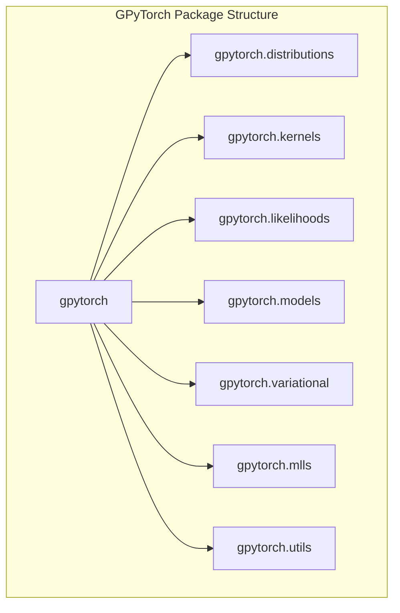

Sources: [.conda/meta.yaml:30-43]()

## CI/CD Pipeline

GPyTorch uses GitHub Actions for continuous integration and deployment.

### Test Suite (`run_test_suite.yml`)
The pipeline runs on every push and pull request to `main` and `develop` [.github/workflows/run_test_suite.yml:6-10](). It consists of three primary jobs:
1. **`run_linter`**: Executes `flake8` and `pre-commit` checks to enforce code style [.github/workflows/run_test_suite.yml:14-32]().
2. **`run_unit_tests`**: Runs the `unittest` suite across a matrix of PyTorch versions (stable and nightly) [.github/workflows/run_test_suite.yml:36-65]().
3. **`run_examples`**: Validates example notebooks using `pytest --nbval-lax` [.github/workflows/run_test_suite.yml:67-86]().

### Deployment (`deploy.yml`)
Upon a new release creation, the deployment workflow triggers [.github/workflows/deploy.yml:6-8]():
- **PyPI**: Builds source and wheel distributions using `setuptools_scm` and uploads via `twine` [.github/workflows/deploy.yml:14-34]().
- **Anaconda**: Builds the conda package using the `.conda/meta.yaml` recipe and uploads to the `gpytorch` channel [.github/workflows/deploy.yml:36-59]().

Sources: [.github/workflows/run_test_suite.yml:1-86](), [.github/workflows/deploy.yml:1-59]()

## Initial Configuration & Advanced Setup

### TorchScript Integration
GPyTorch supports TorchScript for model deployment, but requires specific settings. Tracing must be performed with `gpytorch.settings.fast_pred_var()` and `gpytorch.settings.trace_mode()` enabled [examples/08_Advanced_Usage/TorchScript_Exact_Models.ipynb:118-122]().

### Documentation Build
The documentation is built using Sphinx. To build locally [CONTRIBUTING.md:60-85]():
```bash
cd docs
SKIP_EXAMPLES=true make html
```
The build process in `docs/source/conf.py` automatically copies notebooks from the `examples/` directory to the documentation source to ensure they are rendered correctly [docs/source/conf.py:43-74]().

Sources: [examples/08_Advanced_Usage/TorchScript_Exact_Models.ipynb:9-13, 118-122](), [CONTRIBUTING.md:60-85](), [docs/source/conf.py:43-74]()

---

# Page: Core Components

# Core Components

<details>
<summary>Relevant source files</summary>

The following files were used as context for generating this wiki page:

- [docs/source/distributions.rst](docs/source/distributions.rst)
- [gpytorch/__init__.py](gpytorch/__init__.py)
- [gpytorch/beta_features.py](gpytorch/beta_features.py)
- [gpytorch/constraints/constraints.py](gpytorch/constraints/constraints.py)
- [gpytorch/distributions/__init__.py](gpytorch/distributions/__init__.py)
- [gpytorch/distributions/delta.py](gpytorch/distributions/delta.py)
- [gpytorch/distributions/distribution.py](gpytorch/distributions/distribution.py)
- [gpytorch/functions/__init__.py](gpytorch/functions/__init__.py)
- [gpytorch/lazy/__init__.py](gpytorch/lazy/__init__.py)
- [gpytorch/module.py](gpytorch/module.py)
- [gpytorch/test/base_test_case.py](gpytorch/test/base_test_case.py)
- [test/distributions/test_delta.py](test/distributions/test_delta.py)

</details>


This page provides an overview of the fundamental building blocks that make up GPyTorch models. These components form the foundation upon which all Gaussian Process functionality is built in the framework.

## Core Architecture Overview

GPyTorch is structured around several key components that work together to provide a flexible, scalable framework for Gaussian Process modeling. The main components are:

```mermaid
classDiagram
    class "Module" {
        +forward()
        +__call__()
        +register_parameter()
        +register_prior()
        +register_constraint()
        +train()/eval()
    }
    
    class "LinearOperator" {
        +matmul()
        +solve()
        +inv_quad_logdet()
        +root_decomposition()
    }
    
    class "Distributions" {
        +MultivariateNormal
        +MultitaskMultivariateNormal
    }
    
    class "Kernels" {
        +forward()
        +__call__()
    }
    
    class "Likelihoods" {
        +forward()
        +__call__()
    }
    
    class "MLL Functions" {
        +forward()
    }
    
    "Module" <|-- "Kernels"
    "Module" <|-- "Likelihoods"
    "Module" <|-- "MLL Functions"
    "Module" --> "LinearOperator": uses
    "Module" --> "Distributions": returns
```

Sources: [gpytorch/__init__.py:10-25](), [gpytorch/module.py:70-86]()

## Module System

The foundation of GPyTorch is the `Module` class, which extends PyTorch's `nn.Module` with additional functionality specific to Gaussian Processes. It handles the management of parameters, constraints, and priors.

For details, see [Module System](#2.1).

```mermaid
classDiagram
    class "torch.nn.Module" {
        +parameters()
        +buffers()
    }
    
    class "gpytorch.module.Module" {
        +forward()
        +initialize()
        +register_prior()
        +register_constraint()
        +named_priors()
        +named_constraints()
    }
    
    class "gpytorch.module.RandomModuleMixin" {
        +initialize()
    }
    
    "torch.nn.Module" <|-- "gpytorch.module.Module"
    "gpytorch.module.RandomModuleMixin" <|-- "gpytorch.module.Module"
```

The `Module` class has several key features:

1.  **Parameter Management**: Extends PyTorch's parameter system with constraints and priors [gpytorch/module.py:70-75]().
2.  **Prior Registration**: Allows attaching probabilistic priors to parameters via `_priors` [gpytorch/module.py:74-74]().
3.  **Constraint System**: Enforces bounds and transformations on parameters using `Interval` objects [gpytorch/module.py:75-75](), [gpytorch/constraints/constraints.py:17-51]().
4.  **Initialization Helpers**: Specialized `initialize()` methods for setting parameter values by name or full path [gpytorch/module.py:122-137]().

Sources: [gpytorch/module.py:70-170](), [gpytorch/constraints/constraints.py:17-51]()

## Distributions

GPyTorch uses specialized probability distributions to represent the outputs of Gaussian Process models. Unlike standard PyTorch distributions, these are designed to work with structured covariance matrices.

For details, see [Distributions](#2.2).

- **`MultivariateNormal`**: The core distribution for standard GPs, accepting `LinearOperator` objects for efficient covariance representation [gpytorch/distributions/multivariate_normal.py:18-25]().
- **`MultitaskMultivariateNormal`**: Extends to multiple output dimensions for multitask GPs [gpytorch/distributions/multitask_multivariate_normal.py:17-25]().
- **Integration**: If Pyro is installed, these distributions inherit from `TorchDistributionMixin` to support probabilistic programming [gpytorch/distributions/distribution.py:28-33]().

Sources: [gpytorch/distributions/distribution.py:8-38](), [docs/source/distributions.rst:7-17]()

## Linear Operators

Linear operators are the primary abstraction for matrix operations in GPyTorch. Instead of storing dense `N x N` matrices, GPyTorch uses the `LinearOperator` class (from the `linear_operator` library) to represent structured matrices (e.g., Toeplitz, Kronecker, Low-Rank).

For details, see [Linear Operators](#2.3).

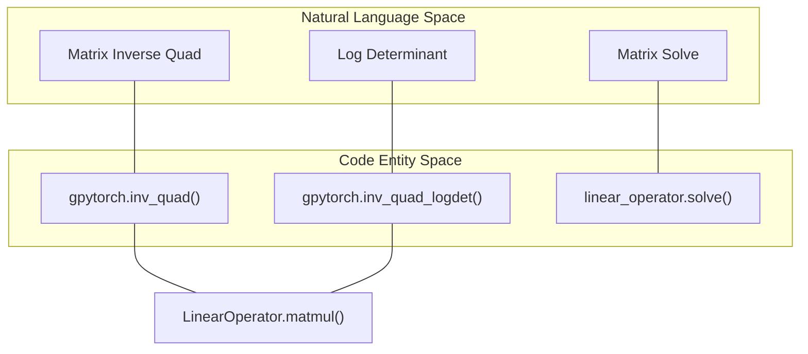

Key operations exposed via GPyTorch:
- `inv_quad`: Computes $tr(R^\top A^{-1} R)$ [gpytorch/__init__.py:91-115]().
- `inv_quad_logdet`: Jointly computes the inverse quadratic form and log determinant [gpytorch/__init__.py:118-143]().
- `pivoted_cholesky`: Performs partial pivoted Cholesky factorization for low-rank approximations [gpytorch/__init__.py:146-173]().

Sources: [gpytorch/__init__.py:34-173](), [gpytorch/functions/__init__.py:26-38]()

## Summary

The core components work in unison: `Module` provides the structure for parameters, `LinearOperator` provides the efficient linear algebra engine, and `Distributions` provide the probabilistic interface for model outputs. These foundations allow GPyTorch to scale to millions of data points while maintaining a familiar PyTorch-like API.

---

# Page: Module System

# Module System

<details>
<summary>Relevant source files</summary>

The following files were used as context for generating this wiki page:

- [docs/source/distributions.rst](docs/source/distributions.rst)
- [gpytorch/constraints/constraints.py](gpytorch/constraints/constraints.py)
- [gpytorch/distributions/__init__.py](gpytorch/distributions/__init__.py)
- [gpytorch/distributions/delta.py](gpytorch/distributions/delta.py)
- [gpytorch/distributions/distribution.py](gpytorch/distributions/distribution.py)
- [gpytorch/module.py](gpytorch/module.py)
- [gpytorch/test/base_test_case.py](gpytorch/test/base_test_case.py)
- [gpytorch/utils/transforms.py](gpytorch/utils/transforms.py)
- [test/constraints/test_constraints.py](test/constraints/test_constraints.py)
- [test/distributions/test_delta.py](test/distributions/test_delta.py)

</details>


## Purpose and Scope

This page documents the Module system in GPyTorch, which forms the foundation for all model components. The Module system extends PyTorch's `nn.Module` base class with Gaussian Process-specific functionality, providing a unified interface for parameter management, prior specifications, constraints, and model composition. This system is essential for building structured, flexible, and modular Gaussian Process models.

For information about specific models built with this module system, see **Models (Section 3)**. For details on how the Linear Operators system interfaces with modules, see **Linear Operators (Section 2.3)**.

## Module Architecture

The GPyTorch Module system enhances PyTorch's `nn.Module` with additional capabilities for Gaussian Process modeling, including parameter priors, constraints, and caching mechanisms.

### Class Hierarchy and Entity Mapping

The following diagram bridges the "Natural Language Space" of GP components to the "Code Entity Space" of the `gpytorch` library.

```mermaid
classDiagram
    class "torch.nn.Module" {
        +parameters()
        +named_parameters()
        +buffers()
        +named_buffers()
        +train()
        +eval()
        +forward()
    }
    
    class "gpytorch.module.Module" {
        <<Entity>>
        -_priors: dict
        -_constraints: dict
        -_added_loss_terms: dict
        -_strict_init: bool
        +forward()
        +initialize()
        +register_prior()
        +register_constraint()
        +constraint_for_parameter_name()
        +sample_from_prior()
        +named_priors()
        +named_constraints()
        +_clear_cache()
    }
    
    class "gpytorch.module.RandomModuleMixin" {
        <<Mixin>>
        +initialize()
    }
    
    class "gpytorch.models.ExactGP" {
        <<Model>>
    }
    
    class "gpytorch.kernels.Kernel" {
        <<Component>>
    }
    
    class "gpytorch.likelihoods.Likelihood" {
        <<Component>>
    }
    
    "torch.nn.Module" <|-- "gpytorch.module.Module"
    "gpytorch.module.Module" <|-- "gpytorch.models.ExactGP"
    "gpytorch.module.Module" <|-- "gpytorch.kernels.Kernel" 
    "gpytorch.module.Module" <|-- "gpytorch.likelihoods.Likelihood"
    "gpytorch.module.RandomModuleMixin" <.. "gpytorch.module.Module" : mixin logic
```

Sources: [gpytorch/module.py:30-67](), [gpytorch/module.py:70-490]()

## Core Module Features

The `gpytorch.module.Module` class provides several key features that distinguish it from the standard PyTorch `nn.Module`:

### 1. Parameter Management with Priors and Constraints

GPyTorch modules associate raw parameters with prior distributions and constraints. Constraints typically transform a "raw" unconstrained parameter (used by optimizers) into a "constrained" parameter (used by the GP logic).

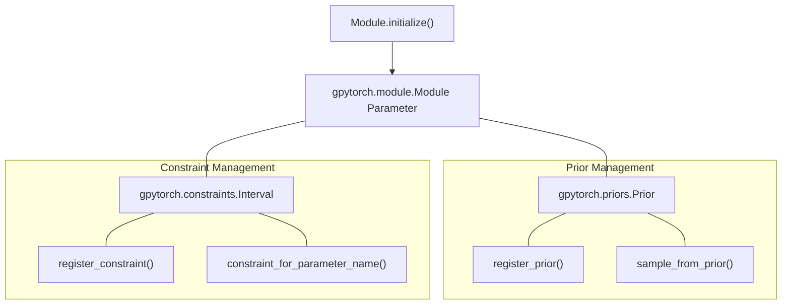

Sources: [gpytorch/module.py:122-191](), [gpytorch/module.py:252-329](), [gpytorch/module.py:359-375]()

### 2. Return Type Validation

The `__call__` method in `gpytorch.module.Module` ensures that outputs are valid GPyTorch objects using `_validate_module_outputs`.

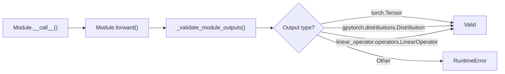

Sources: [gpytorch/module.py:82-86](), [gpytorch/module.py:492-507]()

### 3. Cache Management

Modules implement a `_clear_cache` mechanism. This is automatically triggered when switching between `train()` and `eval()` modes to ensure that stale computations from training do not affect test-time predictions.

Sources: [gpytorch/module.py:88-92](), [gpytorch/module.py:353-357]()

## Constraints System

Constraints ensure parameters maintain valid values, such as ensuring noise variances are positive or lengthscales fall within a specific range.

### Implementation Details
Constraints are implemented in `gpytorch/constraints/constraints.py`. The base class `Interval` handles the transformation between raw and constrained spaces using a `transform` (e.g., `sigmoid` or `softplus`) and its inverse.

| Constraint Class | Domain | Default Transform |
| :--- | :--- | :--- |
| `Interval(low, high)` | `[low, high]` | `torch.sigmoid` |
| `GreaterThan(lower)` | `(lower, inf)` | `torch.nn.functional.softplus` |
| `LessThan(upper)` | `(-inf, upper)` | `torch.nn.functional.softplus` (negative) |
| `Positive()` | `(0, inf)` | `torch.nn.functional.softplus` |

Sources: [gpytorch/constraints/constraints.py:17-83](), [gpytorch/constraints/constraints.py:135-158](), [gpytorch/utils/transforms.py:27]()

### Constraint Naming and Lookup
Constraints are stored in the `_constraints` dictionary. The method `constraint_for_parameter_name(name)` allows retrieving a constraint using the full dot-separated parameter path (e.g., `covar_module.base_kernel.raw_lengthscale`).

Sources: [gpytorch/module.py:359-375](), [test/constraints/test_constraints.py:207-220]()

## Working with Priors

Priors allow specifying Bayesian beliefs about parameter values.

- **Registration**: `register_prior` takes a `Prior` object and a `Closure` that defines how to retrieve the parameter.
- **Sampling**: `sample_from_prior` draws a new value from the distribution and updates the parameter via `initialize`.
- **Pyro Integration**: If Pyro is installed, `gpytorch.distributions.Distribution` inherits from `TorchDistributionMixin`, enabling seamless integration with Pyro's `sample` statements.

Sources: [gpytorch/module.py:252-301](), [gpytorch/distributions/distribution.py:28-38]()

## RandomModuleMixin

The `RandomModuleMixin` (and the `to_random_module` method) allows converting a standard module into one that can sample its own parameters. This is useful for Monte Carlo methods or integration with Pyro's effect handlers.

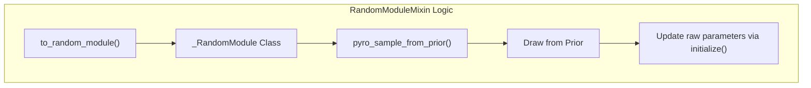

Sources: [gpytorch/module.py:30-67](), [gpytorch/module.py:420-445]()

## State Dictionary and Loading

GPyTorch modules provide specialized hooks for loading state dicts:
- **Shape Flexibility**: `self._load_strict_shapes` can be toggled to allow loading parameters even if the shapes in the state dict differ from the current module (useful for transfer learning).
- **Constraint Buffers**: The `Interval` class registers `lower_bound` and `upper_bound` as buffers, ensuring they are saved and loaded with the model.

Sources: [gpytorch/module.py:78-80](), [gpytorch/module.py:377-402](), [gpytorch/constraints/constraints.py:70-71]()

## Key Methods Reference

| Method | Purpose |
| :--- | :--- |
| `forward(*inputs)` | Defines the computation logic (must be implemented by subclasses). |
| `initialize(**kwargs)` | Sets parameter values while respecting constraints. |
| `register_prior(name, prior, ...)` | Associates a `gpytorch.priors.Prior` with a parameter. |
| `register_constraint(name, constraint)` | Associates a `gpytorch.constraints.Interval` with a parameter. |
| `sample_from_prior(name)` | Samples from a registered prior and updates the raw parameter. |
| `pyro_sample_from_prior()` | Samples all registered priors using Pyro's `sample` mechanism. |
| `_clear_cache()` | Clears precomputed values (e.g., training-time covariance caches). |

Sources: [gpytorch/module.py:111-112](), [gpytorch/module.py:122-191](), [gpytorch/module.py:252-301](), [gpytorch/module.py:331-352](), [gpytorch/module.py:408-445](), [gpytorch/module.py:87-92]()

---

# Page: Distributions

# Distributions

<details>
<summary>Relevant source files</summary>

The following files were used as context for generating this wiki page:

- [docs/source/distributions.rst](docs/source/distributions.rst)
- [gpytorch/constraints/constraints.py](gpytorch/constraints/constraints.py)
- [gpytorch/distributions/__init__.py](gpytorch/distributions/__init__.py)
- [gpytorch/distributions/delta.py](gpytorch/distributions/delta.py)
- [gpytorch/distributions/distribution.py](gpytorch/distributions/distribution.py)
- [gpytorch/distributions/multitask_multivariate_normal.py](gpytorch/distributions/multitask_multivariate_normal.py)
- [gpytorch/distributions/multivariate_normal.py](gpytorch/distributions/multivariate_normal.py)
- [gpytorch/module.py](gpytorch/module.py)
- [gpytorch/test/base_test_case.py](gpytorch/test/base_test_case.py)
- [test/distributions/test_delta.py](test/distributions/test_delta.py)
- [test/distributions/test_multitask_multivariate_normal.py](test/distributions/test_multitask_multivariate_normal.py)
- [test/distributions/test_multivariate_normal.py](test/distributions/test_multivariate_normal.py)

</details>


The Distributions module in GPyTorch provides specialized probability distributions for representing the outputs of Gaussian Processes. While GPyTorch largely leverages PyTorch's distribution library, it implements custom multivariate normal distributions that efficiently work with the `LinearOperator` system and support operations specifically needed for Gaussian Process models.

## Distribution Classes Overview

GPyTorch implements three primary distribution classes:

1.  **MultivariateNormal**: Used for standard single-output Gaussian Processes [gpytorch/distributions/multivariate_normal.py:22-42]().
2.  **MultitaskMultivariateNormal**: Used for multi-output/multitask Gaussian Processes [gpytorch/distributions/multitask_multivariate_normal.py:17-32]().
3.  **Delta**: Represents a degenerate discrete distribution (a single point), often used for deterministic components or borrowed from Pyro [gpytorch/distributions/delta.py:19-32]().

## Distribution Hierarchy

GPyTorch distributions are designed to be compatible with both PyTorch and Pyro. If Pyro is installed, GPyTorch distributions inherit from `TorchDistributionMixin` [gpytorch/distributions/distribution.py:29-38]().

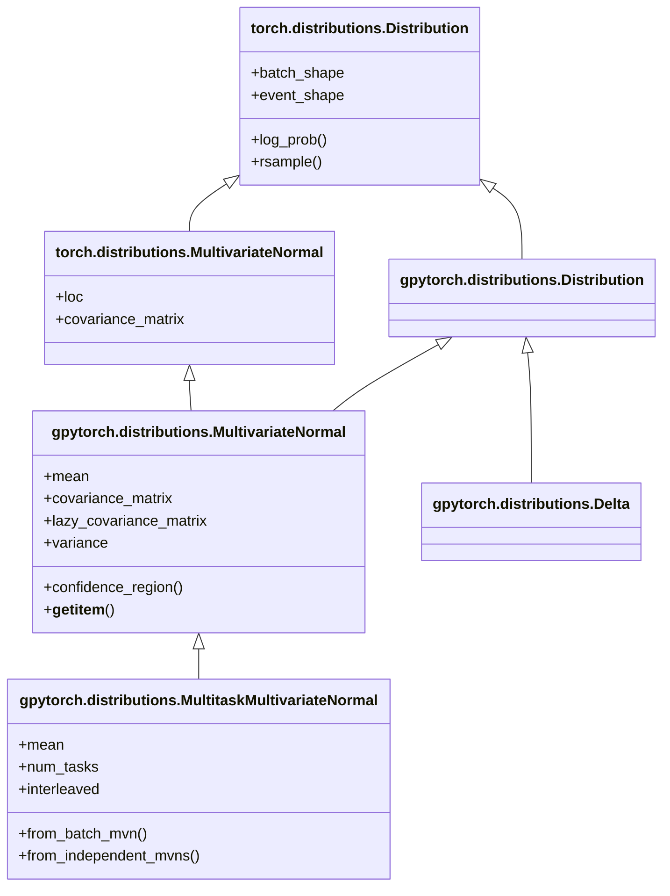
Sources: [gpytorch/distributions/distribution.py:32-38](), [gpytorch/distributions/multivariate_normal.py:22-42](), [gpytorch/distributions/multitask_multivariate_normal.py:17-32](), [gpytorch/distributions/delta.py:19-32]()

## MultivariateNormal

The `MultivariateNormal` class represents a multivariate normal distribution. It extends PyTorch's `MultivariateNormal` but allows for lazy evaluation of operations on the covariance matrix using `LinearOperator` objects [gpytorch/distributions/multivariate_normal.py:22-42]().

### Structure and Data Flow

The following diagram shows how data flows from `LinearOperator` components into the `MultivariateNormal` entity.

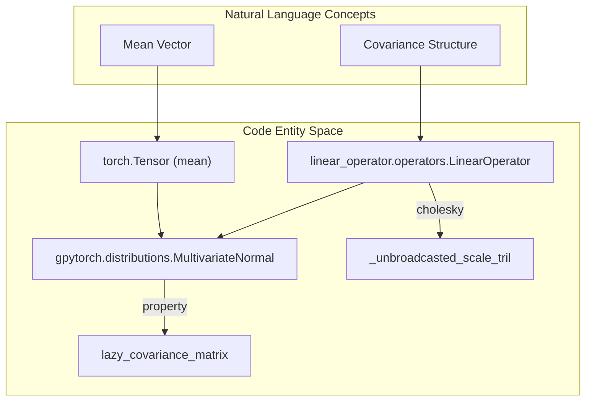
Sources: [gpytorch/distributions/multivariate_normal.py:44-65](), [gpytorch/distributions/multivariate_normal.py:84-89](), [gpytorch/distributions/multivariate_normal.py:115-120]()

### Initialization
```python
mvn = MultivariateNormal(mean, covariance_matrix, validate_args=False)
```
The constructor detects if the inputs are "lazy" (i.e., instances of `LinearOperator`) and sets the `_islazy` flag accordingly [gpytorch/distributions/multivariate_normal.py:45-46]().

### Key Methods and Operations
*   **Confidence Region**: Returns 2 standard deviations above and below the mean [gpytorch/distributions/multivariate_normal.py:121-131]().
*   **Jitter**: `add_jitter(noise=1e-4)` adds a small constant diagonal to the covariance for numerical stability [gpytorch/distributions/multivariate_normal.py:98-104]().
*   **Arithmetic**: Supports `__add__`, `__mul__`, and `__truediv__`. Adding two `MultivariateNormal` distributions sums their means and covariances [gpytorch/distributions/multivariate_normal.py:385-420]().
*   **Indexing**: `__getitem__` allows slicing into batch and event dimensions, returning a new `MultivariateNormal` [gpytorch/distributions/multivariate_normal.py:427-450]().

Sources: [gpytorch/distributions/multivariate_normal.py:98-131](), [gpytorch/distributions/multivariate_normal.py:385-450]()

## MultitaskMultivariateNormal

The `MultitaskMultivariateNormal` class handles multi-output distributions where the mean is an `n x t` matrix (data points by tasks) [gpytorch/distributions/multitask_multivariate_normal.py:17-32]().

### Interleaving
The `interleaved` parameter (default `True`) defines how the flattened covariance matrix `NT x NT` is interpreted:
*   **Interleaved**: Task indices vary faster than observation indices [gpytorch/distributions/multitask_multivariate_normal.py:67-68]().
*   **Non-interleaved**: Observation indices vary faster than task indices [gpytorch/distributions/multitask_multivariate_normal.py:70-71]().

### Creation Utilities
*   **`from_batch_mvn`**: Reinterprets a batch of MVNs as a multitask distribution using `BlockInterleavedLinearOperator` [gpytorch/distributions/multitask_multivariate_normal.py:87-124]().
*   **`from_independent_mvns`**: Combines an iterable of MVNs into a single multitask distribution where tasks are independent [gpytorch/distributions/multitask_multivariate_normal.py:127-160]().

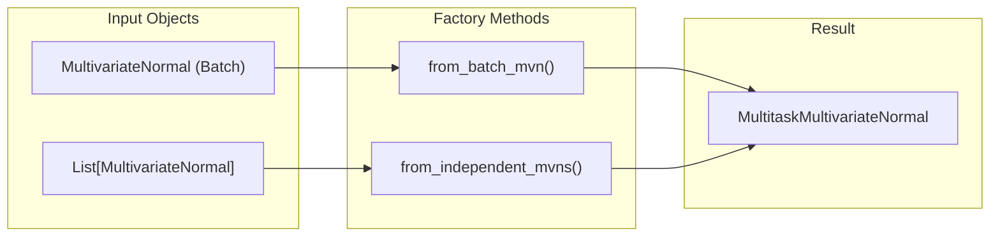
Sources: [gpytorch/distributions/multitask_multivariate_normal.py:87-160]()

## Distribution Operations

GPyTorch distributions integrate with `linear_operator` to perform efficient linear algebra.

| Operation | Implementation Detail | Source |
| :--- | :--- | :--- |
| **Log Probability** | Uses `lazy_covariance_matrix.inv_quad_logdet` for efficient computation. | [gpytorch/distributions/multivariate_normal.py:222-253]() |
| **Sampling** | `rsample` uses `root_decomposition` or `cholesky` for reparameterized samples. | [gpytorch/distributions/multivariate_normal.py:255-321]() |
| **Entropy** | Computed via the log-determinant of the covariance. | [gpytorch/distributions/multivariate_normal.py:216-220]() |
| **KL Divergence** | Registered via `register_kl` for MVN pairs. | [gpytorch/distributions/multivariate_normal.py:453-478]() |

### KL Divergence Registry
GPyTorch registers specific KL divergence implementations for its custom types, such as `kl_mvn_mvn` for two `MultivariateNormal` objects [gpytorch/distributions/multivariate_normal.py:453-478]() and `kl_mvn_mvn` for a `Delta` and `MultivariateNormal` [gpytorch/distributions/delta.py:80-82]().

Sources: [gpytorch/distributions/multivariate_normal.py:453-478](), [gpytorch/distributions/delta.py:80-82]()

---

# Page: Linear Operators

# Linear Operators

<details>
<summary>Relevant source files</summary>

The following files were used as context for generating this wiki page:

- [gpytorch/__init__.py](gpytorch/__init__.py)
- [gpytorch/beta_features.py](gpytorch/beta_features.py)
- [gpytorch/functions/__init__.py](gpytorch/functions/__init__.py)
- [gpytorch/lazy/__init__.py](gpytorch/lazy/__init__.py)
- [gpytorch/lazy/lazy_evaluated_kernel_tensor.py](gpytorch/lazy/lazy_evaluated_kernel_tensor.py)
- [gpytorch/models/approximate_gp.py](gpytorch/models/approximate_gp.py)
- [gpytorch/models/pyro/_pyro_mixin.py](gpytorch/models/pyro/_pyro_mixin.py)
- [gpytorch/models/pyro/pyro_gp.py](gpytorch/models/pyro/pyro_gp.py)
- [test/examples/test_pyro_integration.py](test/examples/test_pyro_integration.py)
- [test/lazy/test_lazy_evaluated_kernel_tensor.py](test/lazy/test_lazy_evaluated_kernel_tensor.py)

</details>


## Purpose and Scope

This page explains the `LinearOperator` abstraction and its role in GPyTorch's computational backend. Linear operators provide lazy evaluation and structured matrix representations that enable efficient Gaussian Process computations at scale.

For information about how kernels produce linear operators, see [Kernels](#4). For details on how distributions use linear operators for covariance matrices, see [Distributions](#2.2). For lazy evaluation and caching mechanisms specific to inference, see [Efficient Linear Algebra](#7.3).

---

## Overview

GPyTorch relies heavily on the external `linear_operator` library to represent and manipulate matrices that arise in GP computations. Rather than forming and storing dense $N \times N$ covariance matrices explicitly, GPyTorch uses `LinearOperator` objects that:

1.  **Defer computation** until results are actually needed (lazy evaluation).
2.  **Exploit structure** in matrices (Toeplitz, Kronecker, etc.) for efficient operations.
3.  **Provide a consistent interface** for matrix operations like solves, matrix-vector products, and log determinants.

The key insight is that for many GP operations, we never need the full covariance matrix—we only need operations like solves ($\mathbf{K}^{-1}\mathbf{v}$) or log determinants ($\log|\mathbf{K}|$). Linear operators implement these operations directly, often with significant computational savings.

**Sources:** [gpytorch/__init__.py:5-7](), [gpytorch/__init__.py:31-31]()

---

## Architecture: GPyTorch and linear_operator Library

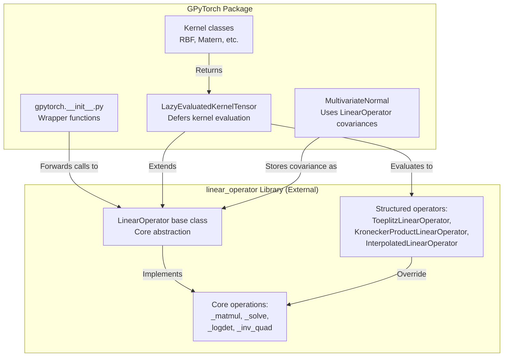

**Diagram: Relationship between GPyTorch and the linear_operator library**

The `linear_operator` library provides the foundation, while GPyTorch adds GP-specific functionality through `LazyEvaluatedKernelTensor` and wraps common operations for convenience in the top-level `gpytorch` namespace.

**Sources:** [gpytorch/__init__.py:5-7](), [gpytorch/lazy/lazy_evaluated_kernel_tensor.py:33-49]()

---

## The LinearOperator Base Class

The `LinearOperator` class from the external library provides a PyTorch-like interface for matrix operations without requiring explicit matrix storage. All linear operators in GPyTorch inherit from this base class.

### Core Properties

| Property | Description | Source |
|----------|-------------|--------|
| `dtype` | Data type of elements (e.g., `torch.float32`) | [gpytorch/lazy/lazy_evaluated_kernel_tensor.py:51-53]() |
| `device` | Device location (CPU/GPU) | [gpytorch/lazy/lazy_evaluated_kernel_tensor.py:55-57]() |
| `requires_grad` | Whether the operator tracks gradients | [gpytorch/lazy/lazy_evaluated_kernel_tensor.py:59-61]() |

### Core Operations

GPyTorch exposes the following key operations through wrapper functions in `gpytorch/__init__.py`:

| Function | Mathematical Operation | Purpose | Source |
|----------|----------------------|---------|--------|
| `solve` | $\mathbf{K}^{-1}\mathbf{R}$ or $\mathbf{L}\mathbf{K}^{-1}\mathbf{R}$ | Linear solve for posterior mean | [gpytorch/functions/__init__.py:36-38]() |
| `inv_quad` | $\text{tr}(\mathbf{R}^\top \mathbf{A}^{-1} \mathbf{R})$ | Inverse quadratic form for MLL | [gpytorch/__init__.py:91-115]() |
| `inv_quad_logdet` | Combined $\text{tr}(\mathbf{R}^\top \mathbf{A}^{-1} \mathbf{R})$ and $\log|\mathbf{A}|$ | Efficient MLL evaluation | [gpytorch/__init__.py:118-143]() |
| `pivoted_cholesky` | $\mathbf{L} \mathbf{L}^\top \approx \mathbf{A}$ | Low-rank approximation | [gpytorch/__init__.py:146-172]() |
| `diagonalization` | Partial Eigendecomposition | Lanczos or Symeig | [gpytorch/__init__.py:61-73]() |
| `add_diagonal` | $\mathbf{A} + \text{diag}(\mathbf{d})$ | Add observation noise | [gpytorch/__init__.py:34-43]() |
| `add_jitter` | $\mathbf{A} + \alpha \mathbf{I}$ | Numerical stability | [gpytorch/__init__.py:46-58]() |

**Sources:** [gpytorch/__init__.py:34-173](), [gpytorch/functions/__init__.py:36-38]()

---

## LazyEvaluatedKernelTensor: Deferred Kernel Computation

`LazyEvaluatedKernelTensor` is GPyTorch's primary `LinearOperator` subclass. It represents a kernel matrix $\mathbf{K}(\mathbf{X}_1, \mathbf{X}_2)$ without actually computing it until necessary.

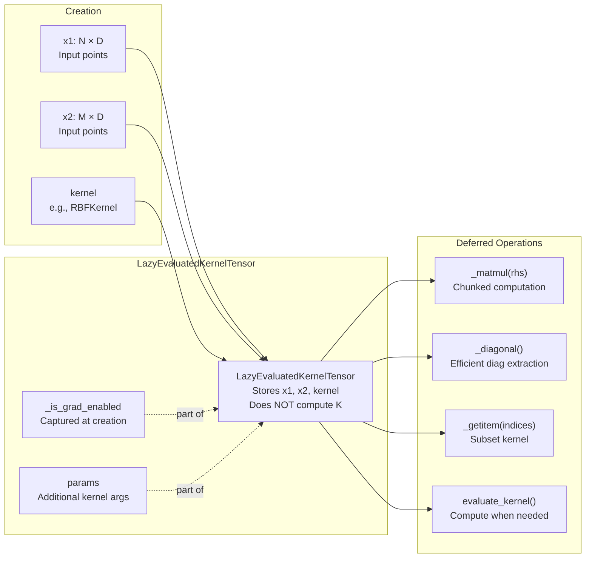

**Diagram: LazyEvaluatedKernelTensor structure and operations**

### Key Features

**Deferred Computation:** The kernel matrix is not computed during initialization. Instead, the tensors `x1`, `x2`, and the `kernel` object are stored. Computation happens only when an operation cannot be performed lazily.

**Gradient State Preservation:** The `recall_grad_state` decorator ensures operations execute with the same gradient tracking state as when the object was created, making lazy tensors behave like regular tensors regarding `torch.is_grad_enabled()`.
**Sources:** [gpytorch/lazy/lazy_evaluated_kernel_tensor.py:17-30](), [gpytorch/lazy/lazy_evaluated_kernel_tensor.py:42-50]()

**Efficient Operations:**
- `_diagonal()`: Computes only diagonal elements by calling the kernel with `diag=True`, which is significantly faster for prediction variances.
- `_getitem()`: Slices the input tensors `x1` and `x2` rather than the computed matrix, maintaining laziness after indexing.
- `_bilinear_derivative()`: Used when kernel checkpointing is enabled to compute gradients in chunks to save memory.

**Sources:** [gpytorch/lazy/lazy_evaluated_kernel_tensor.py:69-104](), [gpytorch/lazy/lazy_evaluated_kernel_tensor.py:106-133](), [gpytorch/lazy/lazy_evaluated_kernel_tensor.py:136-166]()

---

## Memory-Efficient Operations with Checkpointing

For very large kernels that cannot fit in GPU memory, GPyTorch provides kernel checkpointing to trade compute for memory. This is controlled via the `gpytorch.beta_features.checkpoint_kernel` context manager.

```python
import gpytorch

# Enable kernel checkpointing with a specific split size
with gpytorch.beta_features.checkpoint_kernel(split_size=512):
    # Kernel operations are now computed in segments
    output = model(train_x)
```

When `split_size > 0`:
- The kernel is never fully computed or stored in memory.
- `_bilinear_derivative` breaks `x1` into chunks and computes gradients sequentially to reduce the peak memory footprint.
- This is functionally similar to KeOps but implemented within GPyTorch's lazy framework.

**Sources:** [gpytorch/beta_features.py:26-42](), [gpytorch/lazy/lazy_evaluated_kernel_tensor.py:69-104]()

---

## Kernel Evaluation Pipeline

The `settings.lazily_evaluate_kernels()` context manager controls whether kernels return lazy or eager operators.

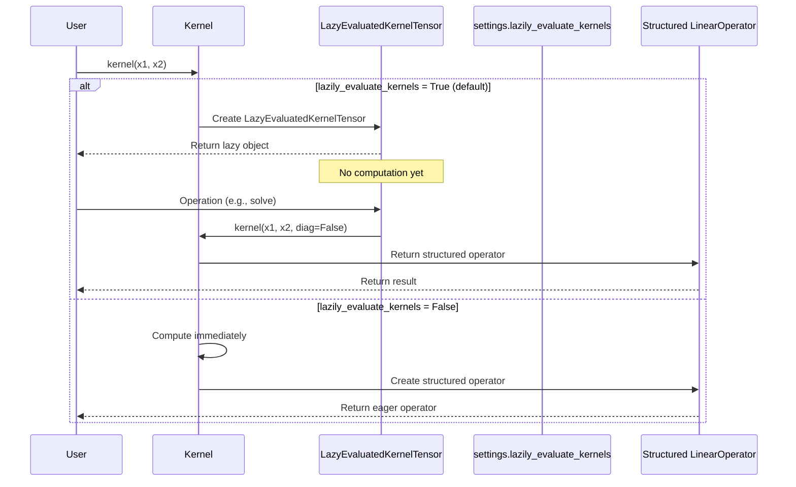

**Diagram: Kernel evaluation decision flow**

**Sources:** [gpytorch/lazy/lazy_evaluated_kernel_tensor.py:89-98](), [test/lazy/test_lazy_evaluated_kernel_tensor.py:25-26]()

---

## Numerical Stability Features

### Adding Jitter
Small diagonal elements (jitter) are added to ensure positive definiteness, which is critical for Cholesky decompositions and CG stability.

```python
# Add small diagonal for stability
stable_covar = gpytorch.add_jitter(covar_matrix, jitter_val=1e-3)
```
**Sources:** [gpytorch/__init__.py:46-58]()

### Adding Diagonal Elements
Used for adding observation noise to a latent covariance matrix:

```python
# K + diag(d)
noisy_covar = gpytorch.add_diagonal(covar_matrix, noise_tensor)
```
**Sources:** [gpytorch/__init__.py:34-43]()

---

## Deprecated Utilities

Several functions in `gpytorch.functions` and `gpytorch.lazy` have been deprecated in favor of the `linear_operator` library to unify the ecosystem.

| Deprecated | Replacement |
|------------|-------------|
| `gpytorch.logdet` | `torch.logdet` |
| `gpytorch.matmul` | `torch.matmul` |
| `gpytorch.inv_matmul` | `linear_operator.solve` |
| `gpytorch.functions.<name>` | `linear_operator.functions.<name>` |

**Sources:** [gpytorch/functions/__init__.py:26-38](), [gpytorch/functions/__init__.py:51-58]()

---

# Page: Models

# Models

<details>
<summary>Relevant source files</summary>

The following files were used as context for generating this wiki page:

- [docs/source/index.rst](docs/source/index.rst)
- [docs/source/models.rst](docs/source/models.rst)
- [gpytorch/lazy/lazy_evaluated_kernel_tensor.py](gpytorch/lazy/lazy_evaluated_kernel_tensor.py)
- [gpytorch/mlls/deep_approximate_mll.py](gpytorch/mlls/deep_approximate_mll.py)
- [gpytorch/models/approximate_gp.py](gpytorch/models/approximate_gp.py)
- [gpytorch/models/deep_gps/__init__.py](gpytorch/models/deep_gps/__init__.py)
- [gpytorch/models/deep_gps/deep_gp.py](gpytorch/models/deep_gps/deep_gp.py)
- [gpytorch/models/exact_gp.py](gpytorch/models/exact_gp.py)
- [gpytorch/models/exact_prediction_strategies.py](gpytorch/models/exact_prediction_strategies.py)
- [gpytorch/models/pyro/_pyro_mixin.py](gpytorch/models/pyro/_pyro_mixin.py)
- [gpytorch/models/pyro/pyro_gp.py](gpytorch/models/pyro/pyro_gp.py)
- [gpytorch/settings.py](gpytorch/settings.py)
- [gpytorch/utils/memoize.py](gpytorch/utils/memoize.py)
- [test/examples/test_pyro_integration.py](test/examples/test_pyro_integration.py)
- [test/lazy/test_lazy_evaluated_kernel_tensor.py](test/lazy/test_lazy_evaluated_kernel_tensor.py)

</details>


This page documents the model classes in GPyTorch that represent Gaussian process (GP) models. Models define the structure of GP implementations, specifying how predictions are made and how inference is performed. For information about kernels (covariance functions), see [Kernels](#4), and for information about likelihoods, see [Likelihoods](#5).

## Model Architecture Overview

GPyTorch models are built around two primary model classes: `ExactGP` and `ApproximateGP`, both inheriting from a base `GP` class [gpytorch/models/gp.py:9]().

- **ExactGP**: Implements exact GP inference, suitable for datasets with up to a few thousand points. It requires a Gaussian likelihood [gpytorch/models/exact_gp.py:71-72]().
- **ApproximateGP**: Implements approximate/variational GP inference, scaling to much larger datasets using inducing points [gpytorch/models/approximate_gp.py:16-52]().

### Class Hierarchy and Entity Mapping

The following diagram maps high-level model concepts to their specific implementation classes in the codebase.

```mermaid
classDiagram
    class "gpytorch.Module" as Module {
        +parameters()
        +named_priors()
    }
    
    class "gpytorch.models.GP" as GP {
        +forward(x)
    }
    
    class "gpytorch.models.ExactGP" as ExactGP {
        +train_inputs
        +train_targets
        +prediction_strategy
        +get_fantasy_model()
    }
    
    class "gpytorch.models.ApproximateGP" as ApproximateGP {
        +variational_strategy
        +get_fantasy_model()
    }

    class "gpytorch.models.PyroGP" as PyroGP {
        +guide()
        +model()
    }
    
    Module <|-- GP
    GP <|-- ExactGP
    GP <|-- ApproximateGP
    ApproximateGP <|-- PyroGP
```

Sources: 
- [gpytorch/models/gp.py:9]()
- [gpytorch/models/exact_gp.py:23-23]()
- [gpytorch/models/approximate_gp.py:16-16]()
- [gpytorch/models/pyro/pyro_gp.py:11-11]()

## Exact GP Models

The `ExactGP` class implements exact GP inference by computing the analytic posterior distribution. It stores `train_inputs` and `train_targets` [gpytorch/models/exact_gp.py:76-77]() and requires a `_GaussianLikelihoodBase` [gpytorch/models/exact_gp.py:65-65]().

### Prediction Strategies

`ExactGP` delegates the heavy lifting of posterior computation to a `prediction_strategy` [gpytorch/models/exact_gp.py:83-83](). The strategy is selected based on the input type and kernel properties [gpytorch/models/exact_prediction_strategies.py:30-44]().

| Strategy Class | Role |
| :--- | :--- |
| `DefaultPredictionStrategy` | Standard exact inference using Cholesky or CG [gpytorch/models/exact_prediction_strategies.py:46-46](). |
| `LinearPredictionStrategy` | Optimized for cases where number of features is less than number of points [gpytorch/models/exact_prediction_strategies.py:43-43](). |

For details on caching, fantasy models, and specific strategies, see [Exact GP Models](#3.1).

Sources:
- [gpytorch/models/exact_gp.py:23-59]()
- [gpytorch/models/exact_prediction_strategies.py:30-46]()

## Approximate GP Models

The `ApproximateGP` class is the base for models where inference is performed via variational methods [gpytorch/models/approximate_gp.py:18-21](). Unlike `ExactGP`, it does not store training data directly but relies on a `variational_strategy` to marginalize over inducing points [gpytorch/models/approximate_gp.py:57-57]().

### Deep GPs and Composition

GPyTorch supports Deep Gaussian Processes via the `DeepGP` container and `DeepGPLayer` modules [gpytorch/models/deep_gps/deep_gp.py:33-128](). These layers are composable, allowing the output of one GP to serve as the input to another [gpytorch/models/deep_gps/deep_gp.py:61-66]().

```mermaid
flowchart LR
    subgraph "Approximate Inference Stack"
    A["ApproximateGP"] --> B["VariationalStrategy"]
    B --> C["VariationalDistribution"]
    end
    
    subgraph "Deep GP Stack"
    D["DeepGP"] --> E["DeepGPLayer 1"]
    E --> F["DeepGPLayer 2"]
    end
```

For details on variational strategies and SVI, see [Approximate GP Models](#3.2).

Sources:
- [gpytorch/models/approximate_gp.py:16-52]()
- [gpytorch/models/deep_gps/deep_gp.py:33-128]()

## Pyro Integration

Models can be integrated with the Pyro probabilistic programming library via `PyroGP` [gpytorch/models/pyro/pyro_gp.py:11-11](). This mixin provides `pyro_model` and `pyro_guide` methods to allow GPs to be part of larger stochastic programs [gpytorch/models/pyro/_pyro_mixin.py:9-48]().

Sources:
- [gpytorch/models/pyro/pyro_gp.py:11-59]()
- [gpytorch/models/pyro/_pyro_mixin.py:9-48]()

## Common Model Settings

GPyTorch uses a global `settings` module to toggle performance and numerical behaviors [gpytorch/settings.py:1-368]().

| Setting | Description | File Reference |
| :--- | :--- | :--- |
| `debug` | Performs safety checks on input data shapes and modes. | [gpytorch/settings.py:147-158]() |
| `fast_pred_var` | Enables Lanczos Variance Estimates (LOVE) for $O(1)$ variances. | [gpytorch/settings.py:183-224]() |
| `fast_pred_samples` | Enables fast posterior sampling using LOVE. | [gpytorch/settings.py:225-241]() |
| `detach_test_caches` | Detaches caches to speed up derivatives w.r.t. test inputs. | [gpytorch/settings.py:160-171]() |

Sources:
- [gpytorch/settings.py:145-368]()

## Model Execution Flow

When a model is called (`__call__`), the behavior depends on the `self.training` state and specific settings like `prior_mode`.

```mermaid
flowchart TD
    Start["model(x)"] --> ModeCheck{"self.training?"}
    ModeCheck -- "True" --> Prior["Return Prior Dist\n(forward(x))"]
    ModeCheck -- "False" --> PriorMode{"settings.prior_mode?"}
    PriorMode -- "True" --> Prior
    PriorMode -- "False" --> ModelType{"Exact vs Approx?"}
    
    ModelType -- "ExactGP" --> ExactProc["Apply PredictionStrategy\n(Compute Posterior)"]
    ModelType -- "ApproximateGP" --> ApproxProc["Apply VariationalStrategy\n(q(f) marginalization)"]
    
    ExactProc --> End["Return MultivariateNormal"]
    ApproxProc --> End
```

Sources:
- [gpytorch/models/exact_gp.py:264-349]()
- [gpytorch/models/approximate_gp.py:113-116]()
- [gpytorch/settings.py:341-356]()

---

# Page: Exact GP Models

# Exact GP Models

<details>
<summary>Relevant source files</summary>

The following files were used as context for generating this wiki page:

- [gpytorch/models/exact_gp.py](gpytorch/models/exact_gp.py)
- [gpytorch/models/exact_prediction_strategies.py](gpytorch/models/exact_prediction_strategies.py)
- [gpytorch/settings.py](gpytorch/settings.py)
- [gpytorch/utils/memoize.py](gpytorch/utils/memoize.py)
- [test/examples/test_fixed_noise_fanatasy_updates.py](test/examples/test_fixed_noise_fanatasy_updates.py)
- [test/examples/test_kissgp_white_noise_regression.py](test/examples/test_kissgp_white_noise_regression.py)
- [test/examples/test_sgpr_regression.py](test/examples/test_sgpr_regression.py)
- [test/examples/test_simple_gp_regression.py](test/examples/test_simple_gp_regression.py)
- [test/examples/test_white_noise_regression.py](test/examples/test_white_noise_regression.py)

</details>


## Purpose and Scope

This document describes GPyTorch's `ExactGP` models, which provide exact inference for Gaussian processes using analytic solutions. This page covers the implementation of exact GP inference, prediction strategies, and features like efficient caching and fantasy observations. For information about approximate GP models using variational inference, see [Approximate GP Models](#3.2).

## Introduction to Exact GP Models

Exact Gaussian Process models in GPyTorch implement closed-form solutions for GP inference when using Gaussian likelihoods. These models provide exact posterior predictions by directly computing the conditional distribution of test points given training points, without resorting to approximations.

```mermaid
flowchart TB
    subgraph "Exact GP Model Structure"
        ModelClass["ExactGP Model"]
        Mean["Mean Module"]
        Kernel["Kernel (Covariance)"]
        Like["Gaussian Likelihood"]
        PredStrat["Prediction Strategy"]
        
        ModelClass --> Mean
        ModelClass --> Kernel
        ModelClass --> Like
        ModelClass --- PredStrat
    end
    
    subgraph "Inference Flow"
        Train["Training Data"] --> ModelClass
        Test["Test Data"] --> ModelClass
        ModelClass --> Post["Posterior Distribution"]
        Post --> PredMean["Predictive Mean"]
        Post --> PredVar["Predictive Variance"]
    end
```

Sources: [gpytorch/models/exact_gp.py:23-59](), [gpytorch/models/exact_prediction_strategies.py:30-36]()

## Key Class Structure

The `ExactGP` class serves as the foundation for all exact GP models in GPyTorch. It inherits from the base `GP` class and requires three essential components: training inputs, training targets, and a Gaussian likelihood.

**Class Hierarchy Diagram: ExactGP and Prediction Strategies**

```mermaid
classDiagram
    class GP {
        +forward(x)
    }
    
    class ExactGP {
        +Tensor train_inputs
        +Tensor train_targets
        +_GaussianLikelihoodBase likelihood
        +PredictionStrategy prediction_strategy
        +forward(x)
        +__call__(*args, **kwargs)
        +set_train_data(inputs, targets, strict)
        +get_fantasy_model(inputs, targets, **kwargs)
        +_clear_cache()
    }
    
    class DefaultPredictionStrategy {
        +tuple train_inputs
        +MultivariateNormal train_prior_dist
        +Tensor train_labels
        +Likelihood likelihood
        +LinearOperator lik_train_train_covar
        +mean_cache : Tensor
        +covar_cache : Tensor
        +exact_prediction(joint_mean, joint_covar)
        +exact_predictive_mean(test_mean, test_train_covar)
        +exact_predictive_covar(test_test_covar, test_train_covar)
        +get_fantasy_strategy(inputs, targets, ...)
    }
    
    class InterpolatedPredictionStrategy {
        +bool uses_wiski
        +interp_inner_prod
        +interp_response_cache
        +fantasy_mean_cache
        +fantasy_covar_cache
        +_exact_predictive_covar_inv_quad_form_cache()
        +_exact_predictive_covar_inv_quad_form_root()
        +prepare_dense_wmat(covar)
    }
    
    class RFFPredictionStrategy {
        +exact_predictive_covar(test_test_covar, test_train_covar)
    }
    
    class SGPRPredictionStrategy {
        +exact_prediction(joint_mean, joint_covar)
        +exact_predictive_covar(test_test_covar, test_train_covar)
    }
    
    GP <|-- ExactGP
    DefaultPredictionStrategy <|-- InterpolatedPredictionStrategy
    DefaultPredictionStrategy <|-- RFFPredictionStrategy
    DefaultPredictionStrategy <|-- SGPRPredictionStrategy
    ExactGP --> DefaultPredictionStrategy : creates via prediction_strategy()
```

Sources: [gpytorch/models/exact_gp.py:23-83](), [gpytorch/models/exact_prediction_strategies.py:30-36](), [gpytorch/models/exact_prediction_strategies.py:46-422](), [gpytorch/models/exact_prediction_strategies.py:424-733](), [gpytorch/models/exact_prediction_strategies.py:735-788](), [gpytorch/models/exact_prediction_strategies.py:790-873]()

### Initialization and Requirements

When creating an ExactGP model, you must provide:

1. Training inputs (features) - `Tensor` or tuple of `Tensor` [gpytorch/models/exact_gp.py:63-68]()
2. Training targets (labels) - `Tensor` [gpytorch/models/exact_gp.py:64]()
3. A Gaussian likelihood - must inherit from `_GaussianLikelihoodBase` [gpytorch/models/exact_gp.py:71-72]()

The constructor performs validation to ensure the likelihood is Gaussian (required for exact inference) and properly formats the inputs.

```python
class ExactGPModel(gpytorch.models.ExactGP):
    def __init__(self, train_inputs, train_targets, likelihood):
        super(ExactGPModel, self).__init__(train_inputs, train_targets, likelihood)
        self.mean_module = gpytorch.means.ZeroMean()
        self.covar_module = gpytorch.kernels.ScaleKernel(gpytorch.kernels.RBFKernel())
    
    def forward(self, x):
        mean = self.mean_module(x)
        covar = self.covar_module(x)
        return gpytorch.distributions.MultivariateNormal(mean, covar)
```

Sources: [gpytorch/models/exact_gp.py:61-83](), [test/examples/test_simple_gp_regression.py:22-30]()

## Prediction Process

The ExactGP prediction process involves several key steps, from computing priors to delivering posterior predictions. This process is handled through a specialized prediction strategy system.

```mermaid
sequenceDiagram
    participant User
    participant Model as ExactGP
    participant Prior as Prior Distribution
    participant PredStrategy as Prediction Strategy
    participant MVN as MultivariateNormal

    User->>Model: model(test_x)
    
    alt Training Mode
        Model->>Prior: forward(train_x)
        Prior->>Model: train_prior_dist
        Model->>User: train_prior_dist
    else Prior Mode
        Model->>Prior: forward(test_x)
        Prior->>Model: test_prior_dist
        Model->>User: test_prior_dist
    else Posterior Mode
        Note over Model,PredStrategy: First call creates prediction strategy
        Model->>Prior: forward(train_x)
        Prior->>Model: train_prior_dist
        Model->>PredStrategy: create strategy
        Model->>Prior: forward([train_x, test_x])
        Prior->>Model: joint_prior_dist
        Model->>PredStrategy: exact_prediction(joint_mean, joint_covar)
        PredStrategy->>PredStrategy: exact_predictive_mean()
        PredStrategy->>PredStrategy: exact_predictive_covar()
        PredStrategy->>Model: predictive_mean, predictive_covar
        Model->>MVN: create distribution
        MVN->>User: posterior distribution
    end
```

Sources: [gpytorch/models/exact_gp.py:264-349](), [gpytorch/models/exact_prediction_strategies.py:311-421]()

### Prediction Strategy

The prediction strategy system is central to how ExactGP makes predictions. The strategy:

1. Computes and caches quantities needed for faster inference [gpytorch/models/exact_prediction_strategies.py:246-301]()
2. Provides implementations for exact predictive mean and covariance [gpytorch/models/exact_prediction_strategies.py:328-421]()
3. Handles specialized cases like structured kernels or fantasy observations [gpytorch/models/exact_prediction_strategies.py:137-244]()

The strategy is automatically created and cached on the first posterior prediction call [gpytorch/models/exact_gp.py:302-311]().

Sources: [gpytorch/models/exact_gp.py:302-311](), [gpytorch/models/exact_prediction_strategies.py:30-36]()

### Computing Posterior Distributions

The exact predictive mean and covariance are computed using standard Gaussian process equations:

**Predictive Mean**:
μ(x*) = μ(x*) + K(x*, X)[K(X, X) + σ²I]⁻¹(y - μ(X))

**Predictive Covariance**:
Σ(x*, x*') = K(x*, x*') - K(x*, X)[K(X, X) + σ²I]⁻¹K(X, x*')

These computations are implemented in the `exact_predictive_mean` and `exact_predictive_covar` methods of the prediction strategy classes.

Sources: [gpytorch/models/exact_prediction_strategies.py:328-365](), [gpytorch/models/exact_prediction_strategies.py:368-421]()

## Memory and Computational Efficiency

ExactGP models can be computationally expensive due to the O(n³) matrix operations required for exact inference. GPyTorch implements several techniques to improve efficiency:

### Caching System

The prediction strategy maintains two key caches to avoid redundant computation during prediction. These caches are computed on the first prediction call and reused for subsequent predictions.

**Cache Computation Flow**

```mermaid
flowchart TD
    subgraph "Cached Quantities"
        Model["ExactGP"] --> |creates| PredStrat["DefaultPredictionStrategy"]
        PredStrat --> |@cached property| MeanCache["mean_cache"]
        PredStrat --> |@cached property| CovarCache["covar_cache"]
        
        MeanCache --> |stores| AlphaTerm["(K_XX + σ²I)⁻¹(y - μ)"]
        CovarCache --> |stores| InvRootTerm["(K_XX + σ²I)⁻¹/² or similar"]
    end
    
    subgraph "Prediction Usage"
        TestInput["test_x"] --> PredMean["exact_predictive_mean()"]
        TestInput --> PredCovar["exact_predictive_covar()"]
        
        AlphaTerm --> PredMean
        InvRootTerm --> PredCovar
        
        PredMean --> |"K(x*, X) @ mean_cache"| PostMean["μ_posterior"]
        PredCovar --> |"K(x*, x*) - ..."| PostCovar["Σ_posterior"]
    end
```

**Cache Details:**

1. **`mean_cache`** (`@cached(name="mean_cache")` property) [gpytorch/models/exact_prediction_strategies.py:246-252]()
   - Stores: `(K_XX + σ²I)⁻¹(y - μ(X))` 
   - Computed via: `train_train_covar.solve(train_labels_offset)` [gpytorch/models/exact_prediction_strategies.py:298-301]()
   - Used in: `exact_predictive_mean()` via matrix-vector product [gpytorch/models/exact_prediction_strategies.py:365]()

2. **`covar_cache`** (`@cached(name="covar_cache")` property) [gpytorch/models/exact_prediction_strategies.py:254-255]()
   - Stores: Root inverse decomposition `(K_XX + σ²I)⁻¹/²` or precomputed terms
   - Computed via: `train_train_covar.root_inv_decomposition()` [gpytorch/models/exact_prediction_strategies.py:307-309]()
   - Used in: `exact_predictive_covar()` for efficient posterior covariance [gpytorch/models/exact_prediction_strategies.py:379-421]()

The caches use the `@cached` decorator from `gpytorch.utils.memoize` [gpytorch/utils/memoize.py:12-17]() and are invalidated when `prediction_strategy` is set to `None` or when `_clear_cache()` is called [gpytorch/models/exact_gp.py:99-101]().

Sources: [gpytorch/models/exact_prediction_strategies.py:246-309](), [gpytorch/utils/memoize.py:12-100](), [gpytorch/models/exact_gp.py:99-101]()

### Settings for Efficient Prediction

GPyTorch provides several settings to adjust the prediction behavior and efficiency.

| Setting | Purpose | Default | Location |
|---------|---------|---------|----------|
| `fast_pred_var` | Use LOVE (Lanczos Variance Estimates) for O(1) predictive variance | `False` | [gpytorch/settings.py:183-199]() |
| `fast_pred_samples` | Use LOVE for efficient sampling from posterior | `False` | [gpytorch/settings.py:225-242]() |
| `skip_posterior_variances` | Return `ZeroLinearOperator` for covariance (mean-only prediction) | `False` | [gpytorch/settings.py:358-368]() |
| `detach_test_caches` | Detach caches from autograd graph for faster test derivatives | `True` | [gpytorch/settings.py:160-170]() |
| `eval_cg_tolerance` | Conjugate gradient tolerance for prediction solve operations | `0.01` | [gpytorch/settings.py:173-181]() |
| `max_eager_kernel_size` | Threshold for eager evaluation vs lazy evaluation | `512` | [gpytorch/settings.py:259-267]() |
| `debug` | Enable safety checks on training data during prediction | `True` | [gpytorch/settings.py:147-158]() |

Sources: [gpytorch/settings.py:145-368](), [gpytorch/models/exact_prediction_strategies.py:379-421](), [gpytorch/models/exact_prediction_strategies.py:615-680]()

## Advanced Features

### Fantasy Observations

Fantasy observations allow efficient conditioning on new data points without full model retraining by updating the `mean_cache` and `covar_cache` in linear time [gpytorch/models/exact_gp.py:155-157]().

**Fantasy Model Creation Flow**

```mermaid
flowchart TB
    subgraph "ExactGP.get_fantasy_model()"
        Start["Call get_fantasy_model(inputs, targets)"]
        Check["Check prediction_strategy exists"]
        Validate["Validate batch shapes"]
        Concat["Concatenate train_inputs + inputs"]
        Forward["Call forward(full_inputs)"]
        Copy["deepcopy(self)"]
        Update["Create fantasy strategy"]
    end
    
    subgraph "PredictionStrategy.get_fantasy_strategy()"
        ExtractFant["Extract fantasy covariances"]
        BorderSolve["Solve bordered linear system"]
        UpdateMean["Update mean_cache"]
        UpdateCovar["Update root decompositions"]
        NewStrat["Return new strategy"]
    end
    
    Start --> Check
    Check --> |"None"| Error["RuntimeError: Must call model first"]
    Check --> |"exists"| Validate
    Validate --> Concat
    Concat --> Forward
    Forward --> Copy
    Copy --> Update
    
    Update --> ExtractFant
    ExtractFant --> BorderSolve
    BorderSolve --> UpdateMean
    UpdateMean --> UpdateCovar
    UpdateCovar --> NewStrat
```

**Implementation Details:**

- `DefaultPredictionStrategy.get_fantasy_strategy()` ([gpytorch/models/exact_prediction_strategies.py:137-244]())
  - Updates both `mean_cache` and `covar_cache` via bordered system.
  - Uses `psd_safe_cholesky()` for Schur complement [gpytorch/models/exact_prediction_strategies.py:20]().
- `InterpolatedPredictionStrategy.get_fantasy_strategy()` ([gpytorch/models/exact_prediction_strategies.py:456-491]())
  - Implements WISKI (Warp-Induced Structured Kernel Interpolation) fantasy updates.
  - Updates `interp_inner_prod` via low-rank update [gpytorch/models/exact_prediction_strategies.py:539-555]().

Sources: [gpytorch/models/exact_gp.py:151-262](), [gpytorch/models/exact_prediction_strategies.py:137-244](), [gpytorch/models/exact_prediction_strategies.py:456-491]()

### Different Prediction Strategies

GPyTorch automatically selects prediction strategies based on kernel type [gpytorch/models/exact_prediction_strategies.py:30-36]().

**Strategy Comparison:**

| Strategy | Use Case | Location |
|----------|----------|-------------|
| `DefaultPredictionStrategy` | General kernels, dense covariance | [gpytorch/models/exact_prediction_strategies.py:46-422]() |
| `InterpolatedPredictionStrategy` | `GridInterpolationKernel`, KISS-GP | [gpytorch/models/exact_prediction_strategies.py:424-733]() |
| `RFFPredictionStrategy` | `RFFKernel` | [gpytorch/models/exact_prediction_strategies.py:735-788]() |
| `SGPRPredictionStrategy` | `InducingPointKernel`, SGPR | [gpytorch/models/exact_prediction_strategies.py:790-873]() |

Sources: [gpytorch/models/exact_prediction_strategies.py:30-873]()

### Handling Missing Observations

GPyTorch can handle missing observations (NaN values) in training data through the `observation_nan_policy` setting [gpytorch/settings.py:405-448]().

| Policy | Description |
|--------|-------------|
| `"ignore"` | Do not check for NaN values (default) |
| `"mask"` | Mask out NaN values during calculation |
| `"fill"` | Fill NaN values with a dummy value and filter later |

Sources: [gpytorch/settings.py:405-448](), [gpytorch/models/exact_prediction_strategies.py:257-292](), [gpytorch/models/exact_prediction_strategies.py:346-364]()

## Usage Example

```python
# Define the model
class ExactGPModel(gpytorch.models.ExactGP):
    def __init__(self, train_x, train_y, likelihood):
        super(ExactGPModel, self).__init__(train_x, train_y, likelihood)
        self.mean_module = gpytorch.means.ConstantMean()
        self.covar_module = gpytorch.kernels.ScaleKernel(gpytorch.kernels.RBFKernel())
    
    def forward(self, x):
        mean = self.mean_module(x)
        covar = self.covar_module(x)
        return gpytorch.distributions.MultivariateNormal(mean, covar)

# Create model and likelihood
likelihood = gpytorch.likelihoods.GaussianLikelihood()
model = ExactGPModel(train_x, train_y, likelihood)

# Prediction mode
model.eval()
likelihood.eval()
with torch.no_grad(), gpytorch.settings.fast_pred_var():
    predictions = likelihood(model(test_x))
    mean = predictions.mean
```

Sources: [test/examples/test_simple_gp_regression.py:22-132](), [test/examples/test_simple_gp_regression.py:217-257]()

---

# Page: Approximate GP Models

# Approximate GP Models

<details>
<summary>Relevant source files</summary>

The following files were used as context for generating this wiki page:

- [gpytorch/lazy/lazy_evaluated_kernel_tensor.py](gpytorch/lazy/lazy_evaluated_kernel_tensor.py)
- [gpytorch/models/approximate_gp.py](gpytorch/models/approximate_gp.py)
- [gpytorch/models/pyro/_pyro_mixin.py](gpytorch/models/pyro/_pyro_mixin.py)
- [gpytorch/models/pyro/pyro_gp.py](gpytorch/models/pyro/pyro_gp.py)
- [gpytorch/variational/_variational_strategy.py](gpytorch/variational/_variational_strategy.py)
- [gpytorch/variational/grid_interpolation_variational_strategy.py](gpytorch/variational/grid_interpolation_variational_strategy.py)
- [gpytorch/variational/unwhitened_variational_strategy.py](gpytorch/variational/unwhitened_variational_strategy.py)
- [gpytorch/variational/variational_strategy.py](gpytorch/variational/variational_strategy.py)
- [test/examples/test_batch_svgp_gp_regression.py](test/examples/test_batch_svgp_gp_regression.py)
- [test/examples/test_pyro_integration.py](test/examples/test_pyro_integration.py)
- [test/examples/test_svgp_gp_regression.py](test/examples/test_svgp_gp_regression.py)
- [test/lazy/test_lazy_evaluated_kernel_tensor.py](test/lazy/test_lazy_evaluated_kernel_tensor.py)
- [test/models/test_exact_gp.py](test/models/test_exact_gp.py)
- [test/models/test_variational_gp.py](test/models/test_variational_gp.py)
- [test/variational/test_variational_strategy.py](test/variational/test_variational_strategy.py)

</details>


This page documents the approximate Gaussian Process (GP) models implemented in GPyTorch, which provide scalable alternatives to [Exact GP Models](#3.1) for scenarios involving large datasets or non-Gaussian likelihoods. Approximate GP models in GPyTorch primarily use variational inference techniques to achieve computational efficiency while providing flexible and accurate posterior approximations.

## Core Concepts

Approximate GP models in GPyTorch are built around the concept of variational inference, using inducing points to form a tractable approximation to the full GP posterior. The core idea is to define a set of inducing points $\mathbf{Z}$ (fewer than the training points) and approximate the GP posterior using these points.

```mermaid
flowchart TD
    subgraph "Approximate GP Framework"
        [ApproximateGP_Model] --> [VariationalStrategy]
        [VariationalStrategy] --> [VariationalDistribution_q_u]
        [VariationalStrategy] --> [Inducing_Points_Z]
        
        [VariationalStrategy] --> [PosteriorDistribution_q_f_x]
        
        [VariationalELBO] --> |"Optimization Target"| [ApproximateGP_Model]
        [VariationalELBO] --> |"KL[q(u)‖p(u)]"| [VariationalDistribution_q_u]
    end
```

Sources:
- [gpytorch/variational/variational_strategy.py:142-158]()
- [gpytorch/variational/_variational_strategy.py:48-82]()

### ApproximateGP Base Class

All approximate GP models in GPyTorch inherit from the `ApproximateGP` base class [gpytorch/models/approximate_gp.py](), which provides the framework for variational inference. This class works with a variational strategy to define how the posterior distribution is computed.

### Inducing Points

Inducing points (sometimes called "pseudo-inputs") are a small set of points (typically $m \ll n$ training points) that are used to approximate the full GP. The locations of these points can be fixed or learned during optimization by registering them as a `torch.nn.Parameter` [gpytorch/variational/_variational_strategy.py:75-77]().

### Variational Distribution

The variational distribution $q(\mathbf{u})$ is a probability distribution over the function values at the inducing points. GPyTorch provides several options:

- `CholeskyVariationalDistribution`: Full-covariance Gaussian [gpytorch/variational/cholesky_variational_distribution.py]().
- `MeanFieldVariationalDistribution`: Diagonal-covariance Gaussian.
- `DeltaVariationalDistribution`: Delta/point distribution.
- `NaturalVariationalDistribution`: For use with natural gradient descent [test/variational/test_variational_strategy.py:131]().

### Variational Strategy

The variational strategy defines how to transform the variational distribution $q(\mathbf{u})$ into a posterior distribution $q(f|\mathbf{x})$ by computing the integral:
$$q(f(\mathbf{X})) = \int p(f(\mathbf{X})|\mathbf{u}) q(\mathbf{u}) d\mathbf{u}$$

This is the key component that differentiates the various approximate GP models.

Sources:
- [gpytorch/variational/variational_strategy.py:142-156]()
- [gpytorch/variational/_variational_strategy.py:123-157]()

## Standard Variational GP

The standard variational GP implementation uses the `VariationalStrategy` class, which follows the formulation by Hensman et al. (2015). This strategy applies an approximate distribution $q(\mathbf{u})$ over the function values at inducing points $\mathbf{Z}$, and then derives the distribution for any input $\mathbf{X}$.

```mermaid
classDiagram
    class ApproximateGP {
        +variational_strategy
        +forward(x)
    }
    
    class VariationalStrategy {
        +model ApproximateGP
        +inducing_points Tensor
        +variational_distribution _VariationalDistribution
        +forward(x, inducing_points, inducing_values, variational_inducing_covar)
        +kl_divergence()
    }
    
    class _VariationalDistribution {
        +mean
        +covar
    }
    
    ApproximateGP --> VariationalStrategy : uses
    VariationalStrategy --> _VariationalDistribution : contains
```

The standard variational strategy uses "whitening" to accelerate optimization by transforming the inducing variables to have a simpler prior distribution (identity covariance) [gpytorch/variational/variational_strategy.py:154-155]().

Sources:
- [gpytorch/variational/variational_strategy.py:142-272]()
- [test/examples/test_svgp_gp_regression.py:30-40]()

## Example Usage

Here's a simplified example of how to create an approximate GP model with the standard variational strategy:

```python
class SVGPRegressionModel(ApproximateGP):
    def __init__(self, inducing_points):
        # Define variational distribution
        variational_distribution = CholeskyVariationalDistribution(inducing_points.size(-2))
        
        # Define variational strategy
        variational_strategy = VariationalStrategy(
            self, inducing_points, variational_distribution, learn_inducing_locations=True
        )
        
        # Initialize with the variational strategy
        super().__init__(variational_strategy)
        
        self.mean_module = gpytorch.means.ConstantMean()
        self.covar_module = gpytorch.kernels.ScaleKernel(gpytorch.kernels.RBFKernel())
    
    def forward(self, x):
        mean_x = self.mean_module(x)
        covar_x = self.covar_module(x)
        return gpytorch.distributions.MultivariateNormal(mean_x, covar_x)
```

Sources:
- [test/examples/test_svgp_gp_regression.py:30-45]()
- [test/examples/test_batch_svgp_gp_regression.py:32-50]()

## Advanced Variational Strategies

GPyTorch provides several specialized variational strategies:

| Strategy | Class Name | Description |
| :--- | :--- | :--- |
| **Whitened** | `VariationalStrategy` | Standard SVGP with whitening transformation [gpytorch/variational/variational_strategy.py:142](). |
| **Unwhitened** | `UnwhitenedVariationalStrategy` | SVGP without whitening; faster if $\mathbf{Z}=\mathbf{X}$ [gpytorch/variational/unwhitened_variational_strategy.py:29](). |
| **Grid** | `GridInterpolationVariationalStrategy` | Constrains inducing points to a grid (KISS-GP style) [gpytorch/variational/grid_interpolation_variational_strategy.py:17](). |
| **Decoupled** | `BatchDecoupledVariationalStrategy` | Different inducing points for mean and covariance [gpytorch/variational/batch_decoupled_variational_strategy.py](). |
| **Multitask** | `LMCVariationalStrategy` | Linear Model of Coregionalization for multi-output GPs [gpytorch/variational/lmc_variational_strategy.py](). |

### Unwhitened Variational Strategy

The `UnwhitenedVariationalStrategy` is preferable when the number of inducing points is very large (>2000) as it can use Conjugate Gradients (CG) for faster computation [gpytorch/variational/unwhitened_variational_strategy.py:38-39]().

### Grid Interpolation Variational Strategy

This strategy constrains inducing points to a grid and applies a deterministic relationship between $f$ and $u$ using interpolation [gpytorch/variational/grid_interpolation_variational_strategy.py:19-21](). It is only compatible with Gaussian variational distributions [gpytorch/variational/grid_interpolation_variational_strategy.py:91-95]().

Sources:
- [gpytorch/variational/unwhitened_variational_strategy.py:29-52]()
- [gpytorch/variational/grid_interpolation_variational_strategy.py:17-37]()

## Predictive Performance Optimization

For training, GPyTorch provides a custom autograd function `ComputePredictiveUpdates` to optimize the backward pass when the number of data points $n$ is much larger than the number of inducing points $m$ ($m \ll n$) [gpytorch/variational/variational_strategy.py:59-93]().

### Caching System

The `@cached` decorator is used extensively to avoid redundant computations of the prior distribution, variational distribution, and Cholesky factors [gpytorch/variational/_variational_strategy.py:106, 119, 168]().

```mermaid
flowchart LR
    [Input_X] --> [VariationalStrategy_Call]
    [VariationalStrategy_Call] --> [Check_Cache]
    [Check_Cache] -- "Miss" --> [Compute_Predictive_Updates]
    [Compute_Predictive_Updates] --> [Store_in_Cache]
    [Check_Cache] -- "Hit" --> [Return_Cached_Dist]
```

Sources:
- [gpytorch/variational/variational_strategy.py:68-81]()
- [gpytorch/variational/_variational_strategy.py:20-21]()

## Integration with Pyro

GPyTorch includes a `PyroGP` mixin and base class to allow approximate GP models to be used within the Pyro probabilistic programming framework [gpytorch/models/pyro/pyro_gp.py:11](). This enables:
- Using GP models as components of larger hierarchical models.
- Leveraging Pyro's inference tools (e.g., SVI) [gpytorch/models/pyro/pyro_gp.py:47-53]().

The `pyro_guide` and `pyro_model` methods handle the sampling of inducing values $\mathbf{u}$ and latent function values $\mathbf{f}$ [gpytorch/models/pyro/_pyro_mixin.py:10-48]().

Sources:
- [gpytorch/models/pyro/pyro_gp.py:11-60]()
- [gpytorch/models/pyro/_pyro_mixin.py:9-48]()

---

# Page: Kernels

# Kernels

<details>
<summary>Relevant source files</summary>

The following files were used as context for generating this wiki page:

- [docs/source/kernels.rst](docs/source/kernels.rst)
- [gpytorch/kernels/__init__.py](gpytorch/kernels/__init__.py)
- [gpytorch/kernels/cosine_kernel.py](gpytorch/kernels/cosine_kernel.py)
- [gpytorch/kernels/gibbs_kernel.py](gpytorch/kernels/gibbs_kernel.py)
- [gpytorch/kernels/index_kernel.py](gpytorch/kernels/index_kernel.py)
- [gpytorch/kernels/kernel.py](gpytorch/kernels/kernel.py)
- [gpytorch/kernels/matern_kernel.py](gpytorch/kernels/matern_kernel.py)
- [gpytorch/kernels/periodic_kernel.py](gpytorch/kernels/periodic_kernel.py)
- [gpytorch/kernels/rbf_kernel.py](gpytorch/kernels/rbf_kernel.py)
- [gpytorch/kernels/rbf_kernel_grad.py](gpytorch/kernels/rbf_kernel_grad.py)
- [gpytorch/kernels/scale_kernel.py](gpytorch/kernels/scale_kernel.py)
- [gpytorch/kernels/spectral_mixture_kernel.py](gpytorch/kernels/spectral_mixture_kernel.py)
- [gpytorch/kernels/spherical_linear_kernel.py](gpytorch/kernels/spherical_linear_kernel.py)
- [test/kernels/test_gibbs_kernel.py](test/kernels/test_gibbs_kernel.py)
- [test/kernels/test_spherical_linear_kernel.py](test/kernels/test_spherical_linear_kernel.py)

</details>


This page provides a comprehensive overview of the kernel system in GPyTorch. Kernels define covariance functions that encode assumptions about the similarity between data points in Gaussian Process models. The kernel system is built on a modular, composable architecture that supports both standard covariance functions and specialized implementations for scalability.

**Page structure:**
- [Standard Kernels](#4.1): RBF, Matern, Periodic, Spectral Mixture, Cosine, and Index kernels
- [Compositional Kernels](#4.2): ScaleKernel, AdditiveKernel, ProductKernel
- [Scalable Kernels](#4.3): GridKernel, GridInterpolationKernel, InducingPointKernel, MultitaskKernel

## Overview

The kernel system in GPyTorch is organized around the `Kernel` base class [[gpytorch/kernels/kernel.py:84-159]](), which extends `gpytorch.Module` [[gpytorch/module.py:69-490]](). All kernels:

1. Inherit from `Kernel` and implement the abstract `forward` method [[gpytorch/kernels/kernel.py:233-256]]()
2. Support parameter management (lengthscales, constraints, priors) through the `Module` system [[gpytorch/kernels/kernel.py:105-139]]()
3. Use lazy evaluation via `LazyEvaluatedKernelTensor` to defer matrix computation [[gpytorch/kernels/kernel.py:19]]()
4. Support algebraic composition through `__add__` and `__mul__` operators [[gpytorch/kernels/kernel.py:548-558]]()
5. Handle batch dimensions and active dimension selection [[gpytorch/kernels/kernel.py:119-134]]()
6. Integrate with prediction strategies for efficient inference [[gpytorch/kernels/kernel.py:438-447]]()

Sources: [[gpytorch/kernels/kernel.py:84-257]](), [[gpytorch/module.py:69-122]]()

## System Architecture

### Class Hierarchy

**Kernel Class Hierarchy and Key Methods**

```mermaid
classDiagram
    class Module {
        +register_parameter()
        +register_prior()
        +register_constraint()
        +initialize()
    }
    
    class Kernel {
        +has_lengthscale: bool
        +is_stationary: bool
        +batch_shape: torch.Size
        +active_dims: Tensor
        +lengthscale: Tensor
        +forward(x1, x2, diag, last_dim_is_batch)*
        +__call__(x1, x2, diag, last_dim_is_batch)
        +covar_dist(x1, x2, diag, square_dist)
        +__add__(other)
        +__mul__(other)
        +prediction_strategy()
    }
    
    class RBFKernel {
        +has_lengthscale = True
        +forward(x1, x2, diag)
    }
    
    class MaternKernel {
        +has_lengthscale = True
        +nu: float
        +forward(x1, x2, diag)
    }
    
    class PeriodicKernel {
        +has_lengthscale = True
        +period_length: Tensor
        +forward(x1, x2, diag)
    }
    
    class SpectralMixtureKernel {
        +num_mixtures: int
        +mixture_scales: Tensor
        +mixture_means: Tensor
        +mixture_weights: Tensor
        +forward(x1, x2, diag)
    }
    
    class AdditiveKernel {
        +kernels: ModuleList
        +forward(x1, x2, diag)
    }
    
    class ProductKernel {
        +kernels: ModuleList
        +forward(x1, x2, diag)
    }
    
    class ScaleKernel {
        +base_kernel: Kernel
        +outputscale: Tensor
        +forward(x1, x2, diag)
    }
    
    class IndexKernel {
        +covar_factor: Tensor
        +var: Tensor
        +forward(i1, i2)
    }
    
    Module <|-- Kernel
    Kernel <|-- RBFKernel
    Kernel <|-- MaternKernel
    Kernel <|-- PeriodicKernel
    Kernel <|-- SpectralMixtureKernel
    Kernel <|-- AdditiveKernel
    Kernel <|-- ProductKernel
    Kernel <|-- ScaleKernel
    Kernel <|-- IndexKernel
```

Sources: [[gpytorch/kernels/kernel.py:84-257]](), [[gpytorch/kernels/rbf_kernel.py:14-86]](), [[gpytorch/kernels/matern_kernel.py:14-110]](), [[gpytorch/kernels/periodic_kernel.py:14-145]](), [[gpytorch/kernels/spectral_mixture_kernel.py:17-157]](), [[gpytorch/kernels/scale_kernel.py:13-125]](), [[gpytorch/kernels/index_kernel.py:18-112]]()

### Kernel Evaluation Pipeline

**Data Flow from Input to Covariance Matrix**

```mermaid
graph TB
    Input["x1, x2<br/>Input tensors"] --> Call["Kernel.__call__()<br/>kernel.py:459-541"]
    Call --> ActiveDims["Select active_dims<br/>kernel.py:500-503"]
    ActiveDims --> LazyWrap["Create LazyEvaluatedKernelTensor<br/>kernel.py:535-536"]
    LazyWrap --> Forward["Kernel.forward()<br/>Implemented by subclass"]
    
    Forward --> Distance["covar_dist()<br/>Compute distances<br/>kernel.py:312-357"]
    Distance --> KernelFunc["Apply kernel function<br/>e.g., exp(-0.5*d²)"]
    KernelFunc --> LinearOp["Return LinearOperator<br/>or Tensor"]
    
    LinearOp --> LazyTensor["LazyEvaluatedKernelTensor<br/>Deferred computation"]
    LazyTensor --> Evaluate["to_dense()<br/>When needed"]
    
    subgraph "Parameter Management"
        Params["raw_lengthscale"] --> Transform["Constraint.transform()"]
        Transform --> Lengthscale["lengthscale property"]
        Lengthscale --> Distance
    end
```

Sources: [[gpytorch/kernels/kernel.py:459-541]](), [[gpytorch/kernels/kernel.py:312-357]](), [[gpytorch/lazy/lazy_evaluated_kernel_tensor.py]]()

## Base Kernel Class

The `Kernel` base class [[gpytorch/kernels/kernel.py:84-597]]() extends `gpytorch.Module` and provides the foundation for all kernel implementations.

### Key Components

| Component | Description | Code Reference |
|-----------|-------------|----------------|
| **Abstract `forward` method** | Must be implemented by subclasses to compute covariance | [[gpytorch/kernels/kernel.py:233-256]]() |
| **`__call__` method** | Pre-processes inputs and creates lazy evaluation wrapper | [[gpytorch/kernels/kernel.py:459-541]]() |
| **Lengthscale parameter** | Optional distance scaling parameter with constraints | [[gpytorch/kernels/kernel.py:105-139]]() |
| **Batch shape** | Supports batched kernel parameters | [[gpytorch/kernels/kernel.py:259-268]]() |
| **Active dimensions** | Select which input dimensions to use | [[gpytorch/kernels/kernel.py:177-179]]() |
| **Distance computation** | `covar_dist()` efficiently computes pairwise distances | [[gpytorch/kernels/kernel.py:312-357]]() |

### Parameter Management

Kernels inherit parameter management from `gpytorch.Module`:

**Lengthscale Parameter Storage and Transformation**

```mermaid
graph LR
    Raw["raw_lengthscale<br/>Unconstrained<br/>nn.Parameter"] --> Constraint["lengthscale_constraint<br/>Default: Positive()"]
    Constraint --> Transform["constraint.transform()"]
    Transform --> Property["lengthscale property<br/>Constrained value"]
    
    Prior["lengthscale_prior<br/>Optional Prior"] -.-> Property
    Init["initialize(lengthscale=...)"] --> InvTransform["constraint.inverse_transform()"]
    InvTransform --> Raw
```

The lengthscale is stored as `raw_lengthscale` (unconstrained) and transformed through a constraint when accessed via the `lengthscale` property [[gpytorch/kernels/kernel.py:293-297]]().

**Constructor Parameters:**

| Parameter | Type | Description | Default |
|-----------|------|-------------|---------|
| `ard_num_dims` | `int` | Number of dimensions for ARD (separate lengthscale per dimension) | `None` |
| `batch_shape` | `torch.Size` | Shape for batched parameters | `torch.Size([])` |
| `active_dims` | `Tuple[int]` | Which input dimensions to use | `None` |
| `lengthscale_prior` | `Prior` | Prior distribution over lengthscale | `None` |
| `lengthscale_constraint` | `Interval` | Constraint on lengthscale values | `Positive()` |
| `eps` | `float` | Minimum lengthscale value | `1e-6` |

Sources: [[gpytorch/kernels/kernel.py:165-210]](), [[gpytorch/kernels/kernel.py:293-301]](), [[gpytorch/module.py:122-191]]()

## Kernel Composition and Operations

GPyTorch supports flexible composition of kernels through addition and multiplication, allowing for the creation of complex covariance structures.

### ScaleKernel
To add an output scale to a kernel, use the `ScaleKernel` decorator [[gpytorch/kernels/scale_kernel.py:13-55]]():
```python
# k(x,y) = σ² * k_rbf(x,y)
scaled_kernel = ScaleKernel(RBFKernel())
```
The `outputscale` is constrained to be positive using a `Positive` constraint by default [[gpytorch/kernels/scale_kernel.py:75-87]]().

### Additive and Product Kernels
Adding two kernels creates an `AdditiveKernel` [[gpytorch/kernels/kernel.py:599-640]](), while multiplying them creates a `ProductKernel` [[gpytorch/kernels/kernel.py:641-695]](). These operations are handled by the `__add__` and `__mul__` methods in the base `Kernel` class [[gpytorch/kernels/kernel.py:548-558]]().

For details, see [Compositional Kernels](#4.2).

Sources: [[gpytorch/kernels/kernel.py:548-558]](), [[gpytorch/kernels/scale_kernel.py:13-125]]()

## Standard Kernels Overview

GPyTorch includes several standard kernel implementations. For details, see [Standard Kernels](#4.1).

| Kernel | Class | Key Parameters | Use Case |
|--------|-------|----------------|----------|
| RBF (Squared Exponential) | `RBFKernel` | `lengthscale` | Smooth functions [[gpytorch/kernels/rbf_kernel.py:14-26]]() |
| Matern | `MaternKernel` | `nu`, `lengthscale` | Controlling smoothness [[gpytorch/kernels/matern_kernel.py:14-32]]() |
| Periodic | `PeriodicKernel` | `period_length`, `lengthscale` | Periodic functions [[gpytorch/kernels/periodic_kernel.py:14-35]]() |
| Spectral Mixture | `SpectralMixtureKernel` | `mixture_scales`, `mixture_means`, `mixture_weights` | Pattern discovery [[gpytorch/kernels/spectral_mixture_kernel.py:17-72]]() |
| Cosine | `CosineKernel` | `period_length` | Periodic patterns [[gpytorch/kernels/cosine_kernel.py:14-27]]() |
| Index | `IndexKernel` | `covar_factor`, `var` | Discrete task covariance [[gpytorch/kernels/index_kernel.py:18-52]]() |

Sources: [[gpytorch/kernels/rbf_kernel.py]](), [[gpytorch/kernels/matern_kernel.py]](), [[gpytorch/kernels/periodic_kernel.py]](), [[gpytorch/kernels/spectral_mixture_kernel.py]](), [[gpytorch/kernels/index_kernel.py]]()

## Scalable Kernels Overview

For large datasets, GPyTorch provides kernels designed for efficiency and scalability. For details, see [Scalable Kernels](#4.3).

- **Grid Kernels:** `GridKernel` and `GridInterpolationKernel` (KISS-GP) exploit Toeplitz/Kronecker structure for fast matrix-vector multiplications [[gpytorch/kernels/grid_interpolation_kernel.py]]().
- **Inducing Point Kernels:** `InducingPointKernel` implements Nystrom-style approximations for variational inference [[gpytorch/kernels/inducing_point_kernel.py]]().
- **Multitask Kernels:** `MultitaskKernel` uses Kronecker products to scale to multiple outputs [[gpytorch/kernels/multitask_kernel.py]]().

## Implementation Details

### Lazy Evaluation System
Kernels use `LazyEvaluatedKernelTensor` [[gpytorch/kernels/kernel.py:19]]() to defer computation. When a kernel is called, it pre-processes inputs in `__call__` [[gpytorch/kernels/kernel.py:459]]() but only executes the `forward` logic when the matrix elements are actually required (e.g., during `to_dense()` or a matrix-vector product).

### Distance Computation
The `covar_dist()` method [[gpytorch/kernels/kernel.py:312-357]]() is the primary utility for computing pairwise distances. It leverages `sq_dist` [[gpytorch/kernels/kernel.py:26-50]]() and `dist` [[gpytorch/kernels/kernel.py:52-61]]() functions, which include optimizations for cases where `x1 == x2` [[gpytorch/kernels/kernel.py:45-47]]().

### Specialized Derivatives
GPyTorch provides specialized kernels for modeling derivatives of functions, such as `RBFKernelGrad` [[gpytorch/kernels/rbf_kernel_grad.py:11-52]](), which computes the covariance between function values and partial derivatives.

Sources: [[gpytorch/kernels/kernel.py:26-61]](), [[gpytorch/kernels/kernel.py:312-357]](), [[gpytorch/kernels/rbf_kernel_grad.py]]()

---

# Page: Standard Kernels

# Standard Kernels

<details>
<summary>Relevant source files</summary>

The following files were used as context for generating this wiki page:

- [examples/01_Exact_GPs/GP_Regression_on_Classification_Labels.ipynb](examples/01_Exact_GPs/GP_Regression_on_Classification_Labels.ipynb)
- [examples/01_Exact_GPs/Spectral_Delta_GP_Regression.ipynb](examples/01_Exact_GPs/Spectral_Delta_GP_Regression.ipynb)
- [examples/01_Exact_GPs/index.rst](examples/01_Exact_GPs/index.rst)
- [gpytorch/kernels/arc_kernel.py](gpytorch/kernels/arc_kernel.py)
- [gpytorch/kernels/cosine_kernel.py](gpytorch/kernels/cosine_kernel.py)
- [gpytorch/kernels/cylindrical_kernel.py](gpytorch/kernels/cylindrical_kernel.py)
- [gpytorch/kernels/hamming_kernel.py](gpytorch/kernels/hamming_kernel.py)
- [gpytorch/kernels/index_kernel.py](gpytorch/kernels/index_kernel.py)
- [gpytorch/kernels/kernel.py](gpytorch/kernels/kernel.py)
- [gpytorch/kernels/linear_kernel.py](gpytorch/kernels/linear_kernel.py)
- [gpytorch/kernels/matern_kernel.py](gpytorch/kernels/matern_kernel.py)
- [gpytorch/kernels/periodic_kernel.py](gpytorch/kernels/periodic_kernel.py)
- [gpytorch/kernels/piecewise_polynomial_kernel.py](gpytorch/kernels/piecewise_polynomial_kernel.py)
- [gpytorch/kernels/rbf_kernel.py](gpytorch/kernels/rbf_kernel.py)
- [gpytorch/kernels/rbf_kernel_grad.py](gpytorch/kernels/rbf_kernel_grad.py)
- [gpytorch/kernels/rq_kernel.py](gpytorch/kernels/rq_kernel.py)
- [gpytorch/kernels/scale_kernel.py](gpytorch/kernels/scale_kernel.py)
- [gpytorch/kernels/spectral_delta_kernel.py](gpytorch/kernels/spectral_delta_kernel.py)
- [gpytorch/kernels/spectral_mixture_kernel.py](gpytorch/kernels/spectral_mixture_kernel.py)
- [test/kernels/test_arc_kernel.py](test/kernels/test_arc_kernel.py)
- [test/kernels/test_cosine_kernel.py](test/kernels/test_cosine_kernel.py)
- [test/kernels/test_cylindrical_kernel.py](test/kernels/test_cylindrical_kernel.py)
- [test/kernels/test_hamming_kernel.py](test/kernels/test_hamming_kernel.py)
- [test/kernels/test_linear_kernel.py](test/kernels/test_linear_kernel.py)
- [test/kernels/test_matern_kernel.py](test/kernels/test_matern_kernel.py)
- [test/kernels/test_periodic_kernel.py](test/kernels/test_periodic_kernel.py)
- [test/kernels/test_piecewise_polynomial_kernel.py](test/kernels/test_piecewise_polynomial_kernel.py)
- [test/kernels/test_polynomial_kernel.py](test/kernels/test_polynomial_kernel.py)
- [test/kernels/test_rbf_kernel.py](test/kernels/test_rbf_kernel.py)
- [test/kernels/test_rq_kernel.py](test/kernels/test_rq_kernel.py)
- [test/kernels/test_scale_kernel.py](test/kernels/test_scale_kernel.py)
- [test/kernels/test_spectral_delta_kernel.py](test/kernels/test_spectral_delta_kernel.py)
- [test/kernels/test_spectral_mixture_kernel.py](test/kernels/test_spectral_mixture_kernel.py)

</details>


This page documents the standard kernel implementations in GPyTorch that define covariance functions between input points. These kernels are the fundamental building blocks for constructing Gaussian Process models.

For information about combining kernels using addition and multiplication, see [Compositional Kernels](#4.2). For scalability-focused kernel implementations like KISS-GP and inducing point methods, see [Scalable Kernels](#4.3).

## Purpose and Scope

Standard kernels implement specific covariance functions that encode assumptions about function smoothness, periodicity, and correlation structure. All standard kernels inherit from the `Kernel` base class defined in [gpytorch/kernels/kernel.py:84-597]() and support:

- **Lengthscale parameters** for controlling input distance scaling.
- **Automatic Relevance Determination (ARD)** for dimension-specific lengthscales.
- **Batch mode** for processing multiple datasets simultaneously.
- **Active dimensions** for computing covariance on subsets of input features.
- **Priors and constraints** on kernel parameters via the `Module` system.

Sources: [gpytorch/kernels/kernel.py:84-161](), [gpytorch/kernels/kernel.py:165-231]()

## Kernel Type Overview

The following table summarizes the standard kernels available in GPyTorch:

| Kernel | Class Name | Primary Use Case | Key Parameters | Stationary |
|--------|------------|------------------|----------------|------------|
| RBF (Squared Exponential) | `RBFKernel` | Smooth, infinitely differentiable functions | `lengthscale` | Yes |
| Matérn | `MaternKernel` | Functions with controlled smoothness | `lengthscale`, `nu` (0.5, 1.5, 2.5) | Yes |
| Periodic | `PeriodicKernel` | Periodic/seasonal patterns | `lengthscale`, `period_length` | Yes |
| Cosine | `CosineKernel` | Simple periodic structure | `period_length` | Yes |
| Spectral Mixture | `SpectralMixtureKernel` | Complex multi-scale patterns | `mixture_scales`, `mixture_means`, `mixture_weights` | Yes |
| Index | `IndexKernel` | Discrete categorical inputs | `covar_factor`, `var` | N/A |
| Linear | `LinearKernel` | Linear relationships, high-dimensional features | `variance` | No |
| Arc | `ArcKernel` | Non-stationary modeling via cylindrical embedding | `angle`, `radius` | No |

Sources: [gpytorch/kernels/rbf_kernel.py:14-85](), [gpytorch/kernels/matern_kernel.py:14-110](), [gpytorch/kernels/periodic_kernel.py:14-145](), [gpytorch/kernels/cosine_kernel.py:14-105](), [gpytorch/kernels/spectral_mixture_kernel.py:17-354](), [gpytorch/kernels/index_kernel.py:18-112](), [gpytorch/kernels/linear_kernel.py:20-119](), [gpytorch/kernels/arc_kernel.py:14-200]()

## Kernel Hierarchy and Parameter Management

```mermaid
graph TB
    Module["gpytorch.Module<br/>(gpytorch/module.py)"]
    
    Kernel["Kernel base class<br/>(gpytorch/kernels/kernel.py:84)<br/>lengthscale, active_dims,<br/>batch_shape, ard_num_dims"]
    
    subgraph "Standard Kernels"
        RBF["RBFKernel<br/>(rbf_kernel.py:14)<br/>has_lengthscale=True"]
        Matern["MaternKernel<br/>(matern_kernel.py:14)<br/>nu parameter (0.5/1.5/2.5)"]
        Periodic["PeriodicKernel<br/>(periodic_kernel.py:14)<br/>period_length parameter"]
        Linear["LinearKernel<br/>(linear_kernel.py:20)<br/>variance parameter"]
        Index["IndexKernel<br/>(index_kernel.py:18)<br/>covar_factor, var"]
    end
    
    subgraph "Evaluation Pipeline"
        Forward["forward(x1, x2)<br/>Compute covariance"]
        CovarDist["covar_dist()<br/>(gpytorch/kernels/kernel.py:383)<br/>Distance computation"]
        LazyEval["LazyEvaluatedKernelTensor<br/>(gpytorch/lazy/lazy_evaluated_kernel_tensor.py)<br/>Deferred computation"]
    end
    
    Module --> Kernel
    Kernel --> RBF
    Kernel --> Matern
    Kernel --> Periodic
    Kernel --> Linear
    Kernel --> Index
    
    RBF --> Forward
    Matern --> Forward
    Periodic --> Forward
    Forward --> CovarDist
    Forward --> LazyEval
```

Sources: [gpytorch/kernels/kernel.py:84-257](), [gpytorch/kernels/kernel.py:383-435]()

## RBF Kernel (Squared Exponential)

The `RBFKernel` implements the most commonly used kernel in Gaussian Process regression. It produces infinitely differentiable sample functions and is defined as:

$$k_{\text{RBF}}(\mathbf{x_1}, \mathbf{x_2}) = \exp \left( -\frac{1}{2} (\mathbf{x_1} - \mathbf{x_2})^\top \Theta^{-2} (\mathbf{x_1} - \mathbf{x_2}) \right)$$

where $\Theta$ is a diagonal lengthscale matrix [gpytorch/kernels/rbf_kernel.py:16-27]().

### Key Implementation Details

The RBF kernel uses an optimized `RBFCovariance` autograd function for efficient gradient computation:

```mermaid
graph LR
    Input["x1, x2<br/>Input data"]
    ScaledInputs["x1/lengthscale<br/>x2/lengthscale<br/>(rbf_kernel.py:77-78)"]
    SquaredDist["covar_dist(..., square_dist=True)<br/>(kernel.py:26)"]
    Postprocess["postprocess_rbf()<br/>exp(-dist²/2)<br/>(rbf_kernel.py:10-11)"]
    Output["Covariance matrix"]
    
    Input --> ScaledInputs
    ScaledInputs --> SquaredDist
    SquaredDist --> Postprocess
    Postprocess --> Output
```

The implementation includes performance optimizations:
- **Efficient distance computation**: Uses `sq_dist()` helper from [gpytorch/kernels/kernel.py:26-50]().
- **Custom autograd function**: `RBFCovariance.apply()` for specialized backward pass [gpytorch/kernels/rbf_kernel.py:80-85]().
- **Conditional optimization**: Falls back to standard computation when gradients are required, ARD is enabled, or in `trace_mode` [gpytorch/kernels/rbf_kernel.py:69-79]().

Sources: [gpytorch/kernels/rbf_kernel.py:14-85](), [gpytorch/kernels/kernel.py:26-61]()

## Matérn Kernel

The `MaternKernel` provides control over function smoothness via the parameter $\nu \in \{0.5, 1.5, 2.5\}$ [gpytorch/kernels/matern_kernel.py:42-43]():

$$k_{\text{Matern}}(\mathbf{x_1}, \mathbf{x_2}) = \frac{2^{1 - \nu}}{\Gamma(\nu)} \left( \sqrt{2 \nu} d \right)^{\nu} K_\nu \left( \sqrt{2 \nu} d \right)$$

where $d$ is the scaled distance [gpytorch/kernels/matern_kernel.py:21-32]().

### Smoothness Control

| $\nu$ Value | Differentiability | Use Case |
|-------------|-------------------|----------|
| 0.5 | Non-differentiable (equivalent to exponential kernel) | Rough, non-smooth functions |
| 1.5 | Once differentiable | Moderately smooth functions |
| 2.5 | Twice differentiable | Smooth functions (common default) |

The three $\nu$ cases are handled explicitly in the `forward` method [gpytorch/kernels/matern_kernel.py:101-107]():
- **$\nu = 0.5$**: `constant_component = 1`
- **$\nu = 1.5$**: `constant_component = (math.sqrt(3) * distance).add(1)`
- **$\nu = 2.5$**: `constant_component = (math.sqrt(5) * distance).add(1).add(5.0 / 3.0 * distance**2)`

Sources: [gpytorch/kernels/matern_kernel.py:14-110]()

## Periodic Kernel

The `PeriodicKernel` encodes periodic patterns with specified period length [gpytorch/kernels/periodic_kernel.py:15-25]():

$$k_{\text{Periodic}}(\mathbf{x}, \mathbf{x'}) = \exp \left( -2 \sum_i \frac{\sin ^2 \left( \frac{\pi}{p} ({x_{i}} - {x_{i}'} ) \right)}{\lambda} \right)$$

where $p$ is the `period_length` and $\lambda$ is the `lengthscale`.

### Implementation Details

The periodic kernel performs dimension-wise computation:
1. **Scale inputs by period**: `x1_ = x1.div(self.period_length / math.pi)` [gpytorch/kernels/periodic_kernel.py:131-132]().
2. **Compute differences**: Uses `covar_dist` with `last_dim_is_batch=True` to calculate per-dimension differences [gpytorch/kernels/periodic_kernel.py:134]().
3. **Apply periodic transformation**: `exp_term = diff.sin().pow(2.0).div(lengthscale).mul(-2.0)` [gpytorch/kernels/periodic_kernel.py:140]().

Sources: [gpytorch/kernels/periodic_kernel.py:14-145]()

## Linear Kernel

The `LinearKernel` computes the dot product between inputs, scaled by a variance parameter $v$ [gpytorch/kernels/linear_kernel.py:21-34]():

$$k_\text{Linear}(\mathbf{x_1}, \mathbf{x_2}) = v\mathbf{x_1}^\top \mathbf{x_2}$$

### Efficiency and Strategy

To handle high-dimensional inputs ($D < N$) efficiently, the kernel uses specialized `LinearOperator` types [gpytorch/kernels/linear_kernel.py:36-47]():
- **Training**: Uses `RootLinearOperator` or `LowRankRootLinearOperator` when $x_1 = x_2$ [gpytorch/kernels/linear_kernel.py:97-101]().
- **Prediction**: Implements `prediction_strategy` to select `LinearPredictionStrategy` when features are fewer than data points [gpytorch/kernels/linear_kernel.py:115-119]().

Sources: [gpytorch/kernels/linear_kernel.py:20-119](), [test/kernels/test_linear_kernel.py:100-111]()

## Spectral Mixture Kernel

The `SpectralMixtureKernel` learns multi-scale patterns by representing the spectral density as a mixture of Gaussians [gpytorch/kernels/spectral_mixture_kernel.py:18-22]().

### Parameter Structure

```mermaid
graph TB
    SpectralParams["SpectralMixtureKernel Parameters<br/>(spectral_mixture_kernel.py:107-112)"]
    
    subgraph "Raw Parameters"
        RawWeights["raw_mixture_weights<br/>Shape: batch_shape × num_mixtures"]
        RawMeans["raw_mixture_means<br/>Shape: batch_shape × num_mixtures × 1 × ard_num_dims"]
        RawScales["raw_mixture_scales<br/>Shape: batch_shape × num_mixtures × 1 × ard_num_dims"]
    end
    
    subgraph "Initialization Methods"
        DataInit["initialize_from_data()<br/>(spectral_mixture_kernel.py:218)"]
        EmpSpectInit["initialize_from_data_empspect()<br/>(spectral_mixture_kernel.py:158)"]
    end
    
    SpectralParams --> RawWeights
    SpectralParams --> RawMeans
    SpectralParams --> RawScales
    
    DataInit -.->|Sets| RawWeights
    EmpSpectInit -.->|Sets| RawWeights
```

**Note**: The `ard_num_dims` **must equal** the dimensionality of the data, and it should not be wrapped in a `ScaleKernel` [gpytorch/kernels/spectral_mixture_kernel.py:24-28]().

Sources: [gpytorch/kernels/spectral_mixture_kernel.py:17-354]()

## Index Kernel

The `IndexKernel` defines a lookup table covariance for discrete indices [gpytorch/kernels/index_kernel.py:19-29]():

$$k(i, j) = \left(BB^\top + \text{diag}(\mathbf v) \right)_{i, j}$$

### Parameters and Evaluation
- **`covar_factor`**: The low-rank matrix $B$ [gpytorch/kernels/index_kernel.py:47-48]().
- **`var`**: The diagonal component $\mathbf v$ [gpytorch/kernels/index_kernel.py:81-82]().
- **Evaluation**: Uses `InterpolatedLinearOperator` to index into the pre-computed task covariance matrix [gpytorch/kernels/index_kernel.py:107-111]().

Sources: [gpytorch/kernels/index_kernel.py:18-112]()

## Arc Kernel

The `ArcKernel` applies a cylindrical embedding to inputs before passing them to a base kernel (defaulting to `MaternKernel`) [gpytorch/kernels/arc_kernel.py:15-59]().

### Embedding Logic
The `embedding` method transforms inputs $x$ using `radius` and `angle` parameters [gpytorch/kernels/arc_kernel.py:187-195]():
- $x_s = \omega \sin(\pi \rho \frac{x}{\lambda})$
- $x_c = \omega \cos(\pi \rho \frac{x}{\lambda})$

This is typically used within a `ProductStructureKernel` to handle multiple dimensions [gpytorch/kernels/arc_kernel.py:46-53]().

Sources: [gpytorch/kernels/arc_kernel.py:14-200]()

## Scale Kernel (Compositional Wrapper)

While not a "base" kernel, the `ScaleKernel` is the standard way to add an `outputscale` parameter to stationary kernels like `RBFKernel` or `MaternKernel` [gpytorch/kernels/scale_kernel.py:13-32]():

$$K_{\text{scaled}} = \theta_\text{scale} K_{\text{orig}}$$

It delegates stationarity checks to the `base_kernel` [gpytorch/kernels/scale_kernel.py:57-62]() and multiplies the base output by the learned `outputscale` [gpytorch/kernels/scale_kernel.py:108-118]().

Sources: [gpytorch/kernels/scale_kernel.py:13-124]()

---

# Page: Compositional Kernels

# Compositional Kernels

<details>
<summary>Relevant source files</summary>

The following files were used as context for generating this wiki page:

- [docs/source/kernels.rst](docs/source/kernels.rst)
- [gpytorch/kernels/__init__.py](gpytorch/kernels/__init__.py)
- [gpytorch/kernels/cosine_kernel.py](gpytorch/kernels/cosine_kernel.py)
- [gpytorch/kernels/gibbs_kernel.py](gpytorch/kernels/gibbs_kernel.py)
- [gpytorch/kernels/index_kernel.py](gpytorch/kernels/index_kernel.py)
- [gpytorch/kernels/kernel.py](gpytorch/kernels/kernel.py)
- [gpytorch/kernels/matern_kernel.py](gpytorch/kernels/matern_kernel.py)
- [gpytorch/kernels/newton_girard_additive_kernel.py](gpytorch/kernels/newton_girard_additive_kernel.py)
- [gpytorch/kernels/periodic_kernel.py](gpytorch/kernels/periodic_kernel.py)
- [gpytorch/kernels/rbf_kernel.py](gpytorch/kernels/rbf_kernel.py)
- [gpytorch/kernels/rbf_kernel_grad.py](gpytorch/kernels/rbf_kernel_grad.py)
- [gpytorch/kernels/scale_kernel.py](gpytorch/kernels/scale_kernel.py)
- [gpytorch/kernels/spectral_mixture_kernel.py](gpytorch/kernels/spectral_mixture_kernel.py)
- [gpytorch/kernels/spherical_linear_kernel.py](gpytorch/kernels/spherical_linear_kernel.py)
- [test/kernels/test_additive_and_product_kernels.py](test/kernels/test_additive_and_product_kernels.py)
- [test/kernels/test_gibbs_kernel.py](test/kernels/test_gibbs_kernel.py)
- [test/kernels/test_inducing_point_kernel.py](test/kernels/test_inducing_point_kernel.py)
- [test/kernels/test_newton_girard_additive_kernel.py](test/kernels/test_newton_girard_additive_kernel.py)
- [test/kernels/test_spherical_linear_kernel.py](test/kernels/test_spherical_linear_kernel.py)

</details>


This page documents the compositional kernel system in GPyTorch, which allows kernels to be combined through operations like addition, multiplication, and scaling. Kernel composition is a powerful technique for constructing flexible covariance functions that can model complex patterns in data.

## Overview

GPyTorch provides a flexible framework for composing kernels through algebraic operations. This allows users to build complex kernel structures by combining simpler kernels. The core classes enabling this are `ScaleKernel`, `AdditiveKernel`, and `ProductKernel`.

### Entity Relationship Diagram
The following diagram illustrates how the compositional kernels relate to the base `Kernel` class and how algebraic operators map to specific code entities.

```mermaid
graph TD
    subgraph "Natural Language Space"
        Add["Addition (+)"]
        Mul["Multiplication (*)"]
        Scale["Scaling (Output Scale)"]
    end

    subgraph "Code Entity Space (gpytorch.kernels)"
        K["Kernel (Base Class)"]
        AK["AdditiveKernel"]
        PK["ProductKernel"]
        SK["ScaleKernel"]
    end

    K -- "__add__" --> AK
    K -- "__mul__" --> PK
    K -- "Decorator Pattern" --> SK
    
    Add -.-> AK
    Mul -.-> PK
    Scale -.-> SK

    AK -- "holds" --> ML1["ModuleList[Kernel]"]
    PK -- "holds" --> ML2["ModuleList[Kernel]"]
    SK -- "wraps" --> BK["base_kernel: Kernel"]
```
Sources: [gpytorch/kernels/kernel.py:548-558](), [gpytorch/kernels/kernel.py:599-638](), [gpytorch/kernels/kernel.py:641-688](), [gpytorch/kernels/scale_kernel.py:13-55]()

---

## Kernel Composition Mechanisms

GPyTorch implements kernel composition through operator overloading in the `Kernel` base class, allowing for intuitive mathematical expressions.

### Addition of Kernels (`AdditiveKernel`)

When kernels are added together, an `AdditiveKernel` is created. This kernel computes the sum of the covariances from each component kernel.

**Implementation Details:**
- **Operator Overloading**: The `__add__` method in `Kernel` handles the logic for flattening nested `AdditiveKernel` structures [gpytorch/kernels/kernel.py:548-552]().
- **Data Flow**: The `forward` method iterates through its `ModuleList` of kernels, computes each covariance, and sums them using `linear_operator` logic for efficiency [gpytorch/kernels/kernel.py:619-627]().

```mermaid
sequenceDiagram
    participant U as User Code
    participant AK as AdditiveKernel
    participant K1 as Kernel 1
    participant K2 as Kernel 2
    participant LO as LinearOperator (Sum)

    U->>AK: forward(x1, x2)
    AK->>K1: forward(x1, x2)
    K1-->>AK: covar1
    AK->>K2: forward(x1, x2)
    K2-->>AK: covar2
    AK->>LO: covar1 + covar2
    LO-->>U: SumLinearOperator
```
Sources: [gpytorch/kernels/kernel.py:599-638]()

### Multiplication of Kernels (`ProductKernel`)

When kernels are multiplied, a `ProductKernel` is created which computes the Hadamard (element-wise) product of covariances.

**Key Logic:**
- **Symmetry Check**: If `x1` is not equal to `x2`, the kernel matrix is not necessarily square or symmetric. In this case, GPyTorch falls back to dense computation to maintain correctness [gpytorch/kernels/kernel.py:661-667]().
- **Lazy Evaluation**: If inputs are equal, it returns a `MulLinearOperator` (or similar lazy structure) to avoid explicit matrix construction [gpytorch/kernels/kernel.py:668-684]().

Sources: [gpytorch/kernels/kernel.py:641-688]()

### Scaling Kernels (`ScaleKernel`)

The `ScaleKernel` is a decorator that multiplies a base kernel by a learnable `outputscale` parameter. This is essential for most standard kernels (like RBF or Matern) which do not include a variance parameter by default [gpytorch/kernels/rbf_kernel.py:31-32]().

**Parameters:**
- `outputscale`: Constrained to be positive via `Positive` constraint by default [gpytorch/kernels/scale_kernel.py:74-75]().
- `base_kernel`: The underlying kernel to be scaled [gpytorch/kernels/scale_kernel.py:77]().

Sources: [gpytorch/kernels/scale_kernel.py:13-124]()

---

## Specialized Compositional Kernels

Beyond basic algebra, GPyTorch includes specialized compositional structures:

### Newton-Girard Additive Kernel
`NewtonGirardAdditiveKernel` implements additive structures for high-dimensional inputs using the Newton-Girard formulae to compute symmetric polynomials of kernels.
- **Note**: This class is deprecated in favor of manual additive structure tutorials but remains in the codebase for legacy support [gpytorch/kernels/newton_girard_additive_kernel.py:31-36]().
- **Mechanism**: It computes power sums $s_k$ of base kernel values across dimensions and uses them to derive elementary symmetric polynomials [gpytorch/kernels/newton_girard_additive_kernel.py:99-117]().

### Spectral Mixture Kernel
While not a simple composition of two existing GPyTorch classes, the `SpectralMixtureKernel` is functionally a mixture (sum) of RBF-like components in the spectral domain.
- **Components**: It learns `mixture_weights`, `mixture_means`, and `mixture_scales` [gpytorch/kernels/spectral_mixture_kernel.py:53-56]().
- **Constraints**: All mixture parameters are typically constrained to be positive [gpytorch/kernels/spectral_mixture_kernel.py:98-106]().

Sources: [gpytorch/kernels/spectral_mixture_kernel.py:17-156](), [gpytorch/kernels/newton_girard_additive_kernel.py:14-128]()

---

## Common Usage Patterns

| Composition | Code Example | Math Equivalent |
| :--- | :--- | :--- |
| **Standard Scaled RBF** | `ScaleKernel(RBFKernel())` | $\sigma^2 \exp(-\frac{1}{2} d^2)$ |
| **Locally Periodic** | `RBFKernel() * PeriodicKernel()` | $k_{RBF} \cdot k_{Per}$ |
| **Additive Noise/Bias** | `RBFKernel() + ConstantKernel()` | $k_{RBF} + c$ |
| **ARD + Scale** | `ScaleKernel(MaternKernel(ard_num_dims=D))` | $\sigma^2 k_{Mat}(x, y; \Theta)$ |

Sources: [gpytorch/kernels/rbf_kernel.py:53](), [gpytorch/kernels/periodic_kernel.py:70](), [docs/source/kernels.rst:11-12]()

## Implementation Details: Active Dimensions

Compositional kernels frequently use `active_dims` to apply different kernels to different slices of the input data.

```mermaid
graph LR
    Input["Input Tensor [N x 3]"] --> K1["Kernel 1 (active_dims=[0,1])"]
    Input --> K2["Kernel 2 (active_dims=[2])"]
    
    K1 --> Out1["Covar [N x N] (Spatial)"]
    K2 --> Out2["Covar [N x N] (Temporal)"]
    
    Out1 -- "+" --> Sum["AdditiveKernel"]
    Out2 -- "+" --> Sum
```

When `active_dims` are set, the `Kernel.__call__` method slices the input tensor before passing it to the `forward` implementation [gpytorch/kernels/kernel.py:499-523]().

Sources: [gpytorch/kernels/kernel.py:84-159](), [gpytorch/kernels/kernel.py:499-523]()

---

# Page: Scalable Kernels

# Scalable Kernels

<details>
<summary>Relevant source files</summary>

The following files were used as context for generating this wiki page:

- [examples/02_Scalable_Exact_GPs/KeOps_GP_Regression.ipynb](examples/02_Scalable_Exact_GPs/KeOps_GP_Regression.ipynb)
- [examples/045_GPLVM/3PhData.tar.gz](examples/045_GPLVM/3PhData.tar.gz)
- [examples/045_GPLVM/Gaussian_Process_Latent_Variable_Models_with_Stochastic_Variational_Inference.ipynb](examples/045_GPLVM/Gaussian_Process_Latent_Variable_Models_with_Stochastic_Variational_Inference.ipynb)
- [gpytorch/kernels/additive_structure_kernel.py](gpytorch/kernels/additive_structure_kernel.py)
- [gpytorch/kernels/grid_interpolation_kernel.py](gpytorch/kernels/grid_interpolation_kernel.py)
- [gpytorch/kernels/grid_kernel.py](gpytorch/kernels/grid_kernel.py)
- [gpytorch/kernels/inducing_point_kernel.py](gpytorch/kernels/inducing_point_kernel.py)
- [gpytorch/kernels/keops/__init__.py](gpytorch/kernels/keops/__init__.py)
- [gpytorch/kernels/keops/keops_kernel.py](gpytorch/kernels/keops/keops_kernel.py)
- [gpytorch/kernels/keops/matern_kernel.py](gpytorch/kernels/keops/matern_kernel.py)
- [gpytorch/kernels/keops/periodic_kernel.py](gpytorch/kernels/keops/periodic_kernel.py)
- [gpytorch/kernels/keops/rbf_kernel.py](gpytorch/kernels/keops/rbf_kernel.py)
- [gpytorch/kernels/lcm_kernel.py](gpytorch/kernels/lcm_kernel.py)
- [gpytorch/kernels/multi_device_kernel.py](gpytorch/kernels/multi_device_kernel.py)
- [gpytorch/kernels/multitask_kernel.py](gpytorch/kernels/multitask_kernel.py)
- [gpytorch/kernels/product_structure_kernel.py](gpytorch/kernels/product_structure_kernel.py)
- [gpytorch/kernels/rff_kernel.py](gpytorch/kernels/rff_kernel.py)
- [gpytorch/likelihoods/likelihood_list.py](gpytorch/likelihoods/likelihood_list.py)
- [gpytorch/mlls/sum_marginal_log_likelihood.py](gpytorch/mlls/sum_marginal_log_likelihood.py)
- [gpytorch/models/model_list.py](gpytorch/models/model_list.py)
- [gpytorch/test/base_keops_test_case.py](gpytorch/test/base_keops_test_case.py)
- [gpytorch/utils/generic.py](gpytorch/utils/generic.py)
- [test/examples/test_keops_gp_regression.py](test/examples/test_keops_gp_regression.py)
- [test/examples/test_lowrank_gp_regression.py](test/examples/test_lowrank_gp_regression.py)
- [test/kernels/test_grid_interpolation_kernel.py](test/kernels/test_grid_interpolation_kernel.py)
- [test/kernels/test_grid_kernel.py](test/kernels/test_grid_kernel.py)
- [test/kernels/test_rff_kernel.py](test/kernels/test_rff_kernel.py)
- [test/models/test_model_list.py](test/models/test_model_list.py)

</details>


This page documents the specialized kernel implementations in GPyTorch that enable Gaussian Process models to scale to larger datasets. These kernels employ various approximation techniques and mathematical structures to reduce the computational complexity of kernel operations, which would otherwise scale as $O(n^3)$ for exact GP inference on $n$ data points.

## Overview of Scalable Kernel Methods

GPyTorch provides several approaches to scale kernel computations:

1.  **Grid-based methods (KISS-GP)**: Approximate kernel evaluations using interpolation with a grid of inducing points.
2.  **Sparse approximations**: Use a smaller set of inducing points to reduce computational complexity.
3.  **Random Fourier Features (RFF)**: Approximate the kernel using a finite-dimensional feature map.
4.  **Hardware Acceleration**: Utilize KeOps for $O(n^2)$ operations without storing the full matrix in memory.
5.  **Multitask Scaling**: Exploit Kronecker structure for multiple outputs.

### Class Hierarchy and Relationships

```mermaid
classDiagram
    class Kernel {
        +forward(x1, x2, diag, last_dim_is_batch)
        +__call__(x1, x2)
    }
    
    class GridKernel {
        +base_kernel: Kernel
        +grid: List[Tensor]
        +interpolation_mode: bool
    }
    
    class GridInterpolationKernel {
        +grid_sizes: List[int]
        +grid_bounds: List[Tuple]
    }
    
    class InducingPointKernel {
        +base_kernel: Kernel
        +inducing_points: Parameter
        +likelihood: Likelihood
    }

    class RFFKernel {
        +num_samples: int
        +randn_weights: Buffer
    }

    class MultitaskKernel {
        +data_covar_module: Kernel
        +task_covar_module: IndexKernel
    }
    
    Kernel <|-- GridKernel
    Kernel <|-- InducingPointKernel
    Kernel <|-- RFFKernel
    Kernel <|-- MultitaskKernel
    GridKernel <|-- GridInterpolationKernel
```

Sources: [gpytorch/kernels/grid_kernel.py:17-47](), [gpytorch/kernels/grid_interpolation_kernel.py:16-70](), [gpytorch/kernels/inducing_point_kernel.py:27-34](), [gpytorch/kernels/rff_kernel.py:13-90](), [gpytorch/kernels/multitask_kernel.py:13-28]()

## Grid-Based Methods (KISS-GP / SKI)

### GridKernel
`GridKernel` exploits Toeplitz and Kronecker structure when input data $X$ are regularly spaced on a grid. It is restricted to **stationary kernels** [gpytorch/kernels/grid_kernel.py:27-28]().

*   **Toeplitz Structure**: If `settings.use_toeplitz.on()`, it uses `ToeplitzLinearOperator` for 1D grids [gpytorch/kernels/grid_kernel.py:140-157]().
*   **Kronecker Structure**: For multi-dimensional grids, it returns a `KroneckerProductLinearOperator` [gpytorch/kernels/grid_kernel.py:159]().

### GridInterpolationKernel
Implements the **KISS-GP** (or SKI) approximation [gpytorch/kernels/grid_interpolation_kernel.py:18-19](). It approximates $k(x_1, x_2) \approx \mathbf{w}_{x_1}^\top K_{U,U} \mathbf{w}_{x_2}$, where $U$ is a grid of inducing points and $\mathbf{w}$ are sparse interpolation weights [gpytorch/kernels/grid_interpolation_kernel.py:25-38]().

**Data Flow in GridInterpolationKernel:**
```mermaid
graph TD
    subgraph "Natural Language Space"
        Input["Training Data (X)"]
        Grid["Inducing Grid (U)"]
        Interp["Cubic Interpolation"]
    end

    subgraph "Code Entity Space"
        Inputs["x1, x2 (Tensors)"]
        CreateGrid["create_grid()"]
        InterpClass["Interpolation().interpolate()"]
        BaseK["base_kernel(U, U)"]
        ILO["InterpolatedLinearOperator"]
    end

    Inputs --> InterpClass
    CreateGrid --> InterpClass
    CreateGrid --> BaseK
    InterpClass --> ILO
    BaseK --> ILO
    ILO --> Output["Lazy Covariance Matrix"]
```
Sources: [gpytorch/kernels/grid_interpolation_kernel.py:114-143](), [gpytorch/utils/grid.py:10-13](), [gpytorch/utils/interpolation.py:11]()

## Inducing Point Methods

### InducingPointKernel
Implements sparse GP approximations (like SGPR). It requires a `base_kernel`, a set of `inducing_points`, and a `likelihood` [gpytorch/kernels/inducing_point_kernel.py:28-34]().

*   **Mechanism**: It computes a low-rank approximation $K_{XU} K_{UU}^{-1} K_{UX}$.
*   **Variational Term**: During training, it registers an `InducingPointKernelAddedLossTerm` to the model's marginal log-likelihood [gpytorch/kernels/inducing_point_kernel.py:43-112]().
*   **Prediction Strategy**: It uses `SGPRPredictionStrategy` for optimized inference [gpytorch/kernels/inducing_point_kernel.py:150-152]().

Sources: [gpytorch/kernels/inducing_point_kernel.py:75-90](), [gpytorch/mlls/inducing_point_kernel_added_loss_term.py]()

## Random Fourier Features (RFF)

### RFFKernel
Approximates the RBF kernel using the Monte Carlo estimator $k(x, x') \approx z(x)^\top z(x')$.
*   **Feature Map**: It constructs $z(x)$ using sine and cosine features [gpytorch/kernels/rff_kernel.py:42-54]().
*   **Efficiency**: If the number of samples $D$ is less than the number of data points $N$, it returns a `LowRankRootLinearOperator` [gpytorch/kernels/rff_kernel.py:131-134]().

Sources: [gpytorch/kernels/rff_kernel.py:113-148]()

## Multitask Scaling

### MultitaskKernel
Scales GPs to multiple tasks where every data point is evaluated at every task (Kronecker-style multitask).
*   **Structure**: Computes $K = K_{data} \otimes K_{tasks}$ [gpytorch/kernels/multitask_kernel.py:18-20]().
*   **Implementation**: Uses `IndexKernel` for the task covariance and returns a `KroneckerProductLinearOperator` [gpytorch/kernels/multitask_kernel.py:40-53]().

### LCMKernel
The Linear Model of Coregionalization (LCM) kernel is a sum of multiple `MultitaskKernel` instances, each with its own base kernel [gpytorch/kernels/lcm_kernel.py:14-22]().

Sources: [gpytorch/kernels/multitask_kernel.py:30-54](), [gpytorch/kernels/lcm_kernel.py:49-60]()

## Hardware-Accelerated Kernels (KeOps)

GPyTorch integrates with **KeOps** to perform kernel operations without explicitly instantiating large $N \times N$ matrices in GPU memory.

*   **Classes**: `gpytorch.kernels.keops.RBFKernel`, `gpytorch.kernels.keops.MaternKernel`.
*   **Operation**: They return a `KernelLinearOperator` which wraps a symbolic KeOps expression [gpytorch/kernels/keops/rbf_kernel.py:48](), [gpytorch/kernels/keops/matern_kernel.py:73]().

```mermaid
graph LR
    subgraph "KeOps Execution Flow"
        InputX["x1, x2 (Tensors)"]
        CovarFunc["_covar_func (Symbolic)"]
        KLO["KernelLinearOperator"]
        KeOpsEngine["KeOps C++ Engine"]
    end

    InputX --> KLO
    CovarFunc --> KLO
    KLO -- "Matmul Request" --> KeOpsEngine
    KeOpsEngine -- "Online Computation" --> Result["Vector/Matrix Product"]
```
Sources: [gpytorch/kernels/keops/keops_kernel.py:9](), [gpytorch/kernels/keops/rbf_kernel.py:12-15](), [gpytorch/kernels/keops/matern_kernel.py:13-30]()

## Summary of Efficiency Trade-offs

| Kernel Class | Complexity (Memory) | Complexity (Time) | Key Constraint |
| :--- | :--- | :--- | :--- |
| `GridKernel` | $O(d \cdot g)$ | $O(n \log n)$ | Inputs must be on a grid |
| `GridInterpolationKernel` | $O(n + d \cdot g)$ | $O(n + g \log g)$ | Stationary base kernel |
| `InducingPointKernel` | $O(nm + m^2)$ | $O(nm^2 + m^3)$ | Accuracy depends on $m$ |
| `RFFKernel` | $O(nD)$ | $O(nD^2)$ | RBF approximation only |
| `MultitaskKernel` | $O(n^2 + t^2)$ | $O(n^3 + t^3)$ | Kronecker structure (all tasks at all $X$) |
| `KeOpsKernel` | $O(n)$ | $O(n^2)$ | Requires `pykeops` installation |

*Note: $n$ = data points, $d$ = dimensions, $g$ = grid size, $m$ = inducing points, $D$ = RFF samples, $t$ = tasks.*

---

# Page: Likelihoods

# Likelihoods

<details>
<summary>Relevant source files</summary>

The following files were used as context for generating this wiki page:

- [docs/source/likelihoods.rst](docs/source/likelihoods.rst)
- [gpytorch/likelihoods/__init__.py](gpytorch/likelihoods/__init__.py)
- [gpytorch/likelihoods/bernoulli_likelihood.py](gpytorch/likelihoods/bernoulli_likelihood.py)
- [gpytorch/likelihoods/likelihood.py](gpytorch/likelihoods/likelihood.py)
- [gpytorch/likelihoods/softmax_likelihood.py](gpytorch/likelihoods/softmax_likelihood.py)
- [test/likelihoods/test_bernoulli_likelihood.py](test/likelihoods/test_bernoulli_likelihood.py)
- [test/likelihoods/test_gaussian_likelihood.py](test/likelihoods/test_gaussian_likelihood.py)
- [test/likelihoods/test_multitask_gaussian_likelihood.py](test/likelihoods/test_multitask_gaussian_likelihood.py)
- [test/likelihoods/test_softmax_likelihood.py](test/likelihoods/test_softmax_likelihood.py)

</details>


## Purpose and Scope

This page documents the likelihood system in GPyTorch, which specifies the mapping from latent GP function values $f(\mathbf{x})$ to observed labels or targets $y$. Likelihoods model the observation process and define the conditional distribution $p(y \mid f(\mathbf{x}))$.

For information about:
- **Gaussian Likelihoods**: See [Gaussian Likelihoods](#5.1) for details on `GaussianLikelihood`, `FixedNoiseGaussianLikelihood`, and `MultitaskGaussianLikelihood`.
- **Classification Likelihoods**: See [Classification Likelihoods](#5.2) for details on `BernoulliLikelihood`, `SoftmaxLikelihood`, and quadrature-based inference.

---

## Overview: The Role of Likelihoods

Likelihoods bridge the gap between the latent GP function and observations. They serve three primary roles:

1.  **Training**: Compute the marginal distribution $p(y)$ or expected log likelihood for optimization.
2.  **Prediction**: Add observation noise to posterior distributions.
3.  **Sampling**: Draw samples from the conditional distribution $p(y \mid f)$.

### Likelihood Operational Flow
```mermaid
graph TB
    subgraph "Training Phase"
        LatentF["Latent Function f(x)<br/>MultivariateNormal"]
        Marginal["marginal() method"]
        MarginalDist["Marginal p(y)<br/>MultivariateNormal"]
        Loss["Log Marginal Likelihood"]
    end
    
    subgraph "Prediction Phase"
        PosteriorF["Posterior f*(x*)<br/>MultivariateNormal"]
        AddNoise["Add observation noise"]
        PredDist["Predictive p(y*|x*)<br/>MultivariateNormal"]
    end
    
    subgraph "Conditional Sampling"
        Samples["Function samples f"]
        Forward["forward() method"]
        ConditionalDist["Conditional p(y|f)<br/>torch.distributions"]
    end
    
    LatentF --> Marginal
    Marginal --> MarginalDist
    MarginalDist --> Loss
    
    PosteriorF --> AddNoise
    AddNoise --> PredDist
    
    Samples --> Forward
    Forward --> ConditionalDist
```

Sources: [gpytorch/likelihoods/likelihood.py:22-84](), [gpytorch/likelihoods/likelihood.py:87-122]()

---

## Base Classes and Architecture

### Likelihood Hierarchy
All likelihoods inherit from `_Likelihood` (an abstract base class extending `gpytorch.Module`) or `Likelihood` (which adds Pyro integration).

```mermaid
graph TB
    subgraph "Base Infrastructure"
        Module["gpytorch.Module"]
        _Lik["_Likelihood [Base]"]
        Lik["Likelihood [Pyro Support]"]
        OneDim["_OneDimensionalLikelihood"]
    end

    subgraph "Gaussian Family"
        GaussBase["_GaussianLikelihoodBase"]
        Gauss["GaussianLikelihood"]
        FixedGauss["FixedNoiseGaussianLikelihood"]
        MultiGauss["MultitaskGaussianLikelihood"]
    end

    subgraph "Classification Family"
        Bern["BernoulliLikelihood"]
        Soft["SoftmaxLikelihood"]
    end

    Module --> _Lik
    _Lik --> Lik
    Lik --> OneDim
    Lik --> GaussBase
    Lik --> Soft
    GaussBase --> Gauss
    GaussBase --> FixedGauss
    GaussBase --> MultiGauss
    OneDim --> Bern
```

Sources: [gpytorch/likelihoods/likelihood.py:22-22](), [gpytorch/likelihoods/likelihood.py:90-90](), [gpytorch/likelihoods/__init__.py:5-23]()

### Key Interface Methods
The base `_Likelihood` class defines the standard interface for all observation models.

| Method | Purpose | Returns |
| :--- | :--- | :--- |
| `forward(function_samples, ...)` | Conditional distribution $p(y \mid f)$ | `torch.distributions.Distribution` |
| `marginal(function_dist, ...)` | Marginal distribution $p(y)$ | `Distribution` |
| `expected_log_prob(obs, dist)` | Variational objective component | `Tensor` |
| `log_marginal(obs, dist)` | Log marginal likelihood | `Tensor` |
| `__call__(input, ...)` | Dispatch: marginal if `MVN`, conditional if `Tensor` | `Distribution` |

Sources: [gpytorch/likelihoods/likelihood.py:46-51](), [gpytorch/likelihoods/likelihood.py:54-55](), [gpytorch/likelihoods/likelihood.py:60-66](), [gpytorch/likelihoods/likelihood.py:68-70](), [gpytorch/likelihoods/likelihood.py:72-84]()

---

## Gaussian Likelihoods

Gaussian likelihoods are used for regression tasks where the observation noise is assumed to be normally distributed. They are unique because they typically allow for an analytic marginal distribution $p(y)$, which is essential for `ExactGP` models.

*   **`GaussianLikelihood`**: Standard homoskedastic noise model.
*   **`FixedNoiseGaussianLikelihood`**: Used when observation noise is known per-point (heteroskedastic).
*   **`MultitaskGaussianLikelihood`**: Handles multiple outputs with potential cross-task noise correlation.

For details on parameters, noise models, and multi-task structures, see [Gaussian Likelihoods](#5.1).

Sources: [gpytorch/likelihoods/gaussian_likelihood.py:1-13](), [gpytorch/likelihoods/multitask_gaussian_likelihood.py:9-18]()

---

## Classification Likelihoods

Non-Gaussian likelihoods are used when observations are discrete (e.g., binary or multiclass labels). These models do not have analytic marginals and require approximate inference methods like Variational Inference.

*   **`BernoulliLikelihood`**: Binary classification using a Probit link function. It inherits from `_OneDimensionalLikelihood` to utilize Gauss-Hermite quadrature for higher accuracy in computing expected log probabilities.
*   **`SoftmaxLikelihood`**: Multiclass classification using a Softmax link. It supports linear mixing weights to map multiple latent functions to class probabilities.

For details on link functions and quadrature integration, see [Classification Likelihoods](#5.2).

Sources: [gpytorch/likelihoods/bernoulli_likelihood.py:17-34](), [gpytorch/likelihoods/softmax_likelihood.py:17-33]()

---

## Summary of Likelihood Properties

| Likelihood | Analytic Marginal | Integration Method | Primary Use Case |
| :--- | :--- | :--- | :--- |
| `GaussianLikelihood` | Yes | Analytic | Standard Regression |
| `FixedNoiseGaussianLikelihood` | Yes | Analytic | Regression with known error bars |
| `MultitaskGaussianLikelihood` | Yes | Analytic | Multi-output Regression |
| `BernoulliLikelihood` | Yes (Probit) | Quadrature | Binary Classification |
| `SoftmaxLikelihood` | No | Monte Carlo | Multiclass Classification |
| `PoissonLikelihood` | No | Quadrature | Count Data |

Sources: [gpytorch/likelihoods/likelihood.py:23-23](), [gpytorch/likelihoods/bernoulli_likelihood.py:36-36](), [gpytorch/likelihoods/softmax_likelihood.py:60-81]()

---

# Page: Gaussian Likelihoods

# Gaussian Likelihoods

<details>
<summary>Relevant source files</summary>

The following files were used as context for generating this wiki page:

- [.pre-commit-config.yaml](.pre-commit-config.yaml)
- [examples/03_Multitask_Exact_GPs/Hadamard_Multitask_GP_Regression.ipynb](examples/03_Multitask_Exact_GPs/Hadamard_Multitask_GP_Regression.ipynb)
- [examples/08_Advanced_Usage/svgp_elevators.pt](examples/08_Advanced_Usage/svgp_elevators.pt)
- [gpytorch/likelihoods/beta_likelihood.py](gpytorch/likelihoods/beta_likelihood.py)
- [gpytorch/likelihoods/gaussian_likelihood.py](gpytorch/likelihoods/gaussian_likelihood.py)
- [gpytorch/likelihoods/hadamard_gaussian_likelihood.py](gpytorch/likelihoods/hadamard_gaussian_likelihood.py)
- [gpytorch/likelihoods/laplace_likelihood.py](gpytorch/likelihoods/laplace_likelihood.py)
- [gpytorch/likelihoods/multitask_gaussian_likelihood.py](gpytorch/likelihoods/multitask_gaussian_likelihood.py)
- [gpytorch/likelihoods/noise_models.py](gpytorch/likelihoods/noise_models.py)
- [gpytorch/likelihoods/student_t_likelihood.py](gpytorch/likelihoods/student_t_likelihood.py)
- [test/likelihoods/test_hadamard_multitask_gaussian_likelihood.py](test/likelihoods/test_hadamard_multitask_gaussian_likelihood.py)
- [test/likelihoods/test_noise_models.py](test/likelihoods/test_noise_models.py)

</details>


## Purpose and Scope

This page documents Gaussian likelihood functions in GPyTorch, which connect latent GP function values to observed continuous data through Gaussian noise models. Gaussian likelihoods are used for regression tasks where observations are assumed to be corrupted by Gaussian noise. 

For classification tasks with Bernoulli or Softmax likelihoods, see [Classification Likelihoods](#5.2). For the general likelihood interface and base classes, see [Core Components](#2).

**Key Features:**
- Analytic marginal distributions for exact inference [gpytorch/likelihoods/gaussian_likelihood.py:27-27]()
- Support for homoskedastic (constant) and heteroskedastic (varying) noise [gpytorch/likelihoods/noise_models.py:26-143]()
- Multitask learning with cross-task noise correlations [gpytorch/likelihoods/multitask_gaussian_likelihood.py:28-158]()
- Integration with both exact and variational inference methods [gpytorch/likelihoods/gaussian_likelihood.py:134-135]()

---

## Class Hierarchy

The following diagram shows the inheritance structure of Gaussian likelihood classes:

```mermaid
graph TB
    Module["gpytorch.Module"]
    Likelihood["Likelihood<br/>(likelihood.py)"]
    GaussianBase["_GaussianLikelihoodBase<br/>(gaussian_likelihood.py:24)"]
    MultitaskBase["_MultitaskGaussianLikelihoodBase<br/>(multitask_gaussian_likelihood.py:28)"]
    OneDimBase["_OneDimensionalLikelihood<br/>(likelihood.py)"]
    
    GaussianLike["GaussianLikelihood<br/>(gaussian_likelihood.py:124)"]
    FixedNoise["FixedNoiseGaussianLikelihood<br/>(gaussian_likelihood.py:245)"]
    Hadamard["HadamardGaussianLikelihood<br/>(hadamard_gaussian_likelihood.py:38)"]
    Multitask["MultitaskGaussianLikelihood<br/>(multitask_gaussian_likelihood.py:160)"]
    Laplace["LaplaceLikelihood<br/>(laplace_likelihood.py:17)"]
    StudentT["StudentTLikelihood<br/>(student_t_likelihood.py:17)"]
    
    Module --> Likelihood
    Likelihood --> GaussianBase
    Likelihood --> MultitaskBase
    Likelihood --> OneDimBase
    
    GaussianBase --> GaussianLike
    GaussianBase --> FixedNoise
    GaussianBase --> Hadamard
    
    MultitaskBase --> Multitask
    OneDimBase --> Laplace
    OneDimBase --> StudentT
```

**Sources:** [gpytorch/likelihoods/gaussian_likelihood.py:24-360](), [gpytorch/likelihoods/multitask_gaussian_likelihood.py:28-160](), [gpytorch/likelihoods/hadamard_gaussian_likelihood.py:38-38](), [gpytorch/likelihoods/laplace_likelihood.py:17-17](), [gpytorch/likelihoods/student_t_likelihood.py:17-17]()

---

## Base Class: _GaussianLikelihoodBase

The `_GaussianLikelihoodBase` class provides core functionality for all Gaussian likelihoods:

| Property | Description |
|----------|-------------|
| `has_analytic_marginal` | Always `True` - enables exact inference without sampling [gpytorch/likelihoods/gaussian_likelihood.py:27-27]() |
| `noise_covar` | Noise model (e.g., `HomoskedasticNoise`, `FixedGaussianNoise`) [gpytorch/likelihoods/gaussian_likelihood.py:39-39]() |

### Key Operations

**Marginal Computation**
The `marginal()` method computes the predictive distribution $p(\mathbf{y}|\mathbf{x})$ by adding noise to the latent function covariance:
$$p(\mathbf{y}|\mathbf{x}) = \mathcal{N}(\mu_f, K_f + \Sigma_{noise})$$

**Expected Log Probability**
Computes $\mathbb{E}_{q(f)}[\log p(y|f)]$ for variational inference, including handling for `observation_nan_policy` [gpytorch/likelihoods/gaussian_likelihood.py:44-78]().

**Sources:** [gpytorch/likelihoods/gaussian_likelihood.py:24-121]()

---

## GaussianLikelihood

The standard `GaussianLikelihood` assumes homoskedastic (constant) Gaussian noise:
$$p(y|f) = \mathcal{N}(f, \sigma^2)$$

### Implementation Details

```mermaid
graph LR
    GL["GaussianLikelihood"]
    HN["HomoskedasticNoise"]
    Param["raw_noise parameter"]
    Constraint["GreaterThan(1e-4)"]
    
    GL -->|"contains"| HN
    HN -->|"manages"| Param
    Param -->|"constrained by"| Constraint
    Param -->|"transformed to"| noise["noise σ²"]
```

| Component | Purpose |
|-----------|---------|
| `raw_noise` | Unconstrained parameter optimized during training [gpytorch/likelihoods/noise_models.py:32-32]() |
| `noise` | Constrained parameter ($\sigma^2 > 10^{-4}$) accessed by users [gpytorch/likelihoods/noise_models.py:44-46]() |
| `noise_constraint` | Ensures noise is positive via `GreaterThan(1e-4)` [gpytorch/likelihoods/noise_models.py:30-30]() |

**Sources:** [gpytorch/likelihoods/gaussian_likelihood.py:124-182](), [gpytorch/likelihoods/noise_models.py:26-93]()

---

## MultitaskGaussianLikelihood

For multitask learning, this likelihood models cross-task noise correlations with a low-rank structure:
$$\Sigma_{noise} = \mathbf{I}_n \otimes \mathbf{D}_t + \sigma^2 \mathbf{I}_{nt}$$

### Task Noise Covariance Structure

The class supports two modes for the task noise covariance $\mathbf{D}_t$:
1. **Rank 0 (Diagonal):** $\mathbf{D}_t = \text{diag}(d_1, \ldots, d_t)$ using `raw_task_noises` [gpytorch/likelihoods/multitask_gaussian_likelihood.py:125-127]().
2. **Rank > 0 (Low-rank):** $\mathbf{D}_t = \mathbf{F}\mathbf{F}^T$ where $\mathbf{F}$ is the `task_noise_covar_factor` [gpytorch/likelihoods/multitask_gaussian_likelihood.py:131-132]().

It exploits Kronecker structure via `KroneckerProductLinearOperator` to ensure efficiency [gpytorch/likelihoods/multitask_gaussian_likelihood.py:134-154]().

**Sources:** [gpytorch/likelihoods/multitask_gaussian_likelihood.py:28-158]()

---

## HadamardGaussianLikelihood

This likelihood is used for input-wise homoskedastic and task-wise heteroskedastic noise, where a different constant noise level is learned for each fidelity/task [gpytorch/likelihoods/hadamard_gaussian_likelihood.py:39-42]().

### Operation
It expects task indices to be provided in the `forward` and `marginal` calls [gpytorch/likelihoods/hadamard_gaussian_likelihood.py:90-92](). It constructs a masked noise covariance matrix where the noise for each observation is selected based on its task index [gpytorch/likelihoods/hadamard_gaussian_likelihood.py:102-111]().

**Sources:** [gpytorch/likelihoods/hadamard_gaussian_likelihood.py:38-126]()

---

## Noise Models

Noise models encapsulate the noise structure.

```mermaid
graph TB
    NoiseBase["Noise<br/>(noise_models.py:20)"]
    
    Homo["HomoskedasticNoise<br/>(noise_models.py:95)"]
    MTHomo["MultitaskHomoskedasticNoise<br/>(noise_models.py:102)"]
    Fixed["FixedGaussianNoise<br/>(noise_models.py:145)"]
    Hetero["HeteroskedasticNoise<br/>(noise_models.py:109)"]
    
    NoiseBase --> Homo
    NoiseBase --> MTHomo
    NoiseBase --> Fixed
    NoiseBase --> Hetero
    
    Hetero -->|"evaluates"| GPModel["noise_model<br/>(GP)"]
```

### HeteroskedasticNoise
Uses a separate `noise_model` (typically another GP) to predict the noise variance for each input [gpytorch/likelihoods/noise_models.py:109-114](). During evaluation, it extracts the mean of the noise model's output to serve as the observation noise [gpytorch/likelihoods/noise_models.py:129-142]().

### FixedGaussianNoise
Stores a fixed `noise` tensor provided by the user [gpytorch/likelihoods/noise_models.py:146-157](). It rounds very small values up to `settings.min_fixed_noise` to prevent numerical instability [gpytorch/likelihoods/noise_models.py:148-156]().

**Sources:** [gpytorch/likelihoods/noise_models.py:1-179]()

---

## Robust Regression Likelihoods

GPyTorch provides non-Gaussian likelihoods for regression that inherit from `_OneDimensionalLikelihood`. These are typically used with variational inference or quadrature as they lack analytic marginals.

| Class | Distribution | Learnable Parameters |
|-------|--------------|----------------------|
| `LaplaceLikelihood` | `Laplace` | `noise` ($\sigma$) [gpytorch/likelihoods/laplace_likelihood.py:26-26]() |
| `StudentTLikelihood` | `StudentT` | `noise` ($\sigma^2$), `deg_free` ($\nu$) [gpytorch/likelihoods/student_t_likelihood.py:29-30]() |
| `BetaLikelihood` | `Beta` | `scale` ($s$) [gpytorch/likelihoods/beta_likelihood.py:40-40]() |

**Sources:** [gpytorch/likelihoods/laplace_likelihood.py:17-61](), [gpytorch/likelihoods/student_t_likelihood.py:17-92](), [gpytorch/likelihoods/beta_likelihood.py:17-78]()

---

# Page: Classification Likelihoods

# Classification Likelihoods

<details>
<summary>Relevant source files</summary>

The following files were used as context for generating this wiki page:

- [gpytorch/likelihoods/bernoulli_likelihood.py](gpytorch/likelihoods/bernoulli_likelihood.py)
- [gpytorch/likelihoods/likelihood.py](gpytorch/likelihoods/likelihood.py)
- [gpytorch/likelihoods/negative_binomial_likelihood.py](gpytorch/likelihoods/negative_binomial_likelihood.py)
- [gpytorch/likelihoods/poisson_likelihood.py](gpytorch/likelihoods/poisson_likelihood.py)
- [gpytorch/likelihoods/softmax_likelihood.py](gpytorch/likelihoods/softmax_likelihood.py)
- [test/likelihoods/test_bernoulli_likelihood.py](test/likelihoods/test_bernoulli_likelihood.py)
- [test/likelihoods/test_beta_likelihood.py](test/likelihoods/test_beta_likelihood.py)
- [test/likelihoods/test_laplace_likelihood.py](test/likelihoods/test_laplace_likelihood.py)
- [test/likelihoods/test_multitask_gaussian_likelihood.py](test/likelihoods/test_multitask_gaussian_likelihood.py)
- [test/likelihoods/test_negative_binomial_likelihood.py](test/likelihoods/test_negative_binomial_likelihood.py)
- [test/likelihoods/test_poisson_likelihood.py](test/likelihoods/test_poisson_likelihood.py)
- [test/likelihoods/test_softmax_likelihood.py](test/likelihoods/test_softmax_likelihood.py)
- [test/likelihoods/test_student_t_likelihood.py](test/likelihoods/test_student_t_likelihood.py)

</details>


Classification likelihoods in GPyTorch map continuous latent GP function values to discrete class probabilities or labels. These likelihoods enable GP models to perform classification tasks by warping the latent function through appropriate link functions. The primary classification likelihoods are `BernoulliLikelihood` for binary classification and `SoftmaxLikelihood` for multiclass problems. Both integrate with quadrature methods for computing expected log probabilities under non-Gaussian likelihoods. For Gaussian likelihoods used in regression, see page 5.1.

## Class Hierarchy and Code Structure

Classification likelihoods inherit from the base `Likelihood` class located in `gpytorch.likelihoods.likelihood`. The diagram below shows the inheritance structure and key methods:

**Diagram: Classification Likelihood Class Hierarchy**
```mermaid
classDiagram
    class _Likelihood {
        <<ABC>>
        +forward(function_samples) Distribution
        +expected_log_prob(observations, function_dist) Tensor
        +log_marginal(observations, function_dist) Tensor
        +marginal(function_dist) Distribution
    }
    _Likelihood <|-- Likelihood
    Likelihood <|-- _OneDimensionalLikelihood
    _OneDimensionalLikelihood <|-- BernoulliLikelihood
    _OneDimensionalLikelihood <|-- PoissonLikelihood
    _OneDimensionalLikelihood <|-- NegativeBinomialLikelihood
    Likelihood <|-- SoftmaxLikelihood
    
    class BernoulliLikelihood {
        +has_analytic_marginal: bool = True
        +forward(function_samples) Bernoulli
        +marginal(function_dist) Bernoulli
        +expected_log_prob(observations, function_dist) Tensor
    }
    
    class SoftmaxLikelihood {
        +num_classes: int
        +num_features: int
        +mixing_weights: Parameter
        +forward(function_samples) Categorical
    }

    class PoissonLikelihood {
        +forward(function_samples) Poisson
    }

    class NegativeBinomialLikelihood {
        +probs: Tensor
        +num_failures_param: bool
        +forward(function_samples) NegativeBinomial
    }
```

Sources: [gpytorch/likelihoods/likelihood.py:22-85](), [gpytorch/likelihoods/bernoulli_likelihood.py:17-77](), [gpytorch/likelihoods/softmax_likelihood.py:17-81](), [gpytorch/likelihoods/poisson_likelihood.py:13-45](), [gpytorch/likelihoods/negative_binomial_likelihood.py:15-88]()

## Data Flow During Training and Prediction

The following diagram shows how classification likelihoods integrate into the GP training and prediction pipeline, with specific method calls:

**Diagram: Classification Likelihood Data Flow**
```mermaid
flowchart TB
    subgraph "Training Phase (ELBO Optimization)"
        TrainX["train_x: Tensor"] --> Model["ApproximateGP.forward()"]
        Model --> FuncDist["MultivariateNormal (q(f))"]
        FuncDist --> ELBO["VariationalELBO.forward()"]
        ELBO --> ELP["likelihood.expected_log_prob(observations, q_f)"]
        ELP --> Sample["_Likelihood._draw_likelihood_samples()"]
        Sample --> Forward["Likelihood.forward(function_samples)"]
        Forward --> Dist["torch.distributions.Distribution"]
        Dist --> LogProb["distribution.log_prob(observations)"]
    end
    
    subgraph "Prediction Phase (Posterior)"
        TestX["test_x: Tensor"] --> ModelEval["model.eval()"]
        ModelEval --> PosteriorDist["MultivariateNormal (p(f*|y))"]
        PosteriorDist --> LikelihoodCall["likelihood(posterior_dist)"]
        LikelihoodCall --> Marginal["Likelihood.marginal(posterior_dist)"]
        Marginal --> FinalDist["Bernoulli or Categorical"]
    end
```

Sources: [gpytorch/likelihoods/likelihood.py:29-51](), [gpytorch/likelihoods/likelihood.py:68-70](), [gpytorch/likelihoods/likelihood.py:72-84](), [gpytorch/likelihoods/bernoulli_likelihood.py:41-43]()

## BernoulliLikelihood

`BernoulliLikelihood` implements binary classification using probit regression. The likelihood maps latent function values to the [0,1] interval using the standard normal CDF $\Phi(x)$.

### Mathematical Definition

The likelihood is defined as:
$p(y=1|f) = \Phi(f)$
$p(y=0|f) = 1 - \Phi(f) = \Phi(-f)$

This can be written compactly as: $p(y|f) = \Phi((2y - 1)f)$ where $y \in \{0, 1\}$.

### Class Definition and Methods

The `BernoulliLikelihood` class is located in [gpytorch/likelihoods/bernoulli_likelihood.py:17-77]() and inherits from `_OneDimensionalLikelihood`.

| Method | Return Type | Purpose |
|--------|-------------|---------|
| `forward(function_samples)` | `Bernoulli` | Converts function samples to Bernoulli distribution [gpytorch/likelihoods/bernoulli_likelihood.py:41-43]() |
| `marginal(function_dist)` | `Bernoulli` | Computes analytic marginal $p(y)$ from GP prior [gpytorch/likelihoods/bernoulli_likelihood.py:51-59]() |
| `log_marginal(observations, function_dist)` | `Tensor` | Computes log $p(y)$ directly [gpytorch/likelihoods/bernoulli_likelihood.py:45-49]() |
| `expected_log_prob(observations, function_dist)` | `Tensor` | Computes $E_{q(f)}[\log p(y|f)]$ using quadrature [gpytorch/likelihoods/bernoulli_likelihood.py:61-77]() |

### Key Implementation Details

**Analytic Marginal:** `BernoulliLikelihood` has `has_analytic_marginal = True` [gpytorch/likelihoods/bernoulli_likelihood.py:36](), enabling exact computation of the marginal distribution. The marginal integrates out the latent function: $p(y) = \int \Phi(f) N(f|\mu,\sigma^2) df = \Phi(\frac{\mu}{\sqrt{1+\sigma^2}})$ [gpytorch/likelihoods/bernoulli_likelihood.py:55-58]().

**Expected Log Probability:** The `expected_log_prob` method (lines 61-77) computes $E_{q(f)}[\log p(y|f)]$ using Gauss-Hermite quadrature. It uses `log_normal_cdf` from `gpytorch.functions` for numerical stability [gpytorch/likelihoods/bernoulli_likelihood.py:75-76]().

Sources: [gpytorch/likelihoods/bernoulli_likelihood.py:17-77](), [gpytorch/functions/__init__.py]() (implied by `log_normal_cdf` import)

## SoftmaxLikelihood

`SoftmaxLikelihood` implements multiclass classification by applying a softmax transformation to the latent GP functions. It is located in [gpytorch/likelihoods/softmax_likelihood.py:17-91]().

### Mathematical Definition

For $C$ classes and $F$ latent functions, the likelihood is:
$p(y=c|\mathbf{f}) = \text{Softmax}(\mathbf{W} \mathbf{f})_c$

where $\mathbf{W}$ is an optional linear mixing weight matrix [gpytorch/likelihoods/softmax_likelihood.py:22]().

### Constructor Parameters

| Parameter | Type | Required | Default | Purpose |
|-----------|------|----------|---------|---------|
| `num_features` | `int` | Yes (if mixing) | `None` | Latent function dimensionality [gpytorch/likelihoods/softmax_likelihood.py:49]() |
| `num_classes` | `int` | Yes | `None` | Number of classes [gpytorch/likelihoods/softmax_likelihood.py:45]() |
| `mixing_weights` | `bool` | No | `True` | Learn linear mixing weight $\mathbf{W}$ [gpytorch/likelihoods/softmax_likelihood.py:39]() |

### Implementation Details

The `forward` method (lines 60-81) applies mixing weights and returns a `Categorical` distribution. If `mixing_weights` is provided, it performs a matrix multiplication `function_samples @ self.mixing_weights.t()` [gpytorch/likelihoods/softmax_likelihood.py:77]().

The `__call__` method handles input validation, ensuring that `MultivariateNormal` inputs are converted to `MultitaskMultivariateNormal` to support the multi-output nature of multiclass classification [gpytorch/likelihoods/softmax_likelihood.py:83-91]().

Sources: [gpytorch/likelihoods/softmax_likelihood.py:17-91](), [test/likelihoods/test_softmax_likelihood.py:9-67]()

## Other Classification-Related Likelihoods

### PoissonLikelihood
Used for count data regression where outcomes are non-negative integers. It uses a `softplus` link function to map GP samples to the rate parameter $\lambda$ [gpytorch/likelihoods/poisson_likelihood.py:24-45]().

### NegativeBinomialLikelihood
Designed for overdispersed count data. The GP function parametrizes either the mean or the number of failures $k$, depending on the `num_failures_param` flag [gpytorch/likelihoods/negative_binomial_likelihood.py:27-41](). It includes a learnable `probs` parameter $p \in (0, 1)$ constrained by an `Interval` [gpytorch/likelihoods/negative_binomial_likelihood.py:58-65]().

Sources: [gpytorch/likelihoods/poisson_likelihood.py:13-45](), [gpytorch/likelihoods/negative_binomial_likelihood.py:15-88]()

## Integration with Quadrature

Classification likelihoods that do not have analytic marginals rely on numerical integration. `_OneDimensionalLikelihood` subclasses use `GaussHermiteQuadrature1D` [gpytorch/likelihoods/likelihood.py:18]().

**Diagram: Quadrature Entity Mapping**
```mermaid
graph TD
    subgraph "Code Entity Space"
        GHQ["GaussHermiteQuadrature1D"]
        ODL["_OneDimensionalLikelihood"]
        BL["BernoulliLikelihood"]
        PL["PoissonLikelihood"]
    end

    subgraph "Mathematical/Logic Space"
        Integration["Numerical Integration: ∫ p(y|f)q(f) df"]
        ELBO_Term["Expected Log Likelihood"]
        Nodes["Quadrature Nodes/Weights"]
    end

    GHQ -- "implements" --> Integration
    ODL -- "contains" --> GHQ
    BL -- "inherits" --> ODL
    PL -- "inherits" --> ODL
    BL -- "calls .quadrature()" --> ELBO_Term
    GHQ -- "uses" --> Nodes
```

Sources: [gpytorch/likelihoods/likelihood.py:18](), [gpytorch/likelihoods/bernoulli_likelihood.py:76](), [gpytorch/likelihoods/poisson_likelihood.py:13]()

## Comparison of Likelihood Properties

| Likelihood | Analytic Marginal | Link Function | Output Distribution |
|------------|-------------------|---------------|---------------------|
| `BernoulliLikelihood` | **Yes** | Normal CDF ($\Phi$) | `Bernoulli` |
| `SoftmaxLikelihood` | **No** | Softmax | `Categorical` |
| `PoissonLikelihood` | **No** | Softplus | `Poisson` |
| `NegativeBinomialLikelihood` | **No** | Softplus | `NegativeBinomial` |

Sources: [gpytorch/likelihoods/bernoulli_likelihood.py:36](), [gpytorch/likelihoods/softmax_likelihood.py:80](), [gpytorch/likelihoods/poisson_likelihood.py:44](), [gpytorch/likelihoods/negative_binomial_likelihood.py:88]()

---

# Page: Inference Methods

# Inference Methods

<details>
<summary>Relevant source files</summary>

The following files were used as context for generating this wiki page:

- [docs/source/constraints.rst](docs/source/constraints.rst)
- [docs/source/marginal_log_likelihoods.rst](docs/source/marginal_log_likelihoods.rst)
- [gpytorch/mlls/__init__.py](gpytorch/mlls/__init__.py)
- [gpytorch/mlls/added_loss_term.py](gpytorch/mlls/added_loss_term.py)
- [gpytorch/mlls/exact_marginal_log_likelihood.py](gpytorch/mlls/exact_marginal_log_likelihood.py)
- [gpytorch/mlls/gamma_robust_variational_elbo.py](gpytorch/mlls/gamma_robust_variational_elbo.py)
- [gpytorch/mlls/inducing_point_kernel_added_loss_term.py](gpytorch/mlls/inducing_point_kernel_added_loss_term.py)
- [gpytorch/mlls/kl_gaussian_added_loss_term.py](gpytorch/mlls/kl_gaussian_added_loss_term.py)
- [gpytorch/mlls/marginal_log_likelihood.py](gpytorch/mlls/marginal_log_likelihood.py)
- [gpytorch/mlls/predictive_log_likelihood.py](gpytorch/mlls/predictive_log_likelihood.py)
- [gpytorch/mlls/variational_elbo.py](gpytorch/mlls/variational_elbo.py)
- [gpytorch/models/__init__.py](gpytorch/models/__init__.py)
- [test/examples/test_kronecker_multitask_sgpr_regression.py](test/examples/test_kronecker_multitask_sgpr_regression.py)
- [test/mlls/test_inducing_point_kernel_added_loss_term.py](test/mlls/test_inducing_point_kernel_added_loss_term.py)

</details>


This page documents the various inference methods available in GPyTorch for computing posterior distributions in Gaussian Process (GP) models. It covers both exact inference and approximate methods like variational inference, detailing their implementation, computational properties, and appropriate use cases. For information about model construction, see [Core Components](#2) and [Models](#3).

## Overview

Inference in Gaussian Process models involves computing the posterior distribution over function values given observed data. GPyTorch implements these methods through specialized model classes and objective functions called Marginal Log Likelihoods (MLLs) [gpytorch/mlls/marginal_log_likelihood.py:9-28]().

1. **Exact Inference**: Provides mathematically exact posterior distributions. It uses the `ExactMarginalLogLikelihood` [gpytorch/mlls/exact_marginal_log_likelihood.py:13-34]() and has $O(n^3)$ complexity.
2. **Approximate Inference**: Scales to larger datasets by employing variational strategies and optimizing the Evidence Lower Bound (ELBO) [gpytorch/mlls/variational_elbo.py:8-60]().

```mermaid
flowchart TD
    subgraph "GP Models"
        ExactGP["ExactGP"]
        ApproxGP["ApproximateGP"]
    end
    
    subgraph "Inference Objectives (MLLs)"
        EMLL["ExactMarginalLogLikelihood"]
        VELBO["VariationalELBO"]
        PLL["PredictiveLogLikelihood"]
        GRV["GammaRobustVariationalELBO"]
    end
    
    Data["Training Data"] --> Model{"Model Type"}
    Model -->|Exact| ExactGP
    Model -->|Approximate| ApproxGP
    
    ExactGP --> EMLL
    ApproxGP --> VELBO
    ApproxGP --> PLL
    ApproxGP --> GRV
    
    EMLL --> Post["Posterior Distribution"]
    VELBO --> Post
    PLL --> Post
    GRV --> Post
```

Sources: [gpytorch/mlls/marginal_log_likelihood.py](), [gpytorch/mlls/exact_marginal_log_likelihood.py](), [gpytorch/mlls/variational_elbo.py](), [gpytorch/models/exact_gp.py](), [gpytorch/models/approximate_gp.py]()

## Exact Inference

Exact inference computes the true posterior distribution for a Gaussian Process model. This approach provides the most accurate results but scales poorly with dataset size. For details, see [Exact Inference](#6.1).

### ExactGP and MLL
The `ExactMarginalLogLikelihood` is specifically designed for `ExactGP` models with a `GaussianLikelihood` [gpytorch/mlls/exact_marginal_log_likelihood.py:13-24](). It computes the log probability of the marginal distribution [gpytorch/mlls/exact_marginal_log_likelihood.py:84]().

- **Complexity**: $O(n^3)$ time and $O(n^2)$ space.
- **Constraints**: Cannot be used with stochastic optimization (mini-batching) [gpytorch/mlls/exact_marginal_log_likelihood.py:20-21]().
- **Special Terms**: Supports additional loss terms like the SGPR regularization trace term via `InducingPointKernelAddedLossTerm` [gpytorch/mlls/inducing_point_kernel_added_loss_term.py:12-36]().

Sources: [gpytorch/mlls/exact_marginal_log_likelihood.py:13-89](), [gpytorch/mlls/inducing_point_kernel_added_loss_term.py:12-58]()

## Variational Inference

Variational inference provides scalable approximations by optimizing a lower bound on the marginal log likelihood. For details, see [Variational Inference](#6.2).

### Variational Objectives
GPyTorch provides several approximate objectives:
- **VariationalELBO**: The standard evidence lower bound for variational GPs [gpytorch/mlls/variational_elbo.py:8-60]().
- **PredictiveLogLikelihood**: An alternative that often produces better predictive variances by putting the log outside the expectation [gpytorch/mlls/predictive_log_likelihood.py:8-38]().
- **GammaRobustVariationalELBO**: Uses $\gamma$-divergence for robustness against outliers in Gaussian likelihoods [gpytorch/mlls/gamma_robust_variational_elbo.py:14-66]().

### Variational Strategies
Variational strategies define how the latent function $f$ is related to the inducing points $u$.

```mermaid
classDiagram
    class MarginalLogLikelihood {
        <<interface>>
        +forward(output, target)
    }
    class _ApproximateMarginalLogLikelihood {
        +forward(variational_dist_f, target)
    }
    class VariationalELBO {
        +_log_likelihood_term()
    }
    class PredictiveLogLikelihood {
        +_log_likelihood_term()
    }
    
    MarginalLogLikelihood <|-- ExactMarginalLogLikelihood
    MarginalLogLikelihood <|-- _ApproximateMarginalLogLikelihood
    _ApproximateMarginalLogLikelihood <|-- VariationalELBO
    _ApproximateMarginalLogLikelihood <|-- PredictiveLogLikelihood
    _ApproximateMarginalLogLikelihood <|-- GammaRobustVariationalELBO
```

Sources: [gpytorch/mlls/variational_elbo.py:8-19](), [gpytorch/mlls/predictive_log_likelihood.py:8-24](), [gpytorch/mlls/gamma_robust_variational_elbo.py:14-31]()

## Comparison and Use Cases

| Feature | Exact Inference | Variational Inference |
| :--- | :--- | :--- |
| **Model Class** | `ExactGP` | `ApproximateGP` |
| **Likelihood** | `GaussianLikelihood` only | Any (Gaussian, Bernoulli, etc.) |
| **Optimization** | Full-batch | Stochastic (Mini-batch) supported |
| **Scalability** | Small datasets ($N < 10,000$) | Large datasets ($N > 1,000,000$) |
| **Complexity** | $O(N^3)$ | $O(M^3 + NM^2)$ ($M$ inducing points) |

### Performance and Caching
GPyTorch uses a caching system to store intermediate results like the `mean_cache` and `covar_cache` during exact inference [gpytorch/models/exact_prediction_strategies.py:247-301](). Variational methods leverage `AddedLossTerm` to include KL divergence terms and other regularization without modifying the core ELBO logic [gpytorch/mlls/added_loss_term.py:1-12]().

### Numerical Stability
The `settings` module provides controls for numerical stability during inference, such as `eval_cg_tolerance` for the conjugate gradient solver and policies for handling `NaN` observations [gpytorch/mlls/exact_marginal_log_likelihood.py:71-81]().

Sources: [gpytorch/mlls/exact_marginal_log_likelihood.py:13-89](), [gpytorch/mlls/variational_elbo.py:8-60](), [gpytorch/settings.py:145-387]()

---

# Page: Exact Inference

# Exact Inference

<details>
<summary>Relevant source files</summary>

The following files were used as context for generating this wiki page:

- [gpytorch/mlls/added_loss_term.py](gpytorch/mlls/added_loss_term.py)
- [gpytorch/mlls/exact_marginal_log_likelihood.py](gpytorch/mlls/exact_marginal_log_likelihood.py)
- [gpytorch/mlls/inducing_point_kernel_added_loss_term.py](gpytorch/mlls/inducing_point_kernel_added_loss_term.py)
- [gpytorch/mlls/kl_gaussian_added_loss_term.py](gpytorch/mlls/kl_gaussian_added_loss_term.py)
- [gpytorch/mlls/leave_one_out_pseudo_likelihood.py](gpytorch/mlls/leave_one_out_pseudo_likelihood.py)
- [gpytorch/mlls/marginal_log_likelihood.py](gpytorch/mlls/marginal_log_likelihood.py)
- [gpytorch/models/exact_gp.py](gpytorch/models/exact_gp.py)
- [gpytorch/models/exact_prediction_strategies.py](gpytorch/models/exact_prediction_strategies.py)
- [gpytorch/settings.py](gpytorch/settings.py)
- [gpytorch/utils/memoize.py](gpytorch/utils/memoize.py)
- [test/examples/test_kronecker_multitask_sgpr_regression.py](test/examples/test_kronecker_multitask_sgpr_regression.py)
- [test/mlls/__init__.py](test/mlls/__init__.py)
- [test/mlls/test_exact_marginal_log_likelihood.py](test/mlls/test_exact_marginal_log_likelihood.py)
- [test/mlls/test_inducing_point_kernel_added_loss_term.py](test/mlls/test_inducing_point_kernel_added_loss_term.py)
- [test/mlls/test_leave_one_out_pseudo_likelihood.py](test/mlls/test_leave_one_out_pseudo_likelihood.py)

</details>


Exact inference in GPyTorch refers to the analytical computation of the posterior distribution over function values when both the prior and likelihood are Gaussian. This approach yields closed-form solutions for the predictive mean and covariance, providing mathematically precise uncertainty estimates.

Sources: [gpytorch/models/exact_gp.py:24-59](), [gpytorch/models/exact_prediction_strategies.py:30-36]()

## ExactGP Model Class

The `ExactGP` class is the base for all models using exact inference. It requires a Gaussian likelihood and handles training data management.

### System Mapping: Model to Strategy
The following diagram bridges the high-level `ExactGP` model to the low-level `prediction_strategy` implementations.

```mermaid
graph TD
    subgraph "Code Entity Space: gpytorch.models"
        Model["ExactGP"]
        Strategy["PredictionStrategy (Abstract)"]
        Default["DefaultPredictionStrategy"]
        Interp["InterpolatedPredictionStrategy"]
        SGPR["SGPRPredictionStrategy"]
        RFF["RFFPredictionStrategy"]
    end

    subgraph "Natural Language Concepts"
        Conditioning["Posterior Conditioning"]
        Caching["Mean/Covar Caching"]
        Fantasy["Fantasy Observations"]
    end

    Model -- "holds" --> Strategy
    Strategy -- "implements" --> Conditioning
    Strategy -- "manages" --> Caching
    Default -- "specializes" --> Strategy
    Interp -- "specializes" --> Strategy
    SGPR -- "specializes" --> Strategy
    RFF -- "specializes" --> Strategy
    Model -- "get_fantasy_model()" --> Fantasy
```

**Key features of ExactGP:**
- **Training Data**: Managed via `self.train_inputs` and `self.train_targets` [gpytorch/models/exact_gp.py:75-81]().
- **Data Modification**: `set_train_data` allows updating data while clearing existing caches [gpytorch/models/exact_gp.py:113-150]().
- **Posterior Logic**: When called (`__call__`), the model determines if it should return the prior or compute the posterior via `prediction_strategy` [gpytorch/models/exact_gp.py:264-349]().

Sources: [gpytorch/models/exact_gp.py:23-150](), [gpytorch/models/exact_prediction_strategies.py:30-36]()

## Prediction Strategies

GPyTorch uses specialized strategies to implement the mathematical operations for posterior computation. The function `prediction_strategy` [gpytorch/models/exact_prediction_strategies.py:30-36]() selects the appropriate class based on the covariance matrix type.

### Strategy Types

| Strategy | Usage Case | Implementation |
| :--- | :--- | :--- |
| `DefaultPredictionStrategy` | Standard GP regression | Uses `solve()` on the full covariance matrix [gpytorch/models/exact_prediction_strategies.py:46-421]() |
| `InterpolatedPredictionStrategy` | KISS-GP / SKI | Leverages structured interpolation matrices [gpytorch/models/exact_prediction_strategies.py:424-733]() |
| `SGPRPredictionStrategy` | Sparse GP (Titsias 2009) | Exploits low-rank + diagonal structure [gpytorch/models/exact_prediction_strategies.py:790-873]() |
| `RFFPredictionStrategy` | Random Fourier Features | Optimized for pure low-rank approximations [gpytorch/models/exact_prediction_strategies.py:735-788]() |

### DefaultPredictionStrategy Implementation
The default strategy computes and caches two primary components:
1.  **Mean Cache**: Computed as $\alpha = (K_{XX} + \sigma^2 I)^{-1} (y - \mu_{X})$ [gpytorch/models/exact_prediction_strategies.py:254-301]().
2.  **Covariance Cache**: Computed as a root inverse of the training covariance [gpytorch/models/exact_prediction_strategies.py:246-251]().

Sources: [gpytorch/models/exact_prediction_strategies.py:30-43](), [gpytorch/models/exact_prediction_strategies.py:46-421]()

## Caching and Memoization

GPyTorch utilizes a custom memoization framework to avoid redundant linear algebra operations during optimization and prediction.

### Data Flow: Memoization and Invalidation
This diagram shows how `memoize.py` utilities interact with the `ExactGP` lifecycle.

```mermaid
sequenceDiagram
    participant M as ExactGP
    participant P as PredictionStrategy
    participant C as memoize.py
    participant L as LinearOperator

    M->>P: Call exact_predictive_mean()
    P->>C: @cached(name="mean_cache")
    alt Cache Miss
        C->>L: solve(train_labels)
        L-->>C: Result Tensor
        C->>C: add_to_cache(self, "mean_cache", Result)
    else Cache Hit
        C-->>P: Return cached Tensor
    end
    P-->>M: Predictive Mean
    
    Note over M, C: Training Step / set_train_data()
    M->>M: _clear_cache()
    M->>P: self.prediction_strategy = None
    Note over M, C: Cache is invalidated
```

**Key Caching Functions:**
- `add_to_cache`: Manually inserts values into an object's `_memoize_cache` [gpytorch/utils/memoize.py:20-22]().
- `register_cache_clear_hook`: Attaches a backward hook to a tensor that clears the cache when gradients are computed [gpytorch/utils/memoize.py:50-66]().
- `cached`: A decorator for methods to automatically manage retrieval and storage [gpytorch/utils/memoize.py:12-17]().

Sources: [gpytorch/utils/memoize.py:1-145](), [gpytorch/models/exact_gp.py:99-101]()

## Marginal Log Likelihood (MLL)

For exact inference, the `ExactMarginalLogLikelihood` is used to train model hyperparameters.

- **Objective**: Computes $\log p(y | X, \theta)$ exactly for Gaussian likelihoods [gpytorch/mlls/exact_marginal_log_likelihood.py:13-34]().
- **Added Loss Terms**: Supports additional regularization terms, such as the SGPR trace term [gpytorch/mlls/exact_marginal_log_likelihood.py:41-52]().
- **Trace Term**: `InducingPointKernelAddedLossTerm` implements $-\frac{1}{2\sigma^2} \text{Tr}(K_{XX} - Q)$ for SGPR [gpytorch/mlls/inducing_point_kernel_added_loss_term.py:12-58]().

Sources: [gpytorch/mlls/exact_marginal_log_likelihood.py:13-89](), [gpytorch/mlls/inducing_point_kernel_added_loss_term.py:12-58]()

## Settings Affecting Exact Inference

GPyTorch provides several feature flags to control the behavior and performance of exact inference.

| Setting | Impact | Default | Source |
| :--- | :--- | :--- | :--- |
| `fast_pred_var` | Enables Lanczos Variance Estimates (LOVE) for $O(n)$ predictive variances | `False` | [gpytorch/settings.py:183-222]() |
| `fast_pred_samples` | Enables fast sampling using Lanczos roots | `False` | [gpytorch/settings.py:225-244]() |
| `detach_test_caches` | Detaches caches from the autograd graph to save memory/time | `True` | [gpytorch/settings.py:160-171]() |
| `eval_cg_tolerance` | Sets the termination threshold for CG during prediction | `0.01` | [gpytorch/settings.py:173-181]() |
| `observation_nan_policy` | Determines how to handle NaNs in training data (`mask`, `fill`, `ignore`) | `ignore` | [gpytorch/settings.py:405-449]() |

### NaN Handling in Strategies
When `observation_nan_policy` is set to `"mask"`, `DefaultPredictionStrategy` uses a `MaskedLinearOperator` to filter out invalid training observations during the solve [gpytorch/models/exact_prediction_strategies.py:266-275]().

Sources: [gpytorch/settings.py:1-449](), [gpytorch/models/exact_prediction_strategies.py:260-292]()

## Fantasy Models (Online Conditioning)

The `ExactGP` class supports "fantasy" observations via `get_fantasy_model` [gpytorch/models/exact_gp.py:151-261]().

- **Efficiency**: Instead of re-solving the system, it uses rank-1 or rank-m updates to the existing caches [gpytorch/models/exact_prediction_strategies.py:137-244]().
- **State**: Returns a new `ExactGP` instance where the training data is the concatenation of the original data and the fantasy points [gpytorch/models/exact_gp.py:252-261]().

Sources: [gpytorch/models/exact_gp.py:151-261](), [gpytorch/models/exact_prediction_strategies.py:137-244]()

---

# Page: Variational Inference

# Variational Inference

<details>
<summary>Relevant source files</summary>

The following files were used as context for generating this wiki page:

- [docs/source/constraints.rst](docs/source/constraints.rst)
- [docs/source/marginal_log_likelihoods.rst](docs/source/marginal_log_likelihoods.rst)
- [gpytorch/mlls/__init__.py](gpytorch/mlls/__init__.py)
- [gpytorch/mlls/gamma_robust_variational_elbo.py](gpytorch/mlls/gamma_robust_variational_elbo.py)
- [gpytorch/mlls/predictive_log_likelihood.py](gpytorch/mlls/predictive_log_likelihood.py)
- [gpytorch/mlls/variational_elbo.py](gpytorch/mlls/variational_elbo.py)
- [gpytorch/models/__init__.py](gpytorch/models/__init__.py)
- [gpytorch/variational/__init__.py](gpytorch/variational/__init__.py)
- [gpytorch/variational/_variational_distribution.py](gpytorch/variational/_variational_distribution.py)
- [gpytorch/variational/_variational_strategy.py](gpytorch/variational/_variational_strategy.py)
- [gpytorch/variational/additive_grid_interpolation_variational_strategy.py](gpytorch/variational/additive_grid_interpolation_variational_strategy.py)
- [gpytorch/variational/batch_decoupled_variational_strategy.py](gpytorch/variational/batch_decoupled_variational_strategy.py)
- [gpytorch/variational/cholesky_variational_distribution.py](gpytorch/variational/cholesky_variational_distribution.py)
- [gpytorch/variational/ciq_variational_strategy.py](gpytorch/variational/ciq_variational_strategy.py)
- [gpytorch/variational/delta_variational_distribution.py](gpytorch/variational/delta_variational_distribution.py)
- [gpytorch/variational/grid_interpolation_variational_strategy.py](gpytorch/variational/grid_interpolation_variational_strategy.py)
- [gpytorch/variational/independent_multitask_variational_strategy.py](gpytorch/variational/independent_multitask_variational_strategy.py)
- [gpytorch/variational/large_batch_variational_strategy.py](gpytorch/variational/large_batch_variational_strategy.py)
- [gpytorch/variational/lmc_variational_strategy.py](gpytorch/variational/lmc_variational_strategy.py)
- [gpytorch/variational/mean_field_variational_distribution.py](gpytorch/variational/mean_field_variational_distribution.py)
- [gpytorch/variational/natural_variational_distribution.py](gpytorch/variational/natural_variational_distribution.py)
- [gpytorch/variational/nearest_neighbor_variational_strategy.py](gpytorch/variational/nearest_neighbor_variational_strategy.py)
- [gpytorch/variational/orthogonally_decoupled_variational_strategy.py](gpytorch/variational/orthogonally_decoupled_variational_strategy.py)
- [gpytorch/variational/tril_natural_variational_distribution.py](gpytorch/variational/tril_natural_variational_distribution.py)
- [gpytorch/variational/unwhitened_variational_strategy.py](gpytorch/variational/unwhitened_variational_strategy.py)
- [gpytorch/variational/variational_strategy.py](gpytorch/variational/variational_strategy.py)
- [test/variational/test_large_batch_variational_strategy.py](test/variational/test_large_batch_variational_strategy.py)
- [test/variational/test_nearest_neighbor_variational_strategy.py](test/variational/test_nearest_neighbor_variational_strategy.py)

</details>


This page describes GPyTorch's variational inference framework for scalable Gaussian Process modeling. Variational inference approximates the intractable GP posterior using a simpler distribution parameterized by inducing points, enabling efficient training on large datasets.

For exact inference methods, see [Exact Inference](#6.1). For scalability techniques that use variational inference, see [Stochastic Variational Inference](#7.2).

## Core Concepts

### Variational Approximation Framework

Variational inference approximates the true GP posterior $p(f \mid \mathbf{X}, \mathbf{y})$ with a tractable variational distribution $q(f)$. This is done by introducing a set of $M \ll N$ **inducing points** $\mathbf{Z}$ with corresponding function values $\mathbf{u} = f(\mathbf{Z})$.

The variational distribution over inducing values $q(\mathbf{u})$ is chosen (typically Gaussian), and the approximate posterior at any test point is obtained by marginalizing:

$$q( f(\mathbf{X}) ) = \int p( f(\mathbf{X}) \mid \mathbf{u}) q(\mathbf{u}) \: d\mathbf{u}$$

Training optimizes the **Evidence Lower BOund (ELBO)**, implemented in `VariationalELBO` [gpytorch/mlls/variational_elbo.py:8-60]():

$$\mathcal{L}_\text{ELBO} \approx \sum_{i=1}^N \mathbb{E}_{q( f_i)} \left[ \log p( y_i \! \mid \! f_i) \right] - \beta \: \text{KL} \left[ q( \mathbf{u}) \Vert p( \mathbf{u}) \right]$$

The first term is the expected log-likelihood (computed via `likelihood.expected_log_prob`), and the second is the KL divergence between the variational and prior inducing distributions [gpytorch/mlls/variational_elbo.py:62-79]().

```mermaid
graph TB
    subgraph "Variational Approximation"
        TrainData["Training Data<br/>(X, y)<br/>N points"]
        InducingPoints["Inducing Points<br/>Z<br/>M << N points"]
        VarDist["Variational Distribution<br/>q(u)"]
        Prior["GP Prior<br/>p(f)"]
    end
    
    subgraph "Inference Process"
        ELBO["VariationalELBO<br/>E[log p(y|f)] - KL[q(u)||p(u)]"]
        Posterior["Approximate Posterior<br/>q(f(x)) = ∫ p(f(x)|u)q(u)du"]
    end
    
    TrainData -->|"Condition"| ELBO
    InducingPoints -->|"Define"| VarDist
    InducingPoints -->|"Prior at"| Prior
    VarDist -->|"KL term"| ELBO
    Prior -->|"KL term"| ELBO
    VarDist -->|"Marginalize"| Posterior
    ELBO -->|"Optimize"| VarDist
    ELBO -->|"Learn"| InducingPoints
```

Sources: [gpytorch/variational/_variational_strategy.py:48-166](), [gpytorch/mlls/variational_elbo.py:8-60]()

### Inducing Points and Variational Distributions

**Inducing points** $\mathbf{Z}$ are pseudo-inputs that summarize training data. In `_VariationalStrategy`, they are registered as parameters if `learn_inducing_locations=True`, or as buffers otherwise [gpytorch/variational/_variational_strategy.py:70-78]().

The **variational distribution** $q(\mathbf{u})$ represents the belief about inducing function values. The base class `_VariationalDistribution` defines the interface for these objects [gpytorch/variational/_variational_distribution.py:13-61]().

| Class | Description | Sources |
| :--- | :--- | :--- |
| `CholeskyVariationalDistribution` | Full covariance Gaussian parameterized by a mean vector and Cholesky factor. | [gpytorch/variational/cholesky_variational_distribution.py:12-60]() |
| `MeanFieldVariationalDistribution` | Diagonal covariance Gaussian (independent dimensions). | [gpytorch/variational/mean_field_variational_distribution.py:12-49]() |
| `DeltaVariationalDistribution` | Deterministic point estimate. | [gpytorch/variational/delta_variational_distribution.py:11-41]() |
| `NaturalVariationalDistribution` | Gaussian parameterized by natural parameters for NGD. | [gpytorch/variational/natural_variational_distribution.py:12-92]() |

## Base Strategy Architecture

All variational strategies inherit from `_VariationalStrategy`, which provides the logic for marginalization and KL divergence computation [gpytorch/variational/_variational_strategy.py:48-51]().

```mermaid
graph TB
    Base["_VariationalStrategy<br/>(Abstract Base)"]
    
    subgraph "Core Methods"
        Forward["forward(x, inducing_points,<br/>inducing_values, ...)<br/>→ MultivariateNormal"]
        KL["kl_divergence()<br/>→ Tensor"]
        Prior["prior_distribution<br/>→ MultivariateNormal"]
        VarDist["variational_distribution<br/>→ Distribution"]
    end
    
    subgraph "Key Attributes"
        InducPts["inducing_points: torch.nn.Parameter"]
        VarDistObj["_variational_distribution:<br/>_VariationalDistribution"]
        Model["model: ApproximateGP"]
    end
    
    Base --> Forward
    Base --> KL
    Base --> Prior
    Base --> VarDist
    Base --> InducPts
    Base --> VarDistObj
    Base --> Model
    
    Forward -->|"Implements"| Marginal["Computes q(f(x)) via<br/>∫ p(f(x)|u)q(u)du"]
    KL -->|"Computes"| KLDiv["KL[q(u)||p(u)]"]
    Prior -->|"Returns"| PriorU["p(u) ~ GP(μ(Z), K(Z,Z))"]
    VarDist -->|"Returns"| QU["q(u) from variational<br/>parameters"]
```

Sources: [gpytorch/variational/_variational_strategy.py:48-166]()

### Key Methods

| Method | Purpose | Returns |
| :--- | :--- | :--- |
| `forward(...)` | Marginalizes inducing points to get $q(f(x))$ [gpytorch/variational/_variational_strategy.py:123-157]() | `MultivariateNormal` |
| `kl_divergence()` | Computes KL term between $q(\mathbf{u})$ and $p(\mathbf{u})$ [gpytorch/variational/_variational_strategy.py:159-166]() | `Tensor` |
| `prior_distribution` | Computes the GP prior at inducing locations $p(\mathbf{u})$ [gpytorch/variational/_variational_strategy.py:105-116]() | `MultivariateNormal` |
| `variational_distribution` | Accesses the current $q(\mathbf{u})$ [gpytorch/variational/_variational_strategy.py:118-121]() | `Distribution` |

## Strategy Hierarchy

GPyTorch provides specialized strategies optimized for different data structures and computational constraints [gpytorch/variational/__init__.py:7-25]().

### VariationalStrategy (Standard Whitened)
The default strategy (Hensman et al., 2015) uses "whitening" to transform variational parameters into a space where the prior is $\mathcal{N}(0, I)$, accelerating optimization [gpytorch/variational/variational_strategy.py:142-156]().

**Predictive Updates:**
It uses a custom autograd function `ComputePredictiveUpdates` for efficient backward passes when $M \ll N$, rearranging operations to save matrix multiplications [gpytorch/variational/variational_strategy.py:59-140]().

**When to Use:**
- Default for most problems.
- $M < 5000$ inducing points.
- Standard SVGPs.

### UnwhitenedVariationalStrategy
Similar to the standard strategy but operates directly on the inducing values $\mathbf{u}$ without whitening [gpytorch/variational/unwhitened_variational_strategy.py:29-52]().

**When to Use:**
- When inducing points equal training points ($\mathbf{Z} = \mathbf{X}$).
- Very large number of inducing points where CG is preferred [gpytorch/variational/unwhitened_variational_strategy.py:38-40]().

### NNVariationalStrategy (VNNGP)
Implements Variational Nearest Neighbor GPs (Wu et al., 2022). It sets inducing locations to observed inputs and uses a $k$-nearest-neighbor approximation [gpytorch/variational/nearest_neighbor_variational_strategy.py:24-46]().

**Complexity:**
- Training/Inference: $O(k^3)$ after one-time $k$-NN search [gpytorch/variational/nearest_neighbor_variational_strategy.py:38-40]().
- Only supports `MeanFieldVariationalDistribution` [gpytorch/variational/nearest_neighbor_variational_strategy.py:88-90]().

### BatchDecoupledVariationalStrategy
Uses different inducing points for the variational mean ($\mathbf{Z}_\mu$) and variational covariance ($\mathbf{Z}_\sigma$) [gpytorch/variational/batch_decoupled_variational_strategy.py:19-45]().

**When to Use:**
- When mean and variance require different levels of approximation.
- With `PredictiveLogLikelihood` for PPGPR [gpytorch/variational/batch_decoupled_variational_strategy.py:47-51]().

### GridInterpolationVariationalStrategy
Constrains inducing points to a grid and applies deterministic interpolation [gpytorch/variational/grid_interpolation_variational_strategy.py:17-37]().

**Key Features:**
- Inducing points are not learned [gpytorch/variational/grid_interpolation_variational_strategy.py:54]().
- Covariance is represented as an `InterpolatedLinearOperator` [gpytorch/variational/grid_interpolation_variational_strategy.py:108-114]().

### CiqVariationalStrategy
Uses Contour Integral Quadrature (CIQ) for whitening instead of Cholesky, allowing for $O(N)$ or $O(N \log N)$ scaling with structured kernels [gpytorch/variational/ciq_variational_strategy.py:20-50]().

## Scalability and Optimization

### LargeBatchVariationalStrategy
Optimized for very large mini-batches. It uses a custom autograd function `QuadFormDiagonal` to compute predictive variances more efficiently during training [gpytorch/variational/large_batch_variational_strategy.py:20-40]().

**Caching:**
In `eval` mode, it caches `_cached_inv_chol_t_inducing_values` and `_cached_middle_term` to speed up repeated inferences [gpytorch/variational/large_batch_variational_strategy.py:102-125]().

### ELBO Optimization
The ELBO is optimized using standard PyTorch optimizers. `VariationalELBO` computes the loss by summing the expected log likelihood and the KL divergence (scaled by $\beta$) [gpytorch/mlls/variational_elbo.py:16-35]().

```mermaid
graph LR
    subgraph "Optimization Loop"
        Opt["Optimizer (Adam/SGD)"]
        Loss["VariationalELBO"]
        Model["ApproximateGP"]
    end
    
    Opt -->|"Update Params"| Model
    Model -->|"Predict q(f)"| Loss
    Loss -->|"Backward Grad"| Opt
    
    subgraph "Strategy Logic"
        VS["VariationalStrategy"]
        VD["VariationalDistribution"]
    end
    
    Model --> VS
    VS --> VD
    VS -->|"kl_divergence()"| Loss
```

Sources: [gpytorch/mlls/variational_elbo.py:47-54](), [gpytorch/variational/variational_strategy.py:142-273]()

### Inducing Point Selection
Inducing points are typically initialized as a random subset of the training data or a grid. Classes like `GridInterpolationVariationalStrategy` automate grid creation [gpytorch/variational/grid_interpolation_variational_strategy.py:39-54](). In standard strategies, `inducing_points` is a `torch.nn.Parameter` that is optimized via backpropagation alongside kernel hyperparameters [gpytorch/variational/_variational_strategy.py:70-78]().

Sources: [gpytorch/variational/variational_strategy.py:142-273](), [gpytorch/variational/grid_interpolation_variational_strategy.py:17-54](), [gpytorch/variational/nearest_neighbor_variational_strategy.py:78-121]()

---

# Page: Scalability Techniques

# Scalability Techniques

<details>
<summary>Relevant source files</summary>

The following files were used as context for generating this wiki page:

- [gpytorch/__init__.py](gpytorch/__init__.py)
- [gpytorch/beta_features.py](gpytorch/beta_features.py)
- [gpytorch/functions/__init__.py](gpytorch/functions/__init__.py)
- [gpytorch/kernels/additive_structure_kernel.py](gpytorch/kernels/additive_structure_kernel.py)
- [gpytorch/kernels/grid_interpolation_kernel.py](gpytorch/kernels/grid_interpolation_kernel.py)
- [gpytorch/kernels/grid_kernel.py](gpytorch/kernels/grid_kernel.py)
- [gpytorch/kernels/inducing_point_kernel.py](gpytorch/kernels/inducing_point_kernel.py)
- [gpytorch/kernels/multitask_kernel.py](gpytorch/kernels/multitask_kernel.py)
- [gpytorch/kernels/product_structure_kernel.py](gpytorch/kernels/product_structure_kernel.py)
- [gpytorch/lazy/__init__.py](gpytorch/lazy/__init__.py)
- [test/kernels/test_grid_interpolation_kernel.py](test/kernels/test_grid_interpolation_kernel.py)
- [test/kernels/test_grid_kernel.py](test/kernels/test_grid_kernel.py)

</details>


This page provides an overview of the three primary approaches GPyTorch uses to scale Gaussian Process models to large datasets. Traditional GP inference requires $O(n^3)$ computation and $O(n^2)$ storage for $n$ data points. GPyTorch addresses this through:

1.  **Structured Kernels**: Exploiting mathematical structure in covariance matrices (page 7.1)
2.  **Variational Inference**: Approximating the posterior with inducing points (page 7.2)
3.  **Lazy Evaluation**: Deferring and caching expensive computations (page 7.3)

These techniques can be combined to achieve near-linear scaling for many problems. Detailed coverage of specific methods is provided in the subsections.

## Overview of Scalability Approaches

The following diagram illustrates how GPyTorch's main scalability techniques reduce computational complexity by mapping high-level concepts to their primary code entities:

**Diagram: Computational Complexity and Code Mapping**

```mermaid
graph TB
    subgraph "Standard GP [ExactGP]"
        A1["n training points"] --> B1["K: n×n kernel matrix"]
        B1 --> C1["Cholesky: O(n³)"]
        C1 --> D1["Storage: O(n²)"]
    end
    
    subgraph "Structured Kernels [GridKernel]"
        A2["GridKernel / MultitaskKernel"] --> B2["Exploit Toeplitz/Kronecker"]
        B2 --> C2["FFT-based MVMs: O(n log n)"]
        C2 --> D2["Storage: O(n)"]
    end
    
    subgraph "Variational Inference [ApproximateGP]"
        A3["m inducing points (m << n)"] --> B3["VariationalStrategy"]
        B3 --> C3["Operations: O(m³ + nm²)"]
        C3 --> D3["Storage: O(nm)"]
    end
    
    subgraph "Lazy Evaluation [LazyEvaluatedKernelTensor]"
        A4["LazyEvaluatedKernelTensor"] --> B4["Defer kernel computation"]
        B4 --> C4["MVM without forming K"]
        C4 --> D4["Caching via @cached"]
    end
```

Sources: [gpytorch/lazy/lazy_evaluated_kernel_tensor.py:5-8](), [gpytorch/kernels/grid_kernel.py:17-47](), [gpytorch/kernels/multitask_kernel.py:13-45](), [gpytorch/kernels/inducing_point_kernel.py:27-38]()

## Structured Kernels

Structured kernels exploit mathematical patterns in the covariance matrix for efficient computation. GPyTorch implements several structured kernel types that return specialized `LinearOperator` objects from the `linear_operator` library.

### GridKernel and GridInterpolationKernel (KISS-GP)

When data lies on a regular grid, `GridKernel` exploits `ToeplitzLinearOperator` and `KroneckerProductLinearOperator` structure [gpytorch/kernels/grid_kernel.py:9-10](). For off-grid data, `GridInterpolationKernel` (implementing KISS-GP/SKI) interpolates to a grid using sparse interpolation matrices [gpytorch/kernels/grid_interpolation_kernel.py:16-43]().

**Diagram: Grid Kernel Logic Flow**

```mermaid
graph TB
    A["GridInterpolationKernel"] --> B["base_kernel (stationary)"]
    A --> C["create_grid()"]
    
    B --> D{"interpolation_mode?"}
    D -->|Yes| E["InterpolatedLinearOperator"]
    D -->|No| F["GridKernel"]
    
    F --> G["ToeplitzLinearOperator"]
    F --> H["KroneckerProductLinearOperator"]
    
    G --> I["Fast MVMs via FFT"]
    H --> I
```

**Key Classes:**
*   `GridKernel` ([gpytorch/kernels/grid_kernel.py:17-47]()): Base class for grid-structured covariances.
*   `GridInterpolationKernel` ([gpytorch/kernels/grid_interpolation_kernel.py:16-70]()): Implements the SKI/KISS-GP approximation.
*   `MultitaskKernel` ([gpytorch/kernels/multitask_kernel.py:13-45]()): Uses Kronecker products to scale multi-output GPs.

For details, see [KISS-GP and SKI](#7.1).

Sources: [gpytorch/kernels/grid_kernel.py:17-47](), [gpytorch/kernels/grid_interpolation_kernel.py:16-70](), [gpytorch/kernels/multitask_kernel.py:13-45]()

## Stochastic Variational Inference

Variational inference approximates the GP posterior using a set of $m$ inducing points. This allows for mini-batch training, which is essential for datasets that do not fit in memory.

### Variational Strategies

The `VariationalStrategy` defines how the latent function $f$ is related to the inducing variables $u$. GPyTorch provides several strategies to handle different scalability needs.

| Strategy | Code Entity | Use Case |
| :--- | :--- | :--- |
| Standard | `VariationalStrategy` | Default whitened variational inference. |
| Unwhitened | `UnwhitenedVariationalStrategy` | When inducing points are the training points ($Z=X$). |
| Multi-task | `LMCVariationalStrategy` | Efficient multi-output variational GPs. |
| Large Inducing | `CiqVariationalStrategy` | Scaling to tens of thousands of inducing points. |

For details, see [Stochastic Variational Inference](#7.2).

Sources: [gpytorch/kernels/inducing_point_kernel.py:107-112](), [gpytorch/variational/__init__.py:1-26]()

## Efficient Linear Algebra and Lazy Evaluation

GPyTorch relies heavily on "Lazy Evaluation" to avoid forming large dense matrices. The `LazyEvaluatedKernelTensor` is the core mechanism for this, deferring the evaluation of kernel functions until a matrix-vector multiplication (MVM) or diagonal access is required.

### LazyEvaluatedKernelTensor

Instead of computing an $n \times n$ matrix, `LazyEvaluatedKernelTensor` stores the inputs and the kernel module.

**Diagram: Lazy Evaluation and Caching**

```mermaid
graph LR
    subgraph "Lazy Evaluation [gpytorch.lazy]"
        A["LazyEvaluatedKernelTensor"] --> B["_matmul()"]
        A --> C["_diagonal()"]
        A --> D["_getitem()"]
    end
    
    subgraph "Caching [gpytorch.utils.memoize]"
        E["@cached"] --> F["_memoize_cache"]
        G["clear_cache_hook"] --> F
    end
    
    B -.uses.-> E
    C -.uses.-> E
```

**Key Features:**
*   **Checkpointing**: `checkpoint_kernel` settings allow computing kernels in chunks to save GPU memory at the cost of compute [gpytorch/beta_features.py:26-40]().
*   **Structured Operators**: Integration with `linear_operator` for `Toeplitz`, `Kronecker`, and `LowRank` structures [gpytorch/__init__.py:5-7]().

For details, see [Efficient Linear Algebra](#7.3).

Sources: [gpytorch/lazy/lazy_evaluated_kernel_tensor.py:5-8](), [gpytorch/beta_features.py:26-40](), [gpytorch/__init__.py:5-7]()

## InducingPointKernel (SGPR)

The `InducingPointKernel` implements Sparse Gaussian Process Regression (SGPR). It approximates the covariance using a low-rank structure: $K \approx K_{XU} K_{UU}^{-1} K_{UX}$.

*   **Low-Rank Representation**: Uses `LowRankRootLinearOperator` for the approximation [gpytorch/kernels/inducing_point_kernel.py:78]().
*   **Diagonal Correction**: Includes an optional correction term for predictive variances [gpytorch/kernels/inducing_point_kernel.py:81-83]().
*   **Loss Terms**: Automatically adds an `InducingPointKernelAddedLossTerm` to the MLL during training [gpytorch/kernels/inducing_point_kernel.py:107-112]().

Sources: [gpytorch/kernels/inducing_point_kernel.py:75-90](), [gpytorch/kernels/inducing_point_kernel.py:107-112]()

---

# Page: KISS-GP and SKI

# KISS-GP and SKI

<details>
<summary>Relevant source files</summary>

The following files were used as context for generating this wiki page:

- [.pyre_configuration](.pyre_configuration)
- [docs/source/functions.rst](docs/source/functions.rst)
- [docs/source/utils.rst](docs/source/utils.rst)
- [examples/04_Variational_and_Approximate_GPs/Non_Gaussian_Likelihoods.ipynb](examples/04_Variational_and_Approximate_GPs/Non_Gaussian_Likelihoods.ipynb)
- [examples/06_PyTorch_NN_Integration_DKL/Deep_Kernel_Learning_DenseNet_CIFAR_Tutorial.ipynb](examples/06_PyTorch_NN_Integration_DKL/Deep_Kernel_Learning_DenseNet_CIFAR_Tutorial.ipynb)
- [examples/07_Pyro_Integration/Clustered_Multitask_GP_Regression.ipynb](examples/07_Pyro_Integration/Clustered_Multitask_GP_Regression.ipynb)
- [examples/07_Pyro_Integration/Cox_Process_Example.ipynb](examples/07_Pyro_Integration/Cox_Process_Example.ipynb)
- [examples/07_Pyro_Integration/Pyro_GPyTorch_High_Level.ipynb](examples/07_Pyro_Integration/Pyro_GPyTorch_High_Level.ipynb)
- [examples/07_Pyro_Integration/Pyro_GPyTorch_Low_Level.ipynb](examples/07_Pyro_Integration/Pyro_GPyTorch_Low_Level.ipynb)
- [gpytorch/kernels/additive_structure_kernel.py](gpytorch/kernels/additive_structure_kernel.py)
- [gpytorch/kernels/grid_interpolation_kernel.py](gpytorch/kernels/grid_interpolation_kernel.py)
- [gpytorch/kernels/grid_kernel.py](gpytorch/kernels/grid_kernel.py)
- [gpytorch/kernels/inducing_point_kernel.py](gpytorch/kernels/inducing_point_kernel.py)
- [gpytorch/kernels/multitask_kernel.py](gpytorch/kernels/multitask_kernel.py)
- [gpytorch/kernels/product_structure_kernel.py](gpytorch/kernels/product_structure_kernel.py)
- [gpytorch/utils/__init__.py](gpytorch/utils/__init__.py)
- [gpytorch/utils/grid.py](gpytorch/utils/grid.py)
- [gpytorch/utils/interpolation.py](gpytorch/utils/interpolation.py)
- [gpytorch/utils/lanczos.py](gpytorch/utils/lanczos.py)
- [gpytorch/utils/quadrature.py](gpytorch/utils/quadrature.py)
- [gpytorch/utils/sparse.py](gpytorch/utils/sparse.py)
- [gpytorch/utils/toeplitz.py](gpytorch/utils/toeplitz.py)
- [test/examples/test_grid_gp_regression.py](test/examples/test_grid_gp_regression.py)
- [test/examples/test_kissgp_additive_classification.py](test/examples/test_kissgp_additive_classification.py)
- [test/examples/test_kissgp_additive_regression.py](test/examples/test_kissgp_additive_regression.py)
- [test/examples/test_kissgp_gp_regression.py](test/examples/test_kissgp_gp_regression.py)
- [test/examples/test_kissgp_kronecker_product_classification.py](test/examples/test_kissgp_kronecker_product_classification.py)
- [test/examples/test_kissgp_kronecker_product_regression.py](test/examples/test_kissgp_kronecker_product_regression.py)
- [test/examples/test_kissgp_multiplicative_regression.py](test/examples/test_kissgp_multiplicative_regression.py)
- [test/examples/test_simple_gp_classification.py](test/examples/test_simple_gp_classification.py)
- [test/kernels/test_grid_interpolation_kernel.py](test/kernels/test_grid_interpolation_kernel.py)
- [test/kernels/test_grid_kernel.py](test/kernels/test_grid_kernel.py)
- [test/utils/test_quadrature.py](test/utils/test_quadrature.py)

</details>


This document explains the Kernel Interpolation for Scalable Structured Gaussian Processes (KISS-GP) and Structured Kernel Interpolation (SKI) methods implemented in GPyTorch. These techniques enable scaling Gaussian Process inference to much larger datasets by efficiently approximating kernel matrices using structured interpolation methods.

For information about other scalability techniques like Stochastic Variational Inference, see [Stochastic Variational Inference](#7.2), and for efficient linear algebra techniques, see [Efficient Linear Algebra](#7.3).

## 1. Introduction to KISS-GP and SKI

KISS-GP, introduced by Wilson and Nickisch (2015), is a method for scaling Gaussian Processes to large datasets. The key insight is representing kernel matrices through sparse approximations that leverage structured matrices, which enables:

- Reducing the standard $O(n^3)$ computational complexity for exact GPs to $O(n)$ or $O(n \log n)$
- Decreasing memory requirements from $O(n^2)$ to $O(n)$
- Enabling inference on datasets with millions of points

SKI (Structured Kernel Interpolation) provides the underlying mathematical framework for KISS-GP by approximating kernel matrices through interpolation from a grid of inducing points.

```mermaid
flowchart TD
    A["Standard GP Inference<br>O(n³) computation<br>O(n²) storage"] --> B["KISS-GP<br>O(n) or O(n log n) computation<br>O(n) storage"]
    
    B --> C["Exploits matrix structure<br>(Toeplitz, Kronecker)"]
    B --> D["Uses inducing points on a grid"]
    B --> E["Employs sparse interpolation"]
```

Sources: [gpytorch/kernels/grid_kernel.py:19-24](), [gpytorch/kernels/grid_interpolation_kernel.py:18-20]()

## 2. Structured Kernel Interpolation (SKI)

The core idea behind SKI is to approximate the exact kernel matrix using interpolation from a fixed grid of inducing points. For inputs $x_1$ and $x_2$, a kernel function $k(x_1, x_2)$ is approximated as:

$$k(x_1, x_2) \approx \mathbf{w}_{x_1}^\top K_{U,U} \mathbf{w}_{x_2}$$

```mermaid
flowchart LR
    A["Exact Kernel Matrix<br>K(x1,x2)"] --> B["Approximated as<br>W_x1^T K_UU W_x2"]
    
    subgraph "SKI Approximation Components"
        B --> C["W: Sparse interpolation matrix<br>Interpolation.interpolate()"]
        B --> D["K_UU: Kernel matrix on grid points<br>GridKernel._inducing_forward()"]
        B --> E["U: Grid of inducing points<br>utils.grid.create_grid()"]
    end
```

This approximation leads to the computational benefits of KISS-GP because:

1. The interpolation matrices $W$ are sparse (typically cubic interpolation).
2. The grid kernel matrix $K_{UU}$ has Toeplitz or Kronecker structure (for stationary kernels).
3. Matrix-vector multiplications (MVMs) on structured matrices are much faster than dense MVMs.

Sources: [gpytorch/kernels/grid_interpolation_kernel.py:22-39](), [gpytorch/utils/interpolation.py:15-42](), [gpytorch/kernels/grid_kernel.py:22-24]()

## 3. Implementation in GPyTorch

GPyTorch implements SKI and KISS-GP primarily through the `GridKernel` and `GridInterpolationKernel` classes.

```mermaid
classDiagram
    class Kernel {
        +forward(x1, x2)
    }
    
    class GridKernel {
        +base_kernel: Kernel
        +grid: List~Tensor~
        +interpolation_mode: bool
        +forward(x1, x2)
        -_clear_cache()
    }
    
    class GridInterpolationKernel {
        +grid_sizes: List~int~
        +grid_bounds: List~tuple~
        +grid_is_dynamic: bool
        +forward(x1, x2)
        -_compute_grid(inputs)
    }
    
    Kernel <|-- GridKernel
    GridKernel <|-- GridInterpolationKernel
```

Sources: [gpytorch/kernels/grid_kernel.py:17-47](), [gpytorch/kernels/grid_interpolation_kernel.py:16-70]()

### 3.1. GridKernel

`GridKernel` is designed for when your input data is already on a regular grid. It exploits the Toeplitz and Kronecker structure within the kernel matrix for efficient computation [gpytorch/kernels/grid_kernel.py:19-24]().

Key features:
- Wraps a **stationary** base kernel [gpytorch/kernels/grid_kernel.py:58-59]().
- Exploits `ToeplitzLinearOperator` when grid points are equally spaced [gpytorch/kernels/grid_kernel.py:140-152]().
- Uses `KroneckerProductLinearOperator` for multidimensional grids [gpytorch/kernels/grid_kernel.py:158-159]().

### 3.2. GridInterpolationKernel (KISS-GP)

`GridInterpolationKernel` implements the full KISS-GP approximation for arbitrary input locations [gpytorch/kernels/grid_interpolation_kernel.py:18-20]().

- **Dynamic Grid**: If `grid_bounds` are not provided, it automatically determines bounds from the data and updates the grid if points fall outside `_tight_grid_bounds` [gpytorch/kernels/grid_interpolation_kernel.py:150-175]().
- **Interpolation**: It uses `gpytorch.utils.interpolation.Interpolation` to compute the sparse weights $W$ [gpytorch/kernels/grid_interpolation_kernel.py:140-143]().
- **Data Flow**:
    1. `_compute_grid` calculates interpolation indices and values [gpytorch/kernels/grid_interpolation_kernel.py:132-143]().
    2. `_inducing_forward` computes the structured $K_{UU}$ [gpytorch/kernels/grid_interpolation_kernel.py:145-146]().
    3. The result is returned as an `InterpolatedLinearOperator` [gpytorch/kernels/grid_interpolation_kernel.py:195]().

Sources: [gpytorch/kernels/grid_interpolation_kernel.py:132-195](), [gpytorch/utils/interpolation.py:44-110]()

## 4. Structured Kernel Variants

GPyTorch supports specialized structures to handle the "curse of dimensionality" in KISS-GP:

### 4.1. Additive and Product Structure
For high-dimensional data, a single $d$-dimensional grid becomes computationally expensive. Users often decompose the kernel:

- **AdditiveStructureKernel**: $k(x, z) = \sum k_i(x_i, z_i)$. Used in `test_kissgp_additive_regression.py` [test/examples/test_kissgp_additive_regression.py:40-42]().
- **ProductStructureKernel**: $k(x, z) = \prod k_i(x_i, z_i)$. Used in `test_kissgp_multiplicative_regression.py` [test/examples/test_kissgp_multiplicative_regression.py:46-48]().

### 4.2. Kronecker Structure
If the data lies on a full Cartesian product grid, `GridInterpolationKernel` uses `KroneckerProductLinearOperator` to avoid forming the full $O(m^d \times m^d)$ matrix [gpytorch/kernels/grid_kernel.py:159]().

Sources: [test/examples/test_kissgp_additive_regression.py:40-42](), [test/examples/test_kissgp_multiplicative_regression.py:46-48](), [gpytorch/kernels/grid_kernel.py:158-159]()

## 5. Prediction Strategies

For `ExactGP` models using interpolation, GPyTorch employs the `InterpolatedPredictionStrategy` [gpytorch/kernels/grid_interpolation_kernel.py:9](). This strategy is optimized to handle the `InterpolatedLinearOperator` returned by the kernel, ensuring that predictive means and variances benefit from the $O(n)$ or $O(n \log n)$ complexity.

Sources: [gpytorch/kernels/grid_interpolation_kernel.py:9](), [gpytorch/models/exact_prediction_strategies.py]()

## 6. Usage and Configuration

### 6.1. Choosing Grid Size
The helper `gpytorch.utils.grid.choose_grid_size` assists in selecting an appropriate number of inducing points based on the number of data points and the presence of Kronecker structure [gpytorch/utils/grid.py:80-100]().

### 6.2. Settings
Several settings impact KISS-GP performance:
- `gpytorch.settings.use_toeplitz(True/False)`: Enables or disables the exploitation of Toeplitz structure in the grid kernel [gpytorch/kernels/grid_kernel.py:140]().
- `gpytorch.settings.fast_pred_var()`: Enables fast predictive variances, which is highly recommended for KISS-GP models [test/examples/test_kissgp_additive_regression.py:69]().

```mermaid
flowchart TD
    Data["Training Data (X)"] --> Scale["ScaleToBounds"]
    Scale --> GridSize["choose_grid_size()"]
    GridSize --> KernelInit["GridInterpolationKernel(base, grid_size)"]
    KernelInit --> Forward["Kernel.forward(x)"]
    Forward --> Interp["Interpolation.interpolate()"]
    Interp --> Result["InterpolatedLinearOperator"]
```

Sources: [gpytorch/utils/grid.py:80-100](), [gpytorch/kernels/grid_kernel.py:140](), [gpytorch/utils/grid.py:11-31]()

## 7. Performance Considerations

| Feature | Exact GP | KISS-GP (SKI) |
| :--- | :--- | :--- |
| **Complexity** | $O(n^3)$ | $O(n + \text{poly}(m))$ |
| **Storage** | $O(n^2)$ | $O(n + m)$ |
| **Kernel Type** | Any | Stationary (for Toeplitz/Kronecker) |
| **Structure** | Dense | Interpolated / Toeplitz / Kronecker |

Where $n$ is the number of data points and $m$ is the number of grid points per dimension.

Sources: [gpytorch/kernels/grid_interpolation_kernel.py:18-20](), [gpytorch/kernels/grid_kernel.py:19-24]()

---

# Page: Stochastic Variational Inference

# Stochastic Variational Inference

<details>
<summary>Relevant source files</summary>

The following files were used as context for generating this wiki page:

- [docs/source/keops_kernels.rst](docs/source/keops_kernels.rst)
- [docs/source/variational.rst](docs/source/variational.rst)
- [examples/04_Variational_and_Approximate_GPs/GP_Regression_with_Uncertain_Inputs.ipynb](examples/04_Variational_and_Approximate_GPs/GP_Regression_with_Uncertain_Inputs.ipynb)
- [examples/04_Variational_and_Approximate_GPs/PolyaGamma_Binary_Classification.ipynb](examples/04_Variational_and_Approximate_GPs/PolyaGamma_Binary_Classification.ipynb)
- [examples/04_Variational_and_Approximate_GPs/SVGP_Multitask_GP_Regression.ipynb](examples/04_Variational_and_Approximate_GPs/SVGP_Multitask_GP_Regression.ipynb)
- [examples/04_Variational_and_Approximate_GPs/index.rst](examples/04_Variational_and_Approximate_GPs/index.rst)
- [gpytorch/variational/_variational_strategy.py](gpytorch/variational/_variational_strategy.py)
- [gpytorch/variational/grid_interpolation_variational_strategy.py](gpytorch/variational/grid_interpolation_variational_strategy.py)
- [gpytorch/variational/unwhitened_variational_strategy.py](gpytorch/variational/unwhitened_variational_strategy.py)
- [gpytorch/variational/variational_strategy.py](gpytorch/variational/variational_strategy.py)
- [test/examples/test_batch_decoupled_ppgpr_regression.py](test/examples/test_batch_decoupled_ppgpr_regression.py)
- [test/examples/test_batch_svgp_gp_regression.py](test/examples/test_batch_svgp_gp_regression.py)
- [test/examples/test_decoupled_svgp_regression.py](test/examples/test_decoupled_svgp_regression.py)
- [test/examples/test_lmc_svgp_regression.py](test/examples/test_lmc_svgp_regression.py)
- [test/examples/test_svgp_gp_classification.py](test/examples/test_svgp_gp_classification.py)
- [test/examples/test_svgp_gp_regression.py](test/examples/test_svgp_gp_regression.py)
- [test/examples/test_unwhitened_svgp_regression.py](test/examples/test_unwhitened_svgp_regression.py)
- [test/models/test_exact_gp.py](test/models/test_exact_gp.py)
- [test/models/test_variational_gp.py](test/models/test_variational_gp.py)
- [test/variational/test_batch_decoupled_variational_strategy.py](test/variational/test_batch_decoupled_variational_strategy.py)
- [test/variational/test_ciq_variational_strategy.py](test/variational/test_ciq_variational_strategy.py)
- [test/variational/test_grid_interpolation_variational_strategy.py](test/variational/test_grid_interpolation_variational_strategy.py)
- [test/variational/test_independent_multitask_variational_strategy.py](test/variational/test_independent_multitask_variational_strategy.py)
- [test/variational/test_lmc_variational_strategy.py](test/variational/test_lmc_variational_strategy.py)
- [test/variational/test_orthogonally_decoupled_variational_strategy.py](test/variational/test_orthogonally_decoupled_variational_strategy.py)
- [test/variational/test_unwhitened_variational_strategy.py](test/variational/test_unwhitened_variational_strategy.py)
- [test/variational/test_variational_strategy.py](test/variational/test_variational_strategy.py)

</details>


This document explains the implementation of stochastic variational inference (SVI) in GPyTorch. SVI enables scaling variational Gaussian Process models to large datasets by using mini-batch optimization, typically optimized via the Evidence Lower Bound (ELBO).

## Overview

Stochastic Variational Inference combines variational inference with stochastic optimization. Instead of computing gradients over the entire dataset, GPyTorch processes small mini-batches of data in each optimization step. This approach is computationally efficient and is the standard way to scale GPs to millions of data points.

```mermaid
flowchart TD
    subgraph "Data Flow"
    A["Full Dataset (N samples)"] --> B["torch.utils.data.DataLoader"]
    B --> C["Mini-batch (M << N samples)"]
    end

    subgraph "Entity Space: gpytorch.mlls"
    C --> D["ApproximateGP Model"]
    D --> E["VariationalELBO"]
    E --> F["Scaled Log-Likelihood (× N/M)"]
    E --> G["KL Divergence (q(u) || p(u))"]
    F --> H["Stochastic ELBO Estimate"]
    G --> H
    end

    subgraph "Optimization Loop"
    H --> I["loss.backward()"]
    I --> J["optimizer.step()"]
    J --> |"Next iteration"| B
    end
```

Sources: [test/examples/test_svgp_gp_regression.py:67-100](), [test/examples/test_batch_svgp_gp_regression.py:77-100]()

## Variational ELBO with Mini-Batches

The Evidence Lower Bound (ELBO) in GPyTorch is implemented in `_ApproximateMarginalLogLikelihood` subclasses. When using mini-batches, the log-likelihood term must be scaled by the ratio of total data points to the current batch size to remain an unbiased estimate.

### Scaling the Log-Likelihood

The `VariationalELBO` class requires the `num_data` parameter during initialization to handle this scaling automatically:

```python
# num_data is N (total training points)
mll = gpytorch.mlls.VariationalELBO(likelihood, model, num_data=len(train_y))
```

During the training loop, the `mll` object calculates the expected log likelihood on the mini-batch and scales it by `num_data / batch_x.size(0)` before adding the KL divergence term (which is not scaled as it depends only on inducing points).

Sources: [test/examples/test_svgp_gp_regression.py:81-81](), [test/examples/test_batch_svgp_gp_regression.py:71-71](), [docs/source/variational.rst:17-19]()

## Variational Strategies and Whitening

The core of SVI in GPyTorch is the `VariationalStrategy`. The standard implementation uses "whitening" to decorrelate the variational parameters, which significantly accelerates optimization convergence.

### Implementation Details: `VariationalStrategy`

The `VariationalStrategy` class [gpytorch/variational/variational_strategy.py:142-142]() implements the strategy defined by Hensman et al. (2015). It transforms the variational distribution $q(u)$ into the predictive distribution $q(f)$ via:
$q( f(\mathbf X) ) = \int p( f(\mathbf X) \mid \mathbf u) q(\mathbf u) \: d\mathbf u$.

```mermaid
classDiagram
    class _VariationalStrategy {
        <<abstract>>
        +inducing_points: Tensor
        +prior_distribution() MultivariateNormal
        +kl_divergence() Tensor
        +forward() MultivariateNormal
    }
    
    class VariationalStrategy {
        +forward()
        +ComputePredictiveUpdates
        +whitened_parameters: bool
    }
    
    class UnwhitenedVariationalStrategy {
        +forward()
        +pseudo_points()
    }
    
    class GridInterpolationVariationalStrategy {
        +grid: Tensor
        +forward()
    }

    _VariationalStrategy <|-- VariationalStrategy
    _VariationalStrategy <|-- UnwhitenedVariationalStrategy
    _VariationalStrategy <|-- GridInterpolationVariationalStrategy
```

### Computational Optimization: `ComputePredictiveUpdates`

For large-scale SVI, GPyTorch uses a custom autograd function `ComputePredictiveUpdates` [gpytorch/variational/variational_strategy.py:59-139]() to optimize the backward pass. 

When the number of inducing points $m$ is much smaller than the data points $n$ ($m \ll n$), this implementation is approximately 2x faster than standard PyTorch autograd by rearranging tensor operations and reducing the number of $O(m^2 n)$ matrix multiplications [gpytorch/variational/variational_strategy.py:89-94]().

Sources: [gpytorch/variational/variational_strategy.py:59-139](), [gpytorch/variational/_variational_strategy.py:48-82]()

## Alternative Strategies for SVI

### Unwhitened Variational Strategy
The `UnwhitenedVariationalStrategy` [gpytorch/variational/unwhitened_variational_strategy.py:29-52]() is preferable in specific cases:
- When inducing points are exactly equal to training points ($Z = X$).
- When using very large numbers of inducing points where Conjugate Gradient (CG) is more efficient than Cholesky [gpytorch/variational/unwhitened_variational_strategy.py:38-39]().

### Grid Interpolation (KISS-GP for SVI)
The `GridInterpolationVariationalStrategy` [gpytorch/variational/grid_interpolation_variational_strategy.py:17-37]() constrains inducing points to a grid. It uses `InterpolatedLinearOperator` to map grid function values to data points, enabling $O(n)$ inference time for SVI.

Sources: [gpytorch/variational/unwhitened_variational_strategy.py:29-52](), [gpytorch/variational/grid_interpolation_variational_strategy.py:17-37]()

## Multi-Output SVI

GPyTorch supports multitask SVI by wrapping a base `VariationalStrategy` in a multitask strategy. This is typically used with a batch of latent GPs.

| Class | Description |
| :--- | :--- |
| `LMCVariationalStrategy` | Implements the Linear Model of Coregionalization. Latent GPs are combined linearly to produce outputs [examples/04_Variational_and_Approximate_GPs/SVGP_Multitask_GP_Regression.ipynb:83-87](). |
| `IndependentMultitaskVariationalStrategy` | Treats each task as a completely independent GP [docs/source/variational.rst:117-118](). |

In these models, the `inducing_points` and `variational_distribution` are initialized with a `batch_shape` corresponding to the number of latent functions [examples/04_Variational_and_Approximate_GPs/SVGP_Multitask_GP_Regression.ipynb:104-108]().

Sources: [gpytorch/variational/variational_strategy.py:142-272](), [examples/04_Variational_and_Approximate_GPs/SVGP_Multitask_GP_Regression.ipynb:99-141]()

## Efficiency and Caching

To prevent redundant computations during mini-batch iterations, `_VariationalStrategy` utilizes a caching system via `gpytorch.utils.memoize`.

1.  **Prior Distribution**: The inducing point prior $p(u)$ is cached as `prior_distribution_memo` [gpytorch/variational/_variational_strategy.py:106-107]().
2.  **Variational Distribution**: The current $q(u)$ is cached as `variational_distribution_memo` [gpytorch/variational/_variational_strategy.py:119-120]().
3.  **Cache Clearing**: A `clear_cache_hook` is registered to ensure that caches are invalidated at the start of every new training iteration or when parameters are updated [gpytorch/variational/_variational_strategy.py:83-84]().

Sources: [gpytorch/variational/_variational_strategy.py:83-121](), [gpytorch/variational/variational_strategy.py:33-34]()

---

# Page: Efficient Linear Algebra

# Efficient Linear Algebra

<details>
<summary>Relevant source files</summary>

The following files were used as context for generating this wiki page:

- [docs/source/functions.rst](docs/source/functions.rst)
- [docs/source/utils.rst](docs/source/utils.rst)
- [gpytorch/__init__.py](gpytorch/__init__.py)
- [gpytorch/beta_features.py](gpytorch/beta_features.py)
- [gpytorch/functions/__init__.py](gpytorch/functions/__init__.py)
- [gpytorch/lazy/__init__.py](gpytorch/lazy/__init__.py)
- [gpytorch/lazy/lazy_evaluated_kernel_tensor.py](gpytorch/lazy/lazy_evaluated_kernel_tensor.py)
- [gpytorch/models/approximate_gp.py](gpytorch/models/approximate_gp.py)
- [gpytorch/models/pyro/_pyro_mixin.py](gpytorch/models/pyro/_pyro_mixin.py)
- [gpytorch/models/pyro/pyro_gp.py](gpytorch/models/pyro/pyro_gp.py)
- [gpytorch/utils/__init__.py](gpytorch/utils/__init__.py)
- [gpytorch/utils/interpolation.py](gpytorch/utils/interpolation.py)
- [gpytorch/utils/lanczos.py](gpytorch/utils/lanczos.py)
- [gpytorch/utils/quadrature.py](gpytorch/utils/quadrature.py)
- [gpytorch/utils/sparse.py](gpytorch/utils/sparse.py)
- [gpytorch/utils/toeplitz.py](gpytorch/utils/toeplitz.py)
- [test/examples/test_pyro_integration.py](test/examples/test_pyro_integration.py)
- [test/lazy/test_lazy_evaluated_kernel_tensor.py](test/lazy/test_lazy_evaluated_kernel_tensor.py)
- [test/utils/test_quadrature.py](test/utils/test_quadrature.py)

</details>


## Purpose and Scope

This document provides a detailed overview of the efficient linear algebra techniques used within GPyTorch to make Gaussian Process (GP) computations tractable for large datasets. These methods are fundamental to GPyTorch's scalability, reducing the typical $O(n^3)$ computational complexity and $O(n^2)$ storage requirements of GPs to more manageable levels.

GPyTorch offloads much of its structured linear algebra to the [linear_operator](https://github.com/cornellius-gp/linear_operator) library, providing a high-level `LinearOperator` abstraction that GPyTorch modules consume `[gpytorch/__init__.py:5-7]()`.

## Why Efficient Linear Algebra Matters for GPs

Gaussian Processes traditionally suffer from computational challenges due to the need to:

1. Store and manipulate the kernel matrix $K$ ($O(n^2)$ storage).
2. Compute the Cholesky decomposition of $K$ ($O(n^3)$ computation).
3. Calculate log determinants and matrix inverses ($O(n^3)$ computation).

GPyTorch implements specialized linear algebra techniques, often accessed via `gpytorch.functions` (which wraps `linear_operator` logic), to circumvent these limitations `[gpytorch/functions/__init__.py:51-58]()`.

### GPyTorch Linear Algebra Data Flow

```mermaid
graph TD
    subgraph "Traditional Approach (O(n³))"
        A1["Full Kernel Matrix Storage"] --> B1["Cholesky Decomposition"]
        B1 --> C1["Matrix Inverse Calculation"]
        C1 --> D1["Log Determinant"]
    end
    
    subgraph "GPyTorch Approach (Code Entities)"
        A2["LazyEvaluatedKernelTensor"] --> B2["linear_operator.matmul"]
        B2 --> C2["linear_operator.solve (CG)"]
        C2 --> D2["linear_operator.inv_quad_logdet"]
        
        A2 -.-> E2["O(n) Storage"]
        C2 -.-> F2["O(n²) Computation"]
    end
```
Sources: `[gpytorch/lazy/lazy_evaluated_kernel_tensor.py:33-435]()`, `[gpytorch/__init__.py:118-143]()`

## Linear Operator Abstraction

At the heart of GPyTorch's efficient linear algebra is the `LinearOperator` system. GPyTorch defines `Anysor` as a union of `LinearOperator` and `Tensor` to handle both structured and dense representations `[gpytorch/__init__.py:31]()`.

### Class Hierarchy and Entity Mapping

```mermaid
classDiagram
    class "LinearOperator (external)" {
        +matmul(rhs)
        +solve(rhs)
        +inv_quad_logdet()
    }
    
    class "LazyEvaluatedKernelTensor" {
        +kernel: Kernel
        +x1: Tensor
        +x2: Tensor
        +evaluate_kernel()
        +_matmul(rhs)
        +_diagonal()
        +_bilinear_derivative()
    }
    
    "LinearOperator (external)" <|-- "LazyEvaluatedKernelTensor"
```

The `LazyEvaluatedKernelTensor` is a key component that operates on the principle of lazy evaluation—only computing kernel matrix elements when absolutely necessary for operations like matrix-vector multiplication `[gpytorch/lazy/lazy_evaluated_kernel_tensor.py:33-43]()`.

Sources: `[gpytorch/lazy/lazy_evaluated_kernel_tensor.py:33-43]()`, `[gpytorch/__init__.py:5-7]()`

## Lazy Evaluation of Kernel Matrices

Rather than explicitly constructing full kernel matrices, GPyTorch uses lazy evaluation to delay computation. The `LazyEvaluatedKernelTensor` stores the inputs and the kernel function, only evaluating them when a method like `_matmul` or `_diagonal` is called.

### Lazy Evaluation Sequence

```mermaid
sequenceDiagram
    participant User
    participant Model as ExactGP
    participant LEKT as LazyEvaluatedKernelTensor
    participant Kernel as RBFKernel
    
    User->>Model: __call__(x)
    Model->>LEKT: __init__(x1, x2, kernel)
    Note over LEKT: Stores x1, x2, kernel. No computation.
    
    User->>Model: pred.variance
    Model->>LEKT: _diagonal()
    LEKT->>Kernel: __call__(x1, x2, diag=True)
    Kernel-->>LEKT: Diagonal Tensor
    LEKT-->>Model: res.view(shape)
```

Key implementation insights:
- **Grad State Persistence**: The `recall_grad_state` decorator ensures that lazy operations (like `_diagonal`) execute within the same `grad_enabled` context present during the tensor's instantiation `[gpytorch/lazy/lazy_evaluated_kernel_tensor.py:17-30]()`.
- **Efficient Diagonal**: `_diagonal()` handles variance computations efficiently by passing `diag=True` to the underlying kernel, avoiding $O(n^2)$ work `[gpytorch/lazy/lazy_evaluated_kernel_tensor.py:106-133]()`.
- **Caching**: Results are stored using the `@cached` decorator to prevent redundant kernel evaluations `[gpytorch/lazy/lazy_evaluated_kernel_tensor.py:106]()`.

Sources: `[gpytorch/lazy/lazy_evaluated_kernel_tensor.py:17-133]()`, `[gpytorch/utils/memoize.py:11]()`

## Kernel Checkpointing

For extremely large datasets where even a single $O(n^2)$ matrix-vector product exceeds GPU memory, GPyTorch provides **Kernel Checkpointing**. This feature splits the kernel computation into manageable chunks.

When `beta_features.checkpoint_kernel` is enabled with a non-zero `split_size`, `LazyEvaluatedKernelTensor._bilinear_derivative` computes gradients in segments `[gpytorch/lazy/lazy_evaluated_kernel_tensor.py:69-73]()`.

### Checkpointing Logic
1. **Split**: The input `x1` is split into chunks of size `split_size` `[gpytorch/lazy/lazy_evaluated_kernel_tensor.py:84]()`.
2. **Iterate**: For each chunk, a partial kernel matrix is created with `lazily_evaluate_kernels(False)` to force immediate (but small) evaluation `[gpytorch/lazy/lazy_evaluated_kernel_tensor.py:89-98]()`.
3. **Backward**: `torch.autograd.backward` is called on each chunk's representation to accumulate gradients without storing the full graph for the entire matrix `[gpytorch/lazy/lazy_evaluated_kernel_tensor.py:101]()`.

*Note: Checkpointing is deprecated in favor of KeOps integration for large-scale kernel operations `[gpytorch/beta_features.py:45-49]()`.*

Sources: `[gpytorch/lazy/lazy_evaluated_kernel_tensor.py:69-104]()`, `[gpytorch/beta_features.py:26-53]()`

## Lanczos and Stochastic Methods

GPyTorch utilizes the Lanczos algorithm for approximating matrix functions. While much of the core implementation resides in `linear_operator`, GPyTorch provides entry points for these operations.

- **Diagonalization**: The `diagonalization` function provides a partial diagonalization of symmetric positive definite matrices using either "lanczos" or "symeig" `[gpytorch/__init__.py:61-73]()`.
- **Pivoted Cholesky**: `pivoted_cholesky` provides a low-rank approximation of a `LinearOperator` by greedily selecting pivots based on residual diagonal elements `[gpytorch/__init__.py:146-173]()`.
- **Log Determinants**: `inv_quad_logdet` uses stochastic Lanczos quadrature (SLQ) to efficiently estimate $\log|K|$ and $r^\top K^{-1} r$ simultaneously `[gpytorch/__init__.py:118-143]()`.

Sources: `[gpytorch/__init__.py:61-173]()`, `[gpytorch/utils/lanczos.py:1-19]()`

## Interpolation and Structured Grids

For methods like KISS-GP (SKI), GPyTorch implements efficient interpolation to map data points to a structured grid. The `Interpolation` class in `gpytorch.utils.interpolation` handles cubic interpolation kernels `[gpytorch/utils/interpolation.py:15-42]()`.

- **`interpolate`**: Maps target points to grid indices and computes interpolation weights `[gpytorch/utils/interpolation.py:44-100]()`.
- **Boundary Handling**: The implementation explicitly checks if data is within grid bounds and handles boundary conditions for interpolation points `[gpytorch/utils/interpolation.py:53-87]()`.

Sources: `[gpytorch/utils/interpolation.py:15-150]()`

## Summary Table of Operations

| Function | Code Entity | Complexity | Purpose |
| :--- | :--- | :--- | :--- |
| **Matrix-Vector Product** | `LinearOperator.matmul` | $O(n^2)$ | Fundamental operation for CG |
| **Linear Solve** | `linear_operator.solve` | $O(k \cdot n^2)$ | Replaces matrix inverse |
| **Log Determinant** | `inv_quad_logdet` | $O(k \cdot n^2)$ | Used in MLL computation |
| **Low-rank Approx** | `pivoted_cholesky` | $O(r^2 \cdot n)$ | Used in LOVE and SGPR |
| **Diagonal** | `LazyEvaluatedKernelTensor._diagonal` | $O(n)$ | Predictive variance |

Sources: `[gpytorch/__init__.py:91-173]()`, `[gpytorch/lazy/lazy_evaluated_kernel_tensor.py:106-133]()`

---

# Page: Advanced Topics

# Advanced Topics

<details>
<summary>Relevant source files</summary>

The following files were used as context for generating this wiki page:

- [docs/source/index.rst](docs/source/index.rst)
- [docs/source/models.rst](docs/source/models.rst)
- [gpytorch/kernels/additive_structure_kernel.py](gpytorch/kernels/additive_structure_kernel.py)
- [gpytorch/kernels/grid_interpolation_kernel.py](gpytorch/kernels/grid_interpolation_kernel.py)
- [gpytorch/kernels/grid_kernel.py](gpytorch/kernels/grid_kernel.py)
- [gpytorch/kernels/inducing_point_kernel.py](gpytorch/kernels/inducing_point_kernel.py)
- [gpytorch/kernels/multitask_kernel.py](gpytorch/kernels/multitask_kernel.py)
- [gpytorch/kernels/product_structure_kernel.py](gpytorch/kernels/product_structure_kernel.py)
- [gpytorch/mlls/deep_approximate_mll.py](gpytorch/mlls/deep_approximate_mll.py)
- [gpytorch/models/deep_gps/__init__.py](gpytorch/models/deep_gps/__init__.py)
- [gpytorch/models/deep_gps/deep_gp.py](gpytorch/models/deep_gps/deep_gp.py)
- [test/kernels/test_grid_interpolation_kernel.py](test/kernels/test_grid_interpolation_kernel.py)
- [test/kernels/test_grid_kernel.py](test/kernels/test_grid_kernel.py)

</details>


This page covers specialized features in GPyTorch that enable sophisticated modeling scenarios: multitask learning for correlated outputs, mean functions for incorporating prior knowledge, utilities for efficient computation, and numerical stability mechanisms for robust inference.

Sources: [gpytorch/likelihoods/multitask_gaussian_likelihood.py:1-300](), [gpytorch/means/__init__.py:1-24](), [gpytorch/utils/__init__.py:1-37](), [gpytorch/settings.py:1-507]()

## Overview of Advanced Features

GPyTorch provides four main categories of advanced functionality:

1.  **Multitask Learning**: Models multiple correlated outputs using `MultitaskGaussianLikelihood`, `MultitaskKernel`, and `MultitaskMultivariateNormal`. Supports both diagonal and low-rank task covariance structures. See [Multitask Learning](#8.1) for details.
2.  **Mean Functions and Priors**: Incorporates prior knowledge through mean functions (`ConstantMean`, `LinearMean`, `ZeroMean`) and prior distributions over hyperparameters. See [Mean Functions and Priors](#8.2) for details.
3.  **Utilities and Helpers**: Provides quadrature methods for non-Gaussian likelihoods, caching mechanisms for efficient prediction, and grid interpolation utilities for scalable kernels. See [Utilities and Helpers](#8.3) for details.
4.  **Numerical Stability**: Ensures robust computation through settings like `cholesky_jitter`, constraint systems, and NaN handling policies. See [Numerical Stability](#8.4) for details.

Sources: [gpytorch/likelihoods/multitask_gaussian_likelihood.py:160-191](), [gpytorch/means/__init__.py:1-24](), [gpytorch/utils/__init__.py:1-37](), [gpytorch/settings.py:145-462]()

## Advanced Feature Architecture

**Diagram: Advanced Feature Components and Their Relationships**

```mermaid
graph TB
    subgraph "Multitask Learning"
        MTLik["MultitaskGaussianLikelihood"]
        MTKern["MultitaskKernel"]
        MTMVN["MultitaskMultivariateNormal"]
        MTLik --> MTMVN
        MTKern --> MTMVN
    end
    
    subgraph "Mean Functions"
        MeanBase["Mean base class"]
        ConstMean["ConstantMean"]
        LinMean["LinearMean"]
        ZeroMean["ZeroMean"]
        MeanBase --> ConstMean
        MeanBase --> LinMean
        MeanBase --> ZeroMean
    end
    
    subgraph "Utilities"
        Quadrature["GaussHermiteQuadrature1D"]
        Caching["@cached decorator"]
        GridUtils["create_grid / Interpolation"]
    end
    
    subgraph "Numerical Stability"
        Settings["gpytorch.settings"]
        Jitter["cholesky_jitter"]
        Constraints["Constraints (GreaterThan, Interval)"]
        NaNPolicy["observation_nan_policy"]
        Settings --> Jitter
        Settings --> NaNPolicy
    end
    
    MTLik -.uses.-> NaNPolicy
    LinMean -.uses.-> Constraints
    Quadrature -.uses.-> Settings
    MTKern -.uses.-> GridUtils
```

Sources: [gpytorch/likelihoods/multitask_gaussian_likelihood.py:160-241](), [gpytorch/means/__init__.py:1-24](), [gpytorch/utils/__init__.py:1-37](), [gpytorch/settings.py:1-507](), [gpytorch/kernels/grid_interpolation_kernel.py:10-13]()

## Multitask Learning Overview

Multitask learning in GPyTorch enables modeling multiple correlated outputs simultaneously. The key components are:

**Diagram: Multitask Learning Components**

```mermaid
graph TB
    Model["ExactGP or ApproximateGP"]
    MTKernel["MultitaskKernel"]
    MTLikelihood["MultitaskGaussianLikelihood"]
    MTMVN["MultitaskMultivariateNormal"]
    
    Model -->|"covar_module"| MTKernel
    Model -->|"likelihood"| MTLikelihood
    Model -->|"forward() returns"| MTMVN
    MTLikelihood -->|"marginal()"| MTMVN
    
    MTKernel -->|"uses"| IndexKernel["IndexKernel (Task Covar)"]
    MTKernel -->|"exploits"| KroneckerProd["KroneckerProductLinearOperator"]
    MTLikelihood -->|"creates"| TaskNoise["Task noise covariance"]
```

### Key Classes

| Class | Purpose | Key Parameters |
| :--- | :--- | :--- |
| `MultitaskGaussianLikelihood` | Adds task-specific and global noise | `num_tasks`, `rank`, `has_task_noise` |
| `MultitaskKernel` | Creates Kronecker structure over tasks and data | `data_covar_module`, `num_tasks`, `rank` |
| `MultitaskMultivariateNormal` | Distribution over multiple outputs | `interleaved` flag controls data layout |

The `MultitaskKernel` [gpytorch/kernels/multitask_kernel.py:13-61]() wraps a `data_covar_module` and an internal `IndexKernel` to form a `KroneckerProductLinearOperator` [gpytorch/kernels/multitask_kernel.py:53](). This structure is highly efficient for datasets where every data point is evaluated at every task.

Sources: [gpytorch/likelihoods/multitask_gaussian_likelihood.py:26-241](), [gpytorch/kernels/multitask_kernel.py:13-61](), [gpytorch/distributions/multitask_multivariate_normal.py]()

For detailed coverage, see [Multitask Learning](#8.1).

## Mean Functions and Priors

Mean functions specify the prior expectation $E[f(x)]$ for the GP. GPyTorch provides several mean function types in `gpytorch.means`.

### Mean Function Types

| Class | Formula | Parameters | Use Case |
| :--- | :--- | :--- | :--- |
| `ZeroMean` | $\mu(x) = 0$ | None | Default, data determines function |
| `ConstantMean` | $\mu(x) = c$ | `constant` | Non-zero baseline |
| `LinearMean` | $\mu(x) = w^T x + b$ | `weights`, `bias` | Linear trends [gpytorch/means/linear_mean.py:8-22]() |
| `MultitaskMean` | Per-task mean | Wraps base mean | Different mean per task |

Priors can be specified on kernel hyperparameters and likelihood parameters using `register_prior()`. This enables MAP estimation or full Bayesian inference using Pyro.

Sources: [gpytorch/means/__init__.py:1-24](), [gpytorch/means/linear_mean.py:8-22]()

For detailed coverage, see [Mean Functions and Priors](#8.2).

## Utilities and Helpers

GPyTorch provides several utility modules for common operations:

*   **Quadrature**: `GaussHermiteQuadrature1D` [gpytorch/utils/quadrature.py:25-88]() is used by non-Gaussian likelihoods (like `BernoulliLikelihood`) to compute expected log probabilities.
*   **Grid Utilities**: Tools like `create_grid` [gpytorch/utils/grid.py]() and `Interpolation` [gpytorch/utils/interpolation.py]() support scalable kernels like `GridInterpolationKernel` (KISS-GP) [gpytorch/kernels/grid_interpolation_kernel.py:16-121]().
*   **Caching**: The `@cached` decorator from `gpytorch.utils.memoize` manages expensive intermediate results, such as the `_cached_kernel_mat` in `InducingPointKernel` [gpytorch/kernels/inducing_point_kernel.py:45-59]().

Sources: [gpytorch/utils/quadrature.py:25-88](), [gpytorch/kernels/grid_interpolation_kernel.py:10-13](), [gpytorch/kernels/inducing_point_kernel.py:45-59]()

For detailed coverage, see [Utilities and Helpers](#8.3).

## Numerical Stability

GPyTorch provides multiple mechanisms to ensure numerically stable computations:

### Key Stability Settings

| Setting | Purpose | Default |
| :--- | :--- | :--- |
| `cholesky_jitter` | Added to diagonal before Cholesky | dtype-dependent (e.g., 1e-6) |
| `min_variance` | Minimum variance returned | dtype-dependent |
| `observation_nan_policy` | How to handle NaN observations | "ignore" [gpytorch/settings.py:405-449]() |

The `observation_nan_policy` setting is particularly important for real-world datasets, allowing the model to "mask" out missing data during training and prediction [gpytorch/models/exact_prediction_strategies.py:256-292]().

Sources: [gpytorch/settings.py:1-507](), [gpytorch/models/exact_prediction_strategies.py:256-292]()

For detailed coverage, see [Numerical Stability](#8.4).

---

# Page: Multitask Learning

# Multitask Learning

<details>
<summary>Relevant source files</summary>

The following files were used as context for generating this wiki page:

- [gpytorch/distributions/multitask_multivariate_normal.py](gpytorch/distributions/multitask_multivariate_normal.py)
- [gpytorch/distributions/multivariate_normal.py](gpytorch/distributions/multivariate_normal.py)
- [gpytorch/kernels/additive_structure_kernel.py](gpytorch/kernels/additive_structure_kernel.py)
- [gpytorch/kernels/grid_interpolation_kernel.py](gpytorch/kernels/grid_interpolation_kernel.py)
- [gpytorch/kernels/grid_kernel.py](gpytorch/kernels/grid_kernel.py)
- [gpytorch/kernels/inducing_point_kernel.py](gpytorch/kernels/inducing_point_kernel.py)
- [gpytorch/kernels/lcm_kernel.py](gpytorch/kernels/lcm_kernel.py)
- [gpytorch/kernels/multitask_kernel.py](gpytorch/kernels/multitask_kernel.py)
- [gpytorch/kernels/product_structure_kernel.py](gpytorch/kernels/product_structure_kernel.py)
- [gpytorch/likelihoods/gaussian_likelihood.py](gpytorch/likelihoods/gaussian_likelihood.py)
- [gpytorch/likelihoods/likelihood_list.py](gpytorch/likelihoods/likelihood_list.py)
- [gpytorch/likelihoods/multitask_gaussian_likelihood.py](gpytorch/likelihoods/multitask_gaussian_likelihood.py)
- [gpytorch/likelihoods/noise_models.py](gpytorch/likelihoods/noise_models.py)
- [gpytorch/mlls/sum_marginal_log_likelihood.py](gpytorch/mlls/sum_marginal_log_likelihood.py)
- [gpytorch/models/model_list.py](gpytorch/models/model_list.py)
- [gpytorch/utils/generic.py](gpytorch/utils/generic.py)
- [test/distributions/test_multitask_multivariate_normal.py](test/distributions/test_multitask_multivariate_normal.py)
- [test/distributions/test_multivariate_normal.py](test/distributions/test_multivariate_normal.py)
- [test/examples/test_hadamard_multitask_gp_regression.py](test/examples/test_hadamard_multitask_gp_regression.py)
- [test/examples/test_kissgp_dkl_regression.py](test/examples/test_kissgp_dkl_regression.py)
- [test/examples/test_kronecker_multitask_gp_regression.py](test/examples/test_kronecker_multitask_gp_regression.py)
- [test/examples/test_kronecker_multitask_ski_gp_regression.py](test/examples/test_kronecker_multitask_ski_gp_regression.py)
- [test/kernels/test_grid_interpolation_kernel.py](test/kernels/test_grid_interpolation_kernel.py)
- [test/kernels/test_grid_kernel.py](test/kernels/test_grid_kernel.py)
- [test/models/test_model_list.py](test/models/test_model_list.py)

</details>


This page explains multitask learning in GPyTorch—a mechanism for modeling multiple related outputs (tasks) simultaneously using Gaussian processes. Multitask learning enables sharing of information across outputs, leading to more data-efficient learning when the outputs are correlated.

## Overview of Multitask Gaussian Processes

Multitask Gaussian Processes extend traditional GPs to handle multiple outputs by modeling the correlations between different tasks. Instead of training separate GPs for each output, multitask GPs learn a joint model that captures relationships between outputs.

```mermaid
flowchart TD
    A["Single Output GP"] --> B["Multitask GP"]
    B -- "has distribution" --> C["MultitaskMultivariateNormal"]
    B -- "uses likelihood" --> D["MultitaskGaussianLikelihood"]
    B -- "uses kernel" --> G["MultitaskKernel"]
    
    C -- "extends" --> E["MultivariateNormal"]
    D -- "extends" --> F["GaussianLikelihood"]
    
    subgraph "Data Structure"
        H["Input X: n points"] --> I["Output Y: n x t matrix<br/>(t tasks)"]
    end
    
    B --> H
    B --> I
```

Sources: 
- [gpytorch/distributions/multitask_multivariate_normal.py:17-32]()
- [gpytorch/likelihoods/multitask_gaussian_likelihood.py:28-40]()
- [gpytorch/kernels/multitask_kernel.py:13-28]()

## Core Components

### MultitaskMultivariateNormal Distribution

This distribution represents the output of a multitask GP model. It extends the regular `MultivariateNormal` distribution to handle multiple outputs.

```mermaid
classDiagram
    class MultivariateNormal {
        +mean: Tensor (n)
        +covariance_matrix: LinearOperator (n×n)
        +log_prob()
        +rsample()
    }
    
    class MultitaskMultivariateNormal {
        +mean: Tensor (n×t)
        +covariance_matrix: LinearOperator (nt×nt)
        +_interleaved: bool
        +from_batch_mvn()
        +from_independent_mvns()
    }
    
    MultivariateNormal <|-- MultitaskMultivariateNormal
```

Key features of `MultitaskMultivariateNormal`:
- **Interleaving**: Controls the ordering of the joint vector. If `interleaved=True` (default), the variables are ordered by observation then task ($y_{1,1}, y_{1,2}, \dots, y_{n,t}$). If `False`, they are ordered by task then observation ($y_{1,1}, y_{2,1}, \dots, y_{n,t}$) [[gpytorch/distributions/multitask_multivariate_normal.py:29-32](), [gpytorch/distributions/multitask_multivariate_normal.py:67-71]()].
- **Event Shape**: The `event_shape` is defined as `torch.Size([n, t])` [[gpytorch/distributions/multitask_multivariate_normal.py:83-84]()].

Sources:
- [gpytorch/distributions/multitask_multivariate_normal.py:17-150]()
- [gpytorch/distributions/multivariate_normal.py:22-64]()

### Multitask Kernels and Kronecker Structure

GPyTorch utilizes Kronecker products to efficiently represent the joint covariance of $n$ points and $t$ tasks.

#### MultitaskKernel
The `MultitaskKernel` computes $K = K_{XX} \otimes K_{TT}$, where $K_{XX}$ is the data covariance and $K_{TT}$ is the task covariance (represented by an `IndexKernel`) [[gpytorch/kernels/multitask_kernel.py:13-28](), [gpytorch/kernels/multitask_kernel.py:53-54]()].

#### LCMKernel (Linear Coregionalization Model)
The `LCMKernel` allows summing multiple `MultitaskKernel` components, each with its own base kernel and task covariance matrix [[gpytorch/kernels/lcm_kernel.py:14-22](), [gpytorch/kernels/lcm_kernel.py:56-60]()].

```mermaid
flowchart LR
    subgraph "MultitaskKernel Structure"
        DK["data_covar_module (Kernel)"]
        TK["task_covar_module (IndexKernel)"]
        KP["KroneckerProductLinearOperator"]
        
        DK -- "K_XX" --> KP
        TK -- "K_TT" --> KP
    end
```

Sources:
- [gpytorch/kernels/multitask_kernel.py:13-54]()
- [gpytorch/kernels/lcm_kernel.py:14-60]()

### MultitaskGaussianLikelihood

This likelihood handles Gaussian noise for multiple tasks, supporting cross-task noise correlations.

```mermaid
classDiagram
    class _GaussianLikelihoodBase {
        +noise_covar: Noise
        +marginal()
    }
    
    class _MultitaskGaussianLikelihoodBase {
        +num_tasks: int
        +rank: int
        +task_noise_corr: Parameter
        +_shaped_noise_covar()
    }
    
    _GaussianLikelihoodBase <|-- _MultitaskGaussianLikelihoodBase
```

Key features of `MultitaskGaussianLikelihood`:
- **Noise Correlation**: If `rank > 0`, it learns a correlation matrix between task noises using a low-rank factor `task_noise_corr` [[gpytorch/likelihoods/multitask_gaussian_likelihood.py:51-57](), [gpytorch/likelihoods/multitask_gaussian_likelihood.py:67-74]()].
- **Marginal Computation**: It forms a `KroneckerProductLinearOperator` between the identity $I_n$ and the task noise matrix $D_t$ to augment the covariance: $\mathbf K + \mathbf D_{t} \otimes \mathbf I_{n} + \sigma^{2} \mathbf I_{nt}$ [[gpytorch/likelihoods/multitask_gaussian_likelihood.py:86-96]()].

Sources:
- [gpytorch/likelihoods/multitask_gaussian_likelihood.py:28-154]()
- [gpytorch/likelihoods/gaussian_likelihood.py:24-43]()

## Data Representation and Covariance Structures

| Feature | Interleaved (`True`) | Non-interleaved (`False`) |
| :--- | :--- | :--- |
| **Ordering** | $y_{1, task1}, y_{1, task2} \dots$ | $y_{task1, 1}, y_{task1, 2} \dots$ |
| **Mean Shape** | `reshape(*mean.shape[:-2], -1)` | `transpose(-1, -2).reshape(...)` |
| **Likelihood Structure** | `ckl_init(eye_lt, task_var_lt)` | `ckl_init(task_var_lt, eye_lt)` |

Sources:
- [gpytorch/distributions/multitask_multivariate_normal.py:67-71]()
- [gpytorch/likelihoods/multitask_gaussian_likelihood.py:149-152]()

## Noise Models and Missing Data

### Task Noise Configuration
The noise structure is determined by the `rank` parameter in `_MultitaskGaussianLikelihoodBase`:
1.  **rank = 0**: A diagonal covariance matrix is fit (independent task noises) [[gpytorch/likelihoods/multitask_gaussian_likelihood.py:46-50]()].
2.  **rank > 0**: A low-rank task noise covariance matrix is fit [[gpytorch/likelihoods/multitask_gaussian_likelihood.py:51-57]()].

### Handling Missing Observations
GPyTorch supports missing data in multitask settings via `settings.observation_nan_policy`.
- **Masking**: The `expected_log_prob` and `log_marginal` functions in `_GaussianLikelihoodBase` can detect `NaN` targets and use a `MaskedLinearOperator` to ignore those dimensions during computation [[gpytorch/likelihoods/gaussian_likelihood.py:51-61](), [gpytorch/likelihoods/gaussian_likelihood.py:90-99]()].

Sources:
- [gpytorch/likelihoods/multitask_gaussian_likelihood.py:42-65]()
- [gpytorch/likelihoods/gaussian_likelihood.py:44-78]()

## Scalability: Multitask KISS-GP
For large-scale multitask learning, `GridInterpolationKernel` (KISS-GP) can be combined with multitask structures. While `GridKernel` exploits Toeplitz/Kronecker structure for inputs on a grid [[gpytorch/kernels/grid_kernel.py:19-23]()], multitask models add an additional Kronecker dimension for tasks.

Sources:
- [gpytorch/kernels/grid_interpolation_kernel.py:16-47]()
- [gpytorch/kernels/grid_kernel.py:17-47]()

---

# Page: Mean Functions and Priors

# Mean Functions and Priors

<details>
<summary>Relevant source files</summary>

The following files were used as context for generating this wiki page:

- [docs/source/_static/.gitkeep](docs/source/_static/.gitkeep)
- [docs/source/means.rst](docs/source/means.rst)
- [docs/source/priors.rst](docs/source/priors.rst)
- [gpytorch/means/__init__.py](gpytorch/means/__init__.py)
- [gpytorch/means/constant_mean.py](gpytorch/means/constant_mean.py)
- [gpytorch/means/constant_mean_grad.py](gpytorch/means/constant_mean_grad.py)
- [gpytorch/means/constant_mean_gradgrad.py](gpytorch/means/constant_mean_gradgrad.py)
- [gpytorch/means/linear_mean.py](gpytorch/means/linear_mean.py)
- [gpytorch/means/linear_mean_grad.py](gpytorch/means/linear_mean_grad.py)
- [gpytorch/means/linear_mean_gradgrad.py](gpytorch/means/linear_mean_gradgrad.py)
- [gpytorch/means/mean.py](gpytorch/means/mean.py)
- [gpytorch/means/multitask_mean.py](gpytorch/means/multitask_mean.py)
- [gpytorch/means/zero_mean.py](gpytorch/means/zero_mean.py)
- [gpytorch/priors/__init__.py](gpytorch/priors/__init__.py)
- [gpytorch/priors/horseshoe_prior.py](gpytorch/priors/horseshoe_prior.py)
- [gpytorch/priors/lkj_prior.py](gpytorch/priors/lkj_prior.py)
- [gpytorch/priors/prior.py](gpytorch/priors/prior.py)
- [gpytorch/priors/smoothed_box_prior.py](gpytorch/priors/smoothed_box_prior.py)
- [gpytorch/priors/torch_priors.py](gpytorch/priors/torch_priors.py)
- [gpytorch/priors/utils.py](gpytorch/priors/utils.py)
- [gpytorch/priors/wishart_prior.py](gpytorch/priors/wishart_prior.py)
- [gpytorch/test/variational_test_case.py](gpytorch/test/variational_test_case.py)
- [gpytorch/utils/cholesky.py](gpytorch/utils/cholesky.py)
- [test/examples/test_batch_gp_regression.py](test/examples/test_batch_gp_regression.py)
- [test/examples/test_batch_multitask_gp_regression.py](test/examples/test_batch_multitask_gp_regression.py)
- [test/kernels/test_rbf_kernel_gradgrad.py](test/kernels/test_rbf_kernel_gradgrad.py)
- [test/likelihoods/test_general_multitask_gaussian_likelihood.py](test/likelihoods/test_general_multitask_gaussian_likelihood.py)
- [test/means/test_constant_mean_gradgrad.py](test/means/test_constant_mean_gradgrad.py)
- [test/means/test_linear_mean.py](test/means/test_linear_mean.py)
- [test/means/test_linear_mean_grad.py](test/means/test_linear_mean_grad.py)
- [test/priors/test_half_cauchy_prior.py](test/priors/test_half_cauchy_prior.py)
- [test/priors/test_half_normal_prior.py](test/priors/test_half_normal_prior.py)
- [test/priors/test_horseshoe_prior.py](test/priors/test_horseshoe_prior.py)
- [test/priors/test_lkj_prior.py](test/priors/test_lkj_prior.py)
- [test/priors/test_prior.py](test/priors/test_prior.py)
- [test/priors/test_utils.py](test/priors/test_utils.py)

</details>


This page documents mean functions and prior specification in GPyTorch. Mean functions define the expected value of the GP prior, while priors over hyperparameters enable Bayesian inference and regularization. Together, these components allow flexible modeling of both the central tendency and uncertainty in Gaussian Process models.

## 1. Mean Functions

### 1.1 Overview

Mean functions in GPyTorch define the prior mean of the Gaussian Process. By default, GPs assume a zero mean, but specifying a mean function can improve model performance when data exhibits known structure or trends.

All mean functions inherit from the `Mean` base class defined in [gpytorch/means/mean.py:8-26](). The mean function is called during the forward pass of a GP model to compute the mean vector. The `__call__` method automatically handles dimension unsqueezing for 1D inputs [gpytorch/means/mean.py:19-26]().

```mermaid
graph TB
    subgraph "Mean Function Hierarchy"
        Mean["Mean<br/>(Base Class)"]
        
        ZeroMean["ZeroMean<br/>Returns zeros"]
        ConstantMean["ConstantMean<br/>Learnable constant"]
        LinearMean["LinearMean<br/>Linear function w x + b"]
        MultitaskMean["MultitaskMean<br/>Multiple outputs"]
        
        ConstantMeanGrad["ConstantMeanGrad<br/>Gradient outputs"]
        LinearMeanGrad["LinearMeanGrad<br/>Gradient outputs"]
        
        Mean --> ZeroMean
        Mean --> ConstantMean
        Mean --> LinearMean
        Mean --> MultitaskMean
        
        ConstantMean --> ConstantMeanGrad
        LinearMean --> LinearMeanGrad
    end
    
    subgraph "Usage in GP Model"
        Model["ExactGP.forward"]
        MeanModule["self.mean_module"]
        CovarModule["self.covar_module"]
        MVN["MultivariateNormal"]
        
        Model --> MeanModule
        Model --> CovarModule
        MeanModule --> MVN
        CovarModule --> MVN
    end
    
    Mean -.implements.-> MeanModule
```

Sources: [gpytorch/means/mean.py:8-26](), [gpytorch/means/__init__.py:1-24]()

### 1.2 Available Mean Functions

| Mean Function | Description | Parameters | Use Case |
|---------------|-------------|------------|----------|
| `ZeroMean` | Returns zeros | None | Default choice, assumes data centered at zero |
| `ConstantMean` | Learnable constant offset | `raw_constant` | Data with unknown but constant mean |
| `LinearMean` | Linear function: w^T x + b | `weights`, `bias` | Linear trends in data |
| `MultitaskMean` | Wraps mean for multiple outputs | `base_mean`, `num_tasks` | Multi-output regression |

Sources: [gpytorch/means/constant_mean.py:33-113](), [gpytorch/means/multitask_mean.py:9-45]()

### 1.3 ConstantMean Implementation

The `ConstantMean` class demonstrates the pattern of parameter management using constraints and priors. It uses a `raw_constant` parameter which is transformed via an `Interval` constraint (if provided) to the `constant` property [gpytorch/means/constant_mean.py:81-99]().

```mermaid
classDiagram
    class Mean {
        <<abstract>>
        +forward(x)
    }
    
    class ConstantMean {
        +raw_constant: Parameter
        +constant: property
        +__init__(constant_prior, constant_constraint, batch_shape)
        +forward(input) Tensor
    }
    
    class Module {
        +register_parameter(name, parameter)
        +register_prior(name, prior, closure, setting_closure)
    }
    
    Module <|-- Mean
    Mean <|-- ConstantMean
    
    note for ConstantMean "constant = constraint.transform(raw_constant)\nforward expands constant to input shape"
```

Sources: [gpytorch/means/constant_mean.py:33-113]()

### 1.4 Using Mean Functions in Models

Mean functions are specified in the GP model constructor and called in the `forward` method. For multi-task settings, `MultitaskMean` wraps a base mean to handle multiple outputs [gpytorch/means/multitask_mean.py:32-45]().

```python
class ExactGPModel(gpytorch.models.ExactGP):
    def __init__(self, train_inputs, train_targets, likelihood, batch_shape=torch.Size()):
        super().__init__(train_inputs, train_targets, likelihood)
        # Constant mean with a SmoothedBoxPrior
        self.mean_module = ConstantMean(
            batch_shape=batch_shape, 
            constant_prior=gpytorch.priors.SmoothedBoxPrior(-1, 1)
        )
```

Sources: [test/examples/test_batch_gp_regression.py:38-56](), [test/examples/test_batch_multitask_gp_regression.py:36-54]()

## 2. Introduction to Priors in GPyTorch

Priors represent beliefs about parameters before observing data. In GPyTorch, priors are registered to parameters, and their log-probabilities are automatically included in Marginal Log-Likelihood (MLL) calculations [gpytorch/priors/prior.py:17-24]().

All priors inherit from the `Prior` base class, which combines `gpytorch.distributions.Distribution` and `torch.nn.Module` [gpytorch/priors/prior.py:17]().

```mermaid
flowchart TB
    subgraph "Prior Architecture"
        PriorBase["Prior (ABC)"]
        TorchPrior["Torch Distribution (e.g. Normal)"]
        GPyPrior["GPyTorch Prior Implementation"]
        
        PriorBase -- inherits from --> TorchPrior
        GPyPrior -- inherits from --> PriorBase
    end
    
    subgraph "Parameter Interaction"
        Param["Parameter (raw)"]
        Constraint["Constraint (Interval/Positive)"]
        Transformed["Transformed Value"]
        PriorObj["Prior.log_prob()"]
        
        Param --> Constraint
        Constraint --> Transformed
        Transformed --> PriorObj
    end
```

Sources: [gpytorch/priors/prior.py:17-59](), [gpytorch/priors/torch_priors.py:15-120]()

## 3. Available Prior Types

### 3.1 Scalar and Standard Priors

GPyTorch wraps standard PyTorch distributions to behave as GPyTorch modules with buffer management for parameters [gpytorch/priors/torch_priors.py:27-110]().

| Prior Type | Distribution | Parameters |
|------------|--------------|------------|
| `NormalPrior` | Normal | `loc`, `scale` |
| `GammaPrior` | Gamma | `concentration`, `rate` |
| `LogNormalPrior` | LogNormal | `loc`, `scale` |
| `UniformPrior` | Uniform | `low`, `high` |
| `HalfNormalPrior` | HalfNormal | `scale` |
| `SmoothedBoxPrior` | Smoothed Uniform | `a`, `b`, `sigma` |

Sources: [gpytorch/priors/torch_priors.py:15-118](), [gpytorch/priors/smoothed_box_prior.py:10-25]()

### 3.2 Matrix-Valued and Correlation Priors

For multi-task and multi-output models, GPyTorch provides priors over covariance and correlation matrices.

- **LKJPrior**: Prior over correlation matrices where the PDF is proportional to $|\Sigma|^{\eta-1}$ [gpytorch/priors/lkj_prior.py:43-70]().
- **LKJCholeskyFactorPrior**: Accepts the Cholesky factor of the correlation matrix directly [gpytorch/priors/lkj_prior.py:14-38]().
- **LKJCovariancePrior**: Combines an `LKJPrior` for correlations with a user-specified prior for marginal standard deviations to define a prior over the full covariance matrix [gpytorch/priors/lkj_prior.py:72-119]().
- **WishartPrior / InverseWishartPrior**: Priors over positive definite matrices [gpytorch/priors/wishart_prior.py:15-113]().

Sources: [gpytorch/priors/lkj_prior.py:14-119](), [gpytorch/priors/wishart_prior.py:15-113]()

## 4. Prior Registration and Data Flow

Priors are registered via `register_prior`. When `log_prob` is called, the prior optionally applies a transformation to the input tensor before computing the probability [gpytorch/priors/prior.py:26-34]().

### 4.1 Prior Internal Structure

```mermaid
classDiagram
    class Prior {
        +transform(x)
        +log_prob(x)
        +sample(sample_shape)
    }
    class LKJCovariancePrior {
        +correlation_prior: LKJPrior
        +sd_prior: Prior
        +log_prob(X)
    }
    class NormalPrior {
        +loc: Tensor
        +scale: Tensor
    }
    Prior <|-- NormalPrior
    Prior <|-- LKJPrior
    LKJPrior <|-- LKJCovariancePrior
```

Sources: [gpytorch/priors/prior.py:17-35](), [gpytorch/priors/lkj_prior.py:72-119]()

### 4.2 Batch Support

Priors support batching, allowing different prior parameters for different tasks or GP instances. For example, `MultivariateNormalPrior` handles batch shapes and lazy properties for covariance matrices [gpytorch/priors/torch_priors.py:120-161]().

Example of batch prior initialization:
```python
likelihood = GaussianLikelihood(
    noise_prior=gpytorch.priors.NormalPrior(loc=torch.zeros(2), scale=torch.ones(2)),
    batch_shape=torch.Size([2]),
)
```

Sources: [test/examples/test_batch_gp_regression.py:127-130](), [gpytorch/priors/torch_priors.py:155-161]()

## 5. Implementation Details

### 5.1 Buffer Management

Priors use `_bufferize_attributes` to ensure that distribution parameters (like `loc` or `scale`) are moved to the correct device (CPU/GPU) alongside the model [gpytorch/priors/torch_priors.py:27, 45, 60]().

### 5.2 LKJ Correlation Logic

The `LKJPrior` validates that inputs are valid correlation matrices (positive semidefinite with unit diagonal) [gpytorch/priors/lkj_prior.py:128-151](). `LKJCovariancePrior` decomposes a covariance matrix $X$ into correlations and standard deviations:
1. Extract marginal variances: `torch.diagonal(X)` [gpytorch/priors/lkj_prior.py:102]().
2. Compute correlation matrix: $D^{-1} X D^{-1}$ where $D$ is the diagonal matrix of standard deviations [gpytorch/priors/lkj_prior.py:106-107]().
3. Sum log-probabilities from the correlation prior and the SD prior [gpytorch/priors/lkj_prior.py:108-110]().

Sources: [gpytorch/priors/lkj_prior.py:101-110](), [gpytorch/priors/lkj_prior.py:128-151]()

---

# Page: Utilities and Helpers

# Utilities and Helpers

<details>
<summary>Relevant source files</summary>

The following files were used as context for generating this wiki page:

- [docs/source/functions.rst](docs/source/functions.rst)
- [docs/source/optim.rst](docs/source/optim.rst)
- [docs/source/utils.rst](docs/source/utils.rst)
- [gpytorch/metrics/__init__.py](gpytorch/metrics/__init__.py)
- [gpytorch/metrics/metrics.py](gpytorch/metrics/metrics.py)
- [gpytorch/optim/__init__.py](gpytorch/optim/__init__.py)
- [gpytorch/optim/ngd.py](gpytorch/optim/ngd.py)
- [gpytorch/utils/__init__.py](gpytorch/utils/__init__.py)
- [gpytorch/utils/broadcasting.py](gpytorch/utils/broadcasting.py)
- [gpytorch/utils/interpolation.py](gpytorch/utils/interpolation.py)
- [gpytorch/utils/lanczos.py](gpytorch/utils/lanczos.py)
- [gpytorch/utils/nearest_neighbors.py](gpytorch/utils/nearest_neighbors.py)
- [gpytorch/utils/quadrature.py](gpytorch/utils/quadrature.py)
- [gpytorch/utils/sparse.py](gpytorch/utils/sparse.py)
- [gpytorch/utils/sum_interaction_terms.py](gpytorch/utils/sum_interaction_terms.py)
- [gpytorch/utils/toeplitz.py](gpytorch/utils/toeplitz.py)
- [test/metrics/__init__.py](test/metrics/__init__.py)
- [test/metrics/test_metrics.py](test/metrics/test_metrics.py)
- [test/optim/__init__.py](test/optim/__init__.py)
- [test/optim/test_ngd.py](test/optim/test_ngd.py)
- [test/utils/test_nearest_neighbors.py](test/utils/test_nearest_neighbors.py)
- [test/utils/test_quadrature.py](test/utils/test_quadrature.py)

</details>


## Purpose and Scope

This page documents the utility functions and helper classes in GPyTorch that provide cross-cutting functionality used throughout the library. These utilities include:

- **Caching and memoization** for expensive computations (Cholesky factorizations, distribution caching).
- **Quadrature methods** for numerical integration in non-Gaussian likelihoods.
- **Nearest neighbor search** for scalable variational strategies.
- **Custom error types** for better debugging.
- **Specialized helpers** for grid operations, interpolation, and transformations.
- **Metrics** for evaluating model performance.

For kernel-specific utilities, see [Kernels](#4). For settings that control behavior (jitter, CG tolerance, etc.), see [Numerical Stability](#8.4). For distribution-related operations, see [Distributions](#2.2).

---

## Caching and Memoization System

GPyTorch uses an extensive caching system to avoid redundant expensive computations, particularly Cholesky factorizations and distribution evaluations. The caching system is implemented in `gpytorch/utils/memoize.py` and is critical for computational efficiency during both training and inference.

### Core Caching Decorator

The primary interface is the `@cached` decorator, which provides two modes of operation:

| Decorator | Usage | Cache Key Includes Arguments? |
|-----------|-------|------------------------------|
| `@cached(name="cache_name")` | Standard caching | Yes - different args create separate cache entries |
| `@cached(name="cache_name", ignore_args=True)` | Argument-agnostic caching | No - same cache regardless of arguments |

The decorator stores cached values in a `_memoize_cache` dictionary attached to the object instance.

Sources: [gpytorch/utils/memoize.py:9-14](), [gpytorch/utils/__init__.py:11]()

### Caching Architecture

```mermaid
graph TB
    subgraph "Caching Decorator System"
        CachedDecorator["@cached decorator"]
        IgnoreArgs["ignore_args=True<br/>flag"]
        CacheName["name parameter<br/>(cache identifier)"]
    end
    
    subgraph "Storage Mechanism"
        MemoizeCache["_memoize_cache dict<br/>(per-object instance)"]
        CacheKey["Cache Key:<br/>(name, args, kwargs_pkl)"]
        CachedValue["Cached return value"]
    end
    
    subgraph "Cache Management Functions"
        AddCache["add_to_cache()"]
        GetCache["get_from_cache()"]
        PopCache["pop_from_cache()"]
        ClearHook["clear_cache_hook()"]
    end
    
    CachedDecorator --> MemoizeCache
    IgnoreArgs --> CacheKey
    CacheName --> CacheKey
    CacheKey --> MemoizeCache
    MemoizeCache --> CachedValue
    
    AddCache --> MemoizeCache
    GetCache --> MemoizeCache
    PopCache --> MemoizeCache
    ClearHook --> MemoizeCache
```

Sources: [gpytorch/utils/memoize.py:1-125]()

---

## Quadrature Methods for Numerical Integration

Non-Gaussian likelihoods require computing expected log probabilities that involve intractable integrals. GPyTorch uses Gauss-Hermite quadrature to numerically approximate these expectations.

### GaussHermiteQuadrature1D

The `GaussHermiteQuadrature1D` class implements 1D Gauss-Hermite quadrature for integrating functions with respect to Gaussian distributions.

```python
class GaussHermiteQuadrature1D(Module):
    def __init__(self, num_locs=None):
        # Initialize quadrature locations and weights
        
    def forward(self, func, gaussian_dists):
        # Result of ∫ func(x) p(x) dx
```

The quadrature approximation is:

$$
\int f(x) \mathcal{N}(x | \mu, \sigma^2) dx \approx \frac{1}{\sqrt{\pi}} \sum_{i=1}^{n} w_i f(\sqrt{2\sigma^2} x_i + \mu)
$$

where $x_i$ and $w_i$ are the quadrature locations and weights obtained via `np.polynomial.hermite.hermgauss` [gpytorch/utils/quadrature.py:60-63]().

Sources: [gpytorch/utils/quadrature.py:27-89]()

### Quadrature Integration Process

```mermaid
graph TB
    subgraph "Quadrature Components"
        GHQ["GaussHermiteQuadrature1D"]
        Locs["self.locations"]
        Weights["self.weights"]
    end
    
    subgraph "Input Data"
        Func["func (callable)"]
        Dist["gaussian_dists (MVN/Normal)"]
    end
    
    subgraph "Execution Flow"
        Shift["Shift/Scale Locations:<br/>sqrt(2*var)*locs + mean"]
        Eval["log_probs = func(shifted_locs)"]
        Sum["Weighted Sum:<br/>(1/sqrt(pi)) * sum(log_probs * weights)"]
    end
    
    GHQ --> Locs
    GHQ --> Weights
    Dist --> Shift
    Locs --> Shift
    Shift --> Eval
    Func --> Eval
    Eval --> Sum
    Weights --> Sum
```

Sources: [gpytorch/utils/quadrature.py:77-89]()

---

## Interpolation and Grid Utilities

GPyTorch provides specialized utilities for Structured Kernel Interpolation (SKI/KISS-GP).

### Cubic Interpolation

The `Interpolation` class computes the interpolation kernel $u()$ for points $X$ given grid distances. This is used to map data points to a structured grid [gpytorch/utils/interpolation.py:15-42]().

Key methods include:
- `_cubic_interpolation_kernel`: Computes $u(s)$ where $s$ is the distance between neighboring grid points [gpytorch/utils/interpolation.py:16-42]().
- `interpolate`: Performs the actual interpolation of target points onto the grid, handling boundary conditions [gpytorch/utils/interpolation.py:44-152]().

Sources: [gpytorch/utils/interpolation.py:15-152]()

---

## Metrics and Evaluation

The `gpytorch.metrics` module provides standard evaluation functions for Gaussian Process models.

| Function | Description | Implementation |
|----------|-------------|----------------|
| `mean_absolute_error` | Mean absolute error between prediction and target. | `torch.abs(pred_dist.mean - test_y).mean()` |
| `mean_squared_error` | Mean squared error (or RMSE if `squared=False`). | `torch.square(pred_dist.mean - test_y).mean()` |
| `negative_log_predictive_density` | Normalized negative log probability. | `-pred_dist.log_prob(test_y) / N` |
| `mean_standardized_log_loss` | Standardized log loss (MSLL) relative to a trivial model. | `(0.5*log(2*pi*var) + sq_err/(2*var)).mean()` |
| `quantile_coverage_error` | Error in the fraction of points within a specific quantile. | `abs(fraction - quantile/100)` |

Sources: [gpytorch/metrics/metrics.py:12-110]()

---

## Additive Interaction Utilities

For `AdditiveKernel` implementations, GPyTorch provides `sum_interaction_terms`. This function computes the sum of interaction terms up to a specific degree using the Newton-Girard formula in $\mathcal{O}(D)$ time [gpytorch/utils/sum_interaction_terms.py:9-32]().

Sources: [gpytorch/utils/sum_interaction_terms.py:9-58]()

---

## Nearest Neighbor Utilities

The `NNUtil` class handles efficient k-nearest neighbor search, supporting both FAISS (for GPU/CPU speed) and scikit-learn (as a fallback) [gpytorch/utils/nearest_neighbors.py:1-237]().

Sources: [gpytorch/utils/nearest_neighbors.py:12](), [gpytorch/utils/__init__.py:12]()

---

## Deprecated Utilities and LinearOperator Integration

Many low-level linear algebra utilities have been moved to the `linear_operator` library. The `gpytorch.utils` module uses a `__getattr__` hook to provide backward compatibility with a `DeprecationWarning` [gpytorch/utils/__init__.py:30-37]().

Affected modules include:
- `gpytorch.utils.broadcasting` [gpytorch/utils/broadcasting.py:12-19]()
- `gpytorch.utils.lanczos` [gpytorch/utils/lanczos.py:12-19]()
- `gpytorch.utils.sparse` [gpytorch/utils/sparse.py:12-19]()
- `gpytorch.utils.toeplitz` [gpytorch/utils/toeplitz.py:12-19]()

---

## Optimization Helpers: Natural Gradient Descent

GPyTorch implements Natural Gradient Descent (NGD) specifically for variational distributions.

### NGD Optimizer
The `NGD` class performs a natural gradient step, which is equivalent to a standard gradient step when parameters are in the natural parameter space [gpytorch/optim/ngd.py:8-44]().

```python
# Usage Example
ngd_optimizer = NGD(model.variational_parameters(), num_data=train_y.size(0), lr=0.1)
ngd_optimizer.step()
```

Sources: [gpytorch/optim/ngd.py:8-44]()

---

# Page: Numerical Stability

# Numerical Stability

<details>
<summary>Relevant source files</summary>

The following files were used as context for generating this wiki page:

- [gpytorch/models/exact_gp.py](gpytorch/models/exact_gp.py)
- [gpytorch/models/exact_prediction_strategies.py](gpytorch/models/exact_prediction_strategies.py)
- [gpytorch/priors/lkj_prior.py](gpytorch/priors/lkj_prior.py)
- [gpytorch/priors/smoothed_box_prior.py](gpytorch/priors/smoothed_box_prior.py)
- [gpytorch/priors/wishart_prior.py](gpytorch/priors/wishart_prior.py)
- [gpytorch/settings.py](gpytorch/settings.py)
- [gpytorch/test/variational_test_case.py](gpytorch/test/variational_test_case.py)
- [gpytorch/utils/cholesky.py](gpytorch/utils/cholesky.py)
- [gpytorch/utils/errors.py](gpytorch/utils/errors.py)
- [gpytorch/utils/memoize.py](gpytorch/utils/memoize.py)
- [test/priors/test_lkj_prior.py](test/priors/test_lkj_prior.py)
- [test/test_settings.py](test/test_settings.py)

</details>


This page documents GPyTorch's numerical stability mechanisms, including jitter values, parameter constraints, NaN handling policies, and minimum value thresholds. These features prevent common numerical issues such as singular matrices, negative variances, and divide-by-zero errors during Gaussian Process inference.

For information about parameter management and initialization, see [Module System](gpytorch/module.py). For details on prediction strategies and caching, see [Exact Inference](gpytorch/models/exact_prediction_strategies.py).

---

## Overview

Numerical stability in GPyTorch is maintained through several mechanisms:

| Mechanism | Purpose | Configuration |
|-----------|---------|---------------|
| **Jitter values** | Add small diagonal terms to prevent singular matrices | `cholesky_jitter`, `variational_cholesky_jitter`, `tridiagonal_jitter` |
| **Parameter constraints** | Enforce valid parameter ranges (e.g., positive lengthscales) | `Positive()`, `Interval()`, `GreaterThan()` |
| **Distance clamping** | Prevent negative squared distances and zero distances | `dist()`, `sq_dist()` in kernel computations |
| **Minimum thresholds** | Prevent underflow in variances and noise | `min_variance`, `min_fixed_noise` |
| **NaN handling** | Deal with missing or invalid observations | `observation_nan_policy` |
| **Safe matrix operations** | Use numerically stable algorithms | `psd_safe_cholesky`, `max_cholesky_size` |

Sources: [gpytorch/settings.py:1-507](), [gpytorch/kernels/kernel.py:26-61]()

---

## Settings System

The `gpytorch.settings` module provides context managers for controlling numerical stability parameters. Most settings are imported from the `linear_operator` library and extended with GPyTorch-specific configurations.

### Core Stability Settings

```python
# Jitter settings (from linear_operator)
with gpytorch.settings.cholesky_jitter(1e-6, double_value=1e-8):
    # Cholesky decompositions will add this jitter to diagonal
    covar_matrix.cholesky()

# GPyTorch-specific jitter for variational inference
with gpytorch.settings.variational_cholesky_jitter(1e-4, double_value=1e-6):
    # Variational strategies use this jitter value
    variational_strategy.variational_distribution.cholesky_factor

# Minimum variance threshold
with gpytorch.settings.min_variance(float_value=1e-6):
    # Variances below this threshold are clamped and a warning is issued
    posterior.variance
```

**Diagram: Settings Architecture**

```mermaid
graph TB
    subgraph "Settings_Module"
        Settings["gpytorch.settings"]
        LinearOpSettings["linear_operator.settings<br/>(imported)"]
        GPyTorchSettings["GPyTorch-specific settings"]
    end
    
    subgraph "Imported_from_linear_operator"
        CholeskyJitter["cholesky_jitter<br/>Default: dtype-dependent"]
        CholeskyMaxTries["cholesky_max_tries<br/>Default: 3"]
        MaxCholeskySize["max_cholesky_size<br/>Default: 2000"]
        CGTolerance["cg_tolerance<br/>Default: 1.0"]
        TridiagJitter["tridiagonal_jitter<br/>Default: dtype-dependent"]
    end
    
    subgraph "GPyTorch_Settings"
        MinVariance["min_variance<br/>float: 1e-6, double: 1e-10"]
        MinFixedNoise["min_fixed_noise<br/>float: 1e-4, double: 1e-6"]
        VarCholeskyJitter["variational_cholesky_jitter<br/>float: 1e-4, double: 1e-6"]
        ObsNaNPolicy["observation_nan_policy<br/>ignore/mask/fill"]
        EvalCGTol["eval_cg_tolerance<br/>Default: 0.01"]
    end
    
    subgraph "Usage_in_Components"
        Kernels["Kernel.covar_dist<br/>Uses distance clamping"]
        Distributions["MultivariateNormal.variance<br/>Uses min_variance"]
        Likelihoods["FixedNoiseGaussianLikelihood<br/>Uses min_fixed_noise"]
        VarStrat["VariationalStrategy<br/>Uses variational_cholesky_jitter"]
        PredStrat["PredictionStrategy<br/>Uses eval_cg_tolerance"]
    end
    
    Settings --> LinearOpSettings
    Settings --> GPyTorchSettings
    
    LinearOpSettings --> CholeskyJitter
    LinearOpSettings --> CholeskyMaxTries
    LinearOpSettings --> MaxCholeskySize
    LinearOpSettings --> CGTolerance
    LinearOpSettings --> TridiagJitter
    
    GPyTorchSettings --> MinVariance
    GPyTorchSettings --> MinFixedNoise
    GPyTorchSettings --> VarCholeskyJitter
    GPyTorchSettings --> ObsNaNPolicy
    GPyTorchSettings --> EvalCGTol
    
    CholeskyJitter -.used_by.-> Distributions
    VarCholeskyJitter -.used_by.-> VarStrat
    MinVariance -.used_by.-> Distributions
    MinFixedNoise -.used_by.-> Likelihoods
    EvalCGTol -.used_by.-> PredStrat
    
    Kernels -.uses_internal_clamping.-> Kernels
```

Sources: [gpytorch/settings.py:1-507](), [gpytorch/kernels/kernel.py:52-60]()

---

## Jitter Values

Jitter is a small positive value added to the diagonal of covariance matrices to ensure numerical stability during Cholesky decomposition. Without jitter, matrices that are theoretically positive definite can become numerically singular due to floating-point precision limitations.

### Cholesky Jitter

The `cholesky_jitter` setting (imported from `linear_operator`) controls the diagonal term added during Cholesky factorization:

```python
# Automatic jitter based on dtype
cholesky_jitter.value(torch.float32)   # Returns default jitter for float32
cholesky_jitter.value(torch.float64)   # Returns default jitter for float64

# Manual override
with gpytorch.settings.cholesky_jitter(1e-5):
    L = covar_matrix.cholesky()  # Uses 1e-5 jitter
```

The `psd_safe_cholesky` function in `linear_operator` automatically adds jitter and retries if the initial decomposition fails.

Sources: [gpytorch/settings.py:8-9](), [gpytorch/models/exact_prediction_strategies.py:199](), [gpytorch/priors/lkj_prior.py:6-7]()

### Variational Cholesky Jitter

Variational inference requires separate jitter control because it operates on inducing point covariances that may have different numerical characteristics:

```python
# Default values by dtype
variational_cholesky_jitter.value(torch.float32)   # 1e-4
variational_cholesky_jitter.value(torch.float64)   # 1e-6
```

Sources: [gpytorch/settings.py:389-403]()

**Diagram: Jitter Application Pipeline**

```mermaid
graph LR
    subgraph "Covariance_Matrix_Computation"
        KernelCall["kernel(x1, x2)<br/>Returns LazyTensor"]
        AddNoise["Add observation noise<br/>likelihood.noise_covar"]
        LikTrain["lik_train_train_covar<br/>K_XX + σ²I"]
    end
    
    subgraph "Cholesky_Decomposition"
        CholeskyAttempt1["Attempt 1<br/>Add base jitter"]
        CholeskyAttempt2["Attempt 2<br/>Add 10× jitter"]
        CholeskyAttempt3["Attempt 3<br/>Add 100× jitter"]
        Success["Successful L matrix"]
        Fail["Raise error"]
    end
    
    subgraph "Settings_Control"
        CholeskyJitterSetting["cholesky_jitter<br/>from settings"]
        MaxTries["cholesky_max_tries<br/>Default: 3"]
    end
    
    KernelCall --> AddNoise
    AddNoise --> LikTrain
    LikTrain --> CholeskyAttempt1
    
    CholeskyJitterSetting -.provides_base_value.-> CholeskyAttempt1
    MaxTries -.controls_retries.-> CholeskyAttempt2
    
    CholeskyAttempt1 -->|Success| Success
    CholeskyAttempt1 -->|Fails| CholeskyAttempt2
    CholeskyAttempt2 -->|Success| Success
    CholeskyAttempt2 -->|Fails| CholeskyAttempt3
    CholeskyAttempt3 -->|Success| Success
    CholeskyAttempt3 -->|Fails| Fail
```

Sources: [gpytorch/settings.py:389-403](), [gpytorch/models/exact_prediction_strategies.py:199](), [gpytorch/priors/lkj_prior.py:64-65]()

---

## Parameter Constraints

Constraints enforce mathematical requirements on parameters, such as positive lengthscales or bounded mixture weights. They operate through the `gpytorch.Module` system's constraint registration mechanism.

### Constraint System Architecture

Parameters are stored in "raw" (unconstrained) form internally and transformed when accessed:

```python
# In Kernel.__init__
self.register_parameter("raw_lengthscale", torch.nn.Parameter(torch.zeros(...)))
self.register_constraint("raw_lengthscale", Positive())

# When accessed, constraint transforms the raw value
@property
def lengthscale(self):
    return self.raw_lengthscale_constraint.transform(self.raw_lengthscale)
```

**Diagram: Constraint Application**

```mermaid
graph TB
    subgraph "Parameter_Storage"
        RawParam["raw_lengthscale<br/>(unconstrained)"]
        RawValue["torch.nn.Parameter<br/>Can be any real value"]
    end
    
    subgraph "Constraint_Definition"
        RegisterConstraint["register_constraint<br/>(param_name, constraint)"]
        ConstraintTypes["Constraint Types"]
        Positive["Positive()<br/>transform: softplus"]
        GreaterThan["GreaterThan(bound)<br/>transform: softplus + bound"]
        Interval["Interval(lower, upper)<br/>transform: sigmoid"]
    end
    
    subgraph "Transformation"
        Property["@property lengthscale"]
        Transform["constraint.transform<br/>(raw_value)"]
        ConstrainedValue["Constrained value<br/>Always in valid range"]
    end
    
    subgraph "Inverse_Transform"
        Initialize["initialize(lengthscale=value)"]
        InverseTransform["constraint.inverse_transform"]
        UpdateRaw["Update raw_lengthscale"]
    end
    
    RawParam --> RawValue
    RegisterConstraint --> ConstraintTypes
    ConstraintTypes --> Positive
    ConstraintTypes --> GreaterThan
    ConstraintTypes --> Interval
    
    RawValue --> Property
    Property --> Transform
    Positive -.used_in.-> Transform
    Transform --> ConstrainedValue
    
    Initialize --> InverseTransform
    Positive -.used_in.-> InverseTransform
    InverseTransform --> UpdateRaw
    UpdateRaw --> RawValue
```

Sources: [gpytorch/module.py:331-351](), [gpytorch/kernels/kernel.py:186-210]()

### Common Constraints

| Constraint | Purpose | Transform | Example Use |
|------------|---------|-----------|-------------|
| `Positive()` | Ensure parameter > 0 | `softplus(x) + eps` | Lengthscales, noise variance |
| `GreaterThan(bound)` | Ensure parameter > bound | `softplus(x) + bound` | Minimum noise values |
| `Interval(lower, upper)` | Bound parameter in range | `sigmoid(x) * (upper - lower) + lower` | Normalized parameters |

Sources: [gpytorch/kernels/kernel.py:165-210](), [gpytorch/priors/smoothed_box_prior.py:32-35]()

---

## Distance Computations

Distance calculations between data points are fundamental to kernel evaluations. GPyTorch ensures numerical stability by clamping distances to prevent negative values or zeros.

### Distance Functions

Two primary functions handle distance computation in `Kernel.covar_dist()`:

#### Squared Distance: `sq_dist(x1, x2)`

Computes squared Euclidean distances with careful numerical handling:

```python
def sq_dist(x1, x2, x1_eq_x2=False):
    # Quadratic expansion: ||x1 - x2||² = ||x1||² - 2⟨x1, x2⟩ + ||x2||²
    # ...
    # Critical: clamp to prevent negative values from numerical errors
    return res.clamp_min_(0)
```

Sources: [gpytorch/kernels/kernel.py:26-49]()

#### Distance: `dist(x1, x2)`

Computes Euclidean distances with additional safeguards:

```python
def dist(x1, x2, x1_eq_x2=False):
    if not x1_eq_x2:
        res = torch.cdist(x1, x2)
        return res.clamp_min(1e-15)  # Prevent divide-by-zero
    res = sq_dist(x1, x2, x1_eq_x2=x1_eq_x2)
    return res.clamp_min_(1e-30).sqrt_()  # Clamp before sqrt to prevent NaN
```

Sources: [gpytorch/kernels/kernel.py:52-60]()

**Diagram: Distance Computation Pipeline**

```mermaid
graph TB
    subgraph "Kernel_Forward_Pass"
        KernelForward["kernel.forward(x1, x2)"]
        NeedDist{"Kernel uses<br/>distances?"}
        CovarDist["kernel.covar_dist<br/>(x1, x2)"]
    end
    
    subgraph "Distance_Computation"
        CheckEqual{"x1 == x2?"}
        SqDist["sq_dist(x1, x2)<br/>Quadratic expansion"]
        RegDist["torch.cdist(x1, x2)"]
        
        Clamp1["clamp_min_(0)<br/>No negative sq. dist"]
        SetDiagZero["Set diagonal to 0<br/>if x1 == x2"]
        
        Clamp2["clamp_min(1e-15)<br/>Prevent div-by-zero"]
        Clamp3["clamp_min_(1e-30)<br/>Before sqrt"]
        TakeSqrt["sqrt_()"]
    end
    
    KernelForward --> NeedDist
    NeedDist -->|Yes| CovarDist
    CovarDist --> CheckEqual
    
    CheckEqual -->|Yes| SqDist
    CheckEqual -->|No| RegDist
    
    SqDist --> Clamp1
    Clamp1 --> SetDiagZero
    SetDiagZero --> Clamp3
    Clamp3 --> TakeSqrt
    
    RegDist --> Clamp2
```

Sources: [gpytorch/kernels/kernel.py:26-60]()

---

## NaN Handling

GPyTorch provides three strategies for handling NaN (missing) values in training observations through the `observation_nan_policy` setting.

### NaN Policy Options

| Policy | Behavior | Use Case |
|--------|----------|----------|
| `"ignore"` | No special handling (default) | Clean data, no NaNs expected |
| `"mask"` | Mask out NaN observations | Recommended for sparse missing data |
| `"fill"` | Fill NaNs with dummy value | Alternative approach |

Sources: [gpytorch/settings.py:405-449]()

### Masking Strategy

The `"mask"` policy identifies which observations are valid and masks the kernel matrix accordingly using `MaskedLinearOperator`.

Sources: [gpytorch/settings.py:425-438](), [gpytorch/models/exact_prediction_strategies.py:258-301]()

**Diagram: NaN Handling in Prediction**

```mermaid
graph TB
    subgraph "Training_Data"
        TrainTargets["train_labels<br/>May contain NaN"]
        CheckPolicy{"observation_nan_policy<br/>setting"}
    end
    
    subgraph "Policy_mask"
        CreateMask["_get_observed()<br/>Identify non-NaN elements"]
        MaskedKernel["MaskedLinearOperator<br/>(kernel, observed, observed)"]
        MaskedSolve["kernel.solve()<br/>Only uses observed data"]
        MeanCache["mean_cache[observed]<br/>Masked result"]
    end
    
    subgraph "Prediction_Stage"
        PredMean["exact_predictive_mean<br/>(test_mean, test_train_covar)"]
        Result["Posterior mean"]
    end
    
    TrainTargets --> CheckPolicy
    CheckPolicy -->|mask| CreateMask
    CreateMask --> MaskedKernel
    MaskedKernel --> MaskedSolve
    MaskedSolve --> MeanCache
    MeanCache --> PredMean
    PredMean --> Result
```

Sources: [gpytorch/settings.py:425-438](), [gpytorch/models/exact_prediction_strategies.py:258-301]()

---

## Minimum Value Thresholds

GPyTorch enforces minimum values for quantities that must be positive to prevent numerical underflow.

### Minimum Variance

The `min_variance` setting prevents extremely small variances:

```python
# Default values by dtype
min_variance.value(torch.float32)   # 1e-6
min_variance.value(torch.float64)   # 1e-10
```

Sources: [gpytorch/settings.py:297-310]()

### Minimum Fixed Noise

For `FixedNoiseGaussianLikelihood`, a minimum threshold prevents unrealistically small noise:

```python
# Default values by dtype
min_fixed_noise.value(torch.float32)   # 1e-4
min_fixed_noise.value(torch.float64)   # 1e-6
```

Sources: [gpytorch/settings.py:282-295]()

---

## Fast Prediction Settings

### Fast Predictive Variance (LOVE)

The `fast_pred_var` setting enables Lanczos Variance Estimates (LOVE) for O(1) predictive variance computation.

```python
with gpytorch.settings.fast_pred_var(state=True, num_probe_vectors=10):
    predictive_dist = model(test_x)
```

Sources: [gpytorch/settings.py:181-221]()

### CG Tolerance

Conjugate Gradient (CG) iteration tolerance affects solve accuracy. The `eval_cg_tolerance` is specifically used during prediction.

```python
# Evaluation-time CG tolerance
eval_cg_tolerance.value()  # 0.01
```

Sources: [gpytorch/settings.py:171-179](), [gpytorch/models/exact_gp.py:341]()

### Skip Posterior Variances

The `skip_posterior_variances` setting returns a `ZeroLinearOperator` for the predictive covariance, trading accuracy for speed.

Sources: [gpytorch/settings.py:358-369](), [gpytorch/models/exact_prediction_strategies.py:382-383]()

---

## Debug Mode

The `debug` setting enables additional runtime checks that can catch numerical issues early.

```python
with gpytorch.settings.debug(True):
    # Verifies training data consistency and output types
    output = model(train_x)
```

Sources: [gpytorch/settings.py:145-156](), [gpytorch/models/exact_gp.py:275-289]()

---

## Summary Table: Numerical Stability Mechanisms

| Component | Mechanism | Default Value | Purpose |
|-----------|-----------|---------------|---------|
| Cholesky | `cholesky_jitter` | dtype-dependent | Prevent singular matrices |
| Variational | `variational_cholesky_jitter` | 1e-4 (float) | Stabilize inducing points |
| Distance | `dist()` clamping | 1e-15 minimum | Prevent divide-by-zero |
| Variance | `min_variance` | 1e-6 (float) | Prevent underflow |
| Fixed Noise | `min_fixed_noise` | 1e-4 (float) | Ensure minimum noise |
| Constraints | `Positive()` | Softplus transform | Ensure valid parameters |

Sources: [gpytorch/settings.py:1-507](), [gpytorch/kernels/kernel.py:26-210](), [gpytorch/module.py:331-351]()

---

# Page: Glossary

# Glossary

<details>
<summary>Relevant source files</summary>

The following files were used as context for generating this wiki page:

- [.conda/meta.yaml](.conda/meta.yaml)
- [.github/ISSUE_TEMPLATE/---other.md](.github/ISSUE_TEMPLATE/---other.md)
- [.github/workflows/deploy.yml](.github/workflows/deploy.yml)
- [.github/workflows/run_test_suite.yml](.github/workflows/run_test_suite.yml)
- [.readthedocs.yml](.readthedocs.yml)
- [CONTRIBUTING.md](CONTRIBUTING.md)
- [README.md](README.md)
- [docs/source/conf.py](docs/source/conf.py)
- [docs/source/distributions.rst](docs/source/distributions.rst)
- [gpytorch/__init__.py](gpytorch/__init__.py)
- [gpytorch/beta_features.py](gpytorch/beta_features.py)
- [gpytorch/constraints/constraints.py](gpytorch/constraints/constraints.py)
- [gpytorch/distributions/__init__.py](gpytorch/distributions/__init__.py)
- [gpytorch/distributions/delta.py](gpytorch/distributions/delta.py)
- [gpytorch/distributions/distribution.py](gpytorch/distributions/distribution.py)
- [gpytorch/distributions/multitask_multivariate_normal.py](gpytorch/distributions/multitask_multivariate_normal.py)
- [gpytorch/distributions/multivariate_normal.py](gpytorch/distributions/multivariate_normal.py)
- [gpytorch/functions/__init__.py](gpytorch/functions/__init__.py)
- [gpytorch/kernels/cosine_kernel.py](gpytorch/kernels/cosine_kernel.py)
- [gpytorch/kernels/index_kernel.py](gpytorch/kernels/index_kernel.py)
- [gpytorch/kernels/kernel.py](gpytorch/kernels/kernel.py)
- [gpytorch/kernels/matern_kernel.py](gpytorch/kernels/matern_kernel.py)
- [gpytorch/kernels/periodic_kernel.py](gpytorch/kernels/periodic_kernel.py)
- [gpytorch/kernels/rbf_kernel.py](gpytorch/kernels/rbf_kernel.py)
- [gpytorch/kernels/rbf_kernel_grad.py](gpytorch/kernels/rbf_kernel_grad.py)
- [gpytorch/kernels/scale_kernel.py](gpytorch/kernels/scale_kernel.py)
- [gpytorch/kernels/spectral_mixture_kernel.py](gpytorch/kernels/spectral_mixture_kernel.py)
- [gpytorch/lazy/__init__.py](gpytorch/lazy/__init__.py)
- [gpytorch/models/exact_gp.py](gpytorch/models/exact_gp.py)
- [gpytorch/models/exact_prediction_strategies.py](gpytorch/models/exact_prediction_strategies.py)
- [gpytorch/module.py](gpytorch/module.py)
- [gpytorch/settings.py](gpytorch/settings.py)
- [gpytorch/test/base_test_case.py](gpytorch/test/base_test_case.py)
- [gpytorch/utils/memoize.py](gpytorch/utils/memoize.py)
- [gpytorch/variational/_variational_strategy.py](gpytorch/variational/_variational_strategy.py)
- [gpytorch/variational/grid_interpolation_variational_strategy.py](gpytorch/variational/grid_interpolation_variational_strategy.py)
- [gpytorch/variational/unwhitened_variational_strategy.py](gpytorch/variational/unwhitened_variational_strategy.py)
- [gpytorch/variational/variational_strategy.py](gpytorch/variational/variational_strategy.py)
- [setup.py](setup.py)
- [test/distributions/test_delta.py](test/distributions/test_delta.py)
- [test/distributions/test_multitask_multivariate_normal.py](test/distributions/test_multitask_multivariate_normal.py)
- [test/distributions/test_multivariate_normal.py](test/distributions/test_multivariate_normal.py)

</details>


This page provides definitions for GPyTorch-specific terminology, internal jargon, and key class references used throughout the codebase. It serves as a bridge between Gaussian Process (GP) mathematical theory and the technical implementation details within the library.

## Core Abstractions

### LinearOperator
The fundamental building block for scalable linear algebra in GPyTorch. Unlike a standard `torch.Tensor`, a `LinearOperator` represents a matrix lazily, storing only the necessary components (e.g., inducing points or Kronecker factors) to perform matrix-vector multiplications (MVMs) [README.md:14-19](). GPyTorch relies on the external `linear_operator` library for these structured matrix operations [gpytorch/__init__.py:5-7]().

### Module
The base class for all GPyTorch components, extending `torch.nn.Module` [gpytorch/module.py:70-71](). It manages GP-specific metadata such as `priors`, `constraints`, and `added_loss_terms` (e.g., KL divergence in variational methods) [gpytorch/module.py:73-75]().

### LazyEvaluatedKernelTensor
A specialized `LinearOperator` that wraps a `Kernel` and its input data. It defers the actual computation of the covariance matrix until an operation (like `to_dense()` or a matmul) requires it [gpytorch/kernels/kernel.py:19](), [gpytorch/kernels/kernel.py:95-99]().

## Technical Terms & Jargon

| Term | Definition | Code Reference |
| :--- | :--- | :--- |
| **ARD** | Automatic Relevance Determination. A mode where each input dimension has its own separate `lengthscale` [gpytorch/kernels/kernel.py:115-118](). | `ard_num_dims` in `Kernel` |
| **Whitening** | A reparameterization technique used in variational inference to decorrelate variational parameters from the GP prior, typically improving optimization convergence [gpytorch/variational/variational_strategy.py:154-156](). | `VariationalStrategy` |
| **Fantasy Data** | New observations added to an existing `ExactGP` model without re-fitting hyperparameters, useful for Bayesian Optimization [gpytorch/models/exact_gp.py:151-156](). | `get_fantasy_model` |
| **Jitter** | A small constant added to the diagonal of a covariance matrix to ensure positive definiteness and numerical stability during Cholesky decomposition [gpytorch/__init__.py:46-52](). | `add_jitter` |
| **MVM** | Matrix-Vector Multiplication. The primary operation GPyTorch uses for inference instead of direct matrix inversion [README.md:20-21](). | `LinearOperator.matmul` |
| **LOVE** | Lanczos Variance Estimates. A method for constant-time predictive variances and fast posterior sampling [gpytorch/settings.py:183-198](). | `settings.fast_pred_var` |

## Code Entity Mapping

The following diagrams illustrate the relationship between mathematical concepts and the classes that implement them.

### From GP Components to Code Entities
This diagram shows how the standard GP posterior components map to specific classes and prediction strategies.

```mermaid
graph TD
    subgraph "Mathematical Space"
        Prior["GP Prior: p(f)"]
        Likelihood["Likelihood: p(y|f)"]
        Posterior["Posterior: p(f|y, X)"]
    end

    subgraph "Code Entity Space (gpytorch.models)"
        ExactGP["ExactGP Class"]
        Strat["PredictionStrategy"]
        MVN["MultivariateNormal"]
    end

    Prior --> ExactGP
    Likelihood --> ExactGP
    ExactGP -- "calls" --> Strat
    Strat -- "produces" --> MVN
    MVN -- "represents" --> Posterior
```
**Sources:** [gpytorch/models/exact_gp.py:23-59](), [gpytorch/models/exact_prediction_strategies.py:30-36](), [gpytorch/distributions/multivariate_normal.py:22-42]()

### Variational Inference Data Flow
This diagram maps the flow of data through the variational strategy to produce the approximate posterior $q(f)$.

```mermaid
graph LR
    subgraph "Input Data"
        X["Test Inputs (x)"]
        Z["Inducing Points (variational_strategy.inducing_points)"]
    end

    subgraph "Variational Entities (gpytorch.variational)"
        VS["VariationalStrategy"]
        VD["VariationalDistribution"]
    end

    subgraph "Output"
        Q["Approximate Posterior (q(f))"]
    end

    X --> VS
    Z --> VS
    VD -- "provides q(u)" --> VS
    VS -- "_compute_predictive_updates" --> Q
```
**Sources:** [gpytorch/variational/variational_strategy.py:142-156](), [gpytorch/variational/variational_strategy.py:68-81](), [gpytorch/models/gp.py:9]()

## Key Settings and Flags
GPyTorch uses a global `settings` module to toggle algorithmic behaviors.

*   **`debug`**: Enables/disables safety checks on input data shapes and GP modes [gpytorch/settings.py:147-157]().
*   **`fast_pred_var`**: Toggles the use of **LOVE** for accelerating variance computations [gpytorch/settings.py:183-195]().
*   **`detach_test_caches`**: When `True`, detaches test-time caches from the autograd graph to save memory during prediction [gpytorch/settings.py:160-170]().
*   **`cholesky_jitter`**: Controls the amount of noise added to the diagonal during internal Cholesky calls [gpytorch/settings.py:10]().

**Sources:** [gpytorch/settings.py:1-241]()

## Distribution Types

### MultivariateNormal (MVN)
The primary distribution object. In GPyTorch, it supports **Lazy Covariance Matrices**, meaning the `covariance_matrix` property can return a `LinearOperator` rather than a dense tensor [gpytorch/distributions/multivariate_normal.py:44-62]().

### MultitaskMultivariateNormal
Extends MVN to handle multiple outputs (tasks). It treats the last two dimensions of the mean as `[num_samples, num_tasks]` [gpytorch/distributions/multitask_multivariate_normal.py:1-20]().

**Sources:** [gpytorch/distributions/multivariate_normal.py:22-42](), [gpytorch/distributions/multitask_multivariate_normal.py:1-20]()