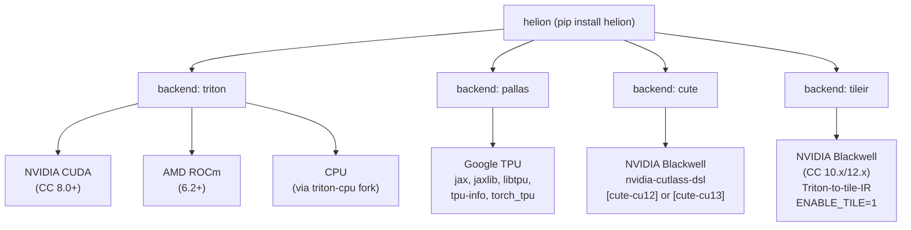
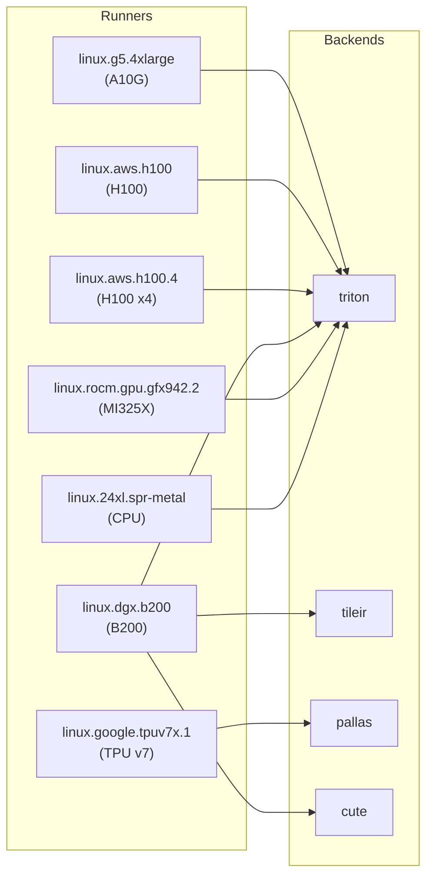

<!-- source: DeepWiki mcp.deepwiki.com · repo pytorch/helion · page 2.1 Installation · fetched 2026-10-21 -->

# Installation

<details>
<summary>Relevant source files</summary>

The following files were used as context for generating this wiki page:

- [.github/matrix.json](.github/matrix.json)
- [.github/workflows/lint.yml](.github/workflows/lint.yml)
- [.github/workflows/test.yml](.github/workflows/test.yml)
- [.gitignore](.gitignore)
- [README.md](README.md)
- [docs/api/config.md](docs/api/config.md)
- [docs/index.md](docs/index.md)
- [docs/installation.md](docs/installation.md)
- [docs/tileir_backend.md](docs/tileir_backend.md)
- [examples/segment_reduction.py](examples/segment_reduction.py)
- [pyproject.toml](pyproject.toml)

</details>


This page covers system requirements, installation procedures, hardware backend prerequisites, and the CI test matrix for Helion. For information on writing your first kernel after installation, see [Your First Kernel](#2.2). For available runtime settings and environment variables, see [Settings and Environment Variables](#6.2).

---

## System Requirements

| Requirement | Minimum Version | Notes |
|---|---|---|
| Operating System | Linux | Other Unix-like systems may work but are not officially tested |
| Python | 3.10 | Tested through 3.14 |
| PyTorch | 2.9 | Earlier versions lack required compiler hooks |
| Triton | 3.5 | Earlier versions lack TMA support on Hopper/Blackwell and may have lower performance |

Helion's core Python dependencies (declared in [pyproject.toml:19-26]()) are:

| Package | Minimum Version | Purpose |
|---|---|---|
| `typing_extensions` | 4.0.0 | Backported type annotations |
| `filecheck` | — | Output matching in tests |
| `psutil` | — | Process management during autotuning |
| `rich` | — | Formatted autotuning progress output |
| `numpy` | — | Array utilities |
| `scikit-learn` | 1.3.0 | Surrogate models in search algorithms |

Sources: [pyproject.toml:19-26](), [README.md:343-351](), [docs/installation.md:4-20]()

---

## Installation Methods

### From PyPI

```bash
pip install helion
```

This installs the stable release. PyTorch and Triton must be installed separately before this step (see [Dependency Installation](#dependency-installation) below).

### From Source (Development)

```bash
git clone https://github.com/pytorch/helion.git
cd helion

# Create and activate a virtual environment (uv recommended)
uv venv .venv
source .venv/bin/activate

# Install in editable mode with development dependencies
pip install -e '.[dev]'
```

The `[dev]` extra (declared in [pyproject.toml:29-36]()) adds `pytest`, `pytest-timeout`, `pre-commit`, `expecttest`, `hypothesis`, and `tabulate`.

Sources: [README.md:356-381](), [docs/installation.md:22-46](), [pyproject.toml:29-36]()

---

## Dependency Installation

### PyTorch

Install PyTorch 2.9 or later using the appropriate index URL for your hardware:

```bash
# CUDA 12.8
pip install "torch==2.9.*" --index-url https://download.pytorch.org/whl/cu128

# CUDA 13.0
pip install "torch==2.9.*" --index-url https://download.pytorch.org/whl/cu130

# ROCm 7.0
pip install "torch==2.9.*" --index-url https://download.pytorch.org/whl/rocm7.0

# Nightly (for latest features)
pip install --pre torch --index-url https://download.pytorch.org/whl/nightly/cu128
```

### Triton

Triton is typically bundled with PyTorch nightlies. For stable PyTorch releases or when a custom build is needed:

```bash
# From PyPI
pip install "triton>=3.5"
```

To build Triton from source (required for some CI configurations and the TileIR backend):

```bash
sudo apt-get install -y git clang-20 clang++-20 zlib1g-dev
export CC=clang-20
export CXX=clang++-20

git clone https://github.com/triton-lang/triton.git
cd triton
pip install -r python/requirements.txt
MAX_JOBS=$(nproc) TRITON_PARALLEL_LINK_JOBS=2 pip install .
```

Sources: [docs/installation.md:62-111](), [.github/workflows/test.yml:107-151]()

---

## Hardware Backend Support

The following diagram maps hardware targets to their required packages, environment variables, and Helion backend identifiers.

**Hardware Backends and Their Dependencies**



Sources: [.github/matrix.json:1-138](), [.github/workflows/test.yml:159-214](), [pyproject.toml:37-47](), [docs/tileir_backend.md:8-15]()

### CUDA (Triton backend)

No additional packages beyond PyTorch and Triton are required. Supported hardware per Triton's requirements (Compute Capability 8.0+). The `tensor_descriptor` indexing strategy requires Hopper (CC 9.0+) or newer and a recent Triton build.

### ROCm (Triton backend)

Install PyTorch from the ROCm index. The ROCm 7.0 runtime image used in CI is `rocm/dev-ubuntu-24.04:7.0-complete` [.github/matrix.json:93-103]().

### TPU / Pallas backend

The Pallas backend targets Google TPUs and requires additional packages not installed by default. Install the `[pallas-tpu]` extra or manually install:

```bash
pip install jax[tpu] absl-py
```

CI also installs `jaxlib`, `libtpu`, `tpu-info`, `jaxtyping`, `frozendict`, and a private `torch_tpu` wheel [.github/workflows/test.yml:166-208](). The `HELION_BACKEND=pallas` environment variable selects this backend.

### CuTe / CUTLASS DSL backend

Requires NVIDIA Blackwell hardware and the `nvidia-cutlass-dsl` package. Install via the optional extras:

```bash
# CUDA 12
pip install 'helion[cute-cu12]'

# CUDA 13
pip install 'helion[cute-cu13]'
```

Declared in [pyproject.toml:37-43](). Set `HELION_BACKEND=cute` to select this backend.

### TileIR backend (Blackwell GPUs)

Requires NVIDIA Blackwell GPUs (Compute Capability 10.x or 12.x) and the [Triton-to-tile-IR](https://github.com/triton-lang/Triton-to-tile-IR) backend installed in place of standard Triton.

```bash
# Clone and install Triton-to-tile-IR (builds from source)
git clone --recursive -b main https://github.com/triton-lang/Triton-to-tile-IR.git triton
cd triton
pip install -r python/requirements.txt
MAX_JOBS=$(nproc) TRITON_PARALLEL_LINK_JOBS=2 pip install .

# Enable at runtime
export ENABLE_TILE=1
```

Set `HELION_BACKEND=tileir`. Unsupported config parameters (`static_ranges`, `range_unroll_factors`, `block_ptr` indexing, etc.) are automatically excluded from the autotuning search space when TileIR is active. See [docs/tileir_backend.md]() for the full parameter compatibility table.

Sources: [docs/tileir_backend.md:8-15](), [.github/workflows/test.yml:139-151](), [README.md:292-305]()

---

## Optional Extras Summary

The [pyproject.toml:28-67]() file declares the following installable extras:

| Extra | Install Command | Contents |
|---|---|---|
| `dev` | `pip install 'helion[dev]'` | `pytest`, `pre-commit`, `expecttest`, `hypothesis`, `tabulate` |
| `cute-cu12` | `pip install 'helion[cute-cu12]'` | `nvidia-cutlass-dsl` (CUDA 12) |
| `cute-cu13` | `pip install 'helion[cute-cu13]'` | `nvidia-cutlass-dsl[cu13]` (CUDA 13) |
| `pallas-tpu` | `pip install 'helion[pallas-tpu]'` | `jax[tpu]`, `absl-py` |
| `pallas-cpu` | `pip install 'helion[pallas-cpu]'` | `jax`, `absl-py` |
| `docs` | `pip install 'helion[docs]'` | Sphinx and related documentation tools |

Sources: [pyproject.toml:28-67]()

---

## CI Test Matrix

The CI test matrix is defined in [.github/matrix.json:1-138]() and consumed by [.github/workflows/test.yml:14-28](). The following table summarizes the tested configurations:

**CI Test Matrix**



Sources: [.github/matrix.json:1-138]()

| Runner | GPU/Platform | Python | PyTorch | Backend | Alias |
|---|---|---|---|---|---|
| `linux.g5.4xlarge` | NVIDIA A10G | 3.10 | 2.9 | triton | a10g |
| `linux.g5.4xlarge` | NVIDIA A10G | 3.14 | nightly | triton | a10g |
| `linux.g5.4xlarge` | NVIDIA A10G | 3.12 | 2.9 | triton | a10g-dtype-asserts |
| `linux.g5.4xlarge` | NVIDIA A10G | 3.12 | nightly | triton | a10g-ref-eager |
| `linux.aws.h100` | NVIDIA H100 | 3.12 | nightly | triton | h100 |
| `linux.aws.h100.4` | NVIDIA H100 ×4 | 3.12 | nightly | triton | h100-distributed |
| `linux.dgx.b200` | NVIDIA B200 | 3.12 | 2.9 | triton | b200 |
| `linux.dgx.b200` | NVIDIA B200 | 3.12 | 2.9 | tileir | b200 |
| `linux.dgx.b200` | NVIDIA B200 | 3.12 | nightly | cute | b200 |
| `linux.rocm.gpu.gfx942.2` | AMD MI325X | 3.12 | nightly | triton | mi325x |
| `linux.24xl.spr-metal` | CPU | 3.12 | nightly | triton | cpu |
| `linux.google.tpuv7x.1` | Google TPU v7 | 3.12 | nightly | pallas | tpu |

Sources: [.github/matrix.json:1-138]()

The `HELION_BACKEND` environment variable selects the backend at runtime. The `ENABLE_TILE=1` environment variable additionally enables TileIR support. For the `ref-eager` alias, `HELION_INTERPRET=1` is set, enabling the Helion eager reference mode (see [Ref Eager Mode](#7.2)).

---

## Installation Verification

After installation, verify the setup with a minimal smoke test:

```python
import torch
import helion
import helion.language as hl

@helion.kernel(autotune_effort="none")
def test_kernel(x: torch.Tensor) -> torch.Tensor:
    out = torch.empty_like(x)
    for tile in hl.tile(x.shape[0]):
        out[tile] = x[tile] * 2
    return out

x = torch.randn(128, device='cuda')
result = test_kernel(x)
torch.testing.assert_close(result, x * 2)
print("Installation verified.")
```

The `autotune_effort="none"` setting skips the full autotuning process during verification. Setting `HELION_PRINT_OUTPUT_CODE=1` will print the generated Triton code to `stderr`, confirming the compilation pipeline is working.

Sources: [docs/installation.md:129-147](), [README.md:307-318]()

---

## Linting and Pre-commit

When working from source with the `[dev]` extra:

```bash
# One-time setup
pip install pre-commit
pre-commit install

# Run all checks
pre-commit run --all-files
```

Pre-commit runs `ruff` (linter/formatter) and `pyrefly` (type checker). The ruff configuration is in [pyproject.toml:73-114]() and the pyrefly configuration is in [pyproject.toml:135-140]().

Sources: [README.md:383-398](), [pyproject.toml:73-140]()

---

