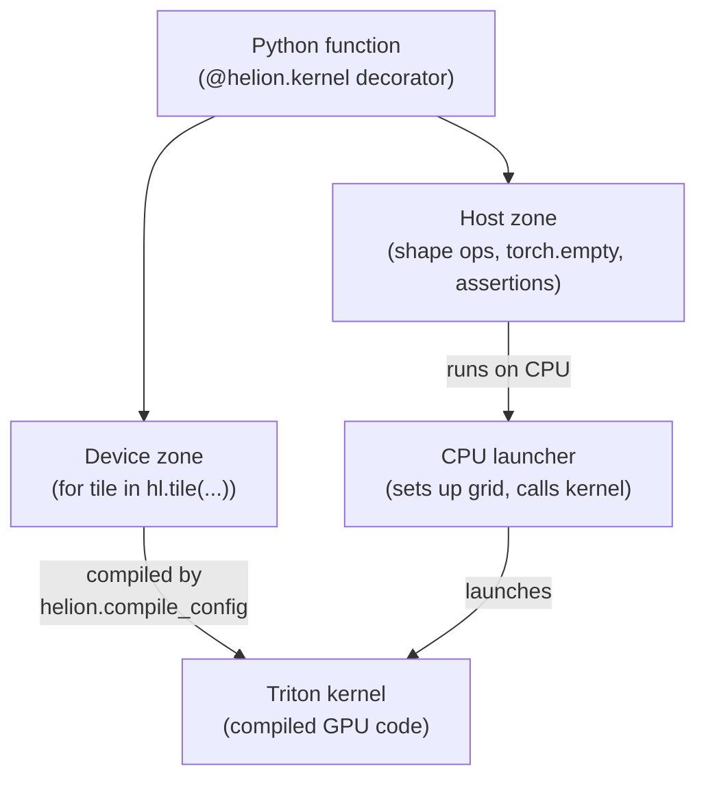
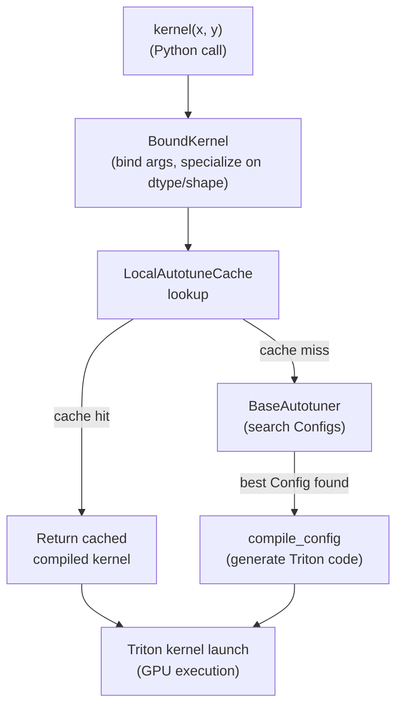
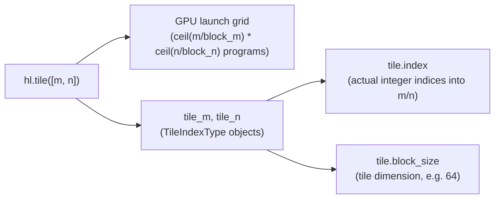

<!-- source: DeepWiki mcp.deepwiki.com · repo pytorch/helion · page 2.2 Your First Kernel · fetched 2026-10-21 -->

# Your First Kernel

<details>
<summary>Relevant source files</summary>

The following files were used as context for generating this wiki page:

- [README.md](README.md)
- [benchmarks/run.py](benchmarks/run.py)
- [docs/api/config.md](docs/api/config.md)
- [docs/index.md](docs/index.md)
- [docs/installation.md](docs/installation.md)
- [docs/tileir_backend.md](docs/tileir_backend.md)
- [examples/add.py](examples/add.py)
- [examples/attention.py](examples/attention.py)
- [examples/bmm.py](examples/bmm.py)
- [examples/concatenate.py](examples/concatenate.py)
- [examples/embedding.py](examples/embedding.py)
- [examples/jagged_dense_add.py](examples/jagged_dense_add.py)
- [examples/long_sum.py](examples/long_sum.py)
- [examples/moe_matmul_ogs.py](examples/moe_matmul_ogs.py)
- [examples/segment_reduction.py](examples/segment_reduction.py)
- [examples/softmax.py](examples/softmax.py)
- [test/test_examples.py](test/test_examples.py)

</details>


This page walks through writing and running a Helion kernel from scratch. It covers the `@helion.kernel` decorator, tiling with `hl.tile`, creating output tensors with `hl.zeros`, and what happens on the first kernel call. For background on what Helion is and how it fits into the ML stack, see [Overview](#1). For detailed reference on all tiling constructs, see [Tiling and Iteration](#3.1). For configuration and autotuning in depth, see [Configuration and Autotuning](#4).

---

## Anatomy of a Helion Kernel

Every Helion kernel follows a two-zone structure:

- **Host zone** — standard Python/PyTorch code that runs on the CPU before the GPU kernel launches. Used for shape arithmetic and output tensor allocation.
- **Device zone** — code inside `hl.tile` or `hl.grid` loops that is traced and compiled into a single Triton kernel.

**Helion Kernel Structure**



Sources: [README.md:72-113](), [docs/index.md:82-134]()

---

## A Minimal Kernel: Element-wise Addition

The simplest kernel is a pointwise operation. The `add` kernel from `examples/add.py` illustrates the full structure:

```
examples/add.py
```

[examples/add.py:28-51]()

Key observations:

| Code construct | Role |
|---|---|
| `@helion.kernel()` | Marks the function as a Helion kernel; wraps it in a `Kernel` object |
| `torch.broadcast_tensors(x, y)` | **Host zone** — runs on CPU, shapes output |
| `torch.empty(...)` | **Host zone** — allocates output tensor on GPU |
| `hl.tile(out.size())` | **Device zone** — partitions the iteration space into tiles |
| `out[tile] = x[tile] + y[tile]` | **Device zone** — compiled to Triton pointwise ops |

The `for tile in hl.tile(out.size())` loop tells Helion to partition all dimensions of the output tensor into blocks. Each tile is executed in parallel by a different GPU program. Tile sizes are determined at compile time, either by the autotuner or by an explicit `Config`.

Sources: [examples/add.py:1-87]()

---

## Using `hl.zeros` and Accumulator Patterns

Many kernels accumulate partial results across a reduction dimension. `hl.zeros` creates a tile-shaped accumulator inside the device zone. The `matmul` kernel from the README illustrates this:

```
README.md (matmul example)
```

[README.md:74-89]()

Key constructs in the matmul:

| Construct | Description |
|---|---|
| `hl.tile([m, n])` | 2D outer tile; maps to the GPU launch grid |
| `hl.zeros([tile_m, tile_n], dtype=torch.float32)` | Allocates a tile-shaped register accumulator |
| `hl.tile(k)` | Inner reduction tile; becomes a loop inside the GPU kernel |
| `torch.addmm(acc, x[tile_m, tile_k], y[tile_k, tile_n])` | Matrix multiply-accumulate mapped to Triton ops |
| `out[tile_m, tile_n] = acc` | Stores accumulated result to global memory |

`hl.zeros` only works inside the device zone (inside a `hl.tile` or `hl.grid` loop). It is distinct from `torch.zeros`, which would attempt to create a full CPU/GPU tensor.

Sources: [README.md:74-106](), [examples/softmax.py:64-93]()

---

## The `@helion.kernel` Decorator

`helion.kernel` is a callable that wraps a Python function and returns a `Kernel` object. Its most common arguments are:

| Argument | Type | Purpose |
|---|---|---|
| `config` | `helion.Config` | Pin a specific configuration; skips autotuning |
| `configs` | `list[helion.Config]` | Restrict autotuner to a candidate set |
| `autotune_effort` | `str` | `"none"`, `"quick"`, or `"full"` |
| `static_shapes` | `bool` | Whether to specialize per input shape (default `True`) |
| `print_output_code` | `bool` | Print generated Triton code to stderr |

The decorator can be called with or without parentheses:

- `@helion.kernel()` — default settings, full autotuning on first call
- `@helion.kernel(autotune_effort="none")` — skip autotuning, use a default config
- `@helion.kernel(config=helion.Config(...))` — use a pinned config, no autotuning

Sources: [README.md:76-105](), [docs/installation.md:136-148]()

---

## What Happens on the First Call

When you call a Helion kernel for the first time with given tensor shapes and dtypes, Helion goes through several stages:

**Kernel Call Lifecycle**



Sources: [README.md:126-145](), [docs/index.md:140-158]()

On first call with a new shape:

1. `BoundKernel` binds the arguments and extracts dtype/shape metadata.
2. `LocalAutotuneCache` is checked. On a cache miss, autotuning begins.
3. `BaseAutotuner` runs a search (e.g., `DifferentialEvolutionSearch`) over the `Config` space.
4. For each candidate `Config`, `compile_config` generates Triton code and benchmarks it.
5. The best `Config` is stored in the cache and used for this call.

Autotuning output looks like:

```
[0s] Starting DifferentialEvolutionSearch with population=40, generations=20, crossover_rate=0.8
[20s] Initial population: ... best=Config(block_sizes=[64, 32, 64], ...)
...
[586s] Autotuning complete in 586.6s after searching 1520 configs.
One can hardcode the best config and skip autotuning with:
    @helion.kernel(config=helion.Config(block_sizes=[64, 64, 64], ...))
```

Sources: [README.md:126-145](), [docs/index.md:140-183]()

---

## Skipping Autotuning During Development

For fast iteration during development, use `autotune_effort="none"` to get a default config immediately without searching:

```
docs/installation.md (verification example)
```

[docs/installation.md:136-147]()

This produces compilable code with a default (often non-optimal) config. Do not use `autotune_effort="none"` for performance benchmarking.

Alternatively, paste the config printed at the end of an autotuning session to skip future autotuning for that kernel:

```
README.md (hardcoded config example)
```

[README.md:152-169]()

---

## `hl.tile`: What It Does

`hl.tile` is the primary loop construct. It takes a shape (scalar or list of scalars) and yields a tile variable (or tuple of tile variables) on each iteration.

**`hl.tile` Semantics**



- **Outer `hl.tile`** (not nested inside another `hl.tile`) maps to the GPU launch grid. Each program processes one tile in parallel.
- **Inner `hl.tile`** (nested inside an outer tile) maps to a sequential loop inside the kernel, used for reductions.
- Block sizes are determined by the `Config.block_sizes` list. Each `hl.tile` call consumes one or more entries from this list in order.

Automatic masking handles the case where the tensor dimension is not evenly divisible by the block size — no manual boundary checks are needed.

Sources: [README.md:99-113](), [docs/index.md:113-117](), [examples/add.py:48-51]()

---

## Complete Worked Example: Softmax

`examples/softmax.py` shows how to use `hl.full`, `hl.zeros`, and nested tiles for a numerically stable kernel:

[examples/softmax.py:65-93]()

Structure:

| Loop | Maps to | Purpose |
|---|---|---|
| `for tile_m in hl.tile(m, block_size=block_size_m)` | GPU grid (outer) | Each program handles one row block |
| `hl.full([tile_m], float("-inf"), ...)` | Register tensor | Running max per row |
| `hl.zeros([tile_m], ...)` | Register tensor | Running denominator |
| `for tile_n in hl.tile(n, block_size=block_size_n)` | Sequential loop (inner) | Reduction over columns |

`hl.register_block_size(n)` registers a new tunable block size dimension that can be shared between two separate `hl.tile` calls — both passes over the `n` dimension use the same block size from the config.

Sources: [examples/softmax.py:65-93]()

---

## Checking Generated Triton Code

To inspect what Triton code Helion generates, set `print_output_code=True`:

```python
@helion.kernel(print_output_code=True, autotune_effort="none")
def my_kernel(x: torch.Tensor) -> torch.Tensor:
    ...
```

Or set the environment variable `HELION_PRINT_OUTPUT_CODE=1`. The Triton source is printed to stderr before kernel execution.

To obtain the Triton code as a string programmatically:

```python
code = my_kernel.bind(args).to_triton_code(config)
```

Sources: [README.md:313-318](), [docs/index.md:243-248]()

---

## Common Patterns Summary

| Pattern | Code construct | Notes |
|---|---|---|
| Pointwise kernel | `for tile in hl.tile(out.size())` | One outer tile; one Config block_size per dimension |
| Row-wise reduction | `for tile_m in hl.tile(m)` with `hl.zeros([tile_m])` | Outer tile over rows; inner tile over reduction |
| Matrix multiply | Nested `hl.tile` with `hl.zeros([tile_m, tile_n])` | Outer 2D tile; inner reduction over `k` |
| Accumulator | `hl.zeros([tile_m, tile_n], dtype=torch.float32)` | Allocated in registers; stored back with `out[tile_m, tile_n] = acc` |
| Skip autotuning | `autotune_effort="none"` | For development only |
| Pin a config | `config=helion.Config(block_sizes=[...])` | Skips autotuning entirely |

---

## Next Steps

- **Tiling and Iteration** ([3.1](#3.1)) — full reference for `hl.tile`, `hl.grid`, `hl.static_range`, block size configuration, and loop ordering.
- **API Functions Reference** ([3.5](#3.5)) — all `helion.language` functions including `hl.zeros`, `hl.full`, `hl.arange`, `hl.load`, `hl.store`.
- **Configuration System** ([4.1](#4.1)) — all `helion.Config` parameters and their valid values.
- **Autotuning Overview** ([4.2](#4.2)) — how the autotuner works, effort profiles, and deploying pre-tuned configs.
- **Kernel Examples** ([9.1](#9.1)) — annotated examples from the `examples/` directory covering matmul, attention, normalization, and more.

---

