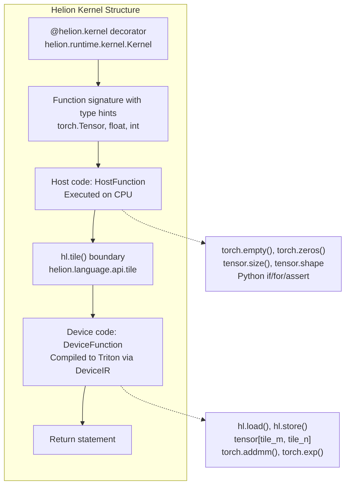
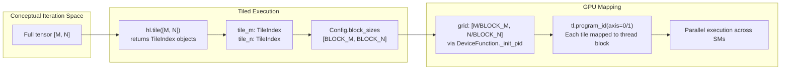
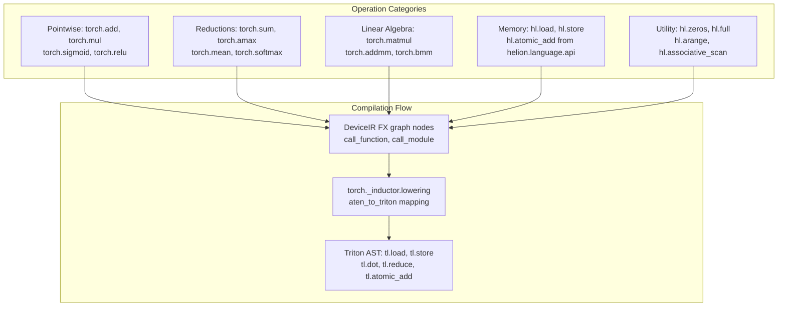
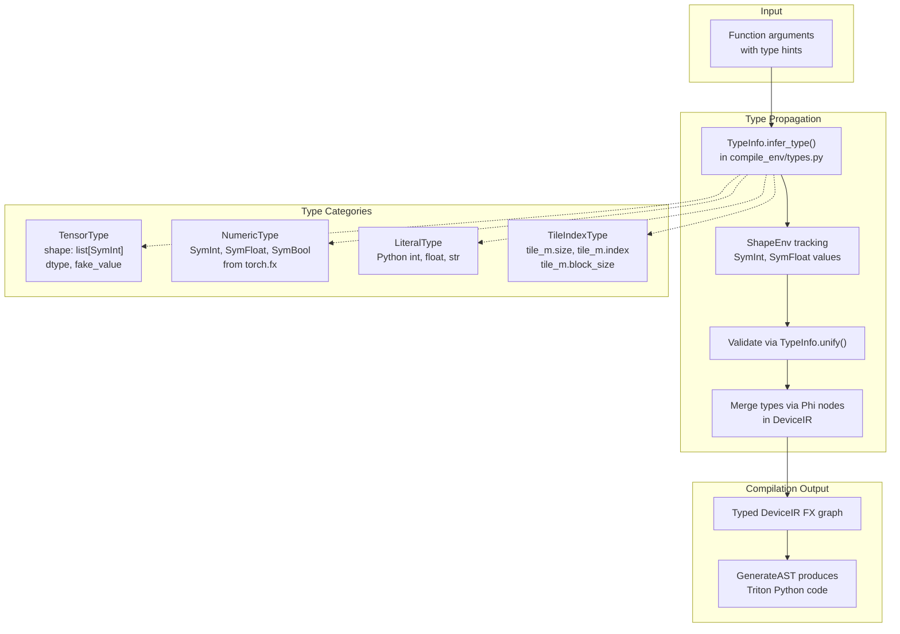

<!-- source: DeepWiki mcp.deepwiki.com · repo pytorch/helion · page 3 Kernel Authoring Guide · fetched 2026-10-21 -->

# Kernel Authoring Guide

<details>
<summary>Relevant source files</summary>

The following files were used as context for generating this wiki page:

- [README.md](README.md)
- [docs/api/config.md](docs/api/config.md)
- [docs/index.md](docs/index.md)
- [docs/installation.md](docs/installation.md)
- [docs/tileir_backend.md](docs/tileir_backend.md)
- [examples/segment_reduction.py](examples/segment_reduction.py)
- [helion/_compiler/roll_reduction.py](helion/_compiler/roll_reduction.py)
- [helion/language/__init__.py](helion/language/__init__.py)
- [helion/language/random_ops.py](helion/language/random_ops.py)
- [test/test_random.py](test/test_random.py)

</details>


This guide covers the fundamentals of writing kernels in Helion, a Python-embedded DSL for GPU kernel authoring. It explains the core concepts, language constructs, and patterns needed to write efficient and correct kernels.

For detailed coverage of specific topics, see:
- [Tiling and Iteration](#3.1) - In-depth guide to `hl.tile()` and iteration spaces
- [Tensor Indexing Patterns](#3.2) - All supported indexing patterns and semantics
- [Memory Operations](#3.3) - Load, store, and atomic operations
- [Control Flow](#3.4) - Loops and conditionals
- [API Functions Reference](#3.5) - Complete API documentation

For autotuning and configuration, see [Configuration and Autotuning](#4).

For compilation internals, see [Compilation Pipeline](#5).

## Kernel Structure Overview

A Helion kernel consists of two distinct code regions: **host code** and **device code**. The distinction is determined by the presence of `hl.tile()` loops.



**Diagram: Kernel Structure with Host and Device Regions**
</thinking>

Sources: [helion/runtime/kernel.py](), [helion/language/api.py](), [helion/compiler/host_function.py](), [helion/compiler/device_function.py]()

**Host code** executes on the CPU during kernel invocation and typically performs:
- Shape computations and size queries
- Output tensor allocation
- Python control flow (if/else, loops over Python ranges)
- Argument validation

**Device code** is enclosed within `hl.tile()` loops and compiles to a single Triton kernel. It performs:
- Parallel computation over tiles
- Tensor indexing and memory access
- Mathematical operations via PyTorch operators
- Reductions and accumulations

Sources: [examples/add.py](https://github.com/pytorch/helion/blob/main/examples/add.py), [examples/matmul.py](https://github.com/pytorch/helion/blob/main/examples/matmul.py), [test/test_examples.py:27-36]()

### Basic Kernel Example

```python
import torch
import helion
import helion.language as hl

@helion.kernel()
def add(x: torch.Tensor, y: torch.Tensor) -> torch.Tensor:
    # Host code: runs on CPU
    x, y = torch.broadcast_tensors(x, y)
    out = torch.empty(x.shape, dtype=torch.promote_types(x.dtype, y.dtype), 
                      device=x.device)
    
    # Device code: compiles to Triton, runs on GPU
    for tile in hl.tile(out.size()):
        out[tile] = x[tile] + y[tile]
    
    # Host code: return result
    return out
```

Sources: [examples/add.py](), [test/test_examples.py:27-36]()

## The @helion.kernel Decorator

The `@helion.kernel` decorator transforms a Python function into a compilable Helion kernel. It manages compilation, autotuning, and execution.

### Decorator Syntax

The `@helion.kernel` decorator is implemented in [helion/runtime/kernel.py]() and accepts the following parameters:

```python
@helion.kernel(
    config=None,              # Single helion.Config object
    configs=None,             # List of helion.Config objects
    autotune_effort="auto",   # "none", "low", "auto", "high" - controls search algorithm
    static_shapes=True,       # Use static shape specialization in BoundKernel
    print_output_code=False,  # Print generated Triton code to stderr
    print_repro=False,        # Print reproduction script
    # ... other Settings fields
)
def kernel_function(...) -> ...:
    ...
```

All parameters except `config` and `configs` correspond to fields in the `Settings` class ([helion/runtime/settings.py]()).

Sources: [helion/runtime/kernel.py](), [helion/runtime/settings.py]()

### Configuration Modes

| Mode | Parameter | Behavior | Implementation |
|------|-----------|----------|----------------|
| **No config** | (omitted) | Full autotuning with `DifferentialEvolutionSearch` | [helion/autotuner/search.py]() |
| **Single config** | `config=Config(...)` | Uses provided config, skips autotuning | [helion/runtime/kernel.py:Kernel.bind()]() |
| **Multiple configs** | `configs=[Config(...), ...]` | Benchmarks via `FiniteSearch`, selects fastest | [helion/autotuner/search.py:FiniteSearch]() |
| **ConfigSpec** | `configs=ConfigSpec(...)` | Defines custom search space for autotuning | [helion/runtime/config_spec.py]() |

Sources: [helion/runtime/kernel.py](), [helion/runtime/config.py](), [helion/runtime/config_spec.py](), [helion/autotuner/search.py]()

Example with explicit configuration:

```python
@helion.kernel(config=helion.Config(
    block_sizes=[128, 128, 64],
    num_warps=4,
    num_stages=2,
    indexing="block_ptr"
))
def matmul_tuned(x: torch.Tensor, y: torch.Tensor) -> torch.Tensor:
    ...
```

Sources: [helion/runtime/kernel.py](), [README.md:152-172]()

## Host Code: CPU Execution

Host code executes standard Python and PyTorch operations on the CPU. It runs once per kernel invocation, before device code execution.

### Common Host Code Patterns

**Shape Computations**
```python
@helion.kernel()
def kernel_example(x: torch.Tensor, y: torch.Tensor) -> torch.Tensor:
    m, k = x.size()          # Extract dimensions
    k2, n = y.size()         # Validate shapes
    assert k == k2           # Shape validation
    ...
```

**Output Tensor Allocation**
```python
@helion.kernel()
def kernel_example(x: torch.Tensor) -> torch.Tensor:
    out = torch.empty_like(x)                    # Match input shape/dtype
    out = torch.empty([m, n], dtype=x.dtype,     # Explicit shape
                      device=x.device)
    out = torch.zeros([m, n], ...)              # Zero-initialized
    ...
```

**Tensor Reshaping**
```python
@helion.kernel()
def attention(q_in: torch.Tensor, k_in: torch.Tensor, 
              v_in: torch.Tensor) -> torch.Tensor:
    m_dim = q_in.size(-2)
    head_dim = q_in.size(-1)
    
    # Reshape for processing
    q_view = q_in.reshape([-1, m_dim, head_dim])
    k_view = k_in.reshape([-1, m_dim, head_dim]).transpose(1, 2)
    ...
```

Sources: [examples/matmul.py](), [examples/attention.py](), [test/test_examples.py:38-51]()

## Device Code: Tiling and Parallelization

Device code is defined by `hl.tile()` loops, which partition the iteration space into parallel work units (tiles) executed on the GPU.



**Diagram: Tiling Maps Iteration Spaces to GPU Parallelism**

Sources: [helion/language/api.py](), [helion/compile_env/types.py](), [helion/runtime/config.py](), [helion/compiler/device_function.py]()

### Basic Tiling Patterns

**Single Dimension**
```python
for tile in hl.tile(n):
    # Process elements in tile
    out[tile] = x[tile] + 1
```

**Two Dimensions**
```python
for tile_m, tile_n in hl.tile([m, n]):
    # Process 2D tile
    out[tile_m, tile_n] = x[tile_m, tile_n] + y[tile_m, tile_n]
```

**Multiple Separate Tiles**
```python
for tile_m, tile_k in hl.tile([m, k]):
    for tile_n in hl.tile(n):
        # Nested iteration
        acc = torch.addmm(acc, x[tile_m, tile_k], y[tile_k, tile_n])
```

Sources: [examples/add.py](), [examples/matmul.py](), [test/test_examples.py:38-51]()

### Tile Objects

Tile objects returned by `hl.tile()` are instances of `TileIndex` (defined in [helion/compile_env/types.py]()) and provide:

| Attribute | Type | Description |
|-----------|------|-------------|
| `tile.size` | `SymInt` | Total size of the dimension |
| `tile.block_size` | `SymInt` | Size of each tile block |
| `tile.index` | `SymInt` or `torch.Tensor` | Current tile indices |
| `tile.is_grid` | `bool` | `True` for outer (grid) loops, `False` for device loops |

These attributes enable:
- **Tensor indexing**: `tensor[tile_m, tile_n]` via `__getitem__` and `__setitem__`
- **Size queries**: `tile_m.size`, `tile_n.block_size`
- **Index access**: `tile_m.index` for masking and conditional logic

For full details on tiling semantics and advanced patterns, see [Tiling and Iteration](#3.1).

Sources: [helion/compile_env/types.py:TileIndex](), [helion/language/api.py:tile()]()

## Tensor Operations in Device Code

Inside device loops, tensor operations use PyTorch operators that are automatically lowered to Triton operations through TorchInductor.



**Diagram: Operation Categories and Compilation Flow**

Sources: [helion/language/api.py](), [helion/compiler/device_ir.py](), [helion/compiler/generate_ast.py]()

### Pointwise Operations

All PyTorch element-wise operations work naturally in device code:

```python
for tile in hl.tile(n):
    # Arithmetic
    out[tile] = x[tile] + y[tile]
    out[tile] = x[tile] * 2.5
    
    # Activations
    out[tile] = torch.relu(x[tile])
    out[tile] = torch.sigmoid(x[tile])
    out[tile] = torch.exp(x[tile])
    
    # Comparisons
    mask = x[tile] > 0
    out[tile] = torch.where(mask, x[tile], 0)
```

Sources: [examples/add.py](https://github.com/pytorch/helion/blob/main/examples/add.py), [test/test_examples.py:27-36]()

### Reduction Operations

Reductions aggregate values across dimensions:

```python
for tile_m in hl.tile(m):
    # Reduce over last dimension
    row_max = torch.amax(x[tile_m, :], dim=-1)
    row_sum = torch.sum(x[tile_m, :], dim=-1)
    row_mean = torch.mean(x[tile_m, :], dim=-1)
```

For large reductions, use reduction loops (see [Tiling and Iteration](#3.1)):

```python
for tile_m in hl.tile(m):
    acc = hl.zeros([tile_m], dtype=torch.float32)
    for tile_n in hl.tile(n):  # Reduction loop
        acc += x[tile_m, tile_n]
    out[tile_m] = acc
```

Sources: [examples/softmax.py](), [test/test_examples.py:293-321]()

### Matrix Multiplication

Matrix operations use accumulator patterns:

```python
for tile_m, tile_n in hl.tile([m, n]):
    acc = hl.zeros([tile_m, tile_n], dtype=torch.float32)
    for tile_k in hl.tile(k):
        acc = torch.addmm(acc, x[tile_m, tile_k], y[tile_k, tile_n])
    out[tile_m, tile_n] = acc
```

Supported matrix operations:
- `torch.matmul(a, b)` - General matrix multiplication
- `torch.addmm(bias, a, b)` - Matrix multiply with bias
- `torch.bmm(a, b)` - Batch matrix multiplication
- `torch.dot(a, b)` - Dot product

Sources: [examples/matmul.py](), [test/test_examples.py:38-51]()

## Tensor Indexing

Helion supports multiple indexing patterns for accessing tensor elements within tiles.

### Basic Tile Indexing

The most common pattern uses tile objects directly:

```python
for tile_m, tile_n in hl.tile([m, n]):
    # Read
    value = x[tile_m, tile_n]
    
    # Write
    out[tile_m, tile_n] = value
```

### Slicing and Partial Indexing

Combine tiles with slices:

```python
for tile_m in hl.tile(m):
    # Full slice on second dimension
    row = x[tile_m, :]
    
    # Explicit range
    row_section = x[tile_m, :100]
```

### Advanced Indexing

```python
for tile_m, tile_n in hl.tile([m, n]):
    # Transpose access
    transposed = x[tile_n, tile_m]
    
    # Gather pattern
    indices = idx_tensor[tile_m]
    gathered = embedding[indices, tile_n]
```

For complete indexing semantics and patterns, see [Tensor Indexing Patterns](#3.2).

Sources: [examples/embedding.py](), [test/test_examples.py:544-574]()

## Memory Operations

Helion provides explicit memory operations for fine-grained control.

### Load and Store

```python
# Basic load
value = hl.load(tensor, [tile_m, tile_n])

# Load with masking
value = hl.load(tensor, [tile_m, tile_n], 
                extra_mask=(tile_m.index < valid_size))

# Store
hl.store(tensor, [tile_m, tile_n], value)

# Store with masking
hl.store(tensor, [tile_m, tile_n], value,
         extra_mask=(tile_n.index < valid_size))
```

### Atomic Operations

For concurrent writes from multiple tiles:

```python
for tile_e, tile_f in hl.tile([num_elements, num_features]):
    indices = idx_tensor[tile_e]
    values = data[tile_e, tile_f]
    
    # Atomic accumulation to avoid race conditions
    hl.atomic_add(output, [indices, tile_f], values)
```

### Eviction Policies

Control cache behavior for loads:

```python
# First-use eviction (for data used once)
value = hl.load(tensor, [tile_m], eviction_policy="first")

# Last-use eviction (for reused data)
value = hl.load(tensor, [tile_m], eviction_policy="last")
```

For detailed memory operation semantics, see [Memory Operations](#3.3).

Sources: [examples/segment_reduction.py:82-91](), [helion/language/api.py]()

## Control Flow

Device code supports both loops and conditionals, though they differ from host code control flow.

### Device Loops

Loops in device code are nested within `hl.tile()` loops:

```python
for tile_m, tile_n in hl.tile([m, n]):
    acc = hl.zeros([tile_m, tile_n], dtype=torch.float32)
    
    # Inner reduction loop
    for tile_k in hl.tile(k):
        acc = torch.addmm(acc, x[tile_m, tile_k], y[tile_k, tile_n])
    
    out[tile_m, tile_n] = acc
```

**Loop Types:**
- **Outer loops** (first `hl.tile()` in kernel) → Map to GPU grid
- **Inner loops** (nested `hl.tile()`) → Generate Triton `tl.range()` loops
- **Python loops** (in host code) → Regular Python iteration

### Conditionals

Standard Python if/else works in device code:

```python
for tile in hl.tile(n):
    value = x[tile]
    
    # Conditional computation
    if some_condition:
        result = torch.relu(value)
    else:
        result = -torch.relu(-value)
    
    out[tile] = result
```

**Important:** Conditionals in device code are subject to control flow analysis. Both branches must produce compatible types. See [Control Flow](#3.4) for details on type merging and scope handling.

Sources: [examples/matmul.py](), [test/test_examples.py:38-51]()

## Special Operations

### Accumulator Initialization

Use `hl.zeros()` and `hl.full()` to create tile-sized accumulators:

```python
for tile_m, tile_n in hl.tile([m, n]):
    # Zero accumulator
    acc = hl.zeros([tile_m, tile_n], dtype=torch.float32)
    
    # Constant-filled accumulator
    m_i = hl.full([tile_m], float("-inf"), dtype=torch.float32)
```

### Specialization

Use `hl.specialize()` to mark values as compile-time constants:

```python
@helion.kernel()
def attention(q: torch.Tensor, k: torch.Tensor, v: torch.Tensor) -> torch.Tensor:
    # Specialize head dimension for optimization
    head_dim = hl.specialize(q.size(-1))
    ...
```

This enables the compiler to generate optimized code for specific sizes.

### Associative Scan

For segmented reductions and prefix sums:

```python
def combine_fn(left_val, left_idx, right_val, right_idx):
    combined_val = torch.where(
        left_idx == right_idx, 
        left_val + right_val, 
        right_val
    )
    return combined_val, right_idx

for tile_e, tile_f in hl.tile([num_elements, num_features]):
    vals = input_data[tile_e, tile_f]
    idxs = indices[tile_e]
    
    tuple_in = (vals, idxs.float().unsqueeze(1).expand_as(vals))
    out_vals, _ = hl.associative_scan(combine_fn, tuple_in, dim=0)
    ...
```

Sources: [examples/segment_reduction.py:32-92](), [helion/language/api.py]()

## Type System and Compilation

Helion performs type inference to validate operations and generate efficient code.



**Diagram: Type System Flow Through Compilation**

Sources: [helion/compile_env/types.py](), [helion/compile_env/shape_env.py](), [helion/compiler/device_ir.py](), [helion/compiler/generate_ast.py]()

**Key Type Categories:**

| Type | Description | Example |
|------|-------------|---------|
| `TensorType` | GPU tensors with shape and dtype | `torch.Tensor[m, n, float32]` |
| `NumericType` | Symbolic scalars | `SymInt`, `SymFloat` |
| `TileIndexType` | Tile objects from `hl.tile()` | `tile_m`, `tile_n` |
| `LiteralType` | Python constants | `1`, `"string"`, `3.14` |

**Type Annotations:**

Always provide type hints for kernel arguments:

```python
@helion.kernel()
def kernel(x: torch.Tensor, alpha: float, size: int) -> torch.Tensor:
    ...
```

This enables proper type inference and validation.

Sources: [helion/compile_env/types.py]()

## Common Patterns

### Pattern: Element-wise Operation

```python
@helion.kernel()
def element_wise(x: torch.Tensor, y: torch.Tensor) -> torch.Tensor:
    x, y = torch.broadcast_tensors(x, y)
    out = torch.empty_like(x)
    
    for tile in hl.tile(x.size(0)):
        out[tile] = x[tile] + y[tile]
    
    return out
```

### Pattern: Matrix Multiplication

```python
@helion.kernel()
def matmul(x: torch.Tensor, y: torch.Tensor) -> torch.Tensor:
    m, k = x.size()
    k, n = y.size()
    out = torch.empty([m, n], dtype=x.dtype, device=x.device)
    
    for tile_m, tile_n in hl.tile([m, n]):
        acc = hl.zeros([tile_m, tile_n], dtype=torch.float32)
        for tile_k in hl.tile(k):
            acc = torch.addmm(acc, x[tile_m, tile_k], y[tile_k, tile_n])
        out[tile_m, tile_n] = acc
    
    return out
```

### Pattern: Reduction

```python
@helion.kernel()
def row_sum(x: torch.Tensor) -> torch.Tensor:
    m, n = x.size()
    out = torch.empty([m], dtype=x.dtype, device=x.device)
    
    for tile_m in hl.tile(m):
        acc = hl.zeros([tile_m], dtype=torch.float32)
        for tile_n in hl.tile(n):
            acc += x[tile_m, tile_n]
        out[tile_m] = acc
    
    return out
```

### Pattern: Softmax (Reduction with Normalization)

```python
@helion.kernel()
def softmax(x: torch.Tensor) -> torch.Tensor:
    m, n = x.size()
    out = torch.empty_like(x)
    
    for tile_m in hl.tile(m):
        # Find max
        row_max = torch.amax(x[tile_m, :], dim=-1)
        
        # Compute exp and sum
        row_exp = torch.exp(x[tile_m, :] - row_max[:, None])
        row_sum = torch.sum(row_exp, dim=-1)
        
        # Normalize
        out[tile_m, :] = row_exp / row_sum[:, None]
    
    return out
```

### Pattern: Embedding Lookup

```python
@helion.kernel()
def embedding(indices: torch.Tensor, weight: torch.Tensor) -> torch.Tensor:
    batch_size, seq_len = indices.size()
    vocab_size, embedding_dim = weight.size()
    out = torch.empty([batch_size, seq_len, embedding_dim], 
                      dtype=weight.dtype, device=weight.device)
    
    for tile_b, tile_s, tile_d in hl.tile([batch_size, seq_len, embedding_dim]):
        idx = indices[tile_b, tile_s]
        out[tile_b, tile_s, tile_d] = weight[idx, tile_d]
    
    return out
```

### Pattern: Attention Mechanism

```python
@helion.kernel()
def attention(q: torch.Tensor, k: torch.Tensor, v: torch.Tensor) -> torch.Tensor:
    batch, heads, seq_q, head_dim = q.size()
    _, _, seq_kv, _ = k.size()
    
    out = torch.empty_like(q)
    qk_scale = 1.0 / (head_dim ** 0.5)
    
    for tile_b, tile_h, tile_q in hl.tile([batch, heads, seq_q]):
        m_i = hl.full([tile_b, tile_h, tile_q], float("-inf"), dtype=torch.float32)
        l_i = torch.full_like(m_i, 1.0)
        acc = hl.zeros([tile_b, tile_h, tile_q, head_dim], dtype=torch.float32)
        
        q_tile = q[tile_b, tile_h, tile_q, :]
        
        for tile_kv in hl.tile(seq_kv):
            k_tile = k[tile_b, tile_h, tile_kv, :]
            qk = torch.matmul(q_tile, k_tile.transpose(-2, -1))
            
            # Online softmax with running max
            m_ij = torch.maximum(m_i, torch.amax(qk, -1) * qk_scale)
            qk = qk * qk_scale - m_ij[..., None]
            p = torch.exp2(qk)
            l_ij = torch.sum(p, -1)
            
            alpha = torch.exp2(m_i - m_ij)
            l_i = l_i * alpha + l_ij
            acc = acc * alpha[..., None]
            
            v_tile = v[tile_b, tile_h, tile_kv, :]
            acc += torch.matmul(p, v_tile)
            
            m_i = m_ij
        
        out[tile_b, tile_h, tile_q, :] = acc / l_i[..., None]
    
    return out
```

Sources: [examples/add.py](), [examples/matmul.py](), [examples/softmax.py](), [examples/attention.py](), [examples/embedding.py]()

## Best Practices

### 1. Use Type Hints

Always annotate kernel arguments:

```python
# Good
@helion.kernel()
def kernel(x: torch.Tensor, alpha: float) -> torch.Tensor:
    ...

# Bad
@helion.kernel()
def kernel(x, alpha):
    ...
```

### 2. Allocate Output Tensors in Host Code

Create output tensors before device loops:

```python
# Good
@helion.kernel()
def kernel(x: torch.Tensor) -> torch.Tensor:
    out = torch.empty_like(x)  # Host code
    for tile in hl.tile(x.size(0)):
        out[tile] = x[tile] * 2
    return out

# Bad - output tensor created in device code
@helion.kernel()
def kernel(x: torch.Tensor) -> torch.Tensor:
    for tile in hl.tile(x.size(0)):
        out = torch.empty_like(x)  # Wrong!
        ...
```

### 3. Use Higher Precision for Accumulators

Avoid numerical instability by using `float32` for accumulators:

```python
for tile_m, tile_n in hl.tile([m, n]):
    acc = hl.zeros([tile_m, tile_n], dtype=torch.float32)  # Good
    for tile_k in hl.tile(k):
        acc = torch.addmm(acc, x[tile_m, tile_k], y[tile_k, tile_n])
    out[tile_m, tile_n] = acc.to(x.dtype)  # Convert at end
```

### 4. Use hl.specialize() for Compile-time Constants

When dimensions are known at compile time, use specialization:

```python
head_dim = hl.specialize(q.size(-1))  # Optimize for specific size
```

### 5. Use Atomic Operations for Concurrent Writes

When multiple tiles may write to the same location:

```python
for tile_e, tile_f in hl.tile([num_elements, num_features]):
    indices = idx[tile_e]
    values = data[tile_e, tile_f]
    hl.atomic_add(output, [indices, tile_f], values)  # Safe
```

### 6. Profile Before Over-optimizing

Use the default autotuning first, then manually tune only if needed:

```python
# Start with this
@helion.kernel()
def kernel(...):
    ...

# Only after profiling, consider manual tuning
@helion.kernel(config=helion.Config(...))
def kernel(...):
    ...
```

### 7. Validate Shapes in Host Code

Catch shape mismatches early:

```python
@helion.kernel()
def matmul(x: torch.Tensor, y: torch.Tensor) -> torch.Tensor:
    m, k = x.size()
    k2, n = y.size()
    assert k == k2, f"Inner dimensions must match: {k} != {k2}"
    ...
```

Sources: [examples/matmul.py](), [examples/attention.py]()

## Debugging and Development Tools

### Viewing Generated Code

To inspect the Triton code generated from a Helion kernel, use:

```python
# Environment variable
HELION_PRINT_OUTPUT_CODE=1 python my_kernel.py

# Or decorator parameter
@helion.kernel(print_output_code=True)
def my_kernel(x: torch.Tensor) -> torch.Tensor:
    ...

# Or programmatically
bound_kernel = my_kernel.bind(args)
triton_code = bound_kernel.to_triton_code(config)
print(triton_code)
```

### Generating Reproduction Scripts

For bug reports or sharing minimal reproducible examples:

```python
# Environment variable
HELION_PRINT_REPRO=1 python my_kernel.py

# Or decorator parameter
@helion.kernel(print_repro=True)
def my_kernel(x: torch.Tensor) -> torch.Tensor:
    ...
```

This generates a standalone script with the kernel definition, config, and helper function to recreate the runtime inputs.

### Eager Execution Mode

For debugging device code with `print()` or `breakpoint()`:

```python
# Run in Helion's eager interpreter
HELION_INTERPRET=1 python my_kernel.py

# Or use Triton's interpreter
TRITON_INTERPRET=1 python my_kernel.py
```

In eager mode, device loops execute on the CPU, allowing standard Python debugging tools.

Sources: [helion/runtime/settings.py](), [README.md:292-320](), [docs/index.md:237-266]()

## Next Steps

For deeper understanding of specific topics:

- **[Tiling and Iteration](#3.1)** - Advanced tiling patterns, loop ordering, flattening
- **[Tensor Indexing Patterns](#3.2)** - All indexing modes, masking, broadcasting
- **[Memory Operations](#3.3)** - Load/store semantics, atomic operations, eviction policies
- **[Control Flow](#3.4)** - Loop transformations, control flow merging, scope management
- **[API Functions Reference](#3.5)** - Complete documentation of all `hl.*` functions
- **[Configuration and Autotuning](#4)** - Performance tuning and configuration options
- **[Compilation Pipeline](#5)** - Understanding how kernels are compiled

To run and test kernels:

- **[Testing Framework](#7.1)** - Writing tests for your kernels
- **[Benchmarking](#8)** - Measuring kernel performance

Sources: All sections above

---

