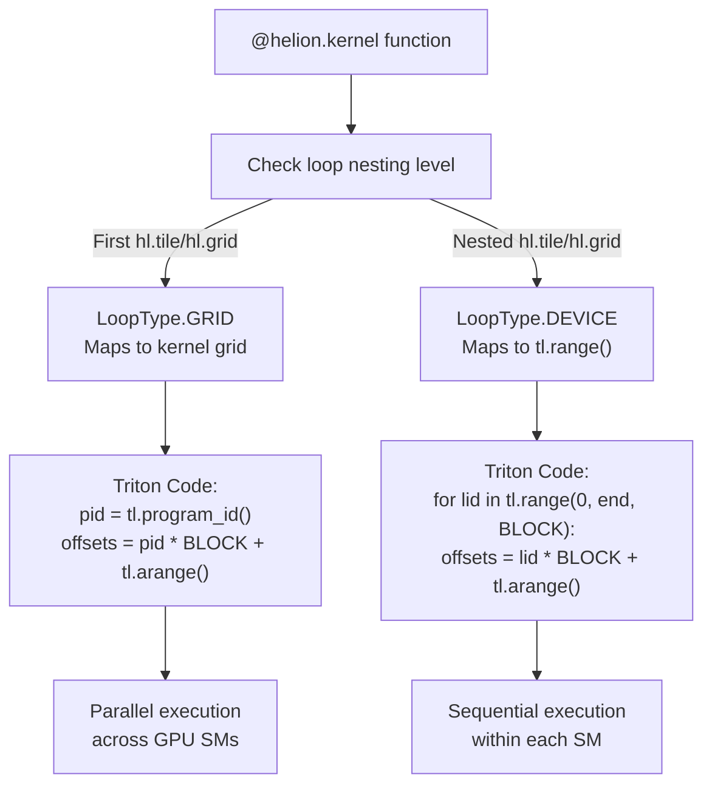
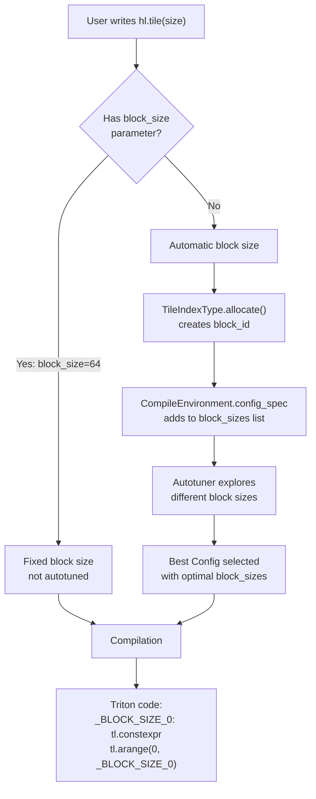
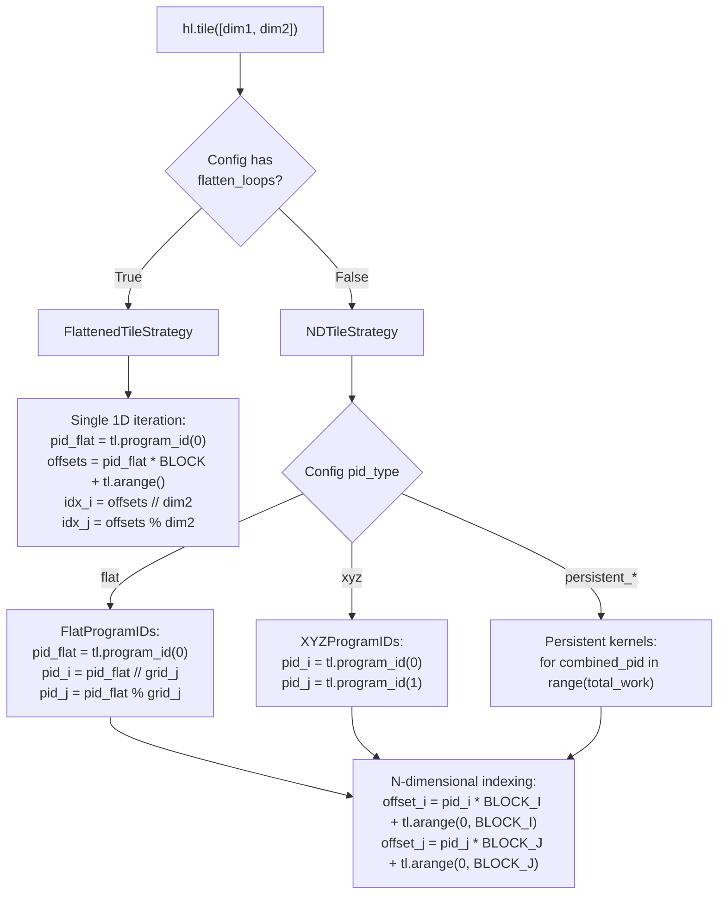
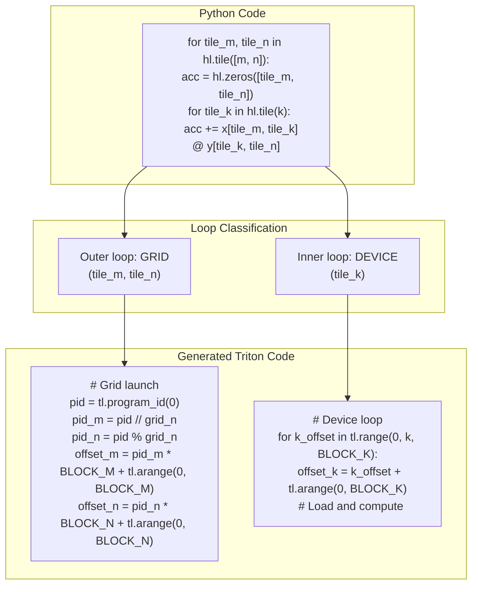
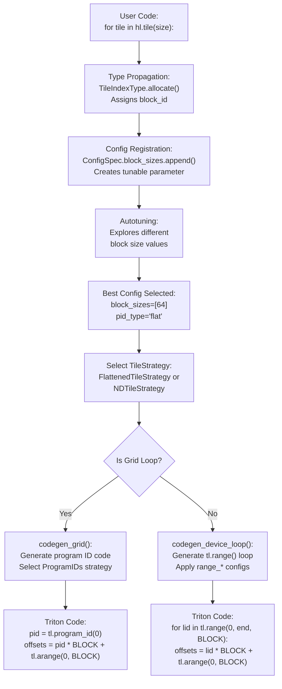

<!-- source: DeepWiki mcp.deepwiki.com · repo pytorch/helion · page 3.1 Tiling and Iteration · fetched 2026-10-21 -->

# Tiling and Iteration

<details>
<summary>Relevant source files</summary>

The following files were used as context for generating this wiki page:

- [helion/language/loops.py](helion/language/loops.py)
- [test/test_loops.py](test/test_loops.py)
- [test/test_reductions.expected](test/test_reductions.expected)
- [test/test_specialize.py](test/test_specialize.py)

</details>


**Purpose**: This page explains how Helion subdivides iteration spaces for parallel execution using `hl.tile()` and `hl.grid()`. It covers loop types (GRID vs DEVICE), tile properties, block size configuration, and how Helion compiles these constructs into efficient Triton kernels.

Related pages: For memory operations on tiles, see [Memory Operations](#3.3). For indexing patterns, see [Tensor Indexing Patterns](#3.2). For configuration parameters like `block_sizes` and `loop_orders`, see [Configuration System](#4.1).

---

## Overview

Helion provides two main primitives for iteration:

- **`hl.tile()`**: Subdivides an iteration space into tiles (blocks of elements) processed in parallel. Returns `Tile` objects that represent slices of data. Recommended for most use cases.
- **`hl.grid()`**: Iterates over scalar integer indices. Provides explicit control over the launch grid. Use when you need to process one element at a time.

The key difference: `tile` processes multiple elements at once (vectorized), while `grid` processes individual elements (scalar).

**Sources**: [helion/language/loops.py:62-206]()

---

## Loop Types: Grid vs Device

Helion distinguishes between two types of loops based on their position in the kernel:

### Grid Loops

The **outermost** `hl.tile()` or `hl.grid()` loop becomes the **kernel grid** - the parallel launch configuration. Each grid cell executes independently on the GPU.

```python
@helion.kernel()
def example(x: torch.Tensor) -> torch.Tensor:
    out = torch.empty_like(x)
    # This is a GRID loop - becomes the kernel grid
    for tile in hl.tile(x.size(0)):
        out[tile] = x[tile] * 2
    return out
```

### Device Loops

**Nested** `hl.tile()` or `hl.grid()` loops become **device loops** - loops that execute within each grid cell using Triton's `tl.range()` or `tl.static_range()`.

```python
@helion.kernel()
def matmul(x: torch.Tensor, y: torch.Tensor) -> torch.Tensor:
    m, k = x.size()
    k, n = y.size()
    out = torch.empty([m, n], dtype=x.dtype, device=x.device)
    
    # GRID loop - parallel across m, n
    for tile_m, tile_n in hl.tile([m, n]):
        acc = hl.zeros([tile_m, tile_n], dtype=torch.float32)
        # DEVICE loop - sequential within each grid cell
        for tile_k in hl.tile(k):
            acc = torch.addmm(acc, x[tile_m, tile_k], y[tile_k, tile_n])
        out[tile_m, tile_n] = acc
    return out
```

**Sources**: [helion/language/loops.py:96-112](), [test/test_loops.py:35-57]()

---

## Loop Type Determination Diagram



**Sources**: [helion/_compiler/ast_extension.py:20-27](), [helion/language/loops.py:390-432]()

---

## The `hl.tile()` Function

### Signature and Usage

```python
# Single dimension
for tile in hl.tile(size):
    # tile is a Tile object

# Multiple dimensions
for tile_i, tile_j in hl.tile([size_i, size_j]):
    # tile_i, tile_j are Tile objects

# With fixed block size
for tile in hl.tile(size, block_size=64):
    # Fixed 64 elements per tile

# With range (begin, end)
for tile in hl.tile(begin, end):
    # Iterate from begin to end
```

### Tile Object Properties

A `Tile` object provides several properties for working with the slice it represents:

| Property | Type | Description |
|----------|------|-------------|
| `begin` | `torch.SymInt` | Starting index of the tile |
| `end` | `torch.SymInt` | Ending index of the tile (exclusive) |
| `block_size` | `torch.SymInt` | Number of elements in the tile |
| `index` | `torch.Tensor` | Vector of all indices: `[begin, begin+1, ..., end-1]` |

**Example**: Accessing tile properties

```python
@helion.kernel()
def tile_properties_example(x: torch.Tensor) -> torch.Tensor:
    out = torch.zeros_like(x)
    for tile in hl.tile(x.size(0)):
        # Use tile properties in computation
        indices = tile.index  # [tile.begin, tile.begin+1, ..., tile.end-1]
        out[tile] = x[tile] + indices
    return out
```

**Sources**: [helion/language/loops.py:119-206]()

---

## Tile Indexing and Slicing

Tiles can be used directly in tensor subscripts to load/store data:

```python
@helion.kernel()
def add_kernel(x: torch.Tensor, y: torch.Tensor) -> torch.Tensor:
    out = torch.empty_like(x)
    for tile in hl.tile(x.size(0)):
        # Tile used as index - loads block of elements
        a = x[tile]  # Loads x[tile.begin:tile.end]
        b = y[tile]
        out[tile] = a + b  # Stores to out[tile.begin:tile.end]
    return out
```

Multi-dimensional tiling:

```python
@helion.kernel()
def copy_2d(x: torch.Tensor) -> torch.Tensor:
    out = torch.empty_like(x)
    m, n = x.shape
    for tile_m, tile_n in hl.tile([m, n]):
        # Loads 2D block: x[tile_m.begin:tile_m.end, tile_n.begin:tile_n.end]
        out[tile_m, tile_n] = x[tile_m, tile_n]
    return out
```

**Sources**: [test/test_loops.py:57-62](), [helion/language/loops.py:525-565]()

---

## The `hl.grid()` Function

### When to Use `hl.grid()`

Use `hl.grid()` when you need:
- Explicit control over the launch grid
- Scalar (single element) processing
- Fine-grained control over indices

Use `hl.tile()` when you want:
- Vectorized (multi-element) processing (recommended)
- Automatic optimization of block sizes
- Simpler code for most cases

### Signature and Usage

```python
# Single dimension
for i in hl.grid(size):
    # i is a scalar torch.SymInt

# Multiple dimensions
for i, j in hl.grid([size_i, size_j]):
    # i, j are scalar torch.SymInt values

# With step size
for i in hl.grid(begin, end, step=2):
    # Iterate with custom step
```

### Tile vs Grid Comparison

```python
# Using hl.tile (recommended)
@helion.kernel()
def add_with_tile(x: torch.Tensor, y: torch.Tensor) -> torch.Tensor:
    out = torch.empty_like(x)
    for tile in hl.tile(x.size(0)):
        # tile is a Tile object
        # Loads/stores blocks of elements
        out[tile] = x[tile] + y[tile]
    return out

# Using hl.grid (explicit control)
@helion.kernel()
def add_with_grid(x: torch.Tensor, y: torch.Tensor) -> torch.Tensor:
    out = torch.empty_like(x)
    for i in hl.grid(x.size(0)):
        # i is a scalar index
        # Loads/stores single elements
        out[i] = x[i] + y[i]
    return out
```

**Sources**: [helion/language/loops.py:626-697]()

---

## Block Size Configuration

### Automatic Block Size (Autotuned)

By default, block sizes are determined automatically through autotuning:

```python
@helion.kernel()
def kernel(x: torch.Tensor) -> torch.Tensor:
    out = torch.empty_like(x)
    # Block size chosen by autotuner
    for tile in hl.tile(x.size(0)):
        out[tile] = x[tile] * 2
    return out
```

### Fixed Block Size

Specify a fixed block size using the `block_size` parameter:

```python
@helion.kernel()
def kernel_fixed(x: torch.Tensor) -> torch.Tensor:
    out = torch.empty_like(x)
    # Always use 64 elements per tile
    for tile in hl.tile(x.size(0), block_size=64):
        out[tile] = x[tile] * 2
    return out
```

### Block Size Registration

Use `hl.register_block_size()` to share a block size variable across multiple loops or use it in computations:

```python
@helion.kernel()
def kernel_shared_block(x: torch.Tensor) -> torch.Tensor:
    BLOCK = hl.register_block_size(4, 256)  # min=4, max=256
    out = torch.zeros_like(x)
    
    # Use same BLOCK for multiple operations
    num_tiles = (x.size(0) + BLOCK - 1) // BLOCK
    for tile_id in hl.grid(num_tiles):
        base = tile_id * BLOCK
        idx = base + hl.arange(BLOCK)
        mask = idx < x.size(0)
        values = hl.load(x, [idx], extra_mask=mask)
        hl.store(out, [idx], values, extra_mask=mask)
    return out
```

**Sources**: [helion/language/loops.py:192-206](), [test/test_loops.py:280-305](), [test/test_loops.py:427-442]()

---

## Block Size Configuration Diagram



**Sources**: [helion/language/loops.py:291-387](), [helion/language/loops.py:389-431]()

---

## Tiling Strategies

Helion uses different strategies to compile `hl.tile()` loops based on the configuration. The two main strategies are:

### FlattenedTileStrategy

Collapses multiple dimensions into a single flat iteration space. Enabled by `flatten_loops` configuration.

**Advantages**:
- Simpler indexing in generated code
- Better for irregular shapes
- Single program ID calculation

**Example**:
```python
# 2D tile becomes 1D iteration
for tile_i, tile_j in hl.tile([m, n]):  # User code
    ...

# Generates flattened Triton code:
# offsets_flat = pid * BLOCK + tl.arange(0, BLOCK)
# indices_i = offsets_flat // n
# indices_j = offsets_flat % n
```

### NDTileStrategy

Preserves dimensional structure with separate indices per dimension.

**Advantages**:
- Natural multi-dimensional indexing
- Better memory access patterns for strided tensors
- Supports loop reordering

**Example**:
```python
# 2D tile with separate dimensions
for tile_i, tile_j in hl.tile([m, n]):  # User code
    ...

# Generates N-dimensional Triton code:
# offset_i = pid_i * BLOCK_I + tl.arange(0, BLOCK_I)
# offset_j = pid_j * BLOCK_J + tl.arange(0, BLOCK_J)
```

**Sources**: [helion/_compiler/tile_strategy.py:434-598](), [helion/_compiler/tile_strategy.py:617-1076]()

---

## Tiling Strategy Selection Diagram



**Sources**: [helion/_compiler/tile_strategy.py:421-432](), [helion/_compiler/program_id.py:1-500]()

---

## Loop Configuration Options

The behavior of tiling loops is controlled by several configuration parameters (see [Configuration System](#4.1) for details):

### Block Sizes

| Config Parameter | Description | Example |
|-----------------|-------------|---------|
| `block_sizes` | Tile sizes for each `hl.tile()` call | `[64, 32, 16]` for 3 tiles |

### Loop Structure

| Config Parameter | Description | Example |
|-----------------|-------------|---------|
| `loop_orders` | Permutation of iteration order | `[[1, 0]]` reverses 2D loop |
| `flatten_loops` | Collapse multi-dim loops to 1D | `[True]` for first multi-dim loop |

### Device Loop Tuning

| Config Parameter | Description | Example |
|-----------------|-------------|---------|
| `range_unroll_factors` | Unroll factor for `tl.range()` | `[0, 2]` - unroll inner by 2 |
| `range_num_stages` | Pipeline stages for `tl.range()` | `[0, 3]` - 3 stages for inner |
| `range_multi_buffers` | Allow multi-buffering | `[None, True]` |
| `range_flattens` | Flatten `tl.range()` iteration | `[None, False]` |
| `range_warp_specializes` | Warp specialization (Blackwell+) | `[None, True]` |
| `static_ranges` | Use `tl.static_range()` | `[False, True]` |

### Program ID Layout

| Config Parameter | Description | Example |
|-----------------|-------------|---------|
| `pid_type` | Grid execution strategy | `"flat"`, `"xyz"`, `"persistent_blocked"` |
| `l2_groupings` | L2 cache locality grouping | `[8]` groups 8 consecutive tiles |

**Sources**: [helion/language/loops.py:389-459](), [helion/autotuner/config_spec.py]()

---

## Loop Ordering and Reordering

Multi-dimensional tiles can have their iteration order reordered for better cache locality:

```python
@helion.kernel(
    config=helion.Config(
        block_sizes=[32, 16],
        loop_orders=[[1, 0]]  # Reverse the order: iterate j, then i
    )
)
def reordered_kernel(x: torch.Tensor) -> torch.Tensor:
    out = torch.empty_like(x)
    m, n = x.shape
    # Loop order: normally i-then-j, but config makes it j-then-i
    for tile_i, tile_j in hl.tile([m, n]):
        out[tile_i, tile_j] = x[tile_i, tile_j]
    return out
```

The `loop_orders` parameter contains one entry per multi-dimensional `hl.tile()` call. Each entry is a permutation of dimension indices.

**Sources**: [test/test_loops.py:148-168](), [helion/language/loops.py:399-403]()

---

## Data-Dependent Bounds

Helion supports tiles with data-dependent bounds (where the size is stored in a tensor):

```python
@helion.kernel()
def data_dependent_kernel(x: torch.Tensor, end: torch.Tensor) -> torch.Tensor:
    out = x.new_empty([x.size(0)])
    for tile0 in hl.tile(x.size(0)):
        acc = hl.zeros([tile0])
        # end[0] is a tensor - data-dependent bound
        for tile1 in hl.tile(end[0]):
            acc += x[tile0, tile1].sum(-1)
        out[tile0] = acc
    return out
```

**Important**: Data-dependent bounds require persistent kernels (`pid_type` must be `"persistent_blocked"` or `"persistent_interleaved"`) to ensure CUDA graph compatibility.

**Sources**: [test/test_loops.py:308-401](), [helion/language/loops.py:417-422]()

---

## Nested Loops Example

A complete example showing grid and device loops:



**Sources**: [test/test_loops.py:253-278]()

---

## `hl.static_range()` — Compile-Time Loop Unrolling

`hl.static_range(begin_or_end, end_or_none, step=1)` is a device-only loop construct that completely unrolls at compile time. All arguments must be compile-time integer constants. The iteration variable becomes a constant literal in each unrolled copy of the loop body.

```python
@helion.kernel()
def unrolled_example(x: torch.Tensor) -> torch.Tensor:
    result = torch.zeros_like(x)
    for tile in hl.tile(x.size(0)):
        acc = torch.zeros([tile], dtype=x.dtype, device=x.device)
        # This loop gets completely unrolled: 3 separate instruction sequences
        for i in hl.static_range(3):
            acc += x[tile] * i
        result[tile] = acc
    return result
```

`hl.static_range` is distinct from `hl.tile()` and `hl.grid()`:

| Feature | `hl.static_range` | `hl.tile` / `hl.grid` |
|---------|-------------------|------------------------|
| Iteration variable | Compile-time integer constant | Runtime `Tile` or `SymInt` |
| Allocates block_id | No | Yes |
| Can be autotuned | No | Yes (via block_sizes) |
| Loop in output code | No (fully unrolled) | Yes (`tl.range()` or grid) |
| Bound type | Must be `int` literal | Can be dynamic |

The `register_fake` implementation simply returns `tuple(range(...))`, which triggers the existing tuple-iteration unrolling mechanism in Helion's compiler.

**Sources**: [helion/language/loops.py:1049-1153](), [helion/language/loops.py:1117-1141]()

---

## `tl.static_range` Optimization via Config

For device loops defined with `hl.tile()` that happen to have small, statically-known bounds, Helion can emit `tl.static_range()` instead of `tl.range()`. This is a separate mechanism from `hl.static_range`.

The `_allow_static_range` helper determines eligibility:

| Condition | Requirement |
|-----------|-------------|
| Begin | Compile-time `int` (or 0) |
| End | Compile-time `int` |
| Iteration count `(end - begin) / step` | ≤ 8 |

When eligible, the `static_ranges` Config parameter controls whether `tl.static_range` is actually emitted. When `tl.static_range` is active, other range-tuning options (`range_unroll_factors`, `range_num_stages`, `range_multi_buffers`, `range_flattens`) are ignored for that loop.

To make loop bounds statically known, use `hl.specialize()` on the bound value before using it in `hl.tile()`:

```python
@helion.kernel()
def static_range_example(x: torch.Tensor) -> torch.Tensor:
    out = torch.empty_like(x)
    M = hl.specialize(x.size(1))   # M is now a compile-time constant
    N = hl.specialize(x.size(2))   # N is now a compile-time constant
    for tile_outer in hl.tile(x.size(0)):
        # If M and N are small (≤ 8 tiles), can use tl.static_range
        for tile_m, tile_n in hl.tile([M, N]):
            out[tile_outer, tile_m, tile_n] = x[tile_outer, tile_m, tile_n] + 1
    return out
```

Config with `static_ranges=[True]` on the inner loop generates `tl.static_range` in Triton code; `static_ranges=[False]` (the default) uses `tl.range`.

**Sources**: [helion/language/loops.py:244-268](), [helion/language/loops.py:424-431](), [test/test_loops.py:967-1022]()

---

## Shape Specialization

Shape specialization converts dynamic tensor dimensions into compile-time constants, producing smaller kernel argument lists and enabling more aggressive compiler optimizations (including `tl.constexpr` folding and `tl.static_range`).

### `hl.specialize()`

`hl.specialize(value)` marks `value` as a compile-time constant for the kernel variant. The return value has `LiteralType` and is available as a `tl.constexpr` in generated Triton code.

```python
@helion.kernel()
def fn(x: torch.Tensor) -> torch.Tensor:
    n = hl.specialize(x.size(0))       # Inline x.size(0) as a constant
    shape = hl.specialize(x.shape)      # Specialize entire shape tuple
    stride = hl.specialize(x.stride(0)) # Specialize a stride value
    out = torch.empty_like(x)
    for tile in hl.tile(n):
        out[tile] = x[tile] + stride
    return out
```

**Effects of `hl.specialize()`:**

| Effect | Description |
|--------|-------------|
| Constant inlining | Value appears as a literal in Triton code, not a kernel argument |
| Cache partitioning | Each distinct specialized value produces a separate compiled variant |
| Enables `tl.static_range` | Loops bounded by specialized values may qualify for static range |
| Non-power-of-2 shapes | Allows `hl.zeros([tile, x.size(1)])` when size is not a power of 2 |

**Sources**: [test/test_specialize.py:40-55](), [test/test_specialize.py:73-110](), [test/test_specialize.py:282-298](), [test/test_specialize.py:320-335]()

### `torch._dynamo.mark_static()`

`torch._dynamo.mark_static(tensor, dim)` is an external PyTorch API to mark specific tensor dimensions as static without modifying the kernel source. It accepts a single dimension index or a list of indices (including negative indexing).

```python
x = torch.randn([96, 128], device="cuda")
y = torch.randn([128, 48], device="cuda")
torch._dynamo.mark_static(x, [0, -1])   # Mark x.size(0) and x.size(1) as static
torch._dynamo.mark_static(y, 1)          # Mark y.size(1) as static
result = kernel(x, y)
```

When both `hl.specialize()` and `torch._dynamo.mark_static()` are used on the same kernel call, they combine as a union: a dimension is treated as static if either API marks it.

```
hl.specialize(x.size(0)) + mark_static(x, -1)
  → both size(0) and size(1) become compile-time constants
```

**Sources**: [test/test_specialize.py:444-495](), [test/test_specialize.py:497-520]()
</old_str>
<new_str>
## `hl.static_range()` — Compile-Time Loop Unrolling

`hl.static_range(begin_or_end, end_or_none, step=1)` is a device-only loop construct that completely unrolls at compile time. All arguments must be compile-time integer constants. The iteration variable becomes a constant literal in each unrolled copy of the loop body.

```python
@helion.kernel()
def unrolled_example(x: torch.Tensor) -> torch.Tensor:
    result = torch.zeros_like(x)
    for tile in hl.tile(x.size(0)):
        acc = torch.zeros([tile], dtype=x.dtype, device=x.device)
        # This loop gets completely unrolled: 3 separate instruction sequences
        for i in hl.static_range(3):
            acc += x[tile] * i
        result[tile] = acc
    return result
```

`hl.static_range` is distinct from `hl.tile()` and `hl.grid()`:

| Feature | `hl.static_range` | `hl.tile` / `hl.grid` |
|---------|-------------------|------------------------|
| Iteration variable | Compile-time integer constant | Runtime `Tile` or `SymInt` |
| Allocates block_id | No | Yes |
| Can be autotuned | No | Yes (via block_sizes) |
| Loop in output code | No (fully unrolled) | Yes (`tl.range()` or grid) |
| Bound type | Must be `int` literal | Can be dynamic |

The `register_fake` implementation returns `tuple(range(...))`, which triggers the existing tuple-iteration unrolling mechanism in Helion's compiler.

**Sources**: [helion/language/loops.py:1049-1153](), [helion/language/loops.py:1117-1141]()

---

## `tl.static_range` Optimization via Config

For device loops defined with `hl.tile()` that happen to have small, statically-known bounds, Helion can emit `tl.static_range()` instead of `tl.range()`. This is a separate mechanism from `hl.static_range`.

The `_allow_static_range` helper determines eligibility:

| Condition | Requirement |
|-----------|-------------|
| Begin | Compile-time `int` (or 0) |
| End | Compile-time `int` |
| Iteration count `(end - begin) / step` | ≤ 8 |

When eligible, the `static_ranges` Config parameter controls whether `tl.static_range` is actually emitted. When `tl.static_range` is active, other range-tuning options (`range_unroll_factors`, `range_num_stages`, `range_multi_buffers`, `range_flattens`) are ignored for that loop.

To make loop bounds statically known, use `hl.specialize()` on the bound value before using it in `hl.tile()`:

```python
@helion.kernel()
def static_range_example(x: torch.Tensor) -> torch.Tensor:
    out = torch.empty_like(x)
    M = hl.specialize(x.size(1))   # M is now a compile-time constant
    N = hl.specialize(x.size(2))   # N is now a compile-time constant
    for tile_outer in hl.tile(x.size(0)):
        # If M and N are small (≤ 8 tiles), can use tl.static_range
        for tile_m, tile_n in hl.tile([M, N]):
            out[tile_outer, tile_m, tile_n] = x[tile_outer, tile_m, tile_n] + 1
    return out
```

Config with `static_ranges=[True]` on the inner loop generates `tl.static_range` in Triton code; `static_ranges=[False]` (the default) uses `tl.range`.

**Sources**: [helion/language/loops.py:244-268](), [helion/language/loops.py:424-431](), [test/test_loops.py:967-1022]()

---

## Shape Specialization

Shape specialization converts dynamic tensor dimensions into compile-time constants, producing smaller kernel argument lists and enabling more aggressive compiler optimizations (including `tl.constexpr` folding and `tl.static_range`).

### `hl.specialize()`

`hl.specialize(value)` marks `value` as a compile-time constant for the kernel variant. The return value has `LiteralType` and is available as a `tl.constexpr` in generated Triton code.

```python
@helion.kernel()
def fn(x: torch.Tensor) -> torch.Tensor:
    n = hl.specialize(x.size(0))       # Inline x.size(0) as a constant
    shape = hl.specialize(x.shape)      # Specialize entire shape tuple
    stride = hl.specialize(x.stride(0)) # Specialize a stride value
    out = torch.empty_like(x)
    for tile in hl.tile(n):
        out[tile] = x[tile] + stride
    return out
```

**Effects of `hl.specialize()`:**

| Effect | Description |
|--------|-------------|
| Constant inlining | Value appears as a literal in Triton code, not a kernel argument |
| Cache partitioning | Each distinct specialized value produces a separate compiled variant |
| Enables `tl.static_range` | Loops bounded by specialized values may qualify for static range |
| Non-power-of-2 shapes | Allows `hl.zeros([tile, x.size(1)])` when size is not a power of 2 |

**Sources**: [test/test_specialize.py:40-55](), [test/test_specialize.py:73-110](), [test/test_specialize.py:282-298](), [test/test_specialize.py:320-335]()

### `torch._dynamo.mark_static()`

`torch._dynamo.mark_static(tensor, dim)` is an external PyTorch API to mark specific tensor dimensions as static without modifying the kernel source. It accepts a single dimension index or a list of indices (including negative indexing).

```python
x = torch.randn([96, 128], device="cuda")
y = torch.randn([128, 48], device="cuda")
torch._dynamo.mark_static(x, [0, -1])   # Mark x.size(0) and x.size(1) as static
torch._dynamo.mark_static(y, 1)          # Mark y.size(1) as static
result = kernel(x, y)
```

When both `hl.specialize()` and `torch._dynamo.mark_static()` are used on the same kernel call, they combine as a union: a dimension is treated as static if either API marks it.

```
hl.specialize(x.size(0)) + mark_static(x, -1)
  → both size(0) and size(1) become compile-time constants
```

**Sources**: [test/test_specialize.py:444-495](), [test/test_specialize.py:497-520]()

---

## Complete Compilation Flow



**Sources**: [helion/language/loops.py:389-431](), [helion/_compiler/tile_strategy.py]()

---

## Key Takeaways

1. **`hl.tile()` vs `hl.grid()`**: Use `tile` for vectorized processing (recommended). Use `grid` for scalar processing or explicit control.

2. **Loop Types**: The first loop becomes the grid (parallel), nested loops become device loops (sequential within each grid cell).

3. **Block Sizes**: Can be autotuned (default), fixed (via `block_size=`), or registered (via `hl.register_block_size()`).

4. **Tile Properties**: Access `tile.begin`, `tile.end`, `tile.block_size`, and `tile.index` for computations.

5. **Configuration**: Many aspects of tiling are controlled by Config parameters like `block_sizes`, `loop_orders`, `flatten_loops`, and range tuning options.

6. **Strategies**: Helion selects between flattened and N-dimensional strategies based on configuration and use patterns.

**Sources**: [helion/language/loops.py:1-900](), [helion/_compiler/tile_strategy.py:1-1600](), [README.md:1-391]()

---

