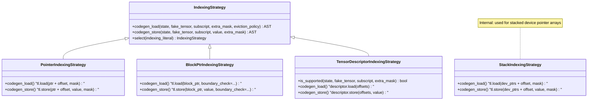
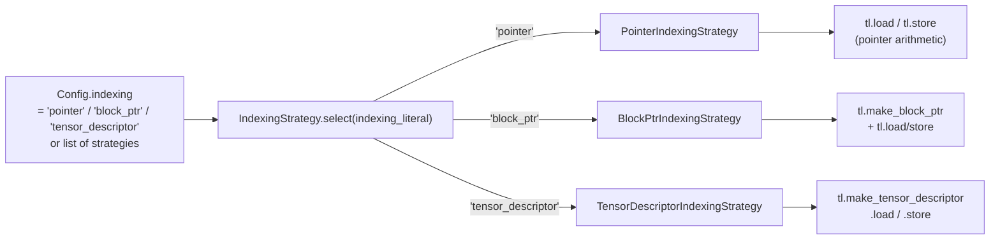
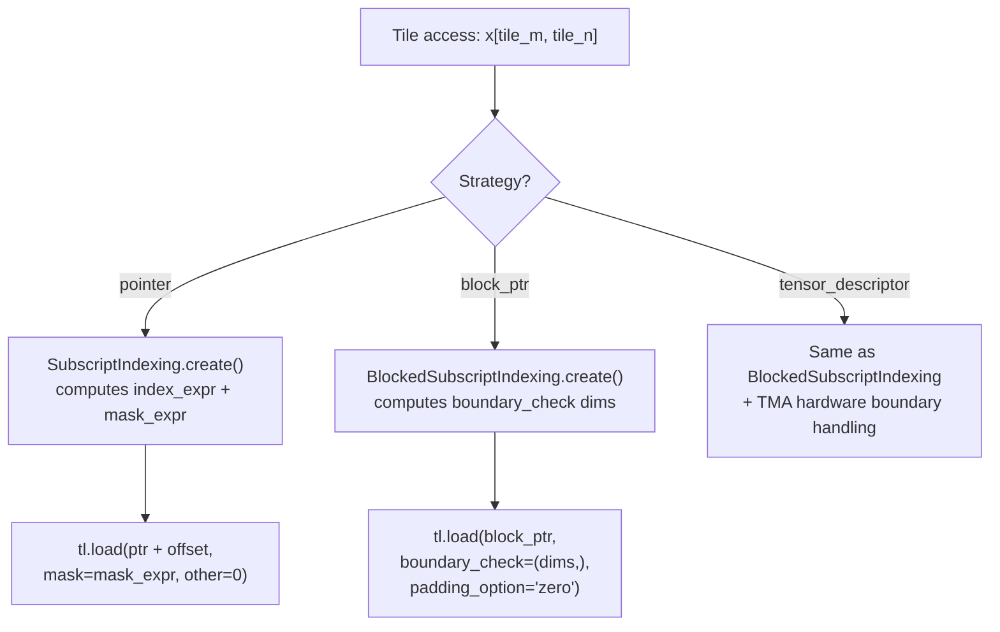
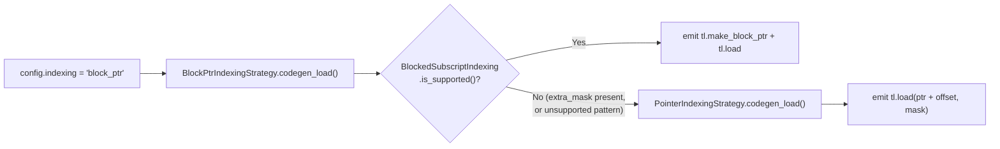

<!-- source: DeepWiki mcp.deepwiki.com · repo pytorch/helion · page 3.2 Tensor Indexing Patterns · fetched 2026-10-21 -->

# Tensor Indexing Patterns

<details>
<summary>Relevant source files</summary>

The following files were used as context for generating this wiki page:

- [README.md](README.md)
- [docs/api/config.md](docs/api/config.md)
- [docs/index.md](docs/index.md)
- [docs/installation.md](docs/installation.md)
- [docs/tileir_backend.md](docs/tileir_backend.md)
- [examples/segment_reduction.py](examples/segment_reduction.py)
- [helion/_compiler/indexing_strategy.py](helion/_compiler/indexing_strategy.py)
- [helion/language/tile_ops.py](helion/language/tile_ops.py)
- [helion/language/tile_proxy.py](helion/language/tile_proxy.py)
- [test/test_indexing.py](test/test_indexing.py)

</details>


This page explains how Helion accesses memory in GPU kernels: the three available indexing strategies, when each applies, how the `indexing` configuration parameter selects among them, and how out-of-bounds masking is handled automatically. This covers the user-facing behavior for kernel authors.

For the compiler-level code generation details of each strategy, see [Indexing Strategies (5.5)](#5.5). For the broader `Config` parameter reference including `indexing`, see [Configuration System (4.1)](#4.1).

---

## Overview

Helion compiles tensor reads (`x[tile_m, tile_k]`) and writes (`out[tile_m, tile_n] = acc`) to Triton memory operations. There are three distinct strategies for how those Triton memory operations are structured. The choice affects generated code performance and hardware compatibility.

| Strategy | Config Value | Triton Primitives Used | Backend Support |
|---|---|---|---|
| Pointer | `"pointer"` | `tl.load(ptr + offset, mask)` / `tl.store(...)` | All backends |
| Block pointer | `"block_ptr"` | `tl.make_block_ptr` + `tl.load(..., boundary_check=...)` | Triton (not TileIR) |
| Tensor descriptor | `"tensor_descriptor"` | `tl.make_tensor_descriptor` + `.load()` / `.store()` | Hopper+ GPU, Triton 3.5+ |

The default when `indexing` is omitted from the config is `"pointer"` for all operations.

Sources: [helion/_compiler/indexing_strategy.py:108-140](), [README.md:261-269]()

---

## Strategy Class Hierarchy

**Strategy classes and their Triton output:**



Sources: [helion/_compiler/indexing_strategy.py:108-143](), [helion/_compiler/indexing_strategy.py:273-328](), [helion/_compiler/indexing_strategy.py:328-491](), [helion/_compiler/indexing_strategy.py:491-643]()

---

## Selecting an Indexing Strategy

The `indexing` field of `helion.Config` controls which strategy is used. `IndexingStrategy.select()` maps string literals to strategy objects at compile time.

**Config value → strategy selection → codegen:**



Sources: [helion/_compiler/indexing_strategy.py:130-140]()

### Single vs. Per-Operation Strategy

`indexing` can be specified as a single string (applies uniformly to all loads and stores) or as a list where each entry corresponds to one load or store operation in execution order.

```
# Single strategy — all loads and stores use block_ptr
indexing = "block_ptr"

# Per-operation — 2 loads use pointer, 1 store uses block_ptr
indexing = ["pointer", "pointer", "block_ptr"]
```

The list ordering is: all loads first (in execution order), then all stores. An empty list or an omitted `indexing` field defaults to `"pointer"` for all operations.

Sources: [README.md:261-269](), [docs/api/config.md:110-143]()

---

## The Three Strategies in Detail

### Pointer Indexing (`"pointer"`)

`PointerIndexingStrategy` computes a flat scalar or tensor offset from the subscript indices and generates a `tl.load` or `tl.store` call with an explicit mask argument.

- Always applicable. No hardware or shape restrictions.
- For multidimensional tensors, the offset is the dot product of indices with strides.
- Masking is handled via an explicit boolean tensor passed as the `mask=` argument to `tl.load`/`tl.store`.
- When a tensor dimension has size 1 and the tile covers multiple elements, a `tl.broadcast_to()` call is emitted automatically.

This strategy uses the `SubscriptIndexing` helper (a `NamedTuple` carrying `index_expr`, `mask_expr`, and `broadcast_dims`) to produce the offset and mask AST nodes.

Sources: [helion/_compiler/indexing_strategy.py:143-270](), [helion/_compiler/indexing_strategy.py:646-659]()

### Block Pointer Indexing (`"block_ptr"`)

`BlockPtrIndexingStrategy` uses Triton's `tl.make_block_ptr` API, which represents a tile as a structured block pointer with shape, strides, and offsets. The hardware or Triton runtime handles boundary checking through a `boundary_check=` tuple of dimension indices.

**Applicability check:** `BlockedSubscriptIndexing.is_supported()` determines whether block_ptr can be used. If not supported (e.g., when an `extra_mask` is present, or the subscript has unsupported index patterns), the strategy falls back transparently to `PointerIndexingStrategy`.

- Not supported on the TileIR backend (Blackwell GPU path).
- Does not support an `extra_mask` argument.

Sources: [helion/_compiler/indexing_strategy.py:273-325]()

### Tensor Descriptor Indexing (`"tensor_descriptor"`)

`TensorDescriptorIndexingStrategy` uses Tensor Memory Accelerators (TMA) through `tl.make_tensor_descriptor` (or `tl._experimental_make_tensor_descriptor` on older Triton). TMA moves data as 16-byte-aligned chunks and is significantly faster for compliant access patterns on Hopper+ hardware.

**Applicability is checked by `TensorDescriptorIndexingStrategy.is_supported()`:**

| Requirement | Detail |
|---|---|
| ndim | Must be between 2 and 5 |
| Stride-1 dimension | Exactly one dimension must have stride == 1 |
| Other strides | Must be 16-byte aligned (`stride * element_size % 16 == 0`) |
| Block size per dimension | Must give at least 16 bytes (`block_size * element_size >= 16`) |
| Slice steps | Slices with non-unit step are not supported |
| Extra mask | Not supported |

When any requirement is not met, it falls back to `PointerIndexingStrategy` automatically. The strategy also handles non-contiguous memory layouts via a permutation applied to the tensor descriptor and inverted on the load result.

**Hardware requirement:** Hopper GPU (SM90+) or newer. Requires Triton 3.5+.

Sources: [helion/_compiler/indexing_strategy.py:328-488]()

---

## Automatic Masking

Helion applies masking automatically for the last tile in a dimension when `tensor_size % block_size != 0`. This means kernel authors rarely write explicit bounds checks.

**How masking works per strategy:**



- **Pointer:** `SubscriptIndexing.mask_expr` is `None` (a `ast.Constant(None)`) when the tile is provably in-bounds. Otherwise it emits a boolean tensor. `has_mask()` returns `True` only when a mask is needed.
- **Block pointer:** `boundary_check` is a tuple of dimension indices where masking is required. `padding_option='zero'` fills out-of-bounds loads with zeros.
- **Tensor descriptor:** TMA hardware handles boundary checking natively.

### Extra Mask

`hl.load` and `hl.store` both accept an `extra_mask` keyword argument for caller-supplied boolean conditions applied on top of the automatic boundary mask. This is only supported by the pointer strategy; passing `extra_mask` to block_ptr or tensor_descriptor operations forces fallback to pointer indexing.

Example from the test suite (masked store, pointer strategy):

[test/test_indexing.py:245-262]()

Sources: [helion/_compiler/indexing_strategy.py:646-660](), [helion/_compiler/indexing_strategy.py:147-181](), [helion/_compiler/indexing_strategy.py:276-301]()

---

## Strategy Fallback Behavior

Both `BlockPtrIndexingStrategy` and `TensorDescriptorIndexingStrategy` check applicability before emitting code. If a given load or store cannot use the requested strategy, they delegate to `PointerIndexingStrategy` transparently.



The same fallback applies for `"tensor_descriptor"`: if `TensorDescriptorIndexingStrategy.is_supported()` returns `False`, the call delegates to `PointerIndexingStrategy`.

This means a single `indexing` value in the config does not guarantee every load/store uses that exact Triton API. It is the preferred strategy, applied where supported.

Sources: [helion/_compiler/indexing_strategy.py:284-291](), [helion/_compiler/indexing_strategy.py:436-439](), [helion/_compiler/indexing_strategy.py:462-467]()

---

## Hardware and Backend Constraints

| Strategy | CUDA (Volta–Ada) | CUDA Hopper (SM90+) | TileIR (Blackwell SM100+) | ROCm |
|---|---|---|---|---|
| `"pointer"` | ✅ | ✅ | ✅ | ✅ |
| `"block_ptr"` | ✅ | ✅ | ❌ | ✅ |
| `"tensor_descriptor"` | ❌ | ✅ | ✅ | ❌ |

When using the TileIR backend (`ENABLE_TILE=1` on Blackwell hardware), `"block_ptr"` is excluded from the autotuner's search space automatically. The `"tensor_descriptor"` path on TileIR uses a different underlying API.

Sources: [docs/tileir_backend.md:62-76](), [docs/tileir_backend.md:157-169]()

---

## Index Dtype and Large Tensors

Pointer offsets are computed using `index_dtype`, which defaults to `torch.int32`. For tensors with more than `2^31` total elements, `torch.int32` overflows. Helion detects this at compile time and raises `InputTensorNumelExceedsIndexType` if the index type is too narrow.

Setting `index_dtype=torch.int64` in `helion.kernel(...)` forces 64-bit indexing, generating `tl.program_id(0).to(tl.int64)` and 64-bit pointer arithmetic throughout. When `index_dtype=None` (the default), Helion automatically upgrades to `int64` for large tensors.

Sources: [test/test_indexing.py:459-564](), [test/test_indexing.py:590-622]()

---

## StackIndexingStrategy

`StackIndexingStrategy` is an internal strategy (not user-selectable via `config.indexing`) used when a load or store targets a stack of device pointers sharing the same index pattern. It broadcasts the computed offset across the stacked pointer dimension and emits a vectorized `tl.load` or `tl.store`. This is used by certain internal kernel patterns and is not directly exposed to kernel authors.

Sources: [helion/_compiler/indexing_strategy.py:491-643]()

---

## Related Pages

- [Tiling and Iteration (3.1)](#3.1) — how `hl.tile` produces the subscript indices consumed by indexing strategies
- [Memory Operations (3.3)](#3.3) — `hl.load`, `hl.store`, and the `extra_mask` / `eviction_policy` parameters
- [Configuration System (4.1)](#4.1) — full reference for the `indexing` config field and how `ConfigSpec` validates it
- [Indexing Strategies (5.5)](#5.5) — compiler-level code generation for each strategy class

---

