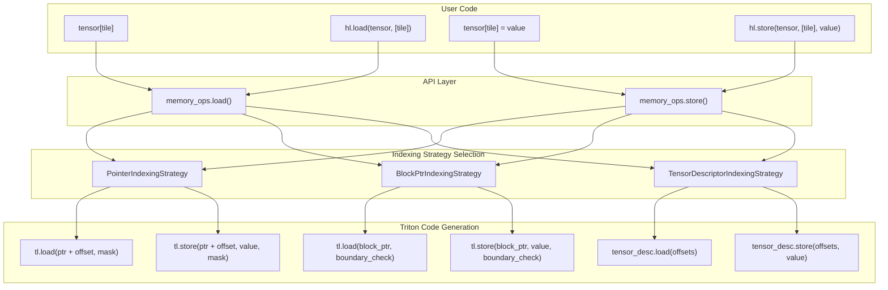
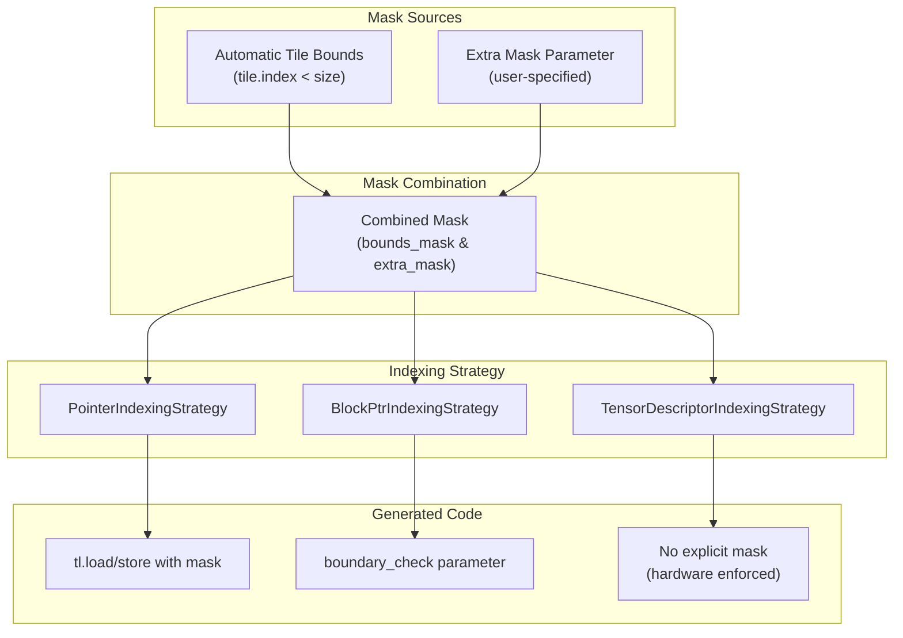
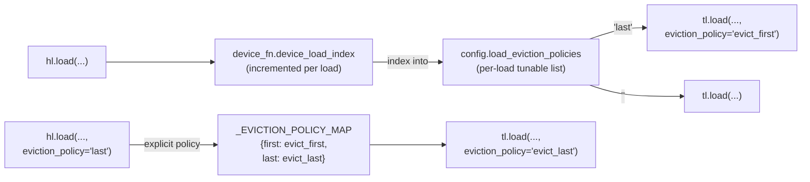
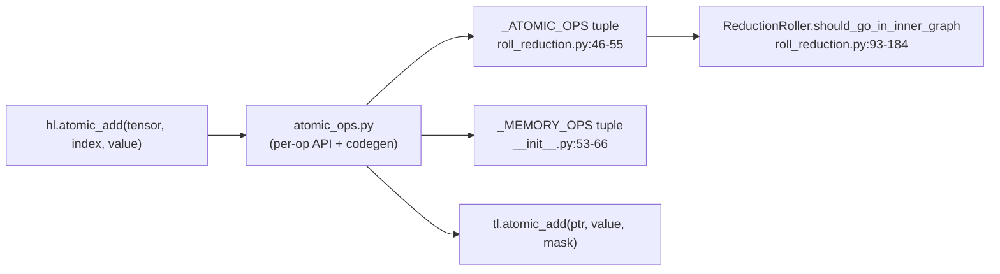

<!-- source: DeepWiki mcp.deepwiki.com · repo pytorch/helion · page 3.3 Memory Operations · fetched 2026-10-21 -->

# Memory Operations

<details>
<summary>Relevant source files</summary>

The following files were used as context for generating this wiki page:

- [helion/_compiler/device_ir.py](helion/_compiler/device_ir.py)
- [helion/_compiler/roll_reduction.py](helion/_compiler/roll_reduction.py)
- [helion/language/__init__.py](helion/language/__init__.py)
- [helion/language/_tracing_ops.py](helion/language/_tracing_ops.py)
- [helion/language/memory_ops.py](helion/language/memory_ops.py)
- [helion/language/random_ops.py](helion/language/random_ops.py)
- [test/test_eviction_policy.py](test/test_eviction_policy.py)
- [test/test_random.py](test/test_random.py)

</details>


This page describes memory operations in Helion kernels: loading from and storing to tensors. Memory operations are the primary way to transfer data between GPU memory and compute operations within a kernel.

For information about tensor indexing patterns and subscripting, see [Tensor Indexing Patterns](#3.2). For implementation details of different indexing strategies, see [Indexing Strategies](#5.5).

## Overview

Helion provides two ways to perform memory operations:

1. **Implicit operations**: Using standard Python subscript notation (`tensor[tile]`)
2. **Explicit operations**: Using `hl.load()` and `hl.store()` functions

Both approaches compile to the same underlying Triton memory operations, but explicit operations provide additional control over masking and cache behavior.

**Memory Operations Flow**



Sources: [helion/language/memory_ops.py:1-611](), [helion/_compiler/indexing_strategy.py:107-402]()

## Implicit Memory Operations

The most common way to load and store data is using standard Python subscript notation:

```python
@helion.kernel
def add_kernel(x: torch.Tensor, y: torch.Tensor) -> torch.Tensor:
    out = torch.empty_like(x)
    for tile in hl.tile(x.size(0)):
        # Implicit load from x[tile] and y[tile]
        # Implicit store to out[tile]
        out[tile] = x[tile] + y[tile]
    return out
```

When you write `x[tile]`, Helion automatically:
- Generates appropriate index expressions based on tile dimensions
- Applies masking to handle boundary conditions (e.g., when tile size doesn't evenly divide tensor size)
- Selects an indexing strategy based on the kernel configuration (pointer, block_ptr, or tensor_descriptor)

Sources: [helion/language/memory_ops.py:29-51]()

## Explicit Memory Operations

### hl.load()

The `hl.load()` function provides explicit control over loading data from tensors:

```python
def load(
    tensor: torch.Tensor | StackTensor,
    index: list[object],
    extra_mask: torch.Tensor | None = None,
    eviction_policy: str | None = None,
) -> torch.Tensor
```

**Parameters:**
- `tensor`: The tensor or stack tensor to load from
- `index`: List of indices (can include tiles, integers, or tensors)
- `extra_mask`: Optional boolean mask to apply beyond automatic tile bounds masking
- `eviction_policy`: Optional cache eviction policy hint (see [Eviction Policies](#eviction-policies))

**Example with extra masking:**

```python
@helion.kernel
def masked_load(x: torch.Tensor) -> torch.Tensor:
    out = torch.zeros_like(x)
    for tile in hl.tile(out.size(0)):
        # Only load elements where index is even
        out[tile] = hl.load(x, [tile], extra_mask=(tile.index % 2) == 0)
    return out
```

Sources: [helion/language/memory_ops.py:434-457](), [test/test_indexing.py:326-343]()

### hl.store()

The `hl.store()` function provides explicit control over storing data to tensors:

```python
def store(
    tensor: torch.Tensor | StackTensor,
    index: list[object],
    value: torch.Tensor | torch.SymInt | float,
    extra_mask: torch.Tensor | None = None,
) -> None
```

**Parameters:**
- `tensor`: The tensor or stack tensor to store to
- `index`: List of indices (can include tiles, integers, or tensors)
- `value`: The value to store
- `extra_mask`: Optional boolean mask to apply beyond automatic tile bounds masking

**Example with extra masking:**

```python
@helion.kernel
def masked_store(x: torch.Tensor) -> torch.Tensor:
    out = torch.zeros_like(x)
    for tile in hl.tile(out.size(0)):
        # Only store elements where index is even
        hl.store(out, [tile], x[tile], extra_mask=(tile.index % 2) == 0)
    return out
```

Sources: [helion/language/memory_ops.py:29-51](), [test/test_indexing.py:233-250]()

## Masking

Helion applies two types of masking to memory operations to ensure safe and correct behavior:

**Masking System Architecture**



Sources: [helion/_compiler/indexing_strategy.py:143-402](), [helion/language/memory_ops.py:91-118]()

### Automatic Tile Bounds Masking

Helion automatically masks memory operations to prevent out-of-bounds accesses when tile sizes don't evenly divide tensor dimensions:

```python
@helion.kernel
def example(x: torch.Tensor) -> torch.Tensor:
    out = torch.empty_like(x)
    for tile in hl.tile(x.size(0)):  # x.size(0) = 100, block_size = 32
        # Automatically masked: last tile (indices 96-127) only accesses 96-99
        out[tile] = x[tile] * 2
    return out
```

The generated code includes a mask like `indices < 100` to prevent accessing indices 100-127 in the last tile.

Sources: [helion/_compiler/indexing_strategy.py:154-187](), [test/test_indexing.expected:14-30]()

### Extra Masking

The `extra_mask` parameter allows you to specify additional conditions beyond tile bounds:

```python
@helion.kernel
def conditional_operation(x: torch.Tensor) -> torch.Tensor:
    out = torch.zeros_like(x)
    for tile in hl.tile(x.size(0)):
        # Combine automatic bounds masking with custom condition
        mask_2d = (tile.index % 2) == 0
        hl.store(out, [tile], x[tile], extra_mask=mask_2d)
    return out
```

The final mask is the logical AND of automatic bounds masking and the extra mask.

Sources: [helion/language/memory_ops.py:35-49](), [test/test_indexing.py:252-324]()

## Eviction Policies

The `eviction_policy` parameter on `hl.load()` controls how the GPU cache handles loaded data. Eviction policies are a Triton-only feature; they are ignored on Pallas/CuTe backends.

**Supported Eviction Policies:**

| Short Name | Full Triton Name | Description |
|------------|------------------|-------------|
| `"first"` | `"evict_first"` | Evict data from cache as soon as possible (minimal caching) |
| `"last"` | `"evict_last"` | Keep data in cache as long as possible (maximal caching) |
| `""` / `None` | (none) | Use default cache behavior |

The mapping from short names to full Triton names is defined in `_EVICTION_POLICY_MAP` in `memory_ops.py`.

**Eviction Policy Resolution**



Sources: [helion/language/memory_ops.py:22-26](), [helion/language/memory_ops.py:497-558]()

**Example:**

```python
@helion.kernel
def example_with_eviction(x: torch.Tensor) -> torch.Tensor:
    out = torch.empty_like(x)
    for tile in hl.tile(x.size(0)):
        # Hint that this data won't be reused - evict from cache quickly
        value = hl.load(x, [tile], eviction_policy="first")
        out[tile] = value * 2
    return out
```

When `eviction_policy` is not specified on a call to `hl.load()`, Helion checks `config.load_eviction_policies` — a per-kernel, per-load-op list that is exposed to the autotuner. Each load in the kernel is assigned an index (`device_load_index`) which is used to look up that load's policy in the list. This allows the autotuner to independently explore cache policies for each load.

Sources: [helion/language/memory_ops.py:509-517](), [test/test_eviction_policy.py:76-105]()

## Stack Tensors

Helion supports loading from and storing to multiple tensors with shared indexing through `StackTensor` objects. A `StackTensor` holds a list of tensors that all share the same shape and dtype, plus a device-side pointer array (`dev_ptrs`). This is useful for operations like grouped matrix multiplications.

When `hl.load()` or `hl.store()` receives a `StackTensor`, the `prepare_args` decorator converts it to a `tuple` of `(tensor_like, dev_ptrs)`. Code generation then dispatches to `StackIndexingStrategy.codegen_load` / `codegen_store`.

The resulting output has the stack dimensions prepended to the tile shape: for a stack of `N` tensors loading a `[block_size]` tile, the result has shape `[N, block_size]`.

Sources: [helion/language/memory_ops.py:460-473](), [helion/language/memory_ops.py:559-568](), [helion/_compiler/indexing_strategy.py:404-461](), [helion/language/stack_tensor.py]()

## Atomic Operations

For concurrent writes to the same memory location, Helion provides atomic operations. All atomic ops are registered in `_MEMORY_OPS` in `helion/language/__init__.py` and in `_ATOMIC_OPS` in `roll_reduction.py`, which is used to classify them correctly during reduction rolling.

| Function | Operation |
|----------|-----------|
| `hl.atomic_add()` | Atomic addition |
| `hl.atomic_and()` | Atomic bitwise AND |
| `hl.atomic_or()` | Atomic bitwise OR |
| `hl.atomic_xor()` | Atomic bitwise XOR |
| `hl.atomic_xchg()` | Atomic exchange |
| `hl.atomic_max()` | Atomic maximum |
| `hl.atomic_min()` | Atomic minimum |
| `hl.atomic_cas()` | Atomic compare-and-swap |

These operations ensure thread-safe updates when multiple program instances write to overlapping memory regions. They compile to the corresponding `tl.atomic_*` Triton intrinsics.

**Atomic Ops in the Compilation Pipeline**



The `_ATOMIC_OPS` tuple is specifically checked during reduction rolling so that atomic writes to non-reduction dimensions are correctly kept in the outer (non-rolled) graph even when their value argument depends on a reduction dimension.

See page 3.5 for the full API reference for each atomic operation.

Sources: [helion/language/__init__.py:3-10](), [helion/language/__init__.py:53-66](), [helion/_compiler/roll_reduction.py:46-55](), [helion/_compiler/roll_reduction.py:150-153](), [helion/language/atomic_ops.py]()

## Indexing Strategy Selection

Memory operations compile to different Triton patterns depending on the `indexing` configuration parameter:

| Strategy | Generated Code | Requirements |
|----------|----------------|--------------|
| `"pointer"` | `tl.load(ptr + offset, mask)` | Always available (fallback) |
| `"block_ptr"` | `tl.load(block_ptr, boundary_check)` | Block-aligned, contiguous access patterns |
| `"tensor_descriptor"` | `tensor_desc.load(offsets)` | Hardware tensor descriptor support, stride alignment, 2-5D tensors |

The strategy is selected during kernel compilation based on configuration and tensor properties. Each strategy has different performance characteristics:

- **Pointer**: Most flexible, works for any access pattern
- **Block Ptr**: Optimized for blocked memory access, reduces address computation
- **Tensor Descriptor**: Hardware-accelerated on supported GPUs (e.g., H100 with TMA), requires strict alignment

**Example generated code comparison:**

```python
# Pointer indexing
load = tl.load(x + (indices_0[:, None] * 512 + indices_1[None, :] * 1), None)

# Block pointer indexing
load = tl.load(
    tl.make_block_ptr(x, [128, 512], [512, 1], [offset_0, offset_1], 
                      [BLOCK_SIZE_0, BLOCK_SIZE_1], [0, 1]),
    boundary_check=[0, 1],
    padding_option='zero'
)

# Tensor descriptor indexing
x_desc = tl.make_tensor_descriptor(x, [128, 512], [512, 1], [BLOCK_SIZE_0, BLOCK_SIZE_1])
load = x_desc.load([offset_0, offset_1])
```

Sources: [helion/_compiler/indexing_strategy.py:107-141](), [test/test_indexing.expected:102-273]()

## Implementation Details

Memory operations flow through several compilation stages:

1. **API Layer** (`memory_ops.py`): Defines the user-facing `load()` and `store()` functions with decorators for type propagation, codegen, and fake implementations.

2. **Argument Preparation** (`_prepare_args` decorator): Converts tiles to sizes and normalizes arguments before tracing.

3. **FX Tracing**: Operations are captured in the FX graph with metadata about tensor shapes and types.

4. **Indexing Strategy Selection** (`indexing_strategy.py`): Based on kernel configuration and tensor properties, selects pointer, block_ptr, or tensor_descriptor strategy.

5. **Code Generation**: Each strategy's `codegen_load()` and `codegen_store()` methods generate appropriate Triton AST nodes.

6. **Masking Application**: Automatic and extra masks are combined and applied according to the indexing strategy.

**Key Implementation Classes:**

- `PointerIndexingStrategy` - [helion/_compiler/indexing_strategy.py:143-188]()
- `BlockPtrIndexingStrategy` - [helion/_compiler/indexing_strategy.py:190-240]()
- `TensorDescriptorIndexingStrategy` - [helion/_compiler/indexing_strategy.py:242-402]()
- `StackIndexingStrategy` - [helion/_compiler/indexing_strategy.py:404-571]()

Sources: [helion/language/memory_ops.py:1-365](), [helion/_compiler/indexing_strategy.py:1-571]()

---

