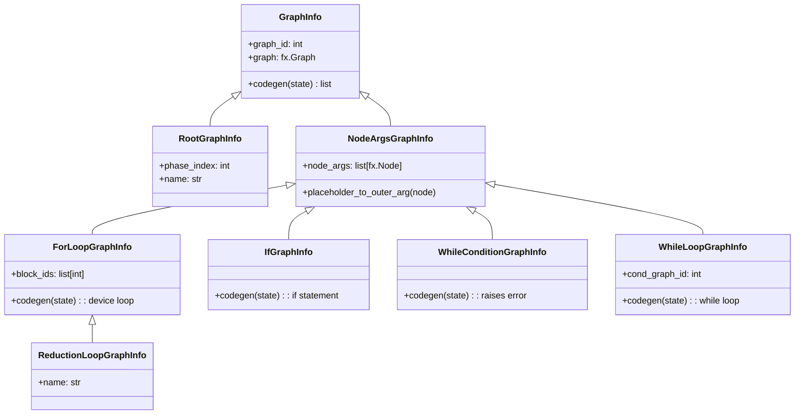
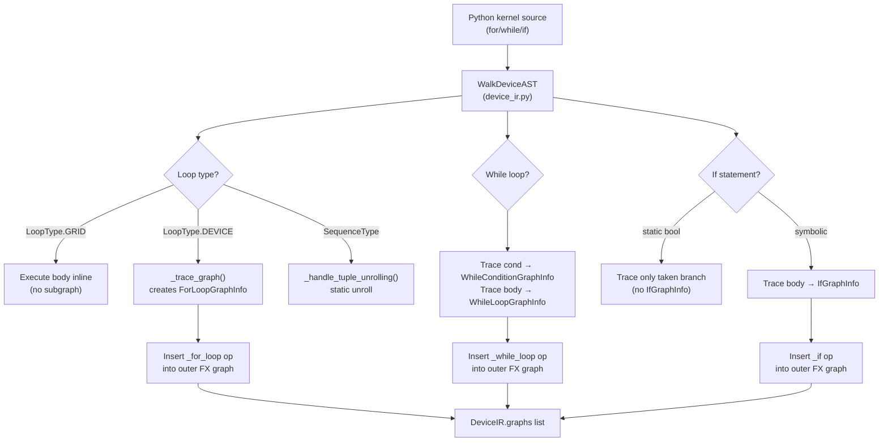

<!-- source: DeepWiki mcp.deepwiki.com · repo pytorch/helion · page 3.4 Control Flow · fetched 2026-10-21 -->

# Control Flow

<details>
<summary>Relevant source files</summary>

The following files were used as context for generating this wiki page:

- [helion/_compiler/device_ir.py](helion/_compiler/device_ir.py)
- [helion/language/_tracing_ops.py](helion/language/_tracing_ops.py)
- [helion/language/memory_ops.py](helion/language/memory_ops.py)
- [test/test_control_flow.py](test/test_control_flow.py)
- [test/test_grid.py](test/test_grid.py)
- [test/test_loops.py](test/test_loops.py)
- [test/test_masking.py](test/test_masking.py)
- [test/test_reductions.expected](test/test_reductions.expected)
- [test/test_register_tunable.py](test/test_register_tunable.py)

</details>


This page covers how `for` loops, `while` loops, and `if` statements are written and compiled in Helion kernels. It explains the tracing mechanism that converts Python control flow into device IR, and how each construct is lowered to backend code.

For information on `hl.tile`, `hl.grid`, and `hl.static_range` as iteration constructs (loop ordering, block sizes, and grid parallelism), see [Tiling and Iteration](#3.1). For the Device IR and FX graph system that stores the output of this tracing, see [Device IR Generation](#5.2).

---

## For Loops

Helion supports three categories of `for` loop inside a kernel, distinguished at compile time by a loop type annotation attached during type propagation.

| Loop Category | Iterates Over | Tracing Behavior | Generated Code |
|---|---|---|---|
| **Grid loop** | `hl.grid(...)`, `range(...)` | Body executed inline; no subgraph | GPU program ID dimension |
| **Device loop** | `hl.tile(...)` (nested) | Body captured as `ForLoopGraphInfo` + `_for_loop` op | `tl.range` / Pallas inner loop |
| **Sequence unrolling** | Python `list` or `tuple` | Body statically unrolled at compile time | Repeated statements (no loop) |

### Grid Loops

`hl.grid(...)` and Python's built-in `range(...)` both produce grid-type loops. During tracing, `WalkDeviceAST.visit_For` detects `LoopType.GRID` and executes the loop body inline—no FX subgraph is created. The loop variable becomes a scalar program ID index.

```python
for i in hl.grid(b):        # grid dimension: one thread block per i
    for j in hl.grid(bj):   # another grid dimension
        ...
```

`range()` used inside a kernel body is treated identically to `hl.grid()`. This lets standard Python range syntax work within a kernel, as shown in tests such as `test_range_as_grid_basic` in [test/test_grid.py:280-298]().

### Device Loops

`hl.tile(...)` used inside another tile produces a `LoopType.DEVICE` loop. The compiler:

1. Analyzes read/write variable usage with `ReadWrites.from_ast` ([helion/_compiler/device_ir.py:849]()).
2. Identifies which tensors from the outer scope need to be passed in (`_lift_inputs`).
3. Traces the loop body into a new FX graph via `_trace_graph`, producing a `ForLoopGraphInfo`.
4. Inserts a `_for_loop` op into the outer FX graph referencing the subgraph by integer ID.
5. Merges any variables written inside the loop back to the outer scope via `_phi`.

The `_for_loop` op signature is defined in [helion/language/_tracing_ops.py:131-135]():

```
_for_loop(graph_id: int, begin: list[int], end: list[int], args: list[object]) -> list[object]
```

At code generation time, `ForLoopGraphInfo.codegen` emits the appropriate device loop via `TileStrategy.codegen_device_loop` ([helion/_compiler/device_ir.py:270-283]()).

**Reduction device loops** use the subclass `ReductionLoopGraphInfo`, which is structurally identical but named differently for reduction-specific handling.

### Sequence Unrolling

When a loop iterates over a Python `list` or `tuple` (detected as `SequenceType` by type propagation), the compiler calls `_handle_tuple_unrolling`, which unrolls the body once per element at compile time:

```python
for i in [1, 2, 3]:          # statically unrolled — no loop generated
    out[tile] += i
```

This also applies to tuples stored in kernel-scope variables. See `_handle_sequence_unrolling` in [helion/_compiler/device_ir.py:773-806]().

---

## While Loops

While loops are supported inside device loop bodies. The syntax `while ... else ...` is not supported and raises `StatementNotSupported`.

During tracing, `WalkDeviceAST.visit_While` ([helion/_compiler/device_ir.py:917-988]()) performs the following steps:

1. Collects variable read/write names from both the condition and body.
2. Traces the condition into a separate `WhileConditionGraphInfo` subgraph.
3. Traces the body into a `WhileLoopGraphInfo` subgraph (which holds a reference to the condition graph's ID via `cond_graph_id`).
4. Inserts a `_while_loop` op into the outer FX graph.
5. Merges written variables via `_phi`.

**Code generation** for while loops is handled by `WhileLoopGraphInfo.codegen` ([helion/_compiler/device_ir.py:334-403]()), which:

- Evaluates the condition, storing the result in a `while_cond` variable.
- Generates a `while while_cond:` block.
- At the end of each iteration, re-evaluates the condition and updates `while_cond`.

```python
while hl.atomic_cas(lock, [idx], 0, 1) == 1:
    pass   # spin-wait — generates a proper while loop in Triton/CuTe
```

See `test_while_atomic_cas_pass` and `test_while_accumulates_tensor` in [test/test_loops.py:77-114]() for concrete examples.

---

## If Statements

`if` statements inside kernel bodies are handled by `WalkDeviceAST.visit_If` in [helion/_compiler/device_ir.py:990]().

The behavior depends on whether the condition is statically known or dynamic:

### Static Conditions

If the condition evaluates to a Python `bool` at trace time (not a `torch.Tensor`, `torch.SymInt`, etc.), only the taken branch is traced. The other branch is completely eliminated from the IR. This is the common case for kernel arguments passed as Python scalars and for constant expressions:

```python
v = 4
if 3 < v < 7:           # condition is True at compile time
    out[tile] = torch.sigmoid(x[tile])   # only this branch exists in IR
else:
    out[tile] = torch.sin(x[tile])       # eliminated
```

See `test_constant_true` and `test_constant_false` in [test/test_control_flow.py:103-151]().

### Dynamic Conditions

If the condition is a symbolic value (a `torch.Tensor`, `torch.SymInt`, `torch.SymFloat`, or `torch.SymBool`), the compiler:

1. Traces the taken branch body into a new FX graph via `_trace_graph`, producing an `IfGraphInfo`.
2. Inserts an `_if` op into the outer FX graph referencing the subgraph by ID.

`IfGraphInfo.codegen` ([helion/_compiler/device_ir.py:297-305]()) emits an `if` statement in the generated device code. Only the `if` branch is captured; Helion does not currently generate an `else` subgraph.

The `_if` op is defined in [helion/language/_tracing_ops.py:484-492]():

```
_if(test: object, graph_id: int, args: list[object]) -> list[object]
```

On the Pallas backend, dynamic `if` with a scalar predicate is lowered to `lax.cond`. Tensor-derived predicates (from block-shaped loads) are unsupported on Pallas because `lax.cond` requires a scalar.

```python
if v > 0:               # v is a kernel argument — dynamic, scalar predicate
    out_a[tile] = x[tile] + 1.0
else:
    out_b[tile] = x[tile] + 2.0
```

See `test_if_arg` and `test_if_arg_side_effect` in [test/test_control_flow.py:24-213]().

---

## Tracing and IR Representation

Since PyTorch FX graphs are flat (no native control flow), all Helion control flow constructs are reified as function calls to special "tracing ops" in `_tracing_ops.py`. These ops are inserted into the outer FX graph during `WalkDeviceAST` traversal.

**Control flow tracing ops** (all declared with `@has_side_effect` so they are not dead-code eliminated):

| Op | Purpose |
|---|---|
| `_for_loop` | Represents a device `for` loop |
| `_while_loop` | Represents a `while` loop |
| `_if` | Represents an `if` statement |
| `_phi` | Merges variables modified inside control flow |

Each op carries an integer `graph_id` that indexes into `DeviceIR.graphs` — a flat list of `GraphInfo` objects.

### GraphInfo Class Hierarchy

**GraphInfo class hierarchy and relationships:**



Sources: [helion/_compiler/device_ir.py:194-403]()

### Control Flow Tracing Pipeline

**From Python source to device IR:**



Sources: [helion/_compiler/device_ir.py:822-915](), [helion/_compiler/device_ir.py:917-988](), [helion/_compiler/device_ir.py:990](), [helion/language/_tracing_ops.py:129-492]()

---

## Variable Merging: Phi Nodes

When a variable is written inside a control flow construct and read afterward, Helion inserts a `_phi` op to merge the pre-loop and post-loop values. This is modeled after SSA phi nodes.

```python
# In device_ir.py visit_For / visit_While:
self.scope[name] = _tracing_ops._phi(self.scope[name], value)
```

At code generation time, `_phi`'s codegen ([helion/language/_tracing_ops.py:572-579]()) does not emit any output statement. Instead, it calls `merge_variable_names` on the device function, which ensures that the pre-loop and post-loop variables are unified into the same name in generated code.

If the types cannot be merged (mismatched dtype, shape, or device), a `CantCombineTypesInControlFlow` error is raised.

---

## Boolean Operations in Device Code

Boolean expressions in conditions (`and`, `or`, `not`, comparisons) are handled by `WalkDeviceAST.visit_BoolOp`, `visit_Compare`, and `visit_UnaryOp` in [helion/_compiler/device_ir.py:706-732]().

When operands are symbolic (tensors or SymInts), the compiler traces through `_and`, `_or`, `_not` tracing ops defined in [helion/language/_tracing_ops.py:608-700](). These generate `and`/`or`/`not` expressions in Triton and `&`/`|` in Pallas (which uses JAX semantics).

Short-circuit evaluation is preserved for statically-known values (early exit when the result is already determined without being a symbolic type).

---

## Limitations

| Construct | Status |
|---|---|
| `while ... else ...` | **Not supported** — raises `StatementNotSupported` |
| `for ... else ...` | **Not supported** |
| `if` with tensor-derived predicate on Pallas | **Not supported** — `lax.cond` requires scalar |
| Nested while loops with tensor accumulators on CuTe | **Not supported** (expected failure) |
| `break` / `continue` | **Not supported** |

Sources: [helion/_compiler/device_ir.py:917-919](), [helion/language/_tracing_ops.py:496-547](), [test/test_loops.py:98-133]()

---

