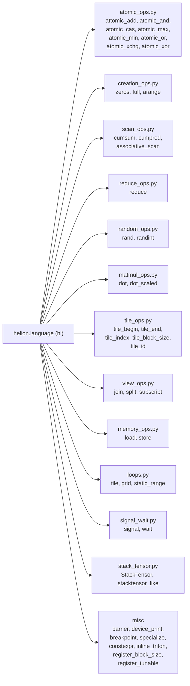
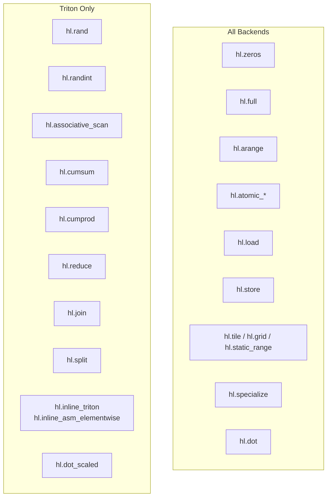
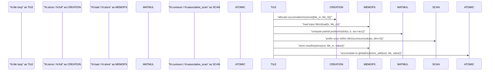

<!-- source: DeepWiki mcp.deepwiki.com · repo pytorch/helion · page 3.5 API Functions Reference · fetched 2026-10-21 -->

# API Functions Reference

<details>
<summary>Relevant source files</summary>

The following files were used as context for generating this wiki page:

- [helion/_compiler/helper_function.py](helion/_compiler/helper_function.py)
- [helion/_compiler/roll_reduction.py](helion/_compiler/roll_reduction.py)
- [helion/language/__init__.py](helion/language/__init__.py)
- [helion/language/creation_ops.py](helion/language/creation_ops.py)
- [helion/language/random_ops.py](helion/language/random_ops.py)
- [helion/language/reduce_ops.py](helion/language/reduce_ops.py)
- [helion/language/scan_ops.py](helion/language/scan_ops.py)
- [helion/language/view_ops.py](helion/language/view_ops.py)
- [test/test_dot.py](test/test_dot.py)
- [test/test_random.py](test/test_random.py)

</details>


This page is a complete reference for all public functions in the `helion.language` module (imported as `hl`). It covers function signatures, arguments, return types, and backend availability. For higher-level conceptual documentation on iteration constructs (`hl.tile`, `hl.grid`, `hl.static_range`), see page [3.1](). For memory operation details including masking and indexing strategies, see page [3.3](). For control flow constructs, see page [3.4]().

All functions documented here are re-exported from `helion/language/__init__.py` and are available as `hl.<function_name>` when importing `import helion.language as hl`.

---

## Module Structure

**Module-to-source-file mapping:**



Sources: [helion/language/__init__.py:1-66]()

---

**Functions grouped by internal classification:**

The `_MEMORY_OPS` tuple ([helion/language/__init__.py:53-66]()) determines which operations are treated as memory-writing ops for reduction rolling and scheduling:

| Group | Members |
|-------|---------|
| `_MEMORY_OPS` | `store`, `load`, `atomic_add`, `atomic_and`, `atomic_cas`, `atomic_max`, `atomic_min`, `atomic_or`, `atomic_xchg`, `atomic_xor`, `wait`, `signal` |

---

## Creation Operations

These functions create device-resident tensors inside a kernel tile loop. They must **not** be used for host-side output tensor allocation; use `torch.zeros` / `torch.empty` / `torch.full` for that.

Sources: [helion/language/creation_ops.py:1-261]()

### `hl.zeros`

```
hl.zeros(shape, dtype=torch.float32, device=None) -> torch.Tensor
```

Creates a device tensor filled with zeros. Delegates to `hl.full` with `value=0`.

| Argument | Type | Description |
|----------|------|-------------|
| `shape` | `list[int \| Tile]` | Sizes or tile indices; tiles are converted to their block size |
| `dtype` | `torch.dtype` | Element dtype (default: `torch.float32`) |
| `device` | `torch.device \| None` | Must match the current compile environment device |

**Lowered to:** `tl.zeros(shape, dtype)` (Triton) or equivalent backend call.

---

### `hl.full`

```
hl.full(shape, value, dtype=torch.float32, device=None) -> torch.Tensor
```

Creates a device tensor filled with a constant value.

| Argument | Type | Description |
|----------|------|-------------|
| `shape` | `list[int \| Tile]` | Sizes or tile indices |
| `value` | `float \| int \| bool` | Scalar fill value; supports `float('-inf')` |
| `dtype` | `torch.dtype` | Element dtype |
| `device` | `torch.device \| None` | Must match the kernel device |

Static values (literals) are preserved as literal expressions in generated code. Dynamic values (tensor elements) are emitted as variables. See [helion/language/creation_ops.py:130-149]() for the code generation logic.

---

### `hl.arange`

```
hl.arange(*args, dtype=None, device=None, **kwargs) -> torch.Tensor
```

Equivalent to `torch.arange`, but defaults to the current kernel device and index dtype. Passes `*args` and `**kwargs` directly to `torch.arange`.

| Argument | Type | Description |
|----------|------|-------------|
| `args` | `int` | `start`, `end`, `step` positional arguments for `torch.arange` |
| `dtype` | `torch.dtype \| None` | Defaults to `CompileEnvironment.index_dtype` |
| `device` | `torch.device \| None` | Defaults to current kernel device |

Sources: [helion/language/creation_ops.py:226-261]()

---

## Matrix Operations

Sources: [helion/language/matmul_ops.py](), [test/test_dot.py:33-70]()

### `hl.dot`

```
hl.dot(a, b, acc=None, out_dtype=None) -> torch.Tensor
```

Computes a matrix multiplication `a @ b`, optionally accumulating into `acc`.

| Argument | Type | Description |
|----------|------|-------------|
| `a` | `torch.Tensor` | Left operand; 2D or batched tile |
| `b` | `torch.Tensor` | Right operand |
| `acc` | `torch.Tensor \| None` | Accumulator tensor; if provided and compatible, fuses with `tl.dot(out_dtype=...)` |
| `out_dtype` | `torch.dtype \| None` | Output dtype hint passed to backend |

**Accumulator fusion rules:**
- If `acc` dtype matches the natural output dtype → fused via `tl.dot(..., out_dtype=acc_dtype)`
- If `acc` dtype differs (e.g., `float32` acc with `float16` inputs) → separate cast + addition emitted

**Lowered to:** `tl.dot` (Triton). When tile dimensions are smaller than the backend minimum (16 for most Triton targets), padding is applied automatically.

**Warning:** Using `+=` with `torch.mm`, `torch.matmul`, `torch.bmm`, `torch.baddbmm`, or `hl.dot` inside a `hl.tile` loop with a K-dimension emits a `TiledKMatmulAccumulationWarning` if accumulation is not handled through `acc=` parameter.

---

### `hl.dot_scaled`

```
hl.dot_scaled(a, a_scale, b, b_scale, out_dtype=None) -> torch.Tensor
```

Scaled matrix multiplication for FP8 and similar workflows. Applies element-wise scales `a_scale` and `b_scale` to the operands before multiplication.

| Argument | Type | Description |
|----------|------|-------------|
| `a` | `torch.Tensor` | Left operand |
| `a_scale` | `torch.Tensor \| float` | Scale for `a` |
| `b` | `torch.Tensor` | Right operand |
| `b_scale` | `torch.Tensor \| float` | Scale for `b` |
| `out_dtype` | `torch.dtype \| None` | Output dtype |

---

## Scan Operations

Sources: [helion/language/scan_ops.py:1-414]()

### `hl.cumsum`

```
hl.cumsum(input_tensor, dim, reverse=False) -> torch.Tensor
```

Cumulative sum along `dim`. Equivalent to `hl.associative_scan(torch.add, input_tensor, dim, reverse)`.

| Argument | Type | Description |
|----------|------|-------------|
| `input_tensor` | `torch.Tensor` | Input tile tensor |
| `dim` | `int` | Dimension to scan |
| `reverse` | `bool` | Scan from right-to-left if `True` |

**Returns:** Tensor with same shape as `input_tensor`.

**Lowered to:** `tl.associative_scan(input, dim, combine_fn)` where `combine_fn` is `torch.add`.

---

### `hl.cumprod`

```
hl.cumprod(input_tensor, dim, reverse=False) -> torch.Tensor
```

Cumulative product along `dim`. Equivalent to `hl.associative_scan(torch.mul, input_tensor, dim, reverse)`.

---

### `hl.associative_scan`

```
hl.associative_scan(combine_fn, input_tensor, dim, reverse=False)
    -> torch.Tensor | tuple[torch.Tensor, ...]
```

Prefix scan along `dim` using a user-supplied associative combine function.

| Argument | Type | Description |
|----------|------|-------------|
| `combine_fn` | `Callable[[T, T], T]` | Binary associative function. Accepts tensor→tensor or tuple→tuple signatures |
| `input_tensor` | `torch.Tensor \| tuple[torch.Tensor, ...]` | Input tensor or tuple of tensors |
| `dim` | `int` | Dimension to scan |
| `reverse` | `bool` | Scan direction |

**Returns:** Same shape as input; for tuple inputs, returns a tuple of tensors.

**Implementation:** During tracing, `combine_fn` is traced via `proxy_tensor.make_fx` into a `HelperFunctionGraphInfo` graph and registered as a `@triton.jit` helper function in generated code. The internal `_associative_scan` op (not public) is what appears in the device IR.

**Constraint:** `combine_fn` must be associative but does **not** need to be commutative.

Sources: [helion/language/scan_ops.py:26-207]()

---

## Reduction Operations

Sources: [helion/language/reduce_ops.py:1-549]()

### `hl.reduce`

```
hl.reduce(combine_fn, input_tensor, dim=None, other=0, keep_dims=False)
    -> torch.Tensor | tuple[torch.Tensor, ...]
```

User-defined reduction with a custom combine function. **Standard PyTorch reductions** (`tensor.sum()`, `tensor.max()`, etc.) work directly in kernels without this function; `hl.reduce` is only needed for custom associativity.

| Argument | Type | Description |
|----------|------|-------------|
| `combine_fn` | `Callable[[T, T], T]` | Binary associative and commutative function |
| `input_tensor` | `torch.Tensor \| tuple[torch.Tensor, ...]` | Tensor(s) to reduce |
| `dim` | `int \| None` | Dimension to reduce; `None` reduces all dims |
| `other` | `float \| tuple[float, ...]` | Fill value for masked/out-of-bounds elements |
| `keep_dims` | `bool` | Retain reduced dimension with size 1 if `True` |

**Returns:** Reduced tensor(s). Shape drops `dim` unless `keep_dims=True`.

**Lowered to:** `tl.reduce(input, dim, combine_fn, keep_dims=...)` (Triton). The `combine_fn` is traced into a `HelperFunctionGraphInfo` and emitted as a `@triton.jit` helper function.

---

## Random Operations

Sources: [helion/language/random_ops.py:1-349]()

Both random ops use a **Philox-based PRNG** independent of PyTorch's global RNG state. Offsets are derived from the full logical (non-blocked) sizes of tile dimensions, making outputs **deterministic across different block sizes** for the same seed.

### `hl.rand`

```
hl.rand(shape, seed, device=None) -> torch.Tensor
```

Generates uniform random floats in `[0, 1)`.

| Argument | Type | Description |
|----------|------|-------------|
| `shape` | `list[int \| Tile]` | Output shape; tiles are converted to block sizes |
| `seed` | `int \| torch.Tensor` | Scalar int64 tensor or int literal |
| `device` | `torch.device \| None` | Must match kernel device |

**Returns:** `float32` tensor.

**Lowered to:** `tl.rand(seed, offset)` where `offset` is computed from global (pre-blocking) logical indices, ensuring cross-tile reproducibility.

---

### `hl.randint`

```
hl.randint(shape, low, high, seed, device=None) -> torch.Tensor
```

Generates random integers in `[low, high)`.

| Argument | Type | Description |
|----------|------|-------------|
| `shape` | `list[int \| Tile]` | Output shape |
| `low` | `int` | Inclusive lower bound |
| `high` | `int` | Exclusive upper bound |
| `seed` | `int \| torch.Tensor` | Seed value |
| `device` | `torch.device \| None` | Must match kernel device |

**Returns:** `int32` tensor.

**Lowered to:** `low + tl.abs(tl.randint(seed, offset).to(tl.int32)) % (high - low)`.

---

## Tile Introspection Operations

These functions let you query properties of a tile variable obtained from `hl.tile`. They are useful for computing explicit indices and guards.

Sources: [helion/language/tile_ops.py]()

| Function | Signature | Returns | Description |
|----------|-----------|---------|-------------|
| `hl.tile_begin` | `tile_begin(tile) -> int` | Start index of tile in the full dimension | Equivalent to the lower bound of the current block |
| `hl.tile_end` | `tile_end(tile) -> int` | End index (exclusive) of tile | `tile_begin(tile) + block_size` |
| `hl.tile_index` | `tile_index(tile) -> int` | Block iteration index | Which block along the dimension (0-based) |
| `hl.tile_block_size` | `tile_block_size(tile) -> int` | Block size of tile | The configured block size for this tile dimension |
| `hl.tile_id` | `tile_id(tile) -> int` | Program ID for tile | The flat program ID associated with this tile dimension |

These are primarily used when you need to build custom index arithmetic not expressible via tensor subscript notation.

---

## View Operations

Sources: [helion/language/view_ops.py:1-219]()

### `hl.join`

```
hl.join(tensor0, tensor1) -> torch.Tensor
```

Joins two tensors along a new minor (last) dimension.

| Argument | Type | Constraint |
|----------|------|------------|
| `tensor0` | `torch.Tensor` | First tensor |
| `tensor1` | `torch.Tensor` | Must have same `dtype` and `device` as `tensor0`; shapes must be broadcast-compatible |

**Returns:** Shape is `broadcast(tensor0.shape, tensor1.shape) + (2,)`.

**Lowered to:** `tl.join(tensor0, tensor1)` (Triton only).

**Typical use:** Constructing interleaved data layouts; pairs with `hl.split`.

---

### `hl.split`

```
hl.split(tensor) -> tuple[torch.Tensor, torch.Tensor]
```

Splits the last dimension (which must have size 2) into two separate tensors.

| Argument | Type | Constraint |
|----------|------|------------|
| `tensor` | `torch.Tensor` | Last dimension must be size 2 |

**Returns:** `(lo, hi)` where each has shape `tensor.shape[:-1]`.

**Lowered to:** `tl.split(tensor)[0], tl.split(tensor)[1]` (Triton only).

---

### `hl.subscript`

```
hl.subscript(tensor, index) -> torch.Tensor
```

Indexes a kernel-side tensor with a list of `None` and `slice(None)` entries. Equivalent to Python indexing syntax `tensor[index]` but explicitly for kernel tensors.

| `index` entry | Effect |
|---------------|--------|
| `None` | Inserts new dimension of size 1 |
| `slice(None)` (`:`) | Keeps existing dimension |

Direct Python indexing syntax (`tensor[None, :]`) is preferred; `hl.subscript` is the underlying mechanism.

Sources: [helion/language/view_ops.py:23-129]()

---

## Atomic Operations

All atomic operations write to a host tensor at a given index and return the previous value. They appear in `_MEMORY_OPS` and are treated as memory-writing operations for scheduling purposes.

Sources: [helion/language/__init__.py:3-10](), [helion/_compiler/roll_reduction.py:44-55]()

### Common Signature Pattern

```
hl.atomic_<op>(tensor, index, value, sem=None, scope=None) -> torch.Tensor
```

| Argument | Type | Description |
|----------|------|-------------|
| `tensor` | `torch.Tensor` | Target host tensor (global memory) |
| `index` | `tuple` | Multi-dimensional index into `tensor` |
| `value` | `torch.Tensor \| scalar` | Value operand |
| `sem` | `str \| None` | Memory ordering semantics (`"acquire"`, `"release"`, `"acq_rel"`, `"relaxed"`) |
| `scope` | `str \| None` | Scope hint (`"gpu"`, `"sys"`) |

**Returns:** Previous value at the indexed location.

### Available Atomic Ops

| Function | Operation | Notes |
|----------|-----------|-------|
| `hl.atomic_add` | `*ptr += value` | Floating-point and integer |
| `hl.atomic_and` | `*ptr &= value` | Bitwise AND |
| `hl.atomic_or` | `*ptr \|= value` | Bitwise OR |
| `hl.atomic_xor` | `*ptr ^= value` | Bitwise XOR |
| `hl.atomic_max` | `*ptr = max(*ptr, value)` | |
| `hl.atomic_min` | `*ptr = min(*ptr, value)` | |
| `hl.atomic_xchg` | `old = *ptr; *ptr = value` | Exchange |
| `hl.atomic_cas` | Compare-and-swap | `value` is new value; takes extra `compare` argument |

**`hl.atomic_cas` signature:**
```
hl.atomic_cas(tensor, index, compare, value, sem=None) -> torch.Tensor
```

---

## Memory Operations

For full documentation of memory operations, see page [3.3]().

| Function | Quick Summary |
|----------|--------------|
| `hl.load(tensor, index, ...)` | Explicit load from a host tensor into a kernel tile |
| `hl.store(tensor, index, value, ...)` | Explicit store from a kernel tile back to a host tensor |

Both support eviction policies and are lowered to backend-specific pointer, `block_ptr`, or tensor descriptor loads/stores depending on the `indexing` config parameter.

---

## Iteration Operations

For full documentation of loop constructs, see page [3.1]().

| Function | Quick Summary |
|----------|--------------|
| `hl.tile(sizes, ...)` | Main tiling loop; maps to GPU program IDs |
| `hl.grid(sizes)` | Explicit grid-stride loop |
| `hl.static_range(start, stop, step)` | Compile-time unrolled range |

---

## Synchronization Operations

| Function | Signature | Description |
|----------|-----------|-------------|
| `hl.barrier` | `barrier()` | Block-level synchronization barrier (maps to `tl.debug_barrier`) |
| `hl.signal` | `signal(tensor, index, ...)` | Signal a semaphore in shared/global memory |
| `hl.wait` | `wait(tensor, index, ...)` | Wait on a semaphore in shared/global memory |

`signal` and `wait` are classified as memory ops in `_MEMORY_OPS` and support inter-block synchronization patterns (useful for persistent kernel pipelines).

Sources: [helion/language/__init__.py:37-38](), [helion/language/__init__.py:53-66]()

---

## StackTensor

Sources: [helion/language/stack_tensor.py]()

| Symbol | Description |
|--------|-------------|
| `hl.StackTensor` | A tensor type that represents on-chip (register/shared-memory) storage across tile iterations |
| `hl.stacktensor_like(tensor)` | Creates a `StackTensor` with the same shape and dtype as the given tensor |

`StackTensor` is used for accumulating values across multiple tile iterations without returning to global memory. For details, see page [3.3]().

---

## Shape Specialization Helpers

| Function | Signature | Description |
|----------|-----------|-------------|
| `hl.specialize` | `specialize(value) -> int` | Marks a runtime integer as a compile-time constant (forces recompilation per value) |
| `hl.constexpr` | Class alias for `ConstExpr` | Type annotation for constexpr values in kernel parameters |

`hl.specialize` wraps `torch._dynamo.mark_static` semantics to specialize the compilation on a particular integer value, improving code generation at the cost of recompilation on value change.

Sources: [helion/language/__init__.py:14-15]()

---

## Tunable Block Size Registration

| Function | Signature | Description |
|----------|-----------|-------------|
| `hl.register_block_size` | `register_block_size(size) -> int` | Registers a custom block size as a tunable parameter |
| `hl.register_tunable` | `register_tunable(value, choices) -> value` | Registers an arbitrary tunable parameter with discrete choices |

These allow user-defined dimensions beyond what `hl.tile` auto-registers. The autotuner will sweep over registered block sizes and tunable choices.

Sources: [helion/language/__init__.py:47-48]()

---

## Debugging and Diagnostic Operations

| Function | Signature | Description |
|----------|-----------|-------------|
| `hl.device_print` | `device_print(prefix, *values)` | Emits a `tl.device_print` in the kernel for on-device debugging |
| `hl.breakpoint` | `breakpoint()` | Inserts a device breakpoint (for debugger integration) |

Both are no-ops in the reference eager interpretation mode.

---

## Inline Backend Operations

| Function | Signature | Description |
|----------|-----------|-------------|
| `hl.inline_asm_elementwise` | See source | Emits inline PTX assembly for elementwise operations |
| `hl.inline_triton` | `inline_triton(fn)` | Wraps a raw Triton function for use inside a Helion kernel |
| `hl.triton_kernel` | Decorator | Marks a function as a raw Triton kernel callable from Helion |

These are escape hatches for operations not natively supported by Helion's high-level language. They are Triton-backend-only.

Sources: [helion/language/__init__.py:21-23]()

---

## Backend Availability Summary



Sources: [helion/language/random_ops.py:72](), [helion/language/scan_ops.py:331](), [helion/language/view_ops.py:158-211](), [helion/language/creation_ops.py:130]()

---

## Function Interaction Overview

The diagram below shows how creation, scan, and atomic ops relate to the tile loop construct during kernel execution:



Sources: [helion/language/__init__.py:1-66](), [test/test_dot.py:44-48](), [helion/language/scan_ops.py:246-271]()

---

