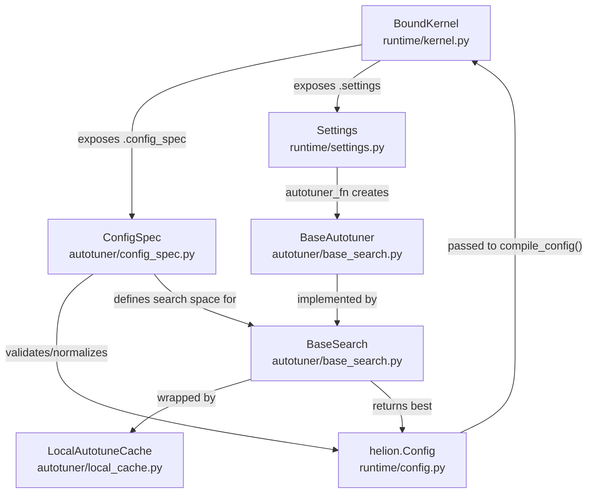

<!-- source: DeepWiki mcp.deepwiki.com · repo pytorch/helion · page 4 Configuration and Autotuning · fetched 2026-10-21 -->

# Configuration and Autotuning

<details>
<summary>Relevant source files</summary>

The following files were used as context for generating this wiki page:

- [helion/autotuner/base_search.py](helion/autotuner/base_search.py)
- [helion/autotuner/config_spec.py](helion/autotuner/config_spec.py)
- [helion/runtime/config.py](helion/runtime/config.py)
- [helion/runtime/settings.py](helion/runtime/settings.py)
- [test/test_autotuner.py](test/test_autotuner.py)

</details>


This page provides an overview of Helion's two closely related systems: the **configuration system** and the **autotuning system**. The configuration system defines what parameters a kernel accepts and validates their values. The autotuning system searches for the best configuration values given a specific set of inputs.

For detailed coverage of specific subsystems, see:
- Configuration parameters and `ConfigSpec` → [Configuration System](#4.1)
- Autotuning end-to-end process → [Autotuning Overview](#4.2)
- Available search algorithms → [Search Algorithms](#4.3)
- Persistent caching of tuned configs → [Autotune Caching](#4.4)
- Logging and diagnostics → [Autotuning Logging and Diagnostics](#4.5)

---

## The Two Systems and How They Interact

A Helion kernel has two kinds of parameters:

- **`Settings`** — user-controlled options that affect how code is compiled and how autotuning runs (backend, logging, timeout, etc.). These are never autotuned.
- **`Config`** — tunable hardware parameters (block sizes, number of warps, loop order, indexing strategy, etc.). These are either hardcoded by the user or found automatically by the autotuner.

The `ConfigSpec` class acts as the bridge: it is derived from the kernel's structure (number of tiled loops, reduction loops, etc.) and encodes what `Config` values are valid for that kernel. The autotuner uses `ConfigSpec` to generate and validate candidate configurations.

**Component Relationship Diagram**



Sources: [helion/runtime/config.py:1-301](), [helion/autotuner/config_spec.py:95-145](), [helion/autotuner/base_search.py:123-131](), [helion/runtime/settings.py:510-614]()

---

## `helion.Config`

`Config` is defined in [helion/runtime/config.py:19-300]() and implements `Mapping[str, object]`. It stores a flat dictionary of kernel tuning parameters.

### Key Parameters

| Parameter | Type | Description |
|-----------|------|-------------|
| `block_sizes` | `list[int]` | Tile sizes for each `hl.tile` invocation; must be powers of two |
| `num_warps` | `int` | Warps per thread block (default: 4) |
| `num_stages` | `int` | Software pipelining stages (default: 1) |
| `pid_type` | `str` | Program ID strategy: `"flat"`, `"xyz"`, `"persistent_blocked"`, `"persistent_interleaved"` |
| `indexing` | `str` or `list[str]` | Memory access strategy: `"pointer"`, `"block_ptr"`, `"tensor_descriptor"` |
| `loop_orders` | `list[list[int]]` | Permutations of iteration order per tiled loop nest |
| `l2_groupings` | `list[int]` | L2 cache locality grouping factors |
| `reduction_loops` | `list[int \| None]` | Per-reduction loop size; `None` means persistent reduction |
| `range_unroll_factors` | `list[int]` | Unroll factors for `tl.range` loops |
| `range_warp_specializes` | `list[bool \| None]` | Warp specialization for `tl.range` loops |
| `num_sm_multiplier` | `int` | Multi-occupancy multiplier for persistent kernels (1, 2, 4, 8) |
| `maxnreg` | `int \| None` | Max registers per thread; `None` = no limit (CUDA only) |

### Creating and Persisting Configs

```python
# Create manually
config = helion.Config(block_sizes=[64, 64], num_warps=4, num_stages=2)

# Save / load from file
config.save("/tmp/my_config.json")
config = helion.Config.load("/tmp/my_config.json")

# Serialize to JSON string
json_str = config.to_json()
config = helion.Config.from_json(json_str)

# Remove values that match defaults (compact representation)
minimal = config.minimize(bound_kernel.config_spec)
```

The `minimize()` method ([helion/runtime/config.py:155-184]()) compares a config against `ConfigSpec.default_config()` and removes any key whose value matches the default — except `block_sizes`, which is always required.

Sources: [helion/runtime/config.py:19-301]()

---

## `ConfigSpec`

`ConfigSpec` ([helion/autotuner/config_spec.py:95-535]()) is constructed during kernel binding. It describes the valid search space for a specific kernel+input combination.

Each tunable parameter is represented as a `BlockIdSequence` of typed spec objects:

| Spec class | Config key | Fragment type |
|---|---|---|
| `BlockSizeSpec` | `block_sizes` | `BlockSizeFragment` (power-of-two range) |
| `LoopOrderSpec` | `loop_orders` | `PermutationFragment` |
| `L2GroupingSpec` | `l2_groupings` | `PowerOfTwoFragment(1, 64)` |
| `FlattenLoopSpec` | `flatten_loops` | `BooleanFragment` |
| `ReductionLoopSpec` | `reduction_loops` | `BlockSizeFragment` |
| `RangeUnrollFactorSpec` | `range_unroll_factors` | `IntegerFragment(0, 4)` |
| `RangeWarpSpecializeSpec` | `range_warp_specializes` | `EnumFragment(None, False, True)` |

`ConfigSpec.normalize()` ([helion/autotuner/config_spec.py:190-442]()) validates and fills in defaults for a config dict in-place. It:
- Converts singular aliases (e.g., `block_size` → `block_sizes`)
- Rejects keys unsupported by the backend
- Caps `reduction_loops` at the backend's `max_reduction_threads`
- Enforces `num_sm_multiplier` and `maxnreg` are only used with persistent `pid_type`
- Ensures only one `range_warp_specializes` entry is `True`

`ConfigSpec.default_config()` returns a `helion.Config` using each fragment's default value. `ConfigSpec.valid_indexing_types()` checks hardware support to determine which indexing strategies are available.

Sources: [helion/autotuner/config_spec.py:95-535]()

---

## Autotuning Overview

When a kernel is called without a pre-selected config, Helion runs the autotuner to find the best `Config` for the given input shapes and device.

**Autotuning Flow**

```mermaid
flowchart TD
    call["kernel.__call__()"]
    bind["BoundKernel.bind(args)"]
    check{"Config\nhardcoded?"}
    cache{"LocalAutotuneCache\nhit?"}
    autotune["BaseSearch._autotune()"]
    baseline["_compute_baseline()"]
    generate["ConfigGeneration\n.random_population()"]
    bench["BaseSearch.parallel_benchmark()"]
    best["select best Config"]
    compile["BoundKernel.compile_config(config)"]
    execute["execute compiled fn"]

    call --> bind
    bind --> check
    check -->|"yes"| compile
    check -->|"no"| cache
    cache -->|"hit"| compile
    cache -->|"miss"| autotune
    autotune --> baseline
    baseline --> generate
    generate --> bench
    bench --> best
    best --> cache
    cache --> compile
    compile --> execute
```

Sources: [helion/autotuner/base_search.py:870-918](), [helion/runtime/settings.py:236-324]()

### Three Usage Modes

**1. Hardcoded config — no autotuning**

```python
@helion.kernel(config=helion.Config(block_sizes=[64, 64], num_warps=4))
def my_kernel(a, b): ...
```

The config is passed directly to `compile_config()` on every call.

**2. Finite list of configs — `FiniteSearch`**

```python
@helion.kernel(configs=[
    helion.Config(block_sizes=[32], num_warps=4),
    helion.Config(block_sizes=[64], num_warps=8),
])
def my_kernel(a, b): ...
```

The autotuner benchmarks all provided configs and selects the fastest.

**3. Automatic search — default**

```python
@helion.kernel()
def my_kernel(a, b): ...
```

The autotuner generates candidate configs using `ConfigGeneration` and runs a search algorithm (default: `LFBOTreeSearch`).

After autotuning completes, the log prints the best config as a decorator:

```
Autotuning complete in 12.3s after searching 45 configs.
One can hardcode the best config and skip autotuning with:
    @helion.kernel(config=helion.Config(block_sizes=[64, 64], num_warps=8, ...))
```

Sources: [helion/autotuner/base_search.py:900-918](), [helion/runtime/settings.py:236-324]()

---

## `Settings` for Autotuning

`Settings` ([helion/runtime/settings.py:510-614]()) is passed to `@helion.kernel(...)` as keyword arguments or read from environment variables at construction time. The fields most relevant to autotuning:

| Setting | Env Var | Default | Description |
|---|---|---|---|
| `autotune_effort` | `HELION_AUTOTUNE_EFFORT` | `"full"` | Effort preset: `"none"`, `"quick"`, `"full"` |
| `autotune_precompile` | `HELION_AUTOTUNE_PRECOMPILE` | `"fork"` | Parallel precompilation mode: `"fork"`, `"spawn"`, or `None` |
| `autotune_precompile_jobs` | `HELION_AUTOTUNE_PRECOMPILE_JOBS` | cpu count | Max concurrent precompile subprocesses |
| `autotune_compile_timeout` | `HELION_AUTOTUNE_COMPILE_TIMEOUT` | `60` | Per-config compilation timeout in seconds |
| `autotune_accuracy_check` | `HELION_AUTOTUNE_ACCURACY_CHECK` | `True` | Validate each config against baseline output |
| `autotune_ignore_errors` | `HELION_AUTOTUNE_IGNORE_ERRORS` | `False` | Skip configs that fail instead of raising |
| `autotune_adaptive_timeout` | `HELION_AUTOTUNE_ADAPTIVE_TIMEOUT` | `True` | Shrink compile timeout based on observed times |
| `autotune_max_generations` | `HELION_AUTOTUNE_MAX_GENERATIONS` | `None` | Override max iterations for search algorithms |
| `autotune_config_overrides` | `HELION_AUTOTUNE_CONFIG_OVERRIDES` | `{}` | Force specific config values during search |
| `autotune_log` | `HELION_AUTOTUNE_LOG` | `None` | Base path for `.csv` + `.log` output files |
| `autotune_cache` | `HELION_AUTOTUNE_CACHE` | `"LocalAutotuneCache"` | Cache class: `"LocalAutotuneCache"` or `"StrictLocalAutotuneCache"` |
| `force_autotune` | `HELION_FORCE_AUTOTUNE` | `False` | Re-autotune even when a config is hardcoded |
| `autotune_baseline_fn` | — | `None` | Custom reference function for accuracy checks |
| `autotune_baseline_atol` | — | `1e-2` | Absolute tolerance for accuracy validation |
| `autotune_baseline_rtol` | — | `1e-2` | Relative tolerance for accuracy validation |
| `autotuner_fn` | `HELION_AUTOTUNER` | `LFBOTreeSearch` | Override the autotuner class |

The `autotune_effort` preset controls how aggressively each search algorithm explores (number of iterations, population sizes, and rebenchmark threshold). The three values are `"none"` (skip search, use default config), `"quick"` (reduced iterations), and `"full"` (full search).

`autotune_config_overrides` accepts a JSON dictionary and pins specific config keys to fixed values during autotuning. For example:

```
HELION_AUTOTUNE_CONFIG_OVERRIDES='{"num_warps": 4, "indexing": "tensor_descriptor"}'
```

Sources: [helion/runtime/settings.py:371-614]()

---

## Class Hierarchy and Module Layout

**Autotuner Class Hierarchy**

```mermaid
classDiagram
    class BaseAutotuner {
        +autotune(skip_cache) Config
    }
    class BaseSearch {
        +kernel
        +settings Settings
        +config_spec ConfigSpec
        +args
        +benchmark(config) tuple
        +benchmark_function(config, fn) float
        +parallel_benchmark(configs) list
        +_prepare()
        +_compute_baseline() tuple
        +_autotune() Config
    }
    class FiniteSearch {
        +configs list~Config~
    }
    class RandomSearch {
        +count int
    }
    class PatternSearch {
        +initial_population int
        +max_generations int
    }
    class LFBOPatternSearch
    class LFBOTreeSearch
    class DifferentialEvolutionSearch {
        +population_size int
        +max_generations int
    }
    class DESurrogateHybrid
    class LocalAutotuneCache {
        +autotune(skip_cache) Config
    }

    BaseAutotuner <|-- BaseSearch
    BaseAutotuner <|-- LocalAutotuneCache
    BaseSearch <|-- FiniteSearch
    BaseSearch <|-- RandomSearch
    BaseSearch <|-- PatternSearch
    PatternSearch <|-- LFBOPatternSearch
    LFBOPatternSearch <|-- LFBOTreeSearch
    BaseSearch <|-- DifferentialEvolutionSearch
    DifferentialEvolutionSearch <|-- DESurrogateHybrid
    LocalAutotuneCache -->|"wraps"| BaseSearch
```

Sources: [helion/autotuner/base_search.py:123-131](), [helion/autotuner/base_search.py:226-939]()

### Module Layout

| Module | Contents |
|---|---|
| `helion/runtime/config.py` | `Config` class |
| `helion/autotuner/config_spec.py` | `ConfigSpec`, `BlockSizeSpec`, `LoopOrderSpec`, etc. |
| `helion/autotuner/config_generation.py` | `ConfigGeneration` — generates random/default flat configs |
| `helion/autotuner/config_fragment.py` | `BlockSizeFragment`, `PowerOfTwoFragment`, `EnumFragment`, etc. |
| `helion/autotuner/base_search.py` | `BaseAutotuner`, `BaseSearch`, `BenchmarkResult`, `PopulationMember` |
| `helion/autotuner/finite_search.py` | `FiniteSearch` |
| `helion/autotuner/pattern_search.py` | `PatternSearch`, `LFBOPatternSearch`, `LFBOTreeSearch` |
| `helion/autotuner/differential_evolution.py` | `DifferentialEvolutionSearch`, `DESurrogateHybrid` |
| `helion/autotuner/random_search.py` | `RandomSearch` |
| `helion/autotuner/local_cache.py` | `LocalAutotuneCache`, `StrictLocalAutotuneCache` |
| `helion/autotuner/effort_profile.py` | `AutotuneEffort`, `get_effort_profile()` |
| `helion/autotuner/logger.py` | `AutotuningLogger`, `AutotuneLogEntry`, `AutotuneLogSink` |
| `helion/runtime/settings.py` | `Settings`, `default_autotuner_fn()` |

---

## Accuracy Validation During Autotuning

By default, the autotuner validates each candidate config's output against a baseline before recording its benchmark time. This is controlled by `autotune_accuracy_check` (default: `True`).

The baseline is computed once at the start of autotuning ([helion/autotuner/base_search.py:311-373]()):
- If `autotune_baseline_fn` is set, that function is called.
- Otherwise, the default config (`ConfigSpec.default_config()`) is used.

For kernels with in-place mutations, the autotuner detects which input tensors were mutated and validates those as well.

For FP8 outputs, tolerances default to `0.0`/`0.0` (bitwise comparison) unless explicitly overridden.

Configs that fail accuracy checks return `inf` performance and are excluded from selection.

Sources: [helion/autotuner/base_search.py:311-497]()

---

## Deploying a Pre-Tuned Config

After autotuning, the logger prints the best config in the form of a `@helion.kernel(config=...)` decorator. Hardcoding this eliminates autotuning overhead on subsequent runs:

```python
@helion.kernel(
    config=helion.Config(block_sizes=[64, 64], num_warps=8, pid_type="persistent_blocked")
)
def matmul(a, b): ...
```

Configs can also be saved to disk and loaded:

```python
best_config.save("matmul_512x512_h100.json")

@helion.kernel(config=helion.Config.load("matmul_512x512_h100.json"))
def matmul(a, b): ...
```

The `minimize()` method on `Config` removes parameters that match the defaults for a specific kernel, producing a more readable hardcoded config ([helion/runtime/config.py:155-184]()).

Sources: [helion/runtime/config.py:155-199](), [helion/autotuner/base_search.py:900-918]()

---

