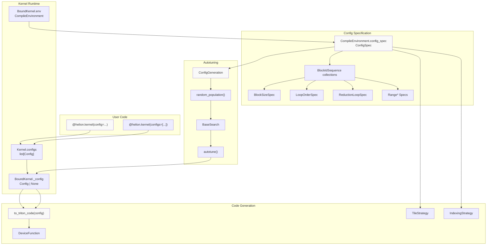
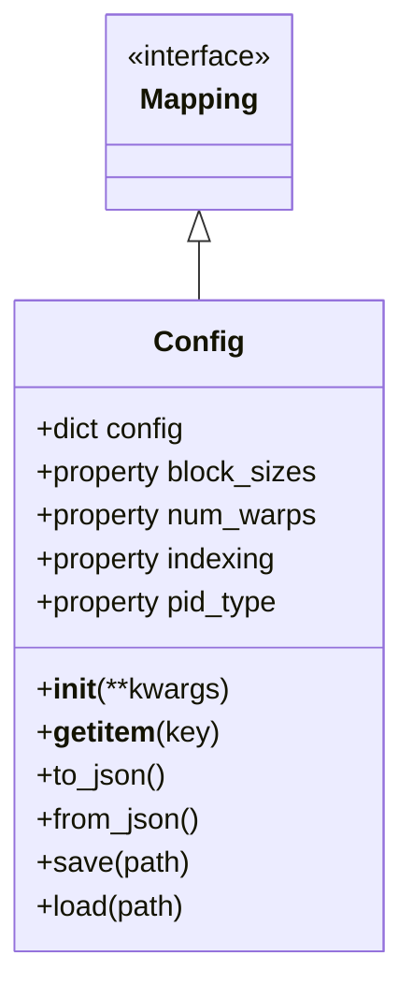
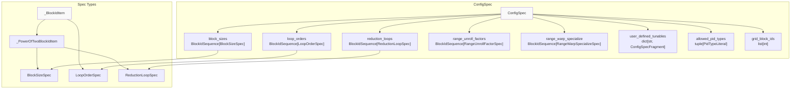
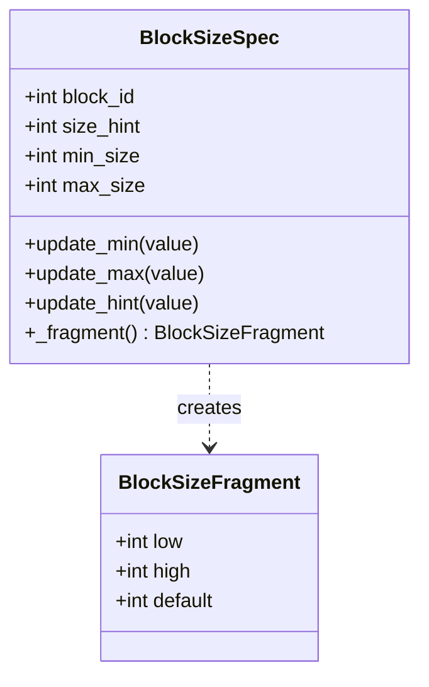
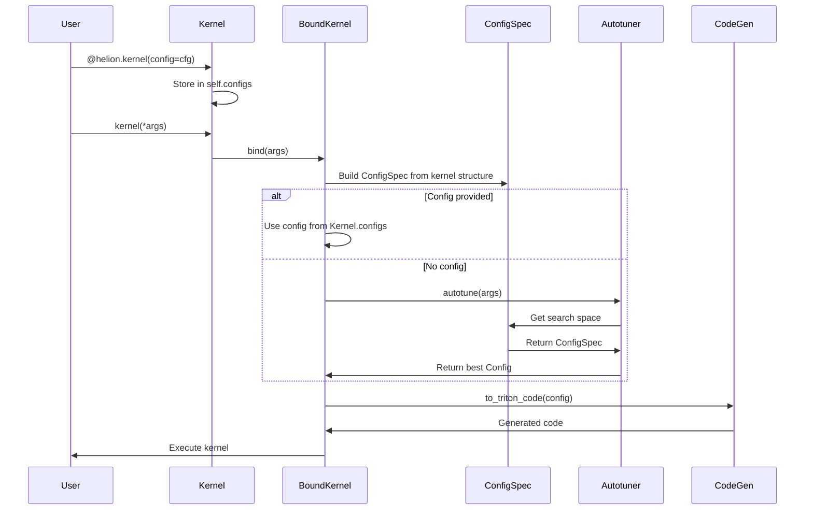

<!-- source: DeepWiki mcp.deepwiki.com · repo pytorch/helion · page 4.1 Configuration System · fetched 2026-10-21 -->

# Configuration System

<details>
<summary>Relevant source files</summary>

The following files were used as context for generating this wiki page:

- [docs/api/kernel.md](docs/api/kernel.md)
- [docs/api/settings.md](docs/api/settings.md)
- [docs/deployment_autotuning.md](docs/deployment_autotuning.md)
- [helion/autotuner/config_spec.py](helion/autotuner/config_spec.py)
- [helion/autotuner/external.py](helion/autotuner/external.py)
- [helion/runtime/config.py](helion/runtime/config.py)
- [test/test_amd_cdna.py](test/test_amd_cdna.py)
- [test/test_config_api.py](test/test_config_api.py)
- [test/test_tileir.py](test/test_tileir.py)

</details>


This document describes the configuration system that controls kernel execution performance parameters. For information about compilation behavior settings (logging, debugging, autotuning options), see [Settings and Environment Variables](#6.2). For details on how autotuning searches the configuration space, see [Autotuning Overview](#4.2).

## Overview

The configuration system consists of two primary classes:

- **`Config`** - A dictionary-like container holding concrete performance parameters for a specific kernel execution
- **`ConfigSpec`** - A specification defining the valid search space for autotuning, built during kernel compilation

The `Config` object determines GPU resource allocation and execution strategy, while `ConfigSpec` defines which configurations are valid and provides bounds for autotuning searches.

**Sources:** [helion/runtime/config.py:1-216](), [helion/autotuner/config_spec.py:1-521]()

## Core Architecture



**Config Flow:** User-provided configs are stored in `Kernel.configs`. When a kernel is first called, `BoundKernel` either uses an explicit config, runs autotuning to find the best config, or uses a default. The selected config is then used to generate Triton code.

**ConfigSpec Flow:** During kernel binding, `CompileEnvironment` builds a `ConfigSpec` that describes valid configuration ranges based on kernel structure (number of tile dimensions, reduction loops, etc.). The autotuner uses this spec to explore the search space.

**Sources:** [helion/runtime/kernel.py:67-300](), [helion/autotuner/config_spec.py:61-315]()

## Config Class

### Structure

The `Config` class implements the `Mapping` interface and stores configuration parameters as a dictionary. All parameters are optional in the constructor and have sensible defaults applied during normalization.



**Sources:** [helion/runtime/config.py:19-216]()

### Creating Configs

Configs can be created directly or loaded from JSON:

```python
# Direct creation
config = helion.Config(
    block_sizes=[64, 64, 32],
    num_warps=4,
    num_stages=2,
    indexing="block_ptr"
)

# From JSON file
config = helion.Config.load("config.json")

# From JSON string
config = helion.Config.from_json('{"block_sizes": [64, 64], "num_warps": 4}')
```

Configs are typically passed to the `@helion.kernel` decorator:

```python
@helion.kernel(config=helion.Config(block_sizes=[64, 64]))
def my_kernel(x, y):
    ...

# Or multiple configs for finite search
@helion.kernel(configs=[
    helion.Config(block_sizes=[32, 32]),
    helion.Config(block_sizes=[64, 64]),
    helion.Config(block_sizes=[128, 128]),
])
def my_kernel(x, y):
    ...
```

**Sources:** [helion/runtime/config.py:22-89](), [test/test_autotuner.py:296-346]()

### Config Serialization

The `Config` class supports JSON serialization for persistence and sharing:

| Method | Purpose | Returns |
|--------|---------|---------|
| `to_json()` | Serialize to JSON string | `str` |
| `from_json(json_str)` | Deserialize from JSON string | `Config` |
| `save(path)` | Write to JSON file (atomic) | `None` |
| `load(path)` | Read from JSON file | `Config` |

The `save()` method uses atomic write-rename to ensure thread safety in multi-process environments.

**Sources:** [helion/runtime/config.py:120-143](), [test/test_autotuner.py:266-279]()

## Configuration Parameters

### Tiling and Parallelization Parameters

These parameters control how work is distributed across GPU threads and blocks.

#### block_sizes

**Type:** `list[int]`  
**Purpose:** Defines tile sizes for each dimension of `hl.tile()` invocations  
**Requirements:** Must be powers of two; length matches number of tile dimensions  
**Example:** `[64, 64, 16]` for 3D tiling

The block sizes determine how the iteration space is divided into parallel chunks. Each element corresponds to one tile dimension in source order.

```python
# Kernel with 2D tiling
@helion.kernel(config=helion.Config(block_sizes=[128, 64]))
def matmul(A, B):
    C = torch.zeros(...)
    for tile_m, tile_n in hl.tile(M, N):  # tile_m has size 128, tile_n has size 64
        ...
```

**Sources:** [helion/runtime/config.py:26-49](), [helion/autotuner/config_spec.py:346-406]()

#### num_warps

**Type:** `int`  
**Default:** `4`  
**Range:** Typically 1-32, must be power of two  
**Purpose:** Number of warps (groups of 32 threads) per thread block

Controls thread-level parallelism. Higher values increase occupancy but may reduce register availability.

**Sources:** [helion/runtime/config.py:162-163](), [helion/autotuner/config_spec.py:35-36]()

#### num_stages

**Type:** `int`  
**Default:** `2`  
**Range:** 1-8  
**Purpose:** Number of software pipeline stages for memory operations

Enables overlapping of memory loads with computation. Higher values can hide memory latency but increase register pressure.

**Sources:** [helion/runtime/config.py:165-167](), [helion/autotuner/config_spec.py:36]()

### Execution Strategy Parameters

#### indexing

**Type:** `IndexingLiteral` = `"pointer" | "tensor_descriptor" | "block_ptr"`  
**Default:** `"pointer"`  
**Purpose:** Selects memory access pattern for tensor loads/stores

| Value | Description | Requirements |
|-------|-------------|--------------|
| `"pointer"` | Pointer arithmetic with masks | Always available |
| `"block_ptr"` | Triton block pointers | Requires Triton support |
| `"tensor_descriptor"` | Hardware tensor descriptors | GPU support + alignment requirements |

See [Indexing Strategies](#5.5) for details on how each strategy generates code.

**Sources:** [helion/runtime/config.py:15-16, 206-208](), [helion/autotuner/config_spec.py:110-115]()

#### pid_type

**Type:** `PidTypeLiteral` = `"flat" | "xyz" | "persistent_blocked" | "persistent_interleaved"`  
**Default:** `"flat"`  
**Purpose:** Controls program ID assignment and loop structure

| Value | Description | Use Case |
|-------|-------------|----------|
| `"flat"` | Single flattened program ID | Simple kernels |
| `"xyz"` | 3D grid of program IDs | Multi-dimensional workloads |
| `"persistent_blocked"` | Persistent threads, blocked assignment | Reductions, blocked locality |
| `"persistent_interleaved"` | Persistent threads, interleaved assignment | Reductions, load balancing |

Persistent modes generate outer loops that process multiple tiles per thread block, useful for reductions and improving cache locality.

**Sources:** [helion/runtime/config.py:16, 174-175](), [helion/autotuner/config_spec.py:57]()

### Optimization Parameters

#### loop_orders

**Type:** `list[list[int]]`  
**Purpose:** Specifies iteration order permutations for tile loops  
**Format:** Each element is a permutation of tile dimension indices

Controls the order in which tiles are processed, affecting cache behavior and memory access patterns.

```python
# For 2D tiling with block_ids [0, 1]
loop_orders=[[0, 1]]  # Process dimension 0 outer, dimension 1 inner
loop_orders=[[1, 0]]  # Process dimension 1 outer, dimension 0 inner
```

**Sources:** [helion/runtime/config.py:27, 150-151](), [helion/autotuner/config_spec.py:317-336]()

#### flatten_loops

**Type:** `list[bool]`  
**Purpose:** Controls whether to flatten specific tile dimensions into a single loop  
**Format:** One boolean per tile loop

When `True`, multiple tile dimensions are collapsed into a flat iteration space, which can improve parallelism for irregularly-sized dimensions.

**Sources:** [helion/runtime/config.py:28, 154-155](), [helion/autotuner/config_spec.py:408-419]()

#### l2_groupings

**Type:** `list[int]`  
**Purpose:** Reorders program IDs to improve L2 cache locality  
**Requirements:** Powers of two  
**Format:** One value per tile dimension

Groups consecutive program IDs together to increase cache hit rates when accessing shared memory regions.

**Sources:** [helion/runtime/config.py:29, 170-171](), [helion/autotuner/config_spec.py:338-344]()

#### reduction_loops

**Type:** `list[int | None]`  
**Purpose:** Configures tile size for reduction dimensions  
**Format:** One value per reduction loop; `None` means persistent reduction

Controls how reduction dimensions are tiled. Smaller values create more reduction passes but use less memory.

**Sources:** [helion/runtime/config.py:30, 158-159](), [helion/autotuner/config_spec.py:421-455]()

### Range Loop Parameters

These parameters control behavior of `tl.range` loops generated by `hl.range()` calls.

#### range_unroll_factors

**Type:** `list[int]`  
**Default:** `[0, 0, ...]`  
**Purpose:** Loop unroll factors for each `tl.range` invocation

Unrolling can improve performance by reducing loop overhead but increases code size.

**Sources:** [helion/runtime/config.py:31, 178-179]()

#### range_warp_specializes

**Type:** `list[bool | None]`  
**Default:** `[None, None, ...]`  
**Purpose:** Enable warp specialization for each `tl.range`

When `True`, uses Triton's warp specialization feature for the loop. Only one range can be warp-specialized per kernel.

**Sources:** [helion/runtime/config.py:32, 182-183]()

#### range_num_stages

**Type:** `list[int]`  
**Default:** `[0, 0, ...]`  
**Purpose:** Number of pipeline stages for each `tl.range`

Enables software pipelining within range loops.

**Sources:** [helion/runtime/config.py:33, 186-187]()

#### range_multi_buffers

**Type:** `list[bool | None]`  
**Default:** `[None, None, ...]`  
**Purpose:** Controls accumulator multi-buffering for each `tl.range`

When `False`, disables multi-buffering which can reduce register usage.

**Sources:** [helion/runtime/config.py:34, 189-191]()

#### range_flattens

**Type:** `list[bool | None]`  
**Default:** `[None, None, ...]`  
**Purpose:** Flatten parameter for `tl.range` loops

Controls Triton's flatten optimization for each range loop.

**Sources:** [helion/runtime/config.py:35, 193-195]()

#### static_ranges

**Type:** `list[bool]`  
**Default:** `[False, False, ...]`  
**Purpose:** Use `tl.static_range` instead of `tl.range`

Static ranges can enable additional compiler optimizations when loop bounds are compile-time constants.

**Sources:** [helion/runtime/config.py:36, 197-199]()

### Memory Parameters

#### load_eviction_policies

**Type:** `list[str]`  
**Valid values:** `""`, `"first"`, `"last"`  
**Purpose:** Cache eviction policy hints for load operations

Controls which cache level to target for memory loads:
- `""` - Default caching behavior
- `"first"` - Evict from L1 cache
- `"last"` - Evict from L2 cache

**Sources:** [helion/runtime/config.py:37, 201-203](), [helion/autotuner/config_spec.py:58]()

## ConfigSpec Class

### Purpose and Structure

`ConfigSpec` defines the valid configuration search space for a kernel. It is built automatically during kernel compilation based on the kernel's structure (number of tile dimensions, reduction loops, range calls, etc.).



**Sources:** [helion/autotuner/config_spec.py:61-108]()

### Block ID Sequences

Each tunable parameter collection is stored as a `BlockIdSequence`, which maps block IDs to specification objects. Block IDs identify specific tile dimensions or range loops.

| Sequence | Spec Type | Purpose |
|----------|-----------|---------|
| `block_sizes` | `BlockSizeSpec` | Defines min/max/hint for each tile dimension |
| `loop_orders` | `LoopOrderSpec` | Permutation spec for iteration order |
| `l2_groupings` | `L2GroupingSpec` | Cache grouping size range |
| `flatten_loops` | `FlattenLoopSpec` | Boolean choice per dimension |
| `reduction_loops` | `ReductionLoopSpec` | Reduction tile size range |
| `range_unroll_factors` | `RangeUnrollFactorSpec` | Unroll factor range per range loop |
| `range_warp_specialize` | `RangeWarpSpecializeSpec` | Warp specialize choice per range |

**Sources:** [helion/autotuner/config_spec.py:63-107](), [helion/autotuner/block_id_sequence.py:1-200]()

### BlockSizeSpec

The most important spec type, `BlockSizeSpec`, defines the search space for tile sizes:



- `size_hint` - Expected typical size based on tensor dimensions
- `min_size` / `max_size` - Bounds for autotuning search (powers of two)
- `update_min/max/hint()` - Methods to refine bounds during compilation

The `_fragment()` method converts the spec to a `BlockSizeFragment` used by the config generation system.

**Sources:** [helion/autotuner/config_spec.py:346-406]()

### Config Normalization

The `normalize()` method validates and fills in defaults for a config:

```python
def normalize(self, config: helion.Config | dict[str, object]) -> None:
    # Convert singular keys to plural lists
    if "block_size" in config:
        config["block_sizes"] = [config.pop("block_size")]
    
    # Normalize lists using BlockIdSequence
    config["block_sizes"] = self.block_sizes._normalize(...)
    
    # Apply defaults
    config.setdefault("num_warps", DEFAULT_NUM_WARPS)
    config.setdefault("num_stages", DEFAULT_NUM_STAGES)
    
    # Validate enum values
    if config["indexing"] not in self._valid_indexing_types():
        raise InvalidConfig(...)
```

This ensures all configs conform to the same structure before use.

**Sources:** [helion/autotuner/config_spec.py:136-269]()

### Default Config Generation

`ConfigSpec` can generate a default configuration:

```python
default_config = config_spec.default_config()
# Returns Config with sensible defaults based on kernel structure
```

The default is computed by calling `fragment.default()` on each fragment in the spec.

**Sources:** [helion/autotuner/config_spec.py:270-271]()

## Config Usage in Kernel Lifecycle



1. **Decorator time:** User provides config(s) to `@helion.kernel`
2. **First call:** `Kernel.bind()` creates `BoundKernel` with `ConfigSpec`
3. **Config selection:** Use provided config, run autotuning, or use default
4. **Code generation:** `to_triton_code()` uses selected config to generate Triton code
5. **Subsequent calls:** Reuse cached compiled config

**Sources:** [helion/runtime/kernel.py:145-179, 617-644]()

## Config vs Settings

Understanding the distinction between `Config` and `Settings` is crucial:

| Aspect | Config | Settings |
|--------|--------|----------|
| **Purpose** | GPU execution parameters | Compilation behavior control |
| **Autotuned** | ✅ Yes | ❌ No |
| **Examples** | `block_sizes`, `num_warps`, `indexing` | `print_output_code`, `autotune_log_level` |
| **When to use** | Performance optimization | Debugging, development |
| **Passed via** | `config=` or `configs=` argument | Keyword args to decorator |
| **Affects** | Generated kernel code | Compilation process |
| **Can have multiple** | ✅ Yes (for finite search) | ❌ No (single settings object) |

Example showing both:

```python
@helion.kernel(
    # Config - affects performance
    config=helion.Config(block_sizes=[64, 64], num_warps=4),
    # Settings - affects compilation
    print_output_code=True,
    autotune_log_level=logging.DEBUG,
)
def kernel(x, y):
    ...
```

**Sources:** [helion/runtime/kernel.py:676-706](), [helion/runtime/settings.py:239-348](), [docs/api/settings.md:23-38]()

## Advanced Topics

### User-Defined Tunable Parameters

`ConfigSpec.user_defined_tunables` allows kernels to define custom configuration parameters using the `@hl.api_tunable` decorator. These are integrated into the autotuning search space.

**Sources:** [helion/autotuner/config_spec.py:96-98]()

### Config Hashing and Caching

Configs are hashable and used as cache keys:

```python
def __hash__(self) -> int:
    return hash(frozenset([(k, _to_hashable(v)) for k, v in self.config.items()]))
```

Lists and dicts in config values are recursively converted to tuples for hashing.

**Sources:** [helion/runtime/config.py:111-112, 210-215]()

### Persistent vs Non-Persistent Execution

The `pid_type` parameter fundamentally changes kernel structure:

- **Non-persistent** (`"flat"`, `"xyz"`): Each thread block processes one tile
- **Persistent** (`"persistent_blocked"`, `"persistent_interleaved"`): Thread blocks loop over multiple tiles

Persistent modes disable most range loop features (unroll, warp specialize, etc.) for grid dimensions since those are handled by the outer persistent loop.

**Sources:** [helion/autotuner/config_spec.py:234-246]()

### Warp Specialization Constraints

Only one `range_warp_specialize` can be `True` per kernel. When enabled, the corresponding `range_unroll_factor` is automatically set to `0`:

```python
# Normalize ensures only last warp_specialize is True
if range_warp_specializes and any(range_warp_specializes):
    for i in [j for j, val in enumerate(range_warp_specializes) if val][:-1]:
        range_warp_specializes[i] = None
    
    # Disable unroll for warp-specialized loop
    if range_unroll_factors and range_unroll_factors[-1]:
        range_unroll_factors[-1] = 0
```

**Sources:** [helion/autotuner/config_spec.py:248-264]()

---

