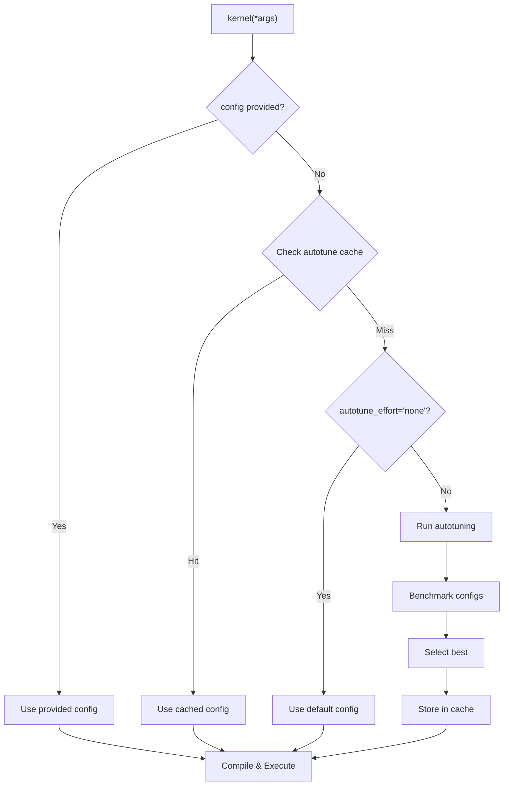
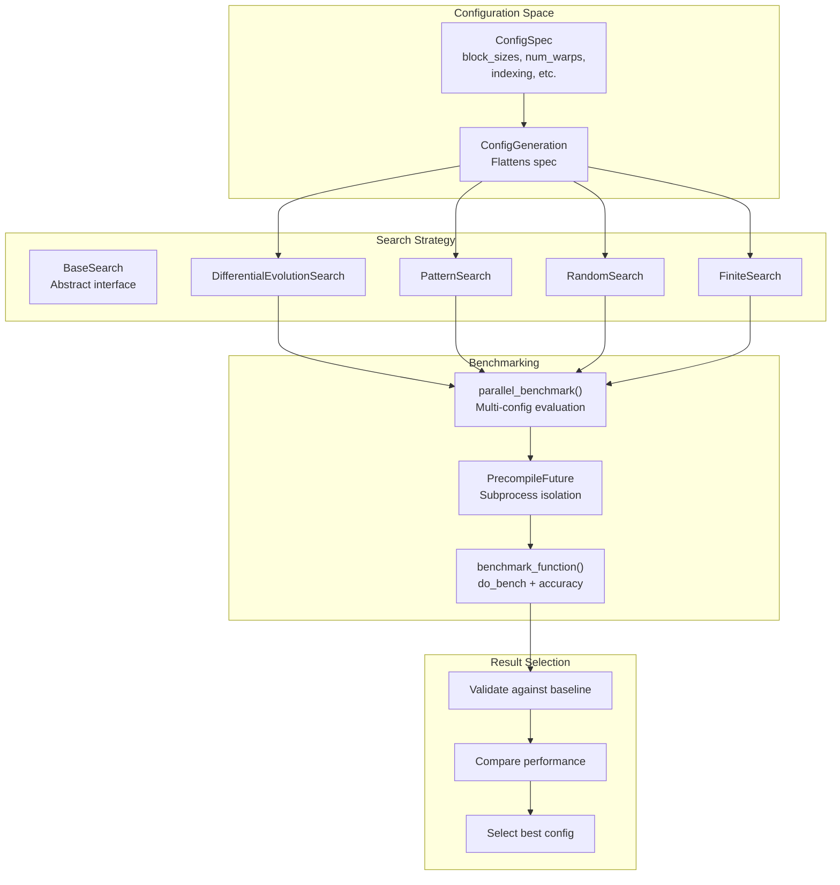
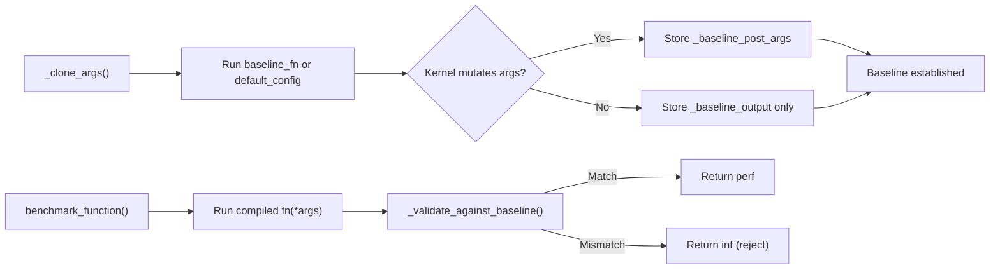
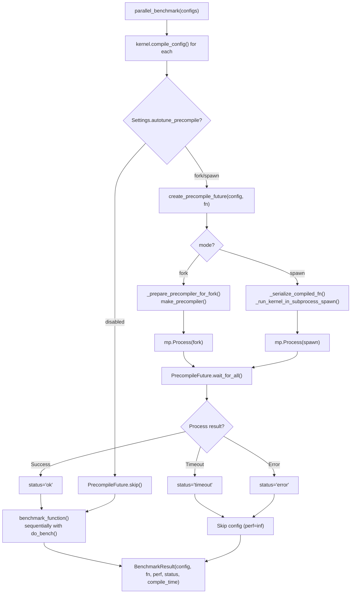
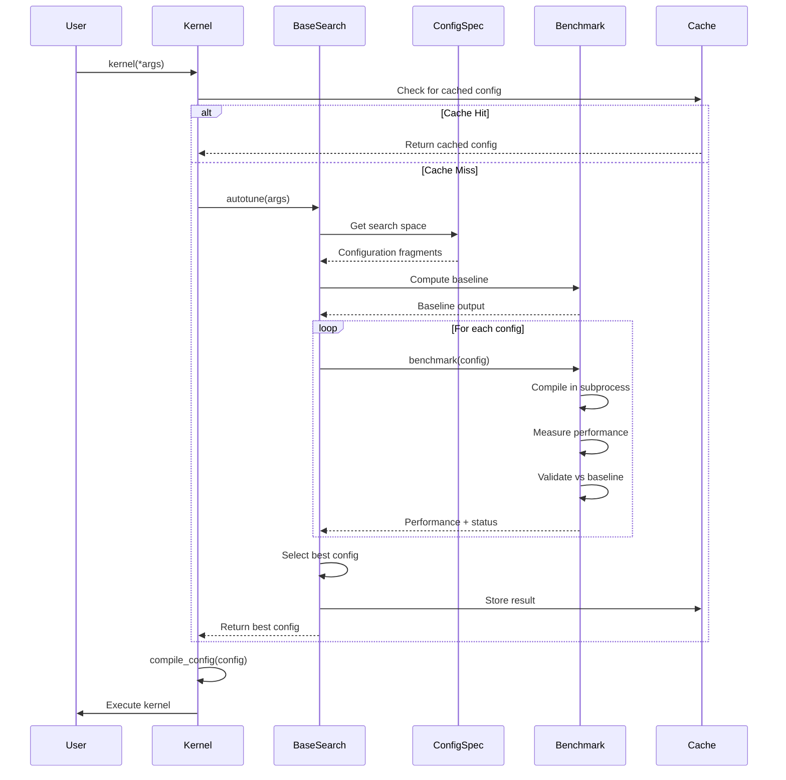

<!-- source: DeepWiki mcp.deepwiki.com · repo pytorch/helion · page 4.2 Autotuning Overview · fetched 2026-10-21 -->

# Autotuning Overview

<details>
<summary>Relevant source files</summary>

The following files were used as context for generating this wiki page:

- [README.md](README.md)
- [docs/api/config.md](docs/api/config.md)
- [docs/api/kernel.md](docs/api/kernel.md)
- [docs/api/settings.md](docs/api/settings.md)
- [docs/deployment_autotuning.md](docs/deployment_autotuning.md)
- [docs/index.md](docs/index.md)
- [docs/installation.md](docs/installation.md)
- [docs/tileir_backend.md](docs/tileir_backend.md)
- [examples/segment_reduction.py](examples/segment_reduction.py)
- [helion/autotuner/base_search.py](helion/autotuner/base_search.py)
- [helion/runtime/settings.py](helion/runtime/settings.py)
- [test/test_autotuner.py](test/test_autotuner.py)

</details>


This page explains how Helion's autotuning system works, when it runs, and how to control its behavior. Autotuning is the process of automatically searching for the best kernel configuration by compiling and benchmarking many candidate configurations. For detailed information about specific search algorithms, see [Search Algorithms](#4.3). For information about how autotune results are cached, see [Autotune Caching](#4.4). For details about configuration parameters, see [Configuration System](#4.1).

## Purpose and Scope

Autotuning enables Helion to generate high-performance kernels without manual configuration tuning. The system:
- Explores a large configuration space automatically
- Benchmarks each configuration for performance and correctness
- Selects the best-performing valid configuration
- Caches results to avoid redundant tuning

## When Autotuning Runs

Autotuning is triggered **on the first call** to a kernel with a specific argument signature, unless a configuration is explicitly provided or cached results exist.



**Sources:** [helion/autotuner/base_search.py:511-548](), [README.md:124-147]()

### Specialization Keys

By default, Helion uses static shapes (`static_shapes=True`), meaning each unique combination of input shapes and strides gets its own specialization and autotune session. Setting `static_shapes=False` shares configurations across different shapes.

```python
# Each shape triggers separate autotuning
@helion.kernel(static_shapes=True)
def kernel1(x: torch.Tensor) -> torch.Tensor: ...

# Shares config across shapes
@helion.kernel(static_shapes=False)
def kernel2(x: torch.Tensor) -> torch.Tensor: ...
```

**Sources:** [README.md:193-202]()

## The Autotuning Process

The autotuning system consists of four main components that work together to find optimal configurations:



**Sources:** [helion/autotuner/base_search.py:79-560](), [helion/autotuner/config_spec.py:62-314]()

### Core Classes

| Class | Purpose | Key Methods | Location |
|-------|---------|-------------|----------|
| `BaseAutotuner` | Abstract base for all autotuners and cache wrappers | `autotune()` | [helion/autotuner/base_search.py:123-130]() |
| `BaseSearch` | Core search implementation; base class for all search algorithms | `benchmark()`, `benchmark_function()`, `parallel_benchmark()`, `_compute_baseline()`, `create_precompile_future()` | [helion/autotuner/base_search.py:226-939]() |
| `PopulationMember` | Dataclass tracking one member of a population-based search | `perf` property, `fn`, `perfs`, `flat_values`, `config`, `compile_time` | [helion/autotuner/base_search.py:942-963]() |
| `BenchmarkResult` | Named tuple returned from `parallel_benchmark()` | Contains `config`, `fn`, `perf`, `status`, `compile_time` | [helion/autotuner/base_search.py:133-139]() |
| `ConfigSpec` | Defines the tunable parameter space for a bound kernel | `default_config()`, `valid_indexing_types()` | [helion/autotuner/base_search.py:72-73]() |
| `ConfigGeneration` | Flattens `ConfigSpec` into numeric vectors for search algorithms | `unflatten()`, `random_flat()`, `default_flat()`, `random_population()` | [helion/autotuner/config_generation.py]() |

**Sources:** [helion/autotuner/base_search.py:123-963](), [helion/runtime/settings.py:236-324]()

### Baseline Computation and Validation

Before exploring configurations, the autotuner establishes a baseline using `_compute_baseline()`:



Sources: [helion/autotuner/base_search.py:311-373](), [helion/autotuner/base_search.py:474-497]()

The baseline serves two purposes:
1. **Correctness validation**: Each candidate configuration's output is compared against the baseline using `torch.testing.assert_close` with tolerances computed by `_compute_effective_tolerances()` (default: atol=1e-2, rtol=1e-2; or 0.0/0.0 for fp8 dtypes)
2. **Mutation detection**: For kernels that mutate their arguments (detected by comparing cloned args), the system validates that argument mutations match `_baseline_post_args`

The baseline can be customized via `Settings.autotune_baseline_fn` to use a reference implementation instead of the default configuration.

Sources: [helion/autotuner/base_search.py:311-423](), [helion/autotuner/base_search.py:474-497]()

### Parallel Benchmarking with Subprocess Isolation

To handle configurations that may hang during compilation or execution, Helion uses subprocess isolation via `create_precompile_future()`:

**Diagram: `parallel_benchmark` flow through `PrecompileFuture`**



Sources: [helion/autotuner/base_search.py:689-868]()

The system determines the number of parallel jobs via `_decide_num_jobs()`:
- Reads `Settings.autotune_precompile_jobs` (defaults to `os.cpu_count()`)
- For spawn mode: estimates memory usage via `_estimate_tree_bytes()` and caps jobs based on available GPU memory
- Warns if GPU memory limits parallel execution

Sources: [helion/autotuner/base_search.py:425-472](), [helion/autotuner/base_search.py:760-868]()

Each `benchmark_function()` call:
1. Clones args if kernel mutates them (`_clone_args()`)
2. Runs kernel and synchronizes
3. Validates output via `_validate_against_baseline()` if `autotune_accuracy_check=True`
4. Measures performance using `do_bench()` (50 repetitions, median)
5. Returns performance in milliseconds or `inf` on failure

Sources: [helion/autotuner/base_search.py:516-632](), [test/test_autotuner.py:97-163]()

## Effort Levels

The `Settings.autotune_effort` parameter controls the comprehensiveness of the search via `get_effort_profile()`:

| Effort Level | Search Algorithm | Typical Configuration | Typical Use Case |
|--------------|------------------|----------------------|------------------|
| `"none"` | None | Uses `config_spec.default_config()` | Development, quick iteration |
| `"quick"` | `LFBOTreeSearch` | Smaller population, fewer generations | Faster tuning with acceptable results |
| `"full"` | `LFBOTreeSearch` | Larger population and more generations | Production deployments (default) |
| Custom | Via `Settings.autotuner_fn` | User-defined parameters | Fine-grained control |

The default autotuner is `LFBOTreeSearch`, selected via `HELION_AUTOTUNER` environment variable (default value `"LFBOTreeSearch"`). Other available autotuners include `PatternSearch`, `LFBOPatternSearch`, `DifferentialEvolutionSearch`, `DESurrogateHybrid`, `FiniteSearch`, and `RandomSearch`.

Effort profile parameters (population size, generation count, etc.) are defined in `helion/autotuner/effort_profile.py` as `EffortProfile` dataclasses. The default autotuner selection and parameterization is handled by `default_autotuner_fn()` in [helion/runtime/settings.py:236-324]().

Sources: [helion/autotuner/effort_profile.py](), [helion/runtime/settings.py:236-324](), [helion/runtime/settings.py:479-486]()

Example usage:

```python
# Skip autotuning during development
@helion.kernel(autotune_effort="none")
def dev_kernel(x: torch.Tensor) -> torch.Tensor: ...

# Quick tuning
@helion.kernel(autotune_effort="quick")
def quick_kernel(x: torch.Tensor) -> torch.Tensor: ...

# Standard tuning (default)
@helion.kernel()
def prod_kernel(x: torch.Tensor) -> torch.Tensor: ...
```

**Sources:** [README.md:288-292](), [test/test_autotuner.py:620-634]()

## Controlling Autotuning Behavior

### Providing Explicit Configurations

You can skip autotuning entirely by providing one or more configurations:

```python
# Single config - no autotuning
@helion.kernel(config=helion.Config(
    block_sizes=[64, 64, 64],
    num_warps=8,
    num_stages=6,
    indexing='block_ptr'
))
def kernel_with_config(x: torch.Tensor) -> torch.Tensor: ...

# Multiple configs - lightweight selection
@helion.kernel(configs=[
    helion.Config(block_sizes=[32, 32], num_warps=4),
    helion.Config(block_sizes=[64, 64], num_warps=8),
])
def kernel_with_choices(x: torch.Tensor) -> torch.Tensor: ...
```

**Sources:** [README.md:152-186](), [test/test_autotuner.py:296-345]()

### Environment Variables and Settings

| Setting | Environment Variable | Default | Purpose |
|---------|---------------------|---------|---------|
| `autotune_effort` | `HELION_AUTOTUNE_EFFORT` | `"full"` | Control search comprehensiveness |
| `autotune_log_level` | `HELION_AUTOTUNE_LOG_LEVEL` | `logging.INFO` | Logging verbosity |
| `autotune_precompile` | `HELION_AUTOTUNE_PRECOMPILE` | `"fork"` | Subprocess mode: `"fork"`, `"spawn"`, or `None` |
| `autotune_precompile_jobs` | `HELION_AUTOTUNE_PRECOMPILE_JOBS` | `os.cpu_count()` | Max parallel compilation jobs |
| `autotune_compile_timeout` | `HELION_AUTOTUNE_COMPILE_TIMEOUT` | `60` | Seconds before killing subprocess |
| `autotune_adaptive_timeout` | `HELION_AUTOTUNE_ADAPTIVE_TIMEOUT` | `True` | Shrink timeout based on observed compile times |
| `autotune_ignore_errors` | `HELION_AUTOTUNE_IGNORE_ERRORS` | `False` | Skip configs that error |
| `autotune_accuracy_check` | `HELION_AUTOTUNE_ACCURACY_CHECK` | `True` | Validate outputs against baseline |
| `autotune_random_seed` | `HELION_AUTOTUNE_RANDOM_SEED` | time-based | Reproducible search |
| `autotune_max_generations` | `HELION_AUTOTUNE_MAX_GENERATIONS` | profile default | Override generation count |
| `autotune_rebenchmark_threshold` | `HELION_REBENCHMARK_THRESHOLD` | profile default | Re-benchmark configs within Nx of best |
| `autotune_progress_bar` | `HELION_AUTOTUNE_PROGRESS_BAR` | `True` | Show progress bar |
| `force_autotune` | `HELION_FORCE_AUTOTUNE` | `False` | Ignore provided configs and cache |
| N/A | `HELION_AUTOTUNER` | `"LFBOTreeSearch"` | Select search algorithm class |
| N/A | `HELION_DISALLOW_AUTOTUNING` | unset | Hard-disable all autotuning |

Sources: [helion/runtime/settings.py:370-613](), [README.md:288-309]()

### Disabling Autotuning

To prevent autotuning in production environments:

```bash
export HELION_DISALLOW_AUTOTUNING=1
```

This requires all kernels to have explicit configurations via the `config=` parameter.

**Sources:** [test/test_autotuner.py:712-732]()

## Progress Tracking and Logging

### Log Output Format

The autotuner uses `LambdaLogger` which prints to stderr with elapsed time:

```
[0s] Starting DifferentialEvolutionSearch with population=40, generations=20
[20s] Initial population: failed=4 min=0.0266 mid=0.1577 max=1.2390
[51s] Generation 2: replaced=17 min=0.0266 mid=0.0573 max=0.1331
...
[586s] Autotuning complete in 586.6s after searching 1520 configs
```

**Sources:** [helion/autotuner/logger.py:20-94](), [README.md:136-146]()

### Logging Levels

```python
import logging

# Standard INFO logs (generation summaries)
@helion.kernel(autotune_log_level=logging.INFO)
def kernel1(...): ...

# DEBUG logs (individual config results, Triton code)
@helion.kernel(autotune_log_level=logging.DEBUG)
def kernel2(...): ...

# Silent
@helion.kernel(autotune_log_level=logging.CRITICAL)
def kernel3(...): ...
```

**Sources:** [helion/autotuner/logger.py:35-66](), [helion/autotuner/base_search.py:112-116]()

### Progress Bars

When `Settings.autotune_progress_bar=True` (default), the system displays progress via `iter_with_progress()` for:
- Precompilation of configurations (`"Benchmarking precompiling"`)
- Benchmarking exploration (`"Benchmarking exploring neighbors"`)
- Rebenchmarking for outlier detection (`"Rebenchmarking"`)

The progress bar uses `tqdm` internally and shows elapsed time, iteration count, and estimated time remaining.

**Sources:** [helion/autotuner/base_search.py:577-602](), [helion/autotuner/base_search.py:914-962](), [helion/autotuner/progress_bar.py]()

## Best Practices

### For Development

```python
# Fast iteration - use default config
@helion.kernel(autotune_effort="none")
def dev_kernel(...): ...

# View generated code
@helion.kernel(print_output_code=True)
def debug_kernel(...): ...
```

### For Production

```python
# Autotune offline, then hardcode best config
@helion.kernel(config=helion.Config(
    # ... parameters from autotune output ...
))
def prod_kernel(...): ...
```

**Note:** For production deployment, use ahead-of-time tuned configurations rather than runtime autotuning. The autotuning process can be time-consuming and resource-intensive.

**Sources:** [README.md:190-191](), [README.md:288-306]()

### Handling Different Input Sizes

```python
# Option 1: Static shapes (best performance, separate tuning per shape)
@helion.kernel(static_shapes=True)
def kernel1(...): ...

# Option 2: Dynamic shapes (shared config, less tuning time)
@helion.kernel(static_shapes=False)
def kernel2(...): ...
```

**Sources:** [README.md:193-202]()

## Error Handling

The autotuner classifies errors via `classify_triton_exception()` into three categories:

| Category | Action | Examples | Implementation |
|----------|--------|----------|----------------|
| `"raise"` | Unexpected error, raise `TritonError` | Novel exceptions | Raise with decorator and suppressed code message |
| `"warn"` | Log warning via `log.warning()`, continue | `PassManager::run failed`, `PTXASError` | Log via `format_triton_compile_failure()` |
| `"debug"` | Expected error, log via `log.debug()` | `OutOfResources`, CUDA errors, invalid arguments | Skip with `perf=inf` |

Special handling exists for unrecoverable runtime errors (illegal memory access, misaligned address) which raise `TritonUnrecoverableRuntimeError` via `match_unrecoverable_runtime_error()`.

Sources: [helion/autotuner/base_search.py:573-632](), [helion/autotuner/logger.py]()

### Ignoring Errors

```python
# Skip all failing configs silently
@helion.kernel(autotune_ignore_errors=True)
def kernel(...): ...
```

Or via environment variable:
```bash
export HELION_AUTOTUNE_IGNORE_ERRORS=1
```

Sources: [test/test_autotuner.py:98-162](), [helion/autotuner/base_search.py:573-632](), [helion/runtime/settings.py:450-454]()

### Accuracy Validation

By default (`Settings.autotune_accuracy_check=True`), the autotuner validates each configuration's output against the baseline via `_validate_against_baseline()`. This uses `torch.testing.assert_close()` with tolerances from `_compute_effective_tolerances()`.

For fp8 dtypes, the system automatically uses bitwise comparison (atol=0.0, rtol=0.0) unless the user explicitly sets `autotune_baseline_atol` or `autotune_baseline_rtol`. This ensures correct handling of low-precision computations.

To disable accuracy checking:

```bash
export HELION_AUTOTUNE_ACCURACY_CHECK=0
```

Or programmatically:

```python
@helion.kernel(autotune_accuracy_check=False)
def kernel(...): ...
```

Sources: [helion/autotuner/base_search.py:474-497](), [helion/autotuner/base_search.py:375-423](), [helion/runtime/settings.py:428-432]()

## Autotuning Workflow Summary



**Sources:** [helion/autotuner/base_search.py:511-548](), [Diagram 3 from system overview]()

---

