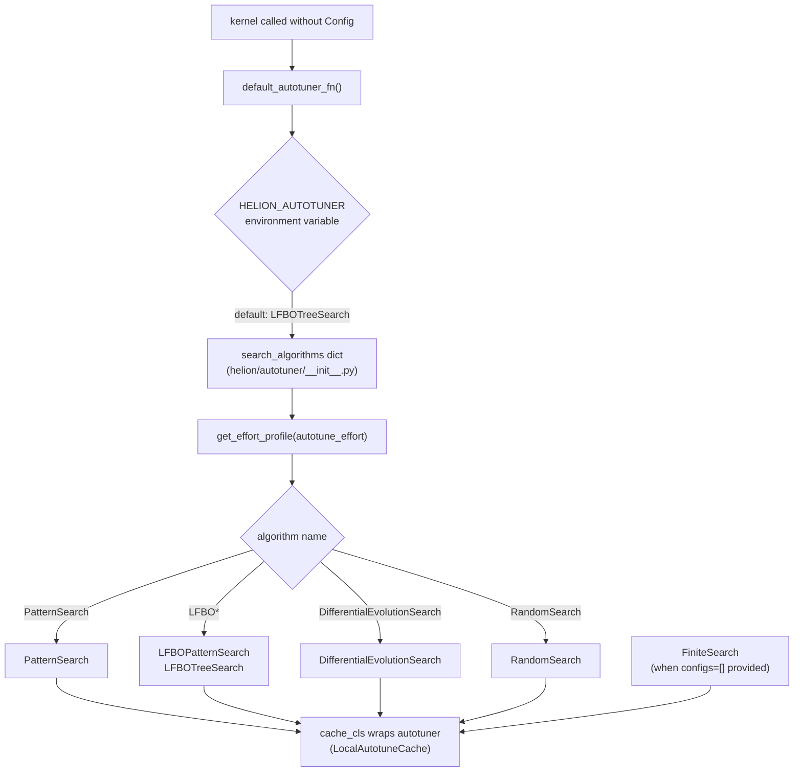
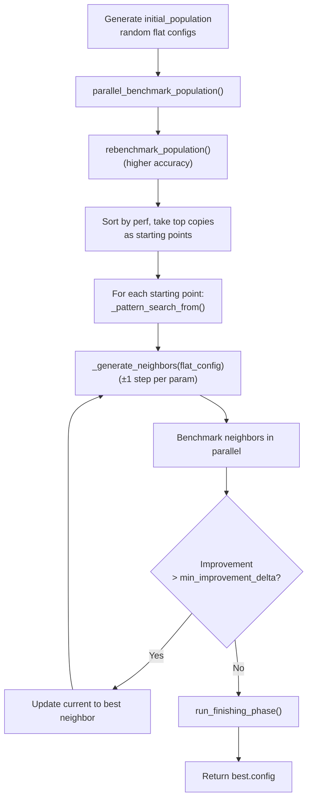
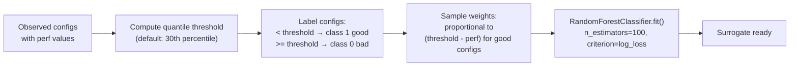
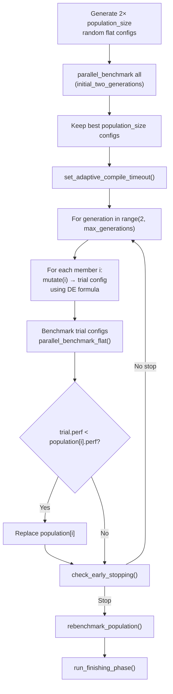
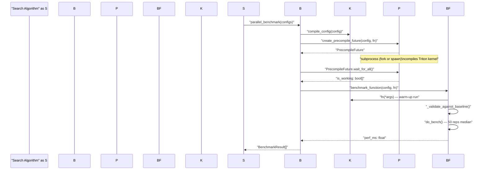

<!-- source: DeepWiki mcp.deepwiki.com · repo pytorch/helion · page 4.3 Search Algorithms · fetched 2026-10-21 -->

# Search Algorithms

<details>
<summary>Relevant source files</summary>

The following files were used as context for generating this wiki page:

- [helion/autotuner/base_search.py](helion/autotuner/base_search.py)
- [helion/autotuner/de_surrogate_hybrid.py](helion/autotuner/de_surrogate_hybrid.py)
- [helion/autotuner/differential_evolution.py](helion/autotuner/differential_evolution.py)
- [helion/autotuner/effort_profile.py](helion/autotuner/effort_profile.py)
- [helion/autotuner/finite_search.py](helion/autotuner/finite_search.py)
- [helion/autotuner/logger.py](helion/autotuner/logger.py)
- [helion/autotuner/pattern_search.py](helion/autotuner/pattern_search.py)
- [helion/autotuner/surrogate_pattern_search.py](helion/autotuner/surrogate_pattern_search.py)
- [helion/runtime/precompile_shim.py](helion/runtime/precompile_shim.py)
- [helion/runtime/settings.py](helion/runtime/settings.py)
- [test/test_autotuner.py](test/test_autotuner.py)

</details>


This page documents all search algorithm classes in Helion's autotuner, their parameters, and how `effort_profile` configures them. For a conceptual overview of the autotuning process and how search is triggered, see [Autotuning Overview](#4.2). For configuration parameters that the search algorithms operate over, see [Configuration System](#4.1). For caching that wraps these algorithms, see [Autotune Caching](#4.4).

---

## Overview

When a Helion kernel is called without a pre-tuned `Config`, the autotuner runs a search algorithm to find the best configuration. All search algorithms inherit from `BaseSearch` (in `helion/autotuner/base_search.py`), which provides benchmarking infrastructure: baseline computation, accuracy validation, parallel precompilation, and timing.

The default algorithm is `LFBOTreeSearch`, selected via the `HELION_AUTOTUNER` environment variable. The effort level (`autotune_effort` setting) controls each algorithm's parameters.

---

## Class Hierarchy

**Class hierarchy diagram**

```mermaid
classDiagram
    class "BaseAutotuner" {
        +autotune() Config
    }
    class "BaseSearch" {
        +kernel
        +settings
        +config_spec
        +args
        +benchmark(config) tuple
        +parallel_benchmark(configs) list
        +autotune() Config
        #_autotune() Config
    }
    class "PopulationBasedSearch" {
        +population list
        +config_gen ConfigGeneration
        +finishing_rounds int
        +parallel_benchmark_flat(flat_configs) list
        +rebenchmark_population()
        +run_finishing_phase()
    }
    class "FiniteSearch" {
        +configs list
        #_autotune() Config
    }
    class "PatternSearch" {
        +initial_population int
        +copies int
        +max_generations int
        #_autotune() Config
        #_generate_neighbors() list
        #_pattern_search_from() Iterator
    }
    class "LFBOPatternSearch" {
        +surrogate RandomForestClassifier
        +num_neighbors int
        +quantile float
        #_fit_surrogate()
        #_surrogate_select()
        #_autotune() Config
    }
    class "LFBOTreeSearch" {
        #_autotune() Config
    }
    class "DifferentialEvolutionSearch" {
        +population_size int
        +max_generations int
        +crossover_rate float
        +mutate() FlatConfig
        +evolve_population() int
        #_autotune() Config
    }
    class "DESurrogateHybrid" {
        +surrogate RandomForestRegressor
        +surrogate_threshold int
        +candidate_ratio int
        #_fit_surrogate()
        #_surrogate_select()
        #_autotune() Config
    }
    class "RandomSearch" {
        +count int
        #_autotune() Config
    }

    BaseAutotuner <|-- BaseSearch
    BaseSearch <|-- PopulationBasedSearch
    BaseSearch <|-- FiniteSearch
    PopulationBasedSearch <|-- PatternSearch
    PatternSearch <|-- LFBOPatternSearch
    LFBOPatternSearch <|-- LFBOTreeSearch
    PopulationBasedSearch <|-- DifferentialEvolutionSearch
    DifferentialEvolutionSearch <|-- DESurrogateHybrid
    BaseSearch <|-- RandomSearch
```

Sources: [helion/autotuner/base_search.py:123-940](), [helion/autotuner/pattern_search.py:32-248](), [helion/autotuner/surrogate_pattern_search.py:33-450](), [helion/autotuner/differential_evolution.py:22-244](), [helion/autotuner/de_surrogate_hybrid.py:55-330](), [helion/autotuner/finite_search.py:15-43]()

---

## Algorithm Selection

The algorithm is selected at runtime by `default_autotuner_fn` in `helion/runtime/settings.py`. The `HELION_AUTOTUNER` environment variable names one of the keys in the `search_algorithms` registry.

**Algorithm dispatch flow**



Sources: [helion/runtime/settings.py:236-324]()

---

## Effort Profiles

Every algorithm reads its default parameters from `helion/autotuner/effort_profile.py`. The `autotune_effort` setting (or `HELION_AUTOTUNE_EFFORT` env var) selects one of three profiles.

| Effort | Algorithm | Key Parameters |
|--------|-----------|----------------|
| `none` | all | Not used; returns default config immediately |
| `quick` | `PatternSearch` / `LFBOPatternSearch` | `initial_population=30, copies=2, max_generations=5, strategy=from_default` |
| `quick` | `DifferentialEvolutionSearch` | `population_size=20, max_generations=8, strategy=from_default` |
| `quick` | `RandomSearch` | `count=100` |
| `full` | `PatternSearch` / `LFBOPatternSearch` | `initial_population=100, copies=5, max_generations=20` |
| `full` | `DifferentialEvolutionSearch` | `population_size=40, max_generations=40` |
| `full` | `RandomSearch` | `count=1000` |

The `finishing_rounds` field determines how many simplification passes run after search completes. The `rebenchmark_threshold` controls when top configs are re-benchmarked for accuracy (disabled in `quick` by setting threshold < 1.0).

Sources: [helion/autotuner/effort_profile.py:1-103]()

---

## FiniteSearch

**File:** `helion/autotuner/finite_search.py`

`FiniteSearch` is the simplest algorithm. It benchmarks a user-provided list of `Config` objects and returns the fastest one. It is used automatically when `@helion.kernel(configs=[...])` is passed.

**Behavior:**
1. Takes a list of `Config` objects (from the kernel's `.configs` attribute or explicit constructor argument).
2. Calls `parallel_benchmark()` on all configs.
3. Returns the config with the lowest median execution time.

Raises `NotEnoughConfigs` if fewer than 2 configs are provided.

Sources: [helion/autotuner/finite_search.py:15-43]()

---

## PatternSearch

**File:** `helion/autotuner/pattern_search.py`

`PatternSearch` is a coordinate-descent-style algorithm that explores single-parameter perturbations around promising configurations.

**Algorithm:**



**Neighbor generation** (`_generate_neighbors`):
- For each config parameter, generates all valid adjacent values (e.g., for a `PowerOfTwoFragment(16, 128)`, neighbors of 32 are `[16, 64]`).
- Also generates all pairs of block-size parameter changes (since block sizes interact strongly).
- The `radius` parameter (default 1 for `PatternSearch`) controls how many steps away neighbors are generated.

**Key parameters:**

| Parameter | Default (full) | Description |
|-----------|---------------|-------------|
| `initial_population` | 100 | Number of random configs to benchmark initially |
| `copies` | 5 | Number of top configs to run parallel search from |
| `max_generations` | 20 | Max iterations per copy |
| `min_improvement_delta` | 0.001 | Stop if relative improvement < 0.1% |
| `initial_population_strategy` | `FROM_RANDOM` | `FROM_RANDOM` or `FROM_DEFAULT` |

Sources: [helion/autotuner/pattern_search.py:32-248]()

---

## LFBOPatternSearch

**File:** `helion/autotuner/surrogate_pattern_search.py`

`LFBOPatternSearch` extends `PatternSearch` with a **Likelihood-Free Bayesian Optimization (LFBO)** surrogate. Instead of evaluating all generated neighbors, it uses a `RandomForestClassifier` to predict which neighbors are likely to be "good," then only benchmarks the top fraction.

Requires `numpy` and `scikit-learn` (`pip install helion[surrogate]`).

**Surrogate model training:**



**Neighbor selection with diversity penalty (`_surrogate_select`):**
1. Generate `num_neighbors` random neighbors around current best configs.
2. Score each neighbor: `P(class=1 | surrogate)`.
3. Compute pairwise leaf-node similarity between candidates.
4. **Sequential greedy selection:** pick candidates one-by-one, penalizing those similar to already-selected ones: `score = P(good) - similarity_penalty × mean_similarity_to_selected`.
5. Benchmark only the top `frac_selected` fraction.

**Key parameters:**

| Parameter | Default | Description |
|-----------|---------|-------------|
| `num_neighbors` | 300 | Neighbors generated per generation |
| `frac_selected` | 0.10 | Fraction of neighbors to actually benchmark |
| `radius` | 2 | Max perturbation steps in config space |
| `quantile` | 0.1 | Top 10% labeled as "good" |
| `patience` | 1 | Stop if no improvement for N generations |
| `similarity_penalty` | 1.0 | Diversity penalty weight |

Sources: [helion/autotuner/surrogate_pattern_search.py:33-420]()

---

## LFBOTreeSearch

**File:** `helion/autotuner/surrogate_pattern_search.py`

`LFBOTreeSearch` is a variant of `LFBOPatternSearch` and is the **default autotuner**. It shares the same constructor parameters and effort profile as `LFBOPatternSearch`. Both are handled identically in `default_autotuner_fn`.

To select it explicitly: `HELION_AUTOTUNER=LFBOTreeSearch` (the default).

Sources: [helion/runtime/settings.py:242-289](), [helion/autotuner/surrogate_pattern_search.py:1-50]()

---

## DifferentialEvolutionSearch

**File:** `helion/autotuner/differential_evolution.py`

`DifferentialEvolutionSearch` maintains a population of configs and evolves them via differential mutation and crossover. It uses `ConfigGeneration.differential_mutation()` to blend parameter values from three population members.

**Algorithm:**



**Mutation formula** (in `ConfigGeneration.differential_mutation`):
```
trial[param] = a[param] + F × (b[param] - c[param])
```
with crossover: for each parameter, use the trial value with probability `crossover_rate`, otherwise keep the base value.

**`immediate_update` mode:** When `autotune_precompile` is disabled, `immediate_update=True` updates the population member immediately after each evaluation. Otherwise, all mutations are evaluated in parallel before updating.

**Early stopping:** Disabled by default (`min_improvement_delta=None`, `patience=None`). When enabled, stops if relative improvement over the last `patience` generations is below `min_improvement_delta`.

**Key parameters:**

| Parameter | Default (full) | Description |
|-----------|---------------|-------------|
| `population_size` | 40 | Population size |
| `max_generations` | 40 | Max generations |
| `crossover_rate` | 0.8 | Crossover probability per parameter |
| `immediate_update` | auto | True if precompile disabled |
| `min_improvement_delta` | `None` | Early stopping threshold (disabled by default) |
| `patience` | `None` | Early stopping patience (disabled by default) |

Sources: [helion/autotuner/differential_evolution.py:22-244]()

---

## DESurrogateHybrid

**File:** `helion/autotuner/de_surrogate_hybrid.py`

`DESurrogateHybrid` extends `DifferentialEvolutionSearch` with a `RandomForestRegressor` surrogate to pre-screen DE candidates. After collecting enough observations, it generates `candidate_ratio × population_size` candidates per generation but only evaluates the `population_size` that the surrogate predicts will have the lowest latency.

Requires `numpy` and `scikit-learn` (`pip install helion[surrogate]`).

**Surrogate lifecycle:**
- Activates after `surrogate_threshold` (default: 100) total evaluations.
- Refits every `refit_frequency` generations (default: every 5).
- Falls back to random selection if the surrogate is not yet fitted.

**Key parameters:**

| Parameter | Default | Description |
|-----------|---------|-------------|
| `surrogate_threshold` | 100 | Min evaluations before surrogate is used |
| `candidate_ratio` | 3 | Oversampling factor for candidate generation |
| `refit_frequency` | 5 | Refit surrogate every N generations |
| `n_estimators` | 50 | Trees in the Random Forest |
| `min_improvement_delta` | 0.001 | Early stopping threshold (enabled by default) |
| `patience` | 3 | Early stopping patience (enabled by default) |

Sources: [helion/autotuner/de_surrogate_hybrid.py:55-330]()

---

## Surrogate Model Comparison

Both `LFBOPatternSearch` and `DESurrogateHybrid` use scikit-learn Random Forest models, but for different purposes:

| Aspect | `LFBOPatternSearch` | `DESurrogateHybrid` |
|--------|---------------------|---------------------|
| **Model type** | `RandomForestClassifier` | `RandomForestRegressor` |
| **Target** | Binary: "good" vs "bad" config | Continuous: predicted latency |
| **Training labels** | Quantile-based class labels | Raw performance values (ms) |
| **Sample weights** | Weighted by margin above threshold | None |
| **Diversity** | Leaf-node similarity penalty | None (pure performance ranking) |
| **File** | `surrogate_pattern_search.py` | `de_surrogate_hybrid.py` |

Sources: [helion/autotuner/surrogate_pattern_search.py:148-190](), [helion/autotuner/de_surrogate_hybrid.py:254-287]()

---

## BaseSearch Infrastructure

All algorithms inherit the following from `BaseSearch` and `PopulationBasedSearch` in `helion/autotuner/base_search.py`:

**Benchmarking pipeline:**



**Accuracy validation:** Before accepting a config's benchmark time, `_validate_against_baseline` compares the kernel output to a baseline (either `autotune_baseline_fn` or the default config output). Tolerances default to `atol=rtol=1e-2`, with automatic `0.0` tolerance for fp8 outputs.

**Adaptive compile timeout:** After the initial population, `set_adaptive_compile_timeout()` adjusts `autotune_compile_timeout` to the Nth percentile of observed compile times (bounded below by `compile_timeout_lower_bound`). Controlled by `HELION_AUTOTUNE_ADAPTIVE_TIMEOUT`.

**`PopulationMember` dataclass** (defined in `base_search.py`):

| Field | Type | Description |
|-------|------|-------------|
| `fn` | `Callable` | Compiled kernel function |
| `perfs` | `list[float]` | Accumulated benchmark results (ms) |
| `flat_values` | `FlatConfig` | Flat list of config values |
| `config` | `Config` | Full Config object |
| `status` | `str` | `"ok"`, `"error"`, `"timeout"`, `"unknown"` |
| `compile_time` | `float \| None` | Subprocess compile duration |

Sources: [helion/autotuner/base_search.py:226-939](), [helion/autotuner/base_search.py:942-976]()

---

## Initial Population Strategies

All population-based algorithms support `InitialPopulationStrategy` (defined in `helion/autotuner/pattern_search.py`):

| Strategy | Behavior |
|----------|----------|
| `FROM_RANDOM` | Generates `initial_population` random configs via `ConfigGeneration.random_population_flat()` |
| `FROM_DEFAULT` | Starts from the default config (repeated), ignores `initial_population` count |

The strategy can be overridden globally with `HELION_AUTOTUNER_INITIAL_POPULATION=from_default` or `from_random`. The `quick` effort profile defaults to `FROM_DEFAULT` to reduce cold-start benchmarking time.

Sources: [helion/autotuner/pattern_search.py:22-30](), [helion/runtime/settings.py:205-233](), [helion/autotuner/effort_profile.py:61-98]()

---

## Configuration and Environment Variables

| Environment Variable | Default | Description |
|---------------------|---------|-------------|
| `HELION_AUTOTUNER` | `LFBOTreeSearch` | Search algorithm class name |
| `HELION_AUTOTUNE_EFFORT` | `full` | `none`, `quick`, or `full` effort profile |
| `HELION_AUTOTUNE_MAX_GENERATIONS` | (effort profile) | Override max generations for generation-based algorithms |
| `HELION_AUTOTUNER_INITIAL_POPULATION` | (effort profile) | `from_random` or `from_default` |
| `HELION_AUTOTUNE_ADAPTIVE_TIMEOUT` | `1` (enabled) | Enable/disable adaptive compile timeout |
| `HELION_AUTOTUNE_COMPILE_TIMEOUT` | `60` | Per-config compile timeout in seconds |
| `HELION_AUTOTUNE_PRECOMPILE` | `fork` | Precompile mode: `fork`, `spawn`, or disabled |
| `HELION_AUTOTUNE_PRECOMPILE_JOBS` | cpu_count | Max parallel precompile subprocesses |
| `HELION_AUTOTUNE_IGNORE_ERRORS` | `0` | Skip failing configs silently |
| `HELION_AUTOTUNE_ACCURACY_CHECK` | `1` | Validate outputs against baseline |
| `HELION_REBENCHMARK_THRESHOLD` | (effort profile) | Re-benchmark if within threshold × best perf |

Sources: [helion/runtime/settings.py:371-613](), [helion/autotuner/effort_profile.py:61-98]()

---

