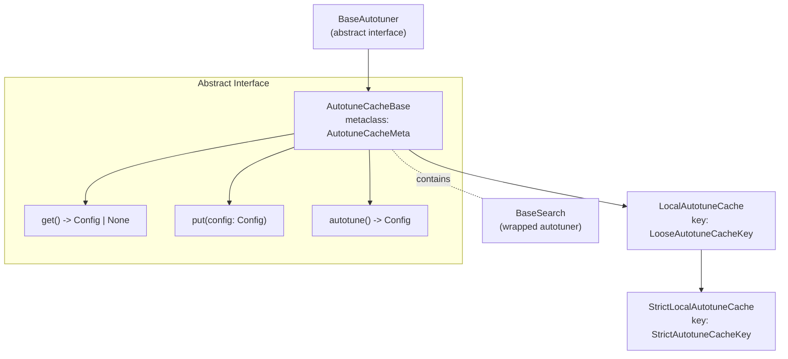
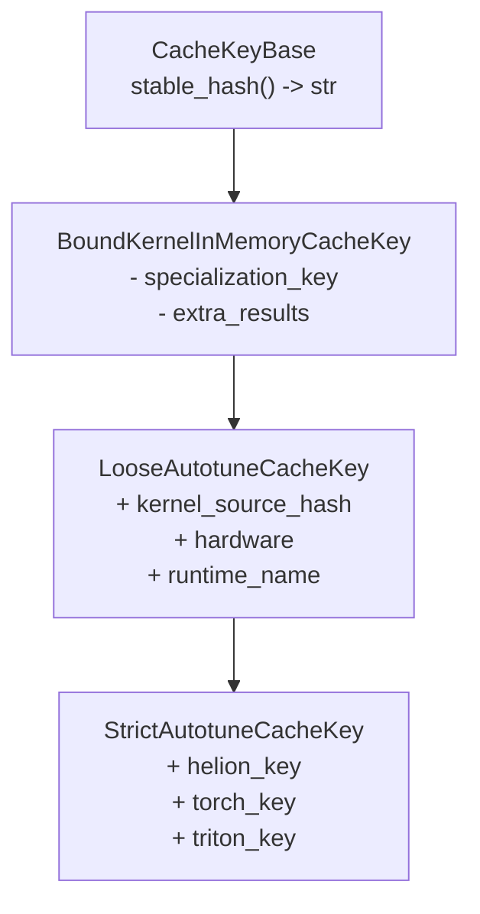
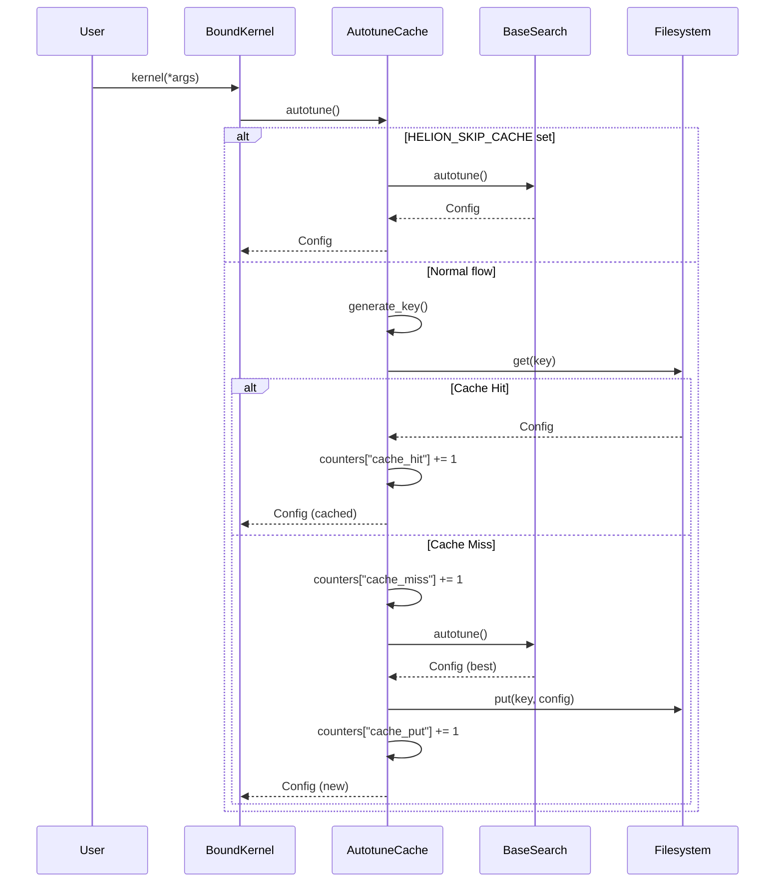
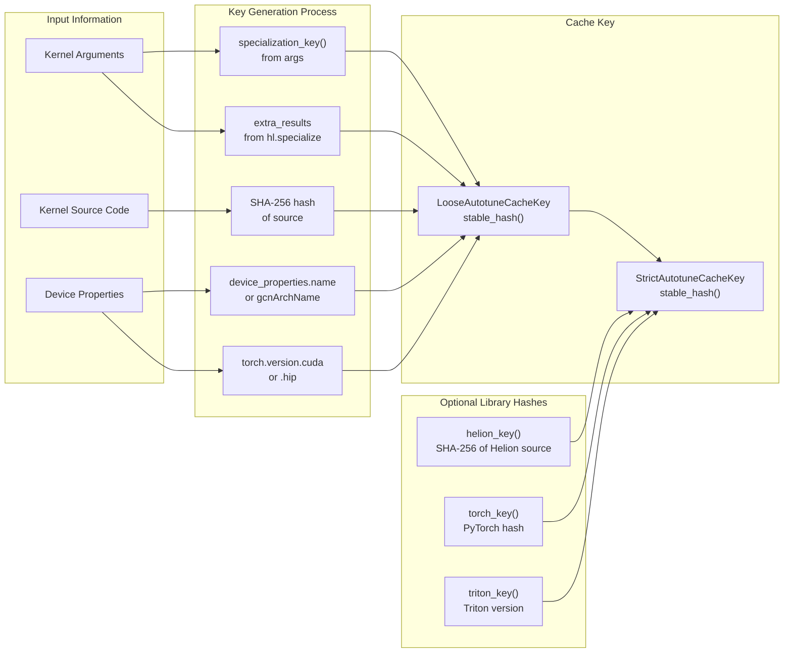

<!-- source: DeepWiki mcp.deepwiki.com · repo pytorch/helion · page 4.4 Autotune Caching · fetched 2026-10-21 -->

# Autotune Caching

<details>
<summary>Relevant source files</summary>

The following files were used as context for generating this wiki page:

- [docs/api/kernel.md](docs/api/kernel.md)
- [docs/api/settings.md](docs/api/settings.md)
- [docs/deployment_autotuning.md](docs/deployment_autotuning.md)
- [examples/welford.py](examples/welford.py)
- [helion/autotuner/aot_cache.py](helion/autotuner/aot_cache.py)
- [helion/autotuner/base_cache.py](helion/autotuner/base_cache.py)
- [helion/autotuner/local_cache.py](helion/autotuner/local_cache.py)
- [helion/autotuner/progress_bar.py](helion/autotuner/progress_bar.py)
- [helion/runtime/kernel.py](helion/runtime/kernel.py)
- [test/test_cache.py](test/test_cache.py)

</details>


Autotune caching persists the best configuration found by autotuning so that subsequent kernel executions can skip the expensive search process. The cache stores configurations on the filesystem and uses cache keys to determine when results can be reused across different inputs, hardware platforms, and code versions.

For information about the autotuning process itself, see [Autotuning Overview](#4.2). For details on search algorithms, see [Search Algorithms](#4.3).

## Architecture Overview

The autotune caching system consists of an abstract base class, concrete implementations with different strictness levels, and a hierarchy of cache key classes that determine when cached results are valid.

### Cache Class Hierarchy



**Sources:** [helion/autotuner/base_cache.py:136-189](), [helion/autotuner/local_cache.py:27-111]()

The `AutotuneCacheBase` class defines the contract for all cache implementations. It wraps a `BaseSearch` instance and intercepts `autotune()` calls to check the cache before running the expensive search. The metaclass `AutotuneCacheMeta` enables the `Cache[Search]` syntax for convenient cache creation.

### Cache Key Hierarchy

Cache keys determine when cached configurations can be reused. Different key classes provide different levels of strictness.



**Sources:** [helion/autotuner/base_cache.py:73-134]()

| Cache Key Class | Includes | Use Case |
|----------------|----------|----------|
| `BoundKernelInMemoryCacheKey` | Specialization key, extra results | In-memory bound kernel cache |
| `LooseAutotuneCacheKey` | + Kernel source hash, hardware, runtime version | Default filesystem cache (survives code changes in libraries) |
| `StrictAutotuneCacheKey` | + Helion/PyTorch/Triton version hashes | Maximum safety (invalidates on any library change) |

**Sources:** [helion/autotuner/base_cache.py:82-134]()

## Cache Implementations

### LocalAutotuneCache

The default filesystem-based cache that uses `LooseAutotuneCacheKey`. This cache persists across kernel invocations and Python sessions but allows cached results to survive updates to Helion, PyTorch, or Triton libraries.

**Key Generation:**
- Retrieves the in-memory cache key from `BoundKernel`
- Hashes the kernel source code using SHA-256
- Extracts hardware name and runtime version from tensor device properties
- Combines into `LooseAutotuneCacheKey`

**Storage Location:**
- Default: `torch.cache_dir() / "helion" / "{key.stable_hash()}.best_config"`
- Override: `$HELION_CACHE_DIR / "{key.stable_hash()}.best_config"`

**Sources:** [helion/autotuner/local_cache.py:27-100]()

### StrictLocalAutotuneCache

A stricter variant that includes library version hashes in the cache key. Use this when you need to ensure autotuning reruns if any dependency changes.

**Additional Key Components:**
- `helion_key()`: SHA-256 hash of all Helion source files
- `torch_key()`: PyTorch source hash from `torch._inductor.codecache`
- `triton_key()`: Triton version hash

**Sources:** [helion/autotuner/local_cache.py:102-111](), [helion/autotuner/base_cache.py:51-71]()

## Cache Lifecycle

The cache intercepts autotuning requests and handles cache lookups, misses, and population.



**Sources:** [helion/autotuner/base_cache.py:160-189]()

### Cache Operations

#### Get Operation

The `get()` method attempts to load a cached configuration from the filesystem:

```python
def get(self) -> Config | None:
    path = self._get_local_cache_path()
    try:
        return Config.load(path)
    except Exception:
        return None
```

Returns `None` on cache miss (file doesn't exist, is corrupt, or can't be read).

**Sources:** [helion/autotuner/local_cache.py:86-91]()

#### Put Operation

The `put()` method saves a configuration to the cache:

```python
def put(self, config: Config) -> None:
    path = self._get_local_cache_path()
    config.save(path)
```

The `Config.save()` method writes atomically using a temporary file and rename to avoid corruption in multithreaded environments.

**Sources:** [helion/autotuner/local_cache.py:93-95](), [helion/runtime/config.py:130-138]()

#### Autotune Method

The `autotune()` method orchestrates the cache lookup and population:

1. Check if `HELION_SKIP_CACHE` is set (bypass cache if true)
2. Call `get()` to check for cached result
3. On cache hit: increment counter, log message, return cached config
4. On cache miss: increment counter, call wrapped autotuner's `autotune()`
5. Call `put()` to cache the result
6. Return the new config

**Sources:** [helion/autotuner/base_cache.py:160-189]()

## Cache Key Generation

Cache keys are generated by combining multiple sources of information to uniquely identify when a cached configuration is valid.



**Sources:** [helion/autotuner/local_cache.py:43-76](), [helion/autotuner/local_cache.py:108-110](), [helion/autotuner/base_cache.py:51-71]()

### Specialization Key Components

The specialization key includes information about all kernel inputs:
- Tensor shapes, strides, dtype, device
- Scalar values and types
- Results from `hl.specialize()` calls

**Sources:** [helion/autotuner/base_cache.py:82-96]()

### Hardware and Runtime Detection

The cache key generation extracts hardware information from the first tensor argument:

| Platform | Hardware Source | Runtime Source |
|----------|----------------|----------------|
| CUDA | `device_properties.name` | `torch.version.cuda` |
| ROCm | `device_properties.gcnArchName` | `torch.version.hip` |
| XPU | `device_properties.name` | `device_properties.driver_version` |

**Sources:** [helion/autotuner/local_cache.py:56-68]()

## Cache Configuration

### Environment Variables

| Variable | Type | Default | Description |
|----------|------|---------|-------------|
| `HELION_CACHE_DIR` | Path | `torch.cache_dir()/helion` | Directory for cache files |
| `HELION_SKIP_CACHE` | Bool | `0` | Skip cache entirely, always autotune |

**Sources:** [helion/autotuner/local_cache.py:79-84](), [helion/autotuner/base_cache.py:161-167]()

### Cache Directory Structure

```
{HELION_CACHE_DIR}/
├── {hash1}.best_config    # JSON config for key hash1
├── {hash2}.best_config    # JSON config for key hash2
└── ...
```

Each cache file contains a JSON-serialized `Config` object. The filename is the stable hash of the cache key.

**Sources:** [helion/autotuner/local_cache.py:78-84](), [helion/runtime/config.py:120-143]()

## Integration with Kernel System

The cache integrates with the kernel system through the `autotuner_fn` parameter on the `@helion.kernel` decorator.

### Usage Patterns

**Default (no explicit cache):**
```python
@helion.kernel()
def my_kernel(...):
    ...
```
Uses the search algorithm directly without caching.

**With LocalAutotuneCache:**
```python
from helion.autotuner import LocalAutotuneCache
from helion.autotuner import DifferentialEvolutionSearch

@helion.kernel(autotuner_fn=LocalAutotuneCache[DifferentialEvolutionSearch])
def my_kernel(...):
    ...
```

**With StrictLocalAutotuneCache:**
```python
from helion.autotuner import StrictLocalAutotuneCache
from helion.autotuner import PatternSearch

@helion.kernel(autotuner_fn=StrictLocalAutotuneCache[PatternSearch])
def my_kernel(...):
    ...
```

**Sources:** [test/test_cache.py:24-26](), [test/test_cache.py:71-74]()

### Cache Metaclass Syntax

The `AutotuneCacheMeta` metaclass enables the `Cache[Search]` syntax:

```python
LocalAutotuneCache[DifferentialEvolutionSearch]
```

This creates a factory function that:
1. Accepts a `BoundKernel` and arguments
2. Instantiates the search algorithm
3. Wraps it in the cache class
4. Returns the combined autotuner

**Sources:** [helion/autotuner/base_cache.py:30-48]()

## Cache Metrics and Debugging

The cache tracks metrics using the global `counters` dictionary:

| Counter | Meaning |
|---------|---------|
| `counters["autotune"]["cache_hit"]` | Number of cache lookups that found a result |
| `counters["autotune"]["cache_miss"]` | Number of cache lookups that failed |
| `counters["autotune"]["cache_put"]` | Number of configs written to cache |

**Sources:** [helion/autotuner/base_cache.py:170-187](), [test/test_cache.py:42-62]()

### Cache Information Messages

When a cache hit occurs, the system logs a message indicating where the cache is located and how to clear it:

```
Found cached config for <kernel_name>, skipping autotuning.
Cache directory: /path/to/cache. To run autotuning again, delete the cache directory or set HELION_SKIP_CACHE=1.
```

**Sources:** [helion/autotuner/base_cache.py:173-175](), [helion/autotuner/local_cache.py:97-99]()

## Cache Invalidation

Understanding when caches are invalidated is important for correct behavior:

### Automatic Invalidation

Caches are automatically invalidated when:
- Kernel source code changes (detected via source hash)
- Input tensor shapes, dtypes, or devices change
- Hardware platform changes (different GPU model)
- Runtime version changes (CUDA/ROCm update)
- Library versions change (**StrictLocalAutotuneCache only**)
- `hl.specialize()` decisions change

### Manual Invalidation

To force re-autotuning:
1. Set `HELION_SKIP_CACHE=1` environment variable
2. Delete cache files from `$HELION_CACHE_DIR`
3. Call `kernel.reset()` to clear in-memory bound kernel cache (forces new cache key lookup)

**Sources:** [helion/autotuner/base_cache.py:161-167](), [test/test_cache.py:46-62]()

## Choosing a Cache Strategy

| Use Case | Recommended Cache | Rationale |
|----------|------------------|-----------|
| Development | No cache or `LocalAutotuneCache` | Fast iteration, accepts library updates |
| Testing | `StrictLocalAutotuneCache` | Detect performance regressions from library changes |
| Production | `LocalAutotuneCache` | Balance safety and performance |
| CI/CD | `StrictLocalAutotuneCache` | Reproducible builds |

**Sources:** [helion/autotuner/local_cache.py:27-111]()

---

