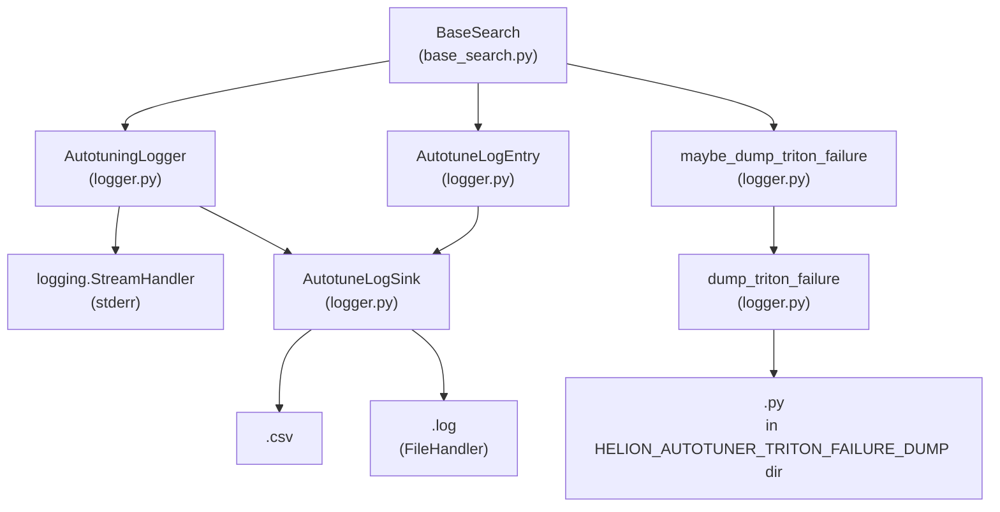
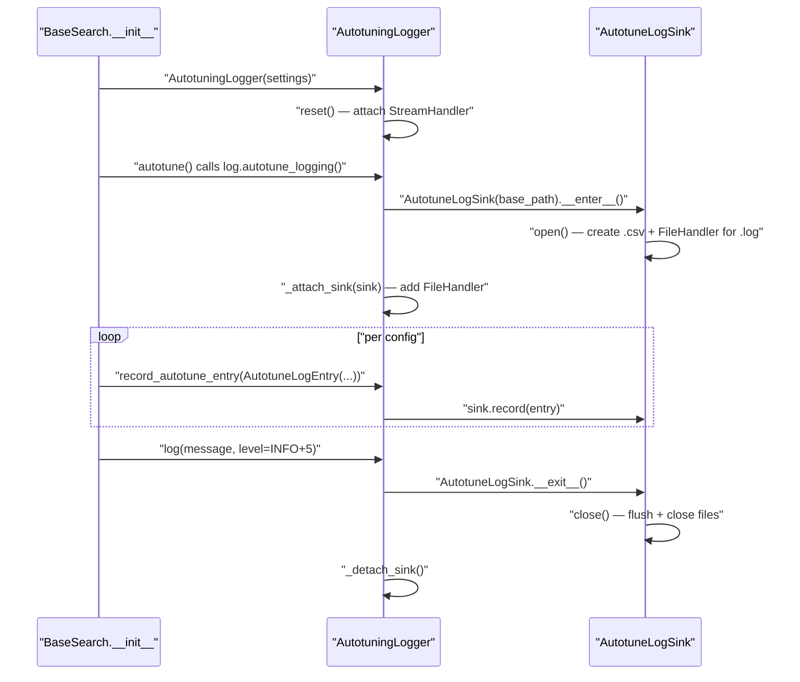
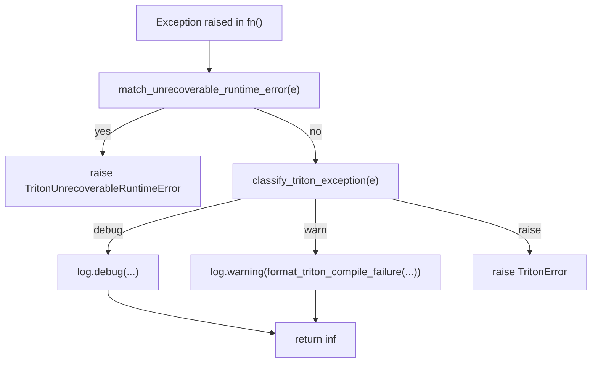
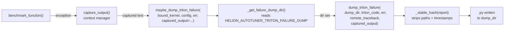
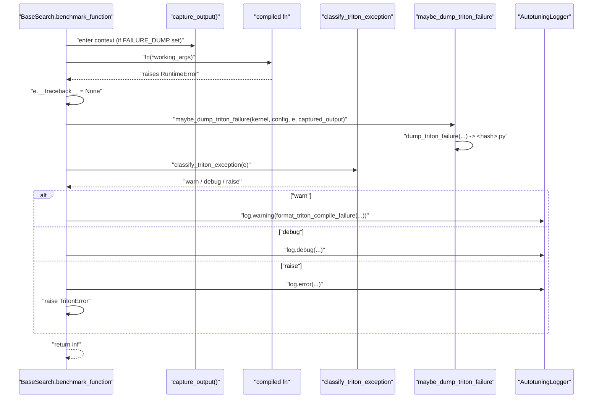

<!-- source: DeepWiki mcp.deepwiki.com · repo pytorch/helion · page 4.5 Autotuning Logging and Diagnostics · fetched 2026-10-21 -->

# Autotuning Logging and Diagnostics

<details>
<summary>Relevant source files</summary>

The following files were used as context for generating this wiki page:

- [helion/_logging/_internal.py](helion/_logging/_internal.py)
- [helion/autotuner/base_search.py](helion/autotuner/base_search.py)
- [helion/autotuner/finite_search.py](helion/autotuner/finite_search.py)
- [helion/autotuner/logger.py](helion/autotuner/logger.py)
- [helion/runtime/precompile_shim.py](helion/runtime/precompile_shim.py)
- [helion/runtime/settings.py](helion/runtime/settings.py)
- [test/test_autotuner.py](test/test_autotuner.py)
- [test/test_logging.py](test/test_logging.py)

</details>


This page documents the logging and diagnostic infrastructure used during Helion's autotuning process. It covers the `AutotuningLogger` and `AutotuneLogSink` classes for structured telemetry, how Triton compilation failures are classified and dumped, the `capture_output` mechanism, and the `make_precompiler` shim used for subprocess-based precompilation.

For an overview of the autotuning flow that produces these log events, see [Autotuning Overview](#4.2). For the caching layer that wraps the autotuner, see [Autotune Caching](#4.4). For settings that configure logging behavior, see [Settings and Environment Variables](#6.2).

---

## Component Map

**Logging flow diagram**



Sources: [helion/autotuner/logger.py:60-136](), [helion/autotuner/base_search.py:247-265]()

---

## AutotuningLogger

`AutotuningLogger` is defined in [helion/autotuner/logger.py:60-238]() and is instantiated once per `BaseSearch` instance [helion/autotuner/base_search.py:260]().

### Design properties

- Does **not** propagate to the root Python logger (`self._logger.propagate = False`).
- Formats every record as `[<elapsed>s] <message>` using `_ElapsedFormatter`, where the elapsed time is wall-clock seconds since the logger was created.
- Accepts both plain strings and **callables** (`lambda: ...`) as message arguments, so expensive formatting is skipped if the log level is not active.
- Has convenience methods `error()`, `warning()`, and `debug()` that delegate to `__call__` with fixed log levels.
- The active log level is taken from `settings.autotune_log_level`, which corresponds to the `HELION_AUTOTUNE_LOG_LEVEL` environment variable (default: `logging.INFO`).

### Lifecycle



Sources: [helion/autotuner/logger.py:60-149](), [helion/autotuner/base_search.py:880-918]()

### Handler management

`AutotuningLogger` maintains two lists:

| List | Purpose |
|------|---------|
| `_active_handlers` | Currently attached to the underlying `logging.Logger` |
| `_extra_handlers` | Persistent handlers that survive `reset()` |

Calling `reset()` removes all handlers and re-creates the `StreamHandler`. The `AutotuneLogSink` handler is temporary and is added/removed via `_attach_sink()` / `_detach_sink()` only for the duration of a tuning run.

---

## AutotuneLogSink

`AutotuneLogSink` [helion/autotuner/logger.py:264-361]() writes two files when active:

| File | Content |
|------|---------|
| `<base_path>.csv` | Per-config structured rows |
| `<base_path>.log` | Full text of all log messages at `DEBUG` level |

The base path is taken from `settings.autotune_log`, which corresponds to `HELION_AUTOTUNE_LOG`. For example, setting `HELION_AUTOTUNE_LOG=/tmp/run` produces `/tmp/run.csv` and `/tmp/run.log`.

### CSV schema

```
timestamp_s, config_index, generation, status, perf_ms, compile_time_s, config
```

| Column | Type | Notes |
|--------|------|-------|
| `timestamp_s` | float (2 dp) | Seconds since `start_run()` was called |
| `config_index` | int | Monotonically increasing counter, reset per run |
| `generation` | int | Search algorithm generation |
| `status` | str | One of `started`, `ok`, `error`, `timeout` |
| `perf_ms` | float (6 dp) | Empty if not finite |
| `compile_time_s` | float (2 dp) | Empty if unknown |
| `config` | str | `str(config)` representation |

The sink flushes the CSV file after every row [helion/autotuner/logger.py:360-361](), so data is not lost if the process is killed mid-run.

### AutotuneLogEntry

`AutotuneLogEntry` [helion/autotuner/logger.py:256-261]() is a `NamedTuple` with fields:

```
generation: int
status: str
perf_ms: float | None
compile_time: float | None
config: Config
```

In `parallel_benchmark`, two entries are written per config — one with `status="started"` before benchmarking, and one with `status="ok"` or `status="error"` after it completes [helion/autotuner/base_search.py:826-847]().

---

## Triton Failure Classification

When a Triton compile or runtime error occurs inside `benchmark_function`, the error is routed through `classify_triton_exception` [helion/autotuner/logger.py:485-506]().

**Failure triage diagram**



Sources: [helion/autotuner/logger.py:444-506](), [helion/autotuner/base_search.py:573-632]()

### Classification rules

| Condition | Classification |
|-----------|---------------|
| `OutOfResources` exception type | `"debug"` |
| `PTXASError` exception type | `"warn"` |
| `"PassManager::run failed"` in message | `"warn"` |
| Matches `_EXPECTED_TRITON_ERRORS_RE` | `"debug"` |
| Matches `_UNRECOVERABLE_RUNTIME_ERROR_RE` | raises immediately |
| Anything else | `"raise"` |

`_EXPECTED_TRITON_ERRORS_RE` [helion/autotuner/logger.py:445-463]() is a compiled regex that matches strings such as:
- `[CUDA]: invalid argument`
- `PassManager::run failed`
- `triton.compiler.errors.CompilationError`
- `out of resource: shared memory`
- `exceeds triton maximum tensor numel`
- `too many resources requested for launch`

`_UNRECOVERABLE_RUNTIME_ERROR_RE` [helion/autotuner/logger.py:465-478]() matches:
- `illegal memory access`
- `misaligned address`
- `unspecified launch failure`
- `illegal instruction`

When `autotune_ignore_errors` is `True` (set via `HELION_AUTOTUNE_IGNORE_ERRORS=1`), none of the "raise" or "warn" paths fire — the error is silently discarded and `inf` is returned as the benchmark result [helion/autotuner/base_search.py:594-596]().

The message `SUPPRESSED_TRITON_CODE_MSG` [helion/autotuner/logger.py:364-366]() is appended to user-facing error messages to inform the user that setting `HELION_AUTOTUNE_LOG_LEVEL=DEBUG` will reveal the generated Triton code.

---

## Triton Failure Dump

When the environment variable `HELION_AUTOTUNER_TRITON_FAILURE_DUMP` is set to a directory path, every Triton failure during benchmarking is written to a file in that directory.

**Dump mechanism diagram**



Sources: [helion/autotuner/logger.py:397-626](), [helion/autotuner/base_search.py:530-535](), [helion/autotuner/base_search.py:578-583]()

### dump_triton_failure output format

`dump_triton_failure` [helion/autotuner/logger.py:565-626]() writes a self-contained `.py` file containing:

1. A header comment with `triton.__version__` and the error type/message
2. The full Triton source code that failed
3. The Python traceback (or a remote traceback, if from a subprocess)
4. Any captured stdout/stderr output (from `capture_output()`)

The filename is derived from `_stable_hash(report)` [helion/autotuner/logger.py:516-520](), which hashes the content after normalizing away absolute filesystem paths (`_PATH_RE`) and timestamps (`_TIMESTAMP_RE`). This means identical failures across different machines or runs deduplicate to the same filename.

### capture_output

`capture_output` [helion/autotuner/logger.py:523-562]() is a context manager that captures stdout and stderr at the **file-descriptor level** (not just Python-level `print()`). This is needed to capture output from Triton's LLVM/MLIR compiler passes written in C++.

It works by:
1. Duplicating the real stdout/stderr file descriptors via `os.dup()`
2. Redirecting both to a temporary file via `os.dup2()`
3. On exit, restoring the originals and reading the temp file's contents

This is active only when `_get_failure_dump_dir()` returns a non-empty path. The captured text is passed into `maybe_dump_triton_failure`.

---

## make_precompiler and Precompilation Logging

`make_precompiler` [helion/runtime/precompile_shim.py:22-89]() is used during the precompilation phase to detect configs that hang or fail during Triton compilation before benchmarking begins.

When Triton compilation inside the precompiler subprocess fails, it uses:
- `classify_triton_exception` to decide whether the failure is expected
- `format_triton_compile_failure` to format the message for `stderr`

If the failure is classified as `"debug"`, the subprocess exits silently (`sys.exit(1)` without printing). Otherwise, it prints the formatted failure message to `stderr` before exiting.

`already_compiled` [helion/runtime/precompile_shim.py:92-93]() is a sentinel function returned when the Triton kernel cache already has a compiled entry for the given config — it causes the precompiler to skip recompilation.

---

## Logging-Related Settings Reference

The following settings control the logging and diagnostic behavior. All have corresponding environment variable overrides.

| Setting | Env Variable | Default | Description |
|---------|-------------|---------|-------------|
| `autotune_log_level` | `HELION_AUTOTUNE_LOG_LEVEL` | `logging.INFO` | Python log level. Accepts integer or level name (e.g., `DEBUG`). Set `0` to silence. |
| `autotune_log` | `HELION_AUTOTUNE_LOG` | `None` | Base path for `.csv` and `.log` output files. |
| `autotune_ignore_errors` | `HELION_AUTOTUNE_IGNORE_ERRORS` | `False` | If `True`, suppresses all error logging and never raises for compile/runtime failures. |
| `print_output_code` | `HELION_PRINT_OUTPUT_CODE` | `False` | After autotuning, prints the Triton code of the best config to `stderr`. |
| *(env only)* | `HELION_AUTOTUNER_TRITON_FAILURE_DUMP` | *(unset)* | Directory to write failure dump `.py` files. |
| *(env only)* | `HELION_LOGS` | *(unset)* | Comma-separated logger names to enable (prefix with `+` for DEBUG). |

Sources: [helion/runtime/settings.py:399-467](), [helion/autotuner/logger.py:397-404](), [helion/_logging/_internal.py:1-81]()

### Enabling debug-level Triton code logging

Setting `HELION_AUTOTUNE_LOG_LEVEL=DEBUG` (or `autotune_log_level=logging.DEBUG`) causes `log_generated_triton_code_debug` [helion/autotuner/logger.py:369-394]() to emit the generated Triton source for any failing config. Without this, only the message `"Enable HELION_AUTOTUNE_LOG_LEVEL=DEBUG to log generated Triton code."` is shown.

---

## End-to-End Example: What Happens on a Compile Failure



Sources: [helion/autotuner/base_search.py:516-632](), [helion/autotuner/logger.py:407-506]()

Note that `e.__traceback__ = None` is set explicitly before any further processing to release references to local variables in call stack frames, preventing memory from being held by the exception object during the rest of the autotuning run [helion/autotuner/base_search.py:577]().

---

