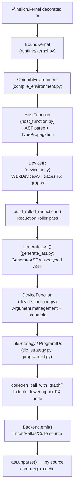
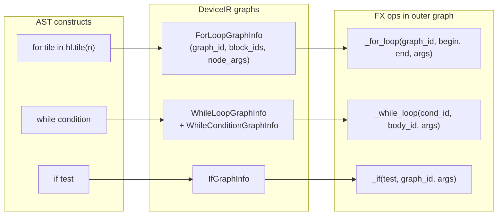
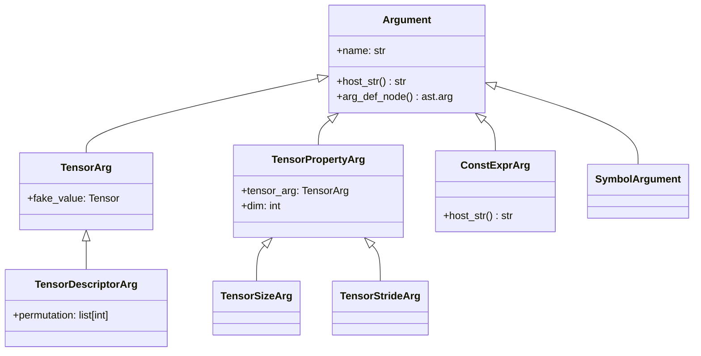
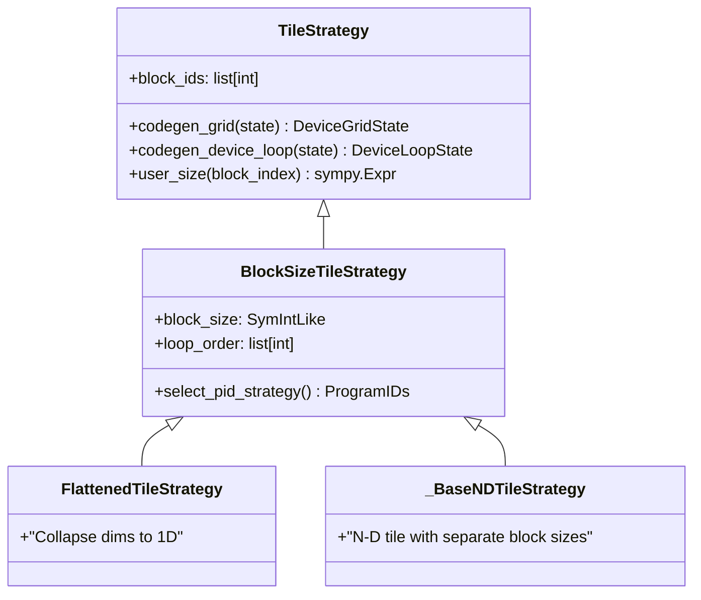
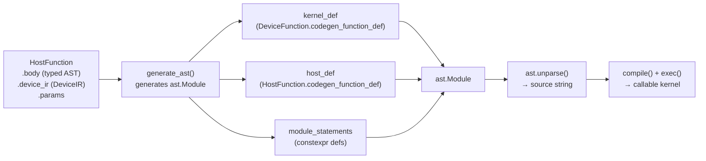
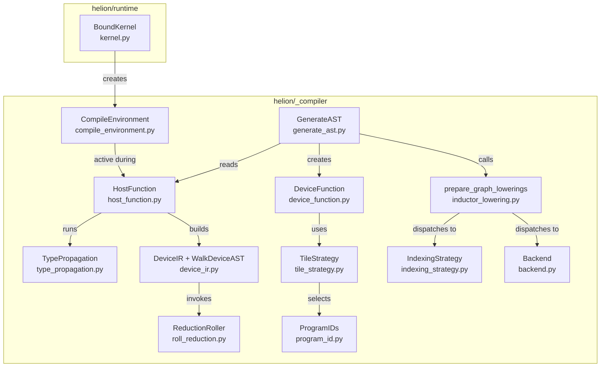

<!-- source: DeepWiki mcp.deepwiki.com · repo pytorch/helion · page 5 Compilation Pipeline · fetched 2026-10-21 -->

# Compilation Pipeline

Relevant source files

The following files were used as context for generating this wiki page:

- [helion/_compiler/compile_environment.py](helion/_compiler/compile_environment.py)
- [helion/_compiler/device_function.py](helion/_compiler/device_function.py)
- [helion/_compiler/device_ir.py](helion/_compiler/device_ir.py)
- [helion/_compiler/generate_ast.py](helion/_compiler/generate_ast.py)
- [helion/_compiler/tile_strategy.py](helion/_compiler/tile_strategy.py)
- [helion/language/_tracing_ops.py](helion/language/_tracing_ops.py)
- [helion/language/memory_ops.py](helion/language/memory_ops.py)

## Purpose and Scope

This page describes the multi-stage pipeline that transforms a Python function decorated with `@helion.kernel` into executable GPU kernel code. It covers the roles of each major compiler component, how they interact, and the data flow between stages.

Related sub-pages cover individual stages in depth:
- For type inference details, see [Type Propagation](#5.1)
- For FX graph construction, see [Device IR Generation](#5.2)
- For Inductor lowering passes, see [Graph Transformations](#5.3)
- For code generation internals, see [Compilation Environment and Code Generation](#5.4)
- For load/store code generation, see [Indexing Strategies](#5.5)
- For backend-specific emission, see [Backend Implementations](#5.6)
- For grid and program ID management, see [Program IDs and Grid Management](#5.7)
- For how a compiled kernel is invoked, see [Kernel Lifecycle](#6.1)

---

## Overview

Helion's compiler takes a Python function that uses `hl.tile`, `hl.load`, `hl.store`, and other `helion.language` primitives and produces a backend-specific source file (typically Triton Python). The pipeline runs once per unique `(kernel, Config)` pair. A single `CompileEnvironment` is shared across all configs for a given bound kernel; config-specific code generation runs separately for each `Config`.

**Pipeline Diagram: Compilation Stages**

Sources: [helion/_compiler/compile_environment.py:94-100](), [helion/_compiler/device_ir.py:423-430](), [helion/_compiler/generate_ast.py:537-581](), [helion/_compiler/device_function.py:225-300]()

---

## Stage 1: Environment Setup

When a Helion kernel is called for the first time with a given combination of tensor dtypes, shapes, and device, a `CompileEnvironment` is created. It serves as the global compilation context for all subsequent stages and is accessed via `CompileEnvironment.current()` (a thread-local singleton).

**Key responsibilities of `CompileEnvironment`:**

| Field | Type | Purpose |
|---|---|---|
| `device` | `torch.device` | Target execution device |
| `settings` | `Settings` | User-facing compilation settings |
| `shape_env` | `ShapeEnv` | Symbolic shape reasoning (PyTorch) |
| `fake_mode` | `FakeTensorMode` | Fake tensor execution for tracing |
| `block_sizes` | `list[BlockSizeInfo]` | One entry per tile/grid dimension |
| `config_spec` | `ConfigSpec` | Valid config parameter ranges |
| `_backend` | `Backend` | Active backend (Triton, Pallas, etc.) |

`CompileEnvironment` does not store any config-specific state. It is reused across all `Config` variants for the same kernel invocation. The backend is selected at environment creation time from `settings.backend`, which maps to `TritonBackend`, `PallasBackend`, `CuteBackend`, or `TileIRBackend`.

**Block size allocation** happens incrementally during tracing. Each call to `hl.tile` or `hl.grid` allocates a `BlockSizeInfo` entry via `allocate_block_size()`, which creates an unbacked `torch.SymInt` symbol that is later resolved to a concrete integer from the `Config`.

Sources: [helion/_compiler/compile_environment.py:94-157](), [helion/_compiler/compile_environment.py:212-250](), [helion/_compiler/compile_environment.py:700-785]()

---

## Stage 2: AST Parsing and Type Propagation

`HostFunction` (in `helion/_compiler/host_function.py`) parses the Python source of the kernel function using `ast.parse`, then annotates every node in the resulting AST with type information via the `TypePropagation` pass.

Type propagation assigns a `TypeInfo` subclass to every expression node. Important types include:

| `TypeInfo` subclass | Meaning |
|---|---|
| `TensorType` | A tensor with a known `FakeTensor` shape/dtype |
| `TileIndexType` | The integer index of a tile (block_id) |
| `GridIndexType` | The integer offset of a grid dimension |
| `NumericType` | A scalar int, float, or bool |
| `CallableType` | A callable (function or API function) |
| `IterType` | An iterable (result of `hl.tile`, `hl.grid`, etc.) |

The type-annotated AST is stored as `HostFunction.body` (a list of `ExtendedAST` nodes) and is the input to all subsequent stages.

For details, see [Type Propagation](#5.1).

---

## Stage 3: Device IR Construction

After type propagation, the compiler constructs the **Device IR**: a collection of `torch.fx.Graph` objects, one per loop body or control flow region. This is done by `WalkDeviceAST` in `helion/_compiler/device_ir.py`.

`WalkDeviceAST` runs under a `make_fx` tracing context. As it walks the type-annotated AST, all tensor operations are recorded into the active FX graph. Control flow constructs are handled specially:

**Control flow → FX graph mapping:**

Top-level `for tile in hl.grid(...)` loops become **root graphs**, stored in `DeviceIR.root_ids`. Each inner `for tile in hl.tile(...)` loop creates a nested `ForLoopGraphInfo`.

The `DeviceIR` class holds:
- `graphs: list[GraphInfo]` — all graphs in creation order
- `root_ids: list[int]` — indices of top-level graphs
- `rolled_reductions: list[RolledReductionInfo]` — reduction rollout metadata
- `phases: list[KernelPhase]` — barrier-separated execution phases

For details, see [Device IR Generation](#5.2).

Sources: [helion/_compiler/device_ir.py:423-570](), [helion/_compiler/device_ir.py:256-405](), [helion/language/_tracing_ops.py:131-141]()

---

## Stage 4: Graph Transformations

After the Device IR is built, two transformation passes run:

### 4.1 Reduction Rollout

`DeviceIR.build_rolled_reductions()` inspects each reduction dimension. If a reduction can be expressed as a looped reduction (rather than persistent), it creates a duplicate graph with the reduction dimension exposed as a `tl.range` loop. This is recorded in `RolledReductionInfo`.

At code generation time, `DeviceIR.get_root(config, graph_id)` selects between the persistent graph and the rolled reduction graph based on the active `Config.reduction_loops` setting.

### 4.2 Inductor Lowering

When a graph is being lowered to device code, `codegen_call_with_graph()` in `helion/_compiler/inductor_lowering.py` walks each FX node and dispatches to a registered lowering function. ATen ops are lowered to Triton/backend equivalents. The `prepare_graph_lowerings()` pass prepares the graph before lowering begins.

For details, see [Graph Transformations](#5.3).

Sources: [helion/_compiler/device_ir.py:504-560](), [helion/_compiler/device_ir.py:432-462]()

---

## Stage 5: Code Generation

Code generation is orchestrated by `generate_ast()` in `helion/_compiler/generate_ast.py`. It creates a `GenerateAST` instance (a node visitor) that walks the type-annotated AST from `HostFunction.body` and produces two outputs:

1. **Host-side Python code**: statements that compute block sizes, call the kernel launcher, etc.
2. **Device-side kernel code**: the Triton/Pallas/CuTe function body.

**`GenerateAST` key responsibilities:**

| Method / attribute | Role |
|---|---|
| `visit_For()` | Dispatches grid loops to tile strategy codegen |
| `visit_Call()` | Dispatches API function calls to their `_codegen` handlers |
| `add_device_loop()` | Context manager tracking active loop nests |
| `active_device_loops` | Maps `block_id → list[DeviceLoopOrGridState]` |
| `device_function` | The `DeviceFunction` being built |
| `host_statements` | Accumulates host-side Python AST nodes |

**`DeviceFunction`** manages the kernel function signature and body:

| Attribute | Role |
|---|---|
| `arguments` | Ordered list of `Argument` subclasses (tensors, sizes, strides, constexprs) |
| `preamble` | Statements before the kernel body (e.g., tensor descriptor creation) |
| `body` | The kernel body statements |
| `tile_strategy` | `TileStrategyDispatch` — per-block-id strategy lookup |
| `pid` | `ProgramIDs` instance — controls grid launch |

**Argument types:**

Sources: [helion/_compiler/generate_ast.py:47-70](), [helion/_compiler/generate_ast.py:537-581](), [helion/_compiler/device_function.py:102-200](), [helion/_compiler/device_function.py:225-300]()

---

## Stage 6: Tile Strategy and Grid Management

For each `for tile in hl.grid(...)` loop, `GenerateAST.visit_For()` invokes the appropriate `TileStrategy` to emit the program ID and offset computation. The strategy is determined by `Config.pid_type` and whether the tile dimensions are flattened.

**`TileStrategy` hierarchy:**

For inner `for tile in hl.tile(...)` loops (device loops), `codegen_device_loop()` emits a `tl.range(...)` loop with offset/index/mask variable computation.

For the `ProgramIDs` hierarchy and grid construction, see [Program IDs and Grid Management](#5.7).

Sources: [helion/_compiler/tile_strategy.py:125-285](), [helion/_compiler/tile_strategy.py:357-667]()

---

## Stage 7: Final AST Assembly and Output

The `generate_ast()` function assembles the final `ast.Module` containing:

1. Import statements (from `HostFunction.codegen_imports()`)
2. Module-level constexpr definitions (e.g., `_BLOCK_SIZE_0 = tl.constexpr(256)`)
3. Helper function definitions (from `DeviceFunction.codegen_helper_functions()`)
4. The device kernel function definition (Triton `@triton.jit` decorated function)
5. The host launcher function definition
6. Optionally, a `call()` repro function and `if __name__ == "__main__"` block

The resulting `ast.Module` is unparsed with `ast.unparse()` to produce a Python source string, which is then compiled and cached. On cache hit for subsequent calls, the compiled kernel object is reused directly.

**Data flow through the final assembly:**

Sources: [helion/_compiler/generate_ast.py:537-581](), [helion/_compiler/device_function.py:666-730]()

---

## Component Interaction Summary

This diagram maps the major components to their file locations and shows how they interact during compilation.

**Code entity diagram: Compilation Pipeline**

Sources: [helion/_compiler/compile_environment.py:94-157](), [helion/_compiler/device_ir.py:423-574](), [helion/_compiler/generate_ast.py:47-70](), [helion/_compiler/device_function.py:225-300](), [helion/_compiler/tile_strategy.py:125-165]()

---

## Key Invariants

- `CompileEnvironment.current()` is valid for the entire duration of a compilation. It is stored in a thread-local (`tls.env`) and entered/exited as a context manager.
- `HostFunction.current()` is valid during type propagation and device IR construction.
- `DeviceFunction.current()` is valid during code generation.
- Block size symbols (`BlockSizeInfo.var`) are unbacked `torch.SymInt` values. They are resolved to concrete integers from `Config` only during code generation via `BlockSizeInfo.from_config(config)`.
- No `Config`-specific state is stored in `CompileEnvironment`. All config-dependent decisions happen in `generate_ast()` and below.
- Dead code elimination (`DeviceFunction.dead_code_elimination()`) runs at the end of device function generation to remove unused variable assignments introduced during codegen.

Sources: [helion/_compiler/compile_environment.py:609-631](), [helion/_compiler/compile_environment.py:97-100](), [helion/_compiler/device_function.py:762-785]()

---

