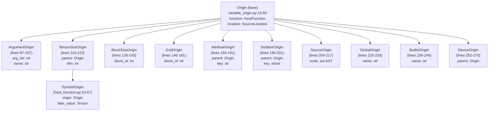
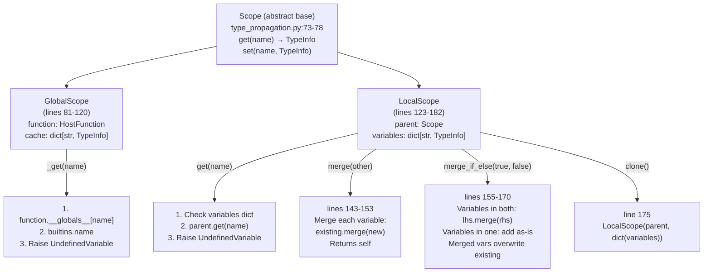
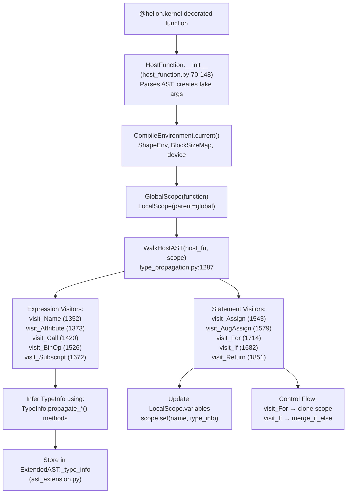
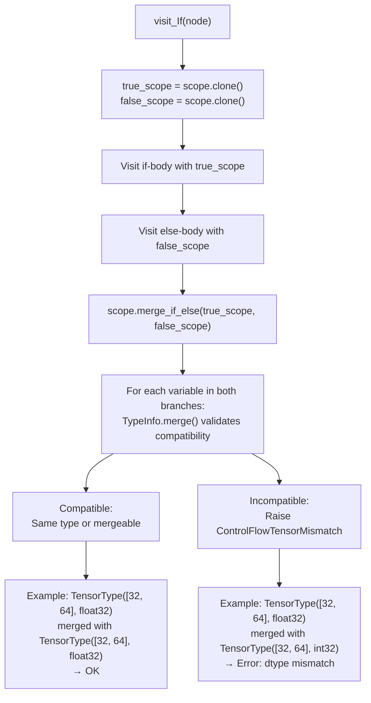
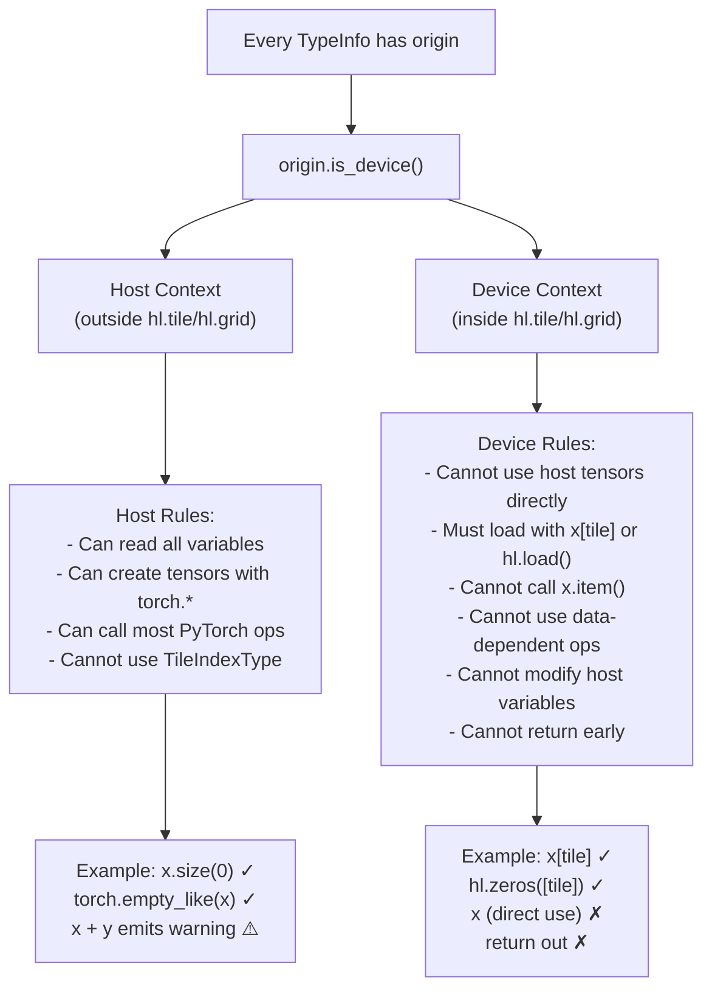
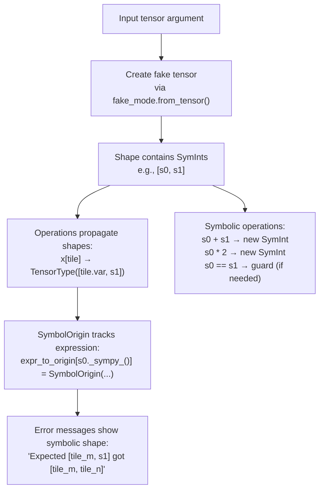
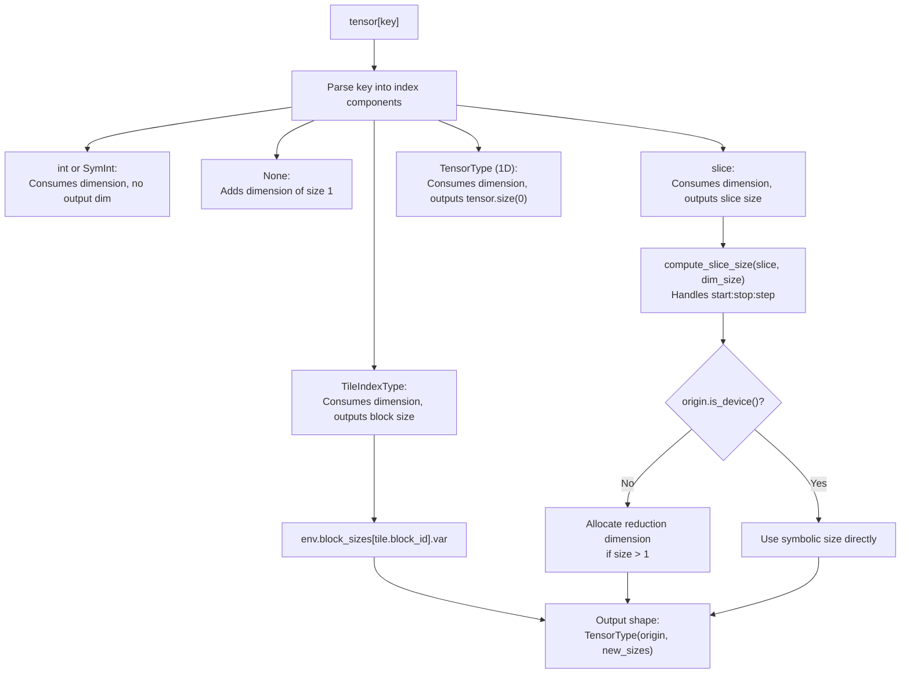
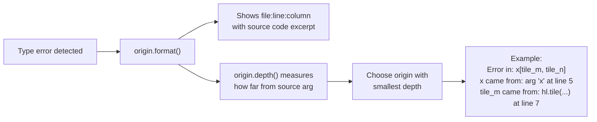
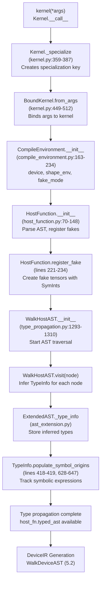

<!-- source: DeepWiki mcp.deepwiki.com · repo pytorch/helion · page 5.1 Type Propagation · fetched 2026-10-21 -->

# Type Propagation

<details>
<summary>Relevant source files</summary>

The following files were used as context for generating this wiki page:

- [examples/matmul.py](examples/matmul.py)
- [examples/matmul_split_k.py](examples/matmul_split_k.py)
- [helion/_compiler/type_propagation.py](helion/_compiler/type_propagation.py)
- [helion/exc.py](helion/exc.py)
- [test/test_errors.py](test/test_errors.py)
- [test/test_type_propagation.expected](test/test_type_propagation.expected)
- [test/test_type_propagation.py](test/test_type_propagation.py)

</details>


Type propagation is the first stage of the Helion compilation pipeline. It walks the host function's Python AST and infers type information for every variable and expression, tracking where each value originates from and validating operations according to type rules. This type information is essential for subsequent compilation stages including device IR generation ([5.2](#5.2)) and Inductor lowering ([5.3](#5.3)).

The type system distinguishes between host and device contexts, enforces tensor shape compatibility across control flow branches, and tracks symbolic shapes through PyTorch's fake tensor mode. All type inference occurs before any code generation, enabling early detection of errors with precise source locations.

---

## TypeInfo Hierarchy

The `TypeInfo` base class ([helion/_compiler/type_propagation.py:191-437]()) represents the type of any value in Helion code. Each subclass implements propagation methods for inferring result types:

**Type Propagation Methods:**

| Method | Purpose | Example |
|--------|---------|---------|
| `propagate_unary(op, origin)` | Unary operations | `-x`, `not x` |
| `propagate_call(args, kwargs, origin)` | Function calls | `torch.sin(x)`, `x.sum()` |
| `propagate_attribute(attr, origin)` | Attribute access | `x.shape`, `x.dtype` |
| `propagate_getitem(key, origin)` | Subscript read | `x[tile]`, `x[0:10]` |
| `propagate_setitem(key, value, origin)` | Subscript write | `x[tile] = value` |

**TypeInfo Class Hierarchy with Code Locations**

```mermaid
graph TB
    TypeInfo["TypeInfo<br/>(type_propagation.py:191)"]
    
    TypeInfo --> TensorType["TensorType<br/>(lines 439-648)<br/>fake_value: torch.Tensor"]
    TypeInfo --> NumericType["NumericType<br/>(lines 949-1029)<br/>value: SymInt/SymFloat/SymBool"]
    TypeInfo --> LiteralType["LiteralType<br/>(lines 721-783)<br/>value: int/float/bool/None"]
    TypeInfo --> CallableType["CallableType<br/>(lines 803-930)<br/>value: Callable"]
    TypeInfo --> CollectionType["CollectionType<br/>(lines 1040-1153)"]
    TypeInfo --> TileIndexType["TileIndexType<br/>(lines 1169-1208)<br/>block_id: int"]
    TypeInfo --> NoType["NoType<br/>(lines 1260-1266)"]
    TypeInfo --> IterType["IterType<br/>(lines 1268-1285)"]
    TypeInfo --> StringType["StringType<br/>(lines 785-789)"]
    
    NumericType --> SymIntType["SymIntType<br/>(lines 1031-1037)"]
    NumericType --> SymFloatType["SymFloatType<br/>(lines 1043-1049)"]
    NumericType --> SymBoolType["SymBoolType<br/>(lines 1055-1061)"]
    
    SymIntType --> BlockSizeType["BlockSizeType<br/>(lines 1063-1095)"]
    SymIntType --> GridIndexType["GridIndexType<br/>(lines 1097-1129)"]
    
    CollectionType --> SequenceType["SequenceType<br/>(lines 1155-1186)"]
    CollectionType --> DictType["DictType<br/>(lines 1188-1212)"]
    CollectionType --> ClassType["ClassType<br/>(lines 1214-1234)"]
    CollectionType --> SliceType["SliceType<br/>(lines 1236-1258)"]
    
    LiteralType --> ConfigFragmentType["ConfigFragmentType<br/>(lines 792-800)"]
    LiteralType --> PythonModuleType["PythonModuleType<br/>(lines 937-946)"]
    
    TensorType --> TensorAttributeType["TensorAttributeType<br/>(lines 650-718)"]
```



**Key TypeInfo Classes:**

| Class | Purpose | Code Location | Key Fields |
|-------|---------|---------------|------------|
| `TensorType` | Tensor values with symbolic shapes | [helion/_compiler/type_propagation.py:439-648]() | `fake_value: torch.Tensor` |
| `NumericType` | Base for symbolic numeric values | [helion/_compiler/type_propagation.py:949-1029]() | `value: SymInt/SymFloat/SymBool` |
| `TileIndexType` | Tile variable from `hl.tile()` | [helion/_compiler/type_propagation.py:1169-1208]() | `block_id: int` |
| `BlockSizeType` | Block size from `hl.register_block_size()` | [helion/_compiler/type_propagation.py:1063-1095]() | `block_id: int, value: SymInt` |
| `GridIndexType` | Grid index from `hl.grid()` | [helion/_compiler/type_propagation.py:1097-1129]() | `block_id: int, value: SymInt` |
| `TensorAttributeType` | Tensor method or attribute | [helion/_compiler/type_propagation.py:650-718]() | `tensor: TensorType, origin.key: str` |
| `LiteralType` | Compile-time constant values | [helion/_compiler/type_propagation.py:721-783]() | `value: object` |
| `CallableType` | Functions and API functions | [helion/_compiler/type_propagation.py:803-930]() | `value: Callable` |
| `SequenceType` | Lists/tuples with element types | [helion/_compiler/type_propagation.py:1155-1186]() | `element_types: list/tuple[TypeInfo]` |
| `SliceType` | Slice objects (e.g., `x[1:10:2]`) | [helion/_compiler/type_propagation.py:1236-1258]() | `start/stop/step: TypeInfo` |

**Sources:** [helion/_compiler/type_propagation.py:191-437](), [helion/_compiler/type_propagation.py:439-648](), [helion/_compiler/type_propagation.py:721-1285]()

---

## Origin Tracking System

Every `TypeInfo` has an `origin` field that records where the value came from. This enables precise error messages and helps track symbolic expressions back to their source arguments.

**Origin Class Hierarchy with Code Locations**



**Origin Classes:**

| Class | Used For | Code Location | Example |
|-------|----------|---------------|---------|
| `ArgumentOrigin` | Function arguments | [helion/_compiler/variable_origin.py:87-107]() | `fn(x)` → `ArgumentOrigin(0, "x")` |
| `TensorSizeOrigin` | Tensor dimensions | [helion/_compiler/variable_origin.py:110-123]() | `x.size(0)` → `TensorSizeOrigin(x_origin, 0)` |
| `BlockSizeOrigin` | Block sizes from config | [helion/_compiler/variable_origin.py:126-143]() | Tile block dimensions |
| `GridOrigin` | Grid indices | [helion/_compiler/variable_origin.py:146-161]() | `hl.grid(n)` iteration variables |
| `AttributeOrigin` | Object attributes | [helion/_compiler/variable_origin.py:164-181]() | `x.shape` → `AttributeOrigin(x_origin, "shape")` |
| `GetItemOrigin` | Collection elements | [helion/_compiler/variable_origin.py:184-201]() | `tuple[0]` → `GetItemOrigin(tuple_origin, 0)` |
| `SourceOrigin` | AST expressions | [helion/_compiler/variable_origin.py:204-217]() | Most intermediate values |
| `DeviceOrigin` | Device-allocated values | [helion/_compiler/variable_origin.py:252-270]() | `hl.zeros([tile])` |
| `SymbolOrigin` | Symbolic expressions | [helion/_compiler/host_function.py:53-67]() | Links sympy expressions to origins |

**Key Origin Methods:**

| Method | Purpose | Implementation |
|--------|---------|----------------|
| `is_device()` | Check if value created in device loop | [helion/_compiler/variable_origin.py:43-44]() |
| `is_host()` | Check if value created in host context | [helion/_compiler/variable_origin.py:46-47]() |
| `depth()` | Distance from source argument | [helion/_compiler/variable_origin.py:49-51]() |
| `format()` | Generate error message with location | [helion/_compiler/variable_origin.py:53-59]() |

The `is_device()` and `is_host()` methods determine whether a value was created inside or outside device loops (`hl.tile`/`hl.grid`). This affects validation rules - for example, host tensors cannot be used directly in device operations without loading ([helion/_compiler/type_propagation.py:643-653]()).

**Sources:** [helion/_compiler/variable_origin.py:15-270](), [helion/_compiler/host_function.py:53-67](), [helion/_compiler/type_propagation.py:194-196]()

---

## Scope Management

The scope system manages variable visibility and handles control flow merging using SSA-like phi semantics.

**Scope Class Hierarchy and Methods**



**Scope Implementation Details:**

| Method | Implementation | Code Location |
|--------|----------------|---------------|
| `GlobalScope.get(name)` | Caches lookup of `fn.__globals__[name]` or `builtins` | [helion/_compiler/type_propagation.py:86-117]() |
| `GlobalScope._get(name)` | Performs actual lookup and creates TypeInfo | [helion/_compiler/type_propagation.py:91-117]() |
| `LocalScope.get(name)` | Checks `variables`, falls back to `parent.get()` | [helion/_compiler/type_propagation.py:128-131]() |
| `LocalScope.maybe_get(name)` | Like `get()` but returns None instead of raising | [helion/_compiler/type_propagation.py:133-137]() |
| `LocalScope.set(name, type_info)` | Updates `variables[name]` | [helion/_compiler/type_propagation.py:140-141]() |
| `LocalScope.merge(other)` | Merges variables using `TypeInfo.merge()` | [helion/_compiler/type_propagation.py:143-153]() |
| `LocalScope.merge_if_else(true, false)` | Merges both branches, requiring compatible types | [helion/_compiler/type_propagation.py:155-170]() |
| `LocalScope.clone()` | Creates copy for control flow branch | [helion/_compiler/type_propagation.py:175-176]() |

**Control Flow Merging Example:**

```python
# Before if statement: x has TensorType with shape [32, 64]
if condition:
    x = hl.zeros([tile_m, tile_n])  # TensorType([tile_m, tile_n], float32)
else:
    x = hl.ones([tile_m, tile_n])   # TensorType([tile_m, tile_n], float32)
# After: LocalScope.merge_if_else() calls x.merge() to check compatibility
```

The merge logic ([helion/_compiler/type_propagation.py:155-170]()) ensures that:
1. Variables defined in both branches have compatible types
2. Variables defined in only one branch are added to the merged scope
3. Variables defined in both branches overwrite any existing values

**Sources:** [helion/_compiler/type_propagation.py:73-182]()

---

## Type Propagation Process

Type propagation walks the host function's AST using the visitor pattern, inferring types for each expression and statement. The main entry point is the `WalkHostAST` class ([helion/_compiler/type_propagation.py:1287-1880]()).

**Type Propagation Flow with Code Entities**



**Key Visitor Methods with Code Locations:**

| Method | Purpose | Implementation | Code Location |
|--------|---------|----------------|---------------|
| `visit_Name` | Lookup variable | `scope.get(node.id)` | [helion/_compiler/type_propagation.py:1352-1357]() |
| `visit_Attribute` | Get attribute | `value_type.propagate_attribute(attr, origin)` | [helion/_compiler/type_propagation.py:1373-1400]() |
| `visit_Call` | Function call | `func_type.propagate_call(args, kwargs, origin)` | [helion/_compiler/type_propagation.py:1420-1491]() |
| `visit_BinOp` | Binary operation | `propagate_binop(lhs, op, rhs)` | [helion/_compiler/type_propagation.py:1526-1541]() |
| `visit_UnaryOp` | Unary operation | `operand_type.propagate_unary(op, origin)` | [helion/_compiler/type_propagation.py:1502-1507]() |
| `visit_Compare` | Comparison | `propagate_compare(left, ops, comparators)` | [helion/_compiler/type_propagation.py:1493-1500]() |
| `visit_Subscript` | Subscript access | `value_type.propagate_getitem(slice_type, origin)` | [helion/_compiler/type_propagation.py:1672-1680]() |
| `visit_Assign` | Assignment | Evaluates RHS, calls `scope.set()` | [helion/_compiler/type_propagation.py:1543-1578]() |
| `visit_For` | For loop | Detects `hl.tile`/`hl.grid`, clones scope | [helion/_compiler/type_propagation.py:1714-1816]() |
| `visit_If` | If statement | `scope.merge_if_else(true_scope, false_scope)` | [helion/_compiler/type_propagation.py:1682-1711]() |

**Type Inference for Operations:**

When the type system encounters an operation like `x + y` where both are tensors, it uses PyTorch's fake tensor mode to trace the operation and infer the output shape ([helion/_compiler/type_propagation.py:467-477]()):

```python
# In TensorType.propagate_unary:
def propagate_unary(self, op: ast.unaryop, origin: Origin) -> TypeInfo:
    if origin.is_host():
        warning(exc.TensorOperationInWrapper)
    try:
        return TypeInfo.from_example(_eval_unary(op, self.fake_value), origin)
    except exc.Base:
        raise
    except Exception as e:
        raise exc.TorchOpTracingError(e) from e
```

For function calls, `CallableType.propagate_call` ([helion/_compiler/type_propagation.py:825-921]()) traces the call using fake arguments to infer the result type.

**Sources:** [helion/_compiler/type_propagation.py:1287-1880](), [helion/_compiler/type_propagation.py:467-477](), [helion/_compiler/type_propagation.py:825-921]()

---

## Control Flow Handling

Type propagation handles control flow (if/else, loops) by cloning scopes, visiting branches independently, and merging results. Types must be compatible across branches.



**Merging Rules:**

| Left Type | Right Type | Result | Notes |
|-----------|------------|--------|-------|
| `TensorType` | `TensorType` | Merged if compatible | Checks device, dtype, rank, and shape |
| `LiteralType(5)` | `LiteralType(5)` | `LiteralType(5)` | Same value → keep |
| `LiteralType(5)` | `LiteralType(10)` | `SymIntType` (unbacked) | Different values → symbolic |
| `SymIntType` | `SymIntType` | Check equality | Uses `NumericType.known_equal()` |
| `NoType` | Any | Right type | `NoType` is identity element |
| Incompatible | Incompatible | Error | Raises `TypeInferenceError` or `ControlFlowTensorMismatch` |

**Tensor Compatibility Checks:**

[helion/_compiler/type_propagation.py:552-579]() shows the merge logic for `TensorType`:

```python
def merge(self, other: TypeInfo, var_name: str | None = None) -> TypeInfo:
    if isinstance(other, TensorType):
        if self.fake_value.device != other.fake_value.device:
            raise exc.ControlFlowTensorMismatch(var=var_name, details=f"device ...")
        if self.fake_value.dtype != other.fake_value.dtype:
            raise exc.ControlFlowTensorMismatch(var=var_name, details=f"dtype ...")
        if self.fake_value.dim() != other.fake_value.dim():
            raise exc.ControlFlowTensorMismatch(var=var_name, details=f"rank ...")
        # ... creates new TensorType with merged origin
```

**Sources:** [helion/_compiler/type_propagation.py:150-165](), [helion/_compiler/type_propagation.py:552-579](), [helion/_compiler/type_propagation.py:320-326](), [helion/_compiler/type_propagation.py:1682-1711]()

---

## Host vs Device Context Tracking

Type propagation distinguishes between host code (outside `hl.tile`/`hl.grid`) and device code (inside loops). Different operations are allowed in each context.



**Context-Dependent Validation:**

[helion/_compiler/type_propagation.py:516-538]() shows validation in `TensorType.propagate_setitem`:

```python
def propagate_setitem(self, key: TypeInfo, value: TypeInfo, origin: Origin) -> TypeInfo:
    if origin.is_host():
        warning(exc.TensorOperationInWrapper)  # Warn on host
    else:
        # On device: validate shapes match
        lhs_shape = self._device_indexing_size(key)
        if isinstance(value, TensorType):
            if lhs_rank != rhs_rank:
                raise exc.RankMismatch(...)
```

**Operations with Different Behavior:**

| Operation | Host Context | Device Context |
|-----------|--------------|----------------|
| Tensor ops (e.g., `x + y`) | Emits warning (unfused) | Normal operation |
| `hl.zeros([tile])` | Error: TileIndexType only on device | Creates device tensor |
| `x[tile]` | Error: TileIndexType only on device | Loads from tensor |
| `x.item()` | Allowed | Error: data-dependent |
| `torch.nonzero(x)` | Allowed | Error: data-dependent output shape |
| Variable assignment | Updates host variable | Error if modifying host var |

**Device Context Tracking:**

When visiting a for loop with `hl.tile()` or `hl.grid()`, type propagation wraps values created inside the loop with `DeviceOrigin`:

[helion/_compiler/type_propagation.py:1760-1780]() shows how device loops set context:

```python
def visit_For(self, node: ast.For) -> TypeInfo:
    # ... detect if hl.tile or hl.grid ...
    if is_device_loop:
        # Visit body with device context
        # All TypeInfos created inside get DeviceOrigin
```

**Sources:** [helion/_compiler/type_propagation.py:516-538](), [helion/_compiler/type_propagation.py:641-653](), [helion/_compiler/type_propagation.py:774-779](), [helion/_compiler/variable_origin.py]()

---

## Symbolic Shape Tracking

Type propagation tracks tensor shapes symbolically using PyTorch's `torch.SymInt`, enabling shape-polymorphic kernels.



**Fake Tensor Creation:**

[helion/_compiler/host_function.py]() shows how input tensors are converted to fake tensors with symbolic shapes:

```python
def register_fake(self, value, origin):
    if isinstance(value, torch.Tensor):
        # Create fake tensor with symbolic shape
        fake = fake_mode.from_tensor(value, ...)
        return fake
```

**SymInt Type Propagation:**

When a tensor size is accessed, it returns a `SymIntType`:

```python
# x.size(0) where x.shape = [s0, 128]
tensor_type.propagate_attribute("size", origin)
# Returns TypeInfo.from_example([s0, 128], origin)
# Individual dimensions become SymIntType(origin, s0)
```

**Symbolic Expression Tracking:**

[helion/_compiler/type_propagation.py:964-968]() shows how `NumericType.populate_symbol_origins()` tracks symbolic expressions:

```python
def populate_symbol_origins(self, origin: Origin) -> None:
    expr_to_origin = HostFunction.current().expr_to_origin
    expr = CompileEnvironment.current().shape_env.simplify(self.value._sympy_())
    if expr not in expr_to_origin or origin.depth() < expr_to_origin[expr].depth():
        expr_to_origin[expr] = SymbolOrigin(origin)
```

This mapping enables Helion to report which input argument or tensor dimension a symbolic expression originated from, improving error messages.

**Sources:** [helion/_compiler/type_propagation.py:581-600](), [helion/_compiler/type_propagation.py:964-968](), [helion/_compiler/type_propagation.py:411-425]()

---

## Indexing Type Inference

Type propagation infers output shapes for tensor indexing operations by analyzing index types and computing result dimensions.



**Indexing Rules:**

[helion/_compiler/type_propagation.py:448-514]() implements `TensorType._device_indexing_size`:

| Index Type | Example | Effect | Output Dimension |
|------------|---------|--------|------------------|
| `int` or `SymInt` | `x[5]` or `x[i]` | Consumes 1 dimension | None (dimension removed) |
| `None` | `x[None, :]` | No dimension consumed | Size 1 |
| `slice` | `x[1:10]` or `x[::2]` | Consumes 1 dimension | `compute_slice_size(slice, size)` |
| `TileIndexType` | `x[tile_m]` | Consumes 1 dimension | `block_sizes[tile.block_id].var` |
| `TensorType` (1D) | `x[indices]` | Consumes 1 dimension | `indices.size(0)` |
| `TensorType` (bool) | `x[mask]` | Error: data-dependent shape | Error raised |

**Slice Size Computation:**

For slices with steps (e.g., `x[::2]`), the output size is calculated symbolically:

```python
# For slice(start, stop, step) and dimension size `size`:
size_expr = (stop - start + step - 1) // step  # Ceiling division
```

This expression is tracked as a `SymInt`, enabling shape-polymorphic behavior.

**Rank Validation:**

After processing all indices, type propagation validates that the number of dimensions consumed matches the tensor rank:

```python
if inputs_consumed != self.fake_value.ndim:
    raise exc.RankMismatch(
        self.fake_value.ndim,
        inputs_consumed,
        f"tensor shape: {tuple(self.fake_value.shape)}"
    )
```

**Sources:** [helion/_compiler/type_propagation.py:448-514](), [helion/_compiler/type_propagation.py:540-550](), [helion/_compiler/utils.py:compute_slice_size]()

---

## Error Reporting with Origins

Origin tracking enables precise error messages that show exactly where problematic values came from.



**Error Example from Tests:**

[test/test_errors.py:401-416]() shows a control flow error with variable name:

```python
@helion.kernel()
def fn(a: torch.Tensor) -> torch.Tensor:
    out = torch.empty_like(a)
    for ti in hl.tile(a.size(0)):
        if ti.index < 1:
            x = hl.full([ti], 0.0, dtype=a.dtype)      # x: TensorType([ti])
        else:
            x = hl.full([ti, ti], 0.0, dtype=a.dtype)  # x: TensorType([ti, ti])
        out[ti] = x.sum()  # Error: cannot merge TensorType([ti]) and TensorType([ti, ti])
    return a

# Raises: ControlFlowTensorMismatch with variable name 'x' and details about rank mismatch
```

The error message includes:
- Variable name (`'x'`)
- Specific mismatch details ("rank 1 != 2")
- Source location for both branches
- Hint about ensuring same rank across branches

**Origin Depth Priority:**

[helion/_compiler/type_propagation.py:585-600]() shows how `TensorType.populate_symbol_origins()` uses origin depth to prefer more direct origins:

```python
if expr not in expr_to_origin or sub_origin.depth() < expr_to_origin[expr].depth():
    expr_to_origin[expr] = SymbolOrigin(sub_origin, fake_value=self.fake_value)
```

This ensures that when multiple paths lead to the same symbolic expression, the error message reports the most direct path from the user's code.

**Sources:** [helion/_compiler/type_propagation.py:581-600](), [helion/_compiler/variable_origin.py](), [test/test_errors.py:401-416](), [helion/exc.py:400-405]()

---

## Type Propagation Entry Points

The type propagation system integrates with the kernel compilation pipeline through several entry points.

**Type Propagation Pipeline with Code Entities**



**Key Classes and Their Roles:**

| Class | Purpose | Code Location |
|-------|---------|---------------|
| `CompileEnvironment` | Holds shape_env, block_sizes, device, config_spec | [helion/_compiler/compile_environment.py:163-234]() |
| `HostFunction` | Parses AST, manages scopes, tracks origins | [helion/_compiler/host_function.py:70-148]() |
| `WalkHostAST` | AST visitor that infers types | [helion/_compiler/type_propagation.py:1287-1880]() |
| `ExtendedAST` | AST wrapper storing TypeInfo | [helion/_compiler/ast_extension.py]() |
| `GlobalScope` | Resolves global variables and builtins | [helion/_compiler/type_propagation.py:81-120]() |
| `LocalScope` | Tracks local variables and handles control flow | [helion/_compiler/type_propagation.py:123-182]() |

**Host Function Creation Details:**

`HostFunction.__init__` ([helion/_compiler/host_function.py:70-148]()) performs:
1. Parses function into `ExtendedAST`
2. Creates `GlobalScope` for the function
3. Initializes `expr_to_origin` and `tensor_to_origin` dicts
4. Calls `register_fake()` for each argument to create fake tensors

**Fake Tensor Registration:**

`HostFunction.register_fake()` ([helion/_compiler/host_function.py:221-234]()) converts real tensor arguments to fake tensors with symbolic shapes using `fake_mode.from_tensor()`. This enables shape-polymorphic type inference.

**AST Walking:**

Type propagation walks the host AST once via `WalkHostAST.visit()`, storing inferred `TypeInfo` on each `ExtendedAST` node's `_type_info` field. The annotated AST is then used by device IR generation ([5.2](#5.2)).

**Sources:** [helion/_compiler/host_function.py:70-234](), [helion/_compiler/compile_environment.py:163-234](), [helion/_compiler/type_propagation.py:1287-1310](), [helion/runtime/kernel.py:359-512]()

---

## Special Cases and Validation

Type propagation includes special handling for various edge cases and validation rules.

**API Functions:**

Functions decorated with `@api` (like `hl.zeros`, `hl.load`) have custom type functions:

```python
if is_api_func(fn := self.value):
    if fn._is_device_only and origin.is_host():
        raise exc.DeviceAPIOnHost(fn.__qualname__)
    return fn._type_function(*args, **kwargs, origin=origin)
```

**Data-Dependent Operations:**

Operations that produce data-dependent output shapes are blocked in device context:

```python
if self.value in (torch.nonzero, torch.Tensor.nonzero) and origin.is_device():
    raise exc.DataDependentOutputShapeNotSupported(op_desc="torch.nonzero")
```

[helion/_compiler/type_propagation.py:774-779]()

**Shape Specialization:**

Some operations require specializing symbolic shapes to concrete values, triggering errors:

```python
with patch.object(torch.SymInt, "__index__", _raise_shape_specializing):
    output_type = TypeInfo.from_example(self.value(*proxy_args, **proxy_kwargs), origin)
```

[helion/_compiler/type_propagation.py:821-828]()

This catches operations like `list(range(n))` where `n` is a `SymInt`, requiring users to use `hl.specialize(n)` or `hl.constexpr(n)`.

**Tensor Device Validation:**

Type propagation warns if tensors are on the wrong device:

```python
if isinstance(arg, TensorType) and arg.fake_value.device.type != env.device.type:
    warning(exc.WrongDevice(self.value, arg.fake_value.device, env.device))
```

[helion/_compiler/type_propagation.py:789-794]()

**Host Variable Modification:**

Variables defined outside device loops cannot be modified inside them (except via subscript assignment):

```python
# In visit_Assign for device context:
if target_type.origin.is_host():
    raise exc.CannotModifyHostVariableOnDevice(target_name)
```

This prevents confusion about execution order and ensures device loops remain side-effect-free (except for output writes).

**Sources:** [helion/_compiler/type_propagation.py:780-786](), [helion/_compiler/type_propagation.py:774-779](), [helion/_compiler/type_propagation.py:789-794](), [helion/_compiler/type_propagation.py:1543-1578]()

---

