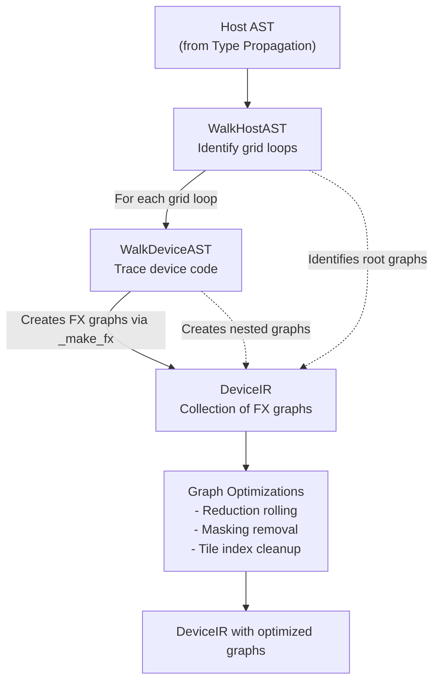
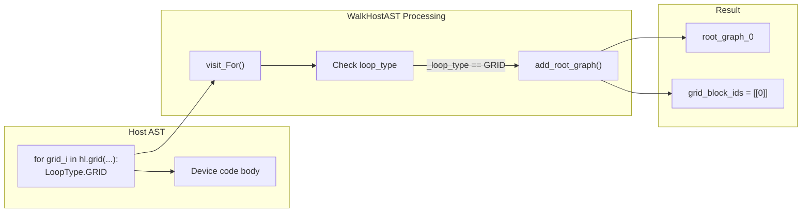
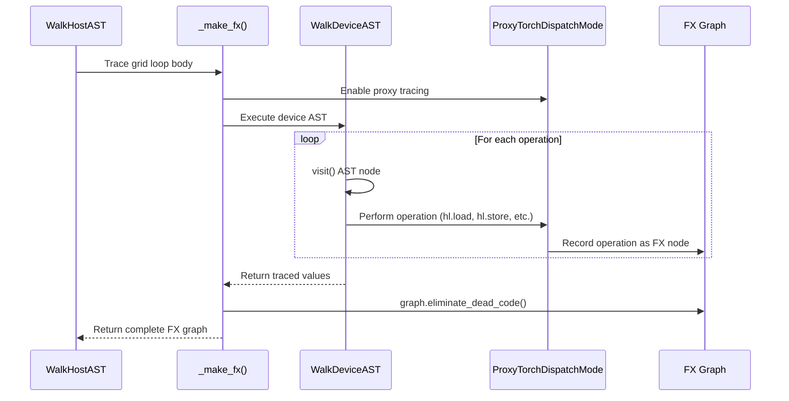
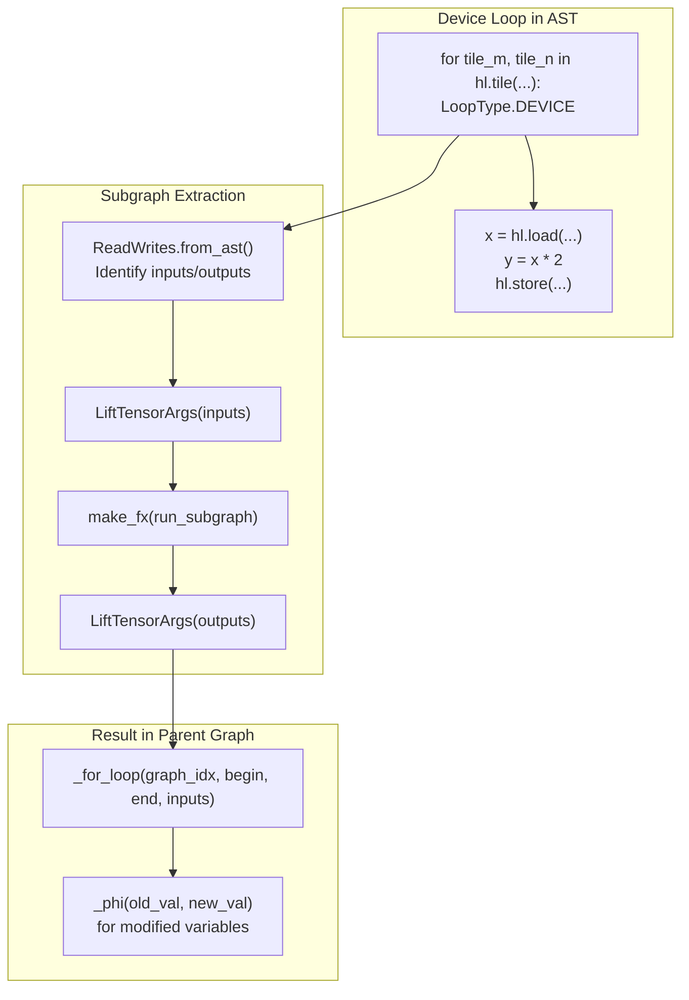
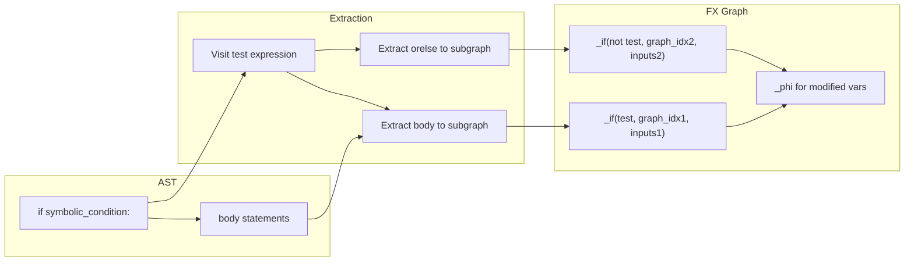
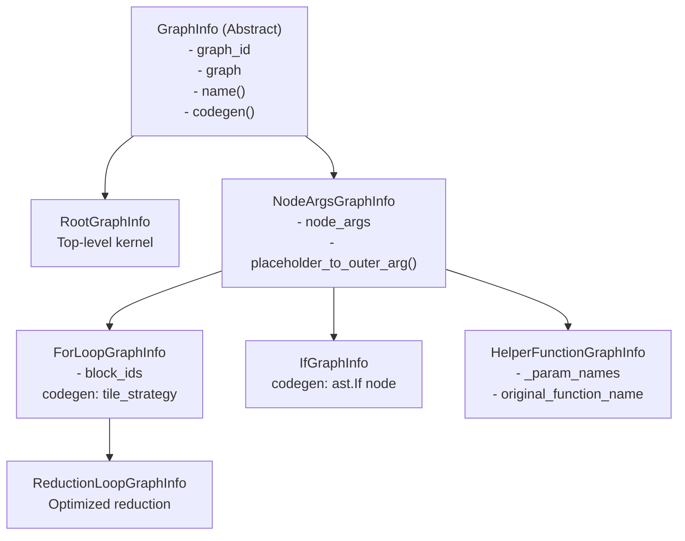
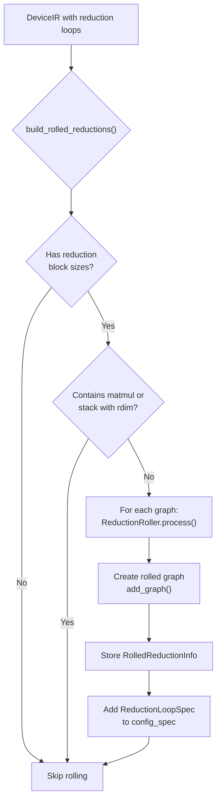
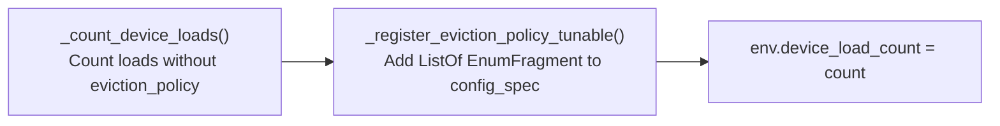

<!-- source: DeepWiki mcp.deepwiki.com · repo pytorch/helion · page 5.2 Device IR Generation · fetched 2026-10-21 -->

# Device IR Generation

<details>
<summary>Relevant source files</summary>

The following files were used as context for generating this wiki page:

- [helion/_compiler/compile_environment.py](helion/_compiler/compile_environment.py)
- [helion/_compiler/device_function.py](helion/_compiler/device_function.py)
- [helion/_compiler/device_ir.py](helion/_compiler/device_ir.py)
- [helion/_compiler/generate_ast.py](helion/_compiler/generate_ast.py)
- [helion/_compiler/tile_strategy.py](helion/_compiler/tile_strategy.py)
- [helion/language/_tracing_ops.py](helion/language/_tracing_ops.py)
- [helion/language/memory_ops.py](helion/language/memory_ops.py)

</details>


## Purpose and Scope

This page describes the Device IR (Intermediate Representation) generation phase of the Helion compilation pipeline. This phase takes the Host AST produced by type propagation ([see Type Propagation](#5.1)) and converts it into a collection of PyTorch FX graphs that represent the device computation. These FX graphs are later lowered to Triton operations ([see Inductor Lowering](#5.3)).

The Device IR generation phase is responsible for:
- Distinguishing between host-level and device-level code
- Creating separate FX graphs for each grid loop and nested device loops
- Handling control flow (conditionals and loops) by extracting subgraphs
- Performing graph-level optimizations including reduction rolling
- Validating host tensor usage patterns

**Sources:** [helion/_compiler/device_ir.py:1-1311]()

---

## Compilation Flow Overview

The device IR generation process transforms the Helion host AST into a structured collection of FX graphs through a two-phase walking process.

### High-Level Process



**Sources:** [helion/_compiler/device_ir.py:1128-1154](), [helion/_compiler/device_ir.py:1056-1077](), [helion/_compiler/device_ir.py:404-451]()

---

## DeviceIR Data Structure

The `DeviceIR` class serves as the central container for all generated FX graphs and metadata about the kernel structure.

### DeviceIR Class Structure

```mermaid
classDiagram
    class DeviceIR {
        +list~GraphInfo~ graphs
        +list~int~ root_ids
        +list~RolledReductionInfo~ rolled_reductions
        +list~list~int~~ grid_block_ids
        +add_graph() int
        +add_root_graph() None
        +add_reduction_loop_graph() int
        +get_root() Graph
        +build_rolled_reductions() None
    }
    
    class GraphInfo {
        <<abstract>>
        +int graph_id
        +Graph graph
        +name() str
        +kwargs() dict
        +codegen() list
    }
    
    class RootGraphInfo {
        +name() "root_graph_{id}"
    }
    
    class ForLoopGraphInfo {
        +list~int~ block_ids
        +list~Node~ node_args
        +name() "for_loop_{id}"
    }
    
    class ReductionLoopGraphInfo {
        +name() "reduction_loop_{id}"
    }
    
    class IfGraphInfo {
        +list~Node~ node_args
        +name() "if_else_graph_{id}"
    }
    
    class HelperFunctionGraphInfo {
        +list~str~ _param_names
        +str original_function_name
        +name() "helper_function_{id}"
    }
    
    DeviceIR --> "*" GraphInfo
    GraphInfo <|-- RootGraphInfo
    GraphInfo <|-- NodeArgsGraphInfo
    NodeArgsGraphInfo <|-- ForLoopGraphInfo
    NodeArgsGraphInfo <|-- IfGraphInfo
    NodeArgsGraphInfo <|-- HelperFunctionGraphInfo
    ForLoopGraphInfo <|-- ReductionLoopGraphInfo
```

| Field | Type | Purpose |
|-------|------|---------|
| `graphs` | `list[GraphInfo]` | All FX graphs (root, loops, conditionals) |
| `root_ids` | `list[int]` | Indices of top-level grid loop graphs |
| `rolled_reductions` | `list[RolledReductionInfo]` | Metadata about reduction loop optimization |
| `grid_block_ids` | `list[list[int]]` | Block IDs used in each grid dimension |

**Sources:** [helion/_compiler/device_ir.py:274-315](), [helion/_compiler/device_ir.py:154-182](), [helion/_compiler/device_ir.py:184-212]()

---

## Host AST Walking

The `WalkHostAST` visitor identifies top-level grid loops and creates root FX graphs for each one.

### Grid Loop Identification

Grid loops (created via `hl.grid()`) represent the outermost parallelization dimension and become separate root graphs in the DeviceIR. Each root graph corresponds to one kernel launch.



**Key Method:** `WalkHostAST.visit_For()` [helion/_compiler/device_ir.py:1061-1077]()

```python
def visit_For(self, node: ast.For) -> None:
    if node._loop_type == LoopType.GRID:
        # Create root graph by tracing device code
        self.device_ir.add_root_graph(
            _make_fx(lambda: WalkDeviceAST(self.device_ir).visit(node))
        )
        # Record block IDs for grid configuration
        iter_type = node.iter._type_info
        # ... extract block_ids and store in grid_block_ids
```

**Sources:** [helion/_compiler/device_ir.py:1056-1077](), [helion/_compiler/device_ir.py:329-331]()

---

## Device AST to FX Graph Conversion

The `WalkDeviceAST` visitor executes the device code body while tracing operations through PyTorch's FX tracing infrastructure (`proxy_tensor.make_fx`).

### Tracing Mechanism



The `_make_fx` function [helion/_compiler/device_ir.py:87-152]() wraps PyTorch's `make_fx` with custom handling for:
- Host tensors without origin (via `_host_tensor()` nodes)
- Symbolic values (via `_get_symnode()` nodes)
- Custom matmul replacements for better decomposition control
- Metadata preservation across graph transformations

**Sources:** [helion/_compiler/device_ir.py:87-152](), [helion/_compiler/device_ir.py:404-451]()

---

## Control Flow Handling

### Device Loops

Device loops (created with `hl.tile()` or `hl.range()`) are extracted into separate subgraphs because they represent parallelizable computation that will be lowered to Triton's block-parallel execution model.

#### Subgraph Extraction Process



**Key Components:**

1. **ReadWrites Analysis** [helion/_compiler/ast_read_writes.py]() - Identifies which variables are read/written in the loop body
2. **LiftTensorArgs** [helion/_compiler/device_ir.py:1019-1054]() - Extracts tensor arguments from nested scopes
3. **Subgraph Tracing** - Creates isolated FX graph for loop body
4. **Phi Nodes** - Merges values across control flow boundaries using `_phi()` operator

**Sources:** [helion/_compiler/device_ir.py:585-699](), [helion/_compiler/device_ir.py:1019-1054]()

### Conditionals

Conditional statements with symbolic test conditions are extracted similarly to device loops, creating subgraphs for each branch.



**Implementation:** `WalkDeviceAST.visit_If()` [helion/_compiler/device_ir.py:700-776]()

Static conditions (known at trace time) are optimized away - only the taken branch is included in the FX graph.

**Sources:** [helion/_compiler/device_ir.py:700-776](), [helion/_compiler/device_ir.py:711-776]()

---

## LiftTensorArgs: Managing Subgraph Boundaries

The `LiftTensorArgs` class handles the complex task of extracting tensor arguments from nested scopes and mapping them between parent and child graphs.

### LiftTensorArgs Workflow

| Phase | Method | Purpose |
|-------|--------|---------|
| **Initialization** | `__init__(values: dict)` | Flattens nested dict using PyTree, identifies tensor indices |
| **Argument Extraction** | `get_tensor_args()` | Returns list of tensors to pass to subgraph |
| **Node Extraction** | `get_node_args(tracer)` | Gets FX nodes corresponding to tensors |
| **Replacement** | `replace_tensor_args(args)` | Substitutes placeholder args in subgraph scope |
| **Reconstruction** | `unflatten()` | Rebuilds original dict structure with new values |

**Example Flow:**

```python
# Parent scope has: {"x": tensor1, "y": {"z": tensor2}, "tile": Tile(...)}
inputs = LiftTensorArgs({"x": tensor1, "y": {"z": tensor2}})

# Extract tensors -> [tensor1, tensor2]
tensor_args = inputs.get_tensor_args()

# Trace subgraph with placeholders
def run_subgraph(*args):
    # Replace tensors in scope
    scope = inputs.replace_tensor_args(args)  # {"x": placeholder1, "y": {"z": placeholder2}}
    # ... execute subgraph body ...
    return outputs.get_tensor_args()
```

**Sources:** [helion/_compiler/device_ir.py:1019-1054]()

---

## Graph Types and Metadata

Each `GraphInfo` subclass represents a different kind of graph in the DeviceIR and carries metadata about how it should be code-generated.

### GraphInfo Hierarchy



### NodeArgsGraphInfo

Subgraphs that take arguments from outer graphs inherit from `NodeArgsGraphInfo` [helion/_compiler/device_ir.py:190-212](), which provides:

- `node_args`: List of FX nodes from the parent graph that are passed as arguments
- `placeholder_to_outer_arg()`: Maps placeholder nodes in the subgraph to their corresponding nodes in the parent graph

This mapping is essential during code generation to inline or call subgraphs correctly.

**Sources:** [helion/_compiler/device_ir.py:154-182](), [helion/_compiler/device_ir.py:190-263]()

---

## Reduction Rolling Optimization

Reduction rolling is a graph-level optimization that transforms reduction loops to improve performance by reducing synchronization overhead.

### Reduction Rolling Process



**Key Classes:**

- `ReductionRoller` [helion/_compiler/roll_reduction.py]() - Transforms graphs to roll reduction loops
- `RolledReductionInfo` [helion/_compiler/device_ir.py:266-272]() - Metadata about rolled reductions
- `ReductionLoopSpec` [helion/autotuner/config_spec.py]() - Configuration for reduction loop parameters

The rolling process creates alternate versions of graphs where reduction loops are optimized. The `get_root()` method [helion/_compiler/device_ir.py:282-296]() selects between original and rolled graphs based on the active configuration.

**Sources:** [helion/_compiler/device_ir.py:332-389](), [helion/_compiler/device_ir.py:282-296](), [helion/_compiler/device_ir.py:266-272]()

---

## Graph-Level Optimizations

After FX graphs are generated, several optimization passes are applied before lowering to Triton.

### Optimization Pipeline

```mermaid
graph LR
    Generated["Generated FX Graphs"]
    
    Prepare["prepare_graph_lowerings()<br/>Attach lowering metadata"]
    Validate["validate_host_tensor_usage()<br/>Check scalar tensor usage"]
    TileOffset["add_tile_with_offset_metadata()<br/>Recognize tile.index + offset"]
    RemoveTile["remove_unnecessary_tile_index()<br/>Enable block_ptr indexing"]
    RemoveMask["remove_unnecessary_masking()<br/>Eliminate redundant masks"]
    
    Generated --> Prepare
    Prepare --> Validate
    Validate --> TileOffset
    TileOffset --> RemoveTile
    RemoveTile --> RemoveMask
    RemoveMask --> RollRed["build_rolled_reductions()"]
    RollRed --> Final["Optimized DeviceIR"]
```



### Specific Optimizations

#### 1. Tile Index Removal

**Purpose:** Enable `block_ptr` indexing by passing `Tile` objects directly to `hl.load`/`hl.store` instead of converting to indices first.

**Implementation:** `remove_unnecessary_tile_index()` [helion/_compiler/device_ir.py:1297-1311]()

```python
# Before: x = hl.load(tensor, [hl.tile_index(tile)])
# After:  x = hl.load(tensor, [tile])
```

**Sources:** [helion/_compiler/device_ir.py:1297-1311]()

#### 2. Tile With Offset Metadata

**Purpose:** Recognize patterns like `tile.index + offset` to enable tensor descriptor indexing.

**Implementation:** `add_tile_with_offset_metadata()` [helion/_compiler/device_ir.py:1208-1295]()

The pass identifies FX nodes representing addition of a tile index with an integer/SymInt offset and adds `tile_with_offset` metadata containing:
- `block_id`: The block dimension being indexed
- `offset`: The constant or symbolic offset value

**Sources:** [helion/_compiler/device_ir.py:1208-1295]()

#### 3. Unnecessary Masking Removal

**Purpose:** Eliminate masking operations when bounds checking is statically provable to be unnecessary.

**Implementation:** `remove_unnecessary_masking()` [helion/_compiler/node_masking.py]()

**Sources:** [helion/_compiler/node_masking.py](), [helion/_compiler/device_ir.py:1144]()

#### 4. Host Tensor Validation

**Purpose:** Ensure scalar host tensors are only used in operations that explicitly allow them.

**Implementation:** `validate_host_tensor_usage()` [helion/_compiler/device_ir.py:1182-1206]()

Checks that `_host_tensor` nodes (representing scalar tensors from host) only flow into API functions marked with `_allow_host_tensor=True`.

**Sources:** [helion/_compiler/device_ir.py:1182-1206]()

---

## Special Cases and Advanced Features

### Tuple Unrolling

Loops that iterate over statically-known tuples or lists are unrolled at trace time rather than creating dynamic loops.

```python
# Source code:
for x in [tensor1, tensor2, tensor3]:
    hl.store(out, ..., x * 2)

# FX graph contains three separate store operations (unrolled)
```

**Implementation:** `_handle_tuple_unrolling()` [helion/_compiler/device_ir.py:571-584]()

**Sources:** [helion/_compiler/device_ir.py:536-584](), [helion/_compiler/device_ir.py:591-604]()

### List Comprehensions

Simple list comprehensions over sequences are unrolled similar to tuple iteration.

```python
# Source code:
sizes = [tensor.size(0) for tensor in tensors]

# Result: tuple of concrete/symbolic size values
```

**Implementation:** `visit_ListComp()` and `_handle_listcomp_unrolling()` [helion/_compiler/device_ir.py:801-844]()

**Sources:** [helion/_compiler/device_ir.py:801-844]()

### Sequence Unrolling Helper

Both tuple unrolling and list comprehensions share common logic in `_handle_sequence_unrolling()` [helion/_compiler/device_ir.py:536-570](), which:

1. Evaluates the sequence to iterate over
2. For each element, either preserves scope (loops) or creates isolated scope (comprehensions)
3. Executes the body/expression for each element
4. Collects results if needed

**Sources:** [helion/_compiler/device_ir.py:536-570]()

### Eviction Policy Tuning

Device IR generation counts all `load` operations without explicit eviction policies and registers a tunable parameter for them.

**Process:**



This allows the autotuner to search over different eviction policies (`evict_first`, `evict_last`, etc.) for optimal cache behavior.

**Sources:** [helion/_compiler/device_ir.py:1079-1126](), [helion/_compiler/device_ir.py:1112-1126]()

---

## Entry Point and Integration

The main entry point for Device IR generation is `lower_to_device_ir()` [helion/_compiler/device_ir.py:1128-1154](), which orchestrates the entire process:

```python
def lower_to_device_ir(func: HostFunction) -> DeviceIR:
    device_ir = DeviceIR()
    with func, device_ir, compile_lock:
        # 1. Walk host AST to identify grid loops
        visitor = WalkHostAST(device_ir)
        for stmt in func.body:
            visitor.visit(stmt)
        
        # 2. Validate we have device code
        if len(device_ir.root_ids) == 0:
            raise exc.NoDeviceLoopsInKernel
        
        # 3. Prepare lowering metadata for each graph
        for graph in device_ir.graphs:
            prepare_graph_lowerings(graph.graph)
        
        # 4. Apply graph optimizations
        for graph in device_ir.graphs:
            validate_host_tensor_usage(graph.graph)
            add_tile_with_offset_metadata(graph)
            remove_unnecessary_tile_index(graph.graph)
            remove_unnecessary_masking(graph.graph)
        
        # 5. Build rolled reduction variants
        device_ir.build_rolled_reductions()
        
        # 6. Configure grid restrictions and eviction policy tuning
        if len(device_ir.root_ids) > 1:
            CompileEnvironment.current().config_spec.disallow_pid_type("xyz")
        
        load_count = _count_device_loads(device_ir)
        _register_eviction_policy_tunable(load_count)
        
        return device_ir
```

The resulting `DeviceIR` is passed to the Inductor Lowering phase ([see Inductor Lowering](#5.3)) for conversion to Triton operations.

**Sources:** [helion/_compiler/device_ir.py:1128-1154]()

---

