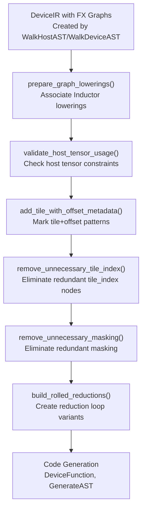
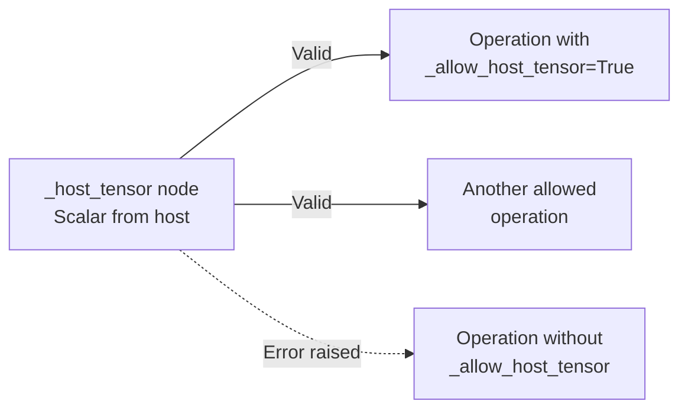
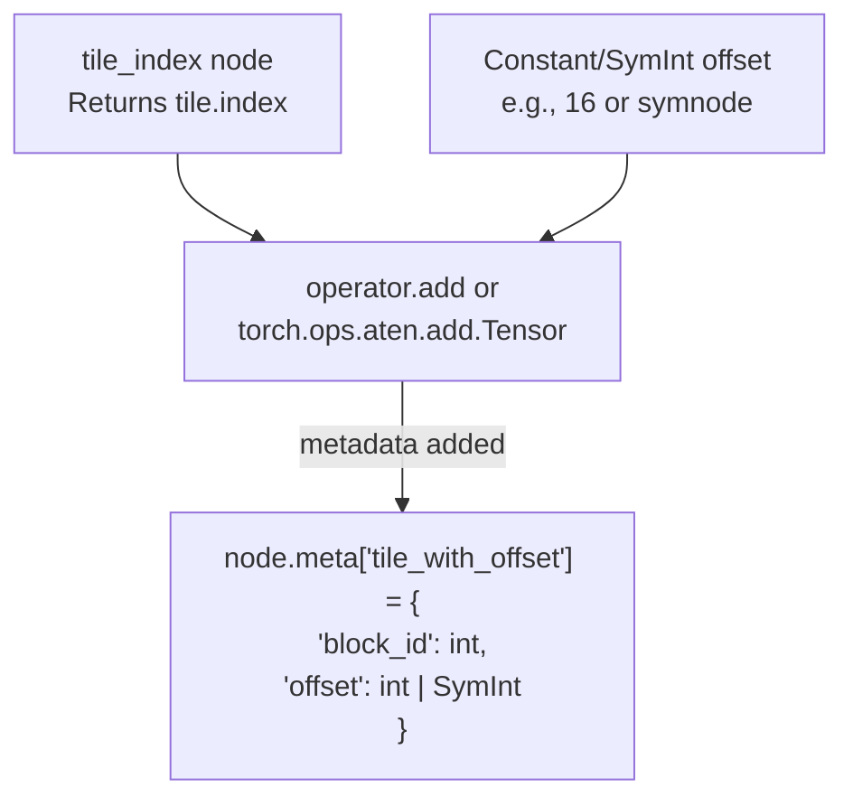
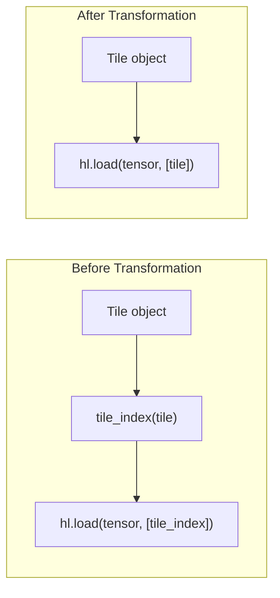
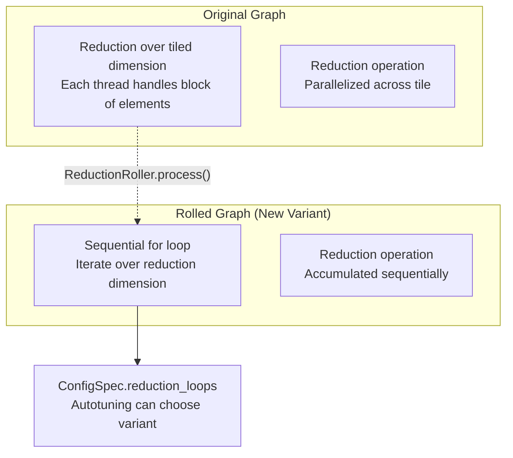
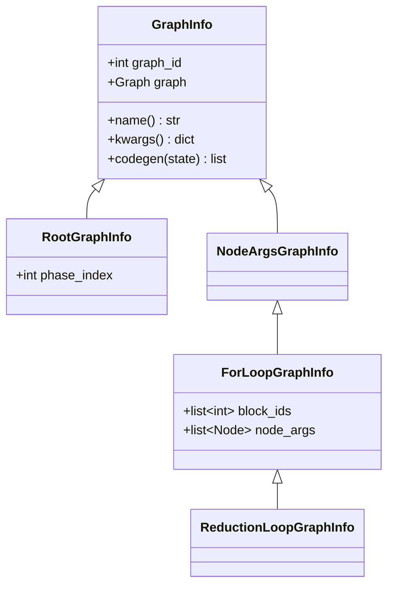

<!-- source: DeepWiki mcp.deepwiki.com · repo pytorch/helion · page 5.3 Graph Transformations · fetched 2026-10-21 -->

# Graph Transformations

<details>
<summary>Relevant source files</summary>

The following files were used as context for generating this wiki page:

- [helion/_compiler/aten_lowering.py](helion/_compiler/aten_lowering.py)
- [helion/_compiler/inductor_lowering.py](helion/_compiler/inductor_lowering.py)
- [helion/_compiler/reduction_strategy.py](helion/_compiler/reduction_strategy.py)
- [helion/_compiler/roll_reduction.py](helion/_compiler/roll_reduction.py)
- [helion/_compiler/tile_dispatch.py](helion/_compiler/tile_dispatch.py)
- [helion/language/__init__.py](helion/language/__init__.py)
- [helion/language/random_ops.py](helion/language/random_ops.py)
- [test/test_misc.py](test/test_misc.py)
- [test/test_random.py](test/test_random.py)
- [test/test_reductions.py](test/test_reductions.py)

</details>


## Purpose and Scope

After Device IR generation creates FX graphs representing kernel operations (see [Device IR Generation](#5.2)), several transformation passes optimize and prepare these graphs for final code generation. These transformations include metadata addition for indexing optimization, elimination of redundant operations, validation of tensor usage patterns, and reduction loop rolling.

For information about the code generation that uses these transformed graphs, see [Compilation Environment and Code Generation](#5.4).

## Transformation Pipeline Overview

Graph transformations execute in a specific sequence within `lower_to_device_ir` after all FX graphs have been created. The pipeline ensures graphs are properly optimized and validated before code generation.



**Transformation Execution Order**

| Pass | Function | Primary Purpose |
|------|----------|----------------|
| 1 | `prepare_graph_lowerings` | Associate operations with Inductor lowering implementations |
| 2 | `validate_host_tensor_usage` | Ensure scalar host tensors only flow to allowed operations |
| 3 | `add_tile_with_offset_metadata` | Mark `tile.index + offset` patterns for tensor descriptor support |
| 4 | `remove_unnecessary_tile_index` | Eliminate redundant `tile_index` calls to enable block pointers |
| 5 | `remove_unnecessary_masking` | Remove masking operations that are provably unnecessary |
| 6 | `build_rolled_reductions` | Generate reduction loop variants for autotuning |

Sources: [helion/_compiler/device_ir.py:1520-1562]()

## Lowering Preparation

The first transformation, `prepare_graph_lowerings`, associates each operation node in the FX graph with its corresponding lowering implementation. This is imported from the `inductor_lowering` module and sets up the infrastructure for converting high-level operations to Triton code.

Sources: [helion/_compiler/device_ir.py:50]()

## Host Tensor Validation

The `validate_host_tensor_usage` transformation ensures that scalar tensors originating from host code only flow into operations explicitly designed to handle them.



**Validation Process**

The function walks the FX graph searching for `_host_tensor` nodes, which represent scalar tensors passed from host code. For each such node, it examines all user operations:

1. Check if the user operation is an API function (decorated with `@_decorators.api()`)
2. Verify the operation has `_allow_host_tensor=True` attribute
3. Raise `exc.HostTensorDirectUsage` if either condition fails

This prevents incorrect usage patterns where scalar host tensors might be used in contexts that expect device-allocated tensors.

Sources: [helion/_compiler/device_ir.py:1590-1613](), [helion/language/_tracing_ops.py:150](), [helion/language/_tracing_ops.py:360]()

## Tile-with-Offset Metadata

The `add_tile_with_offset_metadata` transformation recognizes patterns where tile indices are offset by constants or symbolic integers, marking them for efficient tensor descriptor indexing.



**Pattern Recognition Algorithm**

The transformation identifies addition operations where:
- One operand is a `tile_index` call or a node already marked with `tile_with_offset` metadata
- The other operand is an integer or `torch.SymInt` offset
- Multiple offsets can be accumulated (e.g., `tile.index + 10 + offset`)

**Metadata Structure**

When a pattern is recognized, the node receives metadata:

```python
node.meta["tile_with_offset"] = {
    "block_id": int,       # Which block dimension this relates to
    "offset": int | SymInt # Total accumulated offset
}
```

This metadata enables indexing strategies (see [Indexing Strategies](#5.5)) to generate efficient tensor descriptor loads instead of element-wise pointer arithmetic.

Sources: [helion/_compiler/device_ir.py:1616-1702]()

## Tile Index Elimination

The `remove_unnecessary_tile_index` transformation removes `hl.tile_index` nodes when passing the raw `Tile` object directly would enable more efficient block pointer indexing.



**Transformation Logic**

For each `hl.tile_index` node in the graph:

1. Examine all user nodes of the `tile_index` node
2. If the user is `hl.load` or `hl.store`, replace the `tile_index` node with the original `Tile` argument
3. After processing all users, erase the `tile_index` node if it has no remaining users

**Impact on Code Generation**

Passing `Tile` objects directly to load/store operations allows indexing strategies to recognize the pattern and generate block pointer operations (`tl.load(block_ptr)`) instead of element-wise pointer arithmetic.

Sources: [helion/_compiler/device_ir.py:1705-1718]()

## Masking Optimization

The `remove_unnecessary_masking` transformation eliminates masking operations that can be proven unnecessary through static analysis. This is imported from the `node_masking` module.

**Common Optimization Scenarios**

| Scenario | Optimization |
|----------|-------------|
| Load followed by operation that generates same masked value | Remove redundant masking from load |
| Reduction with constant masked value matching identity | Eliminate masking check |
| Sequential operations with identical masking requirements | Consolidate masking operations |

The transformation uses the `get_masked_value` decorator system to track which values operations produce when masking is applied, enabling safe elimination of redundant masking operations.

Sources: [helion/_compiler/device_ir.py:54](), [helion/language/_tracing_ops.py:353-357](), [helion/language/_tracing_ops.py:398-404]()

## Reduction Rolling

The `build_rolled_reductions` transformation creates alternative graph variants where reduction loops are "rolled" - converted from tiled parallel operations to sequential loops. This enables autotuning to choose between tiled and sequential reduction strategies.



**Rolling Process**

The `ReductionRoller` class processes each graph:

1. **Check Constraints**: Verify the graph contains no matmul operations or stack tensors using the reduction dimension
2. **Create Reduction Loop Graph**: Transform tiled reduction operations into sequential loops
3. **Record Metadata**: Store `RolledReductionInfo` with:
   - `rolled_block_ids`: Which block dimensions were rolled
   - `original_graph_id`: Original graph reference
   - `new_graph_id`: New rolled variant graph reference
   - `used_rdim`: Whether reduction dimension was actually used
   - `can_be_rolled_by_caller`: Whether outer context can roll this reduction

**Autotuning Integration**

If any graph successfully uses the reduction dimension in a rollable way, the transformation adds a `ReductionLoopSpec` to the configuration space:

```python
env.config_spec.reduction_loops.append(
    ReductionLoopSpec(
        block_id=rdim.block_id,
        size_hint=rdim.size_hint(),
    )
)
```

This allows the autotuner to explore both tiled and sequential reduction strategies. The `DeviceIR.get_root()` method selects the appropriate graph variant based on the current configuration.

Sources: [helion/_compiler/device_ir.py:490-546](), [helion/_compiler/device_ir.py:434-448]()

## Load/Store Tunables Registration

After graph transformations, `lower_to_device_ir` counts device load and store operations to register configuration tunables. This happens after all transformations but before code generation.

**Operation Counting**

The `_count_device_loads_and_stores` function walks all non-rolled graphs counting:

| Metric | Purpose |
|--------|---------|
| `total_load_count` | Total loads (for indexing strategy tunable) |
| `loads_without_eviction_policy` | Loads needing eviction policy tuning |
| `store_count` | Total stores (for indexing strategy tunable) |

**Tunable Registration**

The `_register_load_store_tunables` function creates list-based configuration options:

- **`load_eviction_policies`**: List of eviction policy choices for each load without explicit policy
- **`indexing`**: List of indexing strategy choices (pointer/block_ptr/tensor_descriptor) for all loads and stores

These tunables allow the autotuner to explore different memory access strategies across all operations in the kernel.

Sources: [helion/_compiler/device_ir.py:1436-1560]()

## Transformation Infrastructure

**GraphInfo Classes**

Graph transformations operate on `GraphInfo` objects which wrap FX graphs with metadata:



Each `GraphInfo` subclass represents a different graph context (root kernel, loop body, reduction loop, etc.) and provides appropriate code generation methods.

**Phi Nodes and Control Flow**

The `_phi` tracing operation combines values from different control flow branches. Graph transformations preserve these nodes because they may represent loop-carried dependencies not visible in the outer graph structure.

Sources: [helion/_compiler/device_ir.py:196-323](), [helion/language/_tracing_ops.py:149-178]()

---

