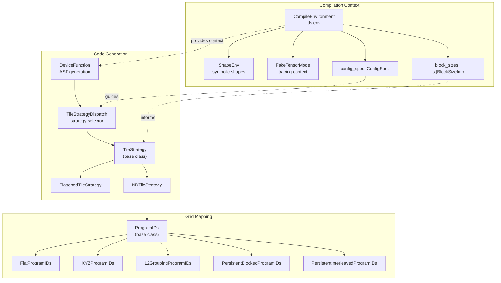
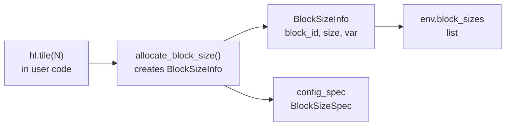
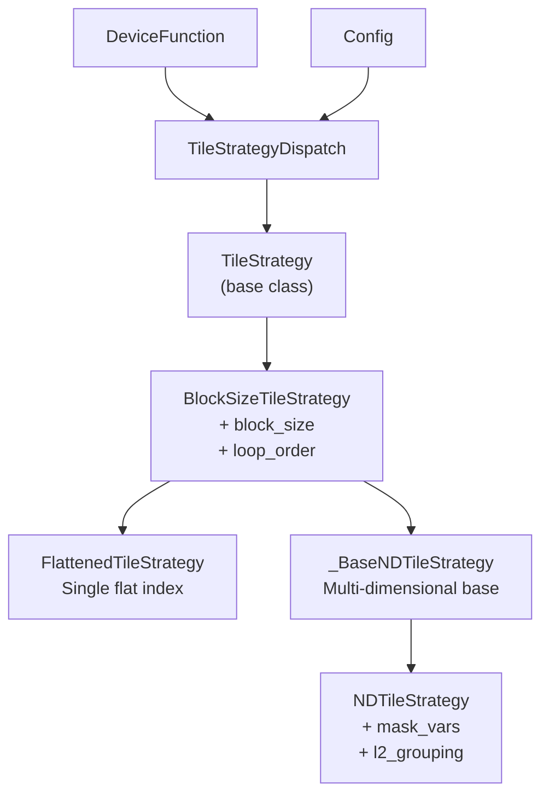
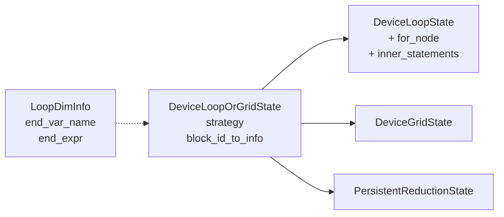
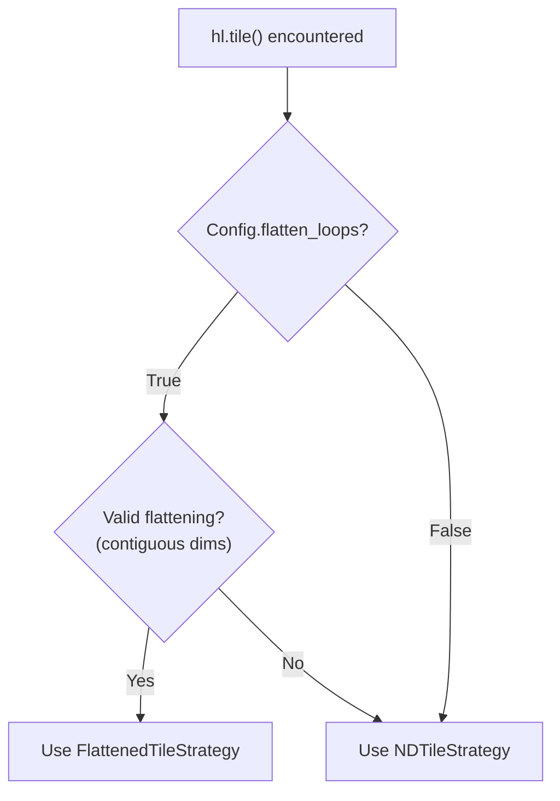
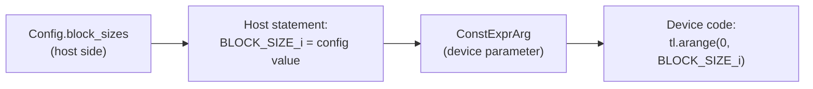
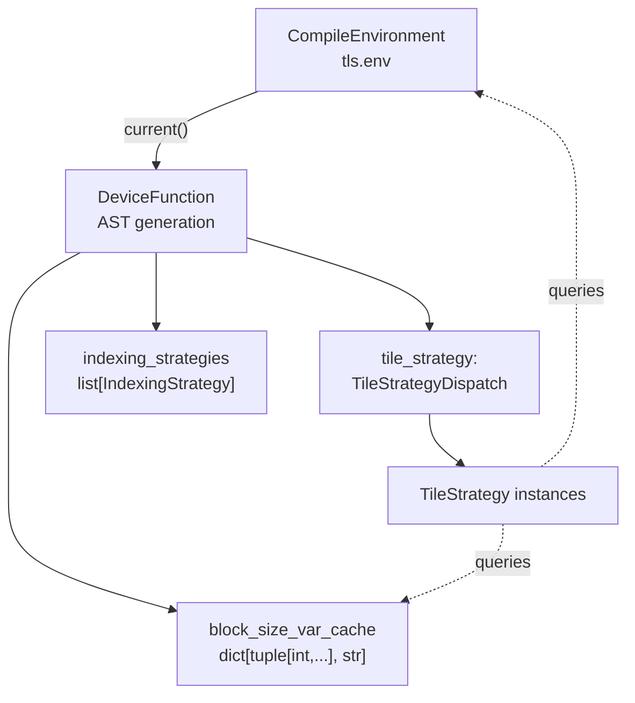
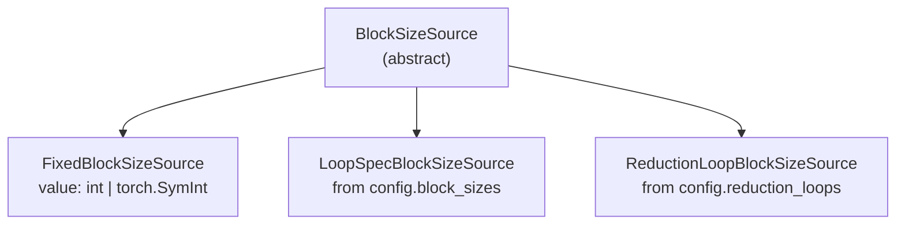

<!-- source: DeepWiki mcp.deepwiki.com · repo pytorch/helion · page 5.4 Compilation Environment and Code Generation · fetched 2026-10-21 -->

# Tile Strategies and Compilation Environment

<details>
<summary>Relevant source files</summary>

The following files were used as context for generating this wiki page:

- [helion/_compiler/compile_environment.py](helion/_compiler/compile_environment.py)
- [helion/_compiler/device_function.py](helion/_compiler/device_function.py)
- [helion/_compiler/generate_ast.py](helion/_compiler/generate_ast.py)
- [helion/_compiler/host_function.py](helion/_compiler/host_function.py)
- [helion/_compiler/tile_strategy.py](helion/_compiler/tile_strategy.py)
- [test/test_broadcasting.py](test/test_broadcasting.py)
- [test/test_generate_ast.py](test/test_generate_ast.py)
- [test/test_matmul.py](test/test_matmul.py)

</details>


## Purpose and Scope

This page documents three interconnected systems that manage kernel compilation:

1. **Tile Strategies** - Determine how iteration spaces defined by `hl.tile()` loops are parallelized and mapped to GPU hardware resources
2. **Program ID Strategies** - Control how thread blocks are assigned to work items through different grid layouts
3. **Compilation Environment** - Maintains global state during compilation including shape tracking, symbol creation, and block size allocation

Together, these systems transform high-level loop constructs into efficient GPU code. For information about memory access patterns within tiles, see [Indexing Strategies](#5.5). For the overall pipeline context, see [Compilation Pipeline](#5).

---

## System Architecture



**System Architecture Overview**

The compilation environment provides global state that tile strategies query during code generation. Tile strategies select program ID strategies to map work to GPU threads.

**Sources:** [helion/_compiler/compile_environment.py:84-133](), [helion/_compiler/tile_strategy.py:92-103](), [helion/_compiler/device_function.py:200-251]()

---

## CompileEnvironment

### Purpose and Lifecycle

`CompileEnvironment` maintains global state for the duration of a single kernel compilation. It exists in a 1:1 relationship with a `BoundKernel` and is reused across multiple `Config` instances during autotuning. No config-specific or codegen-specific state is stored here.

```python
class CompileEnvironment:
    device: torch.device
    settings: Settings
    index_dtype: torch.dtype
    shape_env: ShapeEnv                    # PyTorch symbolic shapes
    fake_mode: FakeTensorMode              # Tracing context
    block_sizes: list[BlockSizeInfo]       # Allocated block dimensions
    config_spec: ConfigSpec                # Tunable parameter space
```

**Sources:** [helion/_compiler/compile_environment.py:84-133]()

### Thread-Local Storage Pattern

The environment uses thread-local storage to provide global access during compilation:

```python
tls: _TLS = typing.cast("_TLS", threading.local())

class CompileEnvironment:
    def __enter__(self) -> Self:
        assert tls.env is None, "CompileEnvironment already active"
        self.fake_mode.__enter__()
        tls.env = self
        return self
    
    @staticmethod
    def current() -> CompileEnvironment:
        if (env := tls.env) is not None:
            return env
        raise NoCurrentEnvironment
```

This pattern allows any part of the compilation pipeline to access the current environment via `CompileEnvironment.current()`.

**Sources:** [helion/_compiler/compile_environment.py:51-592]()

### Block Size Allocation

The environment is responsible for allocating and tracking block sizes for tile dimensions:



**Block Size Allocation Flow**

Each `hl.tile()` call allocates a block dimension tracked globally in the environment.

```python
def allocate_block_size(
    self,
    size: int | torch.SymInt | AutoSize | None,
    *,
    reduction: bool = False,
    source: BlockSizeSource,
    hint: int = 64,
    reuse_var: torch.SymInt | None = None,
) -> int:
    idx = len(self.block_sizes)
    var = reuse_var or self.create_block_var(f"block_size_{idx}", hint=hint)
    
    self.block_sizes.append(
        BlockSizeInfo(
            block_id=idx,
            size=size,
            var=var,
            reduction=reduction,
            block_size_source=source,
        )
    )
    return idx
```

**Sources:** [helion/_compiler/compile_environment.py:189-227](), [helion/_compiler/compile_environment.py:652-732]()

### Symbol Creation and Management

The environment creates symbolic integers that represent dynamic values during compilation:

| Method | Purpose | Returns |
|--------|---------|---------|
| `create_block_var(name, hint)` | Create unbacked symbol for block size | `torch.SymInt` |
| `create_unbacked_symint(hint)` | Create general unbacked symbol | `torch.SymInt` |
| `cached_create_unbacked_symint(key, hint)` | Create cached unbacked symbol | `torch.SymInt` |

These symbols integrate with PyTorch's `ShapeEnv` for symbolic shape tracking:

```python
def create_block_var(self, debug_name: str, hint: int = 64) -> torch.SymInt:
    source = _current_symbol_source()
    with self.shape_env.ignore_fresh_unbacked_symbols():
        sym = self.shape_env.create_unbacked_symint(source=source)
        self.shape_env.var_to_val[sym._sympy_()] = sympy.Integer(hint)
    
    # Store debug name for better error messages
    self.debug_shape_renames[sym._sympy_()] = sympy.Symbol(debug_name, integer=True)
    return sym
```

**Sources:** [helion/_compiler/compile_environment.py:273-324]()

### Fake Tensor Conversion

The environment converts concrete tensors to fake tensors for tracing:

```python
def to_fake(self, obj: object, origin: Origin) -> object:
    if isinstance(obj, torch.Tensor):
        return self._to_fake_tensor(obj, origin.to_source())
    if isinstance(obj, bool):
        return self.shape_env.create_unbacked_symbool()
    if isinstance(obj, int):
        return self.create_unbacked_symint(hint=obj)
    if isinstance(obj, float):
        return self.shape_env.create_unbacked_symfloat()
    # Handle lists, tuples, dicts recursively
    # ...
```

This enables symbolic execution while preserving shape relationships.

**Sources:** [helion/_compiler/compile_environment.py:410-518]()

### Size Hints and Specialization

The environment tracks which symbolic variables should be specialized to concrete values:

```python
specialized_vars: set[sympy.Symbol]          # Symbols to concretize
specialized_strides: set[tuple[str, int]]    # Stride specialization

def specialize_expr(self, expr: sympy.Expr) -> sympy.Expr:
    """Substitute specialized vars with concrete values."""
    if subs := {
        s: sympy.Integer(self.shape_env.size_hint(s))
        for s in expr.free_symbols & self.specialized_vars
    }:
        expr = expr.xreplace(subs)
    return expr

def size_hint(self, n: int | torch.SymInt) -> int:
    """Get concrete size hint for symbolic value."""
    if isinstance(n, torch.SymInt):
        if _has_unbacked(n._sympy_()):
            # Return hint stored in var_to_val
            return int(self.shape_env.var_to_val[n._sympy_()])
        return int(self.shape_env.size_hint(n._sympy_()))
    return n
```

**Sources:** [helion/_compiler/compile_environment.py:127-134](), [helion/_compiler/compile_environment.py:135-143](), [helion/_compiler/compile_environment.py:519-546]()

### Block ID Resolution

The environment provides utilities to map symbolic expressions back to their block IDs:

```python
def get_block_id(self, size: int | torch.SymInt | sympy.Basic) -> int | None:
    """Get block ID for a size expression."""
    if isinstance(size, torch.SymInt):
        size = size._sympy_()
    if isinstance(size, sympy.Symbol):
        origin_info = HostFunction.current().expr_to_origin.get(size)
        if origin_info and isinstance(origin_info.origin, BlockSizeOrigin):
            return origin_info.origin.block_id
    return None

def resolve_block_id(self, size: object) -> int | None:
    """Best-effort block ID lookup with fallback to constant matching."""
    block_id = self.get_block_id(size)
    if block_id is not None:
        return block_id
    
    # Fall back to matching constant reduction dimensions
    expr = _to_sympy(size)
    if expr and not getattr(expr, "free_symbols", None):
        for info in reversed(self.block_sizes):
            if info.reduction and info.size_matches(expr):
                return info.block_id
    return None
```

**Sources:** [helion/_compiler/compile_environment.py:593-642]()

### Tensor Indexing Shape Inference

The environment provides utilities for computing broadcast shapes during tensor indexing:

```python
def should_broadcast_tensor_indexers(self, index: Sequence[object]) -> bool:
    """Check whether tensor indexers need broadcasting."""
    # Returns True if multiple consecutive tensor indices need broadcasting
    # Returns False for single tensors or non-consecutive positions

def tensor_indexer_broadcast_shape(
    self, tensors: Sequence[torch.Tensor]
) -> list[int | torch.SymInt]:
    """Compute broadcast shape for tensor indexers."""
    # Handles both standard broadcast and Cartesian product cases
    # Normalizes dimensions to canonical block size variables

def new_index_result(
    self, tensor: torch.Tensor, output_shape: Sequence[int | torch.SymInt]
) -> torch.Tensor:
    """Create tensor for indexing ops with normalized shapes."""
    # Ensures all block-size dimensions use canonical variables
```

**Sources:** [helion/_compiler/compile_environment.py:337-408]()

---

## Tile Strategy Overview

When a Helion kernel contains `hl.tile()` loops, the compiler must decide how to map the iteration space to GPU threads. The tile strategy system provides two main approaches:

| Strategy | Description | Use Case |
|----------|-------------|----------|
| `FlattenedTileStrategy` | Collapses all dimensions into a single flat index | Irregular patterns, dynamic iteration bounds |
| `NDTileStrategy` | Maps each dimension to a separate grid axis (x/y/z) | Regular rectangular grids, maximizes parallelism |

Both strategies inherit from the abstract `TileStrategy` base class and implement the same interface for code generation.

**Sources:** [helion/_compiler/tile_strategy.py:92-243](), [helion/_compiler/compile_environment.py:84-133]()

---

## Strategy Architecture



**Tile Strategy Class Hierarchy**

The hierarchy separates concerns: `TileStrategy` defines the interface, `BlockSizeTileStrategy` adds block size and loop ordering, and concrete implementations provide specific parallelization approaches.

**Sources:** [helion/_compiler/tile_strategy.py:92-103](), [helion/_compiler/tile_strategy.py:279-306](), [helion/_compiler/tile_strategy.py:357-395](), [helion/_compiler/tile_strategy.py:535-552](), [helion/_compiler/tile_strategy.py:728-742]()

---

## Core Data Structures

### TileStrategy Base Class

The base class maintains shared state and defines the interface for code generation:

```python
class TileStrategy:
    _fn: weakref.ReferenceType[DeviceFunction]
    block_ids: list[int]                    # Dimension identifiers
    index_vars: dict[int, str]              # Variable names for indices
    offset_vars: dict[int, str]             # Variable names for offsets
```

**Key Methods:**

| Method | Returns | Purpose |
|--------|---------|---------|
| `codegen_grid(state)` | `DeviceGridState` | Generate grid-level parallelism using program IDs |
| `codegen_device_loop(state)` | `DeviceLoopState` | Generate explicit device loops |
| `offset_var(block_idx)` | `str` | Get the base offset variable name |
| `index_var(block_idx)` | `str` | Get the index array variable name |
| `mask_var(block_idx)` | `str \| None` | Get the mask variable name (if needed) |
| `block_size_var(block_idx)` | `str \| None` | Get the block size constant name |

**Sources:** [helion/_compiler/tile_strategy.py:92-130]()

### Loop and Grid State Objects



**State Object Types**

These objects carry information about the generated loops back to the code generator, including AST nodes and dimension bounds.

**Sources:** [helion/_compiler/tile_strategy.py:46-89]()

---

## FlattenedTileStrategy

### Concept

Flattened strategies collapse a multi-dimensional iteration space into a single linear index. This is useful when:
- Dimensions are not contiguous in memory access patterns
- Total iteration count is more important than dimensional structure
- Dynamic bounds make grid mapping complex

### Code Generation

```mermaid
graph TB
    subgraph "Grid Mode"
        A1["pid_0 = tl.program_id(0)"]
        A2["offsets = pid_0 * BLOCK_SIZE + tl.arange(0, BLOCK_SIZE)"]
        A3["indices_0 = offsets // numel_1"]
        A4["indices_1 = (offsets // numel_2) % numel_1"]
        A5["indices_2 = offsets % numel_2"]
        A6["mask = offsets < total_numel"]
        
        A1 --> A2
        A2 --> A3
        A3 --> A4
        A4 --> A5
        A5 --> A6
    end
    
    subgraph "Device Loop Mode"
        B1["for lid in tl.range(0, cdiv(total_numel, BLOCK_SIZE))"]
        B2["offsets = lid * BLOCK_SIZE + tl.arange(0, BLOCK_SIZE)"]
        B3["Compute indices_i from offsets"]
        B4["mask = offsets < total_numel"]
        
        B1 --> B2
        B2 --> B3
        B3 --> B4
    end
```



**Flattened Strategy Code Generation Flow**

The strategy computes a flat offset, then decomposes it into individual dimension indices using division and modulo operations.

**Key Implementation Points:**

1. **Single block size variable** - All dimensions share one `_BLOCK_SIZE` variable [helion/_compiler/tile_strategy.py:382-387]()
2. **Index decomposition** - Uses division and modulo to extract dimensional indices [helion/_compiler/tile_strategy.py:413-422]()
3. **Optional masking** - Only needed if total size is not a multiple of block size [helion/_compiler/tile_strategy.py:371-380]()
4. **Loop order** - Dimensions are reordered according to `loop_order` config [helion/_compiler/tile_strategy.py:294-302]()

### Grid Configuration

For flattened grids, the strategy creates a temporary `ProgramIDs` object that generates a 1D grid:

```python
grid = (triton.cdiv(total_numel, _BLOCK_SIZE), 1, 1)
```

**Sources:** [helion/_compiler/tile_strategy.py:357-459](), [helion/_compiler/tile_strategy.py:402-431](), [helion/_compiler/tile_strategy.py:433-459](), [helion/_compiler/tile_strategy.py:461-492]()

---

## NDTileStrategy

### Concept

ND (N-dimensional) strategies map each dimension of the iteration space to a separate axis of the GPU grid. This maximizes parallelism by allowing independent thread blocks to work on different tiles simultaneously.

### Grid vs Device Loop Generation

```mermaid
graph TB
    subgraph "Grid Mode (codegen_grid)"
        G1["Select PID strategy<br/>(xyz, flat, persistent)"]
        G2["For each dimension i:<br/>pid_i = program_id(axis_i)"]
        G3["offset_i = pid_i * BLOCK_SIZE_i"]
        G4["indices_i = offset_i + tl.arange(0, BLOCK_SIZE_i)"]
        G5["mask_i = indices_i < numel_i<br/>(if needed)"]
        G6["Set DeviceFunction.pid"]
        
        G1 --> G2
        G2 --> G3
        G3 --> G4
        G4 --> G5
        G5 --> G6
    end
    
    subgraph "Device Loop Mode (codegen_device_loop)"
        L1["For each dimension i:<br/>Create nested for loop"]
        L2["for offset_i in range(begin_i, end_i, BLOCK_SIZE_i)"]
        L3["indices_i = offset_i + tl.arange(0, BLOCK_SIZE_i)"]
        L4["mask_i = indices_i < end_i<br/>(if needed)"]
        L5["Nest loops according to loop_order"]
        
        L1 --> L2
        L2 --> L3
        L3 --> L4
        L4 --> L5
    end
```



**ND Strategy Dual Mode Generation**

The same strategy can generate either grid-level parallelism or explicit device loops depending on the context.

**Sources:** [helion/_compiler/tile_strategy.py:553-621](), [helion/_compiler/tile_strategy.py:650-721]()

### Masking Strategy

ND strategies only generate masks when the iteration size is not evenly divisible by the block size:

```python
if env.block_sizes[block_idx].known_multiple(block_size):
    self.mask_vars[block_idx] = None  # No mask needed
else:
    self.mask_vars[block_idx] = mask_var
    # Generate: mask = indices < end
```

**Sources:** [helion/_compiler/tile_strategy.py:746-766]()

### Program ID Strategies

The ND strategy delegates to different `ProgramIDs` implementations based on configuration:

| PID Type | Class | Grid Layout | Behavior |
|----------|-------|-------------|----------|
| `xyz` | `XYZProgramIDs` | Maps to `tl.program_id(0/1/2)` | Standard 3D grid, up to 3 dimensions |
| `flat` | `FlatProgramIDs` | Single `tl.program_id(0)` | 1D grid for any number of dimensions |
| `persistent_blocked` | `PersistentBlockedProgramIDs` | Persistent loop with blocking | Blocks process tiles sequentially |
| `persistent_interleaved` | `PersistentInterleavedProgramIDs` | Persistent loop with interleaving | Threads interleave across tiles |

Persistent kernels wrap the entire kernel body in a loop that allows each thread block to process multiple tiles, improving GPU utilization when the grid size is small relative to available SMs.

**Sources:** [helion/_compiler/tile_strategy.py:746-774](), [helion/_compiler/program_id.py:1-800]()

---

## Strategy Selection



**Strategy Selection Flow**

The selection is driven by configuration and shape analysis to determine the optimal parallelization approach.

### Flatten Loop Validation

Before using a flattened strategy, the compiler validates that dimensions are contiguous in tensor access patterns:

```python
def update_allow_flattened(cls, shape: Sequence[sympy.Expr]) -> None:
    # Check if block_ids appear contiguously in shape
    for i, j in itertools.pairwise(block_ids):
        if i in used_indices and used_indices[i] + 1 != used_indices[j]:
            # Block indices must be contiguous
            flatten_loops.disable_block_id(block_ids[0])
```

This ensures flattening doesn't break memory access coalescing.

**Sources:** [helion/_compiler/tile_strategy.py:494-515]()

---

## Loop Ordering and Optimization

### Loop Order Configuration

The `loop_order` parameter determines the nesting order of loops in multi-dimensional tiles:

```python
# Given block_ids = [0, 1, 2] and loop_order = [2, 0, 1]
# Generates loops in order: block_2 (outer), block_0 (middle), block_1 (inner)
```

This affects cache behavior and memory access patterns.

**Sources:** [helion/_compiler/tile_strategy.py:286-302]()

### Range Call Configuration

Both strategies support advanced Triton loop features configured through `ConfigSpec`:

```python
def get_tl_range_kwargs(config: Config, block_idx: int) -> list[str]:
    kwargs = []
    
    # Loop unrolling
    if range_unroll_factor > 0:
        kwargs.append(f"loop_unroll_factor={range_unroll_factor}")
    
    # Warp specialization
    if range_warp_specialize is not None:
        kwargs.append(f"warp_specialize={range_warp_specialize}")
    
    # Multi-stage pipelining
    if range_num_stages > 0:
        kwargs.append(f"num_stages={range_num_stages}")
    
    # Data partitioning
    if dpf_value is not None:
        kwargs.append(f"data_partition_factor={dpf_value}")
```

**Sources:** [helion/_compiler/tile_strategy.py:130-196]()

### Static vs Dynamic Ranges

The compiler can use `tl.static_range()` instead of `tl.range()` when loop bounds are known at compile time:

```python
use_static_range = all(
    config.static_ranges.get(block_idx) is True
    for block_idx in block_ids
)

if use_static_range:
    return f"tl.static_range({args})"
else:
    return f"tl.range({args}, {kwargs})"
```

Static ranges enable better compiler optimizations.

**Sources:** [helion/_compiler/tile_strategy.py:198-227]()

---

## Block Size Management

### Block Size Variables

Each tile dimension has an associated block size that must be passed to the Triton kernel:



**Block Size Flow from Host to Device**

Block sizes are defined on the host, passed as constexpr parameters, and used in device code for range generation.

### Constexpr Setup

The `_setup_block_size_constexpr()` helper creates the necessary infrastructure:

```python
def _setup_block_size_constexpr(self, state, block_size_var, block_size):
    # Create constexpr argument in device function
    state.device_function.constexpr_arg_with_host_def(block_size_var, block_size)
    # Adds to host statements: block_size_var = <value>
    # Adds to device args: block_size_var: tl.constexpr
```

**Sources:** [helion/_compiler/tile_strategy.py:272-276](), [helion/_compiler/device_function.py:489-506]()

---

## Special Cases

### Tile End Folding

When an inner tile's end bound matches an outer tile's end bound, the compiler can optimize away redundant bound checks:

```python
# for outer in hl.tile(0, N, OUTER_SIZE):
#     for inner in hl.tile(outer.begin, outer.end, INNER_SIZE):
#         # If INNER_SIZE <= OUTER_SIZE, inner.end == outer.end

def _fold_tile_end_op(self, state, end, block_size):
    # Check if end comes from parent loop's tile_end()
    if matches_parent_loop_end(fx_node):
        # Replace with parent loop's end_expr
        return loop_info.end_expr
```

This optimization preserves precise bound information across nested tiles.

**Sources:** [helion/_compiler/tile_strategy.py:307-354]()

### Shape Compaction

The `compact_shape()` method optimizes dimension layouts for efficient code generation:

- **Flattened strategy**: Combines consecutive flattened dimensions into a single shape element
- **ND strategy**: Preserves dimension structure (future optimization opportunity for size-1 dims)

```python
# FlattenedTileStrategy merges block_ids [0,1,2] into single CompactedShape
# NDTileStrategy keeps them separate
```

**Sources:** [helion/_compiler/tile_strategy.py:241-242](), [helion/_compiler/tile_strategy.py:517-532](), [helion/_compiler/tile_strategy.py:723-725](), [helion/_compiler/tile_strategy.py:777-792]()

---

## Integration with DeviceFunction and CompileEnvironment



**Integration Architecture**

The `DeviceFunction` maintains the tile strategy and coordinates with `CompileEnvironment` for global state queries. Tile strategies access block size information through both the device function cache and the environment.

**Sources:** [helion/_compiler/device_function.py:200-251](), [helion/_compiler/tile_strategy.py:92-117]()

### Initialization

```python
class DeviceFunction:
    def __init__(self, name: str, config: Config, codegen: GenerateAST):
        from .tile_dispatch import TileStrategyDispatch
        
        self.tile_strategy = TileStrategyDispatch(self, config)
        self.block_size_var_cache: dict[tuple[int, ...], str] = {}
        self.indexing_strategies: list[IndexingStrategy] = []
        self.expr_to_var_info: dict[sympy.Expr, VarInfo] = {}
```

The `TileStrategyDispatch` wrapper manages strategy selection and instantiation based on the current compilation context and queries `CompileEnvironment.current()` for block size information.

**Sources:** [helion/_compiler/device_function.py:200-251]()

### Variable Management

The `DeviceFunction` provides utilities for tile strategies to create and access variables:

| Method | Purpose | Implementation |
|--------|---------|----------------|
| `new_var(name, dce=False)` | Create unique variable name in namespace | Uses `_Namespace` to avoid collisions |
| `block_size_var(block_id)` | Get or create block size variable | Lazy creation with caching in `block_size_var_cache` |
| `unique_name(prefix, dce=False)` | Generate numbered unique name | Uses `itertools.count` per prefix |
| `sympy_expr(expr)` | Convert sympy expression to Triton code string | Queries `CompileEnvironment` for specialization |

The `block_size_var()` method lazily creates block size constexpr arguments:

```python
def block_size_var(self, block_id: int) -> str | None:
    key = (block_id,)
    if key not in self.block_size_var_cache:
        env = CompileEnvironment.current()
        block_value = env.block_sizes[block_id].from_config(self.config)
        
        if block_value is None:
            return None
        
        var_name = self.new_var(f"_BLOCK_SIZE_{block_id}")
        self.block_size_var_cache[key] = var_name
        self.constexpr_arg_with_host_def(var_name, block_value)
    
    return self.block_size_var_cache[key]
```

**Sources:** [helion/_compiler/device_function.py:313-332](), [helion/_compiler/device_function.py:376-416](), [helion/_compiler/device_function.py:444-451]()

---

## Advanced Features

### L2 Cache Grouping

The `NDTileStrategy` supports L2 cache grouping to improve data locality:

```python
class NDTileStrategy:
    def __init__(self, ..., l2_grouping: int):
        self.l2_grouping = l2_grouping
    
    def select_pid_strategy(self):
        if self.l2_grouping > 1:
            return L2GroupingProgramIDs(
                group_size=self.l2_grouping,
                parent_strategy=super().select_pid_strategy(),
            )
```

This wraps the base PID strategy to process multiple tiles per thread block, keeping data in L2 cache. The grouping parameter is set via `Config.l2_groupings` and validated during `CompileEnvironment.finalize_config_spec()`.

**Sources:** [helion/_compiler/tile_strategy.py:863-909](), [helion/_compiler/compile_environment.py:159-165]()

### Tensor Descriptor Compatibility

When using tensor descriptor indexing, certain loop optimizations are disabled to avoid CUDA errors:

```python
if config.indexing == "tensor_descriptor":
    # Disable multi-stage pipelining with unrolling
    if range_num_stages > 0:
        range_num_stages = 0
    if range_unroll_factor > 0 and num_stages > 1:
        range_unroll_factor = 0
```

**Sources:** [helion/_compiler/tile_strategy.py:147-153]()

### Persistent Reductions

The system tracks persistent reduction state separately from regular loops:

```python
class PersistentReductionState(DeviceLoopOrGridState):
    pass  # Marker class for persistent reduction contexts
```

This enables special handling of reduction patterns that span multiple iterations.

**Sources:** [helion/_compiler/tile_strategy.py:88-89]()

---

## BlockSizeInfo and Sources

### BlockSizeInfo Structure

Each allocated block dimension is tracked with metadata:

```python
@dataclasses.dataclass
class BlockSizeInfo:
    block_id: int                           # Unique identifier
    size: torch.SymInt | int | AutoSize | None  # Iteration bound
    var: torch.SymInt                       # Symbolic variable
    reduction: bool                         # Is this a reduction dimension?
    block_size_source: BlockSizeSource      # How to get block size from config
    debug_names: set[str]                   # User-facing names
```

The `size` field represents the iteration bound (e.g., tensor size), while the actual block size used for tiling comes from `block_size_source.from_config(config)`.

**Sources:** [helion/_compiler/compile_environment.py:652-732]()

### BlockSizeSource Hierarchy

Different sources provide block sizes from configuration:



**BlockSizeSource Type Hierarchy**

| Source Type | Purpose | Value Source |
|-------------|---------|--------------|
| `FixedBlockSizeSource` | User-specified fixed size | Literal value |
| `LoopSpecBlockSizeSource` | Autotunable tile loop | `config.block_sizes[index]` |
| `ReductionLoopBlockSizeSource` | Autotunable reduction | `config.reduction_loops[index]` |

```python
class LoopSpecBlockSizeSource(BlockSizeSource):
    def from_config(self, config: Config, block_size_info: BlockSizeInfo) -> int:
        env = CompileEnvironment.current()
        size = block_size_info.size
        if isinstance(size, (int, torch.SymInt)) and env.known_equal(size, 1):
            return 1
        index = env.config_spec.block_sizes.block_id_to_index(block_size_info.block_id)
        return config.block_sizes[index]

class ReductionLoopBlockSizeSource(BlockSizeSource):
    reduction_loop: int
    
    def from_config(self, config: Config, block_size_info: BlockSizeInfo) -> int | None:
        if (len(config.reduction_loops) <= self.reduction_loop
            or config.reduction_loops[self.reduction_loop] is None):
            return max(1, next_power_of_2(block_size_info.size_hint()))
        return config.reduction_loops[self.reduction_loop]
```

**Sources:** [helion/_compiler/compile_environment.py:734-776]()

### Reduction Dimension Allocation

Reduction dimensions receive special treatment with deduplication:

```python
def allocate_reduction_dimension(self, size: torch.SymInt | int) -> BlockSizeInfo:
    # Check for existing reduction dimensions with same size
    for rdim in self.block_sizes:
        if not rdim.reduction:
            continue
        if rdim.size == size or self.known_equal(rdim.size, size):
            return rdim  # Reuse existing
    
    # Allocate new reduction dimension
    rdim_idx = self.allocate_block_size(
        size,
        reduction=True,
        source=ReductionLoopBlockSizeSource(count),
        hint=next_power_of_2(self.size_hint(size)),
    )
    return self.block_sizes[rdim_idx]
```

This ensures that multiple reductions over the same dimension share a single block size variable.

**Sources:** [helion/_compiler/compile_environment.py:229-271]()

---

## Code Generation Examples

### Example 1: 2D Grid with ND Strategy

**Input Helion code:**
```python
for tile_m, tile_n in hl.tile([M, N], [64, 128]):
    # kernel body
```

**Generated grid code:**
```python
pid_0 = tl.program_id(0)
pid_1 = tl.program_id(1)
offset_0 = pid_0 * _BLOCK_SIZE_0
offset_1 = pid_1 * _BLOCK_SIZE_1
indices_0 = offset_0 + tl.arange(0, _BLOCK_SIZE_0)
indices_1 = offset_1 + tl.arange(0, _BLOCK_SIZE_1)
mask_0 = indices_0 < M
mask_1 = indices_1 < N
```

### Example 2: Flattened 3D Loop

**Input Helion code:**
```python
for tile_i, tile_j, tile_k in hl.tile([I, J, K], 256, flatten=True):
    # kernel body
```

**Generated grid code:**
```python
offsets = tl.program_id(0) * _BLOCK_SIZE + tl.arange(0, _BLOCK_SIZE)
indices_0 = offsets // (J * K)
indices_1 = (offsets // K) % J
indices_2 = offsets % K
mask = offsets < (I * J * K)
```

**Sources:** [helion/_compiler/tile_strategy.py:553-621](), [helion/_compiler/tile_strategy.py:433-459]()

---

