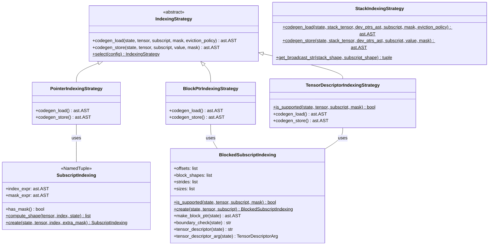
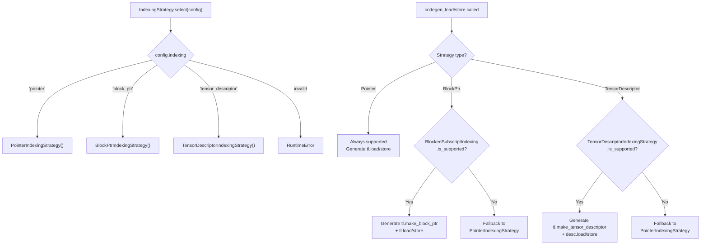
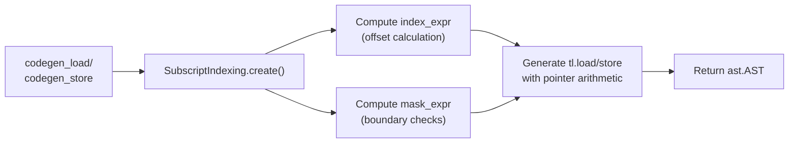
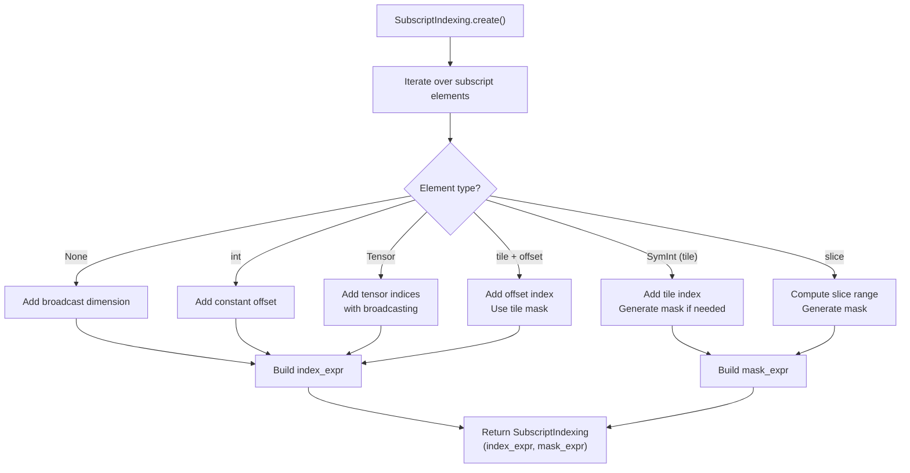
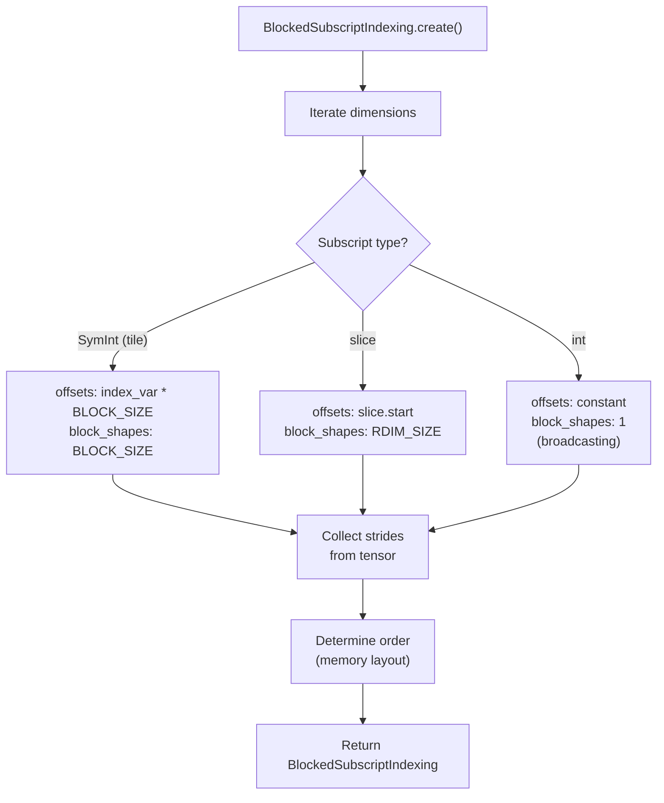
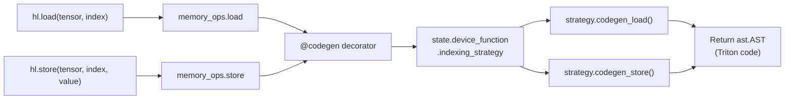
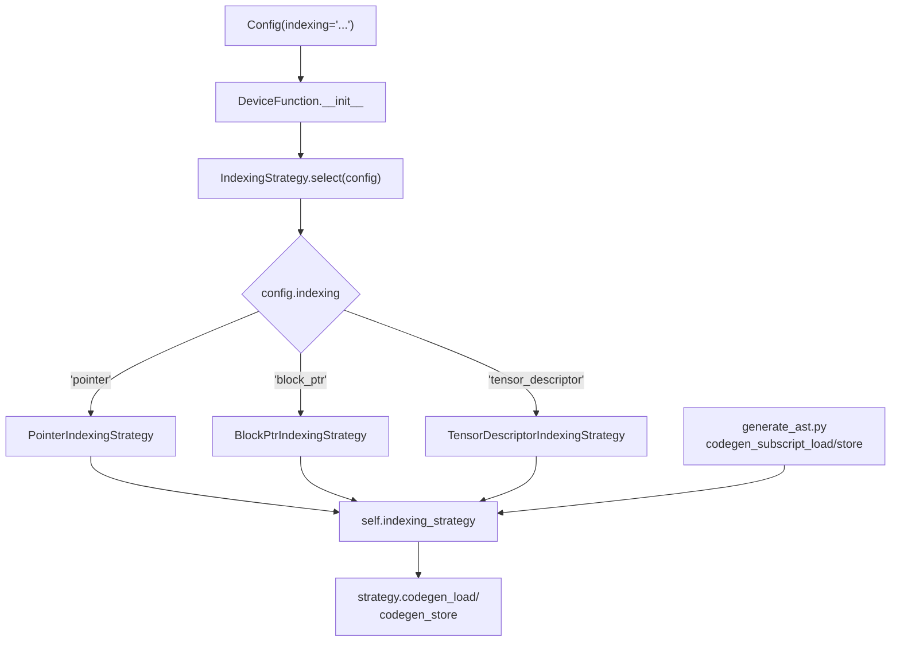

<!-- source: DeepWiki mcp.deepwiki.com · repo pytorch/helion · page 5.5 Indexing Strategies · fetched 2026-10-21 -->

# Indexing Strategies

<details>
<summary>Relevant source files</summary>

The following files were used as context for generating this wiki page:

- [helion/_compiler/aten_lowering.py](helion/_compiler/aten_lowering.py)
- [helion/_compiler/indexing_strategy.py](helion/_compiler/indexing_strategy.py)
- [helion/language/tile_ops.py](helion/language/tile_ops.py)
- [helion/language/tile_proxy.py](helion/language/tile_proxy.py)
- [test/test_autotuner.expected](test/test_autotuner.expected)
- [test/test_indexing.py](test/test_indexing.py)
- [test/test_misc.py](test/test_misc.py)

</details>


## Purpose and Scope

This page describes the indexing strategy system in Helion's compilation pipeline, which determines how memory access operations (loads and stores) are compiled into Triton code. The system provides three distinct strategies—pointer arithmetic, block pointers, and tensor descriptors—each with different performance characteristics and hardware requirements. Strategy selection occurs during compilation based on configuration settings and tensor properties.

For information about how tile indices are generated and managed, see [Tile Strategies](#5.4). For the overall lowering process, see [Inductor Lowering](#5.3).

**Sources:** [helion/_compiler/indexing_strategy.py:1-1134]()

---

## Strategy Architecture

### Class Hierarchy



The `IndexingStrategy` base class defines the interface for load/store code generation. Each concrete strategy implements these methods to generate appropriate Triton code patterns. `SubscriptIndexing` and `BlockedSubscriptIndexing` are helper classes that compute index expressions and masks.

**Sources:** [helion/_compiler/indexing_strategy.py:108-141](), [helion/_compiler/indexing_strategy.py:143-271](), [helion/_compiler/indexing_strategy.py:273-326](), [helion/_compiler/indexing_strategy.py:328-488](), [helion/_compiler/indexing_strategy.py:491-643](), [helion/_compiler/indexing_strategy.py:646-920]()

---

## Strategy Selection

### Selection Flow



Strategy selection occurs in two phases:
1. **Initial selection** via `IndexingStrategy.select(config)` based on the `config.indexing` parameter
2. **Runtime validation** where `BlockPtrIndexingStrategy` and `TensorDescriptorIndexingStrategy` can fall back to `PointerIndexingStrategy` if requirements aren't met

**Sources:** [helion/_compiler/indexing_strategy.py:128-141](), [helion/_compiler/indexing_strategy.py:193-217](), [helion/_compiler/indexing_strategy.py:219-239](), [helion/_compiler/indexing_strategy.py:342-371](), [helion/_compiler/indexing_strategy.py:373-401]()

---

## PointerIndexingStrategy

### Overview

`PointerIndexingStrategy` is the universal fallback strategy that generates direct pointer arithmetic with explicit masking. It works with any tensor layout and subscript pattern, making it the most flexible but potentially less optimized approach.

### Generated Code Pattern

For a simple 1D load:
```python
# User code: x[tile]
# Generated Triton code:
tl.load(x + indices_0 * 1, mask_0, other=0)
```

For a 3D load with strides:
```python
# User code: x[tile_l, tile_m, tile_n]
# Generated Triton code:
tl.load(x + (indices_0[:, None, None] * 768 + 
             indices_1[None, :, None] * 32 + 
             indices_2[None, None, :] * 1), None)
```

### Implementation Details



The strategy:
1. Uses `SubscriptIndexing.create()` to compute offset expressions and masks
2. Generates code of the form `tl.load(tensor + offset, mask, other=0)`
3. Automatically handles broadcasting, strides, and boundary checking
4. Supports FP8 dtypes by using `other=0.0` instead of `other=0`

**Sources:** [helion/_compiler/indexing_strategy.py:143-188](), [helion/_compiler/indexing_strategy.py:655-920]()

### Test Examples

The pointer indexing strategy is demonstrated in the test expected output:

```python
# From test_broadcasting_pointer_indexing
load = tl.load(x + (indices_0[:, None, None] * 768 + 
                    indices_1[None, :, None] * 32 + 
                    indices_2[None, None, :] * 1), None)
```

**Sources:** [test/test_indexing.expected:157-213](), [test/test_indexing.py:740-752]()

---

## BlockPtrIndexingStrategy

### Overview

`BlockPtrIndexingStrategy` uses Triton's `tl.make_block_ptr` API to create optimized block pointers for accessing contiguous memory regions. This strategy provides better performance than pointer arithmetic when accessing regular, blocked patterns but requires specific conditions to be met.

### Requirements

The strategy can only be used when `BlockedSubscriptIndexing.is_supported()` returns `True`:

| Requirement | Description |
|------------|-------------|
| **No extra mask** | `extra_mask` parameter must be `None` |
| **Broadcastable sizes** | Broadcasting must produce valid block shapes |
| **Compatible subscripts** | Each subscript element must be a tile (SymInt), slice, or broadcast dimension |

**Sources:** [helion/_compiler/indexing_strategy.py:869-983]()

### Generated Code Pattern

```python
# User code: x[tile_l, tile_m, tile_n]
# Generated Triton code with block_ptr:
block_ptr = tl.make_block_ptr(
    x, 
    [16, 24, 32],           # tensor shape
    [768, 32, 1],           # strides
    [offset_0, offset_1, offset_2],  # offsets
    [_BLOCK_SIZE_0, _BLOCK_SIZE_1, _BLOCK_SIZE_2],  # block shape
    [2, 1, 0]               # order
)
tl.load(block_ptr, boundary_check=[0, 1, 2], padding_option='zero')
```

The `order` parameter `[2, 1, 0]` specifies that dimension 2 (rightmost) is contiguous in memory, then dimension 1, then dimension 0.

**Sources:** [test/test_indexing.expected:102-155](), [helion/_compiler/indexing_strategy.py:193-217](), [helion/_compiler/indexing_strategy.py:219-239]()

### Boundary Checking

The `boundary_check` parameter specifies which dimensions require bounds checking:

```python
def boundary_check(self, state: CodegenState) -> str:
    env = CompileEnvironment.current()
    checks = []
    for i, (size, block_shape) in enumerate(
        zip(self.sizes, self.block_shapes, strict=True)
    ):
        if not env.known_equal(size % block_shape, 0):
            checks.append(str(i))
    return f"[{', '.join(checks)}]"
```

Only dimensions where `size % block_shape != 0` need boundary checking, allowing the compiler to elide unnecessary checks.

**Sources:** [helion/_compiler/indexing_strategy.py:1012-1023]()

### Fallback Behavior

When requirements aren't met, the strategy gracefully falls back:

```python
def codegen_load(self, state, fake_tensor, subscript, extra_mask, eviction_policy):
    if not BlockedSubscriptIndexing.is_supported(
        state, fake_tensor, subscript, extra_mask
    ):
        return PointerIndexingStrategy().codegen_load(
            state, fake_tensor, subscript, extra_mask, eviction_policy
        )
    # ... generate block_ptr code
```

**Sources:** [helion/_compiler/indexing_strategy.py:193-217]()

---

## TensorDescriptorIndexingStrategy

### Overview

`TensorDescriptorIndexingStrategy` uses Triton's tensor descriptor API (TMA/WGMMA on NVIDIA) for hardware-accelerated memory access. This strategy provides the best performance but has the strictest requirements regarding tensor layouts and block sizes.

### Requirements

| Category | Requirement | Rationale |
|----------|------------|-----------|
| **Rank** | `2 <= ndim <= 5` | Hardware limitation |
| **Stride alignment** | Exactly one dimension with `stride == 1` | Identifies contiguous dimension |
| **Stride alignment** | Other strides must be 16-byte aligned | TMA requirement |
| **Block size** | `block_size * element_size >= 16 bytes` | TMA operates on 16-byte chunks |
| **Block size** | For 2D tensors, first dim `>= min(8, 32//itemsize)` | Hardware constraint |
| **Basic compatibility** | Must pass `BlockedSubscriptIndexing.is_supported()` | Inherits block_ptr requirements |

**Sources:** [helion/_compiler/indexing_strategy.py:245-340]()

### Stride Validation

```python
stride_one_count = 0
element_size = fake_tensor.element_size()
for dim in range(fake_tensor.ndim):
    stride = env.size_hint(fake_tensor.stride(dim))
    if stride == 1:
        stride_one_count += 1
    else:
        # All other dimensions should have 16-byte aligned strides
        byte_stride = stride * element_size
        if byte_stride % 16 != 0:
            return False
if stride_one_count != 1:
    return False  # Must have exactly one contiguous dimension
```

**Sources:** [helion/_compiler/indexing_strategy.py:263-279]()

### Generated Code Pattern

```python
# Tensor descriptor creation (once per kernel):
x_desc = tl.make_tensor_descriptor(
    x,                      # base pointer
    [16, 24, 32],          # shape
    [768, 32, 1],          # strides
    [_BLOCK_SIZE_0, _BLOCK_SIZE_1, _BLOCK_SIZE_2]  # block shape
)

# Load operation:
load = x_desc.load([offset_0, offset_1, offset_2])

# Store operation:
out_desc.store([offset_0, offset_1, offset_2], value)
```

Tensor descriptors are created once at kernel initialization and reused for multiple accesses, amortizing setup cost.

**Sources:** [test/test_indexing.expected:215-286](), [helion/_compiler/indexing_strategy.py:342-371](), [helion/_compiler/indexing_strategy.py:373-401]()

### Permutation Handling

When the tensor has a non-standard memory layout, permutation is applied:

```python
# Load with permutation:
load_expr = x_desc.load([offset_0, offset_1, offset_2])
load_expr = tl.permute(load_expr, desc_arg.inverse_permutation)

# Store with permutation:
store_value = tl.permute(value, desc_arg.permutation)
out_desc.store([offset_0, offset_1, offset_2], store_value)
```

This ensures the logical dimension order matches the physical memory layout.

**Sources:** [helion/_compiler/indexing_strategy.py:358-370](), [helion/_compiler/indexing_strategy.py:388-400]()

### Fallback Scenarios

The strategy automatically falls back to pointer indexing when:

1. Tensor rank is outside `[2, 5]`
2. Stride alignment requirements aren't met
3. Block sizes are too small (< 16 bytes)
4. Reduction loops interfere with layout requirements

**Sources:** [test/test_indexing.py:788-829]()

---

## SubscriptIndexing

### Purpose

`SubscriptIndexing` is a helper class that computes the index expression and mask expression for pointer-based memory access. It handles the complex logic of converting high-level subscripts (tiles, slices, tensors) into Triton pointer arithmetic.

### Core Computation



**Sources:** [helion/_compiler/indexing_strategy.py:655-920]()

### Shape Computation

The `compute_shape()` method determines the output shape of a subscript operation:

```python
@staticmethod
def compute_shape(tensor, index, state=None):
    input_size = collections.deque(tensor.size())
    output_size = []
    
    for k in index:
        if k is None:
            output_size.append(1)  # Broadcast dimension
        elif isinstance(k, int):
            input_size.popleft()   # Index dimension
        elif isinstance(k, torch.SymInt):
            # Tile dimension
            input_size.popleft()
            block_size = env.block_sizes[block_id].var
            if tensor.size(...) != 1:
                output_size.append(block_size)
            else:
                output_size.append(1)  # Broadcasting
        # ... handle slices, tensors, etc.
```

This is used during type propagation to determine result tensor shapes.

**Sources:** [helion/_compiler/indexing_strategy.py:567-627]()

### Index Expression Generation

The index expression combines strides and indices:

```python
# For 3D access x[i, j, k]:
# index = i * stride[0] + j * stride[1] + k * stride[2]
index_values.append(
    f"(({index_var}) + {offset_expr}){expand}"
)
```

The `expand` suffix broadcasts scalar indices to match tile shapes (e.g., `[:, None, None]`).

**Sources:** [helion/_compiler/indexing_strategy.py:682-696]()

### Mask Expression Generation

Masks are generated for dimensions that may exceed bounds:

```python
mask_values = {}
for i, k in enumerate(index):
    if is_tile_dimension(k):
        if mask_var := state.codegen.mask_var(block_id):
            mask_values[f"({mask_var}){expand}"] = None

# Combine all masks:
mask_expr = "&".join(mask_values.keys()) if mask_values else "None"
```

**Sources:** [helion/_compiler/indexing_strategy.py:691-695](), [helion/_compiler/indexing_strategy.py:843-867]()

---

## BlockedSubscriptIndexing

### Purpose

`BlockedSubscriptIndexing` extends `SubscriptIndexing` for block pointer and tensor descriptor strategies. It computes the parameters needed for `tl.make_block_ptr()` and tensor descriptor creation.

### Data Structure

```python
@dataclasses.dataclass
class BlockedSubscriptIndexing:
    offsets: list[str]           # Start offset for each dimension
    block_shapes: list[str]      # Block size for each dimension  
    strides: list[SymIntLike]    # Tensor strides
    sizes: list[SymIntLike]      # Tensor sizes
```

**Sources:** [helion/_compiler/indexing_strategy.py:986-990]()

### Creation Flow



**Sources:** [helion/_compiler/indexing_strategy.py:1025-1109]()

### Memory Layout Order

The `order` parameter specifies dimension ordering for optimal memory access:

```python
def compute_order(self) -> list[int]:
    """Determine dimension order based on strides."""
    stride_order = sorted(
        range(len(self.strides)),
        key=lambda i: self.strides[i]
    )
    return stride_order
```

A stride pattern of `[768, 32, 1]` produces order `[2, 1, 0]`, indicating dimension 2 is contiguous.

**Sources:** [helion/_compiler/indexing_strategy.py:1089-1107]()

---

## StackIndexingStrategy

### Overview

`StackIndexingStrategy` handles memory access for "stack tensors"—collections of device pointers that share the same indexing pattern. This enables efficient operations on multiple tensors simultaneously.

### Stack Tensor Pattern

```python
# Stack tensor representation:
stack_tensor = (tensor_like, dev_ptrs)
# where:
# - tensor_like: template tensor defining shape/dtype
# - dev_ptrs: torch.Tensor of device pointers

# Example usage:
load = hl.load(stack_tensor, [tile_m, tile_n])
# Generates stacked access to all pointers
```

**Sources:** [helion/_compiler/indexing_strategy.py:404-556]()

### Broadcasting Strategy

Stack indexing broadcasts between stack dimensions and subscript dimensions:

```python
# For stack_shape=[N] and subscript_shape=[M, K]:
stack_broadcast = "[0, None, None]"      # Stack dimension
tensor_broadcast = "[None, 0, 1]"        # Subscript dimensions

# Generated expression:
offset = (dev_ptrs[:, None, None] + indices[None, :, :])
```

**Sources:** [helion/_compiler/indexing_strategy.py:416-438]()

### Generated Code Pattern

```python
# Load from stack:
tl.load(
    (dev_ptrs.to(tl.pointer_type(dtype)))[stack_broadcast] + 
    (offset)[tensor_broadcast],
    mask,
    other=0
)

# Store to stack:
tl.store(
    dev_ptrs.to(tl.pointer_type(dtype))[stack_broadcast] + 
    (offset)[tensor_broadcast],
    value,
    mask
)
```

**Sources:** [helion/_compiler/indexing_strategy.py:485-521](), [helion/_compiler/indexing_strategy.py:523-555]()

---

## Integration with Compilation Pipeline

### Load/Store API Integration

The indexing strategies are invoked through the `load()` and `store()` API functions:



**Sources:** [helion/language/memory_ops.py:183-280](), [helion/language/memory_ops.py:28-112]()

### DeviceFunction Integration

Each `DeviceFunction` instance holds the selected indexing strategy:

```python
class DeviceFunction:
    def __init__(self, config: Config, ...):
        self.indexing_strategy = IndexingStrategy.select(config)
```

The strategy is used throughout code generation for all memory operations in that kernel.

**Sources:** [helion/_compiler/device_function.py:1-1500]() (inferred from usage patterns)

### Configuration Flow



**Sources:** [helion/_compiler/indexing_strategy.py:128-141]()

---

## Performance Characteristics

### Strategy Comparison

| Strategy | Flexibility | Performance | Hardware Requirements |
|----------|------------|-------------|---------------------|
| **Pointer** | Universal fallback | Baseline | None |
| **BlockPtr** | Regular block patterns | 10-30% faster | None |
| **TensorDescriptor** | Aligned layouts only | 30-50% faster | NVIDIA Hopper+ / AMD CDNA3+ |

**Notes:**
- Pointer arithmetic works for all access patterns but may be suboptimal
- Block pointers provide better compiler optimization opportunities
- Tensor descriptors leverage specialized hardware (TMA units on Hopper)

**Sources:** [helion/_compiler/indexing_strategy.py:1-1134]() (inferred from implementation)

### Optimization Opportunities

Each strategy enables different compiler optimizations:

1. **Pointer**: Manual strength reduction, CSE of address calculations
2. **BlockPtr**: Automatic prefetching, coalesced memory access
3. **TensorDescriptor**: Hardware-accelerated DMA, automatic swizzling

**Sources:** [helion/_compiler/indexing_strategy.py:143-402]()

---

## Test Coverage

### Test Organization

The test suite validates each strategy through parameterized tests:

```python
# Test pointer indexing
def test_broadcasting_pointer_indexing(self):
    code, result = code_and_output(
        broadcast_add_3d, (x, bias1, bias2),
        indexing="pointer", block_size=[8, 8, 8]
    )
    # Verify pointer arithmetic generation

# Test block_ptr indexing  
def test_broadcasting_block_ptr_indexing(self):
    code, result = code_and_output(
        broadcast_add_3d, (x, bias1, bias2),
        indexing="block_ptr", block_size=[8, 8, 8]
    )
    # Verify block_ptr API usage

# Test tensor_descriptor indexing
def test_broadcasting_tensor_descriptor_indexing(self):
    code, result = code_and_output(
        broadcast_add_3d, (x, bias1, bias2),
        indexing="tensor_descriptor", block_size=[8, 8, 8]
    )
    # Verify tensor_descriptor API usage
```

**Sources:** [test/test_indexing.py:740-786]()

### Expected Output Validation

The `.expected` file contains validated Triton code for each strategy, ensuring generated code matches expected patterns across compiler changes.

**Sources:** [test/test_indexing.expected:1-1200]()

---

