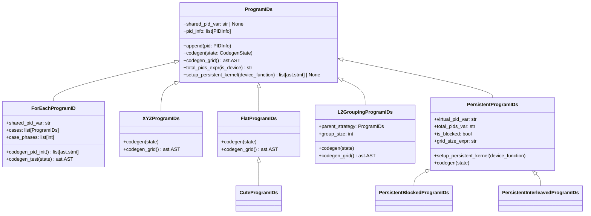
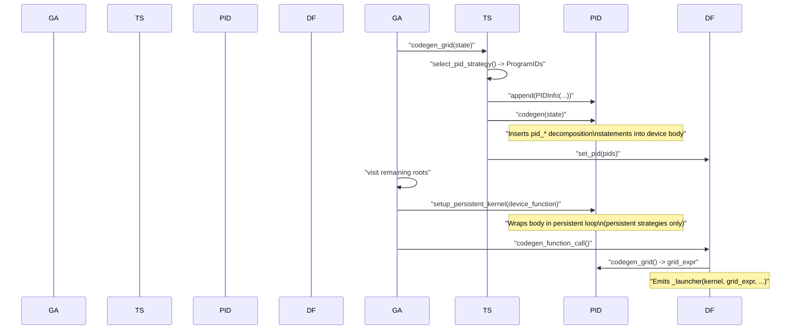
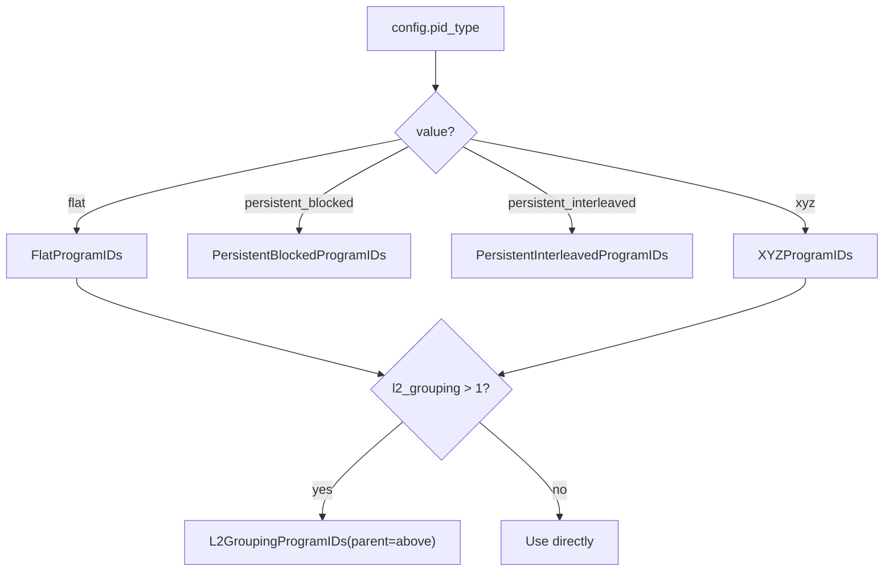
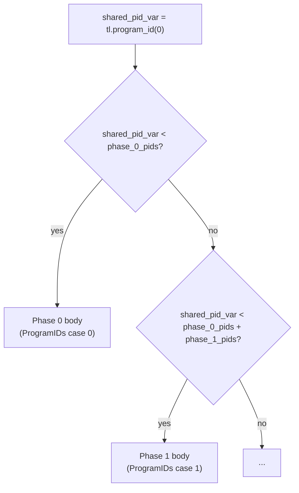
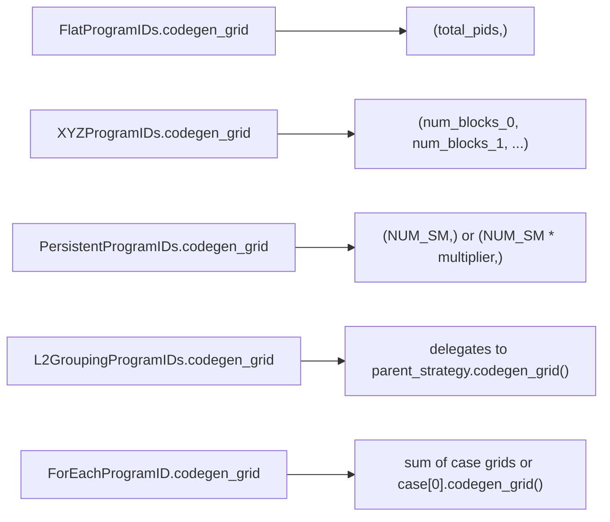

<!-- source: DeepWiki mcp.deepwiki.com · repo pytorch/helion · page 5.7 Program IDs and Grid Management · fetched 2026-10-21 -->

# Program IDs and Grid Management

<details>
<summary>Relevant source files</summary>

The following files were used as context for generating this wiki page:

- [helion/_compiler/compile_environment.py](helion/_compiler/compile_environment.py)
- [helion/_compiler/device_function.py](helion/_compiler/device_function.py)
- [helion/_compiler/generate_ast.py](helion/_compiler/generate_ast.py)
- [helion/_compiler/program_id.py](helion/_compiler/program_id.py)
- [helion/_compiler/tile_strategy.py](helion/_compiler/tile_strategy.py)

</details>


This page documents the `ProgramIDs` class hierarchy in `helion/_compiler/program_id.py`, which is responsible for two tightly coupled concerns: determining the GPU kernel **launch grid** (the `grid=(...)` tuple passed to Triton/Pallas) and generating the **device-side code** that maps raw program IDs to per-dimension tile indices.

For how tile strategies decide which `ProgramIDs` subclass to instantiate, see [Compilation Environment and Code Generation](#5.4). For the `pid_type` configuration parameter that controls which strategy is selected, see [Configuration System](#4.1). For persistent reductions specifically, see [Reduction Optimization](#9.2).

---

## Overview

Every Helion kernel launches on a grid of GPU programs (thread blocks). The `ProgramIDs` system abstracts:

1. **Grid construction** — what shape `(X, Y, Z)` tuple is passed at kernel launch.
2. **PID decomposition** — how each GPU program, given its raw program ID(s), computes its tile offsets (`pid_0`, `pid_1`, ...).
3. **Persistent kernel wrapping** — how the device body is wrapped in a software loop when fewer programs than tiles are launched.

The `pid_type` config option (`"flat"`, `"xyz"`, `"persistent_blocked"`, `"persistent_interleaved"`) selects which concrete strategy is used.

---

## Class Hierarchy

**Class hierarchy of `ProgramIDs` and related types**



Sources: [helion/_compiler/program_id.py:1-751]()

---

## The `PIDInfo` Record

`PIDInfo` is a `NamedTuple` that holds per-dimension metadata gathered during grid code generation.

| Field | Type | Description |
|---|---|---|
| `pid_var` | `str` | Device-side variable name for this dimension's program ID (e.g., `"pid_0"`) |
| `block_size_var` | `str` | Constexpr variable name for the block size of this dimension |
| `numel` | `sympy.Expr \| str` | Total number of elements in this dimension |
| `block_id` | `int` | Index into `CompileEnvironment.block_sizes` |

`PIDInfo.num_pids_expr(is_device)` computes `ceil(numel / block_size)` — the number of programs needed for this dimension — using `cdiv_expr` from the backend. This value is used both in the device-side grid decomposition and in the host-side grid tuple.

Sources: [helion/_compiler/program_id.py:37-58]()

---

## How `ProgramIDs` Integrates with Code Generation

**Data flow from tile strategy to kernel launch**



Sources: [helion/_compiler/generate_ast.py:267-402](), [helion/_compiler/device_function.py:737-778]()

The `DeviceFunction` holds a single `pid: ProgramIDs | None` field set via `set_pid()`. Once set, `codegen_function_call()` calls `pid.codegen_grid()` to produce the grid expression used in `_launcher(kernel, grid_expr, ...)`.

Sources: [helion/_compiler/device_function.py:253-253](), [helion/_compiler/device_function.py:408-410](), [helion/_compiler/device_function.py:758-761]()

---

## Strategy Selection

`BlockSizeTileStrategy.select_pid_strategy()` reads `config.pid_type` and returns the appropriate subclass. `NDTileStrategy` additionally wraps the result with `L2GroupingProgramIDs` when `l2_grouping > 1`.



Sources: [helion/_compiler/tile_strategy.py:473-483](), [helion/_compiler/tile_strategy.py:1067-1073]()

For kernels with multiple top-level `hl.tile` or `hl.grid` loops (multi-phase), `GenerateAST.visit_For()` wraps everything in a `ForEachProgramID` that dispatches via `if/else` on a shared PID variable.

Sources: [helion/_compiler/generate_ast.py:282-291]()

---

## Non-Persistent Strategies

### `FlatProgramIDs`

Uses a single 1-D launch grid (`grid=(total_pids,)`). The device kernel receives `tl.program_id(0)` and decomposes it into per-dimension `pid_*` variables via integer `//` and `%` arithmetic.

- **Grid**: `(ceil(numel_0 / bs_0) * ceil(numel_1 / bs_1) * ...,)`
- **Device decomposition**: `pid_0 = flat_pid % num_blocks_0`, `pid_1 = flat_pid // num_blocks_0`, etc.

Sources: [helion/_compiler/program_id.py:398-410]()

### `XYZProgramIDs`

Uses the GPU's native 3-D launch grid. Each dimension maps directly to a `tl.program_id(i)`. Requires 2 or 3 block dimensions.

- **Grid**: `(num_blocks_0, num_blocks_1, num_blocks_2)`
- **Device decomposition**: `pid_i = tl.program_id(i)` — no arithmetic needed.

Sources: [helion/_compiler/program_id.py:370-395]()

### `L2GroupingProgramIDs`

A wrapper around any other `ProgramIDs` strategy. It reorders the iteration over the two fastest-varying dimensions using a swizzle pattern to improve L2 cache reuse (commonly used in matmul kernels).

Given a flat PID, it computes:

```
group_id = pid // (group_size * num_pid_n)
first_pid_m = group_id * group_size
group_size_m = min(num_pid_m - first_pid_m, group_size)
pid_0 = first_pid_m + (pid % (group_size * num_pid_n)) % group_size_m
pid_1 = (pid % (group_size * num_pid_n)) // group_size_m
```

The `group_size` parameter comes from `BlockSizeSource.l2_grouping()`, which reads from the config's block size spec.

Sources: [helion/_compiler/program_id.py:417-574]()

---

## Persistent Strategies

Persistent kernels launch only `num_SMs` programs (one per streaming multiprocessor) and use a software loop to process all virtual tiles. This reduces kernel launch overhead and keeps the GPU fully occupied with work-stealing.

The constant `NUM_SM_VAR = "_NUM_SM"` holds the SM count, obtained at runtime via `helion.runtime.get_num_sm(device)`.

Sources: [helion/_compiler/program_id.py:34-34](), [helion/_compiler/program_id.py:577-687]()

### Common Setup (`PersistentProgramIDs`)

Both persistent variants share a base class that:

1. Allocates `virtual_pid_var` and `total_pids_var` variable names.
2. Registers `_NUM_SM` as a `constexpr` kernel argument.
3. Emits `_NUM_SM = helion.runtime.get_num_sm(device)` on the host.
4. In `setup_persistent_kernel()`, prepends setup assignments to `device_function.preamble` and wraps the body in a `tl.range(...)` loop over virtual PIDs.

Sources: [helion/_compiler/program_id.py:577-687]()

### `PersistentBlockedProgramIDs`

Each SM receives a contiguous chunk of virtual PIDs.

```
block_size = ceil(total_pids / NUM_SM)
start_pid  = tl.program_id(0) * block_size
end_pid    = min(start_pid + block_size, total_pids)
for virtual_pid in tl.range(start_pid, end_pid):
    ...
```

- **Grid**: `(NUM_SM,)` (or `(NUM_SM * num_sm_multiplier,)` for multi-occupancy)

Sources: [helion/_compiler/program_id.py:739-743](), [helion/_compiler/program_id.py:633-683]()

### `PersistentInterleavedProgramIDs`

Each SM processes every `NUM_SM`-th virtual PID (strided access).

```
for virtual_pid in tl.range(tl.program_id(0), total_pids, NUM_SM):
    ...
```

- **Grid**: `(NUM_SM,)` (or `(NUM_SM * num_sm_multiplier,)`)

Sources: [helion/_compiler/program_id.py:746-750](), [helion/_compiler/program_id.py:633-683]()

### Comparison

| Property | `persistent_blocked` | `persistent_interleaved` |
|---|---|---|
| SM access pattern | Contiguous chunk | Strided (every `NUM_SM`-th) |
| Range call | `tl.range(start_pid, end_pid)` | `tl.range(pid_id, total, NUM_SM)` |
| Locality | Better sequential locality | Better load balancing |
| `is_blocked` flag | `True` | `False` |

---

## Multi-Phase Kernels and `ForEachProgramID`

When a kernel has more than one top-level `hl.tile` loop (e.g., a kernel with `hl.barrier()`), `GenerateAST` sets up a `ForEachProgramID` to dispatch between phases.

**`ForEachProgramID` dispatch structure**



- `ForEachProgramID.codegen_pid_init()` emits `shared_pid_var = tl.program_id(0)` for non-persistent kernels.
- `ForEachProgramID.codegen_test(state)` produces the `if shared_pid < ...` condition.
- Each `case` is its own `ProgramIDs` instance with its `shared_pid_var` set.
- `codegen_grid()` returns the sum of all case grid sizes for non-persistent modes, or delegates to the first case's grid for persistent modes.

Sources: [helion/_compiler/program_id.py:154-367](), [helion/_compiler/generate_ast.py:282-401]()

For kernels with barriers (`hl.barrier()`), `ForEachProgramID._emit_phase_loops()` generates separate `tl.range(...)` loops per phase with `triton_helpers.x_grid_barrier(sem)` calls between them, requiring `persistent_blocked` mode.

Sources: [helion/_compiler/program_id.py:284-367]()

---

## Grid Construction Summary

**How each strategy builds the launch grid expression**



`DeviceFunction.codegen_function_call()` uses the result as the second argument to `_launcher`:

```python
_launcher(_helion_kernel, {call_grid_expr}, arg0, arg1, ...)
```

Sources: [helion/_compiler/device_function.py:737-778]()

---

## Key Variables and Constants

| Symbol | Location | Description |
|---|---|---|
| `NUM_SM_VAR = "_NUM_SM"` | `program_id.py:34` | Constexpr device variable holding SM count |
| `PIDInfo.pid_var` | `program_id.py:38` | Device variable name for this dimension's PID (e.g., `pid_0`) |
| `ProgramIDs.shared_pid_var` | `program_id.py:65` | Shared PID var across cases in `ForEachProgramID` |
| `PersistentProgramIDs.virtual_pid_var` | `program_id.py:584` | Loop variable in the persistent software loop |
| `PersistentProgramIDs.total_pids_var` | `program_id.py:585` | Device variable: total number of virtual tiles |
| `PersistentProgramIDs.grid_size_expr` | `program_id.py:591` | `_NUM_SM` or `_NUM_SM * multiplier` |
| `DeviceFunction.pid` | `device_function.py:253` | The `ProgramIDs` instance for a compiled kernel |

Sources: [helion/_compiler/program_id.py:34-34](), [helion/_compiler/program_id.py:37-58](), [helion/_compiler/program_id.py:61-69](), [helion/_compiler/program_id.py:577-612](), [helion/_compiler/device_function.py:253-253]()

---

