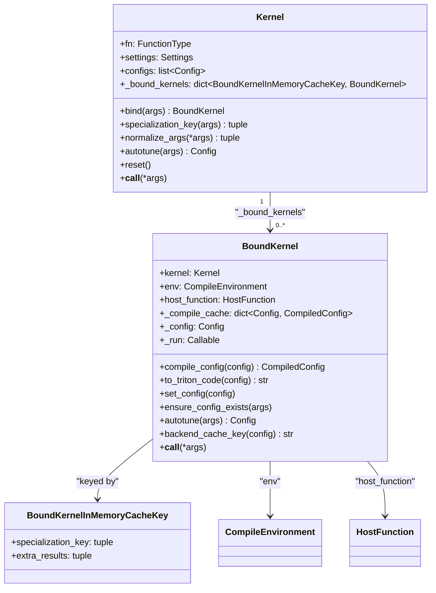
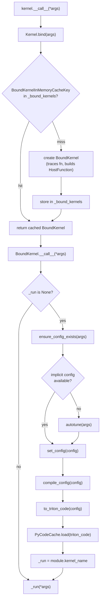
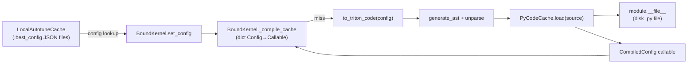
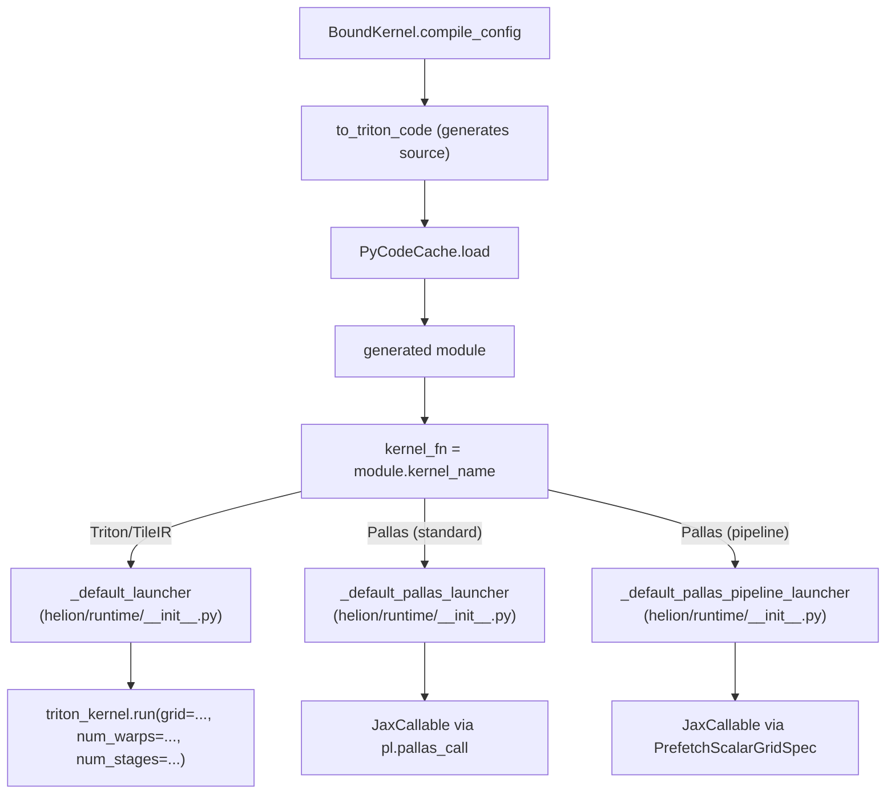

<!-- source: DeepWiki mcp.deepwiki.com · repo pytorch/helion · page 6 Runtime System · fetched 2026-10-21 -->

# Runtime System

<details>
<summary>Relevant source files</summary>

The following files were used as context for generating this wiki page:

- [examples/welford.py](examples/welford.py)
- [helion/_compiler/backend.py](helion/_compiler/backend.py)
- [helion/autotuner/aot_cache.py](helion/autotuner/aot_cache.py)
- [helion/autotuner/base_cache.py](helion/autotuner/base_cache.py)
- [helion/autotuner/local_cache.py](helion/autotuner/local_cache.py)
- [helion/autotuner/progress_bar.py](helion/autotuner/progress_bar.py)
- [helion/runtime/__init__.py](helion/runtime/__init__.py)
- [helion/runtime/kernel.py](helion/runtime/kernel.py)
- [test/test_cache.py](test/test_cache.py)
- [test/test_pallas.py](test/test_pallas.py)

</details>


This page describes the Helion runtime: the classes and functions that manage kernel execution, specialization, compilation caching, and backend dispatch. It covers the structures that bridge user-written Python functions and generated GPU code.

- For a step-by-step walkthrough of the full call lifecycle, see [Kernel Lifecycle](#6.1).
- For environment variables and `Settings` parameters, see [Settings and Environment Variables](#6.2).
- For `torch.compile` integration details, see [torch.compile Integration](#6.3).
- For the compilation pipeline that generates code, see [Compilation Pipeline](#5).

---

## Core Abstractions

The runtime is organized around two classes defined in [helion/runtime/kernel.py]():

| Class | Role |
|---|---|
| `Kernel` | Wraps the user-decorated function; manages the pool of `BoundKernel` instances keyed by argument specialization |
| `BoundKernel` | Represents a `Kernel` specialized to a particular set of argument dtypes, shapes, and devices; owns the compile cache and configuration |

A `Kernel` is created when a function is decorated with `@helion.kernel`. Each unique combination of argument characteristics produces a separate `BoundKernel`, which is cached in `Kernel._bound_kernels`.

**Class and ownership diagram**



Sources: [helion/runtime/kernel.py:109-165](), [helion/runtime/kernel.py:361-396](), [helion/autotuner/base_cache.py:89-103]()

---

## Execution Flow

When a user calls `kernel(*args)`, the following sequence runs:

**Kernel call flow diagram**



Sources: [helion/runtime/kernel.py:338-351](), [helion/runtime/kernel.py:809-828](), [helion/runtime/kernel.py:540-603](), [helion/runtime/kernel.py:778-792]()

---

## Specialization and Argument Binding

### Specialization Key

`Kernel.specialization_key(args)` produces a hashable tuple that encodes the distinguishing properties of a set of arguments. The key determines when a new `BoundKernel` must be created versus reusing an existing one.

| Argument type | Key component |
|---|---|
| `torch.Tensor` | `(dtype, device, shape, stride_layout, requires_grad)` |
| `ConstExpr` / `constexpr`-annotated | the raw value |
| `int`, `float`, `bool` | type tag only (not value, unless `ConstExpr`) |
| `list[Tensor]` | tuple of per-tensor keys |
| `GraphModule` | hash of the graph |
| `dataclass` | per-field recursive keys |

The `_specialization_extractors` registry in [helion/runtime/kernel.py]() maps Python types to extractor functions. An additional `_specialize_extra` mechanism captures `hl.specialize()`-marked dimension values via `TensorPropertySource` and `LocalSource` descriptors, stored in `BoundKernel._specialize_extra()`.

### In-Memory Cache Key

`BoundKernelInMemoryCacheKey` (defined in [helion/autotuner/base_cache.py:89-103]()) is a frozen dataclass that combines:

- `specialization_key`: the main tuple from `Kernel.specialization_key()`
- `extra_results`: per-call results of the `hl.specialize()` extractors

This key is used to look up and store entries in `Kernel._bound_kernels`.

### Default Argument Normalization

`Kernel.normalize_args()` calls `inspect.Signature.bind()` and `apply_defaults()` to fill in missing default arguments before specialization is computed [helion/runtime/kernel.py:296-309]().

---

## Compilation Cache

Each `BoundKernel` maintains two in-memory caches:

| Cache | Type | Key | Value |
|---|---|---|---|
| `_compile_cache` | `dict[Config, CompiledConfig]` | `Config` object | Loaded Python module callable |
| `_cache_path_map` | `dict[Config, str \| None]` | `Config` object | Path to the `.py` file on disk |

### `compile_config()`

[helion/runtime/kernel.py:540-603]() performs the following steps when a `Config` is not yet in `_compile_cache`:

1. Sets `TRITON_CACHE_DIR` to a per-device subdirectory under the Helion cache root (from `helion_triton_cache_dir()` in [helion/autotuner/local_cache.py:37-39]()), unless the user has already set it.
2. Calls `to_triton_code(config)` to generate the backend source string.
3. Passes the source to `PyCodeCache.load()` (from `torch._inductor.codecache`), which compiles and caches the Python module.
4. Retrieves the kernel function by name (`module.<kernel_name>`) and stores it.

### `to_triton_code()`

[helion/runtime/kernel.py:500-538]() calls `generate_ast()` → `unparse()` → `get_needed_imports()` to produce the final source string for any given `Config`.

**Compile cache layers diagram**



Sources: [helion/runtime/kernel.py:540-603](), [helion/autotuner/local_cache.py:120-162]()

---

## Configuration Selection

`BoundKernel._implicit_config()` determines whether a config can be used without triggering autotuning [helion/runtime/kernel.py:747-768]():

1. If `_config` is already set (from a previous `set_config()` call), use it.
2. If `settings.force_autotune` is True, return `None` (force autotuning).
3. If exactly one config was passed to `@helion.kernel(configs=[...])`, use it.
4. If zero configs and `autotune_effort == "none"`, use `config_spec.default_config()` and print a warning.
5. Otherwise, return `None`, which causes `ensure_config_exists()` to call `autotune()`.

`set_config(config)` compiles the config immediately and sets `_run` so subsequent calls skip all overhead [helion/runtime/kernel.py:664-682]().

---

## Launcher Functions

After compilation, the generated module contains a host-side launcher function that invokes the backend kernel. The runtime module (`helion/runtime/__init__.py`) provides the launcher implementations that are imported into generated code.

### `default_launcher` (Triton)

[helion/runtime/__init__.py:109-128]() wraps `triton_kernel.run(...)` with `warmup=False` and passes `num_warps`, `num_stages`, `launch_cooperative_grid`, and any additional kwargs. It is imported into generated Triton code as `_default_launcher`.

### `default_pallas_launcher` (TPU/Pallas)

[helion/runtime/__init__.py:416-497]() builds a `JaxCallable` from `torch_tpu` by:

1. Separating tensor arguments from scalar arguments.
2. Building Pallas `BlockSpec` objects via `_pallas_build_block_specs()`.
3. Constructing a `reordered_kernel` wrapper to restore original argument order.
4. Calling `pl.pallas_call()` to produce a JAX-compiled function.
5. Caching the `JaxCallable` on the kernel object as `_pallas_cache`.

### `default_pallas_pipeline_launcher` (TPU pipeline)

[helion/runtime/__init__.py:500-612]() is used when `use_emit_pipeline=True`. It uses `pltpu.PrefetchScalarGridSpec` with `memory_space=pl.ANY` for all tensors and adds VMEM scratch buffers for DMA pipelining.

**Launcher dispatch diagram**



Sources: [helion/runtime/__init__.py:109-128](), [helion/runtime/__init__.py:416-497](), [helion/runtime/__init__.py:500-612]()

---

## Backend Integration at Runtime

The `CompileEnvironment.backend` field (a subclass of `Backend` from [helion/_compiler/backend.py:30-396]()) determines how autotuning and launcher argument construction are handled at runtime:

| Backend class | `autotune()` behavior | Default launcher |
|---|---|---|
| `TritonBackend` | Calls `settings.autotuner_fn` or `FiniteSearch` | `_default_launcher` |
| `TileIRBackend` | Inherits from `TritonBackend` | `_default_launcher` |
| `PallasBackend` | Returns `config_spec.default_config()` immediately | `_default_pallas_launcher` |

`TritonBackend.autotune()` [helion/_compiler/backend.py:584-610]() applies the following logic:

- If `force=False` and a single config is provided, uses it directly.
- If multiple configs are provided, runs `FiniteSearch` over them.
- Otherwise calls `settings.autotuner_fn(bound_kernel, args).autotune(skip_cache=force)`.

`TritonBackend.launcher_keyword_args()` [helion/_compiler/backend.py:540-566]() builds the `num_warps`, `num_stages`, and optional `launch_cooperative_grid` arguments that appear in each generated kernel call.

---

## Triton Allocator Integration

On import of `helion.runtime`, if Triton is available, `set_triton_allocator()` is called [helion/runtime/__init__.py:35-52](). It replaces the default `NullAllocator` with a custom `_alloc_fn` that allocates scratch memory as `torch.empty(..., dtype=torch.int8)` on the active Triton backend device. This is required for kernels that need scratch buffers (e.g., cooperative kernels using barriers).

---

## Utility Functions

### `get_num_sm(device)`

[helion/runtime/__init__.py:55-106]() returns the number of streaming multiprocessors (or equivalent compute units) for a given device. Used when constructing persistent kernel grids. Supports `cuda`, `xpu`, `cpu`, and `mtia` device types.

```python
# Typical use: pass result to hl.grid() for a persistent kernel
num_sms = helion.runtime.get_num_sm(torch.device("cuda:0"), reserved_sms=2)
```

### `_resolve_index_dtype(settings, args)`

[helion/runtime/kernel.py:78-106]() determines whether to use `torch.int32` or `torch.int64` for index arithmetic. If any input tensor's `numel()` exceeds the `int32` maximum (`2^31 - 1`), it automatically selects `int64`. The `settings.index_dtype` field overrides this logic.

### `BoundKernel.backend_cache_key(config)`

[helion/runtime/kernel.py:830-873]() returns the base32-encoded SHA-256 hash that Triton uses to identify its compiled binary cache directory under `TRITON_CACHE_DIR`. Returns `None` before compilation or for non-Triton backends.

---

## Repro Logging

`BoundKernel.maybe_log_repro()` [helion/runtime/kernel.py:875-957]() is called on compilation errors and (when enabled) on successful compilations. When `settings.print_repro=True`, it emits a self-contained Python script to stderr that recreates the kernel invocation with matching tensor shapes, strides, and dtypes. This is useful for isolating compiler bugs.

---

## Ref Mode

When `settings.ref_mode` is enabled (`HELION_INTERPRET=1`), `BoundKernel.__call__()` routes to `run_ref()` [helion/runtime/kernel.py:795-807](). This executes the kernel function directly in Python using `RefModeContext` instead of compiling to Triton/Pallas. The `HostFunction` and `CompileEnvironment` are not constructed in this path. See [Ref Eager Mode](#7.2) for details.

---

## Key Data Flow Summary

**Data flow from decorator to execution**

```mermaid
flowchart LR
    A["@helion.kernel decorator"] --> B["Kernel.__init__\n(kernel.py:110)"]
    B --> C["Kernel.__call__(*args)\n(kernel.py:338)"]
    C --> D["Kernel.bind(args)\n(kernel.py:203)"]
    D --> E["Kernel.specialization_key\n(kernel.py:240)"]
    E --> F["BoundKernelInMemoryCacheKey\n(base_cache.py:89)"]
    F -- "cache miss" --> G["BoundKernel.__init__\n(kernel.py:362)"]
    G --> H["CompileEnvironment\n(compile_environment.py)"]
    G --> I["HostFunction\n(host_function.py)"]
    F -- "cache hit" --> J["BoundKernel.__call__\n(kernel.py:809)"]
    G --> J
    J --> K["ensure_config_exists\n(kernel.py:778)"]
    K --> L["compile_config\n(kernel.py:540)"]
    L --> M["to_triton_code\n(kernel.py:500)"]
    M --> N["PyCodeCache.load"]
    N --> O["_run callable\n(generated launcher)"]
    O --> P["default_launcher\n(runtime/__init__.py:109)"]
    P --> Q["GPU execution"]
```



Sources: [helion/runtime/kernel.py:109-351](), [helion/runtime/kernel.py:361-873](), [helion/runtime/__init__.py:109-128]()

---

