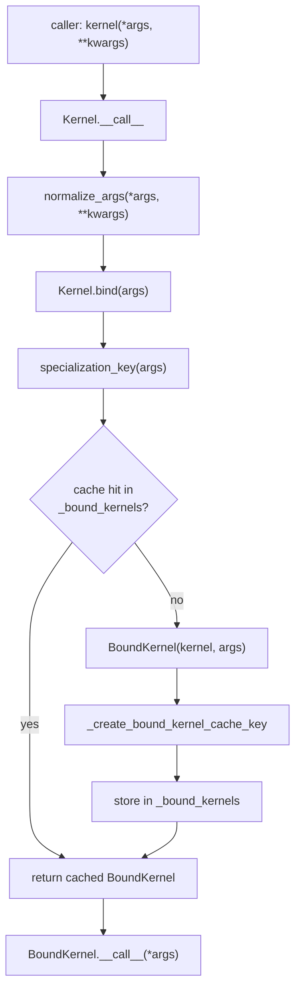
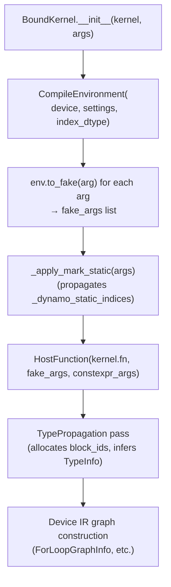
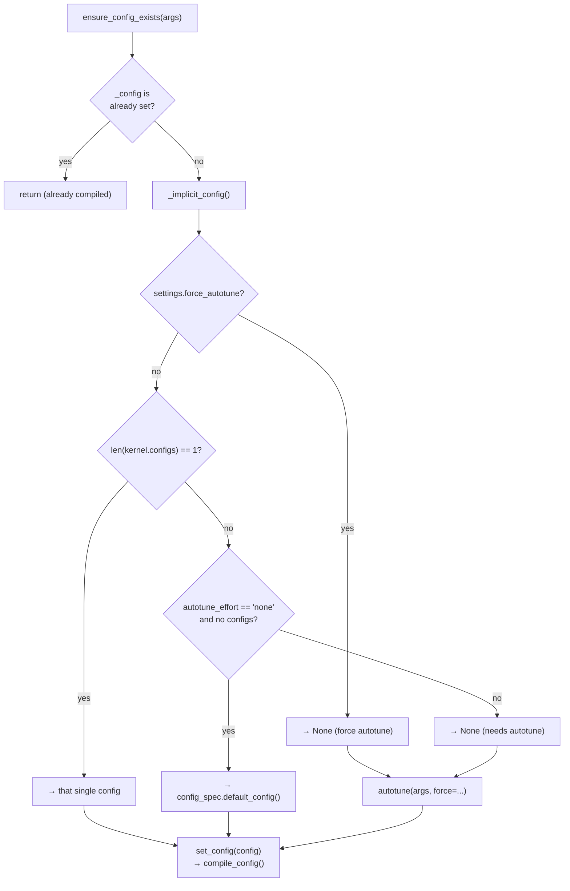
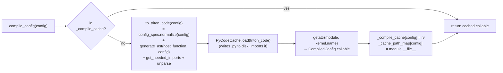
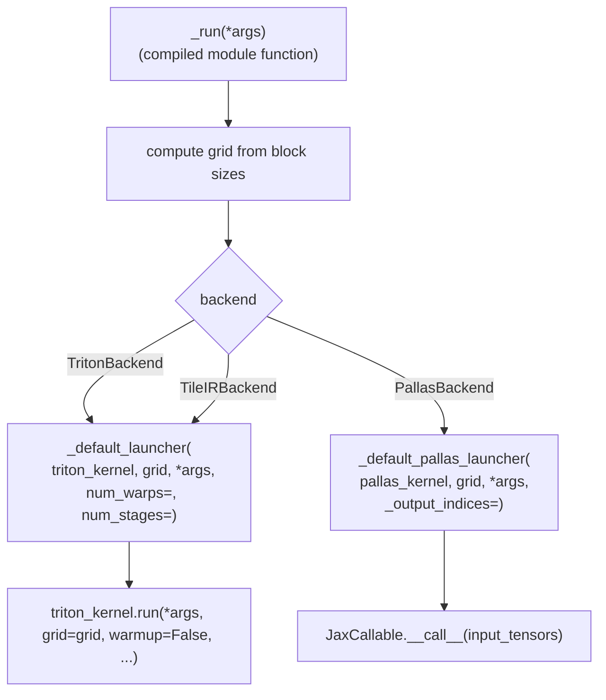
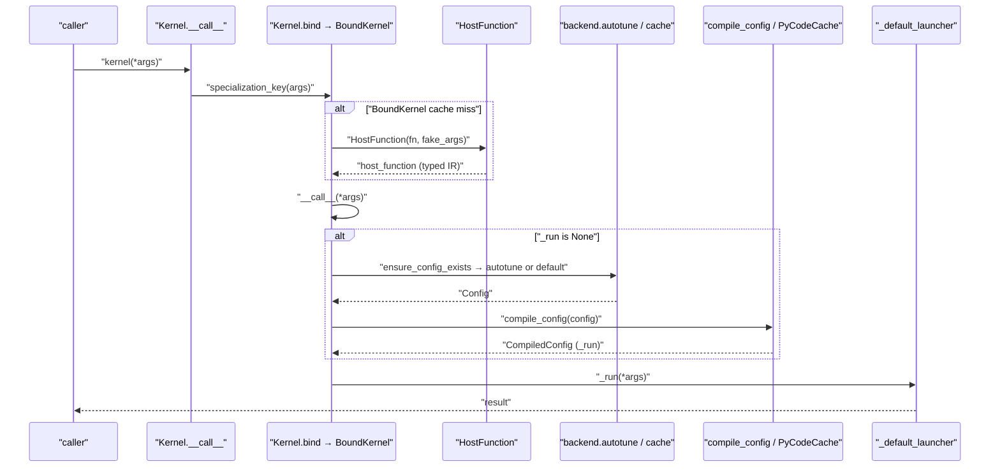

<!-- source: DeepWiki mcp.deepwiki.com · repo pytorch/helion · page 6.1 Kernel Lifecycle · fetched 2026-10-21 -->

# Kernel Lifecycle

Relevant source files

The following files were used as context for generating this wiki page:

- [examples/welford.py](examples/welford.py)
- [helion/_compiler/backend.py](helion/_compiler/backend.py)
- [helion/autotuner/aot_cache.py](helion/autotuner/aot_cache.py)
- [helion/autotuner/base_cache.py](helion/autotuner/base_cache.py)
- [helion/autotuner/local_cache.py](helion/autotuner/local_cache.py)
- [helion/autotuner/progress_bar.py](helion/autotuner/progress_bar.py)
- [helion/runtime/__init__.py](helion/runtime/__init__.py)
- [helion/runtime/kernel.py](helion/runtime/kernel.py)
- [test/test_cache.py](test/test_cache.py)
- [test/test_pallas.py](test/test_pallas.py)

This page describes the end-to-end execution path of a Helion kernel: from the moment Python calls a `@helion.kernel`-decorated function, through argument binding, specialization, config resolution, compilation, and final GPU dispatch.

For details on how configs are tuned, see the [Autotuning Overview](#4.2). For the compilation stages that produce Triton/Pallas/CuTe code, see [Compilation Pipeline](#5). For environment variables and settings that control behavior described here, see [Settings and Environment Variables](#6.2).

---

## Overview

A Helion kernel passes through five distinct phases on every invocation. The first four phases are cached at various granularities so that hot paths pay only the cost of a few dictionary lookups.

**Phase table**

| Phase | Key Class / Function | Cached? |
|---|---|---|
| 1. Argument binding & specialization | `Kernel.bind`, `Kernel.specialization_key` | In-memory (`_bound_kernels`) |
| 2. Tracing / host function construction | `BoundKernel.__init__`, `HostFunction` | Per `BoundKernel` instance |
| 3. Config resolution | `BoundKernel.ensure_config_exists`, autotune cache | In-memory + disk |
| 4. Compilation | `BoundKernel.compile_config`, `PyCodeCache` | In-memory (`_compile_cache`) + Triton disk cache |
| 5. Execution | `_run(*args)` / backend launcher | — |

Sources: [helion/runtime/kernel.py:109-828]()

---

## Phase 1 — Argument Binding and Specialization

**Call entry point diagram**

Sources: [helion/runtime/kernel.py:338-352](), [helion/runtime/kernel.py:203-238]()

### Specialization Key

`Kernel.specialization_key` produces a tuple that uniquely identifies a compilation unit. Each argument is mapped to a hashable key via `_specialization_extractors`, a registry of type-specific extractors.

For `torch.Tensor` arguments, the key captures device type, device index, dtype, shape (each dimension), and strides. For `ConstExpr`-annotated arguments, the actual runtime value is used. For unknown types (non-tensor scalars, lists, named tuples, dataclasses), dedicated extractors or registered handlers are called.

The optional `key=` argument to `@helion.kernel` appends an extra hashable component returned by a user-supplied callable.

The full in-memory cache key is `BoundKernelInMemoryCacheKey(specialization_key, extra_results)`, where `extra_results` comes from `hl.specialize()` decisions recorded in `CompileEnvironment.specialized_vars`.

Sources: [helion/runtime/kernel.py:240-264](), [helion/runtime/kernel.py:180-201](), [helion/autotuner/base_cache.py:89-103]()

---

## Phase 2 — BoundKernel Construction and Tracing

`BoundKernel.__init__` is called once per unique specialization. It does most of the compilation-time work.

**BoundKernel initialization diagram**

Sources: [helion/runtime/kernel.py:361-440](), [helion/runtime/kernel.py:442-454]()

Key details:
- `CompileEnvironment` is a process-global context object set as a thread-local when active. The device is detected from the first tensor argument (`_find_device`).
- `index_dtype` is resolved by `_resolve_index_dtype`: automatically `torch.int32` when all tensor elements fit within int32, otherwise `torch.int64` (or a user-specified override from `Settings.index_dtype`).
- Real tensors are replaced by `FakeTensor` instances via `env.to_fake`. This allows the compiler to reason about shapes/dtypes without GPU memory.
- `HostFunction` drives `TypePropagation` and builds the device IR. If it raises, a repro is logged (controlled by `Settings.print_repro`).

Sources: [helion/runtime/kernel.py:386-440](), [helion/runtime/kernel.py:78-106]()

---

## Phase 3 — Config Resolution

`BoundKernel.__call__` calls `ensure_config_exists` on the first invocation (when `_run` is `None`).

**Config resolution flowchart**

Sources: [helion/runtime/kernel.py:778-792](), [helion/runtime/kernel.py:747-768]()

### Implicit Config Selection Rules

| Condition | Result |
|---|---|
| `_config` already set (prior call or `set_config`) | Use it |
| `settings.force_autotune = True` | Always autotune |
| Exactly one config in `kernel.configs` | Use that config |
| No configs and `autotune_effort = "none"` | Use `config_spec.default_config()` |
| Otherwise | Run autotuner |

Sources: [helion/runtime/kernel.py:747-768]()

### Autotuning Dispatch

When autotuning is needed, `BoundKernel.autotune` delegates to `env.backend.autotune(self, args, force=force)`. For `TritonBackend`, this either:
- Runs `FiniteSearch` when `kernel.configs` is a finite list and `force=False`
- Calls `settings.autotuner_fn(bound_kernel, args).autotune(skip_cache=force)` otherwise

The `autotuner_fn` factory (default: `LocalAutotuneCache[PatternSearch]`) wraps a `BaseSearch` with a disk-backed `AutotuneCacheBase`. If a cached config is found on disk, autotuning is skipped. See [Autotune Caching](#4.4) for cache key construction.

Sources: [helion/_compiler/backend.py:584-610](), [helion/autotuner/base_cache.py:183-253]()

---

## Phase 4 — Compilation

`BoundKernel.compile_config(config)` converts a `Config` into an executable Python callable.

**Compilation pipeline diagram**

Sources: [helion/runtime/kernel.py:540-603]()

Key steps inside `to_triton_code`:
1. `config_spec.normalize(config)` fills in defaults (indexing strategy, eviction policies, etc.)
2. `generate_ast(host_function, config)` produces a Python AST of the entire kernel module
3. `get_needed_imports(root) + unparse(root)` converts the AST to a source string

The resulting string is loaded via `torch._inductor.codecache.PyCodeCache`, which hashes the source, writes it to a `.py` file under `TRITON_CACHE_DIR`, and returns the imported module. If `TRITON_CACHE_DIR` is not set, Helion sets it under its own cache root (`helion_triton_cache_dir(device_index)`).

If `settings.print_output_code` is True, the generated Triton source is printed to `stderr`.

Sources: [helion/runtime/kernel.py:500-538](), [helion/runtime/kernel.py:560-603](), [helion/autotuner/local_cache.py:37-39]()

---

## Phase 5 — Execution

After `compile_config`, `_run` is the top-level Python function extracted from the compiled module (`getattr(module, kernel.name)`). On every subsequent call, `BoundKernel.__call__` simply invokes `self._run(*args)`.

The compiled module's top-level function (the "host launcher") computes the grid, assembles kernel arguments, and calls the backend-specific launcher.

**Backend launcher routing diagram**

Sources: [helion/runtime/__init__.py:109-128](), [helion/runtime/__init__.py:416-497](), [helion/_compiler/backend.py:398-474]()

`default_launcher` (Triton) calls `triton_kernel.run(...)` directly with `warmup=False`, bypassing Triton's lazy compilation delay.

`default_pallas_launcher` (TPU) wraps the kernel in a `pl.pallas_call`, builds `BlockSpec` objects for each tensor, and executes via `JaxCallable` from `torch_tpu`.

---

## Ref Mode (Interpretation)

When `Settings.ref_mode` is enabled (or `HELION_INTERPRET=1`), `BoundKernel` skips `HostFunction` construction entirely (`host_function` is `None`) and routes `__call__` to `run_ref`. This executes the original Python function inside a `RefModeContext`, interpreting tile operations on the CPU for debugging. See [Ref Eager Mode](#7.2) for full details.

Sources: [helion/runtime/kernel.py:392-395](), [helion/runtime/kernel.py:795-807](), [helion/runtime/kernel.py:819-823]()

---

## Full Lifecycle Summary

**End-to-end kernel lifecycle diagram**

Sources: [helion/runtime/kernel.py:338-352](), [helion/runtime/kernel.py:809-828](), [helion/runtime/kernel.py:540-603](), [helion/runtime/__init__.py:109-128]()

---

## Key Classes and Responsibilities

| Class / Function | File | Role |
|---|---|---|
| `Kernel` | `helion/runtime/kernel.py` | Decorator target; owns `_bound_kernels` cache and `specialization_key` logic |
| `BoundKernel` | `helion/runtime/kernel.py` | Per-specialization object; holds `HostFunction`, `_compile_cache`, `_run` |
| `CompileEnvironment` | `helion/_compiler/compile_environment.py` | Global compilation state; device, dtypes, `config_spec`, `shape_env` |
| `HostFunction` | `helion/_compiler/host_function.py` | Traces the kernel function; drives `TypePropagation` |
| `_resolve_index_dtype` | `helion/runtime/kernel.py` | Selects `int32` vs `int64` indexing based on tensor sizes |
| `compile_config` | `helion/runtime/kernel.py` | Converts `Config` → executable callable via `generate_ast` + `PyCodeCache` |
| `default_launcher` | `helion/runtime/__init__.py` | Triton kernel launch wrapper |
| `default_pallas_launcher` | `helion/runtime/__init__.py` | JAX/Pallas kernel launch wrapper |
| `LocalAutotuneCache` | `helion/autotuner/local_cache.py` | Disk-backed cache wrapping a `BaseSearch` |
| `BoundKernelInMemoryCacheKey` | `helion/autotuner/base_cache.py` | In-memory cache key (specialization + `hl.specialize` extras) |

Sources: [helion/runtime/kernel.py:109-828](), [helion/runtime/__init__.py:109-128](), [helion/autotuner/base_cache.py:89-103](), [helion/autotuner/local_cache.py:42-130]()

---

## Cache Invalidation and `reset()`

Calling `kernel.reset()` clears `_bound_kernels`, which discards all `BoundKernel` objects and their associated `_compile_cache` and `_run` references. The next call re-traces and re-compiles from scratch.

The disk autotune cache (`LocalAutotuneCache`) is separate; it is keyed by a hash of kernel source, hardware, and specialization key. It persists across `reset()` calls and process restarts. Set `HELION_SKIP_CACHE=1` or `HELION_ASSERT_CACHE_HIT=1` to control cache behaviour.

Sources: [helion/runtime/kernel.py:353-358](), [helion/autotuner/local_cache.py:42-130](), [helion/autotuner/base_cache.py:183-253]()

---

