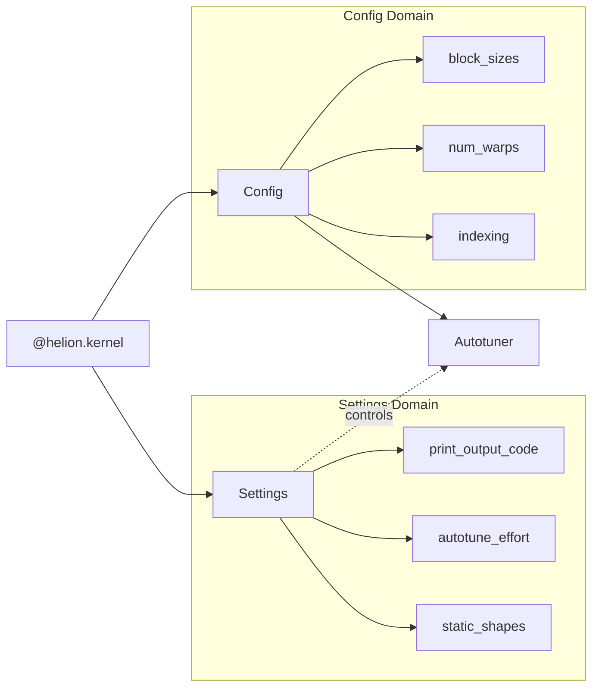
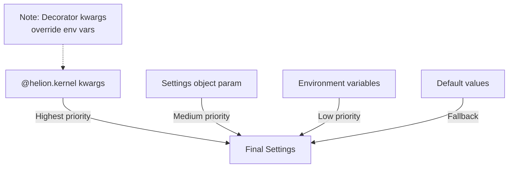
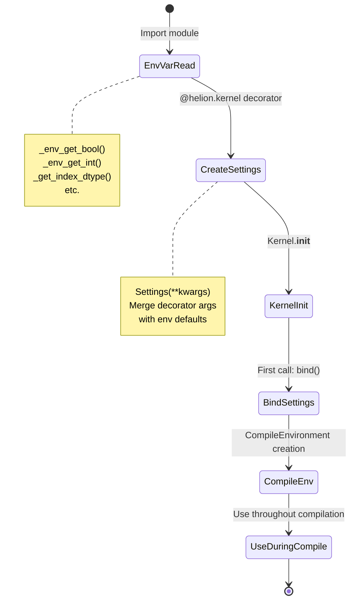
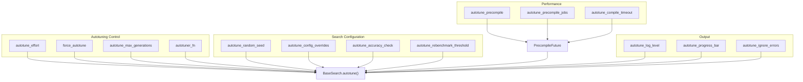
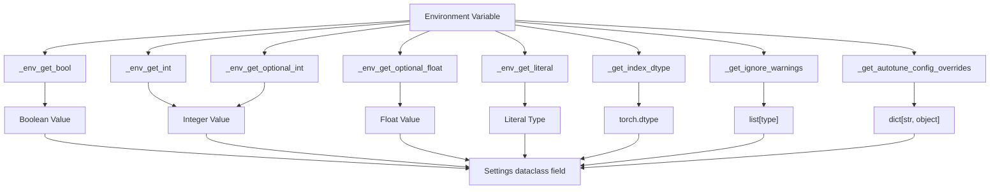

<!-- source: DeepWiki mcp.deepwiki.com · repo pytorch/helion · page 6.2 Settings and Environment Variables · fetched 2026-10-21 -->

# Settings and Environment Variables

<details>
<summary>Relevant source files</summary>

The following files were used as context for generating this wiki page:

- [README.md](README.md)
- [docs/api/config.md](docs/api/config.md)
- [docs/api/kernel.md](docs/api/kernel.md)
- [docs/api/settings.md](docs/api/settings.md)
- [docs/deployment_autotuning.md](docs/deployment_autotuning.md)
- [docs/index.md](docs/index.md)
- [docs/installation.md](docs/installation.md)
- [docs/tileir_backend.md](docs/tileir_backend.md)
- [examples/segment_reduction.py](examples/segment_reduction.py)
- [helion/autotuner/base_search.py](helion/autotuner/base_search.py)
- [helion/runtime/settings.py](helion/runtime/settings.py)
- [test/test_autotuner.py](test/test_autotuner.py)

</details>


This page documents the `Settings` class and associated environment variables that control Helion's compilation behavior, debugging output, and development workflow. Settings are meta-compilation parameters that remain constant across configurations and are not subject to autotuning.

For kernel performance parameters that are autotuned (such as `block_sizes`, `num_warps`, `indexing`), see [Configuration System](#4.1).

---

## Overview

The `Settings` class controls:
- **Compilation behavior**: Shape specialization, index dtype, precision modes
- **Autotuning parameters**: Search algorithms, effort levels, timeout values
- **Debugging output**: Generated code printing, origin line annotations
- **Development modes**: Reference eager execution, dtype assertions

Settings are configured via environment variables or decorator arguments. When both are provided, decorator arguments take precedence.

**Sources:** [helion/runtime/settings.py:239-348]()

---

## Settings vs Config

| Aspect | Settings | Config |
|--------|----------|--------|
| **Purpose** | Control compilation process | Control execution performance |
| **Autotuned** | ❌ Never | ✅ Always (unless explicit) |
| **Examples** | `print_output_code`, `autotune_effort` | `block_sizes`, `num_warps`, `indexing` |
| **Scope** | Development and debugging | Runtime optimization |
| **Specialization** | Same for all invocations | Per-argument-signature |



**Settings Configuration Flow**

**Sources:** [helion/runtime/settings.py:350-404](), [helion/runtime/kernel.py:68-92](), [docs/api/settings.md:23-32]()

---

## Configuration Methods

### Method 1: Environment Variables

Environment variables are read when the `@helion.kernel` decorator is applied (typically at module import time):

```bash
export HELION_PRINT_OUTPUT_CODE=1
export HELION_AUTOTUNE_EFFORT=none
python my_kernel.py
```

### Method 2: Decorator Arguments

Pass settings as keyword arguments to `@helion.kernel()`:

```python
import helion

@helion.kernel(
    print_output_code=True,
    autotune_effort="none",
    static_shapes=False
)
def my_kernel(x: torch.Tensor) -> torch.Tensor:
    ...
```

### Method 3: Settings Object

Create a `Settings` instance explicitly:

```python
from helion import Settings

settings = Settings(
    print_output_code=True,
    autotune_effort="quick"
)

@helion.kernel(settings=settings)
def my_kernel(x: torch.Tensor) -> torch.Tensor:
    ...
```

### Precedence Rules



**Settings Priority Resolution**

**Sources:** [helion/runtime/kernel.py:676-723](), [docs/api/settings.md:34-45]()

---

## Settings Lifecycle



**Settings Lifecycle Diagram**

Environment variables are read **once** when the decorator executes. To change settings after kernel definition, modify `kernel.settings` directly:

```python
kernel.settings.print_output_code = True
```

**Sources:** [helion/runtime/settings.py:239-348](), [helion/runtime/kernel.py:68-92]()

---

## Core Compilation Settings

### `index_dtype: torch.dtype`

Controls the dtype for index variables in generated Triton code.

- **Default:** `torch.int32`
- **Environment variable:** `HELION_INDEX_DTYPE`
- **Example:** `HELION_INDEX_DTYPE=int64` (accepts any `torch.<dtype>` name)

```python
@helion.kernel(index_dtype=torch.int64)
def my_kernel(...): ...
```

**Sources:** [helion/runtime/settings.py:133-145](), [docs/api/settings.md:81-84]()

---

### `dot_precision: Literal["tf32", "tf32x3", "ieee"]`

Precision mode for matrix multiplication operations (passed to `triton.language.dot`).

- **Default:** `"tf32"`
- **Environment variable:** `TRITON_F32_DEFAULT`
- **Options:**
  - `"tf32"`: TensorFloat-32 (faster, less precise)
  - `"tf32x3"`: Triple-pass TF32 (better accuracy)
  - `"ieee"`: IEEE 754 single precision

**Sources:** [helion/runtime/settings.py:246-253](), [docs/api/settings.md:86-88]()

---

### `static_shapes: bool`

When enabled, tensor shapes and strides are part of the specialization key, allowing aggressive shape-based optimizations.

- **Default:** `True`
- **Environment variable:** `HELION_STATIC_SHAPES`
- **Impact:**
  - `True`: One compiled kernel per unique shape/stride signature (best performance)
  - `False`: Kernel reused across shapes (reduces autotuning time, may reduce performance)

```python
# Kernel will autotune separately for [1024, 1024] and [2048, 2048]
@helion.kernel(static_shapes=True)
def matmul(x: torch.Tensor, y: torch.Tensor) -> torch.Tensor: ...

# Kernel will reuse same config for all shapes
@helion.kernel(static_shapes=False)
def matmul(x: torch.Tensor, y: torch.Tensor) -> torch.Tensor: ...
```

**Sources:** [helion/runtime/settings.py:254-256](), [helion/runtime/kernel.py:729-741](), [docs/api/settings.md:90-94](), [README.md:192-202]()

---

## Autotuning Settings



**Autotuning Settings Architecture**

**Sources:** [helion/runtime/settings.py:257-348]()

---

### `autotune_effort: Literal["none", "quick", "full"]`

Presets controlling autotuning thoroughness.

- **Default:** `"full"`
- **Environment variable:** `HELION_AUTOTUNE_EFFORT`
- **Options:**
  - `"none"`: Skip autotuning, use default config (fastest iteration, slowest execution)
  - `"quick"`: Limited search for development (~2-5 minutes)
  - `"full"`: Exhaustive search for production (~10-20 minutes)

```bash
# Development iteration
HELION_AUTOTUNE_EFFORT=none python my_kernel.py

# Pre-production tuning
HELION_AUTOTUNE_EFFORT=quick python my_kernel.py

# Production deployment
HELION_AUTOTUNE_EFFORT=full python my_kernel.py
```

**Sources:** [helion/runtime/settings.py:328-335](), [helion/autotuner/effort_profile.py](), [docs/api/settings.md:165-173]()

---

### `force_autotune: bool`

Force autotuning even when explicit `config=` or `configs=` are provided.

- **Default:** `False`
- **Environment variable:** `HELION_FORCE_AUTOTUNE`

```python
@helion.kernel(config=helion.Config(...))
def my_kernel(...): ...

# Force re-tune despite explicit config
my_kernel.autotune(args, force=True)
```

**Sources:** [helion/runtime/settings.py:322-324](), [helion/runtime/kernel.py:252-277](), [docs/api/settings.md:99-102]()

---

### `autotune_max_generations: int | None`

Override the maximum number of generations for `PatternSearch` and `DifferentialEvolutionSearch`.

- **Default:** `None` (uses algorithm-specific default)
- **Environment variable:** `HELION_AUTOTUNE_MAX_GENERATIONS`

```python
# Limit search to 10 generations
@helion.kernel(autotune_max_generations=10)
def my_kernel(...): ...
```

**Sources:** [helion/runtime/settings.py:301-306](), [helion/runtime/settings.py:197-220](), [docs/api/settings.md:138-142]()

---

### `autotune_precompile: Literal["fork", "spawn"] | None`

Parallel precompilation mode for autotuning.

- **Default:** `"fork"` (on non-Windows platforms)
- **Environment variable:** `HELION_AUTOTUNE_PRECOMPILE`
- **Options:**
  - `"fork"`: Fast subprocess creation via `fork()` (no error checking)
  - `"spawn"`: Fresh Python process per config (includes error checking, slower)
  - `None`: Sequential compilation (no parallelism)

**Sources:** [helion/runtime/settings.py:263-275](), [docs/api/settings.md:119-126]()

---

### `autotune_precompile_jobs: int | None`

Maximum concurrent precompile processes.

- **Default:** `None` (uses CPU count)
- **Environment variable:** `HELION_AUTOTUNE_PRECOMPILE_JOBS`

**Sources:** [helion/runtime/settings.py:276-281](), [docs/api/settings.md:132-136]()

---

### `autotune_compile_timeout: int`

Maximum seconds to wait for Triton compilation during autotuning.

- **Default:** `60`
- **Environment variable:** `HELION_AUTOTUNE_COMPILE_TIMEOUT`

**Sources:** [helion/runtime/settings.py:258-262](), [docs/api/settings.md:114-116]()

---

### `autotune_random_seed: int`

Seed for random number generation in autotuning algorithms.

- **Default:** `int(time.time() * 1000) % 2**32`
- **Environment variable:** `HELION_AUTOTUNE_RANDOM_SEED`

**Sources:** [helion/runtime/settings.py:228-231](), [helion/runtime/settings.py:282-284](), [docs/api/settings.md:128-130]()

---

### `autotune_accuracy_check: bool`

Validate candidate configs against baseline output before accepting them.

- **Default:** `True`
- **Environment variable:** `HELION_AUTOTUNE_ACCURACY_CHECK`

When enabled, each config is run once to verify correctness before benchmarking.

**Sources:** [helion/runtime/settings.py:285-289](), [docs/api/settings.md:148-150]()

---

### `autotune_rebenchmark_threshold: float | None`

Re-benchmark configs within this multiplier of the best performance to filter outliers.

- **Default:** `None` (uses effort profile default, typically `1.5`)
- **Environment variable:** `HELION_REBENCHMARK_THRESHOLD`

Example: With threshold `1.5`, configs within 1.5× of the best time are re-benchmarked.

**Sources:** [helion/runtime/settings.py:290-295](), [helion/runtime/settings.py:450-463](), [docs/api/settings.md:152-154]()

---

### `autotune_progress_bar: bool`

Display an interactive progress bar during autotuning.

- **Default:** `True`
- **Environment variable:** `HELION_AUTOTUNE_PROGRESS_BAR`

**Sources:** [helion/runtime/settings.py:296-300](), [docs/api/settings.md:156-158]()

---

### `autotune_ignore_errors: bool`

Continue autotuning even when candidate configs raise recoverable runtime errors.

- **Default:** `False`
- **Environment variable:** `HELION_AUTOTUNE_IGNORE_ERRORS`

Useful when some configs legitimately fail (e.g., OOM) but others succeed.

**Sources:** [helion/runtime/settings.py:307-311](), [docs/api/settings.md:144-146]()

---

### `autotune_log_level: int`

Controls verbosity of autotuning output using Python logging levels.

- **Default:** `logging.INFO`
- **Environment variable:** `HELION_AUTOTUNE_LOG_LEVEL`
- **Common values:**
  - `0`: Disable all output
  - `logging.WARNING` (30): Errors and warnings only
  - `logging.INFO` (20): Standard progress
  - `logging.DEBUG` (10): Verbose debugging

```bash
# Quiet autotuning
HELION_AUTOTUNE_LOG_LEVEL=0 python my_kernel.py

# Verbose output
HELION_AUTOTUNE_LOG_LEVEL=DEBUG python my_kernel.py
```

**Sources:** [helion/runtime/settings.py:148-161](), [helion/runtime/settings.py:257](), [docs/api/settings.md:105-113]()

---

### `autotune_config_overrides: dict[str, object]`

Dictionary of config key/value pairs forced during autotuning.

- **Default:** `{}`
- **Environment variable:** `HELION_AUTOTUNE_CONFIG_OVERRIDES`

Accepts JSON string or file path:

```bash
# Inline JSON
HELION_AUTOTUNE_CONFIG_OVERRIDES='{"num_warps": 4, "indexing": "block_ptr"}' python my_kernel.py

# File path
HELION_AUTOTUNE_CONFIG_OVERRIDES=/path/to/overrides.json python my_kernel.py
```

**Sources:** [helion/runtime/settings.py:164-180](), [helion/runtime/settings.py:325-327](), [docs/api/settings.md:159-163]()

---

### `autotuner_fn: Callable`

Factory function for creating autotuner instances.

- **Default:** `default_autotuner_fn`
- **Environment variable:** `HELION_AUTOTUNER` (selects among built-in algorithms)

The default implementation uses `HELION_AUTOTUNER` to select among:
- `"PatternSearch"` (default)
- `"DifferentialEvolutionSearch"`
- `"RandomSearch"`
- `"FiniteSearch"`

**Sources:** [helion/runtime/settings.py:183-225](), [helion/runtime/settings.py:347](), [docs/api/settings.md:223-230]()

---

## Debugging and Development Settings

### `print_output_code: bool`

Print generated Triton code to stderr after compilation.

- **Default:** `False`
- **Environment variable:** `HELION_PRINT_OUTPUT_CODE`

```python
@helion.kernel(print_output_code=True)
def my_kernel(...): ...
```

**Sources:** [helion/runtime/settings.py:312-316](), [helion/runtime/kernel.py:459-464](), [docs/api/settings.md:189-192]()

---

### `output_origin_lines: bool`

Annotate generated Triton code with `# src[<file>:<line>]` comments indicating the originating Helion source.

- **Default:** `True`
- **Environment variable:** `HELION_OUTPUT_ORIGIN_LINES`

Example output:
```python
# src[my_kernel.py:10]
acc = tl.dot(a, b)
```

**Sources:** [helion/runtime/settings.py:317-321](), [helion/runtime/kernel.py:420-423](), [docs/api/settings.md:194-197]()

---

### `ignore_warnings: list[type[exc.BaseWarning]]`

List of warning types to suppress during compilation.

- **Default:** `[]`
- **Environment variable:** `HELION_IGNORE_WARNINGS`

Accepts comma-separated class names from `helion.exc`:

```bash
HELION_IGNORE_WARNINGS=TensorOperationInWrapper,UnusedVariable python my_kernel.py
```

**Sources:** [helion/runtime/settings.py:42-71](), [helion/runtime/settings.py:242-244](), [docs/api/settings.md:199-202]()

---

### `debug_dtype_asserts: bool`

Emit `tl.static_assert` dtype checks after each device node.

- **Default:** `False`
- **Environment variable:** `HELION_DEBUG_DTYPE_ASSERTS`

Useful for debugging dtype mismatches in generated code.

**Sources:** [helion/runtime/settings.py:341-345](), [docs/api/settings.md:204-206]()

---

### `ref_mode: RefMode`

Select the reference execution strategy.

- **Default:** `RefMode.OFF` (compiled execution)
- **Environment variable:** `HELION_INTERPRET`
- **Options:**
  - `RefMode.OFF`: Normal compiled execution
  - `RefMode.EAGER`: Python interpreter (for debugging)

```bash
# Run in interpreted mode
HELION_INTERPRET=1 python my_kernel.py
```

When `ref_mode=RefMode.EAGER`, kernels execute as pure Python without compilation.

**Sources:** [helion/runtime/settings.py:234-237](), [helion/runtime/settings.py:346](), [helion/runtime/kernel.py:325-328](), [docs/api/settings.md:215-218]()

---

### `allow_warp_specialize: bool`

Enable warp specialization for `tl.range` calls on compatible CUDA devices.

- **Default:** `True`
- **Environment variable:** `HELION_ALLOW_WARP_SPECIALIZE`

Only applies to Blackwell (SM90+) or newer architectures.

**Sources:** [helion/runtime/settings.py:336-340](), [docs/api/settings.md:211-214]()

---

## Autotuning Cache Settings

While not stored in `Settings`, these environment variables control the autotune result cache:

### `HELION_CACHE_DIR`

Override the directory for cached autotuning results.

- **Default:** PyTorch Inductor cache directory (typically `/tmp/torchinductor_$USER/helion`)
- **Usage:** `export HELION_CACHE_DIR=/my/custom/cache`

**Sources:** [docs/api/settings.md:177-184]()

---

### `HELION_SKIP_CACHE`

Ignore cached entries and force re-tuning.

- **Default:** Not set
- **Usage:** `export HELION_SKIP_CACHE=1`

**Sources:** [docs/api/settings.md:177-184]()

---

### `HELION_DISALLOW_AUTOTUNING`

Hard-disable autotuning; kernels must supply explicit configs.

- **Default:** Not set
- **Usage:** `export HELION_DISALLOW_AUTOTUNING=1`

Raises `AutotuningDisallowedInEnvironment` if autotuning is attempted.

**Sources:** [helion/runtime/settings.py:436-448](), [docs/api/settings.md:246]()

---

## Environment Variable Reference

```mermaid
graph TB
    subgraph "Core"
        E1["HELION_INDEX_DTYPE"]
        E2["TRITON_F32_DEFAULT"]
        E3["HELION_STATIC_SHAPES"]
    end
    
    subgraph "Autotuning Control"
        E4["HELION_AUTOTUNE_EFFORT"]
        E5["HELION_FORCE_AUTOTUNE"]
        E6["HELION_AUTOTUNE_MAX_GENERATIONS"]
        E7["HELION_AUTOTUNER"]
    end
    
    subgraph "Autotuning Performance"
        E8["HELION_AUTOTUNE_PRECOMPILE"]
        E9["HELION_AUTOTUNE_PRECOMPILE_JOBS"]
        E10["HELION_AUTOTUNE_COMPILE_TIMEOUT"]
        E11["HELION_AUTOTUNE_RANDOM_SEED"]
    end
    
    subgraph "Autotuning Quality"
        E12["HELION_AUTOTUNE_ACCURACY_CHECK"]
        E13["HELION_REBENCHMARK_THRESHOLD"]
        E14["HELION_AUTOTUNE_CONFIG_OVERRIDES"]
    end
    
    subgraph "Output Control"
        E15["HELION_AUTOTUNE_LOG_LEVEL"]
        E16["HELION_AUTOTUNE_PROGRESS_BAR"]
        E17["HELION_AUTOTUNE_IGNORE_ERRORS"]
        E18["HELION_PRINT_OUTPUT_CODE"]
        E19["HELION_OUTPUT_ORIGIN_LINES"]
    end
    
    subgraph "Debugging"
        E20["HELION_IGNORE_WARNINGS"]
        E21["HELION_DEBUG_DTYPE_ASSERTS"]
        E22["HELION_INTERPRET"]
        E23["HELION_ALLOW_WARP_SPECIALIZE"]
    end
    
    subgraph "Cache"
        E24["HELION_CACHE_DIR"]
        E25["HELION_SKIP_CACHE"]
        E26["HELION_DISALLOW_AUTOTUNING"]
    end
    
    S["Settings dataclass"]
    
    E1 --> S
    E2 --> S
    E3 --> S
    E4 --> S
    E5 --> S
    E6 --> S
    E7 --> S
    E8 --> S
    E9 --> S
    E10 --> S
    E11 --> S
    E12 --> S
    E13 --> S
    E14 --> S
    E15 --> S
    E16 --> S
    E17 --> S
    E18 --> S
    E19 --> S
    E20 --> S
    E21 --> S
    E22 --> S
    E23 --> S
    
    E24 -.-> C["LocalAutotuneCache"]
    E25 -.-> C
    E26 -.-> D["check_autotuning_disabled"]
```



**Environment Variable to Code Entity Mapping**

**Sources:** [helion/runtime/settings.py:62-348]()

---

### Complete Environment Variable Table

| Environment Variable | Setting Field | Type | Default | Description |
|---------------------|---------------|------|---------|-------------|
| `TRITON_F32_DEFAULT` | `dot_precision` | `str` | `"tf32"` | Dot product precision mode (`"tf32"`, `"tf32x3"`, `"ieee"`) |
| `HELION_INDEX_DTYPE` | `index_dtype` | `torch.dtype` | `torch.int32` | Index variable dtype |
| `HELION_STATIC_SHAPES` | `static_shapes` | `bool` | `True` | Enable static shape specialization |
| `HELION_FORCE_AUTOTUNE` | `force_autotune` | `bool` | `False` | Force autotuning even with explicit configs |
| `HELION_DISALLOW_AUTOTUNING` | N/A | `bool` | `False` | Hard-disable autotuning |
| `HELION_AUTOTUNE_COMPILE_TIMEOUT` | `autotune_compile_timeout` | `int` | `60` | Triton compilation timeout (seconds) |
| `HELION_AUTOTUNE_LOG_LEVEL` | `autotune_log_level` | `int` | `logging.INFO` | Logging verbosity (numeric or level name) |
| `HELION_AUTOTUNE_PRECOMPILE` | `autotune_precompile` | `str \| None` | `"fork"` | Precompile mode (`"fork"`, `"spawn"`, or empty) |
| `HELION_AUTOTUNE_PRECOMPILE_JOBS` | `autotune_precompile_jobs` | `int \| None` | CPU count | Max concurrent precompile processes |
| `HELION_AUTOTUNE_RANDOM_SEED` | `autotune_random_seed` | `int` | Time-based | Random seed for autotuning |
| `HELION_AUTOTUNE_MAX_GENERATIONS` | `autotune_max_generations` | `int \| None` | Algorithm default | Max generations for search algorithms |
| `HELION_AUTOTUNE_ACCURACY_CHECK` | `autotune_accuracy_check` | `bool` | `True` | Validate configs against baseline |
| `HELION_AUTOTUNE_EFFORT` | `autotune_effort` | `str` | `"full"` | Effort preset (`"none"`, `"quick"`, `"full"`) |
| `HELION_REBENCHMARK_THRESHOLD` | `autotune_rebenchmark_threshold` | `float \| None` | `1.5` | Re-benchmark threshold multiplier |
| `HELION_AUTOTUNE_PROGRESS_BAR` | `autotune_progress_bar` | `bool` | `True` | Show progress bar during autotuning |
| `HELION_AUTOTUNE_IGNORE_ERRORS` | `autotune_ignore_errors` | `bool` | `False` | Continue autotuning on recoverable errors |
| `HELION_AUTOTUNE_CONFIG_OVERRIDES` | `autotune_config_overrides` | `dict` | `{}` | JSON config key/value overrides |
| `HELION_CACHE_DIR` | N/A | `str` | PyTorch cache | Override autotune cache directory |
| `HELION_SKIP_CACHE` | N/A | `bool` | `False` | Ignore cached autotuning results |
| `HELION_PRINT_OUTPUT_CODE` | `print_output_code` | `bool` | `False` | Print generated Triton code to stderr |
| `HELION_OUTPUT_ORIGIN_LINES` | `output_origin_lines` | `bool` | `True` | Include source-origin comments in Triton code |
| `HELION_IGNORE_WARNINGS` | `ignore_warnings` | `list[type]` | `[]` | Comma-separated warning class names to suppress |
| `HELION_ALLOW_WARP_SPECIALIZE` | `allow_warp_specialize` | `bool` | `True` | Enable warp specialization |
| `HELION_DEBUG_DTYPE_ASSERTS` | `debug_dtype_asserts` | `bool` | `False` | Emit dtype assertions in generated code |
| `HELION_INTERPRET` | `ref_mode` | `RefMode` | `RefMode.OFF` | Enable reference interpreter mode |
| `HELION_AUTOTUNER` | `autotuner_fn` (indirectly) | `str` | `"PatternSearch"` | Select autotuner algorithm |

**Sources:** [helion/runtime/settings.py:62-348](), [docs/api/settings.md:238-267]()

---

## Common Usage Patterns

### Development Workflow

```bash
# Fast iteration: skip autotuning
HELION_AUTOTUNE_EFFORT=none HELION_PRINT_OUTPUT_CODE=1 python develop.py

# Debug compilation issues
HELION_OUTPUT_ORIGIN_LINES=1 HELION_DEBUG_DTYPE_ASSERTS=1 python debug.py

# Test with reference implementation
HELION_INTERPRET=1 python test.py
```

**Sources:** [README.md:287-310]()

---

### Production Deployment

```python
# Ahead-of-time tuned kernel
@helion.kernel(
    config=helion.Config(...),  # Hardcoded from autotuning
    static_shapes=True,          # Maximum specialization
    print_output_code=False,     # No debug output
    autotune_effort="none"       # Skip autotuning
)
def production_kernel(...): ...
```

**Sources:** [README.md:189-191]()

---

### Autotuning Configuration

```bash
# Quick tuning for CI
HELION_AUTOTUNE_EFFORT=quick \
HELION_AUTOTUNE_MAX_GENERATIONS=5 \
python benchmark.py

# Exhaustive production tuning
HELION_AUTOTUNE_EFFORT=full \
HELION_AUTOTUNE_PRECOMPILE=spawn \
HELION_AUTOTUNE_PRECOMPILE_JOBS=32 \
HELION_CACHE_DIR=/persistent/cache \
python tune.py
```

---

### Debugging Failed Autotuning

```bash
# Verbose output with error tolerance
HELION_AUTOTUNE_LOG_LEVEL=DEBUG \
HELION_AUTOTUNE_IGNORE_ERRORS=1 \
HELION_PRINT_OUTPUT_CODE=1 \
python debug_autotune.py
```

---

## Implementation Details

### Environment Variable Parsing



**Environment Variable Parsing Flow**

Parsing functions handle:
- Empty/whitespace-only values (return defaults)
- Boolean literals: `1`, `true`, `yes`, `on` (case-insensitive)
- Type validation with clear error messages
- Special formats (JSON for config overrides, comma-separated for warnings)

**Sources:** [helion/runtime/settings.py:38-180]()

---

### Settings Validation

The `Settings.__init__` method performs validation:

```python
def __init__(self, **settings: object) -> None:
    super().__init__(**settings)
    self._check_ref_eager_mode_before_print_output_code()
```

Checks include:
- `ref_mode=RefMode.EAGER` incompatible with `print_output_code=True` (raises `RefEagerModeCodePrintError`)

**Sources:** [helion/runtime/settings.py:406-413](), [helion/runtime/settings.py:465-470]()

---

### Dynamic Rebenchmark Threshold

The `get_rebenchmark_threshold()` method provides dynamic resolution:

```python
def get_rebenchmark_threshold(self) -> float:
    if self.autotune_rebenchmark_threshold is not None:
        return self.autotune_rebenchmark_threshold
    
    from ..autotuner.effort_profile import get_effort_profile
    return get_effort_profile(self.autotune_effort).rebenchmark_threshold
```

This allows effort profiles to set defaults while explicit settings override them.

**Sources:** [helion/runtime/settings.py:450-463]()

---

## See Also

- [Configuration System](#4.1) - Autotuned performance parameters
- [Autotuning Overview](#4.2) - How autotuning uses settings
- [Kernel Lifecycle](#6.1) - When settings are applied during execution
- [Testing Framework](#7.1) - Using settings in tests

---

