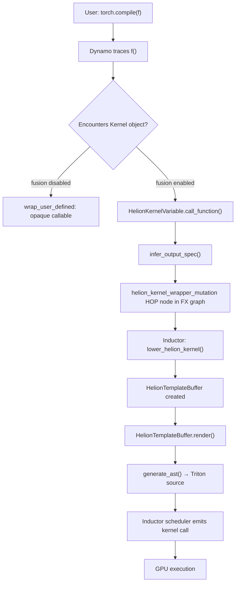
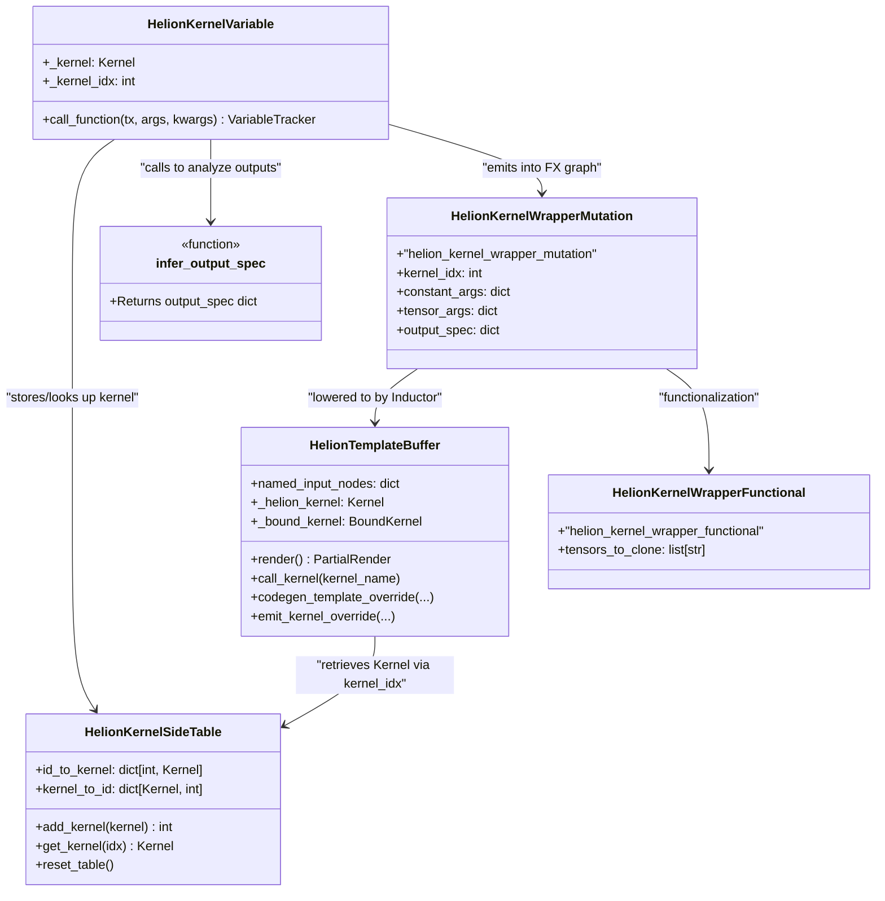
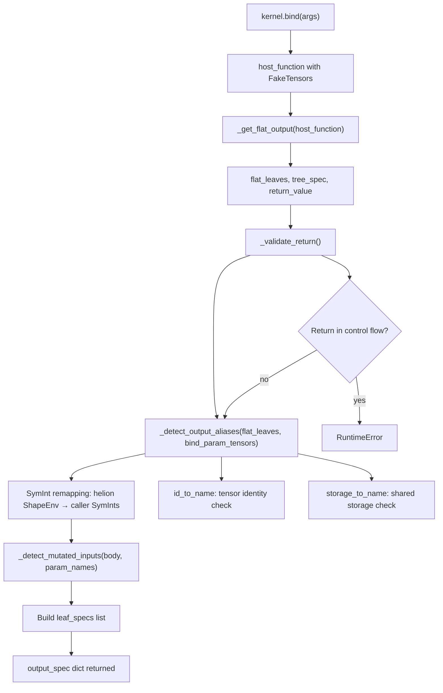
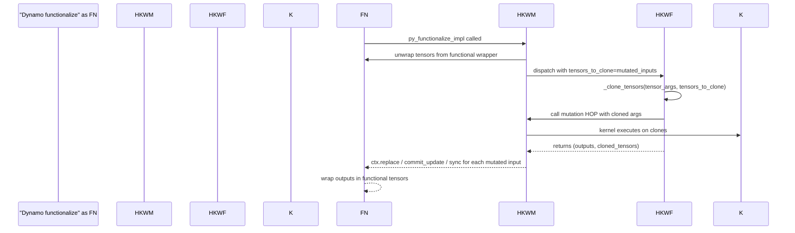

<!-- source: DeepWiki mcp.deepwiki.com · repo pytorch/helion · page 6.3 torch.compile Integration · fetched 2026-10-21 -->

# torch.compile Integration

Relevant source files

The following files were used as context for generating this wiki page:

- [helion/_compiler/_dynamo/__init__.py](helion/_compiler/_dynamo/__init__.py)
- [helion/_compiler/_dynamo/higher_order_ops.py](helion/_compiler/_dynamo/higher_order_ops.py)
- [helion/_compiler/_dynamo/variables.py](helion/_compiler/_dynamo/variables.py)
- [helion/_compiler/_inductor/__init__.py](helion/_compiler/_inductor/__init__.py)
- [helion/_compiler/_inductor/template_buffer.py](helion/_compiler/_inductor/template_buffer.py)
- [test/test_torch_compile.py](test/test_torch_compile.py)

This page documents how Helion kernels integrate with `torch.compile` via PyTorch's Dynamo and Inductor subsystems. It covers the Dynamo variable tracker (`HelionKernelVariable`), output/mutation analysis (`infer_output_spec`), the higher-order operators (HOPs) that model kernel side effects, the global kernel registry (`HelionKernelSideTable`), and the Inductor template buffer (`HelionTemplateBuffer`) that generates code.

This page focuses on the *compilation pipeline integration*. For how Helion kernels execute at runtime without `torch.compile`, see the Kernel Lifecycle page ([6.1](#6.1)). For the Helion compilation pipeline itself (type propagation, code generation), see section [5](#5).

---

## Overview

When a function containing a Helion kernel is passed to `torch.compile`, two separate systems are involved:

1. **Dynamo** traces the Python function and recognizes Helion `Kernel` objects. It emits a *higher-order operator* (HOP) node into the FX graph rather than breaking the graph.
2. **Inductor** receives the FX graph and lowers the HOP node into a `HelionTemplateBuffer`, which generates Triton source code and calls the kernel as a fused template.

This integration is **opt-in** for fusion mode. Without the environment variable `_WIP_DEV_ONLY_HELION_TORCH_COMPILE_FUSION=1`, Helion kernels inside `torch.compile` are treated as opaque user-defined callables (no graph breaks, no fusion, no Inductor lowering). With the env var set, full fusion via `HelionTemplateBuffer` is enabled. The env var is currently a development-only feature flag, as indicated by its `_WIP_DEV_ONLY_` prefix.

**Minimum PyTorch version for fusion mode:** 2.11

---

## Architecture

**Diagram: torch.compile Integration — End-to-End Flow**

Sources: [helion/_compiler/_dynamo/variables.py:395-413](), [helion/_compiler/_dynamo/higher_order_ops.py:59-80](), [helion/_compiler/_inductor/template_buffer.py:302-420]()

---

**Diagram: Key Code Entities and Their Relationships**

Sources: [helion/_compiler/_dynamo/variables.py:26-413](), [helion/_compiler/_dynamo/higher_order_ops.py:26-345](), [helion/_compiler/_inductor/template_buffer.py:69-444]()

---

## Dynamo Registration

`register_dynamo_variable()` in [helion/_compiler/_dynamo/variables.py:395-413]() installs `HelionKernelVariable` into Dynamo's `VariableBuilder._type_dispatch()` under the `Kernel` type.

When Dynamo encounters a `Kernel` object during tracing:

- If `_WIP_DEV_ONLY_HELION_TORCH_COMPILE_FUSION=1` is set **and** PyTorch ≥ 2.11: creates a `HelionKernelVariable` and imports `helion._compiler._inductor.template_buffer` to register the Inductor lowering.
- Otherwise: falls back to `wrap_user_defined`, treating the kernel as a black box that is called eagerly. The kernel still runs correctly but without Inductor fusion.

---

## HelionKernelVariable

`HelionKernelVariable` ([helion/_compiler/_dynamo/variables.py:287-392]()) is the Dynamo `VariableTracker` for Helion `Kernel` objects. Its `call_function` method handles kernel invocations during Dynamo graph tracing.

### Argument Partitioning

Arguments are classified on each kernel call:

| Argument type | Classification | Storage location |
|---|---|---|
| Python scalars (`int`, `float`, `bool`, `str`) | constant | `constant_args` dict |
| `torch.Tensor` proxies | tensor | `tensor_args` dict (keyed by param name) |
| `TupleVariable`, `ListVariable`, `ConstDictVariable` | container | Flattened; elements go to `constant_args` or `tensor_args` with mangled keys `name.0`, `name.1`, etc. Container structure saved in `constant_args["__container_specs"]` |

### HOP Emission

After partitioning arguments and computing `output_spec`, `call_function` emits a `helion_kernel_wrapper_mutation` HOP node into the FX graph via `tx.output.create_proxy` or `_call_function_and_unflatten_output`. The output is then reconstructed by unflattening via `pytree.treespec_loads(tree_spec_str)`.

Direct output aliases (where a return value is exactly an input tensor) are handled by `_replace_direct_aliases` ([helion/_compiler/_dynamo/variables.py:260-284]()), which substitutes the original `VariableTracker` for the alias position rather than creating a new proxy.

Sources: [helion/_compiler/_dynamo/variables.py:303-392]()

---

## Output Specification Inference

`infer_output_spec(kernel, args)` ([helion/_compiler/_dynamo/variables.py:117-247]()) is the core analysis function. It runs at Dynamo tracing time to produce the `output_spec` dictionary that drives HOP lowering.

**Diagram: infer_output_spec Analysis Pipeline**

Sources: [helion/_compiler/_dynamo/variables.py:117-247]()

### output_spec Dictionary

| Key | Type | Description |
|---|---|---|
| `leaf_specs` | `list[dict]` | One entry per flattened output leaf. Tensors: `{type, shape, stride, dtype, device}`. Scalars: `{type, scalar_value}`. |
| `tree_spec_str` | `str \| None` | `pytree.treespec_dumps` of the return structure. `None` for pure-mutation kernels with no return. |
| `mutated_inputs` | `list[str]` | Parameter names mutated by subscript assignment (`x[tile] = ...`) or identified as output aliases. |
| `direct_aliases` | `dict[int, str]` | Maps flat leaf index to input parameter name when the output tensor is identical to an input tensor (same object). |

### Mutation Detection

`_detect_mutated_inputs` ([helion/_compiler/_dynamo/variables.py:30-33]()) uses `ReadWrites.from_list` on the kernel's AST body to find parameter names that appear in subscript write positions (`x[tile] = ...`). Kernels using `hl.inline_triton` conservatively mark all tensor inputs as mutated.

### Aliasing Detection

`_detect_output_aliases` ([helion/_compiler/_dynamo/variables.py:66-94]()) compares each output leaf against the bound `host_function.params` by:
- **Identity match** (`id(leaf) == id(param)`): direct alias — the output *is* the input.
- **Storage match** (`id(leaf.untyped_storage()) == id(param.untyped_storage())`): indirect alias — output shares storage with input (e.g., view, slice, permute).

### SymInt Remapping

`kernel.bind()` creates `FakeTensor` objects in Helion's own `ShapeEnv`. Output shapes expressed as `SymInt` from that env are invisible to the external tracer. `infer_output_spec` builds a remapping table (`sym_remap`) from Helion's `SymInt` expressions to the caller's original values (which may be tracer `SymInt`s), and substitutes these into the `leaf_specs` before returning.

Sources: [helion/_compiler/_dynamo/variables.py:66-247]()

---

## HelionKernelSideTable

`HelionKernelSideTable` ([helion/_compiler/_dynamo/higher_order_ops.py:26-56]()) is a thread-safe global registry that maps `Kernel` objects to integer IDs.

HOPs cannot directly store Python objects as arguments (they must be serializable). `HelionKernelSideTable` solves this by storing the `Kernel` reference globally and passing only a stable `kernel_idx: int` through the HOP interface.

The singleton instance is `helion_kernel_side_table`. In tests, `reset_table()` clears the registry between runs.

Sources: [helion/_compiler/_dynamo/higher_order_ops.py:26-56]()

---

## Higher-Order Operators

Two HOPs are defined in [helion/_compiler/_dynamo/higher_order_ops.py]():

### helion_kernel_wrapper_mutation

`HelionKernelWrapperMutation` is the primary HOP. It is registered as an `ORDERED` effectful op (`hop_effects._register_effectful_op`), which prevents Dynamo/Inductor from reordering or deduplicating kernel calls.

**Signature:** `(kernel_idx, constant_args, tensor_args, output_spec) → tuple[Tensor, ...]`

Dispatch implementations:

| Dispatch key | Implementation | Behavior |
|---|---|---|
| `CompositeExplicitAutograd` | `helion_kernel_wrapper_mutation_dense` | Retrieves kernel, reconstructs args, calls kernel, returns tensor leaves |
| `ProxyTorchDispatchMode` | `helion_kernel_wrapper_mutation_proxy` | Emits proxy into FX graph via `_trace_hop_proxy` |
| `py_functionalize_impl` | `helion_kernel_wrapper_mutation_functionalize` | Converts to functional form by dispatching to `helion_kernel_wrapper_functional`, then propagates mutations back via `ctx.replace/commit_update/sync` |
| Fake tensor | `register_fake(helion_kernel_wrapper_mutation)` | Creates empty tensors from `output_spec["leaf_specs"]` for shape analysis |

### helion_kernel_wrapper_functional

`HelionKernelWrapperFunctional` is used in the functionalization path. It accepts an additional `tensors_to_clone: list[str]` argument, clones those inputs before kernel execution, and returns both the kernel outputs and the cloned tensors.

**Signature:** `(..., tensors_to_clone) → (tuple[Tensor, ...], dict[str, Tensor])`

This separation allows Inductor's functional IR to model mutations without actually mutating the graph's value tensors.

**Diagram: Mutation Handling via Functionalization**

Sources: [helion/_compiler/_dynamo/higher_order_ops.py:83-345]()

---

## Inductor Lowering

When Inductor processes the FX graph, `lower_helion_kernel` ([helion/_compiler/_inductor/template_buffer.py:302-420]()) is invoked for `helion_kernel_wrapper_mutation` nodes.

### lower_helion_kernel Steps

1. **Realize inputs**: Converts `TensorBox` IR nodes to concrete buffers or `ReinterpretView` nodes via `ExternKernel.realize_input`.
2. **Build fake tensors**: Constructs `torch.empty_strided` tensors from the realized input layouts for kernel binding.
3. **Bind kernel**: Calls `kernel.bind(fake_tensors)` to get a `BoundKernel` with accurate output shapes.
4. **Create `HelionTemplateBuffer`**: Instantiates the template buffer with the realized inputs, kernel, and bound kernel.
5. **Create `MultiOutput` nodes**: For each tensor in the flattened output, creates a `MultiOutput(FallbackKernel.tensor_to_layout(output), buf, indices)` node. Direct aliases bypass this and return a `TensorBox` wrapping the input buffer directly.

A companion lowering `lower_helion_kernel_functional` handles `helion_kernel_wrapper_functional` by cloning the requested inputs and delegating to `lower_helion_kernel`.

Sources: [helion/_compiler/_inductor/template_buffer.py:302-444]()

---

## HelionTemplateBuffer

`HelionTemplateBuffer` ([helion/_compiler/_inductor/template_buffer.py:69-300]()) extends Inductor's `TritonTemplateBuffer`.

### Key Attributes

| Attribute | Type | Purpose |
|---|---|---|
| `named_input_nodes` | `dict[str, IRNode]` | Maps parameter names to realized Inductor IR nodes |
| `_helion_kernel` | `Kernel` | The Helion kernel object |
| `_bound_kernel` | `BoundKernel` | Bound instance with config and host function |
| `_constant_args_dict` | `dict[str, object]` | Non-tensor arguments |
| `_autotune_args` | `tuple \| None` | Fake tensors for triggering autotuning |
| `prologue_fused_inputs` | `OrderedSet[str]` | Required by Inductor scheduler interface |

### render()

`render()` ([helion/_compiler/_inductor/template_buffer.py:136-184]()) generates the Triton kernel source code:

1. Calls `self._bound_kernel.ensure_config_exists(autotune_args)` if autotuning hasn't run yet.
2. Calls `generate_ast(host_function, cfg)` to build the Python AST.
3. Renames functions in the AST: the host function is renamed to `Placeholder.KERNEL_NAME`, and the inner Triton function to `_helion_{name}_{Placeholder.KERNEL_NAME}`. Module-level variables (`_BLOCK_SIZE_0`, etc.) are similarly uniquified.
4. Runs `get_needed_imports(root) + unparse(root)` to produce the final source string.

### call_kernel()

`call_kernel()` ([helion/_compiler/_inductor/template_buffer.py:186-228]()) emits the Python call site into the wrapper code. It uses `_CodeExpr` (a `str` subclass whose `__repr__` returns itself) to embed variable names directly in the emitted call expression without extra quoting. Container arguments are rebuilt from their flattened `__container_specs` before constructing the call.

### emit_kernel_override()

`emit_kernel_override()` ([helion/_compiler/_inductor/template_buffer.py:258-295]()) adds the necessary imports to the generated wrapper. Required imports: `triton`, `tl`, `_default_launcher`. Conditional imports (`libdevice`, `tl_math`, `triton_helpers`, `helion`, `hl`) are added only if the kernel source references them. Imports for captured global variables (tracked in `host_function.global_imports`) are also emitted here.

Sources: [helion/_compiler/_inductor/template_buffer.py:69-300]()

---

## Supported Kernel Patterns

The following patterns are verified to work under `torch.compile` (with or without fusion mode):

| Pattern | Example kernel | Notes |
|---|---|---|
| Basic elementwise, returns new tensor | `k_add` | Standard case |
| Multiple tensor outputs (tuple) | `k_scale_two` | Different shapes allowed |
| Mixed tensor + scalar outputs | `k_scale_with_scalar_output`, `k_rms_norm` | Scalars passed via `scalar_value` in spec |
| In-place mutation, returns mutated input | `k_add_inplace` | Mutation detected from AST |
| Mutate both inputs, return both | `k_mutate_both` | Both listed in `mutated_inputs` |
| Pre-allocated output tensor as arg | `k_add_into_out` | Output alias detected |
| Atomic operations (`hl.atomic_add`) | `k_atomic_add`, `k_atomic_add_to_out` | Inputs marked mutated |
| Reduction kernels | `k_sum_rows` | Works with Inductor scheduler |
| `hl.inline_triton` | `k_inline_add` | All tensor inputs conservatively marked mutated |
| Permuted/view outputs | `k_mutate_permuted`, `k_create_return_view` | Indirect alias tracking |
| Kernel called multiple times | Sequential `k_add` calls | Each call gets a separate HOP node |
| Keyword / mixed positional+keyword args | Various | Mapped via `sig_params` |
| Captured global variables | `k_scale_with_global_var` | Via `global_imports` in host function |

Sources: [test/test_torch_compile.py:1-1121]()

---

## Known Limitations

| Limitation | Status | Notes |
|---|---|---|
| ROCm backend | Skipped | Kernel metadata missing in `torch.compile` on ROCm |
| TileIR backend | Skipped | Kernel metadata missing |
| `hl.signal` / `hl.wait` | Skipped (bug) | Generated code missing helion import |
| Indirect output aliasing (output is slice of input) | Bug | `k_slice_mutate` test marked `@unittest.skip` |
| Multiple mutated args sharing storage | `RuntimeError` | Explicitly detected in `infer_output_spec` |
| Outputs sharing storage with each other | `RuntimeError` | Detected in `_validate_return` |
| Return statements inside control flow | `RuntimeError` | Detected in `_validate_return` |
| Returning non-tensor non-scalar types | `RuntimeError` | Only `Tensor`, `int`, `float`, `bool`, `str`, `None`, `SymInt` are supported |

Sources: [helion/_compiler/_dynamo/variables.py:36-64](), [test/test_torch_compile.py:756-780](), [test/test_torch_compile.py:884-942]()

---

