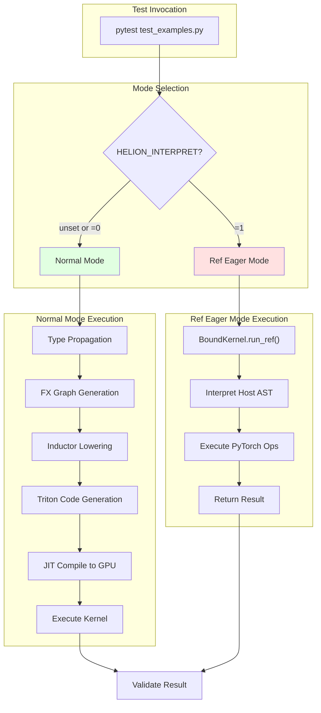
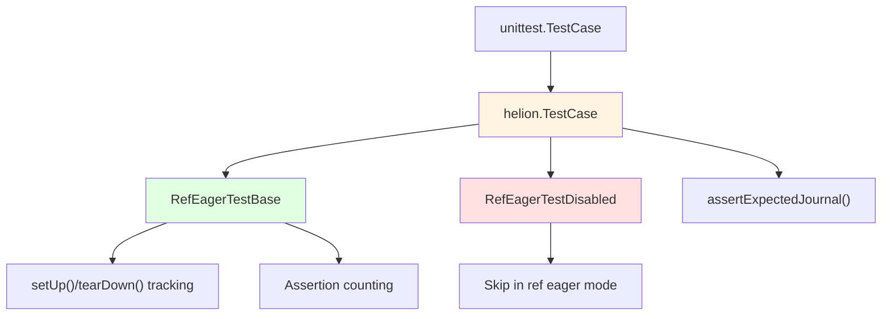
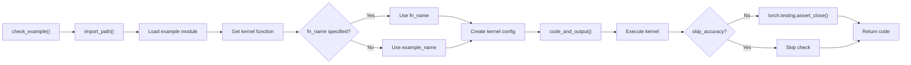
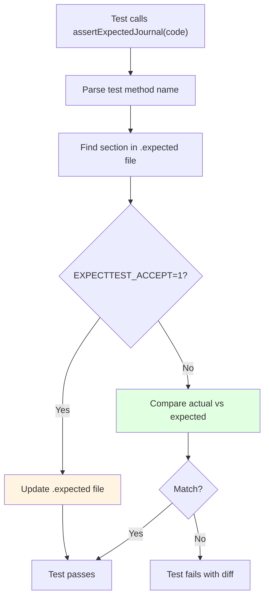
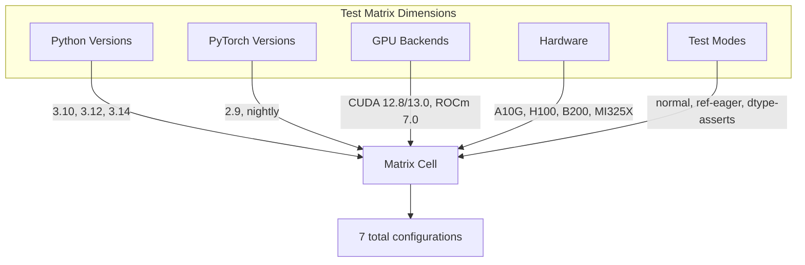
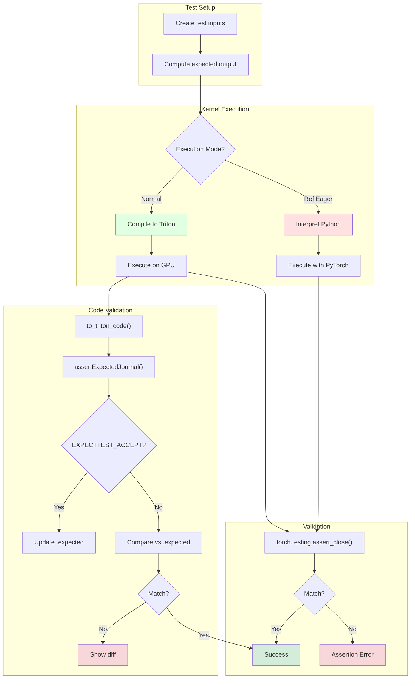

<!-- source: DeepWiki mcp.deepwiki.com · repo pytorch/helion · page 7 Testing and Validation · fetched 2026-10-21 -->

# Testing and Validation

<details>
<summary>Relevant source files</summary>

The following files were used as context for generating this wiki page:

- [.github/matrix.json](.github/matrix.json)
- [.github/workflows/lint.yml](.github/workflows/lint.yml)
- [.github/workflows/test.yml](.github/workflows/test.yml)
- [.gitignore](.gitignore)
- [helion/_compat.py](helion/_compat.py)
- [helion/_testing.py](helion/_testing.py)
- [pyproject.toml](pyproject.toml)
- [test/test_persistent_kernels.py](test/test_persistent_kernels.py)
- [test/test_tensor_descriptor.py](test/test_tensor_descriptor.py)

</details>


This page describes the testing infrastructure for Helion kernels, including test execution modes, the testing framework, utilities for validating correctness and generated code, and patterns for writing effective tests.

For information about benchmarking performance, see [Benchmarking](#8). For information about the compilation pipeline being tested, see [Compilation Pipeline](#5).

---

## Test Execution Modes

Helion supports two execution modes for testing kernels, controlled by the `HELION_INTERPRET` environment variable:

| Mode | Environment Variable | Execution Path | Use Case |
|------|---------------------|----------------|----------|
| **Normal Mode** | `HELION_INTERPRET` unset or `=0` | Compiles to Triton code and runs on GPU | Default mode; tests compilation pipeline and GPU execution |
| **Ref Eager Mode** | `HELION_INTERPRET=1` | Interprets Python directly using PyTorch operations | Tests kernel logic without compilation; faster iteration |



**Sources:** [helion/_testing.py:63-70](), [helion/_testing.py:179-378](), [helion/runtime/ref_mode.py]()

The two modes enable complementary testing strategies:
- **Normal mode** validates the entire compilation stack and GPU correctness
- **Ref eager mode** validates kernel logic independently, useful for debugging semantic issues

---

## Testing Framework

### Base Classes

The testing framework provides specialized base classes that extend `unittest.TestCase`:



**Sources:** [helion/_testing.py:179-424]()

#### helion.TestCase

Base class that adds `assertExpectedJournal()` for validating generated Triton code against stored expected outputs.

**File:** [helion/_testing.py:179-424]()

#### RefEagerTestBase

Mixin for tests that should run in both normal and ref eager modes. Provides automatic tracking and validation:

- **setUp()**: 
  - Patches `torch.testing.assert_close` to count assertion calls [helion/_testing.py:224-231]()
  - Patches `assertRaises`, `skipTest`, `assertTrue`, `assertFalse`, `assertGreater` [helion/_testing.py:233-297]()
  - Initializes `track_run_ref_calls()` context manager [helion/_testing.py:254-255]()

- **tearDown()**:
  - Verifies that either `run_ref()` was called OR the test was skipped [helion/_testing.py:318-322]()
  - Ensures at least one assertion method was called [helion/_testing.py:324-345]()

**Usage Pattern:**
```python
class TestExamples(RefEagerTestBase, TestCase):
    def test_add(self):
        args = (
            torch.randn([512, 512], device=DEVICE, dtype=torch.float32),
            torch.randn([512], device=DEVICE, dtype=torch.float16),
        )
        self.assertExpectedJournal(
            check_example("add", args, sum(args), block_sizes=[128, 1])
        )
```

**Sources:** [test/test_examples.py:26-36](), [helion/_testing.py:179-424]()

#### RefEagerTestDisabled

Mixin for tests that should be skipped when `HELION_INTERPRET=1`. Used for tests that specifically validate compilation behavior.

**Example:**
```python
class TestCache(RefEagerTestDisabled, TestCase):
    def test_basic(self):
        # Test autotune cache behavior - not relevant in ref eager mode
        ...
```

**Sources:** [test/test_cache.py:22-63]()

---

## Test Utilities

### check_example()

Validates a kernel's correctness by comparing its output against an expected result and returns generated Triton code for inspection.

**Signature:**
```python
def check_example(
    example_name: str,
    args: tuple[object, ...],
    expected: object,
    fn_name: str | None = None,
    skip_accuracy: bool = False,
    rtol: float = 1e-2,
    atol: float = 1e-1,
    **config_kwargs: object
) -> str
```

**Parameters:**
- `example_name`: Module name in `examples/` directory (e.g., `"add"`, `"matmul"`)
- `args`: Tuple of arguments to pass to kernel
- `expected`: Expected output tensor(s) or tuple of tensors
- `fn_name`: Function name if different from module name
- `skip_accuracy`: If `True`, skip torch.testing.assert_close check
- `rtol`, `atol`: Relative and absolute tolerance for comparison
- `**config_kwargs`: Configuration parameters (e.g., `block_sizes=[64, 64]`)

**Returns:** Generated Triton code as string (or original source in ref eager mode)

**Workflow:**



**Example Usage:**
```python
def test_matmul(self):
    args = (
        torch.randn([128, 128], device=DEVICE, dtype=torch.float32),
        torch.randn([128, 128], device=DEVICE, dtype=torch.float32),
    )
    self.assertExpectedJournal(
        check_example(
            "matmul",
            args,
            args[0] @ args[1],
            block_sizes=[16, 16, 16],
            l2_grouping=4,
        )
    )
```

**Sources:** [helion/_testing.py:597-790](), [test/test_examples.py:38-51]()

### run_example()

Higher-level utility that runs both correctness validation and benchmarking, supporting multiple kernel variants and baselines.

**Signature:**
```python
def run_example(
    kernel_fn: Callable[..., torch.Tensor] | Kernel | dict[str, Kernel],
    baseline_fn: Callable[..., torch.Tensor] | dict[str, Callable],
    args: tuple[object, ...],
    kernel_name: str = "helion",
    baseline_name: str = "torch",
    rtol: float = 1e-2,
    atol: float = 1e-1,
    bwd: bool = False,
) -> None
```

**Features:**
- Correctness checking against baseline
- Optional backward pass validation (when `bwd=True`)
- Automatic benchmarking of all variants
- Support for multiple kernels and baselines via dict

**Example:**
```python
def check(s: int, d: int) -> None:
    weight = torch.rand((d,), device=DEVICE, dtype=torch.float32)
    bias = torch.rand((d,), device=DEVICE, dtype=torch.float32)
    x = torch.rand((s, d), device=DEVICE, dtype=torch.float32)

    kernels = {"helion": welford}
    run_example(kernels, eager_layer_norm, (weight, bias, x))
```

**Sources:** [helion/_testing.py:471-635](), [examples/welford.py:114-116]()

### code_and_output()

Lower-level utility that executes a kernel and returns both the generated Triton code and the output.

**Signature:**
```python
def code_and_output(
    fn: Kernel,
    args: tuple[object, ...],
    **kwargs: object,
) -> tuple[str, object]
```

**Behavior:**
- In **ref eager mode**: Returns original Python source code via `inspect.getsource()` [helion/_testing.py:449-451]()
- In **normal mode**: 
  - Creates `Config` from `kwargs` if provided
  - Calls `to_triton_code(config)` to generate Triton AST [helion/_testing.py:461]()
  - Compiles and executes kernel [helion/_testing.py:462-467]()
  - Returns (triton_code, result)

**Sources:** [helion/_testing.py:438-468]()

### import_path()

Dynamically imports a Python module from a file path, used for loading example kernels.

**Implementation:**
```python
def import_path(filename: Path) -> types.ModuleType:
    module_name = f"{__name__}.{filename.stem}"
    if module_name not in sys.modules:
        spec = importlib.util.spec_from_file_location(module_name, filename)
        module = importlib.util.module_from_spec(spec)
        spec.loader.exec_module(module)
        sys.modules[module_name] = module
    return sys.modules[module_name]
```

**Sources:** [helion/_testing.py:426-435]()

---

## Expected Output Management

### assertExpectedJournal

Method provided by `helion.TestCase` that validates generated Triton code against stored expected outputs in `.expected` files.

**Workflow:**



**File Format:**

The `.expected` files contain sections for each test method:

```
--- assertExpectedJournal(TestExamples.test_add)
from __future__ import annotations

import torch
import triton
import triton.language as tl
from helion.runtime import default_launcher as _default_launcher

@triton.jit
def _helion_add(x, y, out, _BLOCK_SIZE_0_1: tl.constexpr):
    # src[add.py:N]: for tile in hl.tile(out.size()):
    offsets_0_1 = tl.program_id(0) * _BLOCK_SIZE_0_1 + tl.arange(0, _BLOCK_SIZE_0_1).to(tl.int32)
    ...

--- assertExpectedJournal(TestExamples.test_matmul)
...
```

**Sources:** [test/test_examples.expected:1-468]()

### Regenerating Expected Outputs

To update all expected outputs after intentional code changes:

```bash
EXPECTTEST_ACCEPT=1 pytest test/test_examples.py
```

This regenerates the `.expected` file with the new Triton code output. The header comment documents this:

```
This file is automatically generated by assertExpectedJournal calls in test_examples.py.
Update expected outputs by running tests with the EXPECTTEST_ACCEPT=1 environment variable set.
```

**Sources:** [test/test_examples.expected:1-3]()

---

## Skip Decorators

The testing framework provides decorators to conditionally skip tests based on execution mode, hardware, or platform.

### Execution Mode Skips

| Decorator | Skips When | Use Case |
|-----------|-----------|----------|
| `@skipIfRefEager(reason)` | `HELION_INTERPRET=1` | Tests that validate compiled code generation |
| `@skipIfNormalMode(reason)` | `HELION_INTERPRET` not set | Tests specific to ref eager interpretation |

**Example:**
```python
@skipIfRefEager("Test has skip_accuracy=True and doesn't call assert_close")
def test_moe_matmul_ogs(self):
    # This test skips accuracy checks, which ref eager mode requires
    ...
```

**Sources:** [helion/_testing.py:63-70](), [test/test_examples.py:674-698]()

### Hardware/Platform Skips

| Decorator | Skips When | Use Case |
|-----------|-----------|----------|
| `@skipIfRocm(reason)` | `torch.version.hip is not None` | Tests with NVIDIA-specific behavior |
| `@skipIfXPU(reason)` | `torch.xpu.is_available()` | Tests requiring CUDA/ROCm |
| `@skipIfA10G(reason)` | GPU model contains "A10G" | Tests failing on A10G GPUs |
| `@skipIfNotCUDA()` | Not running on CUDA | NVIDIA-only tests |
| `@skipIfLowVRAM(reason)` | Total VRAM < 30GB | Memory-intensive tests |

**Example:**
```python
@skipIfRocm("failure on rocm")
def test_matmul_layernorm_static_shapes(self):
    # This kernel has different behavior on AMD GPUs
    ...

@skipIfA10G("accuracy check fails on A10G GPUs")
def test_layernorm_bwd(self):
    # Known precision issues on A10G hardware
    ...
```

**Sources:** [helion/_testing.py:73-113](), [test/test_examples.py:129-150](), [test/test_examples.py:904-975]()

### Compute Capability Checks

For features requiring specific GPU capabilities:

```python
@unittest.skipIf(
    not torch.cuda.is_available() or torch.cuda.get_device_capability()[0] < 9,
    "FP8 requires GPU with compute capability >= 9.0 (e.g., H100)",
)
def test_fp8_gemm(self):
    # FP8 operations only available on Hopper (SM90+) GPUs
    ...
```

**Sources:** [test/test_examples.py:193-222]()

---

## Context Managers for Testing

### track_run_ref_calls()

Context manager that tracks calls to `BoundKernel.run_ref()` to verify execution mode.

**Usage:**
```python
with track_run_ref_calls() as run_ref_count:
    result = kernel(*args)
    assert run_ref_count[0] > 0  # Verify ref mode was used
```

**Implementation:** Patches `BoundKernel.run_ref` to increment a counter on each call.

**Sources:** [helion/_testing.py:120-142]()

### assert_helion_ref_mode()

Higher-level context manager that asserts correct execution mode:

```python
from helion.runtime.settings import RefMode

# Assert compilation (normal mode)
with assert_helion_ref_mode(ref_mode=RefMode.OFF):
    result = kernel(*args)
    # Fails if run_ref was called

# Assert ref eager mode
with assert_helion_ref_mode(ref_mode=RefMode.EAGER):
    result = kernel(*args)
    # Fails if run_ref was NOT called
```

**Convenience aliases:**
- `assert_helion_compilation` = `assert_helion_ref_mode(RefMode.OFF)`
- `assert_ref_eager_mode` = `assert_helion_ref_mode(RefMode.EAGER)`

**Sources:** [helion/_testing.py:144-177]()

---

## Test Configuration

### Device Selection

Tests use a global `DEVICE` constant that automatically selects the appropriate GPU type:

```python
DEVICE = torch.device("xpu") if torch.xpu.is_available() else torch.device("cuda")
```

**Sources:** [helion/_testing.py:37]()

### Environment Variables

| Variable | Default | Description |
|----------|---------|-------------|
| `HELION_INTERPRET` | unset | Set to `1` to enable ref eager mode |
| `HELION_SKIP_CACHE` | unset | Set to `1` to force re-autotuning |
| `HELION_CACHE_DIR` | `~/.cache/torch/helion` | Directory for autotune cache |
| `EXPECTTEST_ACCEPT` | unset | Set to `1` to regenerate `.expected` files |

**Sources:** [helion/_testing.py:63-70](), [helion/autotuner/base_cache.py:161-167](), [helion/autotuner/local_cache.py:78-84]()

### CI/CD Test Matrix

From the architecture overview, tests run across 7 configurations:



**Sources:** Architecture Diagram 6, [.github/workflows]()

---

## Writing Effective Tests

### Test Pattern: Basic Correctness

```python
class TestExamples(RefEagerTestBase, TestCase):
    def test_add(self):
        # 1. Create test inputs
        args = (
            torch.randn([512, 512], device=DEVICE, dtype=torch.float32),
            torch.randn([512], device=DEVICE, dtype=torch.float16),
        )
        
        # 2. Compute expected result
        expected = sum(args)
        
        # 3. Validate kernel with configuration
        self.assertExpectedJournal(
            check_example(
                "add",              # example module name
                args,               # inputs
                expected,           # expected output
                block_sizes=[128, 1],  # config params
                flatten_loop=True
            )
        )
```

**Sources:** [test/test_examples.py:27-36]()

### Test Pattern: Backward Pass

```python
def test_matmul_bwd(self):
    # 1. Create tensors with requires_grad=True
    mat1 = torch.randn(
        [128, 128], device=DEVICE, dtype=torch.float32, requires_grad=True
    )
    mat2 = torch.randn(
        [128, 128], device=DEVICE, dtype=torch.float32, requires_grad=True
    )
    grad_out = torch.randn([128, 128], device=DEVICE, dtype=torch.float32)

    # 2. Compute expected gradients with PyTorch
    mat1_torch = mat1.detach().clone().requires_grad_(True)
    mat2_torch = mat2.detach().clone().requires_grad_(True)
    result_torch = torch.matmul(mat1_torch, mat2_torch)
    result_torch.backward(grad_out)

    # 3. Test backward kernel
    args = (grad_out, mat1, mat2)
    self.assertExpectedJournal(
        check_example(
            "matmul",
            args,
            (mat1_torch.grad, mat2_torch.grad),  # Expected gradients
            fn_name="matmul_bwd",
            block_sizes=[16, 16, 16, 16, 16, 16],
        )
    )
```

**Sources:** [test/test_examples.py:53-87]()

### Test Pattern: Multiple Variants

```python
def test_softmax(self):
    args = (torch.randn([1024, 1024], device=DEVICE, dtype=torch.float32),)
    
    # Test standard implementation
    self.assertExpectedJournal(
        check_example(
            "softmax",
            args,
            torch.nn.functional.softmax(*args, dim=1),
            block_size=1,
        )
    )

def test_softmax_decomposed(self):
    args = (torch.randn([1024, 1024], device=DEVICE, dtype=torch.float32),)
    
    # Test decomposed implementation
    self.assertExpectedJournal(
        check_example(
            "softmax",
            args,
            torch.nn.functional.softmax(*args, dim=1),
            fn_name="softmax_decomposed",  # Different function
            block_size=1,
        )
    )
```

**Sources:** [test/test_examples.py:293-337]()

### Test Pattern: Reference Implementation

When testing complex operations, import reference implementations:

```python
def test_jagged_mean(self):
    # Create test data
    num_rows, max_cols = 32, 64
    M = 8
    lengths = torch.randint(1, max_cols + 1, (num_rows,), device=DEVICE)
    x_offsets = torch.cat([
        torch.zeros(1, dtype=torch.long, device=DEVICE),
        torch.cumsum(lengths, dim=0),
    ])
    nnz = int(x_offsets[-1])
    x_data = torch.randn(nnz, M, dtype=torch.float32, device=DEVICE)
    feature_counts = torch.randint(1, M + 1, (num_rows,), dtype=torch.int32, device=DEVICE)
    
    args = (x_data, x_offsets, feature_counts, M)

    # Import and use the reference implementation
    mod = import_path(EXAMPLES_DIR / "jagged_mean.py")
    expected = mod.reference_jagged_mean_kernel_pytorch(
        x_data, x_offsets, feature_counts, M
    )

    self.assertExpectedJournal(
        check_example(
            "jagged_mean",
            args,
            expected,
            fn_name="jagged_mean_kernel",
            block_sizes=[16, 8, 16],
        )
    )
```

**Sources:** [test/test_examples.py:730-761]()

### Test Pattern: Tolerance Adjustment

For numerically sensitive operations, adjust tolerances:

```python
def test_rms_norm_bwd(self):
    # ... setup ...
    
    self.assertExpectedJournal(
        check_example(
            "rms_norm",
            args,
            expected,
            fn_name="rms_norm_bwd",
            block_size=[32, 1],
            rtol=1e-2,  # Relaxed relative tolerance
            atol=1e-2,  # Relaxed absolute tolerance
        )
    )
```

**Sources:** [test/test_examples.py:497-542]()

---

## Test Validation Flow



**Sources:** [helion/_testing.py:438-790](), [test/test_examples.py:26-1290]()

---

## Cache Testing

Tests for autotune caching use `RefEagerTestDisabled` because cache behavior is not relevant in ref eager mode:

```python
class TestCache(RefEagerTestDisabled, TestCase):
    def test_basic(self):
        @helion.kernel(
            autotuner_fn=StrictLocalAutotuneCache[BasicSearch],
            autotune_effort="full"
        )
        def add(x, y):
            # ... kernel implementation ...
            return out
        
        # First call triggers autotuning
        result = add(*args_a)
        self.assertEqual(counters["autotune"]["cache_miss"], 1)
        self.assertEqual(counters["autotune"]["cache_hit"], 0)
        
        # Second call uses cache
        add.reset()
        result = add(*args_a)
        self.assertEqual(counters["autotune"]["cache_hit"], 1)
```

**Cache Counters:**

| Counter | Description |
|---------|-------------|
| `counters["autotune"]["cache_hit"]` | Number of successful cache lookups |
| `counters["autotune"]["cache_miss"]` | Number of cache misses triggering autotuning |
| `counters["autotune"]["cache_put"]` | Number of configs stored to cache |

**Sources:** [test/test_cache.py:22-108](), [helion/autotuner/base_cache.py:160-189]()

---

## Best Practices

### 1. Use RefEagerTestBase for Dual-Mode Testing

Most kernel tests should inherit from `RefEagerTestBase` to validate both compilation and logic:

```python
class TestExamples(RefEagerTestBase, TestCase):
    # Tests run in both normal and ref eager modes
    ...
```

### 2. Skip Tests Appropriately

Use skip decorators to avoid false failures:

```python
@skipIfRocm("precision differences with bf16xint16 operations on rocm")
@skipIfXPU("precision differences with bf16xint16 operations on xpu")
def test_bf16xint16(self):
    ...
```

### 3. Use Appropriate Tolerances

Different operations have different numerical stability:
- Matrix operations: `rtol=1e-2, atol=1e-1`
- Normalization operations: `rtol=1e-2, atol=1e-2`
- FP8 operations: `rtol=0.1, atol=0.2`

### 4. Document Expected Failures

When skipping tests, provide clear reasons:

```python
@skipIfRefEager("Test has skip_accuracy=True and doesn't call assert_close")
def test_moe_matmul_ogs(self):
    # TODO(yf225): fix unstable numerics
    ...
```

### 5. Test Configuration Variants

For complex kernels, test multiple configurations:

```python
def test_matmul(self):
    # Test with default config
    ...

def test_matmul_with_l2_grouping(self):
    # Test with L2 cache optimization
    check_example(..., l2_grouping=4)
```

**Sources:** [test/test_examples.py:1-1290](), [helion/_testing.py:1-1207]()

---

