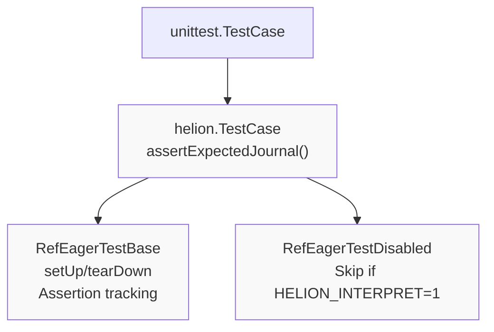
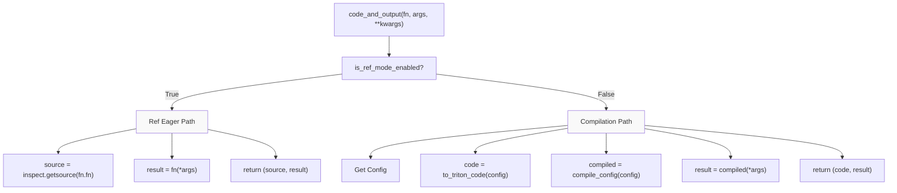
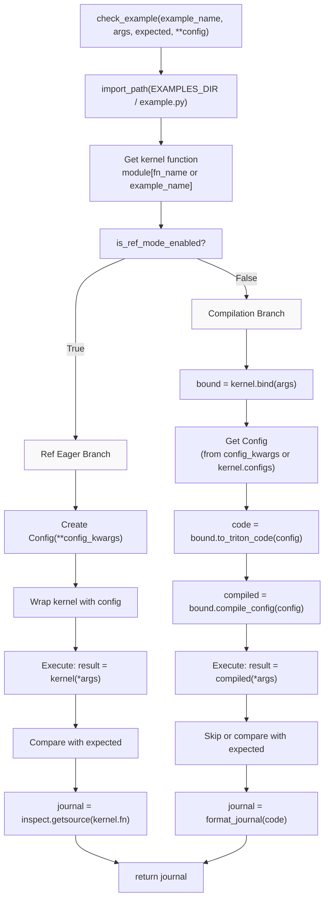
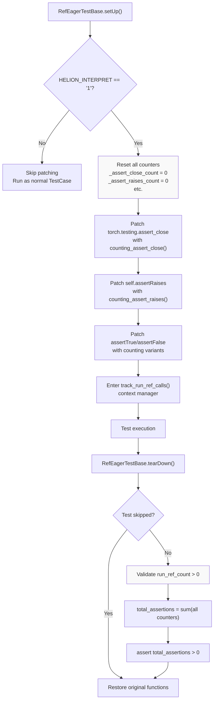

<!-- source: DeepWiki mcp.deepwiki.com · repo pytorch/helion · page 7.1 Testing Framework · fetched 2026-10-21 -->

# Testing Framework

<details>
<summary>Relevant source files</summary>

The following files were used as context for generating this wiki page:

- [.github/matrix.json](.github/matrix.json)
- [.github/workflows/lint.yml](.github/workflows/lint.yml)
- [.github/workflows/test.yml](.github/workflows/test.yml)
- [.gitignore](.gitignore)
- [helion/_compat.py](helion/_compat.py)
- [helion/_testing.py](helion/_testing.py)
- [pyproject.toml](pyproject.toml)
- [test/test_persistent_kernels.py](test/test_persistent_kernels.py)
- [test/test_tensor_descriptor.py](test/test_tensor_descriptor.py)

</details>


This document describes the testing infrastructure provided by Helion for validating kernel correctness and compilation behavior. The framework supports both compiled execution and interpreted reference mode, provides utilities for comparing kernel outputs against baselines, and manages expected code generation outputs.

For information about ref eager mode specifically, see [Ref Eager Mode](#7.2). For expected output file management, see [Expected Output Management](#7.3).

---

## Test Base Classes

Helion provides specialized test base classes that extend `unittest.TestCase` with kernel-specific testing capabilities.

### Class Hierarchy



**Sources:** [helion/_testing.py:179-424]()

### TestCase

The base `TestCase` class extends `unittest.TestCase` with the `assertExpectedJournal()` method for validating generated Triton code against expected outputs stored in `.expected` files.

```python
class TestCase(unittest.TestCase):
    def assertExpectedJournal(self, value: str) -> None:
        # Compares value against corresponding section in .expected file
```

**Usage Pattern:**
```python
class TestExamples(TestCase):
    def test_add(self):
        result = check_example("add", args, expected, block_sizes=[128, 1])
        self.assertExpectedJournal(result)
```

**Sources:** [helion/_testing.py:1-40](), [test/test_examples.py:26-36]()

### RefEagerTestBase

`RefEagerTestBase` is a mixin class that provides dual-mode testing support. When `HELION_INTERPRET=1` is set, tests run in interpreted mode; otherwise they run in compiled mode. The class automatically tracks assertions to ensure tests validate behavior in both modes.

**Key Features:**
- Patches `torch.testing.assert_close` to count assertion calls
- Patches `assertRaises`, `assertTrue`, `assertFalse`, `assertGreater`, `skipTest`
- Tracks `BoundKernel.run_ref` calls via `track_run_ref_calls()`
- Validates that tests either call assertions or are explicitly skipped
- No-ops `assertExpectedJournal` in ref eager mode since code generation is skipped

**Tracked Assertion Methods:**

| Method | Purpose | Counter |
|--------|---------|---------|
| `torch.testing.assert_close` | Tensor comparisons | `_assert_close_count` |
| `assertRaises` | Exception testing | `_assert_raises_count` |
| `assertTrue` | Boolean assertions | `_assert_true_count` |
| `assertFalse` | Negated boolean assertions | `_assert_false_count` |
| `assertGreater` | Numeric comparisons | `_assert_greater_count` |
| `skipTest` | Test skipping | `_skip_test_count` |

**Sources:** [helion/_testing.py:179-377]()

### RefEagerTestDisabled

A convenience base class that automatically skips all tests when running in ref eager mode (`HELION_INTERPRET=1`). Used for test classes that only make sense in compiled mode.

```python
class TestCache(RefEagerTestDisabled, TestCase):
    # These tests are automatically skipped in ref eager mode
```

**Sources:** [test/test_cache.py:22]()

---

## Testing Utilities

The testing framework provides three primary utility functions for validating kernel correctness.

### check_example Function

`check_example()` is the main utility for testing example kernels. It compiles a kernel with a specified configuration, executes it, validates the output, and returns a journal string containing both the generated Triton code and the host wrapper function.

**Signature:**
```python
def check_example(
    example_name: str,
    args: tuple[object, ...],
    expected: object,
    fn_name: str | None = None,
    skip_accuracy: bool = False,
    rtol: float = 1e-2,
    atol: float = 1e-1,
    **config_kwargs: object,
) -> str
```

**Parameters:**

| Parameter | Type | Description |
|-----------|------|-------------|
| `example_name` | `str` | Name of the example file (without `.py`) |
| `args` | `tuple` | Arguments to pass to the kernel |
| `expected` | `object` | Expected output for comparison |
| `fn_name` | `str \| None` | Specific function name if file contains multiple kernels |
| `skip_accuracy` | `bool` | Skip output validation (default: False) |
| `rtol` | `float` | Relative tolerance for `assert_close` (default: 1e-2) |
| `atol` | `float` | Absolute tolerance for `assert_close` (default: 1e-1) |
| `**config_kwargs` | `object` | Config parameters (block_sizes, num_warps, etc.) |

**Return Value:**
A formatted string containing:
1. Generated Triton kernel code with `@triton.jit` decorator
2. Host wrapper function with argument handling and launcher calls

**Example Usage:**
```python
def test_matmul(self):
    args = (
        torch.randn([128, 128], device=DEVICE, dtype=torch.float32),
        torch.randn([128, 128], device=DEVICE, dtype=torch.float32),
    )
    self.assertExpectedJournal(
        check_example(
            "matmul",
            args,
            args[0] @ args[1],
            block_sizes=[16, 16, 16],
            l2_grouping=4,
        )
    )
```

**Sources:** [helion/_testing.py:613-683](), [test/test_examples.py:38-51]()

### code_and_output Function

`code_and_output()` is a lower-level utility that compiles a kernel and returns both the generated code and the execution result without performing accuracy validation.

**Signature:**
```python
def code_and_output(
    fn: Kernel,
    args: tuple[object, ...],
    **kwargs: object,
) -> tuple[str, object]
```

**Behavior in Different Modes:**



**Sources:** [helion/_testing.py:438-468]()

### run_example Function

`run_example()` provides a complete test workflow: correctness validation against baseline(s) and optional backward pass testing. Unlike `check_example()`, it does not return generated code.

**Signature:**
```python
def run_example(
    kernel_fn: Callable | Kernel | dict[str, Kernel],
    baseline_fn: Callable | dict[str, Callable],
    args: tuple[object, ...],
    kernel_name: str = "helion",
    baseline_name: str = "torch",
    rtol: float = 1e-2,
    atol: float = 1e-1,
    bwd: bool = False,
) -> None
```

**Features:**
- Supports multiple kernel variants via dict: `{"variant1": kernel1, "variant2": kernel2}`
- Supports multiple baselines for comparison
- Optional backward pass validation with `bwd=True`
- Prints benchmark results to stderr

**Example Usage:**
```python
def check(s: int, d: int) -> None:
    weight = torch.rand((d,), device=DEVICE)
    bias = torch.rand((d,), device=DEVICE)
    x = torch.rand((s, d), device=DEVICE)
    
    kernels = {"helion": welford}
    run_example(kernels, eager_layer_norm, (weight, bias, x))
```

**Sources:** [helion/_testing.py:471-610](), [examples/welford.py:101-116]()

---

## Test Execution Flow

The following diagram illustrates how `check_example()` processes a kernel test:



**Sources:** [helion/_testing.py:613-683]()

---

## Test Modes and Environment Variables

### Test Mode Control

The testing framework responds to several environment variables:

| Variable | Values | Effect |
|----------|--------|--------|
| `HELION_INTERPRET` | `"1"` / unset | Enables ref eager mode when set to `"1"` |
| `EXPECTTEST_ACCEPT` | `"1"` / unset | Updates `.expected` files instead of comparing |
| `HELION_SKIP_CACHE` | `"1"` / unset | Skips autotune cache lookups when set |

### DEVICE Configuration

The `DEVICE` constant automatically selects the appropriate device:

```python
DEVICE = torch.device("xpu") if torch.xpu.is_available() else torch.device("cuda")
```

Tests use this constant to ensure device-agnostic execution:
```python
x = torch.randn([512, 512], device=DEVICE, dtype=torch.float32)
```

**Sources:** [helion/_testing.py:37]()

---

## Test Decorators

The testing framework provides decorators for conditionally skipping tests based on runtime conditions.

### Skip Decorators

| Decorator | Condition | Usage |
|-----------|-----------|-------|
| `skipIfRefEager(reason)` | `HELION_INTERPRET == "1"` | Skip in ref eager mode |
| `skipIfNormalMode(reason)` | `HELION_INTERPRET != "1"` | Skip in compiled mode |
| `skipIfRocm(reason)` | `torch.version.hip is not None` | Skip on AMD GPUs |
| `skipIfXPU(reason)` | `torch.xpu.is_available()` | Skip on Intel XPUs |
| `skipIfA10G(reason)` | GPU model contains "A10G" | Skip on A10G hardware |
| `skipIfNotCUDA()` | Not running on NVIDIA CUDA | Skip if not CUDA |
| `skipIfLowVRAM(reason)` | GPU VRAM < 30GB | Skip on low-memory GPUs |
| `skipIfPy314(reason)` | Python >= 3.14 | Skip on Python 3.14+ |

**Example Usage:**
```python
@skipIfRocm("failure on rocm")
def test_matmul_layernorm_static_shapes(self):
    # Test implementation
```

**Sources:** [helion/_testing.py:63-118](), [test/test_examples.py:129]()

---

## RefEagerTestBase Assertion Tracking

`RefEagerTestBase` implements a sophisticated assertion tracking mechanism to ensure tests provide meaningful validation in both execution modes.

### Tracking Mechanism



**Sources:** [helion/_testing.py:201-377]()

### Patched Methods

The framework patches the following methods to track assertion usage:

**torch.testing.assert_close:**
```python
def counting_assert_close(*args, **kwargs):
    RefEagerTestBase._assert_close_count += 1
    return RefEagerTestBase._original_assert_close_func(*args, **kwargs)

torch.testing.assert_close = counting_assert_close
```

**self.assertRaises:**
```python
def counting_assert_raises(*args, **kwargs):
    RefEagerTestBase._assert_raises_count += 1
    return RefEagerTestBase._original_assert_raises_func(*args, **kwargs)

self.assertRaises = counting_assert_raises
```

**Sources:** [helion/_testing.py:224-296]()

### Validation Rules

In `tearDown()`, the framework enforces:
1. If test not skipped: `run_ref_count[0] > 0` (kernel executed in ref mode)
2. If test not skipped: `total_assertions > 0` (at least one assertion made)

This ensures every ref eager test:
- Actually executes a kernel in interpreted mode
- Performs at least one validation check

**Sources:** [helion/_testing.py:299-377]()

---

## Helper Functions

### import_path

Dynamically imports a Python module from a file path, used to load example kernels:

```python
def import_path(filename: Path) -> types.ModuleType:
    module_name = f"{__name__}.{filename.stem}"
    # Uses importlib.util.spec_from_file_location
```

**Usage:**
```python
mod = import_path(EXAMPLES_DIR / "fp8_gemm.py")
expected = mod.reference_fp8_gemm_pytorch(x_fp8, y_fp8)
```

**Sources:** [helion/_testing.py:426-435](), [test/test_examples.py:210-211]()

### track_run_ref_calls

Context manager that tracks calls to `BoundKernel.run_ref` for validating execution mode:

```python
with track_run_ref_calls() as run_ref_count:
    # Execute test code
    # run_ref_count[0] increments on each run_ref() call
```

**Sources:** [helion/_testing.py:120-141]()

### assert_helion_ref_mode

Context manager that validates expected compilation behavior based on `RefMode`:

```python
with assert_helion_ref_mode(ref_mode=RefMode.OFF):
    # Code should compile (run_ref should not be called)

with assert_helion_ref_mode(ref_mode=RefMode.EAGER):
    # Code should interpret (run_ref should be called)
```

**Modes:**
- `RefMode.OFF`: Expects compilation, asserts `run_ref_count == 0`
- `RefMode.EAGER`: Expects interpretation, asserts `run_ref_count > 0`

**Convenience Aliases:**
```python
assert_helion_compilation = functools.partial(
    assert_helion_ref_mode, ref_mode=RefMode.OFF
)

assert_ref_eager_mode = functools.partial(
    assert_helion_ref_mode, ref_mode=RefMode.EAGER
)
```

**Sources:** [helion/_testing.py:144-176]()

---

## Integration with CI/CD

The testing framework integrates with Helion's CI/CD pipeline through:

1. **Test Matrix**: Multiple configurations (Python versions, PyTorch versions, hardware platforms)
2. **Mode Sharding**: Separate runs for normal mode and ref eager mode (`HELION_INTERPRET=1`)
3. **Expected Output Management**: `.expected` files track code generation across configurations
4. **Benchmark CI**: Uses `run_example()` for performance validation

For detailed CI/CD configuration and benchmark infrastructure, see [CI/CD Benchmarking](#8.2).

**Sources:** Diagram 6 from system architecture overview

---

## Summary

The Helion testing framework provides:

| Component | Purpose | Key Classes/Functions |
|-----------|---------|----------------------|
| Base Classes | Test organization | `TestCase`, `RefEagerTestBase`, `RefEagerTestDisabled` |
| Testing Utilities | Kernel validation | `check_example()`, `run_example()`, `code_and_output()` |
| Mode Support | Dual testing paths | `HELION_INTERPRET`, `track_run_ref_calls()` |
| Expected Outputs | Code gen validation | `assertExpectedJournal()`, `.expected` files |
| Skip Decorators | Conditional testing | `skipIfRefEager()`, `skipIfRocm()`, etc. |
| Assertion Tracking | Test completeness | Counter patching in `RefEagerTestBase` |

This infrastructure ensures that Helion kernels are validated for both correctness (output matching) and compilation behavior (code generation) across diverse hardware and software configurations.

---

