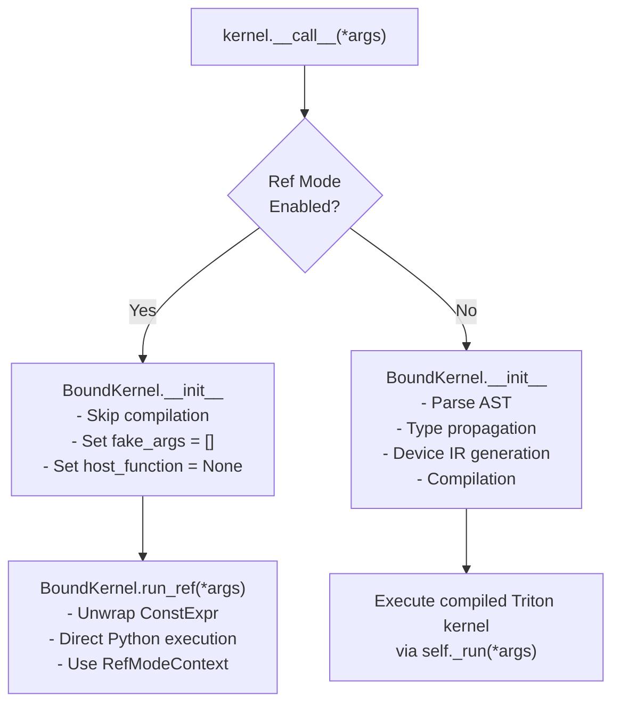
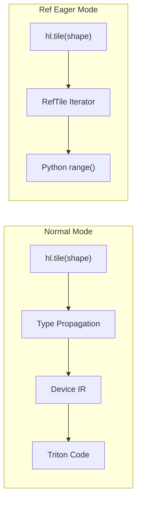
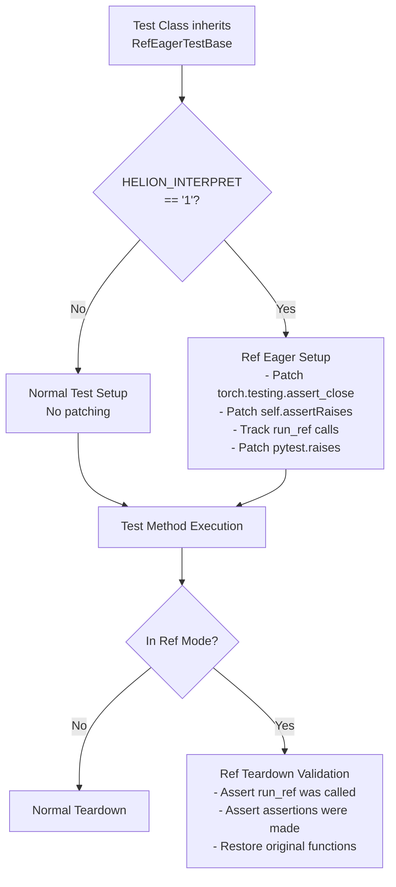
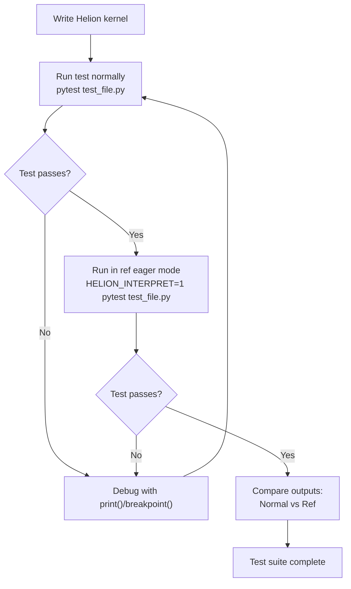

<!-- source: DeepWiki mcp.deepwiki.com · repo pytorch/helion · page 7.2 Ref Eager Mode · fetched 2026-10-21 -->

# Ref Eager Mode

<details>
<summary>Relevant source files</summary>

The following files were used as context for generating this wiki page:

- [helion/_compat.py](helion/_compat.py)
- [helion/_compiler/tensor_utils.py](helion/_compiler/tensor_utils.py)
- [helion/_testing.py](helion/_testing.py)
- [helion/_utils.py](helion/_utils.py)
- [helion/runtime/ref_mode.py](helion/runtime/ref_mode.py)
- [test/test_persistent_kernels.py](test/test_persistent_kernels.py)
- [test/test_ref_eager.py](test/test_ref_eager.py)
- [test/test_tensor_descriptor.py](test/test_tensor_descriptor.py)

</details>


## Overview

Ref Eager Mode is Helion's reference execution mode that runs kernels as pure Python code without compilation to Triton. This mode is primarily used for debugging and testing, enabling the use of standard Python debugging tools like `print()` and `breakpoint()` inside kernel code.

For information about the testing framework infrastructure that uses Ref Eager Mode, see [Testing Framework](#7.1). For managing expected test outputs, see [Expected Output Management](#7.3).

**Sources:** [helion/runtime/kernel.py:47-48](), [helion/_testing.py:32-33]()

## Activation

Ref Eager Mode is activated by setting the `HELION_INTERPRET` environment variable:

```bash
HELION_INTERPRET=1 pytest test/test_misc.py
```

Alternatively, it can be controlled programmatically through the `Settings` class:

```python
import helion
from helion.runtime.settings import RefMode

@helion.kernel(ref_mode=RefMode.EAGER)
def my_kernel(x: torch.Tensor) -> torch.Tensor:
    # This kernel will always run in ref eager mode
    ...
```

The `is_ref_mode_enabled()` function checks whether ref mode is active for a given kernel's settings.

**Sources:** [helion/_testing.py:138-146](), [helion/runtime/kernel.py:47-48]()

## Execution Flow Comparison



**Diagram: Kernel Execution Path with Ref Eager Mode**

**Sources:** [helion/runtime/kernel.py:378-381](), [helion/runtime/kernel.py:742-745]()

## BoundKernel Initialization in Ref Mode

When `is_ref_mode_enabled()` returns `True`, the `BoundKernel.__init__` method takes a minimal initialization path:

```python
# From helion/runtime/kernel.py:378-381
if is_ref_mode_enabled(self.kernel.settings):
    self.fake_args = []  # type: ignore[assignment]
    self.host_function = None  # type: ignore[assignment]
    return
```

This skips:
- AST parsing and validation
- Type propagation and shape inference
- Device IR generation
- Inductor lowering
- Code generation

**Sources:** [helion/runtime/kernel.py:378-381]()

## The run_ref Method

The `run_ref` method in `BoundKernel` executes the kernel function directly as Python code:

```python
# From helion/runtime/kernel.py:718-730
def run_ref(self, *args: object) -> _R:
    # Unwrap ConstExpr arguments
    clean_args = []
    for arg in args:
        if isinstance(arg, ConstExpr):
            clean_args.append(arg.value)
        else:
            clean_args.append(arg)

    # Pass the config to RefModeContext
    with RefModeContext(self.env, self._config):
        result = self.kernel.fn(*clean_args)
        return cast("_R", result)
```

Key behaviors:
1. **ConstExpr Unwrapping**: Arguments marked with `ConstExpr` are unwrapped to their raw values
2. **RefModeContext**: Establishes a context where `helion.language` operations execute as Python
3. **Direct Execution**: Calls the original kernel function (`self.kernel.fn`) with unwrapped arguments
4. **No Compilation**: The Python AST is executed directly by the interpreter

**Sources:** [helion/runtime/kernel.py:718-730]()

## RefModeContext and Language Operations



**Diagram: Language Operation Execution Modes**

In Ref Eager Mode, `helion.language` constructs like `hl.tile`, `hl.grid`, and `hl.load` have special implementations that execute as pure Python:

- **hl.tile**: Returns a `RefTile` object that acts as an iterable, producing Python slice objects
- **hl.load/hl.store**: Execute as direct tensor indexing operations
- **hl.dot**: Falls back to `torch.matmul`
- **hl.reduce**: Uses PyTorch reduction operations

These implementations are selected via the `@_decorators.ref` decorator on each language construct.

**Sources:** [helion/runtime/kernel.py:47-48](), [helion/runtime/kernel.py:728]()

## Testing with RefEagerTestBase

The `RefEagerTestBase` class provides infrastructure for dual-mode testing, where tests run in both normal compilation mode and ref eager mode:



**Diagram: RefEagerTestBase Test Lifecycle**

### Key Features

| Feature | Normal Mode | Ref Eager Mode |
|---------|-------------|----------------|
| `assertExpectedJournal()` | Validates generated code | No-op |
| `assertIn()`/`assertNotIn()` | Validates code properties | No-op |
| `assertEqualCode()` | Validates code equality | No-op |
| `torch.testing.assert_close()` | Validates output | Validates output (counted) |
| `assertRaises()` | Validates exceptions | Validates exceptions (counted) |

**Sources:** [helion/_testing.py:283-489]()

### Setup Method

The `setUp()` method in `RefEagerTestBase` patches assertion methods to track usage:

```python
# From helion/_testing.py:305-408
def setUp(self) -> None:
    super().setUp()
    
    # Check if HELION_INTERPRET is set
    self._in_ref_eager_mode = os.environ.get("HELION_INTERPRET") == "1"
    
    if not self._in_ref_eager_mode:
        return
    
    # Reset counters
    RefEagerTestBase._assert_close_count = 0
    RefEagerTestBase._assert_raises_count = 0
    
    # Patch torch.testing.assert_close
    def counting_assert_close(*args, **kwargs):
        RefEagerTestBase._assert_close_count += 1
        return RefEagerTestBase._original_assert_close_func(*args, **kwargs)
    
    torch.testing.assert_close = counting_assert_close
    
    # Track run_ref calls
    self._run_ref_tracker = track_run_ref_calls()
    self._run_ref_count = self._run_ref_tracker.__enter__()
```

**Sources:** [helion/_testing.py:305-408]()

### Teardown Validation

The `tearDown()` method validates that ref eager mode was actually used:

```python
# From helion/_testing.py:410-489
def tearDown(self) -> None:
    if not self._in_ref_eager_mode:
        super().tearDown()
        return
    
    try:
        # Exit the run_ref tracker
        self._run_ref_tracker.__exit__(None, None, None)
        
        # Check if test was skipped
        test_method = getattr(self, self._testMethodName, None)
        is_skipped = (test_method is not None and 
                     hasattr(test_method, "__unittest_skip__") and 
                     test_method.__unittest_skip__)
        
        # Assert that either run_ref was called or test was skipped
        if not is_skipped and self._run_ref_count[0] == 0:
            self.fail(f"Test {self._testMethodName} did not call run_ref")
        
        # Check that assertions were made
        if not is_skipped:
            total_assertions = (RefEagerTestBase._assert_close_count + 
                               RefEagerTestBase._assert_raises_count + ...)
            assert total_assertions > 0, "No assertions were made"
    finally:
        # Restore original functions
        ...
```

**Sources:** [helion/_testing.py:410-489]()

## code_and_output Helper

The `code_and_output()` function adapts to ref mode automatically:

```python
# From helion/_testing.py:560-592
def code_and_output(fn: Kernel, args: tuple, **kwargs):
    bound = fn.bind(args)
    if is_ref_mode_enabled(bound.kernel.settings):
        if kwargs:
            config = Config(**kwargs)
            bound._config = config
        result = fn(*args)
        # Return the original kernel source code
        code = inspect.getsource(fn.fn)
        return code, result
    
    # Normal mode: compile and generate Triton code
    if kwargs:
        config = Config(**kwargs)
    elif fn.configs:
        (config,) = fn.configs
    else:
        config = fn.bind(args).config_spec.default_config()
    code = fn.bind(args).to_triton_code(config)
    compiled_kernel = fn.bind(args).compile_config(config)
    result = compiled_kernel(*args)
    return code, result
```

In ref eager mode, `code_and_output()` returns:
- **code**: The original Python source code (via `inspect.getsource`)
- **result**: The output from executing `fn(*args)` via `run_ref`

**Sources:** [helion/_testing.py:560-592]()

## Debugging Capabilities

Ref Eager Mode enables standard Python debugging tools inside kernel code:

### Using print()

```python
@helion.kernel(autotune_effort="none")
def debug_kernel(x: torch.Tensor) -> torch.Tensor:
    result = torch.empty_like(x)
    for tile in hl.tile(x.shape):
        # This print() works in ref eager mode
        print(f"Processing tile: {tile.begin} to {tile.end}")
        result[tile] = x[tile] * 2
    return result

# Run with HELION_INTERPRET=1
# Output will show: Processing tile: 0 to 32, etc.
```

### Using breakpoint()

```python
@helion.kernel(autotune_effort="none")
def debug_kernel(x: torch.Tensor) -> torch.Tensor:
    result = torch.empty_like(x)
    for tile in hl.tile(x.shape):
        if tile.begin == 32:
            # Debugger will stop here in ref eager mode
            breakpoint()
        result[tile] = x[tile] * 2
    return result
```

### Inspecting Variables

```python
@helion.kernel(autotune_effort="none")
def debug_kernel(x: torch.Tensor) -> torch.Tensor:
    result = torch.empty_like(x)
    for tile in hl.tile(x.shape):
        tile_data = x[tile]
        # In ref eager mode, you can inspect tile_data
        print(f"Tile shape: {tile_data.shape}")
        print(f"Tile values: {tile_data}")
        result[tile] = tile_data * 2
    return result
```

**Sources:** [helion/runtime/kernel.py:717-730]()

## Limitations and Differences

### Config Handling

In ref mode, config-dependent behavior may differ:
- **Block sizes**: Not enforced; tiles may have different sizes
- **Indexing strategy**: Always uses direct tensor indexing
- **num_warps/num_stages**: Ignored

**Sources:** [helion/runtime/kernel.py:727-728]()

### Performance

Ref Eager Mode executes as pure Python without GPU kernel optimization:
- No tiling optimization
- No memory coalescing
- No parallel execution on GPU cores
- Useful for correctness checking, not performance

### Language Construct Behavior

Some `helion.language` constructs behave differently:

| Construct | Normal Mode | Ref Eager Mode |
|-----------|-------------|----------------|
| `hl.tile()` | Parallel GPU threads | Sequential Python iteration |
| `hl.grid()` | Parallel GPU threads | Sequential Python iteration |
| `hl.dot()` | Triton matrix multiply | `torch.matmul` |
| `hl.load()` | Pointer-based load | Direct tensor indexing |
| `hl.atomic_add()` | GPU atomic operation | Python addition |

**Sources:** [helion/runtime/kernel.py:717-730]()

## Testing Workflow



**Diagram: Dual-Mode Testing Workflow**

The typical workflow:
1. Write kernel and test in normal mode
2. Verify compilation and correctness
3. Run same test in ref eager mode (`HELION_INTERPRET=1`)
4. Compare outputs to ensure reference implementation matches
5. Use ref eager mode for debugging if issues arise

**Sources:** [helion/_testing.py:283-489]()

## Skip Decorators

Tests can be conditionally skipped based on execution mode:

```python
# From helion/_testing.py:138-146
@skipIfRefEager("Decorator ordering checks not applicable in ref eager mode")
def test_decorator(self):
    # This test only runs in normal mode
    ...

@skipIfNormalMode("Test specific to ref eager mode")
def test_ref_mode_behavior(self):
    # This test only runs in ref eager mode
    ...
```

Available decorators:
- `skipIfRefEager(reason)`: Skip when `HELION_INTERPRET=1`
- `skipIfNormalMode(reason)`: Skip when `HELION_INTERPRET!=1`

**Sources:** [helion/_testing.py:138-146]()

## Assertion Tracking

The `track_run_ref_calls()` context manager monitors whether `run_ref` is executed:

```python
# From helion/_testing.py:224-246
@contextlib.contextmanager
def track_run_ref_calls() -> Generator[list[int], None, None]:
    """Context manager that tracks BoundKernel.run_ref calls."""
    from .runtime.kernel import BoundKernel
    
    original_run_ref = BoundKernel.run_ref
    run_ref_count = [0]
    
    def tracked_run_ref(self: BoundKernel, *args):
        run_ref_count[0] += 1
        return original_run_ref(self, *args)
    
    BoundKernel.run_ref = tracked_run_ref
    
    try:
        yield run_ref_count
    finally:
        BoundKernel.run_ref = original_run_ref
```

This enables test validation that ref mode was actually used.

**Sources:** [helion/_testing.py:224-246]()

## Example Test Using RefEagerTestBase

```python
# From test/test_misc.py:37-56
class TestMisc(RefEagerTestBase, TestCase):
    def test_binary_operation_duplicate_args(self):
        """Test binary operations with duplicate tensor references"""
        
        @helion.kernel(autotune_effort="none")
        def kernel_with_duplicate_refs(x: torch.Tensor) -> torch.Tensor:
            result = torch.empty_like(x)
            for tile in hl.tile(x.shape):
                val = x[tile]
                result[tile] = val * val + val
            return result
        
        x = torch.randn([16, 16], device=DEVICE)
        expected = x * x + x
        
        code, result = code_and_output(kernel_with_duplicate_refs, (x,))
        torch.testing.assert_close(result, expected)
```

This test:
- Inherits from `RefEagerTestBase`
- Works in both normal and ref eager modes
- Uses `code_and_output()` which adapts automatically
- Validates correctness with `assert_close()`

**Sources:** [test/test_misc.py:37-56]()

---

