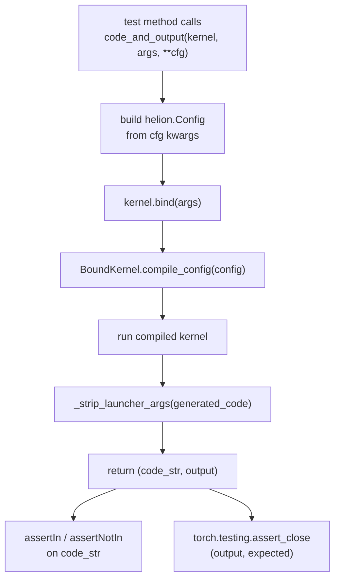
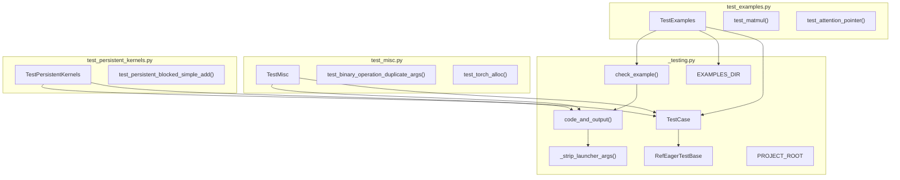
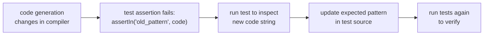

<!-- source: DeepWiki mcp.deepwiki.com · repo pytorch/helion · page 7.3 Expected Output Management · fetched 2026-10-21 -->

# Expected Output Management

<details>
<summary>Relevant source files</summary>

The following files were used as context for generating this wiki page:

- [benchmarks/run.py](benchmarks/run.py)
- [helion/_compat.py](helion/_compat.py)
- [helion/_compiler/aten_lowering.py](helion/_compiler/aten_lowering.py)
- [helion/_testing.py](helion/_testing.py)
- [test/test_examples.py](test/test_examples.py)
- [test/test_misc.py](test/test_misc.py)
- [test/test_persistent_kernels.py](test/test_persistent_kernels.py)
- [test/test_tensor_descriptor.py](test/test_tensor_descriptor.py)

</details>


## Purpose and Scope

This page documents how the Helion test suite captures and validates **generated device code** (Triton, Pallas, CuTe) and **execution outputs**. The primary mechanism is the `code_and_output` function in `helion/_testing.py`, which compiles a kernel and returns both the generated source code as a string and the execution result. Tests then assert on substrings of the generated code and compare numerical outputs against expected tensors.

For background on the broader testing infrastructure (skip/xfail decorators, CI matrix), see [7.1](). For the ref eager interpretation mode used in testing, see [7.2]().

---

## Overview

The expected output validation pattern has two concerns:

1. **Code shape validation** — asserting that the generated Triton/Pallas/CuTe source code contains (or does not contain) specific patterns.
2. **Numerical accuracy validation** — comparing kernel outputs against reference tensors computed in PyTorch eager mode.

These concerns are addressed by two functions: `code_and_output` (used directly in unit tests) and `check_example` (used in example-specific tests). Both are defined in `helion/_testing.py`.

---

## Core Functions

### `code_and_output`

The central function for expected output validation. It compiles a Helion kernel under a specified configuration and returns both the generated source code and the runtime output.

**Signature (inferred from usage):**
```python
code_and_output(
    kernel,
    args: tuple,
    *,
    block_sizes=None,
    block_size=None,
    indexing=None,
    pid_type=None,
    l2_grouping=None,
    num_warps=None,
    num_stages=None,
    loop_orders=None,
    reduction_loops=None,
    flatten_loop=None,
    ...
) -> tuple[str, Any]
```

The returned `str` is the complete generated host+device source code (Python calling a Triton/Pallas/CuTe kernel). The `Any` is the tensor(s) returned by the kernel.

**Typical usage in unit tests:**

```python
# test/test_misc.py
code, result = code_and_output(kernel_with_duplicate_refs, (x,))
torch.testing.assert_close(result, expected)
self.assertIn("some_generated_symbol", code)
```

```python
# test/test_persistent_kernels.py
code, result = code_and_output(add_kernel, args, pid_type="persistent_blocked")
self.assertIn("virtual_pid", code)
self.assertIn("total_pids", code)
```

Sources: [helion/_testing.py:1-57](), [test/test_misc.py:56-60](), [test/test_persistent_kernels.py:75-83]()

---

### `check_example`

A wrapper over `code_and_output` specifically for kernels in the `examples/` directory. It imports the example module, runs the kernel, and compares the output against a provided expected tensor.

**Signature (inferred from usage):**
```python
check_example(
    example_name: str,
    args: tuple,
    expected: Any,
    fn_name: str | None = None,
    skip_accuracy: bool = False,
    rtol: float = ...,
    atol: float = ...,
    **config_kwargs
) -> None
```

- `example_name`: Base name of a file in `examples/`, e.g. `"matmul"` → `examples/matmul.py`.
- `args`: Arguments passed to the kernel.
- `expected`: Reference tensor(s) to compare the output against.
- `fn_name`: If the example file exports multiple kernels, specifies which one to call.

**Typical usage:**
```python
# test/test_examples.py
check_example(
    "matmul",
    args,
    args[0] @ args[1],
    block_sizes=[16, 16, 16],
    l2_grouping=4,
)
```

Sources: [test/test_examples.py:54-65](), [test/test_examples.py:440-481](), [helion/_testing.py:194-196]()

---

## Backend Normalization

Before code string comparisons are performed, backend-specific launcher arguments are stripped from the generated code. This prevents test failures due to irrelevant tunable parameters that differ between hardware configurations.

**`_strip_launcher_args` in `helion/_testing.py`:**

| Backend | Stripped Patterns |
|---|---|
| AMD CDNA (`supports_amd_cdna_tunables()`) | `waves_per_eu=\d+`, `matrix_instr_nonkdim=\d+` |
| TileIR (`_get_backend() == "tileir"`) | `num_ctas=\d+`, `occupancy=\d+` |

Sources: [helion/_testing.py:46-57]()

---

## Validation Flow

The following diagram shows the full flow from a test invocation to validation of both code shape and numerical output.

**Diagram: code_and_output Validation Flow**



Sources: [helion/_testing.py:46-57](), [test/test_misc.py:56-141](), [test/test_persistent_kernels.py:63-100]()

---

## `TestCase` Assertion Methods

Helion tests inherit from a `TestCase` class defined in `helion/_testing.py`. In addition to standard `unittest.TestCase` methods, this class adds helpers for code string comparison.

| Method | Purpose |
|---|---|
| `assertIn(pattern, code)` | Assert that a symbol or pattern appears in generated code |
| `assertNotIn(pattern, code)` | Assert that a symbol or pattern is absent from generated code |
| `assertNotEqualCode(code1, code2)` | Assert two generated code strings differ |
| `assertEqual(code1, code2)` | Assert two generated code strings are identical |

**Code shape assertion examples:**

```python
# Persistent kernel uses virtual_pid loop variable
self.assertIn("for virtual_pid in tl.range(start_pid, end_pid):", code)

# L2 grouping adds specific variables
self.assertIn("num_pid_in_group", code)

# Tensor descriptor uses tl.make_tensor_descriptor
self.assertIn(get_tensor_descriptor_fn_name(), code)

# Block-ptr indexing not used in this case
self.assertNotIn("tl.make_block_ptr", code)
```

Sources: [test/test_persistent_kernels.py:82-84](), [test/test_tensor_descriptor.py:57-59](), [test/test_misc.py:493-496]()

---

## Code Entity Map

The diagram below maps the conceptual expected-output validation system to the concrete code entities in `helion/_testing.py` and the test files.

**Diagram: Expected Output Management — Code Entities**



Sources: [helion/_testing.py:1-57](), [test/test_examples.py:1-52](), [test/test_misc.py:1-60](), [test/test_persistent_kernels.py:1-83]()

---

## Config Parameters in `code_and_output`

When calling `code_and_output` or `check_example`, the caller can pass configuration parameters as keyword arguments. These are assembled into a `helion.Config` object before compilation. The table below lists the most commonly used parameters.

| Parameter | Type | Description |
|---|---|---|
| `block_sizes` | `list[int]` | Block sizes for each tile dimension |
| `block_size` | `int \| list[int]` | Alias for single-value or per-dim block size |
| `indexing` | `str` | One of `"pointer"`, `"block_ptr"`, `"tensor_descriptor"` |
| `pid_type` | `str` | Program ID strategy (e.g., `"flat"`, `"xyz"`, `"persistent_blocked"`) |
| `l2_grouping` | `int \| list[int]` | L2 cache grouping factor |
| `num_warps` | `int` | Number of warps per block |
| `num_stages` | `int` | Pipeline stages |
| `loop_orders` | `list[list[int]]` | Iteration order for loop dimensions |
| `reduction_loops` | `list[int]` | Block sizes for reduction dimensions |
| `flatten_loop` | `bool` | Flatten tiling loop |
| `static_shapes` | `bool` | Compile with static shape specialization |
| `split_k` | `int` | Split-K factor |

Sources: [test/test_examples.py:52-868](), [test/test_misc.py:480-496](), [test/test_persistent_kernels.py:75-100]()

---

## `import_path` for Example Modules

When tests need to call helper functions from example files (e.g., reference implementations), they use `import_path` to dynamically load a Python file as a module.

```python
# test/test_examples.py
mod = import_path(EXAMPLES_DIR / "fp8_gemm.py")
expected = mod.reference_fp8_gemm_pytorch(x_fp8, y_fp8)
```

`EXAMPLES_DIR` is `PROJECT_ROOT / "examples"` as defined in `helion/_testing.py`.

Sources: [helion/_testing.py:194-196](), [test/test_examples.py:267-269]()

---

## Updating Expected Outputs

When Helion's code generation changes (e.g., a new optimization, a different variable naming scheme), tests that assert on specific generated code patterns will fail. The update process depends on what changed:

| What changed | What to update |
|---|---|
| Substring patterns in generated code (`assertIn`) | Edit the expected string literal in the test method |
| Numerical outputs differ due to new optimizations | Recompute the expected tensor and update the reference |
| Backend-specific launcher args | `_strip_launcher_args` handles this automatically |
| TileIR/ROCm-specific patterns | Check `skipIfTileIR` / `skipIfRocm` decorators; add if needed |

**Workflow for generated code changes:**



For accuracy changes in example tests, recompute the expected output with PyTorch eager, e.g.:
```python
expected = mod.rms_norm_pytorch(*args)
check_example("rms_norm", args, (expected, None), fn_name="rms_norm_fwd", ...)
```

Sources: [helion/_testing.py:46-57](), [test/test_examples.py:518-530](), [test/test_examples.py:46-52]()

---

## Relationship to Other Testing Components

The expected output management system interacts with several other test utilities:

- **`RefEagerTestBase`** ([7.2]()): tracks how many times `assert_close` is called, ensuring ref eager mode tests actually validate outputs.
- **`skipIfRefEager`** / **`skipIfNormalMode`**: some tests that check generated code patterns are skipped in ref eager mode (which never produces Triton code).
- **`onlyBackends(["triton"])`**: restricts tests that check Triton-specific patterns to the Triton backend only.

Sources: [helion/_testing.py:249-256](), [test/test_examples.py:44-46](), [test/test_misc.py:40-42]()

---

