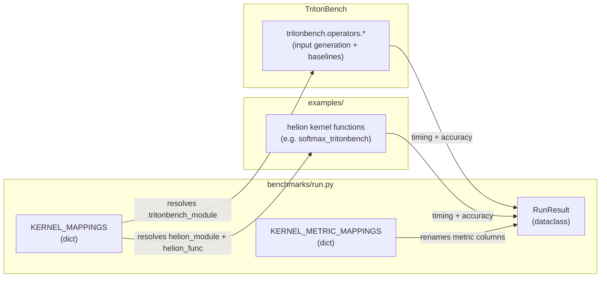
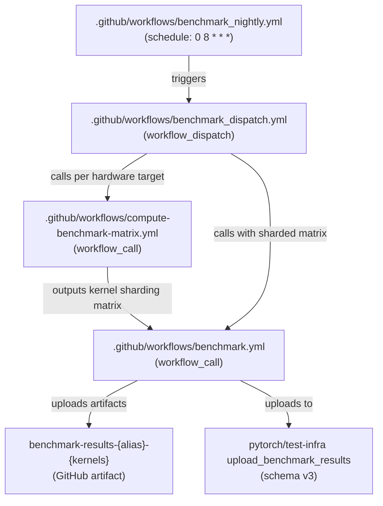
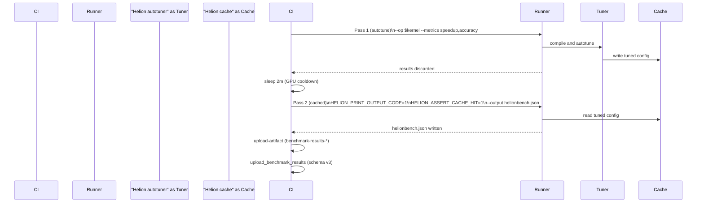

<!-- source: DeepWiki mcp.deepwiki.com · repo pytorch/helion · page 8 Benchmarking · fetched 2026-10-21 -->

# Benchmarking

<details>
<summary>Relevant source files</summary>

The following files were used as context for generating this wiki page:

- [.github/workflows/benchmark.yml](.github/workflows/benchmark.yml)
- [.github/workflows/benchmark_dispatch.yml](.github/workflows/benchmark_dispatch.yml)
- [.github/workflows/benchmark_nightly.yml](.github/workflows/benchmark_nightly.yml)
- [.github/workflows/compute-benchmark-matrix.yml](.github/workflows/compute-benchmark-matrix.yml)
- [benchmarks/run.py](benchmarks/run.py)
- [test/test_examples.py](test/test_examples.py)

</details>


This page covers Helion's benchmarking infrastructure: the local benchmark runner (`benchmarks/run.py`) and the GitHub Actions CI workflows that execute nightly and on-demand benchmark runs. For information about the example kernels that are benchmarked, see [Kernel Examples](#9.1). For information about autotuning configuration used during benchmarking, see [Autotuning Overview](#4.2).

---

## Overview

Helion benchmarks compare Helion kernel performance against Triton, `torch.compile`, and PyTorch eager baselines. The framework is built on top of [TritonBench](https://github.com/pytorch-labs/tritonbench), which provides standardized input generation and timing infrastructure.

The benchmarking system has two components:

| Component | Location | Purpose |
|---|---|---|
| Local runner | `benchmarks/run.py` | Run benchmarks interactively on any machine |
| CI workflows | `.github/workflows/benchmark*.yml` | Scheduled and manual runs on H100/B200/MI325X |

---

## Kernel Registry

The central data structure in `benchmarks/run.py` is `KERNEL_MAPPINGS`, a dictionary that registers every benchmarkable kernel. Each entry maps a TritonBench operator name to a tuple specifying:

1. The TritonBench module path (provides baseline implementations and input generation)
2. The Helion example module path (in `examples/`)
3. The Helion function name to benchmark
4. An optional `args` dictionary of overrides (e.g., `num_inputs`, `d_head`)

**`KERNEL_MAPPINGS` entry formats:**

| Format | Tuple Structure |
|---|---|
| Single kernel | `(tritonbench_module, helion_module, helion_func)` |
| Single kernel with args | `(tritonbench_module, helion_module, helion_func, args_dict)` |
| Multiple variants | `(tritonbench_module, [(helion_module, helion_func), ...])` |
| Multiple variants with args | `(tritonbench_module, [(helion_module, helion_func), ...], args_dict)` |

[benchmarks/run.py:111-352]()

A companion dictionary `KERNEL_METRIC_MAPPINGS` maps raw TritonBench metric strings (like `"helion_add-speedup"`) to standardized names (`"helion_speedup"`) for consistent result reporting across kernels.

[benchmarks/run.py:355-675]()

**Diagram: KERNEL_MAPPINGS data flow**



Sources: [benchmarks/run.py:103-352](), [benchmarks/run.py:355-675]()

---

## Local Benchmarking

### Installation

The runner auto-installs TritonBench if it is not available. `check_and_setup_tritonbench()` detects whether a local checkout or a proper installation exists and clones the repository into `benchmarks/tritonbench/` if needed.

[benchmarks/run.py:844-905]()

### Running Benchmarks

```
# Single kernel
python benchmarks/run.py --metrics speedup,accuracy --kernel softmax

# Multiple kernels
python benchmarks/run.py --metrics speedup,accuracy --kernel softmax,rms_norm

# All registered kernels
python benchmarks/run.py --metrics speedup,accuracy

# Input sharding (run first quarter of inputs on GPU 1)
CUDA_VISIBLE_DEVICES=1 python benchmarks/run.py --input-shard 1/4 \
    --metrics accuracy,tflops,gbps,speedup --csv --output-dir ./

# Equally-spaced-k mode
python benchmarks/run.py --metrics speedup,accuracy --kernel softmax \
    --input-sample-mode equally-spaced-k --num-inputs 5
```

[benchmarks/run.py:1-18]()

### Key Command-Line Arguments

| Argument | Description |
|---|---|
| `--kernel` | Comma-separated kernel names from `KERNEL_MAPPINGS` |
| `--metrics` | Metrics to collect: `speedup`, `accuracy`, `tflops`, `gbps` |
| `--input-shard` | Fraction of inputs to run, e.g. `1/4` |
| `--input-sample-mode` | Input selection mode: `equally-spaced-k` or default |
| `--num-inputs` | Number of inputs to sample |
| `--csv` | Output results as CSV |
| `--output-dir` | Directory for output files |
| `--list-impls-for-benchmark-ci` | Print implementations and baseline for CI use |
| `--op` | TritonBench operator name |
| `--only` | Run only specific implementations |
| `--baseline` | Baseline implementation name |
| `--keep-going` | Continue on individual kernel failures |

### Custom Kernel Configurations

Kernels can be defined via external YAML or JSON config files, loaded by `load_kernel_config()`. Custom configs can add new kernels or override existing entries. `merge_kernel_configs()` merges custom configurations into the base `KERNEL_MAPPINGS` and `KERNEL_METRIC_MAPPINGS`.

[benchmarks/run.py:678-841]()

Hardware-specific overrides are supported via a `hardware_overrides` section in the config file, keyed by GPU model name (e.g. `"NVIDIA B200"`).

[benchmarks/run.py:742-758]()

### Result Structure

`RunResult` is the dataclass that holds one benchmark result:

```
RunResult(
    model: str,       # kernel name
    device: str,      # GPU device identifier
    shape: list[str], # input shape description
    metrics: dict[str, list[float]]  # metric name → values
)
```

[benchmarks/run.py:96-100]()

### Input Limiting

`MAX_NUM_INPUTS = 20` caps the number of inputs per kernel. Individual entries in `KERNEL_MAPPINGS` can further restrict this via `"num_inputs"` in the args dict.

[benchmarks/run.py:92]()

### Hardware Detection

`IS_B200` is set at module load time by checking the GPU model via `get_nvidia_gpu_model()`. This flag controls which TritonBench comparison implementations are used in `KERNEL_METRIC_MAPPINGS` for hardware-specific kernels like `fp8_gemm`.

[benchmarks/run.py:65-66]()

---

## CI/CD Benchmarking

The CI system uses four GitHub Actions workflow files that compose into a layered execution model:

**Diagram: CI workflow composition**



Sources: [.github/workflows/benchmark_nightly.yml:1-31](), [.github/workflows/benchmark_dispatch.yml:1-117](), [.github/workflows/compute-benchmark-matrix.yml:1-49](), [.github/workflows/benchmark.yml:1-236]()

### `benchmark_nightly.yml`

Triggers at 00:00 PST (08:00 UTC) every day via `cron: '0 8 * * *'`. Dispatches `benchmark_dispatch.yml` with all three hardware targets enabled: H100, B200, MI325X.

[.github/workflows/benchmark_nightly.yml:1-31]()

### `benchmark_dispatch.yml`

A manually triggered workflow (`workflow_dispatch`) that accepts:

| Input | Default | Description |
|---|---|---|
| `run_h100` | `false` | Enable H100 runner |
| `run_b200` | `true` | Enable B200 runner |
| `run_mi325x` | `false` | Enable MI325X runner |
| `kernels` | (default set) | Comma-separated kernel list |
| `env_vars` | `""` | Extra environment variables |
| `custom_args` | `""` | Extra CLI arguments |

Default kernel list: `softmax,jsd,welford,kl_div,int4_gemm,layer_norm,layer_norm-bwd,rms_norm,rms_norm-bwd,cross_entropy,flash_attention,gemm,grouped_gemm`

**Hardware targets:**

| Alias | Runner | Image | Runtime |
|---|---|---|---|
| `h100` | `linux.aws.h100` | `nvidia/cuda:12.8.1-devel-ubuntu24.04` | `cu128` |
| `b200` | `linux.dgx.b200` | `nvidia/cuda:13.0.1-devel-ubuntu24.04` | `cu130` |
| `mi325x` | `linux.rocm.gpu.gfx942.2` | `rocm/dev-ubuntu-24.04:6.4.4-complete` | `rocm6.4` |

[.github/workflows/benchmark_dispatch.yml:1-117]()

### `compute-benchmark-matrix.yml`

A reusable workflow that shards a comma-separated kernel list across at most `max-runners` parallel runners. It distributes kernels using round-robin assignment and outputs a JSON matrix for GitHub Actions' `strategy.matrix`.

**Example:** 13 kernels across 13 runners → each runner gets 1 kernel. 14 kernels across 13 runners → one runner gets 2 kernels.

[.github/workflows/compute-benchmark-matrix.yml:1-49]()

### `benchmark.yml` (Core Workflow)

This is the reusable workflow invoked per hardware target per kernel shard. It performs the full benchmark in two passes:

**Diagram: Two-pass benchmark execution**



Sources: [.github/workflows/benchmark.yml:122-196]()

**Pass 1 flags** (autotune, results discarded):
- `--latency-measure-mode triton_do_bench`
- `--cudagraph`
- `--only-match-mode prefix-with-baseline`
- `--atol 1e-2 --rtol 1e-2`
- `--input-sample-mode equally-spaced-k`
- `--keep-going`

**Pass 2 flags** (cached run, results recorded):
- All pass 1 flags plus:
- `HELION_PRINT_OUTPUT_CODE=1` — prints generated Triton code
- `HELION_ASSERT_CACHE_HIT=1` — fails if autotune cache is not hit
- `--append-to-output` — appends to `helionbench.json`

[.github/workflows/benchmark.yml:154-188]()

**Outputs:**

- Artifact: `benchmark-results-{alias}-{kernels}` uploaded to GitHub
- Results uploaded to `pytorch/test-infra` using `upload_benchmark_results` action with schema version `v3`

[.github/workflows/benchmark.yml:217-235]()

---

## Supported Kernels

The following kernels are registered in `KERNEL_MAPPINGS`:

| TritonBench Op | Helion Module | Helion Function |
|---|---|---|
| `vector_add` | `examples.add` | `add` |
| `gemm` | `examples.matmul` | `matmul_tritonbench` |
| `addmm` | `examples.matmul` | `addmm_tritonbench` |
| `softmax` | `examples.softmax` | `softmax_tritonbench` |
| `rms_norm` | `examples.rms_norm` | `rms_norm_tritonbench` |
| `layer_norm` | `examples.layer_norm` | `layer_norm_tritonbench` |
| `cross_entropy` | `examples.cross_entropy` | `cross_entropy` |
| `flash_attention` | `examples.attention` | `attention` |
| `fp8_attention` | `examples.fp8_attention` | `fp8_attention_tritonbench` |
| `fp8_gemm` | `examples.fp8_gemm` | `fp8_gemm_tritonbench` |
| `grouped_gemm` | `examples.grouped_gemm` | `grouped_gemm_jagged_persistent_tritonbench` |
| `int4_gemm` | `examples.int4_gemm` | `int4_gemm_tritonbench` |
| `jsd` | `examples.jsd` | `jsd_tritonbench` |
| `kl_div` | `examples.kl_div` | `kl_div_tritonbench` |
| `welford` | `examples.welford` | `welford` |
| `swiglu` | `examples.swiglu` | `swiglu_tritonbench` |
| `geglu` | `examples.geglu` | `geglu_tritonbench` |
| `sum` | `examples.sum` | `sum_tritonbench` |
| `embedding` | `examples.embedding` | `embedding_tritonbench` |
| `jagged_mean` | `examples.jagged_mean` | `jagged_mean_tritonbench` |
| `jagged_softmax` | `examples.jagged_softmax` | `jagged_softmax_tritonbench` |
| `jagged_sum` | `examples.jagged_sum` | `jagged_sum_tritonbench` |
| `jagged_layer_norm` | `examples.jagged_layer_norm` | `jagged_layer_norm_tritonbench` |
| `low_mem_dropout` | `examples.low_mem_dropout` | `low_mem_dropout_tritonbench` |
| `bf16xint16_gemm` | `examples.bf16xint16_gemm` | `bf16xint16_gemm_tritonbench` |
| `blackwell_attentions` | `examples.blackwell_attention` | `blackwell_attention_tritonbench` |
| `mamba2_chunk_scan` | `examples.mamba2_chunk_scan` | `helion_mamba2_chunk_scan_kernel` |
| `mamba2_chunk_state` | `examples.mamba2_chunk_state` | `helion_mamba2_chunk_state_kernel` |
| `flex_attention` | `examples.flex_attention` | `flex_attention_tritonbench` |

[benchmarks/run.py:111-352]()

Backward pass variants (e.g. `gemm-bwd`, `rms_norm-bwd`, `softmax-bwd`) typically map to the same Helion module and function as the forward pass, with TritonBench handling the distinction.

---

## Environment Variables

| Variable | Used In | Effect |
|---|---|---|
| `HELION_BENCHMARK_DISABLE_LOGGING` | `benchmarks/run.py` | Set to `"1"` to suppress all logging output |
| `HELION_PRINT_OUTPUT_CODE` | CI pass 2 | Print generated Triton code during benchmark |
| `HELION_ASSERT_CACHE_HIT` | CI pass 2 | Fail if autotune cache is not populated |
| `HELION_AUTOTUNE_LOG_LEVEL` | `benchmark.yml` env | Set to `INFO` in CI runs |
| `CUDA_VISIBLE_DEVICES` | Local use | Select specific GPU for local runs |

[benchmarks/run.py:57-58](), [.github/workflows/benchmark.yml:40-41](), [.github/workflows/benchmark.yml:172-173]()

---

